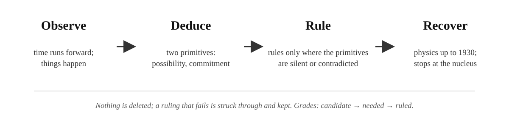

# The Commitment Ontology, in plain language.

The ontology as it stands: It is a reconstruction of gravity and one-particle quantum mechanics up to 1930 from two primitives. 

The results documents are [`SPACE_AND_GRAVITY.md`](SPACE_AND_GRAVITY.md), [`MATTER.md`](MATTER.md) and [`NUCLEUS.md`](NUCLEUS.md).

The working records, with everything tried and dropped, are in [`RECORD_OF_METHOD/`](RECORD_OF_METHOD/). 

A word on what kind of thing this is: an ontology, with standard mathematics used where it applies. Where it reproduces known physics it says so. It takes no physical law as input; its inputs are measured constants and two experimental exclusions (a scalar gravitational wave, by the binary pulsar and LIGO; a one-way hop, by the electron's stability), itemised under "What goes in." It uses theorems (Lovelock, Meyer, Clifford, Bialynicki-Birula, Goyal–Knuth–Skilling) the way any physics does, as tools, and the honest question at each one is whether the primitives force the theorem's inputs or merely allow them.

## The idea in one paragraph.

Time is a count of things that have happened. Not a river, not a dimension: a count. Something happens, and it cannot be undone. That is one tick. Matter is something that keeps happening, and is ticking. Where nothing happens, there is no time. Start from this and ask what physics has to look like. That is the premise of the Commitment Ontology (CO).

GR has no global now; QM has no event. CO takes both as primitives: commitment and possibility. It must then say how there can be a now without a preferred frame, and how there can be events without spoiling interference. The first is answered as relativity answers it: what has committed, for a commitment, is its past light cone, point-relative (Stein 1991 for flat spacetime; the record's arrow, that record only grows, supplies the time orientation that needs); CO adds nothing here and owes nothing. The second has a candidate for a single pattern, that a commitment resolves exactly what it engages, and an unresolved cost for an entangled pair.

*How CO was built.*

## Two things exist. The two primitives. 

**Possibility** is the stuff of the universe. There is a fixed amount of it, it sits at places, and it moves between places that are related. It is conserved: never made, never destroyed.
- Ruling P1, *scaleless:* the substrate has no scale of its own, so a hop compares neighbouring places only by ratio, never by difference. The field is linear in ln P. P is an amount, |a|² where possibility has an amplitude a; the rule acts on amounts and says nothing about phase.
- Ruling P2, *capacity:* a place holds at most P_max of free possibility. Over capacity, it commits. The vacuum today is under capacity.
- Ruling P3, *hold-and-release:* possibility engaged by a commitment is released when it completes, less the share C3 keeps as record; nothing is destroyed. Free possibility at a place is P_free = P(1 − h), h the fraction engaged.
- Ruling P4, *toward engagement:* on each relation, the net flow of possibility runs toward the end that is engaging more. A place's h is what its relations have delivered to it. This is a rule about one link and its two ends; it needs no "at the same time."
- Ruling P5, *inertia:* possibility in transit keeps its mean direction until a commitment redirects it (its own: the mass step of C6; other patterns bend its route only through the fields their commitments set).
- Ruling P6, *transit draws:* possibility in transit is not free, and draws by its frequency ħω, as a renewal would. Light gravitates.
- Ruling P7, *relations:* space is who passes possibility to whom. A relation carries an occupancy (how much is in transit across it) and a ratio (which way). Sliding or relabelling places costs nothing: there is no backdrop.
- Ruling P8, *meeting:* when two routes bring possibility to one place, the amounts combine as |√p₁e^{iθ₁} + √p₂e^{iθ₂}|², forced by conservation, scalelessness and associativity.

**Commitment** is the act. One irreversible update to possibility, at a place. It cannot be undone.
- Ruling C1, *renewal:* a commitment, on completing, engages adjacent free possibility (or, through a channel, a quantum in transit: C8) into its next commitment, releases what it held, and adds one to its count. Any commitment does this while free possibility is adjacent; it halts when none is. Matter is a commitment that keeps being fed.
- Ruling C2, *the clock:* a commitment repeats at the rate (m/ħ)(1 − h). Less free possibility, slower repeats.
- Ruling C3, *retention:* each repeat keeps a share of what it engaged, δħ·(P_free/P_max), as record. The record only grows: the arrow of time.
- Ruling C4, *one quantum:* every commitment engages the same amount, ħ. Mass is how often commitment falls due, ω = mc²/ħ.
- Ruling C5, *rate:* commitments happen at a rate, and a pattern in transit carries where it is in its cycle, its phase. (The one addition of the matter sector.)
- Ruling C6, *the flip:* a commitment changes a pattern's internal state without moving it, with amplitude i·mcℓ/ħ per hop. The heaviest possible pattern flips every hop, and its Compton wavelength is the hop length.
- Ruling C7, *the beginning:* with all possibility free in few places, every place is over capacity and commits; there is no distance yet, so these first commitments are not ordered, none before another. Every first commitment is fed, so matter forms immediately.
- Ruling C8 (candidate), *measurement:* a commitment may engage a quantum of possibility in transit as part of the ħ it engages, its rate or transit changing by that quantum's frequency and direction; the pattern whose transit it was is resolved by it. Only through a channel (a final state of the engager, in rate or transit, matching the quantum's frequency and direction); which engager takes it drawn from |a|² at the engagers' places; what it settles is the channel's state, which fixes place only as finely as the engager is localised; the channel's coupling (imported) sets how strongly the channel is passed through, not the chance that passing is a commitment (it can be coherent, as in an atom and a photon trading a quantum in a cavity); outside a channel, none. Which contacts through a channel are engagements rather than routes, and where the resolved pattern's possibility elsewhere goes, are not yet ruled.

That is the whole inventory. Everything below is what those two do when left to themselves.

## What follows.

**Matter.** A commitment that, on completing, draws free possibility from around it into its next commitment, releases most of what it held, and repeats. Matter is a commitment that keeps getting fed. Starve it and it stops; what is left is a record. So matter is not a kind of thing. It is a commitment's condition.

**Time** is matter's count, the number of times it has repeated. There is no clock of the world; there are only counts, and they can be compared only as ratios:

$$\frac{\text{time at } A}{\text{time at } B}=\frac{N_A}{N_B}.$$

A clock's *mechanism* refers to the possibility around it; a clock's *reading* refers to another clock. Neither needs a background.

**Mass** is how often the upkeep falls due. Every repeat engages one quantum, ħ, so a thing of mass m repeats at the frequency

$$\omega=\frac{mc^2}{\hbar},$$

which is the Compton frequency physics already knew. The first scale in the theory is an action, not a length, and it arrives with the first repeat.

**Record** is what a commitment leaves behind, carried forward by renewal. Each repeat keeps a small share of what it engaged:

$$\text{retained}=\delta\,\hbar\,\frac{P_{\text{free}}}{P_{\max}},$$

δ a constant of the theory, P_free the free possibility at the place, P_max the most a place can hold. The record only grows. That is the arrow of time, said twice: the count goes up, the free stock goes down, and they are one process.

**Pattern** is possibility in transit between commitments: light, and matter between its repeats. Possibility in transit keeps its direction until a commitment redirects it. That is inertia, and it costs nothing to state.

**Place and relation.** Space is who can pass possibility to whom, and nothing else. There is no backdrop, so sliding or relabelling places changes nothing physical.

## The vacuum

Possibility with no commitment. No count, so no time; no repeat, so no scale. The vacuum is timeless and scaleless by construction, not by decree. Flow is not even defined there; it becomes a fact only against matter's count. A place commits on its own only if it is over capacity, P_free > P_max, and the vacuum today is under.

## Gravity

**Why clocks slow.** Matter engages possibility while it repeats. Near a lot of matter, a larger fraction h of the local possibility is engaged at any moment, so there is less free possibility for a clock to repeat on. The clock runs at

$$\text{rate}=\frac{m}{\hbar}\,(1-h).$$

Two clocks in different places compare as (1 − h_A)/(1 − h_B). That is gravitational redshift, and it is the same for every kind of clock, because the factor does not depend on m.

**Why there is a field.** Each repeat keeps a crumb of possibility as record, so matter is a slow, steady sink of free possibility, with strength proportional to mass. Possibility moves by comparing neighbours, and because the substrate has no scale it can compare only ratios, never differences. A steady point sink into a stock that equalises ratios gives

$$\nabla^2\ln P_{\text{free}}=\sigma\,\delta(\mathbf r)\quad\Rightarrow\quad \frac{P_{\text{free}}}{P_\infty}=e^{-U},\qquad U=\frac{GM}{c^2r}.$$

The first-order part is Newton's 1/r potential; the second-order part gives Mercury's precession its measured value (ratio hopping is forced by scalelessness; Mercury's orbit confirms it). This is the weak-field clock factor, correct through second order; it is not the exterior beyond that (see below).

**Why things fall.** A pattern hops on its place's ticks. Ticks are slower where h is higher, so a wavefront turns toward matter, the way light turns toward the slow side of a lens. For a matter wave of frequency mc²/ħ this gives

$$\mathbf g=-c^2\nabla h,$$

Newton's acceleration, independent of mass. Free fall is inertia plus refraction.

**What draws.** Possibility in transit is not free either: a photon's possibility is spoken for while it travels. So radiation gravitates by its energy ħω, just as matter does by its mass. What draws is frequency, repeating or in transit.

**Light.** The same h that slows ticks lengthens routes: a relation carries an *occupancy* (how much possibility is in transit across it), and a route's length is the product of (1 + occupancy) along it, which at rest is e^{U}. Light's coordinate speed is c·e^{−2U} and its deflection by a mass is

$$\delta\varphi=\frac{4GM}{c^2b},$$

twice the Newtonian value and exactly Einstein's, with the Shapiro delay alongside. Slow bodies feel only the tick half; light, at the hop speed, feels both.

**The exterior.** Outside matter the field is general relativity's: the cost of relations being out of step is forced to Einstein's (next paragraph), and under Einstein's equations the static exterior of a body is Schwarzschild, horizon included. The clock factor e^{−U} and route factor e^{+U} above are the weak-field reading of that, correct through the classical tests; taken literally beyond the weak field they would be Yilmaz's exponential metric, which is not a solution of Einstein's equations; the exterior is Schwarzschild. Inside matter, a body where everything is engaged and nothing is free has stopped repeating: all record, no matter. What that says about a hole's interior is open. **CO makes no prediction that differs from GR.**

**Gravitational waves.** Relations carry an occupancy and can be momentarily out of step with their ends. Because sliding places costs nothing, the cost of being out of step can depend only on how relations fit together, and by Lovelock's theorem the only such cost in three dimensions is

$$S=\frac{1}{16\pi G}\int (R-2\Lambda)\sqrt{-g}\,d^4x,$$

Einstein's action, on a network in Regge's form. Lovelock's theorem does the uniqueness; its hypotheses are second-order equations (assumed; a scale-free cost on its own points as readily to fourth-order R² gravity, which observation does not exclude) and that the occupancies are the only dynamical field. The second hypothesis is met by the rules: the clock field h is set by what a place's relations deliver and has no rule of its own, and a free-stock wave that would let it move on its own was excluded, so the occupancies are the only dynamical field. With those, the waves are tensor waves with two polarizations and the quadrupole formula with Einstein's coefficient, as the binary pulsar and LIGO require. G is the stiffness of relations against mismatch; Λ is the one constant the symmetry permits and does not fix.

**Three dimensions.** In one or two dimensions relations carry no waves. In any even dimension a passing signal leaves a tail forever, so a commitment would have no "where." In four or more there are no stable orbits or atoms, and the cost of mismatch acquires a free constant that nothing fixes. **Three is the only dimension in which every rule holds and nothing has to be added.** The pieces are the standard ones (Ehrenfest on orbits, Huygens on even dimensions, Lovelock on uniqueness; Tegmark assembled them in 1997); what is CO's is that each is a consequence of its own rules, so three follows as a consistency condition.

## The universe

**The beginning.** All possibility free, no commitment, in a few places: every place over capacity. Over capacity, a place commits. So the start commits everywhere, and with no distance yet none of those first commitments is before another; every first commitment is fed, and matter forms immediately. The first repeats pool record and spread possibility into new places until every place is under capacity; then commitment stops and the vacuum sits just under P_max, where it is today. That rapid making of places is inflation, with its own beginning and its own end, both set by one number.

**How space got its shape.** With no distance yet, every first place is related to every other. A relation persists only while possibility passes through it, so as places multiply each keeps about as many relations as its quanta can feed. A quantum's first passage through a place pairs the relation it came by with the one it leaves by, and transit keeps to its pairs, so the survivors form lines. The mismatch cost, acting on which relations are kept, pulls the whole toward flat. Among the flat arrangements with that many lines, the one that exists is the one consistent with every rule: three-dimensional. (Candidate; each part supported by a run, convergence to a clean lattice not yet reached. Annealing random graphs toward flatness under a curvature cost is Trugenberger's combinatorial quantum gravity; the runs here reproduce its qualitative result at small size.)

**Expansion.** The first epoch's outward flow set matter moving apart. Inertia keeps it moving; gathering (the field, pulling patterns toward engagement) brakes it. For a uniform cloud of density ρ, Newton's law on a shell gives Friedmann's equation,

$$H^2=\frac{8\pi G}{3}\rho-\frac{k}{a^2},$$

with the matter era from matter's density. The radiation era is not derived: radiation's draw falls as a⁻⁴, but a Newtonian shell gives half Friedmann's coefficient for it, and the missing half, that pressure draws, is a candidate. Λ is taken from data; the theory gives it a seat, not a value.

## The quantum sector

Everything above used possibility as an amount. The quantum sector begins when two routes meet.

**Phase.** Matter repeats, so it has a phase: where it is in its cycle. A pattern in transit carries that phase, and two routes of different length deliver it at different phases.

**When routes meet.** Two routes bring amounts p₁ and p₂ to the same place with a phase difference Δθ. The rule for the amount that arrives is pinned down by three things already ruled: conservation (averaged over unrelated phases, nothing is gained or lost), scalelessness (the rule cannot depend on the overall scale of the amounts), and consistency (three routes combine the same whichever two go first). The only rule that passes all three is

$$p=\left|\sqrt{p_1}\,e^{i\theta_1}+\sqrt{p_2}\,e^{i\theta_2}\right|^2 .$$

Square roots of amounts, with phases, added and then squared. That is quantum mechanics' amplitude rule, forced given the three requirements (Goyal, Knuth and Skilling's theorem does the work); the requirements as stated already carry the square-root structure, so this is less a derivation than a tight statement of what the rule rests on.

**The Born rule.** In the usual theory one adds a postulate: the probability of finding the particle is the amplitude squared. Here the thing that commits is identified with the thing that is conserved, so the chance of a commitment somewhere is the possibility there and the chances sum to one. That is an identification, not a derivation; a critic may fairly call it the postulate restated, and the identification is what CO adds.

**The internal state.** A moving pattern of amplitudes on a network where sliding costs nothing cannot be a single number per place: a theorem (Meyer) says such a thing can only sit still or slide rigidly. To move at all it must carry an internal state. With three directions to move in and a mass, that state must have four components, with the direction operators and the mass operator anticommuting (the Clifford algebra). Those are Dirac's α and β. The two-valued labels that fall out of the four are chirality and spin.

**Mass.** Mass is how often a pattern commits. Each commitment flips the internal state (it is the β step), with amplitude i·mcℓ/ħ per hop, ℓ the hop length. This is Feynman's checkerboard rule, reached from the other side. There is a heaviest possible pattern (one flip per hop), and its Compton wavelength is the hop length:

$$\ell=\frac{\hbar}{m_{\max}c},\qquad \ell=\ell_P\sqrt{\frac{4\pi P_{\max}}{\delta}}.$$

**The moving clock.** A pattern always hops at c; its commitments are its turns. A pattern that travels spends its hops going one way and turns less often per second of the clock it passes, so it commits, and ticks, at ω/γ rather than ω: the slowing of a moving clock, γ = 1/√(1 − v²/c²). Ticking and travelling share one budget of hops (the author's picture). Gravity slows a clock too; in a circular orbit, where v² = GM/r, the slowing from travel is half the slowing from gravity.

The second relation ties the hop length to the two constants gravity already had, through G; it renames one unknown as another rather than removing one.

**The result.** Possibility hopping at the hop speed with a four-component state, flipping at the mass rate, has the Dirac equation as its continuum limit (Bialynicki-Birula). So the electron's equation, with spin ½, follows from the two primitives, the rulings of the gravity sector, and one added statement, commitments happen at a rate, by identification with a construction known to yield it. The magnetic moment g = 2 follows from Dirac's equation once the charge couples to the which-way field, which is a candidate.

**One pattern, not twelve.** A wave on a lattice has a shortest wavelength, two places, and a nearest-neighbour rule cannot always tell a smooth wave from one that flips sign every place. So a lattice Dirac walk, built for one slow pattern, carries extra copies living at maximum wiggle (fermion doubling; every lattice theory meets it). The published automaton carries three such copies and, if the three hops are taken in a fixed order, eight more that no mass can remove. Two candidate rulings address this: the three hops are taken in no preferred order (the step is symmetrised, which removes the eight), and the flip rate rises with how much the transit alternates between neighbours (θ(k) = θ + r Σ_j(1 − cos k_j), the Wilson term in unitary form, with r in a window). The result is the standard one for Wilson fermions: one light species plus heavy copies at the hop scale, not no copies. Because CO's hop is a physical length, those copies are predicted particles with the electron's charge; that none is seen below about 100 GeV bounds the hop from above, a little below the top-quark bound. Open. Two shortcuts that do not work are recorded: a relational lattice alone does not remove the copies, and a one-way (non-unitary) hop removes them but gives the electron a lifetime of 10⁻¹⁵ s.

**Statistics.** Nature has two kinds of pattern: those that refuse to share a state (electrons, which stack into shells and hold up dead stars) and those that pile into one (light, cold helium-4). CO's one-pattern walk is checked compatible with the first kind: counted the standard way, it admits only the refusing option, once one of CO's rules fixes where "zero frequency" sits on the stepped walk (the generator is odd under the swap of the carried sign). Compatible is not forced: three inputs of that counting come from field theory, not from CO, and nothing in CO yet says what two patterns do when they land on the same possibility. Open.

**Entanglement.** A commitment is a definite event, so CO cannot leave unsaid where an outcome becomes definite, as standard quantum mechanics does. Bell's theorem and experiment exclude any account in which two far-apart outcomes are each fixed locally. CO's reading: an entangled pair is one pattern sampled twice. The stock is one and is cut once; each end's commitment is its own event, finding the stock as it stands in its own past. The price is not yet paid. One event at two far-apart places does not fit "what has committed is the past cone" as stated: a later commitment with one end in its past would have the other, far-apart end definite for it too. Relativistic collapse theories pay this in one of two ways: two separate events with a nonlocal covariant law (Tumulka's flashes, with an interacting model since 2020), or a slicing of spacetime fixed by the wavefunction itself (Dürr et al. 2014; Bedingham et al. 2014). CO's rule that nothing far-apart is ordered relative to a commitment picks the first: two separate events, each finding the pair's possibility as it stands given what is in its own past, with the correlation carried by one joint law and nothing travelling between the ends. That joint law is taken from standard quantum mechanics, not derived; and the slicing option is set aside by CO's rule, not excluded by relativity. A commitment resolves exactly the possibility it engages: a renewal engages the vacuum's free possibility and resolves nothing about the pattern, while a measurement is one pattern engaging another's possibility in transit (C8, candidate; C1 alone names free stock as the only food). Each renewal leaves a dent in the free stock at the place where it happened, a share δ of one quantum. The free stock has no amplitude: the amplitude rule gives amplitude to possibility on the move, and free possibility, with no cycle, has no phase; so the stock is one plain amount, not a copy per branch. That alone would not stop it recording which way the pattern went (a measurement record is a plain amount that does exactly that). A further posit does: each dent is an independent draw from |a|², not tied to where the pattern is later found, so the dent record is the same in every branch and no fringe can feel it. (A vacuum with a quantum spread was tried and is excluded from both sides: too little spread and the dents would heat matter; too much and clocks would lose their beat within a picosecond.) So a pattern left alone is not resolved, however massive (candidate; the dents kick back on the pattern only through the clock field they help source, which is the Schrödinger–Newton self-attraction at G as measured; whether that nonlinearity can be kept from signalling is the open cost, and it rests on the entanglement reading above; an earlier reading that the record dims fringes as (1 − δ)^N is withdrawn). Resolution needs another pattern engaging its transit, and when a contact does that is not yet in the rules; "a commitment resolves only what it engages" is a reading of the rules, not a derivation.

**Charge (candidate).** A relation carries not only how much possibility is in transit across it but which way: a ratio that reverses when the direction reverses. That is the shape of a gauge field, and with "sliding costs nothing" its field equations are Maxwell's by the same uniqueness that gave Einstein's. Charge is a sign a pattern carries on the relations it uses; the antiparticle is the same pattern with the opposite sign. So matter made from light comes in pairs: light carries no sign of any kind (electric, or the counts that keep matter and antimatter apart), totals cannot change, and the only way to make one sign is to make the other with it (with a nucleus or a second light pulse nearby to take up the momentum). Antimatter is not a second ingredient but the same pattern with every sign reversed. The range of a force is read in the same bookkeeping: light does not renew, so the electric pull falls off slowly and never ends; the pions that carry the pull between nucleons have mass, and a carrier with mass, passed between two patterns with no energy to spare, can last only about one renewal time, so it reaches only about ħ/(m_π c) ≈ 1.4 fm (Yukawa's construction in CO's words). Its strength, 1/137, is taken from data.

**What the quantum sector does not say.** Why the particles have the masses they do (nothing selects a commitment rate); the value of 1/137; colour: the three lines of space are not it (a rotation of space is part of colour's symmetry, not a factor of it), and the internal four-component state carries only one internal symmetry, charge; an internal three must be added, and positing it buys U(3), with a further rule needed to remove the ninth, long-range vector, and no more.

## What goes in, what comes out

**In:** possibility and commitment; the rule that hops compare by ratio (forced by scalelessness); that commitments happen at a rate; three constants of the theory's own, δ, P_max and Λ; G, c, ħ and 1/137 as measured; the particle masses; two exclusions from experiment, a scalar gravitational wave (which forces relations to carry an occupancy) and a one-way hop (which keeps the hop unitary).

**Out:** one-way time; universal redshift and free fall; Newton's law, light bending, the Shapiro delay and Mercury's precession (standard weak-field gravity, reached from the primitives); the exterior as GR's; tensor gravitational waves with Einstein's quadrupole (by Lovelock, given its hypotheses); three dimensions as a consistency condition (standard pieces, CO's frame); inflation with its own exit (no number); Friedmann's equation with the matter era; the amplitude rule (given its premises) and the Born identification; a four-component internal state (Meyer, Clifford); the Dirac equation with spin ½ (by identification); a maximum mass and the hop length; Maxwell's equations for charge (candidate).

**Not yet:** what sets each particle's mass; the values of δ, P_max, Λ and 1/137; the radiation era; colour; any prediction that differs from established physics.

**How it could fail:** any confirmed departure from GR or from the Dirac equation would now fail CO exactly as it would fail them; a mismatch cost that, derived rather than inferred from symmetry, turned out not to be Einstein's; a demonstration that the clock field must be dynamical on its own, which would make the theory scalar–tensor and excluded. Having no prediction of its own, CO is at present falsifiable only through the theories it reproduces.

## Where it stands

**More than reproduction.**
- Three dimensions follow as a consistency condition of the theory's own rules; the pieces are standard.
- Mercury's precession comes out right because the vacuum is scaleless (hops compare by ratio); Mercury confirms the choice rather than making it.
- Λ has a reason to be the only constant of its kind, if not a value.
- Mass as frequency recasts the masses question as one about sizes, which a combinatorial structure could fix where frequencies could not.
- Two primitives and three constants of its own reach the four classical tests, tensor waves with Einstein's coefficient, inflation with its own exit, the matter era, and three dimensions, with the exterior GR's.
- The amplitude rule is forced given its premises, the Born rule is an identification, and Dirac's equation with spin ½ follows from one added statement by identification with a known construction.

**Where a fair critic pushes.**
- The results come through standard theorems: Lovelock's uniqueness, Regge's form, Ollivier's curvature; in the quantum sector Goyal–Knuth–Skilling, Meyer's no-go, the Clifford count and Bialynicki-Birula's limit. No physical law is taken as input; measured constants and two exclusions are. What is CO's own is the set of rulings that supply each theorem's hypotheses; where a ruling is a choice rather than a consequence of the primitives, the result is a reconstruction, not a derivation, and the documents mark which.
- The exponential metric is not the exterior: it is not a solution of the forced dynamics. The exterior is Schwarzschild. With it went the only prediction that differed from GR. CO reproduces; it does not yet predict.
- "Transit draws by frequency" and "a relation carries an occupancy" are readings in the primitives' words, each with a picture behind it, not derivations.
- The runs are small. Locality is seen arriving; a lattice is not reached.
- In the quantum sector, associativity of combining is assumed, and "the limit must be relativistic" is what forces the mass operator's form.
- No number has been matched to a measurement where the standard theories are silent or wrong, and there is no such number on offer.
- Read as a whole: a reinterpretation of known physics in a new vocabulary, not a derivation of it; the theorems' inputs are supplied by rulings, and the rulings are choices.

**Quarks and gluons (shape).** A quark commits, as an electron does, but is a second kind of commitment: ordinary matter is two kinds, leptons and quarks, told apart by colour (each in three generations, which nothing selects). A quark carries a colour that comes in three, and the relations between quarks carry a matching between colours. Gluons are patterns of that colour field, as light is of the which-way (electromagnetic) one. Colour's relabelling is a slide and costs nothing, which is what a gauge symmetry is. What the picture lacks: the three itself (measured, not derived), and the way gluons act on each other, which is what traps quarks (a world with no quarks at all still has the string). A pull that does not weaken needs the relations between quarks to hold possibility along their length, a string with tension ħc/a², and the grain that fits is about half a fermi, the standard theory's own scale under another name, a new constant for CO as for everyone. The pull between quarks does not weaken with distance; the energy stored grows until the string snaps into a new quark pair; the pull between nucleons is a leftover whose range comes from the pion's renewal. The standard account with its self-coupling column still missing; not a derivation.

**The space-and-gravity sector stops** where the two primitives stop forcing; **the matter sector stops** where its one addition stops forcing. What remains, the masses, the field's strength and colour, each needs something new; that is the nucleus, and CO stops there.

Independent, speculative, not peer-reviewed.
