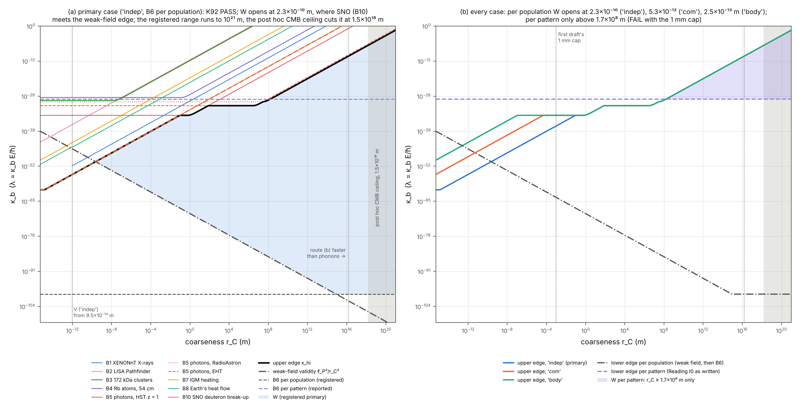

### Run 92: is there a window for route (b)'s rate and coarseness? (Note I's test I0; the quantum sector's first calculation)

*27 October 2026.*
- *Registered and hashed before the run: `quantum92/PREREG_92.md`, with the code, the validation outputs, the disclosed smoke test and the pre-registration check; 9 files; 13:58:58 UTC on 27 October.*
- *Validated beforehand (V1–V5, all PASS).*
- *An independent agent checked the draft before registration. Its corrections were adopted before the hash, and two of them needed rulings (M5, M6).*
- *A second independent agent checked the registered run. Its corrections are adopted here as a post hoc addendum (below); K92 is unchanged.*

**Why.** The rulings of 26–27 October (ONTOLOGY §1; Reading I0) are:
- a commitment is stamped with the local count;
- a pattern draws only through its records;
- records come from two routes, (a) at the surroundings' resolution and (b) a random "commit and continue" at a rate λ with coarseness r_C;
- the medium holds no branches.

So route (b) is a collapse process of the GRW kind, with gravity sourced by its records, as in Tilloy and Diósi (2016) and Tilloy (2018).

**Question.** Is there a window of (λ, r_C) that every current bound allows? If so, where is it, and does any scale already in CO's rules fall inside it?

**The model's rulings** (all 27 October):

| | choice | ruled |
|---|---|---|
| M1 | route (b) acts on every pattern at all times; route (a) adds records when the pattern interacts | universal |
| M2 | the rate per radian of phase, λ = κ_b ω = κ_b E/ħ, with κ_b dimensionless; for photons, ω in the cosmic rest frame | per radian |
| M3 | each record deposits the draw E_TK/λ_tot at the recorded place, smeared at r_C. A unit recorded only by route (b) deposits μ = ħ/(κ_b c²), whatever the unit | Poisson-thinned deposit |
| M4 | the units are electrons and nucleons, each committing on its own (primary); atoms committing through their centre of mass ('com') and whole lumps ('body') reported | "independent primary" |
| M5 | radiation's gravity must follow the radiation per population: the deposits of all rarely recorded matter, at their current positions, add up to the draw, and their shot noise must be small. Reading I0 and Note I wrote it per pattern (λ_ν ≫ c/r_s); that reading is reported | per population |
| M6 | r_C from the hop to 10²¹ m; the first draft's 1 mm cap is reported | to 10²¹ m |

The first M4 ruling rested on an argument that was wrong: cluster interference gives the same centre-of-mass rate in every case. M5 and M6 were ruled after the pre-registration check, with both readings' outcomes already computed. Both are reported. M6's ceiling was set too high; see the addendum.

**The model.**
- **Localisation.** A unit of energy E is localised at rate λ = κ_b E/ħ by
$$
\hat L(\mathbf x)=(\pi r_C^2)^{-3/4}e^{-(\hat{\mathbf q}-\mathbf x)^2/2r_C^2},\qquad \Gamma_b(D)=\lambda\big(1-e^{-D^2/4r_C^2}\big),
$$
with heating 3κ_b c²ħ/(4r_C²) per unit, whatever its mass.
- **Emission.** A sudden kick radiates dΓ/dE = λe²ħ/(4π²ε₀c³m²r_C²E). That is XENONnT's Eq. S1 with λ_CSL = λ(m₀/m)².
- **Gravity from records.** A record at x_f gives every pattern ℓ the phase
$$
\frac{G\,m\,m_\ell}{\hbar\lambda_{\rm tot}}\,K,\qquad K=\frac{\operatorname{erf}(d/\sqrt2 r_C)}{d}.
$$
A body recorded only by route (b) has r_G = GM/(κ_b c²).
- **Back-action.** The loss of coherence per record is at most 2, so through decoherence the back-action sets no lower bound.
- **Validity.**
  - **Weak field:** a route-(b)-only unit's deposit must kick by less than c at r_C, so
$$
\kappa_b>\frac{\ell_P^2}{r_C^2}.
$$
    Relic neutrinos are such units, so this holds in every case.
  - **Non-relativistic kicks:** r_C ≥ √6 ħ/(mc). For nucleons that is 5.15×10⁻¹⁶ m, the model's floor; for electrons, 9.46×10⁻¹³ m.

**The bounds.**

| | bound | limit on κ_b |
|---|---|---|
| B1 | XENONnT X-rays: λ/r_C² < 3.7×10⁻³ s⁻¹ m⁻² mapped per unit | 'indep' 1.58×10⁻²⁸ r_C² (emission only, so conservative by about 10³); 'com' 3.43×10⁻²⁵ r_C² |
| B2 | LISA Pathfinder: S_a = 2κ_b c²ħ/(M r_C²) ≤ (1.74 fm s⁻² Hz^-1/2)² | 3.1×10⁻¹³ r_C² |
| B3, B4 | 172 kDa clusters at 80 nm for 12 ms; Rb atoms at 0.54 m for 2 s: Γ_b t ≤ ln 2 | θħ/[Mc²(1 − e^{−D²/4r_C²})t] |
| B5 | photon coherence (HST at z = 1; EHT on 3C 279; RadioAstron on 3C 273) | θħ/[E(1 − e^{−D²/4r_C²})T] |
| B7 | IGM heating, ≤ (3/2)k_B·10⁴ K over 13.8 Gyr | 6.7×10⁻²⁰ r_C² |
| B8 | Earth's heat flow, 47 TW | 'indep' 1.2×10⁻²¹ r_C² |
| B10 | SNO: deuteron break-up from independently kicked nucleons, ≤ 20% of the 13 NC neutrons per day | 9.0×10⁻³² r_C² |
| B6 | lower edge, per population: shot noise of neutrinos' and dark matter's deposits per acoustic cell below 10⁻⁶ | κ_b > 3.5×10⁻¹⁰⁰ |
| B6′ | lower edge, per pattern (reported): λ_ν ≥ 10 c/r_s | κ_b > 8.2×10⁻²⁸ |

**Results (registered: K92 PASS).** In the primary case, W is open in the validity band from r_C = 2.5×10⁻¹⁰ m (the first grid point; the exact edge is 2.32×10⁻¹⁰ m, where the SNO bound meets the weak-field edge) to the registered ceiling of 10²¹ m:

| r_C | lower edge | upper edge, and what sets it |
|---|---|---|
| 3×10⁻¹⁰ m | 2.9×10⁻⁵¹ (weak field) | 8.1×10⁻⁵¹ (B10) |
| 10⁻⁷ m | 2.6×10⁻⁵⁶ | 9.0×10⁻⁴⁶ (B10) |
| 1 mm | 2.6×10⁻⁶⁴ | 9.0×10⁻³⁸ (B10) |
| 1 m | 2.6×10⁻⁷⁰ | 9.8×10⁻³⁴ (B5, HST) |
| 10⁸ m | 2.6×10⁻⁸⁶ | 3.3×10⁻²⁸ (B5, RadioAstron) |

**What sets the upper edge, by r_C:**
- B10 (SNO), from the floor to 0.09 m;
- photon coherence above that: HST to 70 m, EHT to 3×10⁷ m, RadioAstron beyond.

**The twelve verdicts** (every case, both readings of B6, both caps):

| case | per population, to 10²¹ m | per population, to 1 mm | per pattern, to 10²¹ m | per pattern, to 1 mm |
|---|---|---|---|---|
| 'indep' (primary) | **PASS**, W from 2.32×10⁻¹⁰ m | PASS | PASS, only above 1.7×10⁸ m | FAIL |
| 'com' | PASS, W from 5.25×10⁻¹² m | PASS | PASS, only above 1.7×10⁸ m | FAIL |
| 'body' | PASS, W from 2.50×10⁻¹³ m | PASS | PASS, only above 1.7×10⁸ m | FAIL |

**Also reported.**
- **B9, gravity's tidal noise at LISA Pathfinder from rarely recorded matter:** independent of κ_b, and at most 5×10⁻²⁴ m s⁻¹ in a year against a detectable 5×10⁻¹⁴.
- **Gravity's back-action at B3 and B4:** the total loss over each run stays below 10⁻¹⁶ at κ_hi and at 10⁻⁶ κ_hi.

**Post-run check and post hoc addendum** (`check92b/REPORT.md`; `analyse92_posthoc.py`, not registered):
- **Integrity.** The hashes hold. The run, the smoke test, the validation and the figure reproduce exactly. Every bound recomputes on all 3 × 1064 rows. K92 follows the registered rule. No finding changes K92 or any of the twelve verdicts.
- **The ceiling is about three decades too high.**
  - Relic neutrinos are recorded only by route (b) at every κ_b, and M3 smears their draw at r_C:
$$
\delta_{\rm source}(k)=\delta_\nu(k)\,e^{-k_{\rm phys}^2r_C^2/2}.
$$
  - The CMB sees them through their gravity at horizon entry, k = aH/c. The scale that matters is therefore the Hubble radius when the measured modes enter the horizon, not the sound horizon at recombination.
  - For ℓ ≤ 2000 at a 10% loss, r_C ≤ 0.459 c/H(entry) = **1.5×10¹⁸ m**. The values are 6.2×10¹⁸ m for ℓ = 1000 and 9.6×10¹⁷ m for ℓ = 2500.
  - So W's physical upper end is 1.5×10¹⁸ m. The "widest window" at 10²¹ m and the candidate ε (inside W only above 1.6×10¹⁹ m) fall away. **Ruled 27 October:** the ceiling is 1.5×10¹⁸ m (ℓ ≤ 2000, a 10% loss).
- **Above 1.56×10¹⁶ m, route (b) outpaces phonon rates** at W's upper edge, and electronic rates above 1.56×10¹⁷ m. There, bulk matter's draw is no longer laid down mostly at route (a)'s fine resolution. So W above 1.56×10¹⁶ m is conditional on route (a)'s rate, which Test I1 is to define.
  - *Correction (27 October, Reading I1 §5): this is too weak. What matters is the fraction f = λ_b/(λ_a + λ_b) of a body's draw smeared at r_C. If λ_a depends on the material, lunar laser ranging bounds f(Al) − f(Fe) < 3.9×10⁻¹⁴, so κ_b ≲ 3×10⁻²⁶–3×10⁻²². That caps κ_b in W for r_C above about 10⁹–10¹¹ m. If bulk constituents renew as matter at about mc²/(aħ), there is no cut.*
- **B11 (self-kick heating of dark matter) is withdrawn.**
  - Where it was said to bite, one self-kick (5.6×10⁷ m s⁻¹ at 2.3×10⁻¹⁰ m) far exceeds a dwarf galaxy's escape speed, so a recorded particle is ejected.
  - The ejected fraction λt is at most 2×10⁻⁵ near W's lower end, for masses up to 10 TeV. It grows with κ_b, so it sets no lower bound.
  - The mean-square heating ⟨v²⟩ grows as 1/κ_b, but it is not the observable.
- **Identical units.** The registration's rebuttal holds for CSL-type symmetrisation, whose operator is linear in the density: heating is additive there. It does not hold for GRW-type symmetrisation, where the operator is Λ(x)^{1/2} with Λ = Σ_k g(x−q_k) (Dove and Squires 1995; Tumulka 2006):
$$
\frac{d\langle H\rangle}{dt}=\frac{\lambda\hbar^2}{2m}\int dx\sum_i\frac{|\nabla g_i|^2}{4\sum_k g_k}\ \le\ \text{labelled}.
$$
  On a lattice the ratio is 0.26 at r_C = a/2 and 0.0042 at 2a. So under GRW-type symmetrisation, B1, B8 and B10 overstate the signal by up to the number of like units within r_C (about 17–46 at the lower edge). W could only widen, so the verdict stands. Which symmetrisation route (b) takes is not ruled.
  - *Correction (27 October, after Reading I1's check): the registration's sentence that "the labelled treatment is conservative for every upper bound" is wrong under either symmetrisation.*
    - *Under GRW-type the labelled bounds are too strong, and W only widens.*
    - *Under CSL-type, B10 is suppressed, by about 2×10⁻⁷ at leading order (Jones, Pearle and Ring 2004), and B2 is enhanced, to κ_b < 5.3×10⁻⁴⁰ r_C² for r_C much larger than the test mass.*
    - *CSL-type also conflicts with M2 and M4: its total rate is N²λ for N units within r_C.*
- **Energy superpositions (Note I's Q7, not computed in the registration).**
  - If the rate follows each branch's energy (λ = κ_b E/ħ per branch), branches of different energy leak which-branch information at
$$
\Gamma=\tfrac12\big(\sqrt{\lambda_1}-\sqrt{\lambda_2}\big)^2\approx\frac{\kappa_b(\Delta E)^2}{8\hbar E}.
$$
  - The ⁸⁸Sr tweezer clock (ΔE = 1.775 eV, coherence 48 s; Young et al. 2020) then gives:
    - κ_b < 1.8×10⁻¹¹ if an electron's rate counts its orbital energy ('indep'), which caps κ_b in W for r_C above 2.5×10¹⁶ m;
    - κ_b < 2.9×10⁻⁶ for 'com', which would cap κ_b above 10¹⁹ m, beyond the ceiling.
  - **Ruled 27 October:** the rate is the operator κ_b Ĥ/ħ, so each branch commits at its own rate. This keeps the dynamics linear; a rate set by the mean energy would be nonlinear and need Note I's no-signalling check (Q4). So Q7 applies. The estimate above, if an electron's rate includes its orbital energy, caps κ_b in W for r_C above 2.5×10¹⁶ m. It is to be registered with Test I1.
- **The lower edge, more strictly.**
  - **Per population:** the same shot-noise criterion at the CMB damping tail, and at horizon entry for ℓ = 3000, gives κ_b ≳ 7×10⁻⁹⁵ to 3×10⁻⁹³. The check also estimated, without recomputation here, about 10⁻⁹⁸ to 10⁻⁹⁶ from dwarf galaxies and 10⁻⁸⁷ to 10⁻⁸⁴ from pulsar timing, both if dark matter is particulate. None of these closes W: the per-population edge governs only above about 10¹¹–10¹⁵ m, where κ_hi ≥ 3×10⁻²⁴.
  - **Per pattern,** evaluated when the measured modes enter the horizon: κ_b ≥ 8.7×10⁻²⁷ to 2.6×10⁻²⁶. The per-pattern window then opens at 5.5–9.6×10⁸ m, still below the ceiling.
- **Smaller corrections:**
  - SNO's 14.4% is the detection efficiency in the fiducial volume. If it applies only to neutrons made inside it, B10 is 1.30× weaker, and W's lower end moves from 2.32 to 2.17×10⁻¹⁰ m.
  - B9's formula is outside its regime for 'body' (records within s ≫ 1). The Gaussian-regime estimate, about 4×10⁻²⁶ m s⁻² Hz^-1/2, leaves the conclusion unchanged.
  - B5's lookback times are 2–4% conservative.
  - The CMB's free-streaming signal is partly anisotropic stress, which M3's deposits (the Tolman–Komar scalar and the current) do not carry. B6 rests on CO's draw sufficing, which is untested.
  - The figure was revised:
    - B11 removed;
    - B10 drawn visibly;
    - the 'indep' validity edge and the ceiling marked.

**Where the dimensional candidates fall, with the ceiling** (reported only; none is rule-derived):
- **The r_C candidates:** the hop and hop·P∞ (at its data limit) lie below the model's floor. hop·P∞² (≥ 2.1×10⁻¹¹ m) and ℓ_P·P∞² (≥ 6.6×10⁻¹⁴ m) lie where W is closed at their data limits; W is open from 2.32×10⁻¹⁰ m.
- **The κ_b candidates** reach W only at large coarseness:

| candidate | inside W for r_C |
|---|---|
| ℓ_P/r_C | 5.6×10⁻² m to 1.5×10¹⁸ m |
| 1/P∞² (data limit) | 9.2×10¹⁰ m to 1.5×10¹⁸ m |
| p_s/P∞² | 5.8×10¹³ m to 1.5×10¹⁸ m |
| 1/P∞, ε² | 2.3–3.7×10¹⁶ m to 1.5×10¹⁸ m, wholly in the conditional region, and above Q7's cut (2.5×10¹⁶ m) under the rate operator |
| ε | none |

**Reading.**
- **Under the rulings, route (b) is viable.** A rate λ = κ_b E/ħ and a coarseness r_C exist that every current bound allows, for r_C from 2.3×10⁻¹⁰ m to 1.5×10¹⁸ m (the ceiling ruled after the run). Above about 1.6×10¹⁶ m this is conditional on route (a)'s rate, and Q7 (estimated) cuts it above 2.5×10¹⁶ m.
- **This rests on M5,** reading radiation's gravity per population, as M3's deposit implies. Under Reading I0's per-pattern criterion, route (b) survives only with r_C ≳ 2×10⁸–10⁹ m. It is then invisible in any laboratory, as Reading I0 anticipated.
- **At laboratory r_C, the window is set from above by SNO's deuteron break-up, and from below by the weak field of rarely recorded matter's deposits.** These meet at 2.3×10⁻¹⁰ m. At 100 nm, for example:
$$
2.6\times10^{-56}<\kappa_b<9.0\times10^{-46}.
$$
- **The run sets a target, not a value.** CO's rules produce neither κ_b nor r_C, and no dimensional candidate lands in W at laboratory r_C.

**Carried forward:**
- **Ruled after the run (27 October):**
  - the ceiling is 1.5×10¹⁸ m (ℓ ≤ 2000, a 10% loss);
  - the rate is the operator κ_b Ĥ/ħ, so Q7 applies, to be registered with Test I1;
  - whether route (b) is symmetrised CSL-type or GRW-type is deferred to Test I1.
- **Rulings still open:**
  - whether the rate is per radian in the cosmic frame or along the worldline (along the worldline, photons and massless neutrinos would not commit);
  - quarks or nucleons as units.
- **Calculations:**
  - route (a)'s rate (Test I1), which decides the region above 1.6×10¹⁶ m;
  - a relativistic version below 5×10⁻¹⁶ m;
  - atomic excitation as a direct X-ray bound for 'indep';
  - Tests I1–I4.
- **The target itself:** a rule for κ_b and r_C.

*Figure (made after the run; revised after its check): (a) the primary case: every upper bound, the upper edge, the lower edges, W, the 'indep' validity edge, the phonon line and the post hoc ceiling; (b) each case's upper edge, with both readings of B6.*
