# Commitment Ontology: Lattice Simulation Record

**Date:** 15–27 October 2026
**Scope:** simulation Runs 1–91 (with 72b and 81b), and Run 92, the quantum sector's first calculation (written up in `quantum runs/`), testing whether the commitment / bandwidth ontology, written as the stability landscape Σ (Primitive 12), reproduces gravity, and where it stops working.
**Code and raw data:** the `*_run.zip` bundles from the session (one per run), listed in the [file index](#file-index).
**The ontology tested, as it now stands:** stated on one page in the repository's `ONTOLOGY.md` (rules, rulings with dates, what is derived, ruled or borrowed, predictions, open questions). §3 records how each rule was reached.

---

## Scorecard

| # | What was tested | Outcome |
|---|---|---|
| 1 | Static Σ maximisation: does matter's drain on bandwidth give Newtonian gravity? | **Pass.** 1/r cadence deficit, 1/r² pull, exact linearity |
| 2 | Phases advance at local cadence; global phase lock | **Fail.** Coh repels like sources and grows with box size |
| 3 | Weak coupling, so phases can slip against the background | **Fail.** Coh deficit scales with volume and never settles |
| 4 | Connection in Coh (redshift is not decoherence) | **Pass** for gravity, since Coh becomes blind to cadence. With a tick of its own, Coh is Coulomb-like: like repels, opposite attracts |
| 5 | Commitment as waves (pulsating matter in a possibility field) | **Pass.** Static limit = Newton; synced pulsators pull up to 1.5× harder, anti-synced 0.5× |
| 6 | Free rhythms: do pulsating bodies sync on their own? | **Pass.** In phase inside ¼ wavelength; 27 clusters reach full sync |
| 7 | Equivalence principle, two species | **Rate ∝ mass fails** (η up to 0.38). **Shared rhythm passes**: η → 0 as ε² |
| 8 | Redshifted shared rhythm | **Fail** for sync as a gravity contributor: lock is lost between bodies at different depths, so the 1/d² law and the EP break |
| 9 | Light bending: does possibility bend past a mass by the observed amount? | **Cadence-only fails** (half the observed bending, γ = 0). **"Free capacity" passes** at first order (γ = 0.9988), with no free parameter |
| 10 | Perihelion: additive vs multiplicative budget, orbits by maximal commitment count | **Additive fails** (β = ½: 21.5″ or 50.1″ per century for Mercury). **Multiplicative + free capacity passes** (β = 1: 42.97″; observed 43″) |
| 11 | Binary radiation: energy an orbiting pair loses to the cadence field | **Fails.** One cadence field (relations stretching in step) radiates 0.166 of GR's quadrupole power. Binary pulsars match GR to ~0.2% |
| 11b | Shear of relations: a full strain field (six components) radiated by the orbiting pair, counted two ways (pre-registered) | **Pass** if relations are all there is. Sliding places is free and isotropic stretch is bound to matter, so only the two shear polarisations radiate: **0.98 of GR**. Counting every strain pattern as real gives 2.44× GR, excluded by the double pulsar. Capacity, and isotropic stretch generally, must be set by matter, not radiate as waves of their own. Half the radiating stress lives in the relations that bind the pair |
| 12 | Particles as knots: Coh + Str in an S² director field; uncuttable rule; quench | **Pass** for knots: stable Hopf knots, spectrum within ~1% of the continuum Faddeev–Skyrme values (E₂/E₁ = 1.643 against 1.634). Coh alone collapses. A random quench leaves nothing (cuttable) or a frozen tangle (uncuttable). |
| 13 | Knots on a relational graph with no grid, under CO's own conditions (no triangles; squares) | **Mixed, with a structural finding.** On random triangle-free graphs the knot's twist hides in uncharged longer cycles and the knot unties, at every spacing, link count and form of Str tried. On a **random cubical complex** (every face a square, which satisfies both clauses of the contrast principle), Str charged on closed square loops holds knots with **no cutting rule**. Spectrum ratios are within 3–8% of the continuum values, with ±5% disorder between complexes |
| 14 | Vacuum test on CO's own event-layer engine: vacuum holds possibility but never commits | **Pass (pre-registered).** Shortage unscreened at every density (misfit 0.2–1%). Clocks made of matter slow 3× more at shells 8–10, and 4–20× beyond CO's result-25 ceiling. The reach/strength trade-off comes from vacuum commitment. In a rich medium the clock rule itself saturates |
| 15 | Clock rule on CO's engine: a commitment's hold counted in global ticks (CO's rule) or in passing possibility | **Pass (pre-registered) for the flow rule.** Clocks slow by the fractional shortage (1.02–1.04; 1.00 against their own neighbourhood) at densities 8 and 32. Two clock designs agree to 1–2%, the response is linear, and the shortage stays unscreened. **CO's rule fails:** no response at densities 8–32, and at 1–2 a nonlinear response that depends on the clock (a long-hold clock slows about half as much). In lean media, waiting to pay breaks universality by about 10% |
| 16 | Falling with inertia on CO's engine (adopted rules): a pattern of possibility whose phase is turned by the committed world's count; no steering rule, no coupling | **Pass (pre-registered) on falling and universality.** 192 of 192 releases fall inward. The fall is at the clock-set rate: 0.98–0.99, and distance fallen agrees within 1%. Masses 0.7–2.0 fall alike to 0.6%. Controls behave: phase turned by global ticks gives no fall, and in the medium with no matter patterns fall in its own density ripples. **One marginal miss:** 0.96 at density 8, 12 places out, an artefact of the fit window. **Inertia as pre-registered fails,** because the no-matter medium is not force-free and a measurement artefact affects the lightest patterns; in a uniform field velocity holds to 0.07%. Exploratory: live counts cost heavy patterns their coherence |
| 17 | Slowing hops as well as ticks: (1) possibility's own hops slowed by its place's clock, in CO's engine; (2) the same rule applied to patterns riding on the medium; light bending and Shapiro delay | **(1) Fails: the medium freezes.** Possibility timed by its own passing count is unstable: it freezes, drains or clumps, and any stable version would make light bend less than clock-only. **Not adopted.** **(2) Mixed (pre-registered, amended before use).** With patterns hopping on ticks and needing capacity, light bends toward matter 2.010 × the clock-only amount (density 32, all beams within 0.7%) and the delay doubles. γ = 1 is put in by the rule. At density 8 the far beams and the delays miss by up to 18%, cause not established; the second-order fall formula was wrong |
| 18 | Does matter fall? A knot of commitment (Run 12) released in CO's engine clock field, every cost counted in local ticks; two readings of where Str (twist) is charged | **Str on spatial loops only fails universality: the knot falls 2.7–3.7× faster than patterns** (3× in the continuum, because its twist weighs but does not resist), which MICROSCOPE excludes. **Str also on loops that include a tick: the knot falls at 0.92–0.93 of universal on the fine grid** (0.77–0.96 on the coarse grid), the same as in a clean field, with the shortfall roughly halving as the grid is halved. **Not the 3% registered.** Patterns beside it: 0.99. Most pre-registered bands missed, through two errors found afterwards: the coarse-grid bands came from the wrong fit window, and a centre-measurement bug at h = 0.1 inflated the fine-grid code check. Inertia = energy here is Lorentz invariance in lattice form |
| 18b | The tick-loop knot on the fine grid, measured properly: smooth switch-on, 12-unit windows, smooth (spectral) estimates of inertia and force, the centre bug fixed (pre-registered) | **Pass on the tick-loop knot.** It falls at its own lattice weight ÷ inertia (0.976–0.996), in a clean field and in the engine's field alike, and at 0.94–0.98 of universal. The shortfall is the lattice knot's excess inertia, which shrinks from 9.3% to 2.7% as the grid halves (h² extrapolation: 0.995). Supported, not established, with two grids. The space-loop knot still falls about 3× too fast (2.88, 3.06); one of its two drops misses its band. No-field control drifts 1.7×10⁻⁵ |
| 19 | Knots that dig their own clock wells in CO's engine: a knot's cost paid by engine commitments (cost-paid arm, and CO's one-per-matter-place rule); its active mass; how the engine combines two wells (pre-registered, S1 and S2a) | **The engine is linear: a well follows its body's draw to 3%** (14 bodies). **Active mass ∝ energy fails in both arms** (Q2, Q3 at 0.86 and 0.77 of Q1's draw per unit energy): a body's own well (clock 0.50–0.67 at its cost) slows its own commitments, a binding effect. Two bodies redshift each other's draws exactly as predicted (0.943, 0.955). **Decisive:** outside matter the well is linear in its source (the exponential form is off by 6.5 s.e.), so N = 1 − U and **β = ½**. With the pattern rule (γ = 1) that is **Mercury at 50.1″ per century (observed 42.98″) and Nordtvedt η = −2: excluded.** Run 10's multiplicative budget is not what the adopted engine does |
| 20 | β measured directly in CO's engine: CO's ball at 1, 2, 3 commitments per pair; second-order shape of the clock well (pre-registered) | **Pass as predicted: β = 0.47 ± 0.03** (b₂ = −0.028 ± 0.025). The multiplicative budget (β = 1) is excluded by about 20 standard errors. With γ = 1: **Mercury 50.5″ per century (observed 42.98″), η ≈ −2: excluded.** Structural while clocks count passing possibility (§6) |
| 21 | Probe of Candidate A (§6): possibility's outflow ∝ ln(1 + P), clocks count possibility present; stability and a first β | **Stable** (var/mean 2.0–3.6, bounded). **The written β predictions missed:** Run 20's method gave 0.805 and 1.080 against 0.94 and 1.00, because the wells are too deep for it. A deep-well fit chosen after seeing the data gave β ≈ 1.01 / 0.96, which Run 22's theory later showed was partly luck. Not pre-registered against the standing checks |
| 22 | Candidate A against every standing check: β from the medium's own equation of state (no matter) at P₀ = 4–2048; wells at 4–32; probe clocks; outflow screening; patterns (pre-registered, two amendments) | **β = 1 for an ideal clock:** the medium alone is inside Mercury's band (\|β − 1\| ≤ 0.003) at every P₀ ≥ 64 (0.9996, 1.0015, 1.0010, 1.0005), as a zero-range theory predicted beforehand. The wells at 4–32 obey the same equation of state to about 0.01 in β. No well was run at P₀ ≥ 64. Nordtvedt is not reached (η = +0.002 at 2048). **Clocks FAIL:** a presence clock drains its own places by 24–32%, so clocks of different make slow differently near matter (κ 0.93 / 0.99, and 0.94 / 0.98), and the self-dip barely shrinks from density 8 to 32. **Judged excluded as built (p_s = 1).** Marginal misses on the profile theory and on one amplitude. The pattern code check is invalid in these wells |
| 23 | Candidate A′: the medium linear up to a crossover $p_s$, logarithmic above; a lone clock's self-dip and the medium's β against $p_s$ (pre-registered, with a kill rule) | **Both kill tests pass.** The self-dip falls as $p_s^{-0.94\pm0.04}$ (0.186 → 0.0060 from $p_s$ = 1 to 64; theory −0.92). β rises to within 0.0005 of 1 at $P_0/p_s$ = 1024 for $p_s$ = 4, 16, 64, matching theory to 0.0003. Matter becomes light while β stays 1. Corrects Run 22's self-dip sizes (crowding). Not yet the clock check in a well; real clocks need $p_s\gtrsim2\times10^5$ |
| 24 | Candidate A′: do clocks of different make agree as $p_s$ grows? Two designs in two uniform media (the well test's stand-in, tied to Run 22's well at $p_s$ = 1); pre-registered with a kill rule | **Pass.** The design gap falls 0.056 → 0.018 → 0.0049 at $p_s$ = 1, 4, 16, as $p_s^{-0.85\pm0.07}$ (theory −0.74; kill line −0.5). Both designs approach κ = 1. At $p_s$ = 1 the uniform form reproduces the well's design ratio (0.944 against 0.951). Real clocks (10⁻⁶) need $p_s\gtrsim4\times10^5$ (extrapolated) |
| 25 | Candidate A′ (adopted provisionally), the closing checks: (a) wells where Mercury's band holds ($P_0/p_s$ = 256); (b) β at $P_0/p_s$ up to 4096, for Nordtvedt (pre-registered, kill rules) | **(a) Pass:** the wells follow the medium's equation of state to 0.0015 in ln P at $p_s$ = 4 and 16. **(b) the β part of Nordtvedt met** (ED_Attempt_01 found a linear counting budget fails the sourcing terms by 10⁴; the engine's static sourcing was worked out in Run 30, ζ₂ = 2(β − 1); the motion and preferred-frame terms are untested; see Run 25's correction): at $p_s$ = 16, β − 1 = −1.06×10⁻⁴ at 4096 (theory −0.98×10⁻⁴), so η = −4.2×10⁻⁴, about 1σ of lunar laser ranging. At $p_s$ = 4, η = −2.5×10⁻⁴, but a registered "falls at every step" clause fails within noise (a flaw in the registered rule) |
| 26 | Two bodies under the adopted rules (radius-3 and radius-4 balls, solo and together): Run 19's checks, and whether wells multiply (pre-registered, kill rule on W2) | **Wells multiply:** f = 0.91 (seed 1) and 1.29 (seed 2), pooled 1.12 ± 0.19 (1 = multiply, β = 1; 0 = add, β = ½); additive excluded at about 6σ. Within-seed errors understated the seed-to-seed spread. **Each well follows its draw in ln N:** depth per unit draw 0.690 and 0.689 (medium's slope 0.695). Each body redshifts the other's draw as predicted (to 0.2%). W1's first specification was self-contradictory (an error; corrected for seed 2, which passes at 1.013). $p_s$ = 1 |
| 27 | Patterns falling in Candidate A′'s deep well (the theory's smooth field), box 40 against box 60: was box 40 why Run 22's code check failed? (pre-registered) | **Passes at 18 out in box 60** (0.986, masses alike to 0.5%, as Run 16). **Fails at 10 out in both boxes** and narrowly at 14 in box 60 (0.957, 1.9%). Both suspected causes contribute: the box face (box 40 at 14: 6.1%), and the protocol in steep wells (the error grows with how far the packet falls in its 16-tick window). The fall closer in is unmeasured, not failed |
| 28 | The strong field of the adopted metric (exponential: no horizon, a throat at areal e M), calculated and set against black-hole images and ringdowns (comparison pre-registered) | **Shadow allowed:** 4.6% larger than GR; inside every EHT 2σ interval (1.4σ tension with Sgr A*, VLTI prior). **Ringdown: about 5σ tension.** The static, scalar estimate rings 3.9–4.4% lower than Kerr, against GW250114's 220 frequency of 0.02 ± 0.02 (90%). A flag, not an exclusion: no rotation, scalar modes, and a full CO waveform could shift the inferred masses. The strong field tests the pattern rule's exact form ($g_{ij}=N^{-2}$), which was fixed only at first order |
| 29 | Where the arrow lives: is the event layer one-way, and do time-averaged clock records lose the order? Adopted rules, the vacuum alone and 125 lone clocks (pre-registered, kill rule) | **Pass on the kill rule and both one-way tests.** The vacuum's wandering is one-way: entropy production 2.7×10⁻³ per place per tick (1,870σ), from the global tick acting on the ratio rule; independent walkers give 0. Commitments are absolutely one-way. A clock's record is one-way at single ticks (A = 0.034, 695σ). Averaged over time, it falls about as 1/T from T = 64, to 0.0013 at 1024: under the kill line of 0.0034, but still 5σ from zero. Summing 125 clocks keeps the order. Post hoc: the record's one-way memory is the medium's, with an e-fold of 41 ticks. **Missed:** the bell curve (T4: time-averaging first raises skewness); the vacuum block-skewness slope (T7: −1.74 against −1.5 ± 0.2); and one place's third-order asymmetry, registered as zero (T8: 21σ) |
| 30 | The sourcing weight the static engine can reach (rest mass in a potential) against GR's Tolman mass. Derivation; the engine check is Run 26 W3; checked by an independent agent | **Consistent with GR.** A body's draw is its count × local clock rate, which is Tolman's rest-mass term ρ√−g = ρ*N. In PPN terms ζ₂ = 2(β − 1) (ξ = 0). This reverses ED_Attempt_03's F2 (ζ₂ = −3), which read the count as proper density. The binary-pulsar bound needs $P_0/p_s\gtrsim2.3\times10^4$. **Not reachable statically:** moving matter (it must draw 1 + 2v² × its ticking rate), stress, α₁, α₂ |
| 31 | Does a well form at the pattern speed, and follow a moving body? CO's ball stepped through the lattice at two speeds, plus a static build-up (pre-registered, kill rule) | **Kill rule fired (outcome A): the well is carried by diffusion.** It forms at the diffusion rate (4% formed at 10 places after 1,000 ticks; light speed would give 100%; build-up median 0.97 of diffusion, individual points 0.83–1.75). A moving ball trails its well: fore-aft asymmetry 0.67 and 0.32 (diffusion 0.75, 0.40; a co-moving field 0) and the sideways well cut to 0.54 and 0.93. A moving ball draws 8.5% more. At the adopted scales a well spreads about 0.3 μm in the universe's age, and a body at 370 km/s keeps its well within 0.01 of a place. **The static results hold only as steady states, which the engine's diffusion never reaches at physical distances; the field's dynamics fail** and need a rule (a wave-carried deficit keeps every static result) |
| 32 | Can the adopted rules make a horizon? Theory (surface gravity of the zero-clock surface; the self-limited draw) and an engine check with CO's ball at 8, 32, 128 commitments per pair (pre-registered, kill rule) | **Pass: no horizon.** A static body's draw is its ticking, so its own well throttles it: 16× the commitments gives 1.8× the draw, and outside the ball the clock rate never reaches zero (shell means 7.2 or more at r ≥ 4, lowest single place 4.46; theory within 1–3%). The idealised zero-clock surface would be at zero temperature (κ = 0, a double zero of g_tt). Agrees with Attempt B's B-39, Attempt C's C-O39 and the acoustic-metric arc. (The registration's light-ring threshold U_b > 2 was wrong: it is ½.) **So CO's Hawking-radiation papers, which need κ > 0, do not apply to the engine's static solutions.** The surface-glow constraint (Attempt 03) remains |
| 33 | Does a pattern's energy pull? (a decision memo; no run) | **Decision needed.** No CO rule turns a pattern's energy into draw, and the record conflicts on it (DSR-4 against Mass Without Mass; ontology §12 against D30). A cadence draw (ħω) gets binding energy right but misses motion and stress. Only a rule that also counts momentum flux gives GR's weights, and that is Tolman–Komar's source. Motion is gated by Run 31 |
| 34 | A clock field fixed each tick plus a current field: what must the current be to pass the preferred-frame tests? (a calculation; criteria registered; checked by an independent agent) | **No derived candidate passes; passes only by input. Adopted 19 October** with one input (Lorentz invariance at first post-Newtonian order, as Run 18's); the tick ruled not physical. Matching Will's PPN metric: α₁ = −2k₁ − 8, α₂ = 2k₂ − 1, α₃ = 2a₁ − 4, ζ₁ = ξ = 0. **With no current field: α₁ = −8, α₂ = −1, excluded.** The diffusive engine is not of PPN form, but has no frame dragging either way. If patterns ride possibility's own flow, conservation gives k₂ = ½ and α₂ = 0, with no number chosen (two premises stated). That flow is always curl-free, so α₁ (and frame dragging, which is the same coefficient: 1 + α₁/8 of GR) needs a momentum channel with k₁ = −4 to 2×10⁻⁵ (the record's λ_J = 4), which is input. α₃ needs a₁ = 2 (Run 33's R-b), input. The kill rule as registered could not fire |
| 35 | The engine on the adopted rules (Candidate A″: clock field fixed each tick as the wander rule's stationary law; presence clocks unchanged). A construction run, registered; no kill rule | **Builds as ruled.** Static draw 8.5492 against 8.5451 predicted; shells within a relative 1.7×10⁻⁴ (against Run 26's diffusive engine, post hoc: draw 0.1%, deficits within 0.4–4% at r = 4–13). A moving ball keeps its well and draw at $w=1.5\times10^{-3}$ and 0.25 (α −0.002, lateral 1.001, draw ratio 0.999; Run 31: 0.672, 0.537, 1.085). **D35 passes:** with no memory in the medium between ticks, the clock record's long one-way tail vanishes (2×10⁻⁶ against Run 29's 8.3×10⁻⁴), so Run 29's tail needed the medium's memory (ambient fluctuations or the clock's own reservation hole; not separated). Averaging still removes the order ($T^{-1/2}$ to T ≈ 100, then 1/T). Derived: under part 1 the vacuum is in detailed balance, so the arrow lives in commitment |
| 36 | Does a bound pattern's energy pull, binding counted once? (ruled: pattern rest energy draws; adopted rule: energy + momentum flux). Registered, kill rule; independent check | **Kill rule fired.** With the standard matter (a strongly self-gravitating ball, N = 0.38 at its places) the far field overshoots ħω by 13%; energy-only undershoots by 9%. Post hoc: a body held on fixed places responds to outside wells with weight 1/(1 + U_self), not GR's 1 (in GR the body shrinks in these coordinates), which explains about 0.05 of the 0.13; the rest unresolved. With weak-field matter the adopted rule misses by 0.4–2.6% and energy-only by 1.3–1.7× the binding |
| 37 | Which memory carried Run 29's tail: the clock's own reservation hole or ambient fluctuations? Registered thresholds | **Ambient.** With no own hole the tail is unchanged (ratio 1.118 ± 0.004). The hole shaped only the short lags (cadence swings, D(1)) |
| 38 | Frame dragging on the engine (construction check) | A pattern near a rotating ring co-rotates at the current field's speed to 0.2% (no clock well); in the well its fall is turned by the gravitomagnetic force (+7%, accounted for). The strength is the Lorentz input |
| 39 | The ringdown with the remnant's spin (calculation, registered) | **Undecided.** CO's first-order rotating exterior fails before a = 0.68 (its light ring crosses the throat at a ≈ 0.29). Up to a = 0.15, spin moves the frequency offset −4.4% → −1.8% but the damping time +4.6% → +13% (bound +9%); a linear extrapolation to 0.68 (not registered) gives +3.1% (inside) and +22% (outside). Needs CO's spin-squared structure |
| 40, 40b, 40c | Run 36 with a body that keeps its proper size (registered; 40b and 40c after an independent check) | **A body keeping its proper size responds to outside wells with weight 1 in an unbounded medium** (1.008; held: 0.518). Run 40's pass was the periodic box's. **At weak field (40c) the adopted rule counts a bound pattern's binding once (−0.05 b); energy alone misses by two bindings (−2.01 b, the binding counted three times).** At strong field (40b) it misses by about one binding even with an ideal body, a second-order departure from GR |
| 41 | CO's rotating exterior at the remnant's spin: the engine's own rule (with a body quadrupole) and the Newman–Janis completion (calculation, registered) | **Every exterior fails GW250114 at a = 0.68** (scalar eikonal). Engine rule: no prograde light ring outside the throat, damping times 0.33–0.54 of Kerr's, quality factor below any Kerr value. Newman–Janis: −17% in frequency, −21% in damping time (its quality factor matches a nearly non-spinning Kerr, so this verdict assumes GR's inferred spin) |
| 42 | A pattern inside a body, at weak field (registered, two arms: the body's internal stress drawing or not) | **Internal binding counts once only if the body's stress pulls.** With stress drawing at weight 1 per direction (Tolman's 3p, PPN ζ₄) the far field equals ħω to −0.09 of a binding (K42 passes; m = 3, 5, 8 alike). Under the adopted rules as they stand it misses by 0.67–0.92 bindings, almost all of it the stress term. The small remainder shrinks with the body's own field (second order; post hoc check). Energy alone still misses by about half a binding. **"Stress pulls" adopted as part of the Lorentz input (19 October)** |
| 43 | Option A (Kerr outside, CO's core inside): what the core must do (calculation, registered) | **Viable if the core absorbs a few percent of what reaches it** (≥ 0.3% quenches the ergoregion instability at GW250114's spin; the Sgr A* glow bound at CO's scale needs only ≳ 6×10⁻⁷). Near-total absorption ("it commits") passes everything and leaves no echo. Partial absorption leaves echoes spaced by ≥ 29 ms for GW250114's remnant (CO's natural scale; 293 ms at a Planck length), whose later pulses fall inside the windows searched in O1–O3. **Ruled: the core commits** (a total absorber; no echoes) |
| 44 | Run 42 on a grid twice as fine; the residual against the body's own field (registered) | **All three checks pass.** Finer grid: −0.073 b with the stress drawing (−0.83 b without, as before). The residual goes to zero with the body's own field (intercept −0.005 b; ≈ −1.25 U_self·b), so it is second order: negligible for ordinary bodies, but a potential falsifier for neutron stars (not yet computed). The stress term's stencil gap falls from 6.1% to 1.7% |
| — | The earlier black-hole radiation papers under option A and "the core commits" (a reading) | They fit the ruling (radiation from correlations at the surface, nothing released from the core) and apply with Kerr's κ, borrowed, if the core is assumed to act on quantum fields as a horizon would. No CO-specific signal. The ruling meets the bound that ended Attempt 03's line (by input and rule; that line is not reopened). **Ruled: black holes evaporate** (two tracked assumptions); the endpoint (Planck-mass remnant or full evaporation) is open |
| 45 | A body at neutron-star strength (U ≈ 0.2): does its binding pull and fall like its energy? Two media, stress for the body's own binding, fall as the response to an outside potential (registered, with a first-order calculation) | **The body's own binding:** pulls once to first order (K45a, by construction of the stress rule); falls within the engine's ~10⁻³ resolution (K45b not falsified). **A bound pattern fails (K45c):** with the coded equation (redshifted mass only) its binding falls with the wrong weight, Δ = −2K/ω² ≈ −1 b; as coded the engine fails the pulsar triple by ~10⁵. Post hoc, the full pattern rule shrinks the defect 22–47×, leaving a remainder that is mostly lattice error; untested as registered (Run 46). First order: the pulsar triple tightens P₀/p_s ≳ 10⁵ |
| 46 | The full pattern rule for massive patterns (the wave equation in −N²dt² + N⁻²dx², with the covariant Tolman/Komar draw): Run 45's tests in three media and three resolutions (registered) | **The first-order failure is gone.** Weak-field pull counts binding once (K46a passes); the control reproduces the coded equation's defect (K46d passes). **The registered fall test is undecided** (K46b, K46c): the draw-based defect scatters, which the check traced to the medium's lookup table (a 16× finer table gives about +1×10⁻³). Post hoc, the ω-based fall gives |Δ_∞| ≲ 7×10⁻⁴ and the body's −2×10⁻⁴. The pull at neutron-star strength converges at −0.20 b (4% of the pattern's energy), a second-order miss that remains |
| 46b | Run 46's fall test with a 16× finer medium table and four outside-potential steps; audits of Runs 45 and 40c (registered) | **Undecided as registered:** the table had not converged (2.9×10⁻⁴ against 2×10⁻⁴), and the q = 2 fit came within 0.15×10⁻³ of the falsification line. Post hoc: the ω-based fall goes to about zero after grid extrapolation; the draw-based is −0.9 ± 0.4×10⁻³; the body's is −0.2×10⁻³. Audits: Runs 45 and 40c stand. The pull at neutron-star strength stays at −0.20 to −0.21 b. Run 46c recommended |
| 46c | Run 46b's fall test with a converged medium table (262,144 nodes), a pooled ε slope and fit forms fixed in advance; registered closing rule (registered) | **The fall line is closed at the engine's resolution, not falsified.** The table converged (≤ 1.2×10⁻⁵). A bound pattern's fall by draw (K46b″) is undecided: −2.1×10⁻³ (all nine, q = 2.24) and −0.4×10⁻³ (double + triple, q = 2). Its grid error is not one power law, so its limit is not determined (−2.1 to +0.4×10⁻³ with a leading h² error). By ω it is robust: −0.14 to +0.38×10⁻³. The body's own fall passes (K46c″: −0.6 and −0.15×10⁻³), the first PASS under a registered pass/falsify rule. Pull: −0.20 b. Post hoc (the check): a dilation argument makes the fall exact in the continuum with a scale-free medium, so the triple's 2×10⁻⁶ would bound only P₀/p_s (≳ 10⁵) |
| 47 | Can pulsar timing see a neutron star that pulls 4% less than its energy (m_A = 0.96 m, m_P = m_I assumed)? Analytic claim and N-body check (registered) | **No, at Newtonian orbital order, if m_P = m_I.** The N-body motion is then exactly an ordinary system with masses m_A, so timing measures only active masses (K47a holds by construction; the integrations confirm the algebra). A 10⁻⁶ equivalence-principle violation shows: 7×10⁻⁴ of the orbit raw, 7.5×10⁻⁹ after refitting (K47b passes, margin 4–7). The engine has no inertia, so m_I = κω is an assumption; with m_I = m_A the 4% is only a first-law anomaly. Open: CO's post-Newtonian two-body law (the double pulsar agrees with GR to about 10⁻⁴), and J0737−3039B's binding energy (a possible model-dependent tension). The ζ₂ test is unresolved by the engine (−1.4 to −2.9×10⁻³ at finite grid) |
| 48 | The dilation argument as a registered analytic claim: in a scale-free medium an outside potential is the same lattice computation as a finer grid; numerical checks to h = ⅕ (registered) | **The identity is exact (K48a: 10⁻¹⁶).** So a body's and a bound pattern's fall defect is the grid derivative of their energy, −d ln e/d ln h, which vanishes in the continuum: at neutron-star strength the full rule makes bound matter fall exactly like its energy. Numerically, all three defects go to zero within 10⁻⁵–5×10⁻⁵ (post hoc, from h = ½ to ⅕). K48b undecided: the targets were extrapolated in the wrong variable (p_s/P₀ at fixed P₀); post hoc, the medium's change of log-slope across the body accounts for the leftover. K48c's ω prediction missed (+28%): its exponent came from that offset; scale-free ω goes as h². **The pulsar triple now bounds how far CO's medium departs from scale-free across a star**, not the engine |
| 49 | Is the 4% pull miss CO's or the body model? Three bodies: Run 46c's, matter with an equation of state held at proper size, and the same matter re-settling (registered) | **Neither registered outcome**: re-settling made the miss larger (−0.34 b at Γ = 2, −0.22 at Γ = 3; held: −0.18 to −0.20). The check traced this to the equilibrium rule's post-Newtonian weight: exact hydrostatics weights the virial by the matter's whole draw, (ρ + 3p)N√γ. **Post hoc, with that weight, Run 46c's body gives +0.03 b and re-settling matter +0.03 b: the 4% deficit came mostly from the stress rule, not CO.** To be registered with a body in local hydrostatic equilibrium (Run 50) |
| 50 | A star in exact point-by-point hydrostatic balance (Γ = 2 polytrope, U ≈ 0.215), no stress or proper-size rule: does a quantum raise its far field by exactly ħω? With a registered derivation: in a scale-free medium the engine's statics with this matter come from one action (registered) | **The discrete first law holds** (K50a: ΔE = κω to ≤ 5×10⁻⁸). **The far-field test is undecided as registered** (smooth fits +0.044, +0.050), because the miss oscillates with the star's surface cells (−0.006, −0.028, −0.002, +0.015 b at h = ½ … ⅕). The lattice virial defect falls as h². **Post hoc, surface-averaged: c₀ between −0.015 and +0.012 b across fit forms (0.000 ± 0.009 for c₀ + ah²), against −0.20 b with the old body model**: the 4% deficit was the old body model. Same first law as GR; not GR's mass–radius relation. Γ = 3 and weak-field extras did not finish |
| 51 | A medium with a controlled departure from scale-free, g = αp_s/P, and a 120-cell box (registered) | **PASS.** The fall shifts linearly with the departure, at the size Run 46c's media implied (within 2%; linearity is a weak test at this size). The box changes nothing (≤ 2×10⁻¹⁰), since the field has no box. One family only, so "only through Δg" is not yet distinguished from p_s/P₀ |
| 52 | Should CO's draw be the variational one, T(1 + g), or the engine's, T? Run 50's star in Run 51's medium (g = αp_s/P), both rules (registered) | **The variational draw is self-consistent** (K52a: first law exact; K52c: virial identity in any medium); the engine's breaks the first law by about 0.7 g. **Under it, a body's equivalence-principle violation is well defined**: Δ = M_far/E_H − 1 ≈ ḡ − g_bg (Hellmann–Feynman; inertia = E_H assumed; ruled 20 October). It is not additive: a bound quantum's is about 6× its star's. K52b PARTLY (the far-field-fall DRAW class is a convention for g ∝ 1/P). Neither rule removes the medium's effect. Recommendation: adopt the variational draw (needs a ruling; the alternative is a field linear in U) |
| 53 | Registered surface-averaged far-field first law (radius scans at h = ⅕, ⅙, fit fixed in advance); Run 50's unfinished extras (registered) | **K53a PASS**: c₀ = +0.002 ± 0.006 b, so a quantum raises a balanced star's far field by its energy (|c₀| ≲ 0.3% of κω at 2σ; a constant ≈ 0.01 b is disfavoured only weakly). **K53b FAIL as registered**: a quadrature artefact (trapezoid in ∫ω dκ), not the first law, which holds to about 10⁻⁹. The Γ = 3 scan stalled; the weak field gave −0.013 b (one star) |
| 54 | A second family of media, g = β(P₀/P)², both rules (registered) | **K54a PASS**: under the variational draw the equivalence-principle violation is Δḡ again (to 0.3%; fully explained with the lattice term). **K54b PASS, premise retracted**: the engine-draw far-field shift follows Δḡ − s·δv_E, not Δg(0.8P₀). The rules do not agree on falling: the engine's draw has no conserved energy, and they differ by 2× for a bound quantum |
| 55 | CO's own medium (the A″ mean field) under the variational draw: how it departs from scale-free, the formula at a second compactness, and C for stars up to the pulsar's compactness, against the pulsar triple (registered; star table and pulsar mapping corrected post hoc) | **K55a PASS**: CO's medium is not scale-free; g = (p_s − b)/P with b = ½ln(1 + P/p_s) − ½, so g ≈ p_s/P and s = 1 to 10⁻⁵. **K55b PASS** (ratio 0.996). **With inertia = total energy (the ruling), CO predicts Δ ≈ C p_s/P₀ > 0** for compact bodies; C ≈ 0.33–0.49 for the pulsar (11–13 km, Γ = 3 to 2). Its size is not predicted: the triple needs P₀/p_s ≳ 1.4–2.9×10⁵. The registered pulsar number (1.27×10⁵) is superseded: the radius mapping was wrong and C was clamped |
| 56 | Housekeeping: Run 53's scan at h = 1/7; the first law with Simpson's rule; a capped Γ = 3 search (registered; the scan's 9th point post hoc, capped) | **K56a PASS, on the line, resting on the post hoc 9th point**: c₀ = −0.0097 ± 0.0054 b (χ²-scaled); c₀ + ah gives −0.028 b, so the form of convergence is unsettled and the continuum miss is within about 1% of κω. **K56b PASS**: first law ≤ 2×10⁻⁹ with Simpson's rule (three kink-free points). Γ = 3 converges: first law 2×10⁻¹⁰, misses within surface scatter |
| — | What fixes P₀/p_s? The earlier clock and medium papers (a reading; an inference from the engine's G, checked against the code) | **Nothing in CO fixes P₀/p_s or either number**: no per-place capacity, no quantum, no crossover in any primitive (P04, Note_Nbw, GR-I/III). The SEP prediction stays bounded. **In the engine Għ/(c³ℓ_ED²) ≈ κ/p_s** (κ depends on the phase per renewal), so CO's P-G-Closure with ℓ_ED = ℓ_P needs p_s ≲ 0.6, which Run 24 excludes; otherwise the hop is ~10^2.5–10^3 Planck lengths |
| 57 | Realistic neutron-star equations of state (SLy, APR4, MPA1) in CO's continuum static equations; the pulsar's C; CO's maximum mass (registered; continuum solver) | **K57a FAIL as registered, narrowly** (one Γ = 2 point 1.06% from the lattice; lattice error near the fold, converging as h²); **K57b PASS** (GR values ≤ 0.05% of the fits); **K57c PASS** (fold 0.238). The pulsar: **C = 0.40–0.49, P₀/p_s ≳ 1.7–2.1×10⁵**. **CO's maximum mass is 1.65 / 1.69 / 1.91 M☉ (GR 2.05 / 2.19 / 2.46): with these equations of state CO fails PSR J0740+6620 (2.08 ± 0.07)** |
| 58 | A fifth grid (h = ⅛) for the far-field first law; outer loop capped and recorded (registered) | **K58a PASS** (c₀ = −0.003 ± 0.004 b); **K58b UNDECIDED** (h vs h², Δχ² = 1.0). The far-field first law holds on the lattice to about 0.5% of κω; Simpson first law 3×10⁻¹⁰ |
| 59 | Can CO hold the measured 2 M☉ pulsars with any allowed matter? Causal matter (sound speed = c) above 1.1 and 2 n_sat (registered) | **K59a PASS (2.91 M☉), K59b PASS (2.21 M☉): no falsification.** But CO needs matter far stiffer than standard models: the causal limit from ≲ 2.35 n_sat (or v_s² ≈ 0.33 from 1.1 n_sat). GR holds J0740 with APR4 or MPA1 as they are |
| 60 | The gravity-independent test (ruled: CO's interior equations bind): chiral EFT to 1.1 or 2 n_s, then any constant c_s² ≤ 1, with the perturbative-QCD consistency test (Komoltsev & Kurkela 2022) (registered) | **K60a PASS** (c_s² ≥ 0.33 from 1.1 n_s), **K60b PASS** (c_s² ≥ 0.8 from 2 n_s, SLy or APR4 below): no falsification. QCD never binds inside these stars, so CO's requirement is set by causality and where chiral EFT is trusted: dense matter at or near the causal limit just above it. GR needs neither |
| 61 | CO's own exterior and tidal Love numbers (derived), against GW170817's tidal deformability and NICER's radii; a softer chiral-EFT base (c_s² = 0.10 ± 0.07 from 1.1 to 2 n_s) (registered) | **K61c PASS** (CO's Love number 0.25986 vs 0.25991), **K61a PASS** (the softer base holds 2.08 M☉ for c_s² ≥ 0.8 above 2 n_s), **K61b PASS, conditionally** (route (b): Λ_ED(1.362) = 374–658 ≤ 720; holds if CO's inspiral matches GR's through 3.5PN, not yet derived). **Route (a), stiff from 1.1 n_s, is excluded by GW170817** (Λ = 1230–1588, about twice the bound) **and disfavoured by J0437's radius** (1.1–1.6 km above its 68% interval). Route (b) fits J0437 but its heavy stars sit 1–2σ below J0740's radius as a GR analysis would read them (reported). So CO needs dense matter like chiral EFT to about 2 n_s, then c_s² ≳ 0.7–0.9 above: a gravity-independent prediction. GR needs neither |
| 62 | The dense matter CO needs, against heavy-ion collision bounds at 2–4 n₀ (gravity-independent): symmetric-matter pressure (DLL 2002 at 2 n₀; STAR-flow sound speeds, Oliinychenko et al. 2023) plus DLL's stiff symmetry energy, and the stiffest matter those bounds allow (registered) | **K62a PASS** (2σ: CO's largest maximum mass 2.19 M☉), **K62b PASS** (1σ: 2.13), **K62c PASS** (code), as registered. **The check found the cap loose:** pure neutron matter overstates neutron-star pressure. With the β-equilibrium cap the same inputs imply (post hoc), CO's best is 2.09 M☉ at 2σ (only with L ≳ 95 MeV) and 1.96 M☉ at 1σ (K62b would be UNDECIDED). So CO holds J0740's central mass only at the edge of the laboratory bounds with a stiff symmetry energy. GR has ample room (2.55–2.72 M☉) |
| 63 | (a derivation, not scored) CO's inspiral beyond first order in the test-mass limit, from its exact exterior | The binding energy equals GR's at first order and differs at second (−89/24 against −27/8); the innermost stable orbit's frequency is 7% lower. With GR's flux assumed, the 2PN phase coefficient would shift by δφ̂₄ ≈ −0.2 to −0.3. Not yet a test: CO's flux beyond the quadrupole and the equal-mass 2PN terms need rulings, and under option A it does not apply to black-hole binaries. So GW170817's tidal bound (Run 61) rests on GR phasing that CO's own exterior does not give |
| 64 | (a reading, not scored) What CO's rules leave open beyond first order, after the rulings on binaries | First order is GR's for any masses, and CO's static two-body interaction is fixed by the redshifted draw. **But whether a body's own binding tension shears space is undecided, and it changes CO's statics.** Run 11b's logic says it does. The test-mass second-order binding coefficient is −27/8 + k, with k = −1/3 if it does not (CO's statics as they stand) and k = +2/3 or 0 if it does (without, or with, feedback on the cadence field). A ruling is needed before any second-order test |
| 65 | CO's static field equation against GR's; option 3 (provisional) written to all orders as GR's rule for space (registered) | **K65a, K65b, K65c PASS.** CO's static field equation is exactly GR's equation for the clock rate (lapse), with CO's own rule for space (ψ²N = 1, i.e. c = N²). So every static difference from GR came from how space curves. With option 3's rule (GR's Hamiltonian constraint), CO's stars are GR's (TOV to 3×10⁻⁸): M_max 2.05/2.19/2.46 M☉, so J0740 is held with standard matter. Static holes are Schwarzschild, with a horizon where the clock stops (option A follows for static holes). The pulsar's C becomes 0.38–0.44. Costs: ruling 2's "vacuum draws nothing" holds only at first order, and the engine's medium would need rebuilding |
| 66 | Option 3 in CO's own variables (the medium's space γ̃ = N²g), and the strong-equivalence-principle formula under it with CO's medium on γ̃ (registered; one amendment) | **K66b–e PASS; K66a FAILS as registered, on its constraint check only** (two diffuse crust stars stopped at the solver's 1000 km limit; post hoc 5×10⁻¹¹). GR's static equations are CO's field equation on γ̃ plus "γ̃ is curved by stress" (the field's tension and matter's pressure); CO's original rule is γ̃ flat. So under option 3 the vacuum draws nothing and g₀₀ = −e^{−2U} to all orders, and the engine's medium carries option 3 if it hops on γ̃ (Run 65's two costs withdrawn; what remains is a dynamical γ̃, GR's spatial-geometry sector, on the medium's lattice). The passive mass, computed without the formula, gives Δ = εC/(1 + ε) to ≤ 2×10⁻⁵ with Run 65's C (0.37–0.44): P∞/p_s ≳ 1.6–1.9×10⁵ (2.5–2.9×10⁵ with the planet model). β − 1 = −ε/2, as under option 1, given the choice that the medium's own field curves γ̃ |
| 67 | The near-horizon shell under option 3 with CO's medium: the exact static vacuum, the zero-clock surface, a throat, waves and the shadow (registered) | **K67a–d PASS.** Outside, Schwarzschild to O(ε): shadow +0.46ε, scalar-wave reflection changed by ≤ 1.2×10⁻⁵. The clock stops (P = 0) where GR's lapse would be ε/(1 + ε): a cold surface (κ = 0) at infinite tortoise and proper distance, with no event horizon. It absorbs waves (no echoes), and an infaller meets a curvature singularity there in finite proper time, CO's "commits" (consistent with the ruling, not derived). κ = 0 conflicts with the ruling that black holes evaporate (open). New: a throat (minimum area, 0.05% above GR's horizon) where GR's lapse is (ε/2)^{1/3}, at redshift about 74. The exact medium agrees with the mean field to 0.0035/p_s |
| 68 | Do CO's holes evaporate under option 3? Outgoing-ray peeling and the 1+1 Hawking flux in Run 67's exterior, against Schwarzschild (registered) | **K68a–d PASS.** A hole formed by collapse radiates at Hawking's rate (peak 0.997–0.9999 of Hawking's flux for ε ≤ 10⁻⁴) while its outgoing rays leave the region N ≫ p_s/P∞. Then the redshift stops growing exponentially (a Möbius map near the zero-clock surface): κ(u)·u → 2 and the flux falls as u⁻³ to zero. The transient lasts Δu_eff = 8M[ln(P∞/p_s) − 1] − 1.6M (the check's closed form): at least about 86M at the pulsar bound (≥ 4 ms for 10 M☉, ≥ 31 min for Sgr A*), and carries about one quantum (1+1), about 10⁻² in 4D. So CO's holes do not evaporate under option 3 with its medium, given a smooth collapse endpoint and an absorbing zero-clock surface. It was then ruled (21 October) that CO's holes are stable, replacing the 19 October ruling that they evaporate |
| 69 | Which clock does CO's medium follow around a spinning hole: the Killing norm (K) or the ZAMO lapse (Z)? Geometry on Kerr, and observed spins (registered; literature compiled after registration and corrected by the check) | **K69a PASS.** Under K the medium ends at the ergosurface (r = 2M on the equator): the prograde light ring is cut above a = 1/√2, the ISCO above 2√2/3, and the ergoregion is gone. **K69b: K disfavoured**, formally, by X-ray spins above 0.943 (Cyg X-1, MCG–6-30-15, GRS 1915+105; each contested). **K69c: K challenged** by GW231028_153006 (remnant spin ≥ 0.74 at 90%, Kerr-consistent ringdown; the compile had missed it). K also loses Blandford–Znajek jet power. CO's rules do not decide between the readings (the argument from rule C1 was wrong). **Z adopted provisionally**, with the premise that the input current field is a flow of possibility (ruled 21 October): rotating holes are Kerr outside the horizon to O(ε/α) |
| 70 | Clocks on a lattice with curved-space conductances: Run 24's engine with a weighted hop rule on a periodic lattice whose links follow an imposed conformal factor (R̃ = 0.72 and 1.44 per spacing² at the clocks), against the zero-range theory fixed beforehand (registered) | **K70a, K70b, K70c PASS.** The new hop rule reproduces Run 24 on a flat lattice, and the clock-free medium stays uniform. The clocks follow the zero-range theory with the weighted Green's function: a combined amplitude of 0.94 ± 0.15 of the predicted 3–7% own-dip change, detected at about 6σ. The check narrows this. The size depends on how places are represented (here unequal in γ̃-volume); the robust quantity, the design gap, is not resolved; the effect is non-local, about 0.01·R̃·h·ℓ_c (about 10⁻³⁹ for a neutron star); and the curvature was imposed, not produced by stress. Clock universality on option 3's medium space is not yet tested |
| 71 | Can a collapse get through the throat? A thin shell with a flat interior in Run 67's exterior (held fixed), Israel's two junction conditions, and the 1+1 flux at infinity (registered; checked; extended post hoc to shells with pressure) | **K71-GR, K71a, K71b PASS; K71c, K71d UNDECIDED.** The medium's stress, which violates the null energy condition throughout CO's exterior, feeds a falling shell exactly the rest mass it needs to cross the throat. Dust then creeps toward the zero-clock surface for ever (τ ≈ 4ε²/N). Its burst switches off as in Run 68 but about 9M shorter, through a power-law ray map (late flux −1/(64πu²)): no evaporation. **The check: any pressure turns the shell back where the medium holds about w·p_s per place, and the matter comes back out** (about 45M/w² after formation at ε = 5×10⁻⁶); tension absorbs. So in this model CO's holes are stable for ordinary matter only if matter commits before the bounce. It was ruled (21 October) that it commits where the medium holds about 2p_s per place |
| 72 | Clocks on an equal-place curved lattice (unit γ̃-volume per place, γ̃ = B⁻⁴dx² + B²(dy² + dz²)), at both signs of curvature (R̃ = ±1.10 at the clocks), against the zero-range theory fixed beforehand; 50 runs at p_s = 1 (registered) | **K72a, K72b, K72c PASS; K72d UNDECIDED.** The flat control matches the theory to 0.3–1.1%, and the medium stays uniform per place with no clocks. All eight curved/flat own-dip ratios agree with theory within 3σ, including the two designs moving in opposite directions at negative curvature; one amplitude fits at 1.00–1.03 (± 0.01–0.02, by covariance). The design-gap contrast between the signs, +0.0079 ± 0.0032, has the predicted sign and size (+0.0096) but is 2.5σ from zero, short of the registered 3σ. The check: the clocks' neighbourhood is not uniform (places equal in volume, not shape), and the run confirms the theory's design-dependent responses (about 10⁻³⁹ at physical curvature) rather than showing universality directly. *Run 72b settled the contrast (below)* |
| 72b | Run 72's design-gap contrast with doubled seeds: 40 new runs (seeds 111–120 and 211–220), verdicts registered on the new seeds alone (replication) and on all seeds with a stricter bar for the second look (registered) | **K72d-R, K72d-C PASS.** New seeds alone: +0.0135 ± 0.0027 (5.0σ from zero, +1.4σ from the theory's +0.0096). All 20 seeds per sign: +0.0107 ± 0.0021 (5.1σ from zero against a 3.2σ bar; +0.5σ from theory). Each sign's gap matches its own prediction (+0.6σ, −0.1σ). So the clocks' design-dependent response to curvature is the zero-range theory's, in sign and size, at both signs; universality on a stress-curved lattice is still untested. The check reproduced every number and found the registration and runs clean. It also found that the theory's own error for design 2 (about 1%) vanishes at negative curvature, a sign-dependent piece of the theory's accuracy (0.84 ± 0.24%, about 3.5σ). That is not a falsification, and it does not affect the contrast. The first explanation, the 5-seed flat control, was wrong |
| 73 | Does the stiffest matter commit before it turns back? 216 thin shells (w = ⅓ to 1, ε = 10⁻² to 10⁻⁶, thrown at γ₀ = 1 to 1000) in Run 67's exterior; where each turns, against the ruled 2p_s (registered; corrected by the check) | **K73a FAIL as registered, PASS on the record's definition; K73b FAIL (a sampling effect); K73c PASS.** The run converted the clock to possibility per place with GR's lapse instead of the occupancy N = P/P∞. That error, also in Run 71's reading and the note on the ruling, is corrected. With N = P/P∞, every causal shell (w ≤ 1) that passes the throat turns back no higher than 1.27p_s (shells thrown just hard enough to cross; the check), so all of them commit first at the ruled 2p_s, with a margin of about 1.6. Real cores (w ≲ 0.6) would turn below about 0.75p_s. The earlier suggestion to raise the threshold is withdrawn |
| 74 | What commitment at P = k·p_s does to the radiation: Run 71's shell commits at N_c = kε; the core then absorbs; the 1+1 flux at infinity with a cold static core (A) or a continued map (B) (registered; recomputed post hoc at the true ruled 2p_s after Run 73's check) | **K74a–d PASS as registered,** but for commitment at a true P of about p_s and 1.3p_s (the registration used the wrong conversion). At the ruled 2p_s (post hoc): the core's areal radius is 2m(k + 1)/k = 3m; the Hawking-like burst is at least 99.8% complete by energy (its flux is still 5% of Hawking's when commitment cuts it). A cold core then gives one flash, energy about ħ/δu spread over frequencies, and silence; continuation gives Run 71's faint negative tail. δu, how long commitment takes as seen from afar, is not fixed by CO's rules. "No echoes" now rests on the total-absorber ruling: a reflecting core would echo after about 95M |
| 75 | Do the clocks' outer links carry the zero-range theory's design-2 error (Run 72b's check)? Run 72's flat lattice with only the x-links leading outward from each clock multiplied by e^−1 or e^+1, 20 seeds each, against the theory fixed beforehand (registered) | **K75a FAIL.** The theory's design-2 error is +0.64 ± 0.24% and +0.40 ± 0.31% on the two lattices: D₂ = +0.24 ± 0.40%, against +1.5% predicted if the outer links carried the effect. The hypothesis is disfavoured, about 8:1 (the check). The theory tracks the 12–17% change in the clocks' own dips to within 0.3–0.6%. Post hoc (the check): the other four lattices agree at +0.63 ± 0.14%, and Run 72b's negative-curvature cell is now about 2.5σ after the look-elsewhere correction and weakening; one replication would settle it |
| 76 | Does the negative-curvature design-2 cell replicate? Run 72's s = −1 lattice with 40 fresh seeds (221–260), against the four-lattice baseline fixed beforehand, +0.632 ± 0.142% (registered) | **K76a UNDECIDED.** Fresh seeds: design-2 error +0.26 ± 0.16%, Δ = −0.37 ± 0.22% (−1.7σ), half the first deviation. Seed blocks show no steady trend; combined with the corrected discovery the evidence is 1.8–2.7σ. A lattice-dependent piece of up to about 0.8% is not excluded; settling it would take 230–440 runs (the check). Across five lattices the zero-range theory underestimates the clocks' own dips by 0.25 ± 0.03% (design 1) and about 0.5–0.6% (design 2). The line is closed unless a later result depends on it |
| 77 | Does the engine's medium, hopping on a lattice bent by its own field's stress (option 3, planar), carry the flux the lattice was built with? Does the one-hop-per-tick cap limit how far the lattice can stretch (Note F)? A sheet of 648 pairs at x = 0, released possibility returned over the plane x = 18 (a boundary condition); self-bent lattices at hold k = 16 and 8, a flat control, and a three-step rebuild at k = 2, against the theory fixed beforehand (registered) | **K77a–e PASS.** The medium carries the flux the lattice was built with: −0.13 ± 0.15% (k = 16), −0.04 ± 0.18% (k = 8). The field follows option 3's log law on the bent lattice and option 1's line on the flat one (the construction; deviations ≤ 0.005); clocks read the medium's equation of state to 10⁻⁴. At k = 2, where this box has no fixed point, each rebuild roughly doubles the field (×2.60, ×1.94) as the allowed hop rate falls 1 → 0.38 → 0.17, within 0.4% of theory. The check: with option 3's clock the planar solution is flat (Rindler) spacetime; the limit is on the sheet's draw times the distance to the reservoir, not on stretch (B² up to 229 on this box), and it comes from the representation (one global hop rate, clocks not slowed with it); CO's rules are not shown to impose it; the design note's "B² ≲ 10" is withdrawn |
| 78 | Does the engine's own equation of state (its parallel update departs from the zero-range one at low P) explain the clock theory's offsets of Runs 72b–76? Measured on uniform lattices (5 link totals × 8 occupancies × 2 seeds), applied place by place to Run 72's theory, against the five lattices' existing runs (registered) | **K78a NOT EXPLAINED** for both designs: the correction removes 16% of design 1's offset (+0.238 → +0.200 ± 0.032%) and none of design 2's (+0.36 ± 0.09%). The departure itself is −0.05% to −0.24%, growing as P falls and in proportion to the link total. The check (post hoc): most of the offsets are the theory's ambient normalisation. Evaluated at the ambient the conserved total gives (64.13–64.15, not 64) and averaged place by place, they fall to +0.00 ± 0.03% and +0.07 ± 0.09%; the underestimate reported since Run 72 is withdrawn as stated. Design 2 at s = −1 stays 2.0σ off |
| 79 | Under reading (B), does the local rule fixed by option 3's planar solution (hop weights e^{−4φ} along the field, e^{2φ} across) pass the solar-system tests for a single mass? (a calculation, registered) | **K79c RULE EXCLUDED.** It gives γ = 3, β = 2: light bending and Mercury's perihelion both doubled, 8.7×10⁴σ from Cassini. The other branch gives γ = −1, also excluded. The check: no single function of the local field reproduces option 3's space in both planar and spherical symmetry; rules also using the field's gradient and exact in planar symmetry keep γ = 3; rules using second derivatives remain open |
| 80 | Does the clock theory with the ambient fixed by the conserved total (Run 78's check) predict new runs where the effect is larger? Run 72's flat control with the dense layout (864 clocks), 10 fresh seeds, predictions hashed before any run (registered) | **K80a PASS, K80b PASS, K80c EXCLUDED.** Ambient 64.5206 predicted, 64.5211 ± 0.0004 measured (a bookkeeping check, the check notes). Dips: +0.02 ± 0.07% and +0.21 ± 0.14% against the normalised theory; Run 72's theory as it stood is off by +0.76% (10.5σ) and +1.23% (8.6σ). The agreement rests on the level and the place-mean term: rescaling the ambient alone fails (3.4σ, 4.3σ). With the clock-place term fed back, −0.05% and −0.00%. Flat lattice only; Run 76's negative-curvature cell untested |
| 81 | Can averaging a one-way process give a two-way wave? A density ripple in four media: CO's medium as first built (random hops), a medium that keeps momentum with one-way collisions, the same losing momentum at random, and a control with no preferred direction of rotation (registered; one amendment) | **K81a PASS, K81b PASS, K81c PASS, K81d UNDECIDED, K81e UNDECIDED.** With momentum kept, the direction-telling share Q⁻¹ = γ/ω falls as k^(1.00 ± 0.03), to 0.021 at the largest scored scale: a one-way bottom gives a wave that is two-way at large scales. CO's medium as first built is overdamped at every scale (decay rates to 1%); losing momentum at random returns the large scales to one-way. The check: this is ordinary lattice-gas (HPP) sound, which any bottom gives, so it does not locate the arrow; the control is not reversible (0.025 per place per tick); the one-way cycle shows only in the damping (Γ 0.33 against 0.50; withdrawn as stated by Run 81b). Longitudinal sound only: GR's waves are shear |
| 81b | A reversible control for Run 81: the one-way medium, Run 81's control, and an exactly reversible (heat-bath) medium, all started with no frozen sideways flow (registered) | **K81b-A FAIL, K81b-B PASS, K81b-C PASS, K81b-D UNDECIDED.** A reversible bottom gives the same large-scale wave in form: Q⁻¹ ∝ k^(1.01 ± 0.04). Γ(one-way)/Γ(reversible) = 0.676 ± 0.021 against the registered 0.610: the prediction's collision rates were mis-measured; corrected, 0.652 (T = 8 runs: 0.658 ± 0.018). The check: the wave's damping follows each rule's local collision response, reversible or not; the one-way cycle shows in that local response (Im μ = 0.289), not in the wave. Run 81's 'trace in the damping' withdrawn. Sound-speed offset gone to ≤ 0.16% |
| 82 | The speed of the relations' stretch waves in a well (Note H, test H2): the TT wave equation from N√γ[K_ijK^ij + ξR] with the restoring energy written in the medium's space γ̃ (i) or in physical space g = N⁻²γ̃ (ii), against light's (R6), by Shapiro delay (a calculation; registered) | **K82a FAIL, K82b FAIL, K82c FAIL, K82d FAIL** on their 10⁻³ tolerances: leapfrog dispersion (+1.9%, post hoc → 0 as (kΔx)²) and second-order U² terms in the registered statistic (0.004–0.015 at M/b = 0.02, a design error). Physics as predicted: (i) carries half light's delay, γ_GW − γ_EM = −1, excluded by GW170817 (3.8×10⁶ times the bound); (ii) is light's equation, Δγ = 0. The check: the test fixes the cone, not the space; the second factor of N may sit in the space, the stiffness (ξ = N²) or the clock (K = ḣ/2N², gated by ticks and free capacity as light is) |
| 83 | The normal modes of a lattice of relations that carry their own stretch (Note H, test H1): Kuhn-triangulated cubic lattice, Regge's energy, per-tetrahedron DeWitt kinetic form, shift and lapse; GR's route (both constraints per place) and the khronometric route (healthy α), with health boundaries (a calculation; registered) | **K83a–g all FAIL as registered**; the registered solver lost precision at small k and leaked spurious shift solutions (K83d, e, g fail only on that). Physics (the check's 50-digit spectra): both routes carry exactly two TT modes at c² = 1 in all 16 directions; the khronometric route's long wavelengths are the continuum's (scalar at Hořava's speed; non-metric mode gapped at ω² = 6, healthy), but for λ > 1 the khronon is unstable above |k| ≈ √(2(λ−1)/μ_L), wavelengths ≈ 2.1/√(λ−1) spacings; λ < 1/3 healthy throughout. GR's route fails at long wavelengths off a cone of directions, from the end-average lapse coupling's non-metric content; a tuned local lapse weighting removes that (post hoc). The kinetic form (μ_L ≠ 0) is the common root |
| 84 | A kinetic form that keeps GR's constraint structure exactly on the lattice (Note H, test H1, second attempt): Kuhn lattice, Regge's energy, the corner-metric DeWitt form (the metric of the relations arriving at a place), Regge's end-average lapse coupling; GR's route and the khronometric route, without (N0) and with (N1) inertia for the body diagonal, health boundaries, and Run 83's form with the Run 83 check's tuned lapse (a calculation; registered) | **K84a–c (GR's route, N0 and N1) PASS; K84d–e (khronometric) PASS; K84f–h PASS; K84i FAIL, as expected.** The check: N0 is exact, ω² = c²\|δ\|² for every branch at every k, with \|δ\|² = Σ4sin²(k_a/2); the lapse coupling equals Regge's end-average coupling exactly; an exact Regge identity, q_w†Vq_w = −4\|δ\|², makes the khronometric route healthy exactly when α < 2ξ, as in the continuum; first class in the full linear Dirac sense. N1's body-diagonal inertia vanishes on a closed curve at \|k\| ≥ 4 (4 → 3 modes, the gapped mode's ω² → ∞, nothing negative). K84c, K84f and the C0 clause of K84h hold by construction |
| 85 | GR's constraint algebra at the first nonlinear order on Run 84's lattice (Note H, second order): the bracket {H[N], H[M]} of Run 84's GR route (N0, λ = 1) in vertex-metric variables, for three natural ways the lapse multiplies the kinetic energy (D1–D3) and any local way within one or two spacings (G1, G2) (a calculation; registered) | **K85a–c (D1, D2, D3) FAIL** (ρ ∝ \|k\|, an O(ka) defect); **K85d–e: a closing local dressing EXISTS** (against the registered expectation). Post hoc and the check: the dressing is unique up to canonical transformations (D4: each shear term timed by the lapse averaged along its face diagonal), and the bracket is {H[N], H[M]} = D[ξU], U_a = N(x)M(x+e_a) − M(x)N(x+e_a), from an exact twisted Leibniz rule. The check: on this kinetic form at λ = 1 this closure is equivalent to Run 84's linear first-class structure, so it adds no independent evidence; N0's body diagonal is ill-defined beyond first order (use N0′); at O(∇N), Regge's second-order energy transforms as a scalar density. The decisive test is {H, D} with {D, D} |
| 86 | {H, D} and {D, D} together at the first nonlinear order (Note H, the joint test): one field-dependent sliding D[u] = Σπ·(Γu + S_u h) with local structure functions L(u, N) and [u, v], in N0′ at λ = 1, Regge's second-order energy with the end-average lapse; least-squares existence over radius-1 stencils J1 (axis offsets) and J2 (all pairs within one place), with GR's first moments imposed or free (a calculation; registered) | **K86a, K86c (J1) FAIL** (residual about 0.3; J1 cannot close even {H, D} alone); **K86b, K86d (J2) PASS**, against the registered expectation: residual 10⁻¹⁵–10⁻¹² on every held-out set, L → u·∇N (forced), [u, v] → the Lie bracket when imposed (other brackets close too: the redefinition freedom). Overall PASS. The check (own real-space construction, explicit Poisson brackets): closure verified end to end ({H, D} 3×10⁻¹³, {D, D} 5×10⁻¹⁶); K86b ⇔ K86d, since GR's leading-order L and [u, v] are forced, not imposed (J2-free's bracket differs by a constant redefinition); the sliding is one member of a 700-dimensional family, with one O(a) free parameter in [u, v]; J1's failure is an O(a²) defect already in {H, D}. New beyond Runs 84–85: the local closure of {D, D}'s TT components jointly with {H, D}. Post hoc: solvable order by order at the origin through degree 5; the body diagonal's lapse coupling vanishes identically. Field order 2 is untested |
| 87 | GR's constraint algebra at field order 2 (Note H, the next order): Regge's third-order energy with N0′'s β₂, the kinetic metric's h-dependence W⁽¹⁾, a second-order sliding T and h-dependent structure functions; all six conditions solved order by order in the wavevectors with free moments, at the continuum degree (D0) and the first lattice correction (D1), in N0′ at λ = 1 with D4 (a calculation; registered) | **K87a (D0) PASS; K87b (D1) FAIL**: all three starts stall at weighted cost 1.42; the kinetic sector ({H, D} at π² with {H, H} at πh) is inconsistent, and the check certified it with LAPACK (linear, 0.091 of the residual, clean rank gap); the potential sector closes. Overall FAIL. The check: the D0 solution is GR's own continuum algebra (to 1.5×10⁻¹⁴; kinetic part unique), so K87a confirms Regge's third-order energy, β₂ and the DeWitt kinetic metric. What fails at D1 is the ansatz (structure functions independent of π, in the D4 basis), not the algebra. Post hoc, confirmed by the check: in the constraint basis H̃ = H − D[X], X_a = ¼N(2π_aa − tr π) = ¼ḣ_aa (unique), all six conditions close at D1 (blocks with content ≤ 1.1×10⁻¹⁵). The registered reading ("GR's algebra breaks at order a") is not supported. Field order 2 cuts Run 86's family from 87 directions to 20 (all redefinitions), fixes its O(a) bracket parameter κ at the Lie value, and forces the kinetic metric's continuum part to be DeWitt's. Formal, at the origin of momentum space; field order 3, where Bahr–Dittrich-type breaking would enter, is untested |
| 88 | The kinetic sector of the field-order-2 algebra (HD1, DD1, A, B) at the second lattice correction (order a²; Note H), with the constraint basis part of the ansatz: (K88a) first class with the π-linear structure functions time reversal allows; (K88b) a slide basis H̃ = H − D[X], X through degree 1 (a calculation; registered) | **K88a FAIL, K88b FAIL** (NOT FOUND; controls rejected as required). The check certified K88a with LAPACK on exact coefficient equations (linear, rank 3,743, clean gap, inconsistency 0.052), showed the solver closes planted D2 problems, and found the test complete for the registered Hamiltonian (a field-dependent lapse redefinition adds no direction); K88b's FAIL follows from K88a's. The obstruction begins in {H, D} at order π² (the D4 dressing's covariance at a²): HD1 + DD1 + B closes, HD1 + DD1 + A does not. Post hoc (the check): a non-ultralocal order-a² dressing closes that part exactly, but {H, H} at order πh then fails under every freedom tested (0.43–0.50 of the obstruction remains). Reading: this lattice Hamiltonian has no local first-class closure at a² in the kinetic sector; the registered "khronometric route becomes operative" is not supported until the dressing change is registered. Consistent with the literature on discrete constraint algebras; of relative order (ak)² |
| 89 | The kinetic sector at order a² again (Note H, field order 2), with freedoms of the theory added to Run 88's first-class form: a non-ultralocal order-a² kinetic dressing Ω₂ = P + P† with U⁰'s change Q; (K89a) the spatial-covariance sector with {H, H} at order π (HD1, DD1, A, HH1); (K89b) the full kinetic sector, adding the order-a² lapse couplings of both energies (δM, δC with δC·G = 0) (a calculation; registered) | **K89a PASS, K89b PASS** (EXISTS: non-floored 1.1×10⁻¹⁵ and 1.2×10⁻¹⁵ held out; K89b against the expectation; controls NOT FOUND). Overall FIRST-CLASS. The check certified both by independent degree extraction on fresh points (5.9×10⁻¹⁴, 4.9×10⁻¹⁴) and exact SVD (ranks 3,042 and 3,910, clean gaps); the closures are genuine balances, and random terms lie 35–100% outside the Jacobian's range. What closes {H, H} is the first-order energy's a² lapse coupling δC (without it the fit stalls at 1.9×10⁻²). **The closing Hamiltonians change the graviton dispersion** at N = 1: K89b's gives ω²_TT = s² + O(s⁵), removing Run 84's −Σs_a⁴/12 exactly (the forced coefficients are the ±1/24 that cancel it); K89a's is birefringent at a²; form (i) cannot keep Run 84's dispersion (minimum 0.61, post hoc). The check's interpretation: {H, H} contains the boost relation, so first-class closure at a² requires a Symanzik-type O(a²) improvement making the waves relativistic. Corrections adopted (the report's tangent-space minimum, NC2 weak as run, the khronometric statement incomplete: λ > 1 and the α term untested). The potential sector at a² is untested |
| 90 | Does first-class closure at order a² force relativistic gravitational waves? The full kinetic sector at D2 with Run 89's freedoms and no order-a constant-lapse kinetic change (form iii), with the constant-lapse TT dispersion imposed exactly as Run 84's (K90a), relativistic (K90b) or isotropic non-relativistic ω² = s² − s⁴/20 (K90c); with none imposed (K90z); and the spatial sector alone with Run 84's (K90d) or relativistic (K90e). A solver that never accepts a cost increase; CG and the constraints imposed exactly (a calculation; registered) | **All six PASS; overall LORENTZ FORCED.** K90z closes with ω²_TT = s² + O(s⁵) to rounding (8×10⁻¹⁴), and its family (1,678 directions) cannot move the dispersion, to first order or at finite distance; K90b closes; K90a and K90c are NOT FOUND (three starts each, substantive ρ 1.6×10⁻³–1.8×10⁻²; variable projection along the family: supported, not certified globally); K90d and K90e are NOT FOUND and certified at D2 (exact reductions; minimum residuals 2.1×10⁻² and 0.53). Controls NOT FOUND. The check: the Run 89 check's 0.61 stands (its rows are exact at every form-(i) closure; the registration's doubt was wrong); post hoc, {H, H} at order π admits relativistic waves only with the first-order energy's a² lapse coupling; form (i) keeps one free isotropic s⁴ coefficient. Reading: GR's constraint structure at a² fixes the waves' linear dynamics to be relativistic on this lattice (a Symanzik-type improvement the algebra demands); tied to GR's imposed algebra, not derived from the primitives |
| 91 | Does the whole field-order-2 algebra close at order a², kinetic and potential sectors together? All eight conditions (Run 89's kinetic sector in Run 90's form iii, with O₁ held; Run 87's C and D with δM and δC carried in) solved jointly at D2 by sparse exact-coefficient Gauss–Newton, with the third-order energy (a) as registered, (b) with its lapse coupling changed at orders a and a² (Z₃, zero at constant lapse), (c) with its general change; (u) form c with O₁ free if none closed (a calculation; registered) | **CLOSES WITH A LAPSE COUPLING: K91 PASS, K91r FAIL.** Form (a) NOT FOUND (three starts, stagnant; substantive ρ 1.9×10⁻², 2.1×10⁻³, 2.0×10⁻³, 96% of the residual in C); form (b) EXISTS at its first start (held-out non-floored 3.1×10⁻¹⁴; controls in C5 and D4 failing, 64–76% outside the Jacobian's range); (c) and (u) not run. The waves stay relativistic (to rounding) at the joint closure, a consistency check of Run 90. The check: the closure is real and non-trivial (Regge's energy closes the constant-lapse slice by itself; Z₃ supplies only the lapse-momentum part); form (a)'s stops were solver-limited (σ ≈ 10⁻²), but a post hoc damped solve keeps substantive ρ at 1.2×10⁻³; δT₃ is about 1% of Regge's order-a part and 12–16% of its a² part; Regge's h³ vertex is kept (not shown forced) while the ππh vertex W⁽¹⁾ changes; (D) omits Run 88's ν, immaterial. Reading: GR's route survives the whole field-order-2 algebra through a² on this lattice, with the lapse couplings of all three energies and the kinetic dressing changed; the gravity sector's lattice-algebra line at field order 2 is complete (the cut-off of 26 October) |
| 92 | The window for route (b)'s rate and coarseness (Note I's test I0; the quantum sector's first calculation, written up in `quantum runs/run92_section.md`): GRW-type localisation at λ = κ_b E/ħ with coarseness r_C, gravity sourced by the records (Tilloy 2018, with each record depositing E_TK/λ_tot), against XENONnT, LISA Pathfinder, cluster and atom interference, photon coherence (HST, EHT, RadioAstron), IGM and Earth heating and SNO's deuteron break-up; lower edges from radiation's gravity and from the validity of Newtonian gravity from records (registered; units electrons and nucleons; radiation's gravity per population, ruled after both readings were computed) | **K92 PASS.** W open from r_C = 2.32×10⁻¹⁰ m, where SNO (κ_b < 9.0×10⁻³² r_C²) meets the weak-field edge κ_b > ℓ_P²/r_C², to the registered 10²¹ m; e.g. 2.6×10⁻⁵⁶ < κ_b < 9.0×10⁻⁴⁶ at 100 nm. Per pattern, as Reading I0 wrote it, W exists only above 1.7×10⁸ m (FAIL with the first draft's 1 mm cap). Post hoc (the check): the CMB caps r_C at about 1.5×10¹⁸ m; above 1.6×10¹⁶ m W is conditional on route (a)'s rate; B11 withdrawn; symmetrisation and energy superpositions (Q7) unruled. No rule-derived value exists, so the run sets a target |

## Where the record stands: a consilience reading

*Updated 23 October 2026, after Runs 29–80 and the rulings (including the provisional option 3; option 3 for the current field; and, on 21 October, CO's holes are stable, infalling matter commits where the medium holds about 2p_s per place, and frame dragging is possibility's own flow) on the field's dynamics (adopted: the clock field fixed each tick, patterns riding possibility's flow; the tick is not physical time; the variational draw; inertia = total energy).*

**CO's aim.** "any new ontology will necessarily reproduce everything; there is no room for new, there is only room for massive consilience."

**How this summary is sorted.** It sorts the record by that aim:
- Each observed result the engine reproduces is listed once, by how it gets there: **from the rules** (fixed for other reasons, or before the comparison) or **by an input** (a rule or scale chosen to match, tracked here).
- What it does not reproduce yet is listed as **open**, not as a deviation.

**A caveat on everything "reproduced" below (Run 31), now met by a ruling.**
- Every entry is a steady-state result. In the engine as built, the steady state forms by diffusion, which at the adopted scales reaches only about 0.3 μm in the universe's age.
- A rule has been adopted that reaches the steady state at once: the clock field is fixed each tick (19 October). It keeps every entry below. On the engine (Run 35) the static draw agrees with the earlier engine to 0.1% and its well to within 0.4–4% at r = 4–13, and a moving body keeps its well and its draw.

**The foundation: time goes one way.** A commitment happens once and is not undone. Run 29 tested, in the engine, CO's claim that GR's and QM's time-symmetric equations are averages that have lost that order:

- **The engine's bottom is one-way (Run 29, T1 and T2; re-read in Run 35).** Commitments are absolutely one-way. Run 29 also found the vacuum's wandering one-way, at 2.7×10⁻³ per place per tick. That came from updating every place at once. Under the adopted rules the vacuum relaxes each tick to a law in detailed balance (derived), so it carries no arrow. The arrow lives in commitment, in the inflow of possibility to matter, and in how clocks integrate presence: "the vacuum never commits".
- **Averaging over time shrinks the order (the kill rule, passed).** A clock's record keeps an asymmetry that falls about as 1/T, to 0.0013 at 1024 ticks: 26× down, though not zero. Over long windows the record becomes the sum of what the clock read, and "a sum does not remember the order of its terms".
- **Averaging over space keeps the order.** What leaks goes as c/T, with c set by the medium's memory and unknown at physical scales.
- **Which memory (Run 37):** ambient fluctuations of possibility carried that leak, not each clock's own reservation hole. Without the hole the tail is unchanged.
- **Under the adopted rules (Run 35)** the medium keeps no memory between ticks. The record's long one-way tail vanishes (to 2×10⁻⁶; Run 29: 8.3×10⁻⁴), so it needed the medium's memory, either ambient fluctuations or the clock's own reservation hole (not separated). A one-tick lead remains (0.086), and averaging still removes the order: as $T^{-1/2}$ to about 100 ticks, then as 1/T.

### Reproduced, from the rules

| Observed | How the engine gets it | Runs |
|---|---|---|
| Newton (steady state): 1/r² pull, linear in the source, no screening | matter's draw on a medium that holds possibility but never commits | 1, 14 |
| Gravitational redshift: clocks slow by the fractional shortage | the presence clock (a commitment holds until enough possibility has been present) | 15, 22 |
| Free fall at the clock-set rate, all masses alike | a pattern whose phase is turned by the committed world's count; no steering rule, no coupling | 16, 27 |
| Wells around matter obey the matter-free medium's equation of state, also where Mercury's band holds | local equilibrium of the medium | 22, 25 |
| Rest mass deep in a potential pulls by its local clock rate (Tolman's term; ζ₂ = 2(β − 1)) | a body's draw is its ticking, and its ticking slows in a well | 30 |
| No preferred-frame term from possibility's flow (α₂ = 0); no motion or preferred-location term in the clock field (ζ₁ = ξ = 0) | given the adopted rules (clock field fixed each tick; patterns ride possibility's flow), conservation fixes the flow | 34 |

### Reproduced, by an input (tracked)

| Observed | The input | Runs |
|---|---|---|
| Light bending and Shapiro delay (γ = 1) | the pattern rule: patterns hop on their place's ticks and need free capacity, so $c=N^2$. For massive patterns, its written form, the wave equation in $-N^2dt^2+N^{-2}d\mathbf x^2$ with the Tolman/Komar draw, was adopted on 20 October (Runs 45–46b) | 9, 17, 46 |
| Mercury's 42.98″ and the β part of the Earth–Moon test (β = 1); two bodies' wells multiply | Candidate A′'s medium, designed for β = 1, which then survived the independent checks | 22–26 |
| Bound matter falls like everything else (MICROSCOPE) | twist charged on loops that include a tick: Lorentz invariance, put in by hand. For knots. Bound patterns: the coded equation fails at first order (Run 45). Under the full pattern rule they fall exactly like their energy in a scale-free medium, at any strength: an outside potential is exactly a change of grid (Run 48), so the fall defect vanishes in the continuum. What remains is the medium's departure from scale-free: under the variational draw, Δ = M_far/E_H − 1 ≈ ḡ − g_bg (Runs 52, 54) | 18, 18b, 46–48, 52, 54 |
| Binary-pulsar energy loss (0.98 of GR) | relations shear; isotropic stretch is set by matter, a reading fixed in advance | 11b |
| Clocks of different make agree to 10⁻⁶; the ζ₂ bound; the pulsar triple | the scales $p_s\gtrsim4\times10^5$ (brought in after Run 22's clocks failed) and $P_0\gtrsim10^5\,p_s$, set by observational bounds (the pulsar triple at first order, Run 45; the ζ₂ bound alone gives $7\times10^4$). At strong field the triple bounds the medium's change of log-slope across a star, $|\Delta g|\lesssim10^{-6}$–$10^{-5}$ (Run 48). Under the variational draw with inertia = energy, CO's medium gives $\Delta\simeq C\,p_s/P_0$ with $C\approx0.40$–$0.49$ for the pulsar (realistic equations of state, Run 57), so the triple needs $P_0/p_s\gtrsim1.7$–$2.1\times10^5$ (red noise; $2.7$–$3.3\times10^5$ with the planet model). Under the provisional option 3, $C\approx0.38$–$0.44$ and $P_0/p_s\gtrsim1.6$–$1.9\times10^5$ (Run 65, if the formula carries over). Nothing in the earlier papers fixes either scale (Note D) | 23, 24, 30, 45, 48, 55, 57 |
| A compact body's inertia is its total energy (E = mc² for a closed system), so its equivalence-principle violation is $M_{\rm far}/E_H-1$ | the Lorentz input extended to the complete dynamics, including strongly self-gravitating bodies (20 October): energy and momentum form a four-vector (von Laue). Not derived from CO; the engine has no inertia to test it | 52, 55 |
| The preferred-frame tests (α₁, α₃), frame dragging (Gravity Probe B), and with them the whole Earth–Moon test ($\eta_N=\tfrac{10}{3}(\beta-1)$) | Lorentz invariance at first post-Newtonian order: a moving body's field is its boosted rest field, up to relabelling the tick. The same input as MICROSCOPE's row. It fixes λ_J = 4 and the motion weight together, and needs the tick to be unphysical, as ruled | 34 |
| At weak field, a bound system pulls by its total energy, binding counted once (a bound pattern's far field equals ħω to 5% of its binding; energy alone misses by two bindings) | a pattern's energy draws (the ruling) and its momentum flux draws (the Lorentz input) | 36, 40c |
| Internal binding pulls like rest mass, also inside a body (aluminium and iron alike to 4×10⁻¹²; PPN ζ₄) | a body's internal stress draws with weight 1 per direction (Tolman's 3p): the Lorentz input in its full form, every part of a source drawing by $\alpha(T^{00}+\sum_iT^{ii})$ (19 October). Holds on a grid twice as fine. **Since 20 October (rule correction), a body is matter in exact hydrostatic balance, N h = μ̃, drawing by its rest energy, internal energy and 3p.** That replaces the old virial stress sizing (rest-draw weight) and, for static bodies, the proper-size rule. At strong field it removes the 4% deficit (Run 50) | 42, 44, 49, 50 |
| A compact body's pull follows outside wells with weight 1 (the strong equivalence principle for bodies) | bodies keep their proper size, so they shrink in lattice coordinates in a well (19 October); responds with 1.008 in an unbounded medium. Since 20 October a static body is matter in hydrostatic balance, which keeps its proper size under a uniform potential by itself (the dilation, Runs 48, 50), so for static bodies this is no longer a separate input | 36, 40b, 48, 50 |
| The strong field outside compact objects: GW250114's ringdown, the black-hole shadows of M87* and Sgr A*, and (since 20 October) binary-black-hole inspirals and mergers | outside a compact object the field is GR's (Kerr's); inside, CO's core where possibility runs out replaces the horizon and the singularity (19 October, option A; extended on 20 October to whole black-hole systems, binaries included). Under the provisional option 3 the static part follows from CO's own field equation (Runs 65–67). With the current field also in GR's form (adopted 21 October), a rotating hole's far exterior is Kerr to O(p_s/P∞); near the hole it was open until the medium's clock in rotation was ruled. With that clock ruled provisionally to be the ZAMO lapse (Run 69, on a premise ruled 21 October), a rotating hole is Kerr outside the horizon to O(ε/α), and GW250114's ringdown is Kerr's to that order. Long-term goal: derive it (a pattern rule or clock map changed beyond first order). What reaches the core commits (19 October), so the core absorbs it all: no echoes, no instability, no surface glow (Run 43). Under option 3 with CO's medium a static hole's zero-clock surface lies at infinite tortoise distance, so it absorbs (Run 67) | 28, 39, 41, 43, 65–67 |

### Not yet reproduced (open)

- **Signalling through the constraint.** A field fixed each tick updates everywhere at once on each slice. That carries no signal only if every change in the draws is one that conservation allows. With the inputs it holds at first post-Newtonian order; untested beyond.
- **Stresses inside bodies, and whether stress pulls with weight 3 (PPN ζ₄).** The engine's bodies have no internal stresses (Run 30). The Lorentz input covers only the kinetic pressure of moving particles.
  - A body held on fixed places responds to outside wells with weight 1/(1 + U_self) (Run 36). Keeping its proper size fixes that (Runs 40b, 40c), and is now a tracked input.
  - **Internal binding at weak field (Run 42): needed.** A pattern inside a body pulls by ħω, binding counted once, only if the body's internal stress draws with weight 1 per direction. Without it the count misses by most of a binding (0.67–0.92 b). If the same held for nuclear binding (untested: the run's b is binding in the body's own well), the aluminium–iron difference in binding fraction (about 5×10⁻⁴) would make the two pull differently by roughly 4×10⁻⁴, against the bound of 4×10⁻¹². **Adopted (19 October) as the Lorentz input's full form** (a body's whole source transforms together); now in the inputs table above. Open: a CO rule from which stress drawing follows.
  - **Neutron stars (Runs 44–45).** The pulsar triple PSR J0337+1715 bounds how such a star falls: Δ = (+0.5 ± 1.8)×10⁻⁶.
    - **First order:** CO's Nordtvedt term needs P₀/p_s ≳ 10⁵, about four times the previous bound.
    - **The body's own binding:** in the engine it pulls once (first order) and falls with a defect ≤ 2×10⁻³ that shrinks toward the physical medium and with the grid (Run 45). Not falsified; the 2×10⁻⁶ level is beyond the engine.
    - **A bound pattern falls wrongly at first order under the coded equation (Run 45, K45c failed).** Under the full pattern rule, the wave equation in −N²dt² + N⁻²dx² (Run 46):
      - the first-order failure is gone;
      - weak-field pull still counts binding once (K46a);
      - the registered fall test is undecided, because the draw-based defect scatters (lookup-table noise in the code; a finer table gives about +1×10⁻³);
      - post hoc, the ω-based fall gives |Δ_∞| ≲ 7×10⁻⁴.
    - **Run 46b:** not falsified as registered, though the q = 2 fit came within 0.15×10⁻³ of the line. Post hoc the fall is within about 1.5×10⁻³ of zero (ω-based: about zero).
    - **Run 46c closes the fall line at the engine's resolution, as registered, not falsified.** With a converged table:
      - a bound pattern's fall by its far field is undecided: its limit on a finer grid is not determined (−2.1 to +0.4×10⁻³ with a leading h² grid error);
      - by its frequency it is within a few ×10⁻⁴ of zero, robustly;
      - the body's own fall passes as registered (K46c″).
      - The pulsar bound (2×10⁻⁶) is far beyond the engine's grid.
    - **Run 48 makes the fall exact, apart from the medium.** In a scale-free medium an outside potential is exactly the same lattice computation as a finer grid (K48a, to 10⁻¹⁶). So the fall defect is the grid derivative of the energy and vanishes in the continuum; numerically all three go to zero within 10⁻⁵–5×10⁻⁵. The pulsar triple then bounds how much CO's medium departs from scale-free across a star's depth (|Δg| ≲ 10⁻⁶–10⁻⁵ in the engine's toy medium), not the engine.
    - **The pull at neutron-star strength: no deficit with matter in hydrostatic balance (Run 50).** The 4% came from the old body model (Run 49 points mainly at its stress weight).
      - With matter in exact point-by-point balance, the engine's statics come from one action in a scale-free medium. The discrete first law holds to 5×10⁻⁸.
      - The far field rises by κω (Runs 53, 56, registered): the surface-averaged continuum miss is within about 1% of κω (Run 56 with four grids: c₀ = −0.0097 ± 0.0054 b, its form of convergence unsettled), against −0.20 b before. The first law itself holds to 2×10⁻⁹ with Simpson's rule (Run 56).
      - This is the same first law as GR, not GR's mass–radius relation.
      - Run 47's deficit is gone in the scale-free continuum.
    - **Should CO's draw be the variational one? (Runs 52, 54).** In a medium with a scale, the draw that comes from one action is T(1 + g), g = c d ln R/dz − 1. The engine's is T.
      - The variational draw keeps the first law exact and the virial identity in any medium; the engine's breaks the first law by about 0.7 g.
      - Under it, a body's equivalence-principle violation is well defined: Δ = M_far/E_H − 1 ≈ ḡ − g_bg, its draw-weighted g above the background's. Two medium families confirm this. It is not additive: a bound quantum's is about 6× its host star's.
      - So CO predicts a strong-equivalence-principle violation set by how its medium departs from scale-free across a star. The pulsar triple then needs g_bg ≲ 4–9×10⁻⁶ in the toy medium (P₀/p_s ≳ 10⁵).
      - **Adopted (20 October): the variational draw.**
    - **CO's own medium and the pulsar triple (Run 55).** CO's medium is not scale-free: its scale p_s makes g = (p_s − b)/P ≈ p_s/P (K55a), so with inertia = total energy (the ruling, 20 October)
$$
\Delta\simeq C\,\frac{p_s}{P_0}>0,\qquad C=\Big\langle\frac{P_0}{P}\Big\rangle_T-1 .
$$
      - For the pulsar of PSR J0337+1715 (1.438 M☉), realistic equations of state give C ≈ 0.40–0.49 (Run 57).
      - Its size is not predicted: the triple (Voisin et al. 2025) requires P₀/p_s ≳ 1.7–2.1×10⁵. GR predicts Δ = 0. Nothing in the earlier papers fixes P₀/p_s (Note D).
    - **The maximum neutron-star mass (Runs 57, 59; under CO's original rule for space).** CO's static equations hold about 0.75–0.8 of GR's maximum mass. *Under the provisional option 3 (Run 65) CO's stars are GR's, so this tension and the sub-items below no longer apply; they stand if option 3 is reversed.*
      - With SLy, APR4 or MPA1 as they are, CO's maxima are 1.65, 1.69 and 1.91 M☉, so CO fails PSR J0740+6620 (2.08 ± 0.07).
      - With the stiffest matter causality allows it passes: 2.91 M☉ from 1.1 n_sat and 2.21 M☉ from 2 n_sat (K59a, K59b).
      - So CO needs neutron-star matter far stiffer than standard models above about 2 n_sat. GR does not.
      - Run 60: chiral EFT, causality and perturbative QCD allow it (K60a, K60b PASS), but only with c_s² ≥ 0.33 from 1.1 n_s or ≥ 0.8 from 2 n_s. It was ruled (20 October) that CO's interior equations bind, so this is a requirement CO places on dense matter.
            - Run 61: with CO's own exterior and Love numbers, GW170817 excludes the first route (Λ(1.362) = 1230–1588 against ≤ 720) and J0437's radius disfavours it. The second passes (Λ = 374–658; conditional on CO's inspiral matching GR's through 3.5PN, not yet derived) and fits J0437; its heavy stars sit 1–2σ below J0740's radius as a GR analysis would read them. With N3LO's central sound speed below 2 n_s it needs c_s² ≥ 0.8 above.
      - Run 62: the laboratory's pressure bounds at 2–4 n₀ (heavy-ion flow) leave that matter little room. The registered tests pass (2.19 M☉ at 2σ, 2.13 at 1σ, with a pure-neutron-matter cap). With the tighter β-equilibrium cap the same inputs imply (post hoc, after the check), CO reaches 2.08 M☉ only at the 2σ edge with a stiff symmetry energy (L ≳ 95 MeV; best 2.09), and at most 1.96 M☉ at 1σ.
      - Run 63: CO's exterior is not GR's at 2PN (the test-mass binding energy differs there), so the GR-based GW170817 analysis does not strictly apply to CO; the size of the bias needs CO's flux and equal-mass terms (rulings needed).
- **The strong field (Run 28).**
  - The static estimate rings about 4% below Kerr, about 5σ from GW250114. The shadow is 4.6% larger, which is allowed.
  - **With spin (Runs 39, 41).** *Under option 3 with the current field in GR's form (21 October) the far exterior is Kerr to O(p_s/P∞), so these exteriors are superseded there; with the medium's clock in rotation ruled provisionally (Run 69: the ZAMO lapse, on a premise ruled 21 October), the near zone and GW250114 are Kerr's too, to O(ε/α). What follows stands under option 1.* Both rotating exteriors of the adopted metric fail GW250114's (2,2) ringdown at the remnant's spin (scalar eikonal modes):
    - the engine's own rule, with any body quadrupole from 0 to Kerr's, has no prograde light ring outside its throat, and its quality factor is below any Kerr value;
    - the Newman–Janis completion rings 17% low.
  - With Run 40b (binding not counted once at strong field), this marked the adopted rules' strong field as their main disagreement with data.
  - **Chosen (19 October):** outside compact objects the field is GR's (Kerr's), as a tracked input (above), with CO's core instead of a horizon. Deriving it is the long-term goal. *Under the provisional option 3 the static case follows instead (Runs 65–67); for rotating holes it follows too, given the provisional ruling on the medium's clock in rotation (Run 69).*
  - **The core (Run 43).** Option A holds if the core absorbs a few tenths of a percent or more of what reaches it; a perfectly reflecting core fails. **Ruled (19 October): what reaches the core commits.** So the core absorbs everything, passes every bound and leaves no echo. From outside, CO's compact objects are then GR's black holes; CO differs inside (no singularity; what falls in becomes record). *Run 67: under option 3 with CO's medium, the core's surface sits where GR's lapse would be p_s/P∞. It lies at infinite tortoise distance, so it absorbs waves, and an infaller meets a curvature singularity there in finite proper time; in CO's terms it commits there, consistent with the ruling but not derived (formation is not computed). The surface is cold (κ = 0). Run 68 found that the holes do not evaporate, and it was ruled (21 October) that CO's holes are stable.*
  - **No horizon at all (Run 32).** A static body's draw throttles itself, so the zero-clock surface never forms outside matter, and even idealised it would be at zero temperature. *Under option 3 with CO's medium (Run 67) the same cold surface, of the same form, sits just outside where GR's horizon would be; a static body still cannot make it (Buchdahl).*
  - So the earlier radiation papers (039, 047, 050, 052), which need a horizon with κ > 0, do not apply to the engine's static solutions. **Under option A they can apply**, with Kerr's κ borrowed, if the committing core is assumed to act on quantum fields as a horizon would: they fit "the core commits" (radiation comes from correlations at the surface, not from the core) and give no CO-specific signal (Note C). **Ruled (19 October): they evaporate.** Tracked assumptions: the core acts on quantum fields as a horizon would, and its pull drops while its record stays. Open: no mechanism for the second yet; the endpoint, a Planck-mass remnant (Paper 039) or full evaporation (favoured, not ruled). *Superseded (21 October): under option 3 with CO's medium they do not evaporate (Run 68), and it was ruled that CO's holes are stable. The tracked assumptions are withdrawn, and the radiation papers describe at most a transient of about one quantum.*
  - The missing surface glow of Sgr A* pressed on the body's surface (Attempt 03's closure: a capped core re-emits about 25 times too much). **Under option A with the core committing, nothing is re-emitted beyond (at most) Hawking radiation, so the bound is met** (Run 43, Note C); by input and rule, not derived. Attempt 03's verdict on CO's own strong field stands.
- **Whether a pattern's energy pulls, binding counted once (Runs 36, 40).** Quantum energy measurably does. A proton's mass is about 99% pattern energy, and materials with different binding fractions pull alike to 4×10⁻¹² (Bartlett & van Buren 1986).
  - At weak field this is now reproduced (above).
  - At strong field the adopted rules miss by about one binding (Run 40b).
  - Patterns inside bodies at weak field: counted once only if the body's stress draws (Run 42, above).

### Where CO speaks and GR is silent (not yet tested as predictions)

- **Time's direction is fundamental, not a boundary condition.** In the engine it leaks into a clock's time-averaged record as c/T, with c unknown at physical scales. It stays whole in the steady inflow of possibility to matter, which clocks do not read (Run 29).
- **The quantum vacuum's energy does not draw (the ruling, 24 October).** The vacuum never commits, and neither the undisturbed medium nor the undisturbed vacuum's zero-point energy draws; changes that matter makes to that energy still draw, as equivalence-principle tests require. So quantum field theory's vacuum energy, too large by about 10¹²⁰, never enters gravity, as in unimodular gravity.
  - That removes the old cosmological-constant problem, not the new one: the rules give Λ = 0, while Λ is observed to be small and positive. Λ is taken from data as an input; what sources it is open.
  - *Withdrawn 24 October:* the earlier lines here reframed the small value as (cosmic rate ÷ Planck rate)², "the same scaling as Sorkin's" everpresent Λ, with a coefficient "target near −162". The identity Λℓ_P² = 3Ω_Λ(H₀t_P)² ≈ 2.9×10⁻¹²² restates the observed value; it is not Sorkin's mechanism, which counts spacetime elements (about 10²⁴⁴) and takes Λ ~ 1/√N. The −162 was the observed Ω_Λ converted through a₀ = cH₀/2π.
- **Possibility per place is finite, so a well ends where it runs out:** no point of infinite density (Paper_042). *Run 67, under option 3: the mean-field geometry ends where possibility runs out, at a surface where an infaller's tides grow without bound; its last stretch, below one unit per place, is in CO's discrete regime and is not computed.*
- **Black holes do not evaporate (Run 68; the ruling, 21 October).** Under option 3 with CO's medium, a hole's clock runs out before its redshift can grow exponentially, so a collapse emits GR's Hawking flux for only about 8M ln(P∞/p_s), about one quantum, then nothing. GR with quantum fields says every hole evaporates.
  - For astrophysical holes the difference is unobservable: the microwave background is far warmer than their Hawking temperature, so they absorb more than they emit either way.
  - Black-hole thermodynamics (S = A/4, T = κ/2π) does not carry over without a new argument.
  - Run 71 confirms the switch-off for a collapsing dust shell. With pressure the shell would bounce; it was ruled that matter commits first, where the medium holds about 2p_s per place.
  - Run 73: every causal kind of matter reaches 2p_s before it can turn back (the stiffest turns at most at 1.27p_s, in a thin-shell model at physical ε). Run 74: when it commits, the Hawking-like burst is over by energy; the core's areal radius is 2m(k + 1)/k = 3m; a cold core then gives one flash of about ħ/δu and silence, and continuation gives Run 71's faint negative tail. δu, how long commitment takes as seen from afar, is not fixed by CO's rules.
- **Compact bodies slightly break the strong equivalence principle (Run 55; with inertia = total energy, the ruling, 20 October).** CO's medium has a scale, so a neutron star's gravitational mass exceeds its inertia by Δ ≈ C p_s/P₀ (C ≈ 0.40–0.49 for the pulsar of PSR J0337+1715 under CO's rule for space, Run 57; 0.37–0.44 under the provisional option 3, where Run 66 derived the formula from option 3's own action: Δ = εC/(1 + ε), ε = p_s/P∞). GR gives exactly zero. This prediction survives option 3.
  - The sign (Δ > 0), the growth with compactness and the non-additivity are fixed.
  - The size is not: it waits on P₀/p_s, which the pulsar triple bounds at ≳ 1.6–1.9×10⁵ under option 3 (Run 66; 1.7–2.1×10⁵ under option 1) and which nothing in the earlier papers fixes (Note D). If CO fixed P₀/p_s, pulsar timing would test it directly.
- **CO's static field equation is GR's equation for the clock rate (Run 65).** CO changed only how space curves: it tied space to the clock (c = N²), where GR sets space from the energy density. Every static difference from GR found in this record traces to that rule. Under the provisional option 3 (21 October) space follows GR's rule, so CO's neutron stars and static black holes are GR's, and the neutron-star predictions below are withdrawn. They are kept as what CO's original rule for space predicts, in case option 3 is reversed. **Run 66 sharpens this.** Written on the medium's space γ̃ = N²g, GR's static equations are CO's field equation, exactly, plus "γ̃ is curved by stress" (the field's tension and matter's pressure). CO's original rule was γ̃ flat. So option 3 keeps CO's field equation, its exponential clock, the vacuum that draws nothing and the pattern rule to all orders in statics (with rotation the clock equation gains a vacuum source, Run 69), and changes one thing: binding tension shears the medium's space.
- **Under CO's original rule for space (option 1): heavy neutron stars need very stiff matter (Runs 57, 59).** CO's static field holds about 0.75–0.8 of GR's maximum mass. Standard nuclear equations of state then fall short of the measured 2 M☉ pulsars, and only matter near the causal limit above about 2 n_sat reaches them.
  - This is a requirement CO's gravity puts on nuclear physics.
  - Nuclear theory and QCD allow it (Run 60), but only with sound speed c_s² ≥ 0.33 from 1.1 n_s, or ≥ 0.8 from 2 n_s.
  - **GW170817 and J0437 then leave one route (Run 61):** matter like chiral EFT up to about 2 n_s, then a sharp rise to c_s² ≳ 0.7–0.9 up to the centre (2.5–3.4 n_s). Stiffening from 1.1 n_s makes stars too deformable (Λ(1.362) ≥ 1230 against ≤ 720) and too large for J0437. The surviving route fits GW170817 (if CO's inspiral matches GR's through 3.5PN) and J0437; its 2.08 M☉ stars are at the small edge of J0740's radius.
  - **So CO predicts how nuclear matter behaves between 2 and 3 n_s, independent of gravity:** its sound speed must rise from about 0.1 to at least about 0.7–0.9 there. GR needs no such rise. Nuclear theory carried to 2–3 n_s can test it.
  - CO's stars also deform less than GR's for the same matter (Λ about 0.8–0.9 of GR's), and are about 0.2–0.3 km smaller at 1.4 M☉.
  - **The laboratory leaves CO almost no room (Run 62).** Heavy-ion collisions bound the pressure at 2–4 n₀ without gravity. Read for neutron-star matter (the β-equilibrium cap), they let CO reach J0740's 2.08 M☉ only at the +2σ edge of every input together and with a stiff symmetry energy (slope L ≳ 95 MeV, S(2n₀) ≳ 64 MeV); otherwise its heaviest stars are 1.88–2.07 M☉. So CO predicts a stiff symmetry energy at 2–3 n₀, and no precisely measured pulsar much above 2.1 M☉. Symmetry-energy and flow measurements at 2–3 n₀ (FRIB, FAIR, neutron skins) test this directly.
  - **CO's inspiral differs from GR's at second post-Newtonian order (Run 63, a derivation).** In the test-mass limit the binding energy's 2PN coefficient is 10% larger and the innermost stable orbit's frequency 7% lower. Turning this into a waveform prediction needs CO's flux beyond the quadrupole and the equal-mass terms.
- **What falls into a compact object becomes record (Run 43; the ruling, 19 October).** Where GR has a horizon and a singularity, CO has a core that commits what reaches it: nothing is lost, and nothing is infinite. From outside this looks exactly like GR's black hole (the core absorbs everything, so there are no echoes). A partly reflecting core would have left echoes spaced by at least 29 ms for a GW250114-like remnant; the ruling rules that out. *Run 67, under option 3 with CO's medium: a static hole's core surface absorbs without needing the ruling, sits inside a throat at redshift about 74, and is cold (κ = 0) with no event horizon. So it would not radiate at Hawking's temperature, which conflicts with the ruling that black holes evaporate. Run 68 checked it: a collapse emits GR's Hawking flux for 8M[ln(P∞/p_s) − 1] − 1.6M (at least about 86M), about one quantum, and then nothing, so the holes do not evaporate (given a smooth collapse endpoint). **Ruled (21 October): CO's holes are stable.** What falls in stays, as record, and nothing comes back out. Run 71 (a collapse with the exterior held fixed): the medium's stress carries matter through the throat, but matter with pressure turns back before it reaches the core and comes out again, unless it commits first. It was ruled (21 October) that it commits where the medium holds about 2p_s per place, which is before any matter with w ≤ 1 turns (Run 73: at most 1.27p_s). Run 74: the core then sits at areal radius 3m; "no echoes" now rests on the total-absorber ruling, since a reflecting core there would echo after about 95M.*

### Earlier summary (Runs 1–14, kept for the record)

**Net result.** The steady part of commitment passes every test. That is the drain on a fixed local bandwidth, the Str–Grad terms of Σ. Synchronisation ("commitment wants to sync") is real in the model, but it cannot contribute to gravity *between* bodies once rhythms are redshifted. It can only act among things at essentially the same depth, which in practice means inside a body.

**Run 14 (on CO's own engine)** locates CO's sharpest open problem: the trade-off between a clock well's reach and its strength. It comes from the vacuum committing. With the vacuum holding possibility but never committing, the shortage around matter is unscreened, and clocks made of matter respond strongly at every distance the box allows.

---

## 1. Ontology as used here

These are the primitives that entered the equations, in the ontology's own terms:

- **Event / commitment:** one irreversible update. Time is the count of commitments.
- **Bandwidth:** each place supports a fixed number of commitments per unit time. It is a capacity, not a stock: it is never used up, only occupied.
- **Cadence** $c_i$: the commitment rate available at node $i$. A clock there ticks at $c_i$. Far from matter $c_i = c_0$.
- **Possibility deficit** $u_i = c_0 - c_i$: how much of the local bandwidth matter has taken.
- **Particle / boundary:** commitment that keeps re-making itself. Its upkeep $m_i$ is its mass ("mass is resistance").
- **Space** = who relates to whom. Here that is a 3D cubic lattice with nearest-neighbour relations ⟨ij⟩.
- **The vacuum carries no commitment.** It is where commitment is sparse, and possibility travels through it.

### Primitive 12: the stability landscape

The original form is $\Sigma = \text{Coh} - \text{Str} - \text{Grad}$. The weighted lattice version used throughout is:

$$
\Sigma \;=\; \alpha\sum_{\langle ij\rangle}\cos(\theta_i-\theta_j)\;-\;\beta\sum_i m_i\,c_i\;-\;\gamma\sum_{\langle ij\rangle}(c_i-c_j)^2
$$

- **Coh:** phase alignment of neighbouring rhythms $\theta_i$.
- **Str:** the cost of holding commitment, upkeep × local cadence.
- **Grad:** cadence variation across relations. It is quadratic so that Σ has a proper maximum.

The weights $\alpha,\beta,\gamma$ carry the units. Their ratios are where physical constants would live. Throughout, $\beta=\gamma=1$, $c_0=1$, and a cluster is a ball of radius 2 lattice steps.

---

## 2. The runs, with notes, in order

### Run 1: static Σ gives Newtonian gravity

Setting $\partial\Sigma/\partial c_i = 0$ with the phases aligned (so Coh does not depend on $c$):

$$
2\gamma\,(Lc)_i = \beta\, m_i,\qquad (Lc)_i=\sum_{j\in\text{nb}(i)}(c_j-c_i)
\quad\Longrightarrow\quad \nabla^2 c = \frac{\beta}{2\gamma}\,m
$$

This is a Poisson equation with boundaries as the source. Outside a cluster of total upkeep $M$:

$$
c(r)=c_0-\frac{\beta M}{8\pi\gamma\,r},\qquad A\equiv\frac{\beta M}{8\pi\gamma}
$$

**Result** (81³ lattice, $c=c_0$ on the faces):

| Check | Measured | Expected |
|---|---|---|
| Maximum? (random perturbations lowering Σ) | 20/20 | all |
| Cadence-deficit fit $A/r - B$ (B = box offset) | residual 0.5%, $A$ = 0.00196 | $A$ = 0.00199 |
| Slope of cadence gradient (pull) | −2.04 | −2 |
| Doubling upkeep doubles deficit | 2.0000 | 2 |

The static part of Σ between two clusters changes as $\beta M^2/(8\pi\gamma d)$. That is Newton's potential energy, matched to 1–7% here and to 1% in later runs.

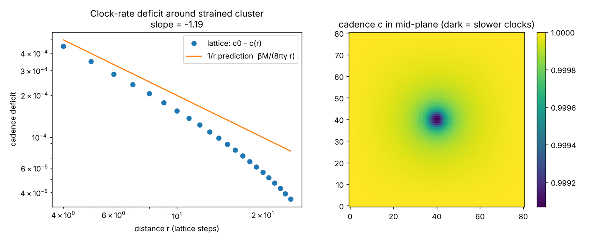

---

### Run 2: phases advancing, globally locked

Rhythms advance at the local cadence, and Coh couples them (gradient flow of αCoh, $K=\alpha$):

$$
\dot\theta_i = c_i + K\sum_{j}\sin(\theta_j-\theta_i)
$$

The locked state rotates at $\Omega=\overline{c}$ and satisfies $K\,L\theta = \Omega - c$. It was verified against the full sin dynamics (drift 10⁻⁷).

**Result:**
- Str + Grad reproduce Newton.
- **Coh repels:** two lagging wells cost more phase strain when close.
- Coh's separation dependence grows with box size: $\text{Coh}(6)-\text{Coh}(18) = -3.3,\ -7.4,\ -12.2\times10^{-3}$ for $N = 33, 49, 65$.

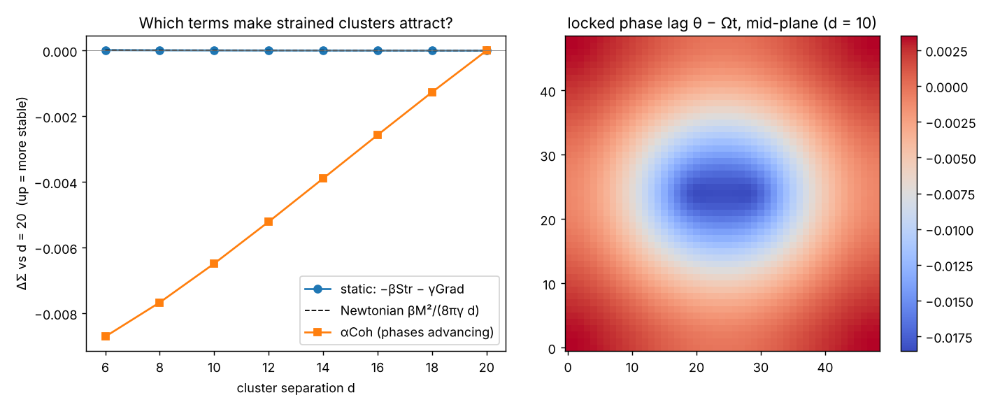

---

### Run 3: weak coupling (slip allowed)

The same dynamics, with $K$ small and the full nonlinear sin coupling. The well is strength $A = 0.1$, in boxes up to $N = 97$.

#### Why Coh cannot be local for a 1/r well (flux argument)

Integrate the locked condition over a ball of radius $r$. The slowness inside grows as $r^2$, exactly like the sphere's area:

$$
K\cdot 4\pi r^2\,\sin(\partial_r\theta) \;=\; \int (\delta c-\Omega)\,dV \;=\; -2\pi A r^2
\quad\Longrightarrow\quad |\sin\partial_r\theta| = \frac{A}{2K}\ \ \text{at every } r
$$

- A 1/r well locks only if $K \ge A/2$, and then the phase gradient **does not decay with distance**.
- Below that threshold, the shear slips everywhere.

**Result:**

| Quantity | Measured |
|---|---|
| Locking threshold | $K^\* \approx 0.4A$ (theory 0.5A) |
| Locked strain at fixed r vs box (N = 33 → 97) | rises toward the constant ½(A/2K)²; extrapolates to ≈ 0.12 against 0.125 |
| Total locked Coh deficit | ∝ volume |
| Unlocked Coh deficit per node | 0.25–0.38 in every box; non-stationary (still winding) |
| Separation dependence (unlocked) | no consistent sign across boxes; drift ±300 → ±10,000 links |
| Phase vortices | appear for $K/A \le 0.1$ |

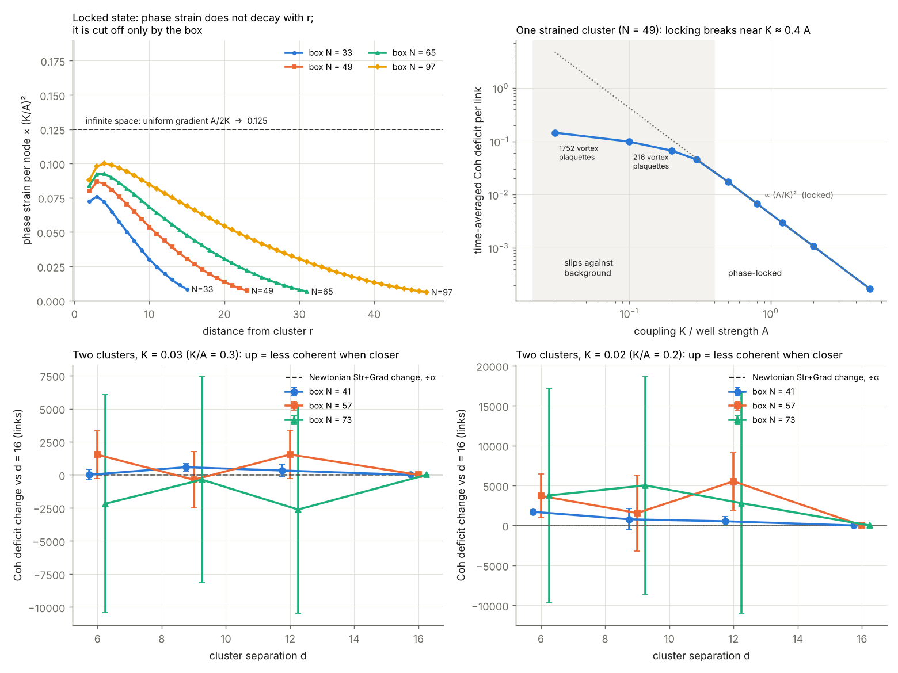

---

### Run 4: Coh with a connection

Gravitational redshift is not decoherence, so neighbours are compared after accounting for the drift that the cadence difference itself produces:

$$
\text{Coh}=\sum_{\langle ij\rangle}\cos(\theta_j-\theta_i-\Phi_{ij}),\qquad \Phi_{ij}=\int (c_j-c_i)\,dt
$$

$$
\dot\theta_i = c_i + \nu_i + K\sum_j \sin(\theta_j-\theta_i-\Phi_{ij})
$$

Because $\Phi_{ij}$ is a difference of node quantities, the **proper phase** $\psi_i=\theta_i-\int c_i\,dt$ absorbs it exactly:

$$
\text{Coh}=\sum\cos(\psi_j-\psi_i),\qquad \dot\psi_i=\nu_i+K\sum_j\sin(\psi_j-\psi_i)
$$

Coh is blind to any cadence field.

**Results:**
- **Gravity only** ($\nu=0$, the same scan as Run 3):
  - Coh deficit 1.5–7.8×10⁻¹² links (rounding), against 25,000–120,000 before.
  - Str + Grad unchanged.
- **Scrambled start:** the deficit falls from 60,090 to 0.0095 with the connection. Without it, it climbs to 34,800 with 490 vortex plaquettes.
- **Boundaries with their own tick rate,** $\nu_i=\nu_0 c_i$ on cluster nodes (locked regime). Coh becomes a Coulomb interaction:

$$
\Delta D(d) = \frac{Q_1Q_2}{4\pi K^2}\Big(\frac1d-\frac1{16}\Big),\qquad Q=\sum_{\text{cluster}}\nu_i
$$

| Pair | ΔD(6→16), N = 73 | Coulomb |
|---|---|---|
| Same-sign rates, no redshift | +1.441 | +1.444 |
| Opposite-sign rates | −1.497 | −1.444 |
| Same sign, with redshift ($\nu_0 c_i$) | +1.067 (box-converged: 1.001, 1.057, 1.067) | — |

- Like rates repel and opposite rates attract, with **the same 1/d range as gravity**.
- The redshift reduces the repulsion by ~15%: the other mass slows each boundary's clock toward the vacuum's.
- If $Q=\kappa M$ (rate ∝ mass), the net 1/d coefficient is $M^2\big[\beta/(8\pi\gamma)-\alpha\kappa^2/(4\pi K^2)\big]$. Coh only weakens Newton's constant.
- Fast ticks (unlocked from the vacuum) leak a steady flux $q\approx1.45$ and give a box-converged, repulsive, Coulomb-like tail.

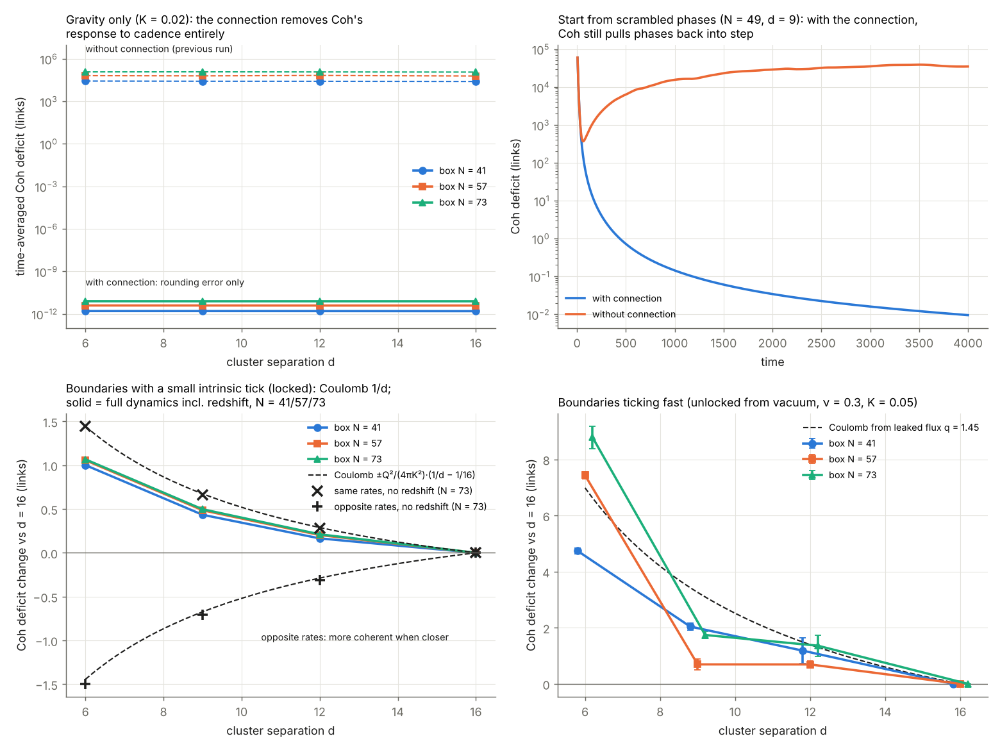

---

### Run 5: commitment as waves

The vacuum carries no commitment. What propagates is the possibility deficit $u=c_0-c$, now as a wave:

$$
\ddot u = v^2\big(\nabla^2 u+\kappa\, m(t)\big)-\sigma(x)\,\dot u,\qquad \kappa=\frac{\beta}{2\gamma}
$$

Its static limit is exactly Run 1. Matter pulsates: it commits, dissolves after its span, and re-commits. Commitment cannot go negative, so:

$$
m(t)=m_0\big(1+\sin(\omega t+\Delta)\big)
$$

The pull on a cluster comes from the Str term: committed matter is drawn toward larger deficit. The possibility field has no $m$, so it feels no pull ("nothing quantum can fill a sail").

$$
P_2=\beta\Big\langle\sum_{i\in 2} m_i(t)\,\partial_x u_i\Big\rangle\ \ \text{(toward body 1)},\qquad
P_N=\frac{\beta\kappa M^2}{4\pi d^2}
$$

Retarded-wave prediction:

$$
\frac{P}{P_N}=1+\tfrac12\Big[\cos(\Delta+kd)+kd\,\sin(\Delta+kd)\Big],\qquad k=\omega/v
$$

Near zone ($kd\ll1$): $P/P_N = 1+\tfrac12\cos\Delta$.

**Results:** $N = 121$, absorbing layer 30 wide. Each cell gives pull ÷ Newton as measured (predicted):

| d | in phase | quarter | anti-phase | unsynced |
|---|---|---|---|---|
| 6 | 1.654 (1.675) | 0.879 (0.873) | 0.344 (0.325) | 0.994 (1) |
| 12 | 1.718 (1.742) | 0.250 (0.234) | 0.274 (0.258) | 0.985 |
| 16 | 1.315 (1.335) | −0.286 (−0.310) | 0.675 (0.665) | 0.989 |
| 20 | 0.498 (0.503) | −0.537 (−0.571) | 1.502 (1.497) | 1.009 |
| 24 | −0.483 (−0.510) | −0.186 (−0.233) | 2.513 (2.510) | 1.041 |
| 28 | −1.177 (−1.244) | 0.849 (0.791) | 3.257 (3.244) | 1.066 |

- **Near zone** (wavelength 126): in phase 1.524 (1.522), anti-phase 0.480 (0.478) at d = 6.
- **No pulsation:** 1.01–1.05 × Newton (finite-size effects from the ball).
- **Sign rule:** matter *gains* from the field, as Str does, so like (in-phase) sources attract. This is the Bjerknes pulsating-sphere sign rule, the opposite of electrostatics.

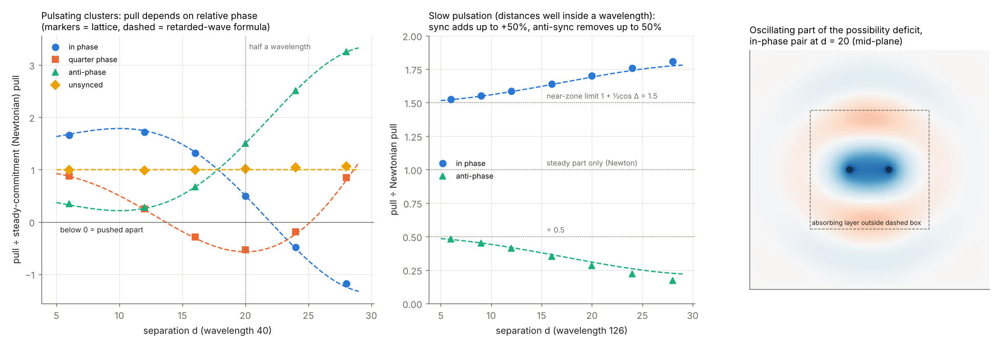

---

### Run 6: free rhythms (does sync happen by itself?)

Each rhythm drifts toward committing when the local deficit is high. This is gradient ascent of Σ's Str term, acting on timing:

$$
\dot\phi_k=\omega_k+\varepsilon\,\frac{\partial\Sigma}{\partial\phi_k}=\omega_k+\varepsilon\beta\cos\phi_k\sum_{i\in k}m_{0,i}\,u_i
$$

Weak-coupling average for a pair, with $\Delta=\phi_2-\phi_1$:

$$
\dot\Delta=\delta\omega-2C\cos(kd)\sin\Delta,\qquad 2C=\frac{\varepsilon\beta\kappa M^2}{4\pi d}
$$

Identical pairs lock **in phase when $\cos kd>0$**, anti-phase when $\cos kd<0$. Mismatched pairs lock only if $|\delta\omega|<2C|\cos kd|$.

**Results:**
- Near zone: 12 of 12 starting phases lock exactly in phase.
- At wavelength 40:
  - d = 16 and d = 28 lock anti-phase.
  - d = 32 locks in phase again.
- Pull after locking (× Newton):

  | d | 8 | 12 | 20 | 16 (λ=40) | 28 (λ=40) | 32 (λ=40) |
  |---|---|---|---|---|---|---|
  | Pull | 1.55 | 1.62 | 1.87 | 0.64 | 3.21 | −1.16 |

  These are within 1–10% of the formula. The gap comes from each rhythm being bent by its own field.
- **Locking width** is 1.7× the weak-coupling estimate, with the same law. The pull fades with mismatch: 1.62 → 1.59 → 1.55 → 1.47 → 1.10 once slipping.
- **27 clusters** from random phases:

  | Tick rates | Sync R |
  |---|---|
  | Identical | 1.00 |
  | 2% spread | 0.98 |
  | 10% spread | 0.26 |
  | No timing drive | 0.10 |

  The shared rhythm runs 5% slow inside the group's combined well.

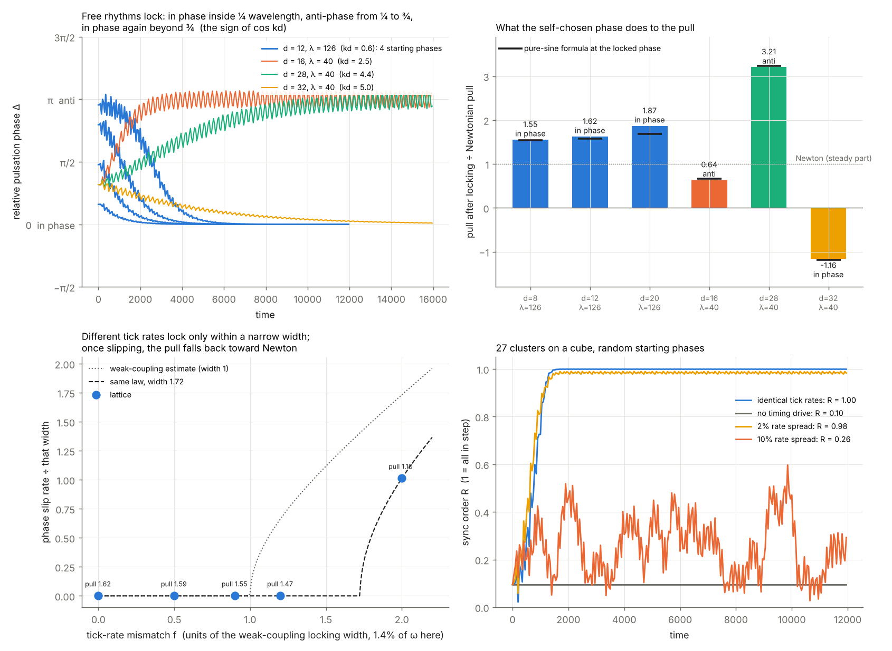

---

### Run 7: equivalence principle (two species)

**Setup:**
- Species A has mass 1 and species B mass 2.
- The source is 27 sub-clusters, either A-rich (64% of the mass in A) or B-rich (88% in B).
- One test body of each species sits at equal distance, in both orientations.

**Timing resistance** ("mass is resistance" also for rhythm): $\varepsilon_k=\varepsilon/M_k$, so

$$
\dot\phi_k=\omega_k+\varepsilon\beta\cos\phi_k\,\bar u_k,\qquad \bar u_k=\frac{1}{M_k}\sum_{i\in k}m_{0,i}u_i
$$

$$
\eta=\frac{2(a_A-a_B)}{a_A+a_B},\qquad a=\frac{\text{pull}}{M}\Big/\big(\text{same, no pulsation}\big)
$$

**Results** (ε = 0.03):

| Rule | $a_A$, $a_B$ (× Newton) | η |
|---|---|---|
| Rate ∝ mass ($\omega_B=2\omega_A$), A-rich source | 1.24, 1.12 | **+0.098** |
| Rate ∝ mass, B-rich source | 1.01, 1.49 | **−0.382** |
| Shared rhythm, A-rich source | 1.53, 1.53 | −0.0018 |
| Shared rhythm, B-rich source | 1.51, 1.51 | −0.0027 |
| Shared rhythm, no timing resistance | 1.49, 1.53 | −0.021 |

- **Rate ∝ mass:** each body syncs only with its own species, and its boost is $1+\tfrac12\times$ (own species' share of the source mass). This is composition-dependent gravity.
- **Shared rhythm:** the leftover scales as $\varepsilon^2$:

  | ε | Timing resistance | No timing resistance |
  |---|---|---|
  | 0.03 | −0.0018 | −0.021 |
  | 0.015 | −0.0004 | −0.0049 |
  | 0.0075 | ≈ 0 | −0.0010 |

  So it comes from the timing drive bending each rhythm, not from the shared-rhythm idea.

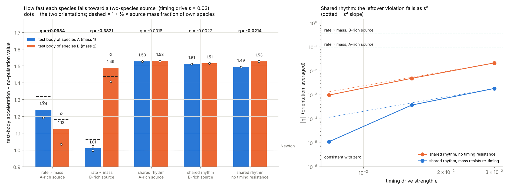

---

### Run 8: redshifted rhythms

The shared rhythm is shared in each body's own (proper) time. In coordinate time:

$$
\dot\phi_k=\omega_0\Big(1-\frac{\bar u_k}{c_0}\Big)+\varepsilon\beta\cos\phi_k\,\bar u_k
$$

The body's own deficit is included. Everything starts in step. Window: 45,000 time units (≈ 4 beats), error bars from thirds.

| Case | Lock to source | $a_A$, $a_B$ | η |
|---|---|---|---|
| Redshift off, D = 12–28 | locked | 1.52–1.55 | −0.001 … −0.005 |
| On, ε = 0.03, D = 12 | locked | 1.38, 1.46 | −0.057 |
| On, ε = 0.03, D = 18–28 | slipping | 1.00–1.03, 1.01–1.06 | ≈ 0 ± 0.06 |
| On, ε = 0.1, D = 12 | locked | 1.50, 1.52 | −0.018 |
| On, ε = 0.1, D = 18 | B locked, A half | 1.05, 1.12 | −0.065 ± 0.006 |
| On, ε = 0.1, D = 24–28 | slipping | 1.02–1.04, 1.07 | −0.03 … −0.05 |

- Slipping bodies feel a pull that **beats between 0.5× and 1.5× Newton** at the redshift-mismatch frequency.
- The heavier body sits deeper in its own well, so it locks more easily and slips more slowly. That brings back a mass-dependent rate.
- An interim first-pass value of η = −0.35 at D = 18 was a start-up transient and is superseded by the long-window runs.

#### Why no parameter choice rescues inter-body sync

| Quantity | Expression |
|---|---|
| Redshift mismatch | $\omega_0(\bar u_{\rm src}-\bar u_{\rm test})$ |
| Locking width | $\approx\tfrac12\varepsilon\,u_{\rm ext}$ |
| Bend in each rhythm | $b\approx\varepsilon\bar u/\omega_0$ |

- Lock requires $b\gtrsim 2(\bar u_{\rm src}-\bar u_{\rm test})/u_{\rm ext}$, which is of order 1 for bodies at different depths.
- The EP requires $b\lesssim10^{-7}$ (Run 7's ε² law against the ~10⁻¹⁵ experimental bound).
- Both mismatch and width scale with the potential, so the weakness of gravity does not help.

**Sync can only hold between things at essentially the same depth.**

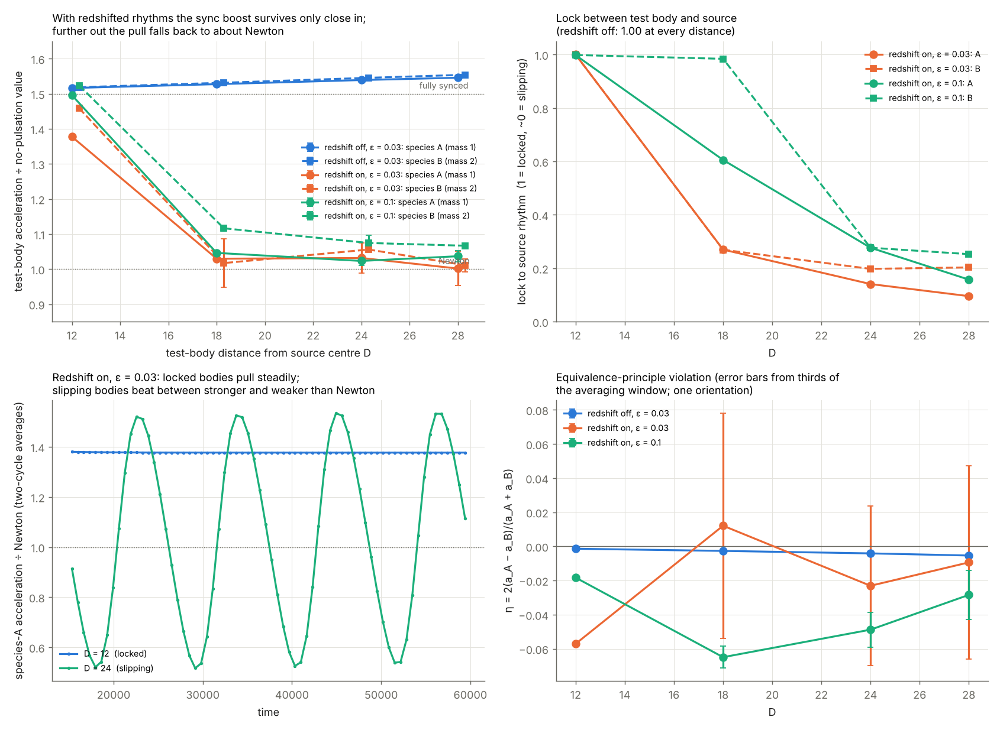

---

### Run 9: light bending (space strain)

**The question.** Is clock-slowing alone enough to bend light by the observed amount? The target is fixed in advance:

- Observed deflection of light passing a mass at impact parameter $b$: $\alpha = 4GM/(c^2 b)$.
- In PPN terms that is $\alpha=2(1+\gamma)GM/(c^2b)$ with $\gamma=1$. Cassini's Shapiro-delay measurement gives $\gamma-1=(2.1\pm2.3)\times10^{-5}$.
- Lattice dictionary: the cadence deficit $\Phi=u/c_0=A/r$ plays the role of $GM/(c^2r)$, so $A\leftrightarrow GM/c^2$.

#### Rules for how possibility moves

Possibility carries no commitment. It advances one relation per local tick of the substrate, so its coordinate speed is

$$
v=v_0\,\frac{\text{tick rate}}{\text{relation length}},\qquad n=\frac{v_0}{v}
$$

| Rule | Ticks | Relations | Speed $v/v_0$ | Index $n$ (first order) |
|---|---|---|---|---|
| Time only | slowed $(1-\Phi)$ | unchanged | $1-\Phi$ | $1+\Phi$ |
| Relations stretch | slowed $(1-\Phi)$ | stretched $(1+\gamma\Phi)$ | $(1-\Phi)/(1+\gamma\Phi)$ | $1+(1+\gamma)\Phi$ |
| Free capacity | possibility needs free bandwidth to tick *and* to hop; matter occupies the same fraction $\Phi$ of each | | $(1-\Phi)^2$ | $1+2\Phi$ |

#### Ray-optics predictions

For $n-1=(1+\gamma)A/r$ and a straight path from $-L_1$ to $L_2$:

$$
\Delta T(b)=(1+\gamma)\frac{A}{v_0}\Big[\operatorname{asinh}\frac{L_1}{b}+\operatorname{asinh}\frac{L_2}{b}\Big],\qquad
\alpha(b)=v_0\Big|\frac{d\,\Delta T}{db}\Big|\;\xrightarrow{L\gg b}\;\frac{2(1+\gamma)A}{b}
$$

- **Time only** gives $\alpha=2A/b$, half the observed value.
- **Free capacity** gives $\gamma=1$ at first order, with nothing tuned.

#### Method

- 2D lattice through the plane of the mass: 1100 × 800, periodic in $y$, absorbing layers at both $x$ ends.
- A continuous plane wave at $\omega_0$ crosses the mass. The phase along a detector line (980 lattice steps downstream of the source) is read out by lock-in.
- The delay profile is $\Delta T(y)=-\arg\!\big(Z_{\rm mass}/Z_{\rm ref}\big)/\omega_0$, measured against a reference run with no mass.
- Two mass shapes: a point mass ($A$ = 0.02, softened core) and a smooth uniform ball of radius 25.
- The straight-ray prediction uses the exact lattice dispersion: $k=2\arcsin(\omega_0/2v)$.

#### Results

| Rule | γ from delay ratio, point mass (λ ≈ 10) | Same, λ ≈ 7 | Smooth mass (λ ≈ 5), delay ratio − 1 |
|---|---|---|---|
| Time only | 0 (by definition) | 0 | 0 |
| Stretch γ = 0.5 | 0.499 | — | — |
| Stretch γ = 1 | 0.998 | — | 0.9987 ± 0.0021 |
| Stretch γ = 2 | 1.993 | — | — |
| **Free capacity** | **0.998** | **0.997** | **0.9988 ± 0.0021** |

- **Deflection** (smooth mass, wavefront tilt): free capacity and γ = 1 bend light $2.00$ times as much as time-only at every $b$ from 30 to 300. The ripple is ±0.04, from diffraction fringes.
- **Absolute delay against the straight-ray prediction:** 0.984 (λ ≈ 10) and 0.993 (λ ≈ 7) at $b$ = 80–150, and 0.97–1.01 for the smooth mass. It converges toward 1 as the wavelength shrinks. The residual is diffraction, which is identical for every rule, so it cancels in the ratios.

#### What the run establishes

- The lattice wave dynamics behave as ray optics predicts, with no hidden lattice effect.
- The physics content is the rule itself:
  - Cadence-only is ruled out, by every light-bending measurement since 1919.
  - Relations must strain by the same amount as clocks.
  - "Possibility needs free bandwidth both to tick and to hop" does this automatically.

**Open at second order.** Free capacity gives $n=(1-\Phi)^{-2}=1+2\Phi+3\Phi^2$. In isotropic coordinates GR gives $n=(1+\Phi/2)^3/(1-\Phi/2)=1+2\Phi+\tfrac74\Phi^2$. Whether these agree depends on how $\Phi$ itself becomes nonlinear in strong fields, which is test 2 (multiplicative budget). At first order the stretched relations change none of Runs 1–8, since they enter the field equation only at order $\Phi^2$.

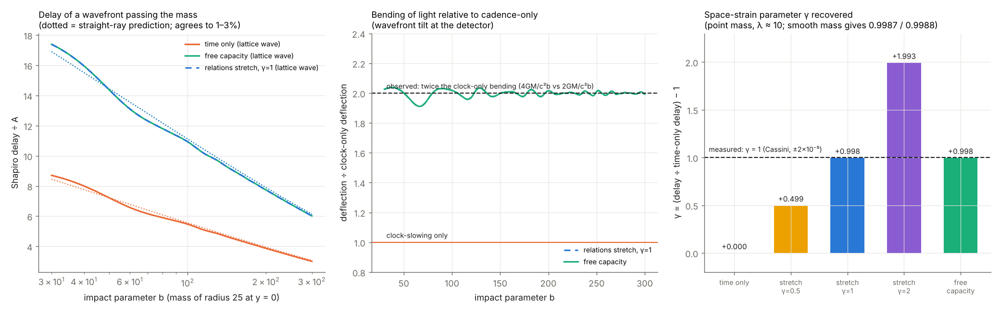

---

### Run 10: perihelion precession (multiplicative budget)

**Target, fixed in advance.** Mercury's perihelion advances about 43″ per century beyond Newton. At first post-Newtonian order:

$$
\Delta\omega=\frac{2+2\gamma-\beta}{3}\;\frac{6\pi GM}{c^2a(1-e^2)}\quad\text{per orbit}
$$

Run 9 fixed $\gamma=1$, so this tests $\beta$, the second-order shape of the clock rate:

$$
N\equiv\frac{c}{c_\infty}=\sqrt{-g_{00}},\qquad -g_{00}=1-2U+2\beta U^2\;\Rightarrow\;N=1-U+\big(\beta-\tfrac12\big)U^2
$$

#### Two budgets in Σ

**Additive** (Run 1): relations compare cadence *differences*.

$$
\Sigma=-\beta_s\sum m_ic_i-\gamma_s\sum_{\langle ij\rangle}(c_i-c_j)^2\;\Rightarrow\;\nabla^2c=\frac{\beta_s}{2\gamma_s}m\;\Rightarrow\;N=1-U\quad(\beta=\tfrac12)
$$

**Multiplicative:** relations compare cadence *ratios*, so each commitment takes a fraction of what is left.

$$
\Sigma=-\beta_s\sum m_ic_i-\gamma_s\sum_{\langle ij\rangle}(\ln c_i-\ln c_j)^2\;\Rightarrow\;\nabla^2\ln c=\frac{\beta_s}{2\gamma_s}\,c\,m\;\Rightarrow\;N=e^{-U}\quad(\beta=1)
$$

Here $\beta_s,\gamma_s$ are Σ's weights, not the PPN parameters. In the multiplicative case the field is nonlinear only inside matter, where the source is weighted by the local cadence. Outside, $\ln c$ is harmonic. Note also that $N=e^{-U}$ never reaches zero: a finite budget occupied multiplicatively is never fully used up.

#### Law of motion: maximal commitment count

A body's own commitments are its proper time, so it follows the path that maximises them:

$$
\delta\!\int d\tau=0,\qquad d\tau^2=N^2dt^2-B^2|d\mathbf x|^2
$$

- $B$ is the relation length. Free capacity gives $B=1/N$.
- In the slow limit, $\tau\approx\int(1-U-\tfrac12v^2)\,dt$. That is Newtonian motion toward slower clocks, the same pull as Runs 1–8.

Integrated in Hamiltonian form, with $E$ conserved:

$$
\dot{\mathbf x}=\mathbf p/B^2,\qquad \dot{\mathbf p}=-E^2N^{-3}\nabla N+|\mathbf p|^2B^{-3}\nabla B,\qquad E=N\sqrt{1+|\mathbf p|^2/B^2}
$$

#### Results

**(a) Lattice (97³, ball source).** $N=1-U+b_2U^2+b_3U^3$ is fitted outside the source, with $U$ from the far field.

| Source | Additive β (exact ½) | Multiplicative β (exact 1) | Multiplicative, with the additive run as control |
|---|---|---|---|
| U ≤ 0.05 | 0.452 | 0.947 | 0.995 |
| U ≤ 0.10 | 0.476 | 0.971 | 0.995 |

The additive case is exactly ½ by construction, so its offset measures the shared lattice and box bias. That bias shrinks as the field gets stronger.

**(b) Orbits.** DOP853 integrator, relative tolerance 10⁻¹³, eccentricity 0.3, 12 orbits per run, $U$ from 10⁻⁴ to 10⁻², extrapolated to $U\to0$.

| Rule | β | γ | Predicted $(2+2\gamma-\beta)/3$ | Measured | Mercury ″/century |
|---|---|---|---|---|---|
| Newton (Str pull only) | — | — | 0 | 6.5×10⁻¹³ rad/orbit | 0 |
| Additive, time only | ½ | 0 | 0.5 | 0.49995 | 21.5 |
| Additive + free capacity | ½ | 1 | 7/6 | 1.16632 | 50.1 |
| Multiplicative, time only | 1 | 0 | 1/3 | 0.33333 | 14.3 |
| **Multiplicative + free capacity** | **1** | **1** | **1** | **0.99987** | **42.97** |
| GR (Schwarzschild, control) | 1 | 1 | 1 | 0.99989 | 42.98 |

#### Reading

- Of the four combinations, only *multiplicative budget + free capacity* matches both light bending and Mercury.
- Its metric is $ds^2=-e^{-2U}dt^2+e^{2U}d\mathbf x^2$, the "exponential metric". It agrees with GR at first post-Newtonian order. It differs at second order: at $U=10^{-2}$ the precession coefficient is 1.040, against GR's 1.037. That difference is far below what Mercury can see.
- It has **no horizon**, since $N$ never reaches zero. Strong-field gravity (black-hole images, gravitational-wave ringdowns, compact binaries) is therefore where this version of the ontology will be tested next.

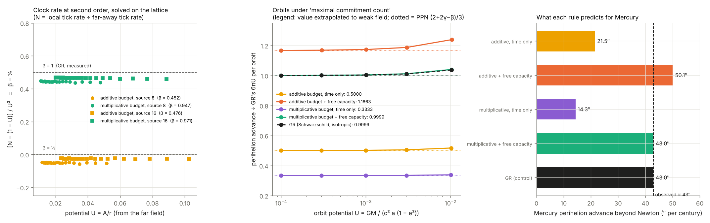

---

### Run 11: gravitational radiation from a binary

**Target, fixed in advance.** Binary pulsars lose orbital energy at GR's quadrupole rate. Hulse–Taylor agrees with it to about 0.2%. For a circular binary (reduced mass $\mu$, separation $a$, angular frequency $\omega$):

$$
P_{\rm GR}=\frac{32}{5}\,\frac{G\mu^2a^4\omega^6}{c^5}
$$

#### Field and energy flux

The cadence deficit $u$ travels at light speed (CO's own result, consistent with GW170817). Its Lagrangian is Σ's Grad and Str terms made dynamical:

$$
\mathcal L=\frac{\gamma_s}{c^2}\dot u^2-\gamma_s|\nabla u|^2+\beta_s\,m\,u\;\Rightarrow\;\ddot u=c^2\big(\nabla^2u+\kappa m\big),\quad \kappa=\frac{\beta_s}{2\gamma_s}
$$

The static limit $u=\kappa M/(4\pi r)$ fixes $G=\kappa/4\pi$. The energy flux is $\mathbf S=-2\gamma_s\,\dot u\,\nabla u$.

#### Prediction for a single (scalar) field

The radiation zone gives $u_{\rm rad}=\dfrac{\kappa}{8\pi r c^2}\,n_in_j\,\dddot I^{ij}$ with $I^{ij}=\sum m\,x^ix^j$. Using $\int n_in_jn_kn_l\,d\Omega=\tfrac{4\pi}{15}(\delta\delta+\delta\delta+\delta\delta)$:

$$
P_{\rm field}=\frac{G}{60c^5}\Big[(\dddot I_{ii})^2+2\,\dddot I_{ij}\dddot I_{ij}\Big]
=\frac{16}{15}\,\frac{G\mu^2a^4\omega^6}{c^5}=\frac16\,P_{\rm GR}\quad\text{(circular orbit)}
$$

- Dipole radiation cancels because the coupling is universal (the EP holds, Run 7).
- Monopole radiation cancels because the source is constant on a circular orbit.

#### Method

- 171³ lattice, absorbing layer 30 wide, field speed 1.
- Two Gaussian bodies (width 1.5) on a prescribed circular orbit.
- Outward flux integrated over a sphere of radius 40–60, averaged over 12 radiation periods.
- **Reference subtraction:** a second field, sourced by the orbit-averaged ring with the same switch-on, is subtracted before measuring flux. Otherwise the slow settling of the static field swamps the radiated flux. The equation is linear, so this subtraction is exact.
- **Body size:** each body's width suppresses radiation at wavenumber $k=2\omega$ by the form factor $F=e^{-(2\omega s)^2}$. Values are reported with $F$ divided out.

#### Results

| a | ω | (ωa)² | Raw ÷ single-field | Body-size factor F | Corrected | ÷ GR |
|---|---|---|---|---|---|---|
| 4 | 0.08 | 0.10 | 0.943 | 0.944 | 0.999 | 0.1665 |
| 4 | 0.10 | 0.16 | 0.909 | 0.914 | 0.994 | 0.1657 |
| 4 | 0.12 | 0.23 | 0.872 | 0.878 | 0.993 | 0.1655 |
| 3 | 0.08 | 0.06 | 0.947 | 0.944 | 1.003 | 0.1672 |
| 3 | 0.10 | 0.09 | 0.914 | 0.914 | 1.000 | 0.1667 |
| 3 | 0.12 | 0.13 | 0.878 | 0.878 | 0.999 | 0.1666 |
| 3 | 0.15 | 0.20 | 0.802 | 0.817 | 0.982 | 0.1637 |

**Mean for ω ≥ 0.08:** 0.996 ± 0.006 of the single-field prediction, which is **0.166 of GR**.

**Checks:**
- Changing the sphere radius (40 / 50 / 60) changes the result by less than 0.2%.
- The power follows the $\omega^6$ law.
- At the longest wavelength (ω = 0.05), reflections from the absorbing edge shift the result by 2–7%.

#### Reading

- **This fails, by a factor of 6.** A single cadence field, with relations stretching in step with it, cannot be the whole of gravity.
- In GR, the radiation is carried by *shear* of space: transverse stretch-one-way, squeeze-the-other strain with two polarizations. LIGO/Virgo's three-detector events favour these tensor polarizations over a pure scalar mode.
- **What the ontology needs:**
  - Relations that can be sheared (strained differently in different directions), with that shear propagating at $c$ as its own wave, sourced by matter's flow.
  - The cadence / isotropic-stretch part bound to matter rather than radiating independently. Otherwise the total would be $\tfrac{32}{5}+\tfrac{16}{15}$, too much.

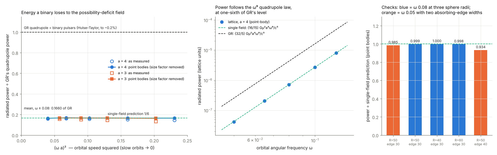

---

### Run 11b: shear of relations

**Question.** Run 11 found that the cadence field alone radiates 1/6 of what binary pulsars lose. Its reading said the missing radiation must come from **shear**: relations stretched one way and squeezed the other, travelling at $c$. This run gives relations a full strain field and measures what an orbiting pair radiates into it. It does this under two ways of counting what is real.

**Target, fixed in advance.** As in Run 11, the target is GR's quadrupole power for a circular binary:

$$
P_{\rm GR}=\frac{32}{5}\,\frac{G\mu^2a^4\omega^6}{c^5}
$$

The double pulsar (Kramer et al. 2021) agrees with this to $1.3\times10^{-4}$. So any extra radiation channel is excluded unless it is at least ten thousand times weaker than GR's.

A pre-registration (`PREREG.md` in the bundle) was written before any run. It fixes the predictions and the reading below.

#### Field

Relation strain is a symmetric $3\times3$ field $s_{ij}$ with six components. Each component is a wave at $c=1$, sourced by the stress of matter:

$$
\ddot s_{ij}=\nabla^2 s_{ij}+16\pi G\,T_{ij},\qquad G=\frac{1}{16\pi}\ \text{(lattice units)}
$$

This is linearised gravity in harmonic gauge, restricted to its spatial part. At this order "each component is a wave" and "linearised GR" are the same equation.

Energy flux through a sphere of radius $R$, time-averaged:

$$
S=-\frac{1}{32\pi G}\,\big\langle\dot s_{ij}\,\partial_r s_{ij}\big\rangle=-\tfrac12\big\langle\dot s_{ij}\,\partial_r s_{ij}\big\rangle,\qquad P=\oint S\,R^2\,d\Omega
$$

#### Source: the bodies and the relations that bind them

The two bodies have equal masses $m_b$, sit at separation $a$, and orbit at angular frequency $\omega$. The reduced mass is $\mu=m_b/2$. Their stress has two parts:

- **Bodies:** each carries its momentum flux, $m_b\,v_iv_j$, on a Gaussian blob of width $s=1.5$.
- **Relations binding the pair:** the line joining the bodies carries the binding tension, $-F\,\hat n_i\hat n_j$ with $F=\mu\omega^2a$. Here $\hat n$ is the unit vector from one body to the other. The tension is spread over 16 blobs along the line.

Together they give exactly the source the quadrupole formula needs. With $\hat t$ the direction of motion:

$$
\int T_{ij}\,d^3x=\underbrace{\mu\omega^2a^2\,\hat t_i\hat t_j}_{\text{bodies}}\;\underbrace{-\;\mu\omega^2a^2\,\hat n_i\hat n_j}_{\text{relations}}=\tfrac12\,\ddot I_{ij},\qquad I_{ij}=\sum m\,x_ix_j
$$

The tension is not optional. Momentum conservation, $\partial_\mu T^{\mu\nu}=0$, requires that whatever holds the pair together carries stress. In GR that stress lives in the Newtonian field itself, spread through space. For the quadrupole only its integral matters, and a line of tension between the bodies has the same integral. In the ontology's terms: **the binding lives in the relations between the bodies, and those relations are under tension.**

#### Splitting the radiation by polarisation

At each point on the sphere, with outward direction $\hat n$ and transverse projector $P_{ij}=\delta_{ij}-n_in_j$, the strain splits into four parts that do not mix:

| Part | Projection | What it does to relations |
|---|---|---|
| TT (plus and cross) | $s^{TT}=PsP-\tfrac12P\,\mathrm{tr}(PsP)$ | stretch one way, squeeze the other, across the direction of travel: **shear** |
| breathing | $\tfrac12P\,\mathrm{tr}(PsP)$ | uniform stretch across the direction of travel |
| longitudinal | $\hat n\hat n\,(\hat n\cdot s\cdot\hat n)$ | stretch along the direction of travel |
| vector | $s-PsP-\hat n\hat n\,(\hat n\cdot s\cdot\hat n)$ | shear between the direction of travel and across it |

The power in each part is the same flux integral, taken with that part alone.

#### Two countings of what is real

- **(R) Relations are all there is.** Two rules together leave only TT.
  - **Sliding places is free.** Space is who relates to whom, so places have no identity apart from their relations. Sliding every place by a small amount, $x\to x+\xi(x)$, changes the strain by $\partial_i\xi_j+\partial_j\xi_i$. That relabels the places but changes no relation, so it can carry no energy. For a wave travelling along $\hat n$, this is exactly the vector and longitudinal parts.
  - **Isotropic stretch is bound to matter.** The breathing part cannot be made by sliding. It is a uniform stretch, the same kind of quantity as capacity. Under the reading fixed in advance, it is set by matter at each moment rather than radiating. That is the same rule the pre-registration applied to the capacity scalar; see Reading 3.
  - *Wording corrected while writing up:* the pre-registration said sliding alone removes every non-TT part. It removes the vector and longitudinal parts only. Prediction R1 (TT ÷ GR) is unchanged.
- **(E) Every strain pattern is real.** Places have identity, and stretch radiates freely. **All six components count.**

#### Predictions (pre-registered)

The radiation-zone field is $s_{ij}\propto\ddot Q_{ij}(t-r)/r$ with $Q=\tfrac12\ddot I$ traceless. Per unit $Q{:}Q$, its angular integrals are:

$$
\textstyle\int\!\big|s^{TT}\big|^2d\Omega=\frac{8\pi}{5},\quad \int\!\big|s^{\rm vec}\big|^2d\Omega=2\!\int\!|PQ\hat n|^2d\Omega=\frac{8\pi}{5},\quad \int\!(\hat nQ\hat n)^2d\Omega=\frac{8\pi}{15},\quad \int\!\big|s^{\rm br}\big|^2d\Omega=\frac{4\pi}{15}
$$

These four sum to $4\pi$.

- **R1.** $P_{TT}/P_{\rm GR}=1.00$. The window is ±0.05 after the body-size factor $e^{-(2\omega s)^2}$ is divided out. A result outside it would mean the source or the counting is wrong.
- **E1.** $P_{\rm all}/P_{\rm GR}=4\pi\big/\tfrac{8\pi}{5}=2.5$.
- **E2.** Shares of $P_{\rm all}$: TT 0.400, vector 0.400, longitudinal 0.133, breathing 0.067.
- **Checks:** the power follows $\omega^6$, and it does not depend on the sphere's radius.

#### Method

- **Lattice:** 171³, with an absorbing layer 30 wide ($\sigma=0.3\,((W-d)/W)^2$). Leapfrog with $dt=0.5$. All six components are evolved together.
- **Switch-on:** the source is turned on over $t=200$ with a cosine ramp. The run then settles for the light-crossing time plus 4 radiation periods.
- **Measurement:** a lock-in at $2\omega$ over 12 whole radiation periods. It records $\dot s_{ij}$ and $\partial_r s_{ij}$ at every lattice place on the sphere (31,742 places at $R=50$). Flux per part is $-\tfrac14\,\mathrm{Re}\big(\Pi\dot{\tilde s}:\Pi\partial_r\tilde s^{*}\big)$.
- **No reference field.** Run 11 needed one; here the lock-in over whole periods rejects the static part of the source.
- **Sweep:** $a=3,4$; $\omega=0.05$–$0.12$; $R=40,50,60$.
- **Control:** the binding tension switched off, leaving only the bodies.

#### Results

All values are power ÷ GR, with the body-size factor divided out.

| a | ω | (ωa)² | body-size factor | **TT ÷ GR** | all six ÷ GR | all ÷ TT |
|---|---|---|---|---|---|---|
| 4 | 0.05 | 0.040 | 0.978 | 0.973 | 2.424 | 2.493 |
| 4 | 0.065 | 0.068 | 0.963 | 1.008 | 2.517 | 2.498 |
| 4 | 0.08 | 0.102 | 0.944 | 0.979 | 2.437 | 2.490 |
| 4 | 0.10 | 0.160 | 0.914 | 0.975 | 2.423 | 2.486 |
| 4 | 0.12 | 0.230 | 0.878 | 0.964 | 2.392 | 2.481 |
| 3 | 0.08 | 0.058 | 0.944 | 0.987 | 2.461 | 2.494 |
| 3 | 0.10 | 0.090 | 0.914 | 0.988 | 2.461 | 2.492 |
| 3 | 0.12 | 0.130 | 0.878 | 0.983 | 2.446 | 2.489 |
| 4 (R = 40) | 0.08 | 0.102 | 0.944 | 0.979 | 2.437 | 2.490 |
| 4 (R = 60) | 0.08 | 0.102 | 0.944 | 0.977 | 2.433 | 2.490 |
| **mean of 10** | | | | **0.981 ± 0.012** | **2.443 ± 0.033** | **2.490 ± 0.005** |
| 4, tension off | 0.08 | 0.102 | 0.944 | 0.241 | 0.602 | 2.498 |

**Polarisation shares**, mean of 10 runs, with the prediction in brackets:

| TT | vector | longitudinal | breathing |
|---|---|---|---|
| 0.402 (0.400) | 0.398 (0.400) | 0.135 (0.133) | 0.065 (0.067) |

**The same parts in units of GR:**
- vector + longitudinal (what sliding removes): 1.30 ± 0.02 (predicted 1.33)
- breathing (isotropic stretch): 0.159 ± 0.004 (predicted 1/6)

The breathing figure is the same size as Run 11's cadence field, which gave 0.166.

**Checks:**
- **Frequency law.** Power against $\omega$ has log-slope 5.98 at $a=4$ and 5.99 at $a=3$, against the expected 6.
- **Sphere radius.** Spheres at 40, 50 and 60 agree to 0.16%.
- **Small shortfall.** TT sits 1–3.5% below 1, and the shortfall grows with $(\omega a)^2$. A straight-line fit (excluding ω = 0.05) gives $\mathrm{TT/GR}=1.005-0.18\,(\omega a)^2$. This is what finite source size beyond the quadrupole approximation does. At ω = 0.05 the absorbing edge reflects a few percent, as it did in Run 11.

**Tension-off control** (not in the pre-registration document). Without the binding tension, only the bodies' $\mu\omega^2a^2\,\hat t\hat t$ remains. Of that, only half oscillates:

$$
\hat t\hat t=\tfrac12(\hat t\hat t+\hat n\hat n)+\tfrac12(\hat t\hat t-\hat n\hat n)
$$

The first term is constant, so the expected power is $(\tfrac12)^2=0.25$ of GR. Measured: 0.241. **Half of the radiating stress amplitude lives in the relations that bind the pair.**

#### Against the pre-registration

| Prediction | Expected | Measured | |
|---|---|---|---|
| R1: TT ÷ GR | 1.00 ± 0.05 | 0.981 ± 0.012 | **pass** |
| E1: all six ÷ GR | 2.5 | 2.443 (all ÷ TT: 2.490 ± 0.005) | **pass** |
| E2: shares TT / vector / longitudinal / breathing | 0.400 / 0.400 / 0.133 / 0.067 | 0.402 / 0.398 / 0.135 / 0.065 | **pass** |
| ω⁶ law | slope 6 | 5.98, 5.99 | **pass** |
| independent of sphere radius | — | 0.16% | **pass** |

#### Reading

**1. With "relations are all there is", shear gives GR's binary radiation: 0.98 of GR, within the pre-registered window.**
- What survives is two polarisations, plus and cross. This is what LIGO/Virgo's three-detector events favour.
- The two rules behind the counting are the ontology's own, not fitted:
  - sliding places is free, which follows from "space is who relates to whom"
  - isotropic stretch is bound to matter, which is the capacity rule in Reading 3

**2. "Every strain pattern is real" is excluded.**
- It radiates 2.44× GR. Of that, 40% is vector, 13% longitudinal and 7% breathing.
- The double pulsar allows about $10^{-4}$ beyond GR, so this is off by four orders of magnitude.
- Places cannot have identity apart from their relations.

**3. Isotropic stretch, capacity included, must not radiate energy of its own.**
- Two isotropic channels would each add about 1/6 of GR if they radiated freely:
  - the breathing part here: 0.16
  - the capacity (cadence) scalar of Runs 1–10: 0.17 (Run 11)
- Either one alone already takes the total to 1.15 of GR, which is excluded.
- **What works is a constraint.** These fields are set by where matter is at each moment, not by a wave equation of their own. GR works the same way: in its gauge-invariant split (Flanagan & Hughes 2005), only the TT part obeys a wave equation. The scalar parts, the Newtonian potential and the isotropic spatial stretch, obey Poisson-type equations tied to matter.
- Light bending (Run 9) and the perihelion (Run 10) use only the static profiles, so they are untouched.
- **Open question for CO's event layer:** how does the capacity shortage follow moving matter without being a wave?
  - A Planck-step random walk is far too slow to keep up.
  - Ballistic spreading at $c$ radiates.

**4. The binding lives in relations.** With the tension off, the power falls to a quarter. The relations holding the pair together must carry stress, and that stress radiates as much as the bodies' motion does.

**5. What this is and is not.**
- **Is not:** a new prediction. This is linearised GR, so the run shows that the ontology *can* carry it, and which readings of the ontology cannot.
- **Is (the CO content):**
  - sliding places is free, which follows from "space is who relates to whom"
  - isotropic stretch and capacity are bound to matter, with no waves of their own
  - binding tension in the relations

**6. Saddles.** CO's earlier saddle-shaped geometry was tidal: the Hessian of a scalar, i.e. second derivatives of capacity. That is a static stretch-and-squeeze around a mass. It is not this shear, which is a travelling wave of its own.

**7. Pointer forward.**
- The physical part of shear, what survives relabelling, is curvature: the mismatch accumulated going around a closed loop of relations.
- That is the same square-loop structure Run 13 needed to hold knots.
- So the natural next construction is Regge-like dynamics on the random cubical complex: shear as loop mismatch, on the same substrate that holds particles.

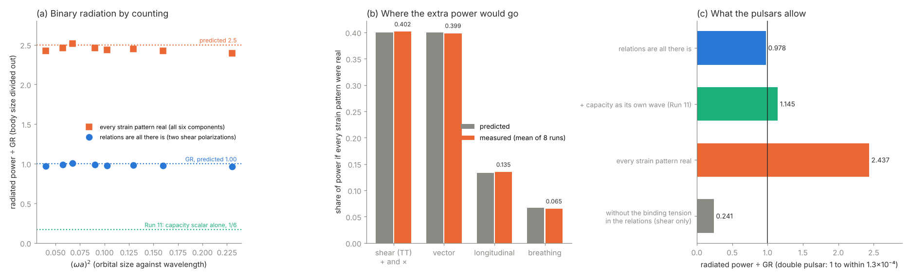

---

### Run 12: particles as knots (D14)

**Claim tested.** A particle is a knot of commitments that cannot be cut. Its mass is the cost of holding the knot.

**Target fixed in advance.** A director field with an alignment term and a squared-winding term is the Faddeev–Skyrme model. Its knotted solitons (hopfions) have known continuum energies, from Sutcliffe 2007 (arXiv:0705.1468):

| Q | 1 | 2 | 3 | 4 |
|---|---|---|---|---|
| $E_Q$ (Faddeev units) | 1.204 | 1.967 | 2.754 | 3.445 |
| $E_Q/E_1$ | 1 | 1.634 | 2.287 | 2.861 |

#### Model

Each node carries a unit director $\mathbf n_i\in S^2$: the orientation its commitments hold. The vacuum is $\mathbf n=(0,0,-1)$.

**Coh (alignment)** is the cost of neighbouring commitments disagreeing:

$$
E_{\rm coh}=h\sum_{\langle ij\rangle}|\mathbf n_j-\mathbf n_i|^2\;\longrightarrow\;\int|\partial\mathbf n|^2\,d^3x
$$

**Str (holding a topological commitment)** is the squared winding density. On the lattice it is the symmetric "four-corner" form, the squared area that each corner's two links sweep on the sphere:

$$
E_{\rm str}=\frac1h\sum_i\sum_{a<b}\tfrac14\sum_{s_a,s_b=\pm}\big|(\mathbf n_{i+s_a\hat a}-\mathbf n_i)\times(\mathbf n_{i+s_b\hat b}-\mathbf n_i)\big|^2\;\longrightarrow\;\int\sum_{a<b}|\partial_a\mathbf n\times\partial_b\mathbf n|^2\,d^3x
$$

The energy in Faddeev units is

$$
E=\frac{1}{32\pi^2\sqrt2}\,\big(E_{\rm coh}+E_{\rm str}\big).
$$

**Uncuttable rule (D14).** A relation may bend by up to 60° at no cost but may not flip:

$$
E_{\rm cut}=k_b\,h\sum_{\langle ij\rangle}\max\!\big(0,\;1-\mathbf n_i\cdot\mathbf n_j-c_0\big)^2,\qquad c_0=0.5,\;k_b=2000 .
$$

**Knot number (Hopf charge).** With $B_i=\tfrac12\epsilon_{ijk}\,\mathbf n\cdot(\partial_j\mathbf n\times\partial_k\mathbf n)$ and $\nabla\times\mathbf A=\mathbf B$ (solved by FFT, fourth-order differences):

$$
Q=\frac{1}{16\pi^2}\int\mathbf A\cdot\mathbf B\,d^3x .
$$

**Why Str is needed (Derrick).** Under a rescaling $x\to\lambda x$:

$$
E_{\rm coh}\to\lambda\,E_{\rm coh},\qquad E_{\rm str}\to E_{\rm str}/\lambda .
$$

- Coh alone always lowers its energy by shrinking, so it has no stable size.
- Coh + Str has a minimum at $E_{\rm coh}=E_{\rm str}$ (virial = 1).
- The knot's size and mass then come from the two couplings: $R\sim\sqrt{k_{\rm str}/k_{\rm coh}}$, $M\sim\sqrt{k_{\rm coh}k_{\rm str}}$, and $M R\propto k_{\rm str}$.

**Seeds.** A compact rational-map ansatz, exactly vacuum beyond radius ρ, so the periodic box has no seam:

$$
Z_0=\cos f+i\tfrac{z}{r}\sin f,\quad Z_1=\tfrac{x+iy}{r}\sin f,\quad f=\pi(1-r/\rho),\quad W=Z_1^{\,m}/Z_0^{\,k},\quad Q=mk .
$$

**Relaxation.** FIRE on the sphere, with each site's step capped at 0.02 so there are no jumps that could cut. This is followed by plain projected gradient flow as a stability check.

#### Results

**(a) Spectrum.** N = 80, h = 0.2 (box 16), Coh + Str, no cutting rule.

| Q | Seed (m, k) | E (lattice) | E (Sutcliffe) | $E_Q/E_1$ | $E_Q/E_1$ (Sutcliffe) | Q measured | Virial $E_{\rm coh}/E_{\rm str}$ | Core radius | max \|grad\| |
|---|---|---|---|---|---|---|---|---|---|
| 1 | (1,1) | 1.1951 | 1.204 | 1 | 1 | −0.989 | 0.868 | 1.34 | 8×10⁻¹⁴ |
| 2 | (2,1) | 1.9637 | 1.967 | **1.643** | 1.634 | −1.989 | 0.922 | 1.84 | 8×10⁻¹² |
| 3 | (3,1) | 2.7475 | 2.754 | **2.299** | 2.287 | −2.985 | 0.913 | 2.25 | 5×10⁻⁶ |
| 4 | (2,2) | 3.4826 | 3.445 | **2.914** | 2.861 | −3.963 | 0.953 | 2.13 | 1×10⁻³ |

- The ratios agree to within 0.5–0.6% for Q = 2 and 3, and to 1.9% for Q = 4.
- The Q = 4 relaxation had not fully converged (max |grad| = 10⁻³). Q = 4 also has competing minima, so its energy is an upper bound.
- The spectrum follows the known sub-additive law $E_Q\approx E_1Q^{3/4}$. Two Q = 1 knots (2 × 1.195 = 2.39) have more energy than one Q = 2 knot (1.964), so **knots bind**, by about 18%.

**(b) Resolution (h → 0).** On the same 12.8 box, Q = 1 was relaxed at h = 0.2 and h = 0.1:

| Grid | E | Virial | Q measured | Core radius | max \|grad\| |
|---|---|---|---|---|---|
| h = 0.2 (N = 64) | 1.1977 | 0.854 | −0.99 | 1.34 | 10⁻¹³ |
| h = 0.1 (N = 128), started from the h = 0.2 knot | **1.2241** | **0.943** | **−0.9995** | 1.41 | 4×10⁻⁶ |
| Straight line in h², read at h = 0 | 1.233 | 0.973 | — | — | — |

- The Derrick balance moves toward 1 as the grid refines, so most of the imbalance on the coarse grid is discretisation. A few percent remain at h → 0, which fits the finite periodic box: Derrick's virial = 1 holds exactly only in infinite space.
- The absolute energy rises with resolution and lands within about 2% of the literature. Sutcliffe gives 1.204 and says it "appears to underestimate the energy by … about 1%"; earlier studies give about 1.21.
- **The ratios are the robust comparison.** Sutcliffe quotes his relative energies to about 0.1%, and ours agree with them to 0.5% (Q = 2, 3).

**(c) Control: Coh alone.** N = 64, h = 0.2, 8,000 steps of gradient flow from the same Q = 1 seed.

| Rule | Q | Core radius | E | Smallest link dot product |
|---|---|---|---|---|
| Cutting allowed | −0.992 → **0.000** by step 2,000 | 1.30 → 0 | 0.742 → 0.0008 | +1.000 (all aligned) |
| Uncuttable | −0.992 → −0.776 | 1.30 → **0.56** | 0.742 → 0.233 | **+0.493** (held at the rule's limit) |

- Without Str the knot unties if it can. If it cannot, it shrinks until links reach the 60° the rule allows, then stalls at about three grid spacings.
- In a scaleless substrate nothing would stop that shrinking. In a substrate whose hop is the Planck length, the knot ends one hop across: a Planck-mass object.

**(d) Quench.** "Knots, Not Crystals" left open whether a quench freezes a protected winding into the director field. Here a random field was relaxed for 20,000 steps of gradient flow (N = 64, h = 0.25).

| Rule set | Energy in box: start → 5,000 → 20,000 | Net Q in box | Lumps left |
|---|---|---|---|
| Coh + Str, cutting allowed | 14,962 → 13.5 → **2.65**, still falling | −0.05 | Two, carrying Q = −0.05 and 0.00: **no knots** |
| Coh + Str, uncuttable | 14,962 → 2,904 → **2,895**, flat | −0.27 | One tangle over **74%** of the box: **jammed** |
| Coh alone, uncuttable | 880 → 316 → **314**, flat | −0.63 | One tangle over 75% of the box: **jammed** |

A lump is a connected region where the director points more than 60° away from the box's average direction. Each lump's own Q was measured by blending the field to that direction outside the lump.

#### Reading

- **Particles as knots pass.** Coh (alignment) plus Str (the squared winding density) holds stable knots of every charge tried, and their energies are the known continuum spectrum. Because this is the established Faddeev–Skyrme model, the agreement is **a pass, not a prediction.** CO's specific content is that Str must be the squared winding density: the cost of holding a topological commitment.
- **Coh alone fails, as Derrick's theorem says it must.** With cutting allowed the knot unties. With CO's uncuttable rule it collapses to the smallest scale the substrate has.
- **Scale.** The size and mass come from the two couplings:

  $$R\sim\sqrt{k_{\rm str}/k_{\rm coh}},\qquad M\sim\sqrt{k_{\rm coh}k_{\rm str}},\qquad MR\propto k_{\rm str}.$$

  If Str's coupling is set by the hop (as in CO's Bullet Cluster papers, $e\sim(\kappa\ell_P^2)^{-1/2}$), knots are Planck-sized. Ordinary particles need $k_{\rm coh}\ell_P^2/k_{\rm str}\sim(m/m_P)^2\sim10^{-45}$, which is the hierarchy problem stated in CO's terms.
- **Quench.** An instant quench gives no isolated particles: nothing survives if cutting is allowed, and a jammed glass forms if it is not. Whether a slow switch-on of the uncuttable rule leaves isolated knots is tested in Run 13.
- **Grid dependence.** These runs use a cubic grid only to discretise a continuum field. An earlier forward-difference version of Str was evaded by single-site flips that cut the knot (link dot product down to −0.98). The symmetric four-corner form above is not. Run 13 repeats the test on a relational graph with no grid.

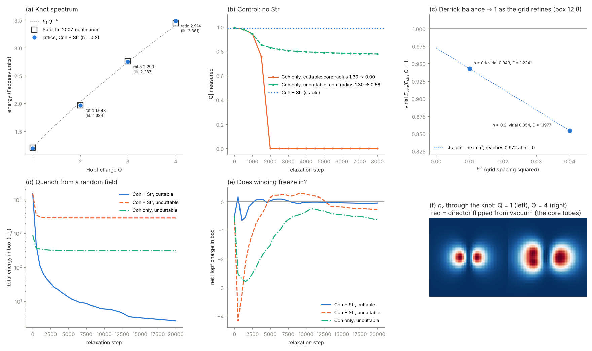

---

### Run 13: knots on a relational graph with no grid

**Question.** Run 12's knots sat on a cubic grid. CO forbids a rigid lattice (Constraints: "a random web, not a grid"), and P06 now says the substrate is a graph and nothing more. Do Coh + Str knots survive when the relations are irregular, isotropic and CO-compliant?

**CO's requirements on the graph:**
- P06: three-dimensional in the discrete sense, no preferred direction.
- Contrast principle (models R18): no triangles, and no two short loops sharing more than one link.
- Particles step across squares (Attempt C, C-O20).

**Energy.** Coh on links, Str on the graph's loops, and optionally the uncuttable barrier, all with two global unit-conversion constants:

$$
E_{\rm coh}=\frac{1}{c_{\rm coh}}\sum_{\rm links}|\mathbf n_j-\mathbf n_i|^2,\qquad c_{\rm coh}=\frac{\sum|\mathbf e|^2}{3V}.
$$

Two forms of Str were tried.

*Open corners.* At a place c, two of its links (to a and b) that lie on a square:

$$
E_{\rm str}=\frac{1}{c_{\rm str}}\sum_{\rm corners}|(\mathbf n_a-\mathbf n_c)\times(\mathbf n_b-\mathbf n_c)|^2,\qquad c_{\rm str}=\frac{4\sum|\mathbf A_c|^2}{3V}.
$$

On the cubic lattice this is exactly Run 12's four-corner Str. The same code reproduces Run 12's energies to 10⁻¹⁴.

*Closed loops.* The solid angle enclosed by the four directors around a square $i\!-\!j\!-\!l\!-\!k$, averaged over the square's two diagonal splittings:

$$
E_{\rm loop}=\frac{1}{c_{\rm loop}}\sum_{\rm squares}\Omega_{\rm sq}^2,\qquad
\Omega_{\rm sq}=\tfrac12\big[W_{ijl}+W_{ilk}+W_{jlk}+W_{jki}\big],
$$

$$
W_{abc}=2\,\mathrm{atan2}\big(\mathbf a\cdot(\mathbf b\times\mathbf c),\;1+\mathbf a\!\cdot\!\mathbf b+\mathbf b\!\cdot\!\mathbf c+\mathbf c\!\cdot\!\mathbf a\big),\qquad c_{\rm loop}=\frac{\sum|\mathbf A_{\rm sq}|^2}{3V}.
$$

For a smooth field, $\Omega_{\rm sq}\approx\mathbf A_{\rm sq}\cdot\mathbf B$ with $B_c=\tfrac12\epsilon_{cab}\,\mathbf n\cdot(\partial_a\mathbf n\times\partial_b\mathbf n)$. Both forms therefore have the same continuum limit as Run 12, $\int\sum_{a<b}|\partial_a\mathbf n\times\partial_b\mathbf n|^2$.

Positions enter only when the graph is built and when the Hopf charge is measured (by interpolating to a probe grid). The energy uses only who is linked to whom and which links close squares.

#### Substrates

| Substrate | How it is made | Triangles | Squares per link | Links per place | Isotropy | Single-link doors |
|---|---|---|---|---|---|---|
| Cubic grid (reference) | — | 0 | 4.00 | 6 | exact | 0 |
| Random triangle-free graph | Poisson points coloured black/white at random; each linked to its k nearest of the other colour (bipartite) | 0 | 5.1 (k = 4) to 23 (k = 8) | 5.1–9.6 | 0.2% | 0 |
| Random graph with triangles | Delaunay links of Poisson points (forbidden by the contrast principle; reference) | 13.5 per place | — | 15.5 | 0.3% | 0 |
| **Random cubical complex** | Each tetrahedron of a random Delaunay tessellation split into four hexahedra. Places are points, edge midpoints, face centres and cell centres; links join neighbouring dimensions; **every face is a square** | **0** | **3.90** | 5.1 mean (4 to 15.5) | 0.6% | **0** |

**The cubical complex meets CO's conditions:**
- Contrast principle: no triangles, and two squares share at most one link.
- Every link lies on at least three squares.
- It is irregular, with no grid.
- Walk-return probability falls as $t^{-1.60}$ (3D is $t^{-1.5}$).
- Hop-ball growth peaks at an exponent of about 4.4 at short range, because the original points are hubs with about 15 links each. It falls toward 3 (3.6 at 16 hops) as far as the box allows.
- **The random triangle-free graph** also passes P06's instruments (ball exponent 3.0–3.2, walk slope −1.48). But its squares do not tile space, and that turns out to matter.

#### Results

**(a) Open-corner Str on the random triangle-free graph (k = 4): the knot unties at every spacing.** Q = 1 was seeded in box 9.6, with no cutting rule unless stated.

| Spacing (link length) | Places | FIRE, 2,000 steps | Plain flow, 4,000 steps | With the uncuttable rule (FIRE, 2,000) |
|---|---|---|---|---|
| 0.20 (0.21) | 110k | Q −0.95 → **0**, E → 0 | Q → **0** | Q → −0.49, still falling |
| 0.16 (0.17) | 216k | Q → **0** | Q → **0** | Q → −0.65, still falling |
| 0.12 (0.13) | 511k | Q → **0** | Q → −0.82, falling | Q → −0.83, falling |
| 0.10 (0.10) | 884k | Q → **0** | Q → −0.92, falling | Q → −0.83, falling |

- In every case the graph's Str collapses within a few hundred steps: the Coh/Str balance jumps from 1 to about 11–30.
- With Str gone, the knot behaves like Coh alone: it shrinks and unties. A finer graph only slows this down, and the 60° rule slows it but does not stop it.

**(b) Why: the graph hides the twist.** Starting from the same seed, 500 steps of plain flow; the graph's Str is compared with the continuum Str of the same field interpolated and smoothed over one cell.

| Substrate and Str | Str the graph charges | Str of the smoothed field | Fraction charged | Q = 1 knot |
|---|---|---|---|---|
| Cubic grid, corner Str | 0.752 | 0.768 | **0.98** | holds |
| Random triangle-free, corner Str, 5.1 links per place | 0.034 | 0.838 | **0.04** | unties |
| Same, 6.2 / 7.4 / 9.6 links per place | 0.076 / 0.145 / 0.314 | 0.86 / 0.88 / 0.88 | 0.09 / 0.16 / 0.36 | unties |
| Random triangle-free, **loop Str** | 0.013 | 0.828 | **0.02** | unties |
| Random graph with triangles (chord area) | 0.558 | 0.767 | 0.73 | holds |
| Random cubical complex, corner Str | 0.456 | 0.817 | 0.56 | **cut at step 2,000** (a link flips) |
| **Random cubical complex, loop Str** | 0.474 | 0.804 | 0.59 | **holds** |

- On the random triangle-free graph the knot is still there: the smoothed field keeps its full Str. But almost no square's loop encloses any twist (largest $|\Omega_{\rm sq}|$ = 0.03). The twist runs through the graph's longer cycles, which nothing charges.
- Adding links helps only slowly. Charging squares as closed loops does not help on this graph, because its squares do not close up into cells.
- **What works is a substrate whose faces tile space**: the cubic grid, a triangulation, or the cubical complex. Then every surface the twist could pass through is made of charged loops. Summed over a closed surface of squares, $\sum\Omega_{\rm sq}$ is $4\pi$ times an integer, so the twist can leave only through a square whose loop reaches $\Omega=\pm2\pi$. Open corners are not enough even then: the cubical complex with corner Str was cut by a flipped link.

**(c) Knots on the cubical complex with loop Str, no cutting rule.** Q = 1 in box 9.6, relaxed to convergence with FIRE on three independent random complexes:

| Complex | E (graph units) | Q (fine probe) | Core radius | Virial |
|---|---|---|---|---|
| Seed 2 | 0.810 | −0.945 | 0.93 | 0.58 |
| Seed 3 | 0.896 | −0.962 | 1.05 | 0.78 |
| Seed 4 | 0.864 | −0.936 | 0.91 | 0.65 |
| Spread | 0.857 ± 0.043 (±5%) | | | |

- Adding the uncuttable rule to the seed-2 knot changes its energy by 0.5%. Its barrier energy is 2×10⁻⁴, so the rule is almost never touched. **The knot is held by Str on closed loops, not by the rule.**
- Absolute energies sit about 30% below the continuum's 1.204, and knots are smaller (R ≈ 0.9–1.05 against 1.34). Both are what the disorder does: once places relax, the random complex is softer than its average link count suggests (κ_coh = 0.83 for Coh). That changes the units, not the physics, so the test that counts is the ratios.

**(d) Spectrum on the cubical complex** (box 14, 672k places, one complex, loop Str, no cutting rule, FIRE to convergence):

| Q | E (graph units) | Q (fine probe) | Core radius | Virial | $E_Q/E_1$ | Sutcliffe | Cubic grid (Run 12) |
|---|---|---|---|---|---|---|---|
| 1 | 0.8256 | −0.948 | 0.97 | 0.60 | 1 | 1 | 1 |
| 2 | 1.3933 | −1.938 | 1.40 | 0.71 | **1.688** | 1.634 | 1.643 |
| 3 | 1.9486 | −2.928 | 1.96 | 0.88 | **2.360** | 2.287 | 2.299 |
| 4 | 2.5538 | −3.869 | 1.79 | 0.83 | **3.093** | 2.861 | 2.914 |

- Every knot keeps its charge, and two Q = 1 knots still bind into one Q = 2 knot (by 16%).
- The ratios sit 3% above the continuum for Q = 2 and 3, and 8% above for Q = 4.
  - The Q = 4 relaxation had not fully converged (max |grad| = 0.02).
  - The Q = 1 knot is the smallest (about six places across), so it is the most under-resolved, which raises every ratio. The cubic grid at h = 0.2 shows the same sign at a smaller size.
  - The ±5% disorder between complexes in (c) applies to each knot separately.
- **Within that, the cubical complex reproduces the knot spectrum.**

**(e) Quench on the cubical complex** (box 9.6, 108k places, random field, 20,000 steps of gradient flow; energy evaluated with full Str):

| Protocol | Energy: start → 2,000 → 20,000 | Net Q in box | What is left |
|---|---|---|---|
| Loop Str at full strength from the start | 6,788 → 2,050 → **961**, still slowly falling | −0.78 | one tangle over **74%** of the box: **jammed** |
| Coh alone first, loop Str ramped in over 10,000 steps | 6,788 → 101 → **96.9**, flat | +0.17 | one tangle over **61%** of the box: jammed, at a tenth of the energy |

- On this substrate the protection *is* Str. So an instant quench behaves like Run 12's uncuttable quench: the random tangle cannot undo itself and jams.
- Letting Coh act alone first untangles most of it: the energy falls 70× before Str takes hold. What Str then freezes is still one extended tangle, not separate knots. Only one ramp rate was tried.

#### Reading

- **On CO's own kind of substrate, particle-knots need one more structural fact.** The relations must close up into faces that tile space: every short loop a face, every face a square. And the twist must be charged on those closed loops, not at open corners.
  - A random triangle-free graph, even one that passes P06's instruments, lets a knot's twist hide in its uncharged longer cycles, and the knot unties.
  - A random **cubical complex** has none of these gaps. It satisfies both clauses of CO's contrast principle, and it holds knots with no cutting rule.
- **This turns "uncuttable" from a rule into a consequence.** On a cubical complex with loop Str, cutting a knot means some square's loop must enclose half the sphere ($\Omega=\pm2\pi$). That costs $(2\pi)^2$ in loop-Str units, so the protection is an energy barrier. CO's reservation rule (K2) is then not needed for knots built this way. The barrier was measured at 2×10⁻⁴ in (c), so the rule never acted.
- **It ties to the earlier record.** CO's particle line already found that "a particle needs two things from its medium: no single-link doors, and squares" (C-O20). This run adds a third: **the squares must tile, so that every loop is a face.** CO's grown glass has near-cubic local order (R18), which is the right local structure; its long-range maze is the open problem.
- **Quench.** Neither an instant quench nor a slow switch-on of Str left isolated knots: both freeze one extended tangle. Separate particles would need a regime this test did not find, such as a slower ramp, noise, or expansion.
- **What this is not.** The cubical complex was built from a random Delaunay tessellation: space was supplied (as in every CO model), not grown. Coh + Str on a cubical complex is still the Faddeev–Skyrme model, so a matching spectrum is a pass, not a prediction. The CO-specific content is the substrate condition: faces that tile, with the twist charged on closed loops.

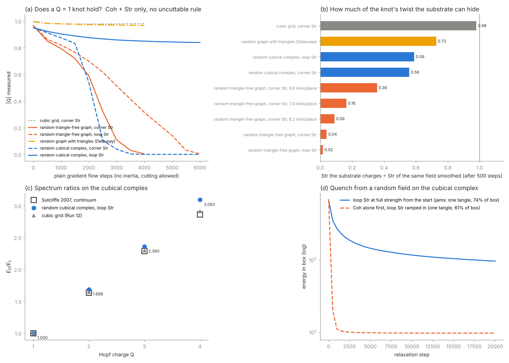

---

### Run 14: the vacuum test (on CO's own event-layer engine)

**Question.** CO's event layer finds that a mass's clock well can have **reach** or **strength** but not both (`EVENT_LAYER.md` result 25; "the hardest open item"). The proposed cause is that every vacuum place commits and so spends possibility. That spending refills the shortage around matter and screens it. The test removes vacuum commitment and nothing else.

**Pre-registered** before any run (`PREREG.md`): predictions V1–V4 and O1, and what would count against the claim.

#### Why vacuum spending screens

A shortage $s$ of possibility spreads by wandering and is refilled by the medium's own consumption:

$$
D\,\nabla^2 s-\frac{\chi R}{\rho}\,s=-S\,\delta(\mathbf x),\qquad s\propto\frac{e^{-r/\lambda}}{r},\qquad \lambda=\sqrt{\frac{D\rho}{\chi R}},\qquad D=\frac{\text{PHOP}}{6}.
$$

CO's clock *is* a place's count of its own commitments. So χ, the clock's response to a shortage, is also the medium's marginal consumption. A responsive clock means a short λ: that is the trade-off.

If the vacuum carries no commitment, the vacuum term vanishes:

$$
D\,\nabla^2 s=-S\,\delta(\mathbf x)+\bar S\quad\Longrightarrow\quad\lambda=\infty .
$$

Clocks are then pieces of matter, sampling the shortage where they sit.

#### Method

**Engine.** CO's `run_event_layer.py`, imported unmodified. The subclass reproduces the original engine **bit for bit** when its additions are switched off (checked over 300 ticks: possibility, blinks and matter states identical).

**Arms.**
- **O:** the original tick. Every place commits by Born choice and mutual proposal, spending one unit from each place.
- **V:** identical, with the vacuum's commit step skipped. Places hold possibility and pass it on, but never commit. Matter's reserved commitments and universal return are unchanged.

**Matter.** The published ball, radius 3, 54 reserved pairs.

**Probe clocks.** Reserved pairs under matter's own rule, renewing the moment they end if both places hold possibility. A probe's clock is its count of completed renewals.
- Six per shell at r = 5–12.
- The same layout in every matter run and its control.

**Settings.** Box 30, PHOP 0.99, densities 1, 2 and 8, seeds 1 and 2, 12,000 ticks read over the last 9,000. Plus a reach check: arm V, box 60, density 2, probes to r = 27, 20,000 ticks, two seeds.

**Shape fit.** The measured shortage was fitted to the periodic lattice solution of $D\Delta_{\rm lat}$, sourced by the measured matter draw with its mean removed (universal return). The fit was done unscreened, and screened with λ scanned.

#### Results

**Shape of the shortage (box 30).**

| Arm | Density | Background μ₀ | Unscreened misfit | Best-fit λ (seeds) |
|---|---|---|---|---|
| O | 1 | 0.56 | 12.5% | 1.5, 1 |
| O | 2 | 1.38 | 5.7% | **3, 3.5** (CO published 3.4–4) |
| O | 8 | 7.21 | 0.2% | ≥ 40 (unscreened, as published) |
| V | 1 | 0.86 | 1.0% | 10, 10 |
| V | 2 | 1.81 | **0.5%** | **20, 15** |
| V | 8 | 7.79 | 0.2% | ≥ 40 |

**Box 60 (arm V, density 2):** the shortage matches the unscreened periodic solution to **0.3%** of its shell-4 value, out to the box's own zero crossing at r ≈ 23.

**Probe clock slowing (%) at shells 8, 9, 10 (box 30), against CO's result-25 ceiling $0.043\,(S/R)/r^3$ for the same drain S and clock rate R:**

| Arm, density | r = 8 | r = 9 | r = 10 | Ceiling at 8, 9, 10 | Response χ (per unit shortage) |
|---|---|---|---|---|---|
| O, 1 | −1.0 ± 0.9 | −0.2 ± 0.7 | −0.6 ± 1.1 | 0.61, 0.43, 0.31 | — (no measurable shortage there) |
| O, 2 | 0.95 ± 0.30 | 0.27 ± 0.31 | 0.17 ± 0.33 | 0.59, 0.42, 0.30 | 0.29–0.33 |
| **V, 1** | **4.86 ± 0.59** | **3.55 ± 0.49** | **2.17 ± 0.47** | 0.26, 0.18, 0.13 | 0.77–1.07 |
| **V, 2** | **1.94 ± 0.25** | **1.37 ± 0.16** | **0.93 ± 0.11** | 0.42, 0.30, 0.22 | 0.13–0.22 |
| O, 8 / V, 8 | 0.01 / 0.02 | 0.02 / 0.00 | −0.02 / 0.01 | — | ≈ 0 in both |

- Arm V draws *less* than arm O at density 2 (S = 9.2 against 11.7 units per tick), yet its clocks at shells 8–10 slow **3.1×** as much (pooled 1.41 ± 0.10% against 0.46 ± 0.18%).
- Arm V **exceeds CO's ceiling by 4.2–4.6× at density 2 and 17–20× at density 1.** Arm O sits at or under its ceiling.

**Reach of the clocks (box 60, arm V, density 2), probe slowing in %:**

| r | 5 | 7 | 9 | 11 | 13 | 15 | 17 | 19 | 21 |
|---|---|---|---|---|---|---|---|---|---|
| Slowing | 14.9 ± 0.4 | 7.1 ± 0.1 | 4.1 ± 0.1 | 2.5 ± 0.2 | 1.75 ± 0.17 | 0.86 ± 0.18 | 0.56 ± 0.12 | 0.44 ± 0.11 | 0.03 ± 0.10 |

- The slowing follows the measured unscreened shortage through one smooth clock response, $\text{slowing}=c_1s+c_2s^2$.
- With CO's density-2 screening (λ = 3.5) and the same response, the slowing at r = 17 would be about 0.06%. The measured value is 0.56 ± 0.12%.

**Sanity checks on arm O.**
- CO's own benchmark (`python run_event_layer.py well`), run unmodified in this workspace, reproduces the published table exactly: 4.36, 1.85, 1.11, 0.69, 0.56 and 0.25% at shells 4–9.
- The subclass is bit-identical to that engine when the probes are off.
- With probes in the box and a read three times longer, arm O's medium-blink well reads 5.0, 2.2, 1.1, 0.5, 0.3 and 0.1%. That is the same shape and depth, within about 0.6 points.

#### Against the pre-registration

| | Prediction | Outcome |
|---|---|---|
| V1 | Arm V unscreened at every density, misfit ≤ 5%, λ ≥ 10 | **Pass.** Misfit 0.2–1.0%; λ 10–20 in box 30 (≥ 40 at density 8); 0.3% in box 60 |
| V2 | Arm V's probes at shells 8–10 ≥ 3× arm O's at density 1–2; χ ≥ 0.1 | **Pass.** Density 2: 3.1× pooled (shell 8 alone 2.0×); density 1: arm O is zero within noise. χ = 0.13–1.07 |
| V3 | Box 60: slowing follows the unscreened shape to r ≈ 20 | **Pass.** Nonzero at 4σ at r = 17 and 19; ~10× the screened expectation |
| V4 | Density 8: weak in both arms (the clock saturates) | **As predicted.** Every probe renews at exactly 1/HBAR in both arms |
| O1 | Arm O screened at density 1–2, unscreened but unfelt at 8 | **Pass** |

#### Reading

- **The trade-off belongs to the vacuum, not to the mechanism.** With the vacuum committing, CO's own engine reproduces its own finding: λ ≈ 3, a ceiling on far slowing. With the vacuum holding possibility but never committing, the same engine gives an unscreened shortage at every density. Clocks made of matter then slow by **4–20× more than the ceiling allows** at the same distance, out to the edge of a 60-place box.
- **Strength is now the clock's business alone.** In this engine a clock renews when both its places hold at least one unit. Where every place holds about eight, it never waits, so it cannot notice a shortage in either arm. Real gravitational slowing is tiny (about 10⁻⁹ at the Earth's surface), so what a clock needs is a response that stays **linear and nonzero** at small shortage. A threshold rule in a rich medium gives an exponentially small one, of order $e^{-\mu_0}$. This is the next thing the clock rule has to supply.
- **What it costs CO:**
  - The One Being medium that commits and settles (results 20–22, 27) runs on vacuum commitment. Adopting "the vacuum carries no commitment" means re-reading those results: in particular the arrow-of-time age relic, which is measured on vacuum clocks.
  - "Clocks are matter" becomes a statement of the ontology.
- **Not tested here:** whether a bigger mass reaches further (expected, since the amplitude scales with the drain while the shape stays fixed); motion ("nothing falls" is a separate question, §2.2 of the map); and any density between 2 and 8.

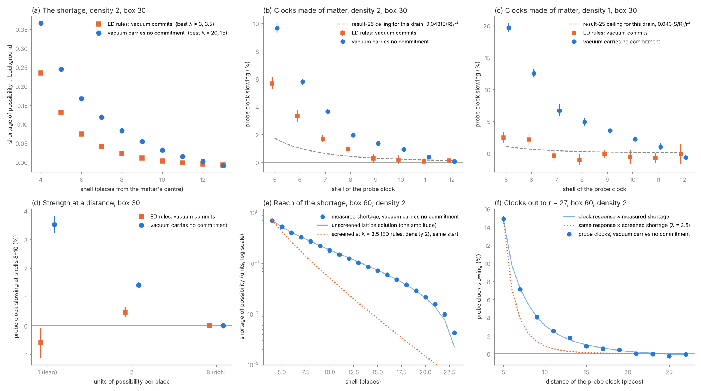

---

### Run 15: the clock rule (on CO's own event-layer engine)

**Question.** In Run 14, CO's clocks stopped noticing a shortage wherever possibility was plentiful: at 8 units per place, probe rates read 0.2000 with and without matter. Real clocks show the full gravitational redshift in nearly empty space. This run asks which matter rule gives a clock that does that.

**Target, fixed in advance (standard physics).** In a weak field, a clock runs at

$$
\frac{\nu(\mathbf x)}{\nu_\infty}=1+\frac{U(\mathbf x)}{c^2}
$$

This has three measured properties:
- **Linear in the potential:** Pound–Rebka 1%; Gravity Probe A about 10⁻⁴; the eccentric Galileo satellites 2.5×10⁻⁵ (Delva et al. 2018).
- **The same for every kind of clock:** local position invariance (Will 2014, §2.1.3).
- **Present where clocks are alone in nearly empty space:** GPS, about 38 µs/day net.

The pre-registration (`PREREG.md` in the bundle) was written before any run of the new rule.

#### Why the engine's clock saturates

In CO's engine, matter is a reserved pair. Its commitment spends one unit from each place, **holds for ħ = 5 global ticks**, and renews at once if both places hold a unit. A clock is its count of completed commitments. So its rate is

$$
\text{rate}=\frac{1}{\hbar+\bar w},\qquad \bar w=\text{mean wait for both places to hold a unit}
$$

Only the wait $\bar w$ can respond to a shortage. Where places are rich, $\bar w\to0$ and the rate sits at $1/\hbar$ whatever the shortage. **The global tick is acting as a clock outside the committed world.**

#### The flow rule

A commitment holds while a fixed number $H$ of possibility units **pass into** its two places; it does not hold for a fixed number of ticks. When the count is reached the commitment completes (one count of the clock), and the pair renews at once if both places can pay, as before.

**Possibility keeps no time. The committed world counts what passes.**

The number of units passing into a place each tick is $\text{PHOP}\times\bar P_{\rm nb}$, where $\bar P_{\rm nb}$ is the mean possibility of the place's neighbours. So when nothing waits to pay:

$$
\text{rate}_F=\frac{\text{PHOP}\,\big(\bar P_{\rm nb}(a)+\bar P_{\rm nb}(b)\big)}{H}
\quad\Rightarrow\quad
1-\frac{\text{rate}_F(\mathbf x)}{\text{rate}_F(\infty)}=\frac{\Delta\mu(\mathbf x)}{\mu_\infty}\equiv\epsilon(\mathbf x)
$$

The far-away possibility $\mu_\infty$ plays the role of the potential's zero, and the fractional shortage $\epsilon$ plays $-U/c^2$.

- $H$ is fixed per run so that a hold lasts about ħ ticks far from matter: $H_1=\mathrm{round}(2\hbar\,\text{PHOP}\,d)$, which gives 10, 20, 79 and 317 at $d$ = 1, 2, 8, 32.
- Units passing in on the completing tick carry over, which removes the tick's granularity.
- The same rule applies to the ball and to every probe, because clocks are matter.

**What is built in and what is tested.** The proportionality is built into the rule. The run tests whether the engine's other rules spoil it:
- paying a unit at each place to renew
- each clock depleting its own places
- matter's own draw changing under the rule
- the fluctuations of discrete possibility

It also tests whether the shortage stays unscreened.

#### Method

- **Engine:** CO's `run_event_layer.py`, imported unmodified.
- **Vacuum:** arm V of Run 14, where the vacuum never commits.
- **Box and settings:** 30³, periodic, PHOP = 0.99. Densities 1, 2, 8 and 32 units per place; seeds 1 and 2; 12,000 ticks, read over the last 9,000.
- **Matter:** the published ball (radius 3, 54 reserved pairs), with a matched control for every run (same seed, same probes, no ball).
- **Probe clocks:** 96 reserved pairs, 12 per shell at shells 5–12, at least 2.5 places apart.
  - Two designs alternate: a **short hold** (ħ ticks under the old rule, $H_1$ under the flow rule) and a **long hold** (2ħ, or $2H_1$).
  - The layout is identical in every run.
- **Rules compared:** the old rule (CO's engine, hold in global ticks) and the flow rule. Each applies to the ball and to the probes alike.
- **Readings:**
  - Fractional shortage $\epsilon(r)=\Delta\mu/\mu_{\rm ctrl}$, averaged over each shell (excluding the ball's and probes' places).
  - Probe slowing $1-\text{rate}_{\rm ball}/\text{rate}_{\rm ctrl}$.
  - **Response** $\kappa$: the least-squares slope through the origin of slowing against $\epsilon$ over shells 5–10, by design. Errors are bootstrap over probes.
  - **Universality ratio** $U_{21}=\kappa_{\rm long}/\kappa_{\rm short}$.
  - **Drift** of κ from shell 5 to shell 10, as a fraction of its mean.
  - The unscreened shortage fit of Run 14.
- **Code check:** the old rule with Run 14's probe layout reproduces Run 14's arm V **bit for bit**, both the possibility field and every count, over 800 ticks at three settings.

#### Results

**Pooled response, shells 5–10** (both seeds; ± bootstrap standard error):

| rule | density | mean possibility (control) | κ, short hold | κ, long hold | long ÷ short | time waiting to pay (short / long) | ball's draw per tick | unscreened misfit |
|---|---|---|---|---|---|---|---|---|
| flow | 1 | 0.82 | 1.249 ± 0.022 | 1.122 ± 0.028 | 0.898 ± 0.027 | 20% / 11% | 3.40 | 2.4% |
| flow | 2 | 1.76 | 1.098 ± 0.016 | 1.091 ± 0.016 | 0.993 ± 0.020 | 4.5% / 2.2% | 6.77 | 1.3% |
| flow | **8** | 7.70 | **1.030 ± 0.014** | **1.026 ± 0.020** | **0.996 ± 0.023** | 0 / 0 | 14.89 | 0.6% |
| flow | **32** | 31.69 | **1.040 ± 0.019** | **1.022 ± 0.023** | **0.983 ± 0.028** | 0 / 0 | 19.58 | 0.8% |
| old | 1 | 0.79 | 0.948 ± 0.022 | 0.580 ± 0.022 | 0.611 ± 0.027 | 37% / 22% | 3.51 | 1.7% |
| old | 2 | 1.72 | 0.387 ± 0.011 | 0.205 ± 0.007 | 0.530 ± 0.023 | 10% / 5% | 8.28 | 0.4% |
| old | 8 | 7.69 | 0.005 ± 0.001 | 0.000 | — | 0 / 0 | 21.69 | 0.2% |
| old | 32 | 31.68 | 0.000 | 0.000 | — | 0 / 0 | 21.80 | 0.4% |

**Against the clock's own neighbourhood.** The places next to each probe are where its passing possibility comes from. Measured against their shortage instead of the shell's, the flow rule gives:

| density | κ, short hold | κ, long hold |
|---|---|---|
| 8 | 0.997 | 1.005 |
| 32 | 1.010 | 0.995 |
| 2 | 1.07 | 1.06 |
| 1 | 1.23 | 1.12 |

The 3–4% excess against the shell average comes from each clock depleting its own surroundings.

**Shell by shell, flow rule** (slowing %, short hold | long hold, against the shortage ε %):

| shell | 5 | 6 | 7 | 8 | 9 | 10 | 11 | 12 |
|---|---|---|---|---|---|---|---|---|
| density 8: ε | 9.63 | 6.56 | 4.67 | 3.21 | 2.11 | 1.26 | 0.61 | 0.09 |
| density 8: slowing | 9.49 \| 9.66 | 7.20 \| 6.31 | 4.71 \| 4.58 | 3.19 \| 3.15 | 2.11 \| 2.30 | 1.35 \| 1.48 | 0.55 \| 0.44 | −0.05 \| 0.37 |
| density 32: ε | 3.11 | 2.19 | 1.58 | 1.09 | 0.68 | 0.37 | 0.16 | 0.00 |
| density 32: slowing | 3.14 \| 3.09 | 2.25 \| 2.13 | 1.78 \| 1.65 | 1.18 \| 1.01 | 0.61 \| 0.69 | 0.26 \| 0.49 | 0.20 \| −0.06 | −0.10 \| −0.14 |

Typical errors are ±0.1–0.3% at density 8 and ±0.1% at density 32.

**Linearity** (drift of κ from shell 5 to shell 10, as a fraction of its mean):
- **Flow rule:**
  - density 8: +0.00 ± 0.06 (short), +0.08 ± 0.09 (long)
  - density 32: +0.12 ± 0.07, −0.01 ± 0.09
  - density 2: +0.12 ± 0.06, +0.02 ± 0.08
- **Old rule:**
  - density 1: −0.34 ± 0.13, −0.25 ± 0.18
  - density 2: −0.72 ± 0.10, −0.59 ± 0.17

So the old rule responds more than proportionally where the shortage is large.

**Does passing possibility alone set the rate?** The ratio rate × H ÷ (units passing in) in the controls reads:
- 1.000 at densities 8 and 32
- 0.95 / 0.98 at density 2
- 0.79 / 0.88 at density 1

That is the share of each cycle not spent waiting to pay.

#### Against the pre-registration

| Prediction | Expected | Measured | |
|---|---|---|---|
| **F1** flow rule responds at any richness (densities 8, 32) | κ = 1.00 ± 0.10, both designs | 1.030, 1.026; 1.040, 1.022 | **pass** |
| **F2** universal | $U_{21}$ = 1.00 ± 0.10 at 8, 32; ± 0.15 at 2 | 0.996, 0.983; 0.993 | **pass** |
| **F3** linear (densities 8, 32) | drift within ±10% beyond error | +0.00 ± 0.06, +0.08 ± 0.09, +0.12 ± 0.07, −0.01 ± 0.09 | **pass** |
| **F4** lean-medium limit (estimate, not pass/fail) | κ ≈ 1.3 / 1.2 at density 1, ≈ 1.1 / 1.05 at density 2; universality off up to ~10% at density 1 | 1.25 / 1.12; 1.10 / 1.09; $U_{21}$ = 0.90 | as estimated |
| **F5** shortage still unscreened | misfit ≤ 5% | 0.6–2.4% | **pass** |
| **O1** old rule, rich media | \|κ\| < 0.05 | 0.005, 0.000 | **pass** (as predicted, no response) |
| **O2** old rule not universal (densities 1, 2) | $U_{21}$ < 0.8 | 0.61, 0.53 | **pass** (as predicted) |
| **O3** old rule, lean media (estimate) | κ ≈ 0.7 (density 1), ≈ 0.2 (density 2) | 0.95, 0.39 | **missed** |

**Why O3 missed.** The estimate took Run 14's shell-8 value. The pooled κ is weighted toward the inner shells, where the old rule responds more strongly (it is not linear: κ falls by 34–72% from shell 5 to shell 10). Twice as many probes also made the medium leaner: mean possibility was 0.79 against Run 14's 0.86. The miss does not touch any pass/fail call.

#### Reading

**1. With the hold counted in passing possibility, CO's clocks behave like real clocks at every richness tested.**
- They slow by the fractional shortage: 1.02–1.04 against the shell average, and 1.00 against their own neighbourhood.
- Two different clocks agree to 1–2%.
- The response is linear in the shortage across shells 5–10.

**2. CO's original rule cannot do this, and not just where possibility is plentiful.**
- At densities 8 and 32 it does not respond at all.
- At densities 1 and 2 it responds, but:
  - more than proportionally (κ falls 34–72% from shell 5 to 10)
  - differently for different clocks: the long-hold clock slows only 53–61% as much as the short-hold clock at the same place
- Different atomic clocks show the same redshift, so the old rule's clock-dependent slowing would violate local position invariance at the level atomic-clock comparisons test.
- The reason is the same in every case: only the waiting responds, and how much of a cycle is waiting depends on the clock.

**3. What changes in CO's terms.** *A commitment holds for ħ ticks* becomes *a commitment holds while a fixed amount of possibility passes its places*.
- The global tick then times nothing that matter does.
- This matches the point that possibility keeps no time and the committed world counts what passes.
- **In standard terms:** a clock's rate is proportional to the local possibility, which plays $1+U/c^2$.
- **Relabelling check:** the proportionality is designed into the rule, not discovered. What the run shows is:
  - that nothing else in CO's engine spoils it where possibility is plentiful
  - that CO's original rule cannot produce it at all

**4. The lean-medium limit.** Where places are often empty (densities 1–2), waiting to pay adds to the response (κ = 1.1–1.25) and breaks universality by about 10% at density 1. A clock that has to wait to pay responds extra, and by an amount that depends on the clock. **So real clocks must never wait to pay:** the places they sit in must be rich compared with what a commitment costs.

**5. Matter slows in its own well.**
- Under the flow rule the ball's draw falls relative to the old rule:
  - by 31% at density 8 (21.7 → 14.9 per tick)
  - by 10% at density 32
- The ball's own places are short, so its holds last longer.
- The source's strength therefore depends on the potential at the source. That is a second-order effect, and it has not been compared with GR's second-order terms.

**6. The vacuum decision's gain survives.** The shortage still fits the unscreened solution, to 0.6–2.4%.

**7. Costs, if adopted:**
- One of CO's event-layer rules changes.
- Result 26's bookkeeping (clock rate = committed share ÷ (ħ − 1)) has to be re-derived. Under the flow rule, a clock's rate is passing possibility ÷ H.
- The global tick still drives possibility's wandering (PHOP per tick). It is the last background clock in the engine. Whether wandering can be made tick-free (asynchronous updates) is the next relational question.

**8. Not addressed: falling.** CO's engine still has nothing that falls (EVENT_LAYER.md: free patterns step *away* from matter). A clock rule that reads the shortage correctly is the prerequisite for testing falling with inertia, since the max-count path depends on the clock rates along it.

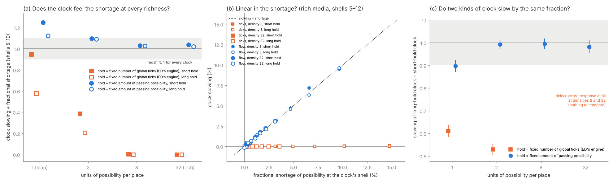

---

### Run 16: falling with inertia (on CO's own event-layer engine)

**Question.** the earlier record says **nothing falls**. A free pattern that moves by commitments, paid for by the places it lands on, is pushed *away* from matter. Matter gathers only under an added steering rule with a chosen coupling, and then it drifts rather than accelerates. The record names two missing pieces: *"a body falling through another's field"* and *"a reason the steering rule should take the form it does"*. It also says direction lives in phase. This run supplies both, with no steering rule and no coupling.

**Target, fixed in advance (standard physics).**
- **Inertia:** a free body keeps its state of motion.
- **Falling:** in a weak static field, a slow body accelerates at

$$
\mathbf a=-c^2\,\nabla\ln\frac{\nu(\mathbf x)}{\nu_\infty}
$$

  That is the same field that sets clock rates; this is Einstein's equivalence argument. Matter waves fall this way too: Colella–Overhauser–Werner (1975) measured gravity's phase shift on neutrons as the difference in elapsed time between two paths.
- **Universality:** all bodies fall alike. MICROSCOPE bounds the difference at about 10⁻¹⁵ (Touboul et al. 2022); rubidium-isotope atom interferometry at about 10⁻¹² (Asenbaum et al. 2020).

The pre-registration (`PREREG.md`) was written before any pattern was evolved in the engine's field. A note written after the density-8 results and before the density-32 ones (`NOTE_after_d8.md`) records two problems and a revised prediction.

#### The source: CO's engine with the adopted rules

- CO's `run_event_layer.py`, imported unmodified.
- **The vacuum never commits** (Run 14), and **matter's hold is counted in passing possibility** (Run 15).
- The published ball (radius 3) in a 60³ periodic box. Densities 8 and 32; ball seeds 1 and 2, plus a control with no matter.

The **clock field** is the time-averaged count of possibility passing into each place, relative to the medium with no matter:

$$
N(\mathbf x)=\overline{n}(\mathbf x)/\lambda_0
$$

Under the adopted rule, this is the rate of matter's clocks. Run 15 measured clock slowing equal to the fractional shortage, 1.00 against the clock's own neighbourhood.

#### The test pattern

A pattern of possibility carries an amplitude and a phase; CO's Born weighting already treats possibility as amplitudes √P with phases. It obeys three rules:
- It hops at most one place per tick.
- **Its phase is turned by the committed world's local count, never by a clock of its own.** At internal frequency $m$, it turns by $m\,N(\mathbf x)$ per tick at place $\mathbf x$.
- It has no steering rule and no coupling.

The simplest linear rule with these properties is the Klein–Gordon equation on the engine's lattice:

$$
\frac{\phi^{n+1}-2\phi^n+\phi^{n-1}}{\delta t^2}=\nabla^2_{\rm lat}\phi^n-m^2N(\mathbf x)^2\phi^n,\qquad \delta t=0.1\ \text{tick}
$$

Its charge is conserved exactly by the scheme:

$$
\rho^{n+1/2}=\mathrm{Im}\big(\overline{\phi^{n+1}}\,\phi^n\big)
$$

The pattern's position is its centroid of charge. Its dispersion relation is

$$
\Big(\tfrac{2}{\delta t}\Big)^2\sin^2\frac{\Omega\,\delta t}{2}=m^2N^2+\sum_i 4\sin^2\frac{k_i}{2}
$$

**Inertia and weight come from the same $m$.** Near rest, $\Omega\approx mN+k^2/(2m)$. So $m$ sets the inertia, through the one-hop-per-tick limit $c=1$. And $mN(\mathbf x)$ is a potential that is lower where clocks run slow.

**The derived steering rule.** CO's added steering rule makes each place lean toward the neighbour whose cadence lags. Here the same thing happens as interference, with no rule added:
- Where the count runs slow, the pattern's phase falls behind.
- Its wavefronts turn toward the lag.
- The pattern's velocity grows steadily in time (an acceleration), rather than drifting at a rate set by a chosen coupling.

**Parameter-free prediction.** For a pattern released at rest, rays of the lattice dispersion give

$$
a_{\rm in}=\big\langle\hat u\cdot\nabla\ln N\big\rangle_{\rho_0}\Big(1-\frac{\langle K\rangle}{m^2\bar N^2}\Big)\Big/\Big(1-\big(\tfrac{m\bar N\delta t}{2}\big)^2\Big)
$$

- The first factor is the clock-rate slope averaged over the initial charge.
- The second is the pattern's internal motion, at most 10%.
- The third is the time step, below 1%.

**Relabelling flag.** In standard terms, this is a relativistic matter wave in a weak static field; its fall is GR's Newtonian limit, as in the COW experiment. CO's own content here is:
- which count turns the phase: the committed world's passing possibility, the same count that times matter
- the field coming from CO's engine
- the steering coming out of phase alone, with no rule and no coupling

#### Method

- **Masses:** $m$ = 0.7, 1.0, 1.4, 2.0 (rest frequency per tick). Charge width σ = 4 places.
- **Releases:** at rest, at $r_0$ = 12 and 18 places from the ball, along the six axis directions, in each ball field. That is 192 releases.
- **Measurement:** the inward centroid displacement, recorded every substep. The acceleration $a$ comes from a polynomial fit of order 4 over the first 16 ticks.
- **Controls:**
  - the ball field with the phase turned by **global ticks** ($N\equiv1$)
  - the medium with **no matter**, at the same 24 release points
- **Inertia:** packets at rest and moving ($k_0$ = 0.1, 0.2), followed for 60 ticks in the no-matter medium.
- **Exploratory:** the engine's **live** per-tick count instead of its average. Three 64-tick windows; $m$ = 1 and 2.
- **Code checks** (synthetic fields only, before the engine's field):
  - charge conserved to 10⁻¹⁶
  - group velocity matched to 5 digits
  - a synthetic 1/r well gives measured ÷ predicted = 0.987–0.989 at every mass

#### Results

**Falling: measured ÷ predicted acceleration** (mean ± sd over the 6 directions):

| density | seed | released | m = 0.7 | m = 1.0 | m = 1.4 | m = 2.0 | acceleration, m = 1 (places/tick²) |
|---|---|---|---|---|---|---|---|
| 8 | 1 | 12 out | 0.961 ± 0.001 | 0.960 ± 0.001 | 0.958 ± 0.001 | 0.959 ± 0.001 | 5.4×10⁻³ |
| 8 | 1 | 18 out | 0.995 ± 0.002 | 0.990 ± 0.001 | 0.989 ± 0.000 | 0.988 ± 0.000 | 2.2×10⁻³ |
| 8 | 2 | 12 out | 0.960 ± 0.001 | 0.959 ± 0.001 | 0.958 ± 0.002 | 0.959 ± 0.002 | 5.6×10⁻³ |
| 8 | 2 | 18 out | 0.994 ± 0.002 | 0.990 ± 0.001 | 0.989 ± 0.001 | 0.988 ± 0.001 | 2.3×10⁻³ |
| 32 | 1 | 12 out | 0.980 ± 0.000 | 0.981 ± 0.000 | 0.983 ± 0.001 | 0.985 ± 0.001 | 1.75×10⁻³ |
| 32 | 1 | 18 out | 0.994 ± 0.003 | 0.991 ± 0.001 | 0.990 ± 0.001 | 0.990 ± 0.001 | 8.0×10⁻⁴ |
| 32 | 2 | 12 out | 0.979 ± 0.001 | 0.980 ± 0.000 | 0.983 ± 0.000 | 0.985 ± 0.000 | 1.78×10⁻³ |
| 32 | 2 | 18 out | 0.994 ± 0.001 | 0.991 ± 0.001 | 0.990 ± 0.000 | 0.990 ± 0.000 | 7.7×10⁻⁴ |

- **Direction:** every release falls inward, 192 of 192.
- **Universality:** at each release, masses 1.0, 1.4 and 2.0 agree to within 0.37% (density 8) and 0.58% (density 32). The lightest pattern, $m$ = 0.7 with internal velocity² ≈ 0.1, differs from them by +0.4% (density 8) and 0.0% (density 32).
- **Absolute rate:** the ratios sit 1–2% below 1. The synthetic-well code check showed the same 1% shortfall at every mass, so it comes from the prediction formula's weighting, not from the engine.

**The marginal case: density 8, released 12 places out (0.96).** The fitted *instantaneous* acceleration depends on the fit window here: for $m$ = 2, 0.983 at 8 ticks, 0.977 at 12, 0.963 at 16 and 0.938 at 24. The reason is that the pattern's inner edge reaches the matter ball, where the field's slope reverses.

As an after-the-fact check (not pre-registered), the **distance fallen in 16 ticks** can be compared with $\tfrac12a_{\rm pred}t^2$:

| | density 8, seed 1 | density 8, seed 2 | density 32, seed 1 | density 32, seed 2 |
|---|---|---|---|---|
| released 12 out | 1.008 ± 0.006 | 1.006 ± 0.007 | 0.997 ± 0.006 | 0.996 ± 0.007 |
| released 18 out | 1.005 ± 0.007 | 1.005 ± 0.006 | 0.995 ± 0.006 | 0.995 ± 0.004 |

**The distance fallen agrees with the clocks to within 1% everywhere, including the marginal case.** The 0.96 is a property of extracting an instantaneous acceleration where the pull changes quickly, not of the fall.

**Controls:**
- **Phase turned by global ticks:** $a$ = 2×10⁻¹⁰ and 3×10⁻¹³ (zero). Without the committed world's count turning the phase, nothing falls.
- **Medium with no matter:** at the release points, the measured acceleration is 2–10% of the ball's.
  - density 8: 2.3% at 12 out, 9.6% at 18 out
  - density 32: 4.5% at 12 out, 6.9% at 18 out
- **That small residual pull is itself falling.** The medium's own density ripples relax slowly (diffusively), so a 6,000-tick average keeps large-scale structure: the rms of N, smoothed over 6 places, is 0.08% at density 8. Patterns fall in those ripples at the formula's rate:
  - measured = 0.987 × formula (density 8) and 0.985 × formula (density 32)
  - correlation 1.000 over 48 releases each

**Inertia: as pre-registered, it fails at both densities.** In the no-matter medium:
- A resting pattern drifts 0.18–0.22 places in 60 ticks at density 8, and 0.12–0.17 at density 32. The bound was < 0.01.
- Moving patterns change speed by up to 13% (m = 1) and 74% (m = 0.7). The bound was 0.5%.

Two causes, found after the fact:
1. **The resting drift and the heavier patterns' slowdowns are the falling above.** The no-matter medium is not force-free on the pattern's scale. Its ripple forces at density 32 are 0.39× density 8's (rms over the control releases). The note written before density 32 predicted about ½.
2. **The large changes in the lightest patterns are a measuring error.** By tick 60 an m = 0.7 pattern is about 13 places wide, so its tails wrap around the 60-place periodic box and corrupt a centroid measured from the release point.

With a centroid that follows the pattern:

| field | m = 1.0, k₀ = 0.2 (speed late ÷ early) | m = 2.0, k₀ = 0.2 | resting m = 2.0, moved in 60 ticks |
|---|---|---|---|
| exactly uniform | 0.9995 | 0.9993 | 0.0000 |
| no-matter medium, density 8 | 0.978 | 0.916 | −0.21 |
| no-matter medium, density 32 | 0.996 | 0.977 | −0.15 |

Where the clock rate is uniform, a pattern keeps its velocity to within 0.07%: that is inertia. Where it is not, the pattern falls.

**Live counts (exploratory).** Turning the phase by the engine's per-tick count, rather than its average, adds noise:

| | overlap after 5 / 10 / 20 ticks | coherence loss rate Γ (fitted) | white-noise estimate $m^2\bar N/\lambda_0$ | fall in 16 ticks, live ÷ averaged |
|---|---|---|---|---|
| density 8, m = 1 | 0.85 / 0.74 / 0.54 | 0.030 | 0.122 | 0.69 |
| density 8, m = 2 | 0.25 / 0.05 / 0.002 | 0.30 | 0.49 | 0.06 |
| density 32, m = 1 | 0.96 / 0.92 / 0.85 | 0.008 | 0.031 | 0.93 |
| density 32, m = 2 | 0.69 / 0.46 / 0.20 | 0.083 | 0.125 | 0.43 |

- **Richer medium:** 4× more possibility per place cuts Γ by 3.6–3.8×, close to the expected 4.
- **Heavier pattern:** Γ grows about 10× for twice the mass, against the white-noise estimate's 4×.
- **Absolute rate:** Γ is 1.5–4× below the white-noise estimate, because counts at neighbouring places are correlated.
- **Effect on falling:** a pattern that stays whole falls nearly as in the averaged field (0.93). One that is shattered by the noise does not fall (0.06).

#### Against the pre-registration

| Prediction | Expected | Measured | |
|---|---|---|---|
| **F1** falls inward | all 192 releases | 192 / 192 | **pass** |
| **F2** at the clock-set rate | a/a_pred = 0.99 ± 0.03 | density 32: 0.979–0.994; density 8 at 18 out: 0.988–0.995; **density 8 at 12 out: 0.958–0.961** | **pass, except a marginal miss at density 8, 12 out** |
| **F3** universal | masses 1.0–2.0 the same to ±1% | within 0.58% at every release | **pass** |
| **C1** phase by global ticks | a = 0 | 2×10⁻¹⁰ | **pass** |
| **C2** no-matter medium | \|a\| < 10% of the ball's | 2.3–9.6%, and equal to the formula (slope 0.985–0.987) | **pass** |
| **I1** at rest stays put | < 0.01 places in 60 ticks | 0.12–0.22 | **fail** (falls in the medium's ripples; exact in a uniform field) |
| **I2** uniform motion | speed constant to 0.5% | changes of 2–74% | **fail** (ripples, plus a box-wrap measuring error; 0.07% in a uniform field) |
| live counts (exploratory) | Γ ≈ $m^2\bar N/\lambda_0$ | 1.5–4× lower; scales as 1/λ₀ | reported |

#### Reading

**1. A pattern whose phase is turned by the committed world's count falls toward matter at the rate the clocks set.**
- It needs no steering rule and no coupling.
- It accelerates; it does not drift.
- Every mass falls alike, to within 0.6%.
- This fills both gaps in the earlier record: a body falls through another's field, and the steering rule has a reason. Direction lives in phase, and the phase is the committed world's count.

**2. Inertia and falling are one rule.**
- In a uniform clock field a pattern keeps its velocity (0.07%). Where the field varies, it falls.
- Both come from $m$: it sets the inertia through the one-hop-per-tick limit, and it sets the weight through how fast the count turns the phase.
- That is why every mass falls alike. Universality here is a consequence of the single speed limit, not a separate rule.

**3. Moving by paying versus moving by phase.**
- CO's earlier result stands: a pattern that moves by commitments paid for by the places it lands on is pushed away from matter.
- A pattern of possibility, moving as a phase, falls.
- So in CO terms, **free fall is a property of possibility in transit, not of committed matter stepping.** That fits "possibility keeps no time; the committed world counts what passes".

**4. The no-matter medium is not perfectly calm, and that is physics, not a defect.** The possibility gas has slowly relaxing density ripples, and patterns fall in them exactly as they fall toward matter. The ripple forces shrink as the medium gets richer (0.39× for 4× the density).

**5. Discreteness has a cost (exploratory).**
- A pattern's phase, turned by a discrete count, picks up noise. That costs it its coherence at a rate that rises steeply with its mass and falls as 1/(possibility per place).
- A pattern that loses coherence stops falling coherently.
- For real particles the rate per Planck tick is tiny ($m t_{\rm P}\sim10^{-19}$ for a proton), so this does not conflict with experiment unless possibility per place is small.
- But it ties possibility per place to the coherence of heavy matter waves. Matter-wave interferometry with large molecules could bound it.

**6. What this does not show.**
- **Only the clock half of gravity is in this test pattern.** Its hops are not slowed, so it cannot bend light (Run 9's spatial half). Its fall for fast motion is not GR's. A full test would include the hop slowing that Run 9 found necessary.
- **Patterns here are much heavier per tick than real particles,** so lattice corrections are visible (the time-step factor, about 1%).
- **Orbits are not tested:** a pattern in this box spreads before it could complete one.

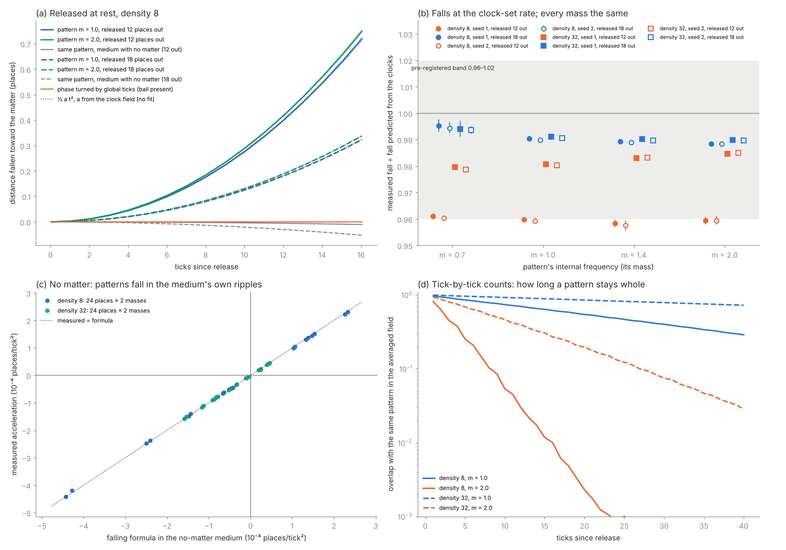

---

### Run 17: slowing hops as well as ticks (light bending and Shapiro delay)

**Question.** Run 16's test pattern carried only the clock half of gravity: its phase slowed near matter, its hops did not. So it could not bend light. Run 9 found the other half in the continuum: possibility needs free capacity to hop as well as to tick, which takes light bending from half to the full observed value. This run puts that half into CO's engine.

**Target, fixed in advance.** A ray passing a mass is deflected by $\alpha=(1+\gamma)\,2GM/(bc^2)$, and the Shapiro delay also scales as $1+\gamma$.
- GR: γ = 1. Cassini: γ − 1 = (2.1 ± 2.3)×10⁻⁵.
- In terms of the clock rate N, the light speed is $c=N^{1+\gamma}$. Clock slowing alone gives $c=N$; GR gives $c=N^2$.

The pre-registration and its amendment are in `PREREG.md`. The amendment was written after the engine runs failed and before any pattern was evolved in an engine field.

#### Part 1. The engine rule as agreed: possibility's own hops slowed by its place's clock

**The rule tried:**

$$
p_{\rm hop}(\mathbf x)=P_0\,N_a(\mathbf x)\,N_b(\mathbf x)\qquad(\text{mean }P_0N^2)
$$

- $N_{a,b}$ are the place's own counts of passing possibility over two consecutive 10-tick windows, relative to the far value.
- One factor is because hops happen on the place's ticks; the other is because a hop needs free capacity.
- $P_0$ = 0.5 leaves headroom so the chance stays below 1, and holds are rescaled to match.
- With the rule off, the code reproduces the Runs 15–16 engine bit for bit.

**Result: the medium froze.** No possibility was moving by tick 200. Diagnostic at density 8 with the ball (box-mean passing count per tick; 4.0 is a healthy medium):

| variant | tick 200 | tick 2,000 | spread of N across places |
|---|---|---|---|
| as pre-registered: N², N against the fixed far value | **0.000** | 0.000 | frozen |
| one factor of N | 3.99 | 3.71, still falling | 0.21 |
| N², N against the box-wide mean | 2.7 | 2.8 | **1.1 (clumped)** |
| no slowing (reference) | 4.00 | 4.00 | 0.18 |

**Why.** The medium's possibility *is* the clock: N is its own passing count. Put a power $g$ of N into its hop chance and, for the uniform mode, a fractional change δ in the flow comes back as $g\,\delta$ one window later.
- $g$ = 2 runs away to zero.
- $g$ = 1 is neutral and drifts.
- Normalising to the box mean removes only the uniform mode; long-wavelength modes still grow, and the medium clumps.

A linear analysis (not simulated beyond the four variants) says stability needs $g<1$. Then the medium's own propagation has speed $N^g$, so $\gamma=g-1<0$: light would bend *less* than clock slowing alone.

> **The possibility that carries the clock field cannot have its own wander timed by that field.** The engine rule is not adopted. The pre-registered engine predictions (shortage shape, hop exponent, stock pile-up) are void.

#### Part 2. The same rule applied to patterns, not to the medium

The medium keeps the adopted engine's wander (Runs 15–16), and the field is the Run 16 seed-1 field (box 60). The rule moves to the pattern:

**a pattern of possibility hops on its place's ticks and needs free capacity there**, so its hop factor is $H=N^2$.

The pattern obeys the wave equation of the static field $ds^2=-N^2dt^2+S^{-2}dx^2$, in conservative form:

$$
w\,\ddot\phi=\sum_{\rm links}\kappa_{\rm link}(\phi_y-\phi_x)-m^2u\,\phi,\qquad w=\frac1{NS^3},\ \kappa=\frac NS,\ u=\frac N{S^3},\qquad c_{\rm massless}=NS
$$

Three couplings are compared in the same field:

| coupling | hop factor S | massless speed |
|---|---|---|
| **A, full rule** | N | N² |
| **B, clock only** | 1 | N |
| **C, Run 16's** | — | 1 (light does not couple) |

**Relabelling flag.** γ = 1 is put in by the pattern rule. This part checks that patterns in the engine's real field bend and are delayed as the rule predicts. It does not derive γ.

**Light.**
- **Pulses:** massless, carrier $k_0$ = 0.8, width 6, launched 22 places before the ball. They pass at $b$ = 15 and 21 on four sides, at densities 8 and 32.
- **Deflection:** the centroid's inward velocity as it crosses a plane 42 places on, with coupling C subtracted. C removes a spurious 0.0005, which is the measurement floor.
- **First-order (Born) prediction:**

$$
\alpha=\frac{1}{\cos^2(k_0/2)}\Big\langle\int\hat u_\perp\!\cdot\!\nabla\ln c\,dx\Big\rangle_{\rm beam}
$$

- **Weak-field reading (pre-registered):** the field is log-scaled, $N\to N^{1/4}$. For log-scaled fields the predicted A/B ratio is exactly 2.00.

**Weak-field results** (measured A/B ratio ÷ predicted ratio; band ±3%):

| | density 32, b = 15 | density 32, b = 21 | density 8, b = 15 | density 8, b = 21 |
|---|---|---|---|---|
| bending | 1.002–1.003 | 1.003–1.007 | 0.973–0.988 | 0.986, **1.084, 1.085, 1.181** |
| Shapiro delay | 0.992–1.014 | **0.935, 0.938**, 0.980, 0.987 | **1.101–1.108** | 1.016, 1.028, **1.073, 1.097** |

- **Direction:** every deflection is toward the matter, 64 of 64.
- **The ratio itself:** the measured A/B bending ratio averages **2.010** at density 32 and 2.067 at density 8.

**Full field strength (reported, not judged).** The A/B bending ratio is 1.92–2.31, against a first-order 2.00–2.02. Deflections reach 0.22 rad at density 8, b = 15. The A/B delay ratio grows to 2.2–3.2, strongly nonlinear in this strong field.

**Slow fall (pre-registered F1′, failed as written).**
- The prediction weighted the second-order factor $H^2$ by the pattern's charge, which gave 0.76 and 0.92.
- **Measured** $a_A/a_C$: 0.89–0.93 at 12 out and 0.95–0.99 at 18 out.
- A synthetic-field check run afterwards shows the charge weighting was the mistake. The geodesic factor $N^4$ *at the pattern's centre* is what the full rule produces: 91–96% of the predicted second-order effect, in a clean field.
- In the engine's periodic, rippled box the absolute normalisation of N, which this factor needs, is uncertain by as much as the effect. So the second-order fall is not judged here.
- At first order the fall is unchanged.

#### Against the pre-registration

| Prediction | Expected | Measured | |
|---|---|---|---|
| E1–E3 (engine with slowed hops) | — | the medium freezes | **void: the rule is unstable** |
| L1′ bending ratio, weak field | Born ± 3% | density 32: all 8 within 0.7%; density 8: b = 15 within 2.7%, b = 21 three of four off by 8–18% | **pass at density 32 and near beams; fail at density 8, far beams** |
| S1′ delay ratio, weak field | Born ± 3% | density 32: 6 of 8 (the 2 misses have the smallest delays); density 8: 2 of 8 | **fail at density 8** |
| L2 coupling C | no coupling | zero, apart from the 0.0005 floor | pass |
| F1′ second-order fall | charge-weighted $H^2$ ± 2% | formula wrong (synthetic check) | **fail as written** |

The density-8 misses are not explained by sub-wavelength counting noise: recomputing the predictions from a smoothed field changes nothing. The likeliest cause, not established, is the measurement itself. The full rule's charge weight, $N^{-4}$, makes the charge centroid a poor stand-in for the ray where signals are small and the medium's ripples are largest.

#### Reading

**1. The main result is a constraint on CO.**
- The medium of possibility, which *is* the clock, cannot have its own wander timed by that clock: the feedback freezes, drains or clumps it.
- So the slowing of hops near matter cannot belong to possibility at large. It has to belong to **patterns riding on the medium**: light, matter waves. This matches GR, where light moves through the metric without making it.
- In CO terms: possibility at large keeps no time and is the engine's update; a pattern of possibility hops on its places' ticks and needs free capacity there.

**2. With that pattern rule, light bends toward matter about twice as much as clock slowing alone** (2.010 ± 0.003 at density 32), and the Shapiro delay also doubles where it can be measured cleanly. This holds in the engine's real field, but it is a consistency check: γ = 1 was put in by the two factors.

**3. The tests are not clean everywhere.**
- At density 8 the far beams and the delays miss by up to 18%. The cause is not established.
- The second-order fall is not judged.

**4. What the engine decision now is.**
- No engine rule changed: the medium is as in Runs 15–16, and the base hop chance stays 0.99.
- The proposal is the **pattern rule**. It is CO's statement of why light bends with γ = 1, and adopting it needs a ruling.
- It also leaves the old "nothing falls when stepping by paying" result standing for committed matter. The stock pile-up that might have reversed it does not happen, because the medium is unchanged.

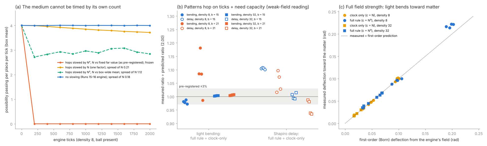

---

### Run 18: does matter fall? (a knot of commitment in the engine's clock field)

**Question.** Every body that has fallen so far (Runs 16–17) is a **pattern of possibility**. CO's matter is **committed**: in Runs 12–13 a particle is a knot of commitments, a director field n held together by Coh (alignment between neighbours) and Str (twist held around closed loops). The earlier record says committed matter that moves by paying for commitments is pushed away from matter. So: does a knot fall, and does it fall *like everything else*?

**Target, fixed in advance.** Universality of free fall for composite bodies: a body's binding and internal energy must fall exactly like the rest of its mass.
- MICROSCOPE: titanium against platinum, η < ~10⁻¹⁵ (Touboul et al. 2022).
- Lunar laser ranging: the Earth's gravitational self-energy falls like the rest of it, to ~10⁻⁴ of that energy (the Nordtvedt effect).

A knot is the cleanest composite in the record. About half its energy is Str, so a rule that lets Str weigh but not resist (or the reverse) shows up at order one.

The pre-registration is `PREREG.md` in `matter_run.zip`, written before any knot was evolved in the engine's field.

#### Model

**The knot.** The relaxed Q = 1 knot of Run 12 on a cubic grid (h = 0.2, 64³; and the refined h = 0.1, 128³), with one knot unit = one engine place. Run 12's lattice energy:

$$
E_{coh}=h\sum_i\sum_a|n_{i+a}-n_i|^2,\qquad E_{str}=\frac1h\sum_i\sum_{a<b}\frac14\sum_{s_a,s_b=\pm}\big|D^{s_a}_a n_i\times D^{s_b}_b n_i\big|^2,\qquad D^{\pm}_a n_i=n_{i\pm a}-n_i
$$

**Weight: every cost counted in local ticks.** A place whose clock runs at rate N pays its commitments' costs at N per global tick, so each term is weighted by the local clock rate:

$$
V_N=h\sum_{i,a}\tfrac12(N_i+N_{i+a})\,|n_{i+a}-n_i|^2\;+\;\frac1h\sum_i N_i\sum_{a<b}\tfrac14\sum_{s_a,s_b}\big|D^{s_a}_a n_i\times D^{s_b}_b n_i\big|^2
$$

(`kknot3.c`. At N = 1 it equals Run 12's kernel to 4×10⁻¹¹ in energy and 10⁻¹⁵ in gradient; the gradient matches central finite differences to 1.6×10⁻⁸.)

**Inertia: two readings of Str.** Motion is change of n between ticks, and a tick at a slow place is longer, so the kinetic energy carries 1/N:

- **(S) Str on spatial loops only,** as in Runs 12–13. Only Coh has a time part:

$$
T_S=\sum_i \frac{h^3}{N_i}\,k_c\,|\dot n_i|^2
$$

- **(T) Str also on loops that include a tick.** A square made of one relation and one tick carries twist $|\dot n\times D_a n|^2$, priced like the spatial squares:

$$
T_T=\sum_i\frac{h^3}{N_i}\,\dot n_i\cdot A_i\,\dot n_i,\qquad A_i=k_cI+\frac{k_s}{h^2}\sum_a\tfrac12\sum_{s=\pm}\Big(|D^s_an_i|^2I-D^s_an_i\,(D^s_an_i)^{T}\Big)
$$

  This is the lattice form of the Lorentz-invariant Faddeev–Skyrme kinetic term. k_c = k_s = 1 throughout.

**Equation of motion.** With |n| = 1 held by a Lagrange multiplier λ:

$$
\frac{2h^3}{N_i}A_i\,\ddot n_i=-\frac{\partial V_N}{\partial n_i}+\lambda_i n_i,\qquad \lambda_i\ \text{fixed by}\ n_i\cdot\ddot n_i=-|\dot n_i|^2
$$

(A = k_c I for reading S.) It is integrated by velocity Verlet on the sphere (renormalise, then project the velocity onto the tangent plane). Energy drift is 10⁻⁸–10⁻⁷ over 400 steps.

**What the model predicts.** Displace the static knot rigidly by **X**. Its energy density e(x) then sits in N(x + X), so

$$
V_N(\mathbf X)\approx\sum_x N(x)\,e(x)+\mathbf X\cdot\sum_x e(x)\,\nabla N(x)\quad\Rightarrow\quad\mathbf F=-E\,\langle\nabla N\rangle_e
$$

where ⟨·⟩_e is the energy-weighted average over the knot. A rigid boost $\dot n=-\dot{\mathbf X}\cdot\nabla n$ gives $T=\tfrac12M\dot X^2/\bar N$. So the knot accelerates toward slower clocks at

$$
a=\frac{E}{M}\,\bar N\,\langle\nabla N\rangle_e,\qquad a_{\rm univ}\equiv\bar N\,\langle\nabla N\rangle_e
$$

$a_{\rm univ}$ is the fall of a body of the knot's shape whose energy all both weighs and resists. It is the law the patterns obey in this metric: a pattern falls at $\langle N\nabla N\rangle$ (Run 17, coupling B).

**Where E/M comes from (continuum).** For a static knot, averaging over directions gives $\int|\partial_xn|^2=\tfrac13E_{coh}$ and $\int\sum_a|\partial_xn\times\partial_an|^2=\tfrac23E_{str}$. So

$$
M_S=\tfrac23E_{coh},\qquad M_T=\tfrac23E_{coh}+\tfrac43E_{str}
$$

Derrick's virial theorem for Faddeev–Skyrme gives $E_{str}=E_{coh}=E/2$ at the static knot, so

$$
\frac{E}{M_S}=3,\qquad\frac{E}{M_T}=1
$$

With spatial-only Str, all of the knot's energy weighs but only two-thirds of its Coh energy resists, so the knot falls three times too fast. With Str also on loops that include a tick, inertia equals energy.

**Masses of the lattice knots** (rigid boost along x; `check_kernel.py`):

| | h = 0.2 | h = 0.1 |
|---|---|---|
| $E=E_{coh}+E_{str}$ | 246.5 + 288.5 = **535.0** (virial 1.17) | **546.8** (virial 1.06) |
| $M_S$ | **159.2** (continuum $\tfrac23E_{coh}$: 164.3) | **176.6** |
| $M_T$ | **544.5** (continuum: 549.0) | **552.6** |
| $E/M_S$ | **3.36** | **3.10** |
| $E/M_T$ | **0.982** | **0.989** |

Along z (the knot's own axis) at h = 0.2, $E/M_S$ = 3.37 and $E/M_T$ = 1.003. As h halves, $E/M_S$ moves toward 3 and $E/M_T$ toward 1.

#### Code checks (clean linear clock field)

Linear field $N=1-g\,x$ with g = 0.004 per unit, flattened beyond ±4.5. Measured $a/a_{\rm univ}$, with $E/M$ in brackets:

| | h = 0.2 along x, 4 units, quadratic (pre-registered) | h = 0.2 along x, 8 units, cubic (the runs' fit; after the fact) | h = 0.2 along z, 8 units, cubic (after the fact) | h = 0.1 along x, 4 units, quadratic (pre-registered; the runs' fit) | the same, t = 0 point corrected (after the fact) |
|---|---|---|---|---|---|
| (S) | 3.22 (3.36) | 3.40 (3.36) | 3.30 (3.37) | 3.16 (3.10) | 3.08 (3.10) |
| (T) | 0.845 (0.982) | 0.774 (0.982) | 0.938 (1.003) | 1.00 (0.989) | **0.916** (0.989) |

The pre-registered checks had two problems. Both were found after the engine drops, while looking for why they missed. Both are errors in the registration.

- **The wrong fit window.** The h = 0.2 bands for M1–M3 came from the first column, fitted over 4 time units. The engine drops were fitted over 8 time units with a cubic, as the pre-registration itself says. On the coarse grid the fitted value depends on the fit by up to 12%, because the knot's acceleration is not constant as it crosses grid cells.
- **A measurement bug at h = 0.1.** The knot's centre is the centroid of its Coh energy, taken with the minimal-image convention about a reference point.
  - The first point (t = 0) was taken about the box centre; every later point about the knot's own starting centre, 0.11 places away.
  - At h = 0.1 one row of grid points lies between the two cut lines, so the t = 0 centre came out 0.0023 places off along x and y (0.0005 along z). At h = 0.2 no grid point lies between them, and the offset is exactly zero.
  - The knot released with **no field at all** shows the bug as a step at the first record that never changes afterwards: −2.33×10⁻³ at t = 0.2 and −2.34×10⁻³ at t = 4, identical in both readings.
  - The step entered every h = 0.1 fit, including the pre-registered code check. In the clean field it opposed the fall and inflated reading T from 0.92 to 1.00. In the engine field it went with the fall and pulled the values down.
  - It is corrected by subtracting the no-field track. That is the same as taking the t = 0 point about the same reference as the rest.

The bands below are left as registered.

#### Method

- **Field:** CO's engine with the adopted rules (Run 16 source: density 8, seed 1, box 60, the ball at the centre). It is read as $N=n/\lambda_0$ and interpolated trilinearly onto the knot grid. Knot coordinates are clipped at ±4.5 when reading N, so the knot box's periodic seam sits where the knot has almost no energy.
- **Releases:** at rest, at $r_0$ = 12 and 18 places from the ball.
  - h = 0.2: along +x, +y, +z, both readings (12 drops), 8 time units (400 steps of 0.02), cubic fit.
  - h = 0.1: along +x, both readings (4 drops), 4 time units (400 steps of 0.01), quadratic fit.
- **Centre:** centroid of the Coh energy density $\sum_a|D^+_an|^2$ (minimal image; see the bug above).
- **Reference:** $a_{\rm univ}$, from the static knot at its release point.
- **Comparison patterns:** Run 17's coupling B (clock-only metric, so the same law), m = 2, width 4, released at the same six places.
- **After-the-fact diagnostics (not pre-registered):**
  - every h = 0.2 drop, the patterns, and the two h = 0.1 drops with reading T, repeated in the engine field smoothed over 2 places (Gaussian, periodic). Reason: the field is a 6,000-tick average of a counting process and keeps noise at the scale of single places. A pattern of width 4 averages it out. A knot of radius ~2 places does not, and over its fall it samples a gradient that changes from place to place.
  - the clean-field checks with the runs' own fits, along x and z
  - the h = 0.1 knot released with no field (both readings), and every h = 0.1 track corrected with it
  - every track refitted with other polynomial fits, to measure how much the fit matters

#### Results

All 42 releases fall inward.

**Acceleration ÷ universal** ($a/a_{\rm univ}$), with the registered fits. Directions are +x, +y, +z.

| | $r_0$ | raw field (pre-registered) | smoothed field (after the fact) | clean field, same fit | pre-registered band |
|---|---|---|---|---|---|
| (S) h = 0.2 | 12 | 3.57, 3.53, 3.45 | 3.41, 3.41, 3.28 | 3.40, 3.40, 3.30 | 3.2 ± 0.2 |
| (S) h = 0.2 | 18 | 3.72, 3.36, 3.39 | 3.41, 3.37, 3.27 | 3.40, 3.40, 3.30 | 3.2 ± 0.2 |
| (S) h = 0.1 | 12, 18 (x) | 3.03, 3.17 | — | 3.16 | 3.16 ± 0.15 |
| (T) h = 0.2 | 12 | 0.88, 0.92, 0.99 | 0.77, 0.78, 0.94 | 0.77, 0.77, 0.94 | 0.84 ± 0.05 |
| (T) h = 0.2 | 18 | 1.11, **0.51**, 1.01 | 0.81, 0.77, 0.93 | 0.77, 0.77, 0.94 | 0.84 ± 0.05 |
| (T) h = 0.1 | 12, 18 (x) | **0.906**, 1.029 | 0.859, 0.820 | 1.00 | 1.00 ± 0.03 |
| patterns (÷ own prediction) | 12 | 0.989, 0.989, 0.989 | 0.988, 0.988, 0.988 | — | 0.99 ± 0.03 |
| patterns (÷ own prediction) | 18 | 0.989, 0.988, 0.988 | 0.990, 0.988, 0.989 | — | 0.99 ± 0.03 |

(The clean-field check was run along x and z. y equals x by the knot's symmetry, since $E/M$ is identical along x and y. The h = 0.1 rows contain the measurement bug.)

**h = 0.1 with the bug corrected** (the registered fit: 4 units, quadratic from t = 0; after the fact):

| | E/M | clean field | raw engine field (12, 18) | smoothed engine field (12, 18) |
|---|---|---|---|---|
| (S) | 3.10 | 3.08 | 3.08, 3.23 | — |
| (T) | 0.989 | **0.916** | 0.960, 1.090 | **0.919, 0.929** |

On the fine grid the smoothed engine field gives what the clean field gives, to 1.5%. The raw field scatters more: reading T is 5% and 19% above the clean value.

**Mean ± spread over the six h = 0.2 drops:**

| | raw field | smoothed field |
|---|---|---|
| (S) | 3.50 ± 0.13 | 3.36 ± 0.07 |
| (T) | 0.90 ± 0.21 | 0.83 ± 0.08 |

The smoothed spread is almost all direction (x and y against z), and the clean field shows the same split. Once smoothed, the engine field gives what a clean field gives with the same measurement: within 1.5% in 11 of 12 coarse-grid drops (the twelfth, reading T at 18 along x, is 4.6% high). With a quadratic fit instead of the cubic, the coarse-grid values move by up to 12% (reading T to 0.85–0.96), and the engine field still matches the clean field to within 3%.

**Coarse against fine grid, one fit** (clean field along x, 4 time units, quadratic from t = 0, the bug corrected), measured ÷ the knot's own $(E/M)\,a_{\rm univ}$:

| | h = 0.2 | h = 0.1 |
|---|---|---|
| (S) | 0.958 | 0.995 |
| (T) | 0.860 | **0.926** |

Reading T's shortfall from its own E/M roughly halves as h halves (14% → 7%), as a first-order lattice error would. Two resolutions cannot establish that.

**M3, the same release under the two readings** ($a_S/a_T$), registered fits:
- raw h = 0.2: 4.06, 3.83, 3.50 (r = 12), 3.34, **6.59**, 3.37 (r = 18)
- smoothed h = 0.2: 4.42, 4.38, 3.48, 4.21, 4.35, 3.53
- raw h = 0.1: 3.34, 3.08 (bug corrected: 3.21, 2.97)

**The raw-field outlier** (reading T, 18 places out along y, 0.51). Its centre first jumps toward the ball, moving over the first 0.2 time units at 2.5 × the universal acceleration, and then slows. In the smoothed field the same drop gives 0.77, like its neighbours. The knot reshapes in response to the field's place-to-place noise, which moves its energy centroid. Reading T's knot falls ~4× more slowly, so the reshaping matters more.

#### Against the pre-registration

Judged on the raw field, with the registered fits:

| Prediction | Expected | Measured | |
|---|---|---|---|
| M1 (S), h = 0.2 | 3.2 ± 0.2 | 3.36–3.72; 2 of 6 in band | **band missed** (registered from the wrong fit window); the effect, ≈3× too fast, holds in every drop |
| M1 (S), h = 0.1 | 3.16 ± 0.15 | 3.03, 3.17; corrected 3.08, 3.23 | **pass** |
| M2 (T), h = 0.2 | 0.84 ± 0.05 | 0.51–1.11; 1 of 6 in band | **fail as written** |
| M2 (T), h = 0.1 | 1.00 ± 0.03 | 0.906, 1.029; with the bug corrected 0.960, 1.090 | **fail: 1 of 2 as measured, 0 of 2 corrected** |
| M3, h = 0.2 | 3.8 ± 0.3 | 3.34–6.59; 3 of 6 | **3 of 6** |
| M3, h = 0.1 | 3.16 ± 0.15 | 3.34, 3.08; corrected 3.21, 2.97 | **1 of 2** |
| M4 patterns | 0.99 ± 0.03 | 0.988–0.989, 6 of 6 (12 of 12 with the smoothed field) | **pass** |
| all inward | | 42 of 42 | **pass** |

The two failure conditions written in advance:
- *"M1 fails: the spatial-only knot falls universally."* It does not. Every spatial-only drop, at both resolutions, in both fields and with every fit, falls 2.7–3.7× faster than universal.
- *"M2 fails beyond the lattice factor: even space-time Str does not make matter fall like patterns."*
  - Not triggered as written. In the engine's field the knot falls as it does in a clean field on the same lattice with the same fit: on the fine grid 0.919 and 0.929 against 0.916.
  - But the lattice factor registered at h = 0.1 (≈ 1.00) was inflated by the measurement bug. The real one is 0.93 of E/M.
  - So this run puts reading T **within about 8% of universal fall on the fine grid, not within the 3% registered.** The patterns beside it fall at 0.99.

#### Reading

**1. Weight is automatic; inertia is not.** Counting every commitment cost in local ticks (the clock rule, Run 15) makes all of a knot's energy weigh: the force on it is $E\,\langle\nabla N\rangle$, whatever the energy is made of. Whether all of that energy also *resists* depends on where Str is charged.

**2. Str on spatial loops only is ruled out.** Then only the Coh part of the knot's change costs anything when it moves.
- $M_S=\tfrac23E_{coh}=E/3$ in the continuum, so the knot falls three times faster than a pattern beside it.
- Every drop shows it: 2.7–3.7× at both resolutions, in both fields and with every fit.
- The knot's binding energy (its Str) weighs without resisting. MICROSCOPE bounds such a difference at 10⁻¹⁵, and this one is of order one.
- **With Runs 12–13's Str as written, CO's matter fails the equivalence principle.**

**3. Charging Str also on loops that include a tick brings the knot to within about 8% of universal fall on the fine grid.**
- A square of one relation and one tick costs twist like a square of two relations. Then $M_T=\tfrac23E_{coh}+\tfrac43E_{str}$, which equals E at the static knot (Derrick's theorem).
- The knot falls at 0.77–0.96 of universal on the coarse grid, depending on direction and fit, and 0.92–0.93 on the fine grid. Each value is the same as in a clean field on the same lattice.
- The remaining shortfall is a lattice effect. It roughly halves as the grid spacing halves.
- In the continuum this model is the Faddeev–Skyrme field coupled to the static metric $-N^2dt^2+d\mathbf x^2$. There a small knot follows the same path as everything else: that is a theorem of field theory, not something this run shows. **This run shows it to about 8%, not to the registered 3%.**

**4. Relabelling flag.** This is the lattice form of a known result. In a Lorentz-invariant field theory a static soliton's inertia equals its energy, and in a static metric it falls universally. Nothing here derives Lorentz invariance from CO. What the run adds for CO is a requirement:
- In CO terms: **twist held across successive ticks must cost exactly as twist held across a relation does.**
- On Run 13's random cubical complex, Str lives on square faces. This asks that squares with one tick edge count as faces too. That fits the "squares, no triangles" contrast principle if a tick is an edge of the same standing as a relation. Whether CO's event layer works that way is not tested here.

**5. What this run is not.** The knot here moves by the lattice field equation, a Lagrangian whose costs are counted in local ticks. It does not move by the engine's commit-and-release events.
- So this answers "does a knot of ED's Coh and Str fall in the engine's clock field?", not "does a knot built from engine commitments fall?"
- CO's old event-layer finding, that committed matter which moves by paying for commitments is pushed away, is about a different law of motion and is untouched.
- Joining the two is open.

**6. Adopted provisionally on 17 October 2026: Str is charged on every closed loop of the history, including loops made of a relation and a tick, with ticks and relations priced alike.** It costs nothing elsewhere in the record (Runs 12–13 used only static knots). It is required for composite matter to fall like everything else, and it is Lorentz invariance of the twist cost, flagged as such. See §10.

**Open:**
- a smaller grid spacing (h = 0.05) or a better time–space discretisation, to see reading T's lattice factor reach 1
- a no-field control registered in advance (it would have caught the centre bug)
- knots built from engine commitments
- the hop half (the pattern rule) for knots; at first order it does not change the fall
- the Nordtvedt test, which needs a knot's own gravity and is not in this model

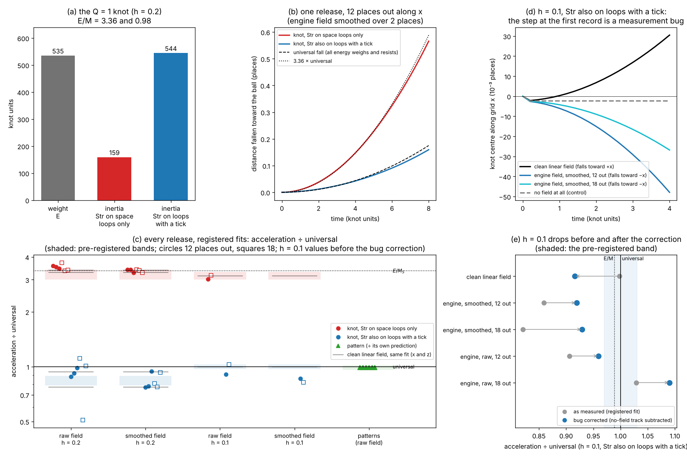

---

### Run 18b: the tick-loop knot on the fine grid, measured properly

**Question.** In Run 18 the knot with Str also charged on loops that include a tick (reading T, adopted provisionally on 17 October) fell at 0.92–0.93 of the universal rate on the fine grid. That missed the registered 1.00 ± 0.03. Is the shortfall the lattice knot's own weight-to-inertia ratio, which should tend to 1 as the grid is refined, or something else?

The pre-registration is `PREREG_18b.md` in `matter_run.zip`. It was written after the diagnostics below and before any registered drop, and it lists everything already seen.

#### What the diagnostics found first

**1. The first suspect was wrong.** The first diagnosis was that twist across a tick and twist across a relation use different lattice formulas. They don't: both build each square face from its corners in the same way. A tick is simply taken as infinitely short. The literal alternative, a tick of finite length h priced exactly like a relation, is unstable on a cubic grid at one hop per tick.

**2. Run 18's inertia estimate was too crude.** It boosted the knot with central differences. A smooth rigid boost uses the exact derivative of the knot's band-limited field, projected onto the sphere's tangent plane:

$$
\dot n=-v\,\partial_x n,\qquad M_{\rm spec}=\frac{2T(\dot n)}{v^2}
$$

The force on a smooth rigid translation is

$$
F_{\rm spec}=\sum_i\frac{\partial V_N}{\partial n_i}\cdot\partial_xn_i .
$$

Together they give the lattice knot's own fall, and the universal fall is the reference:

$$
a_{\rm lat}=N_c\,\frac{F_{\rm spec}}{M_{\rm spec}},\qquad a_{\rm univ}=N_c\,\langle\partial_uN\rangle_e
$$

| | h = 0.2 | h = 0.1 |
|---|---|---|
| $E/M_T$, central boost (Run 18) | 0.982 | 0.989 |
| $E/M_T$, smooth boost | **0.907** | **0.973** |
| $E/M_S$, central / smooth | 3.360 / 3.198 | 3.096 / 3.062 |
| $F_{\rm spec}/(E\langle\partial_xN\rangle_e)$ | 0.993 | 0.992 |

Along z (the knot's own axis) at h = 0.1, $E/M_{T,\rm spec}$ = 0.993.

**3. The fall is not steady over short windows.** At h = 0.2, even with the field switched on smoothly, the knot's local acceleration wobbles by about ±5% over several time units. Run 18's 4- and 8-unit windows could not measure it to 3%.

#### Method

Run 18's model, unchanged. Three changes to the measurement and the code:
- **Smooth switch-on.** The field is switched on over $T_r$ = 4 time units, holding the clock rate at the knot's centre fixed:
$$
N(\mathbf x,t)=N_c+r(t)\big(N(\mathbf x)-N_c\big),\qquad r=3s^2-2s^3,\ s=t/T_r
$$
  The steady fall is then fitted with a quadratic (free offset and velocity) over the next $T_w$ = 12 units. The two half-windows are fitted separately.
- **Centre** about one fixed reference, which fixes Run 18's bug.
- **Code.** The space-time acceleration is in C (`kmass.c`, equal to Run 18's numpy to 10⁻¹⁵). dt = 0.02, checked against 0.01: the tracks agree to 7×10⁻⁶.

Fine grid only (h = 0.1, 128³). The engine field is the smoothed one (Run 16 d8 s1, Gaussian over 2 places), because Run 18 showed its raw noise scatters a knot of radius ~2 by up to ±19%.

#### Results

| drop | $a/a_{\rm univ}$ | registered prediction | $a/a_{\rm lat}$ | half-windows ($a/a_{\rm univ}$) |
|---|---|---|---|---|
| T, clean field, along x | **0.942** | 0.965 ± 0.03 | **0.976** | 0.926, 0.965 |
| T, clean field, along z | **0.983** | 0.991 ± 0.03 | **0.992** | 0.988, 0.981 |
| T, engine field, 12 out | **0.961** | 0.965 ± 0.03 | **0.996** | 0.928, 0.988 |
| T, engine field, 18 out | **0.955** | 0.966 ± 0.03 | **0.989** | 0.934, 0.984 |
| S, clean field, along x | **2.884** | 3.04 ± 0.09 | 0.950 | 2.79, 2.94 |
| S, engine field, 12 out | **3.062** | 3.04 ± 0.09 | 1.008 | 2.88, 3.23 |
| T, no field (control) | centre drift 1.7×10⁻⁵ places over 16 units | < 1×10⁻⁴ | | |

- **The tick-loop knot falls at its own lattice weight ÷ inertia:** 0.976, 0.992, 0.996 and 0.989 of $a_{\rm lat}$ (mean 0.988), in the clean field and in the engine's field alike.
- **Its shortfall from universal is the lattice knot's excess inertia.**
  - Along x it falls at 0.94–0.96 of universal, where $E/M_{\rm spec}$ = 0.973.
  - Along z, the knot's axis, it falls at 0.98, where $E/M_{\rm spec}$ = 0.993.
- **Along x the fall wobbles.** The local acceleration oscillates by about ±5% with a period of about 5.5 time units (panel a). Most likely this is a mode of the knot rung by a pull across its axis, which the 4-unit switch-on is too quick to avoid. Along z it is steady. The 12-unit window covers about two periods, and the half-windows (0.93 against 0.96–0.99 of universal) show what is left of the spread.
- **The space-loop knot still falls about 3× too fast:** 2.88 and 3.06 × universal. Its acceleration varies even more across the window (half-windows 2.79–3.23).
- **No field, no motion:** the control knot's centre drifts by 1.7×10⁻⁵ places in 16 time units.

#### Against the pre-registration

| Prediction | Expected | Measured | |
|---|---|---|---|
| P1: tick-loop knot ÷ its own lattice prediction | 1.00 ± 0.03 | 0.976, 0.992, 0.996, 0.989 | **pass** |
| P2: tick-loop knot ÷ universal | 0.965, 0.991, 0.965, 0.966 (± 0.03) | 0.942, 0.983, 0.961, 0.955 | **pass** (offsets −0.023 to −0.004) |
| P3: space-loop knot ÷ universal | 3.04 ± 0.09 | 2.88, 3.06 | **fail, 1 of 2.** It still falls about 3× too fast; the band was tighter than its wobble |
| P4: engine field against clean field | within 0.03 | +0.020, +0.012 | **pass** |
| P5: no-field control | drift < 1×10⁻⁴ | 1.7×10⁻⁵ | **pass** |

The reading written in advance for P3 failing ("the space-loop knot falls near universal") does not apply: it falls at 2.9–3.1×.

#### Reading

**1. On the fine grid the tick-loop knot falls at its own lattice weight ÷ inertia,** to 1–2% on average and 2.4% at worst, in a clean field and in the engine's field alike. Its shortfall from the universal rate is the lattice knot carrying a little more inertia than energy:

$$
\frac{E}{M_{T,\rm spec}}=0.907\ (h=0.2)\ \to\ 0.973\ (h=0.1)\quad\text{along }x;\qquad 0.993\ \text{along }z\ (h=0.1)
$$

**2. Where Run 18's "8%" went.**
- About 3 points are the lattice knot's excess inertia, which Run 18's crude boost missed.
- About 1 point is the force on a lattice translation (0.992 of the energy-weighted force).
- The rest, about 3 points, was measurement: short windows that caught the wobble, and a sudden release. (Run 18's 8% was already corrected for the centre bug.)

**3. The continuum.**
- The excess inertia shrinks from 9.3% to 2.7% as h halves, a factor of 3.4, close to the factor of 4 of an error going as h². Extrapolated that way it gives $E/M$ = 0.995 at h → 0.
- Field theory says exactly 1 in the continuum (Lorentz invariance plus Derrick's theorem). Extrapolating linearly would give 1.04, inertia below energy, which the continuum theory does not allow.
- With two grids this is **supported, not established.** A third grid (h = 0.05) would settle the rate. It needs a rewrite of the energy kernel's memory use, since its buffer would be ~10 GB at 256³.

**4. The decision stands.** The space-loop knot still falls about 3× too fast. The tick-loop knot falls with the patterns up to a lattice effect that shrinks with the grid. The provisional rule (twist charged on every closed loop, ticks and relations priced alike) passes the test it was given.

**5. Flag, unchanged.** Inertia = energy here is Lorentz invariance in lattice form. And the knot still moves by a field equation, not by the engine's commitments.

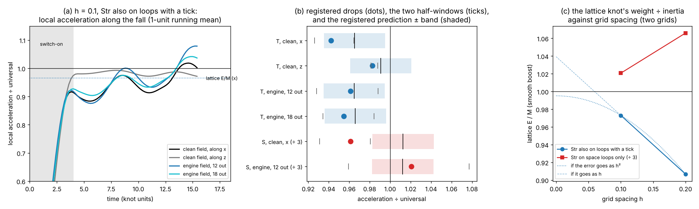

---

### Run 19: knots that dig their own clock wells (active mass, and how CO's engine combines wells)

**Question.** In Runs 16–18 every body fell in a clock well dug by CO's benchmark ball. Here a knot digs its own.
- **Committed side:** its places hold engine commitments where its cost lives, drawing possibility from the one budget.
- **Uncommitted side:** its orientation field moves as in Run 18, falling with inertia, with twist charged on every loop.

This follows the rulings of 6 October (phase memory on uncommitted channels, at the local clock rate) and avoids repeating Attempt D, whose commitment-only loops can only drift, and only with a steering constant of ours (D-O8, D-O15, `Engine_Motion.md`). Plan approved 17 October: the two-layer knot, both matter arms, and R1.

**R1 does not act in this engine.** R1 (adopted 11 October) says a failed try takes no time. Nothing here proposes: the vacuum never commits (Run 14), and matter's reserved pairs renew at once if both places can pay. So the engine is bit-identical with R1 on or off, and Runs 14–18 stand under R1. Checked: the Run 19 control reproduces Run 16's engine bit for bit.

#### Model

**Engine:** Runs 14–16's adopted rules, box 60, density 8, 9,000 ticks, read over the last 6,000. Clock rate $N(\mathbf x)$ = time-averaged passing count ÷ the control's mean (the flow rule: a hold ends when $H_1$ = 79 units have passed its places).

**The knots:** Run 12's relaxed Q = 1, 2, 3 (h = 0.2, one knot unit = one engine place), with cost per place $e_p$:

| | Q = 1 | Q = 2 | Q = 3 |
|---|---|---|---|
| E | 533.8 | 877.1 | 1227.2 |
| ÷ E(Q = 1) | 1 | 1.643 | 2.299 |

**How many commitments a knot holds (two arms):**
- **Arm E, cost-paid (an added rule, flagged).** $\mathrm{round}(\lambda E/2)$ commitments spread over the knot's links with weight $e_p+e_q$, so place p holds about $\lambda e_p$ of them. λ = 0.2023 per unit of cost, fixed so that Q = 1 holds 54, as CO's ball does. That gives 54 / 89 / 124 commitments, up to 6 on one place (an addition, flagged).
- **Arm P, CO's current rule.** One reserved commitment per place with $e_p\ge\tau$, paired at random as CO pairs its ball. τ = 0.371 (ours) is fixed so that Q = 1 has 108 matter places. That gives 51 / 74 / 101 pairs.

**Active mass.** A body's well about its centre, $\delta(r)=1-\langle N\rangle_r/\langle N_{\rm ctrl}\rangle_r$ for r = 7–20, fitted to CO's ball's well: $A=\sum\delta\,t/\sum t^2$. Its draw is the possibility it spends per tick.

#### S1: does a knot's well scale with its energy? (pre-registered, `PREREG_19_S1.md`)

| body | draw per tick | A (in CO balls) | A ÷ draw (×100) | holds per commitment per tick | clock rate over its cost |
|---|---|---|---|---|---|
| CO's ball | 15.13 / 15.26 | 1.00 | 6.58 | 0.140 | 0.70 (over its places) |
| Q1 E | 12.34 | 0.825 | 6.69 | 0.114 | 0.594 |
| Q2 E | 17.33 | 1.180 | 6.81 | 0.097 | 0.534 |
| Q3 E | 21.86 | 1.460 | 6.68 | 0.088 | 0.495 |
| Q1 P | 14.41 | 0.960 | 6.66 | 0.141 | 0.670 |
| Q2 P | 19.48 | 1.329 | 6.82 | 0.132 | 0.618 |
| Q3 P | 24.80 | 1.666 | 6.72 | 0.123 | 0.571 |

(Seed means; seeds agree to 0.2% in draw and 1–3% in A.)

| Prediction | Expected | Measured | |
|---|---|---|---|
| P0: A ÷ draw the same for every body | within 5% | 14 bodies within 3.0% | **pass** |
| P1: arm E, $A_{Q2}/A_{Q1}$, $A_{Q3}/A_{Q1}$ = energy ratios | 1.643 ± 0.08, 2.299 ± 0.12 | 1.429 ± 0.003, 1.770 ± 0.013 | **fail** |
| P2: arm P, ratios = pair ratios | 1.45 ± 0.08, 1.98 ± 0.10 | 1.384 ± 0.007, 1.735 ± 0.003 | **pass for Q2, fail for Q3** |

**Why both arms fall short: a body's own well slows its own commitments.**
- These bodies dig deep wells. Weighted by where their cost sits, their own clocks run at 0.50–0.67 of the far rate (CO's ball: 0.70 over its places).
- A commitment completes as possibility passes its places, so it completes more slowly inside its own body's well. Commitments stacked on one place also share that place's possibility.
- So a bigger body draws less per unit of cost. Draw per unit energy, ÷ Q = 1:
  - arm E: 0.855 (Q2), 0.771 (Q3)
  - arm P: 0.822, 0.749
- Because P0 holds, the well follows the draw exactly. **The engine's active mass is the redshifted draw:**

$$
D=\sum_{\rm commitments}\frac{\text{passing at its places}}{H_1}\;\approx\;\frac{2\,\lambda_0}{H_1}\sum_p n_p\,N_p
$$

**What the registered target got wrong.** "Active mass ∝ E" ignores binding. In standard physics a bound body's mass includes its negative binding energy, so it is *expected* to fall below the sum of its parts. What the equivalence principle needs is that active mass, passive mass and inertia are all reduced alike: the strong equivalence principle (SEP). P1's failure is therefore not by itself a violation. It is a binding effect of the size of the body's own well, and these bodies are strong-field (own clock halved). Real matter's own wells are ~10⁻⁹ deep.

#### The finding that decides the next question: the engine's well is linear in its source

Outside matter, possibility only wanders and returns to random places, which is linear. So the shortage is a sum over sources with one Green's function G, and under the flow rule the clock rate *is* the passing count:

$$
\delta(\mathbf x)=\sum_bD_b\,G(\mathbf x-\mathbf x_b),\qquad N=1-\delta\equiv1-U\quad\text{exactly, outside matter}
$$

**Checked on S1's 14 bodies (after S1, before S2a was registered).** Each body's shell profile at r = 5–8 was scaled two ways and its deviation from the common shape regressed on source strength. An exactly linear engine predicts no trend in the linear form and about +0.035 per 10 units of draw in the log form; an exponential engine predicts the reverse.

| scaling | trend of shape with draw (per 10 units) | scatter |
|---|---|---|
| linear, $(1-N)/D$ | +0.017 ± 0.008 | 1.1% |
| logarithmic, $-\ln N/D$ | **+0.057 ± 0.008** | 1.1% |

The data favour linear. The exponential form ($\ln N$ adding, which gives β = 1) misses by 0.052, about 6.5 standard errors. The small residual trend in the linear form (2σ) is partly the ball's different shape. The strongest and weakest knots alone agree to 0.7–1.3% at r = 5–8 (panel b).

**What β that is.** With the clock as the time part of the metric and the pattern rule (Run 17) for the space part, $ds^2=-N^2dt^2+N^{-2}d\mathbf x^2$:

$$
g_{00}=-(1-U)^2=-1+2U-U^2\;\Rightarrow\;\beta=\tfrac12,\qquad g_{ij}=(1-U)^{-2}\delta_{ij}=(1+2U+\dots)\delta_{ij}\;\Rightarrow\;\gamma=1
$$

- **Mercury.** The perihelion advance per orbit is $\frac{2+2\gamma-\beta}{3}\cdot\frac{6\pi GM}{a(1-e^2)c^2}$, so this metric gives **7/6 of GR: 50.1″ per century against the observed 42.98″.** This is Run 10's additive budget with free capacity. Run 10 reached 42.97″ only by *assuming* the multiplicative budget ($c=c_0e^{-U}$), which the engine as adopted does not produce.
- **Nordtvedt.** $\eta=4\beta-\gamma-3=-2$, against σ(η) = 4.4×10⁻⁴ from lunar laser ranging (Williams et al. 2009). The formula is for theories without preferred-frame terms; CO's engine has a preferred frame, so other terms could add.
- **Both excluded.** The inference assumes the clock rate is the full time part of the metric and that orbits follow that metric, as Runs 16–17's patterns do. A direct orbit run on the engine field has not been done.

#### S2a: two wells in one box (pre-registered, `PREREG_19_S2a.md`)

CO's ball at (30, 30, 30) and the Q1 arm-E knot 9.5 places away, seeds 1 and 2, each against its solo runs.

| Prediction | Expected | Measured | |
|---|---|---|---|
| Q1: knot's draw ÷ solo = ball's clock at the knot's commitments | 0.944 / 0.943 (± 0.01) | 0.943 / 0.946 | **pass** |
| Q1: ball's draw ÷ solo = knot's clock at the ball's places | 0.957 / 0.954 (± 0.01) | 0.955 / 0.959 | **pass** |
| Q2: field outside matter = linear sum with those draws, to 1% of δ | mean residual within 1% | +2.2%, +1.5% (seed 1); −0.2%, +0.8% (seed 2) | **mixed: seed 2 passes, seed 1 off by 0.5–1.2 points** |

- **Sources redshift each other:** each body's commitments complete more slowly in the other's well, exactly as predicted, against 1.00 for a plain additive engine.
- **The field is the linear sum of the redshifted sources.** Mean residual about each body over shells 6–20, from seeds 1 and 2:
  - linear sum with redshifted draws: +1.1% (four cases, ± 0.5%)
  - multiplicative composition, $\delta_b+\delta_k-\delta_b\delta_k$: −2.6%
  - plain additive: −3.9%
- The registered 1% tolerance was tighter than the noise between independent runs (shell rms 1–3%).

#### Reading

**1. In CO's engine a body's active mass is its redshifted draw.** A bigger or denser body sits deeper in its own well, completes its commitments more slowly, and digs a well smaller than its cost. That is a binding effect, and by itself it is not a violation. Whether CO keeps the strong equivalence principle depends on its passive mass and inertia getting the same factor, and that depends on how its wells combine (point 2).

**2. The engine's wells are linear in their sources (β = ½), not exponential (β = 1).** With the adopted pattern rule (γ = 1), the engine therefore predicts Mercury's perihelion at 50.1″ per century and η = −2. **Both are excluded.**
- This is the parked "perihelion on the event layer", now answered by inference: Run 10's multiplicative budget is not what the adopted engine does.
- It follows from two adopted rules together: the vacuum never commits (so outside matter possibility only wanders, linearly), and the flow clock rule (so the clock rate is the passing count, linearly).

**3. What would fix it, stated, not chosen.** Clocks would have to slow as $N=e^{-\delta}$ rather than $1-\delta$, or the shortage would have to obey an equation linear in $\ln N$. For example, a hold could end after possibility equal to a fixed *fraction of what remains* has passed. That would be a change to the clock rule adopted on 16 October, and it would need Runs 15–18 re-checked. **Needs a ruling.**

**4. Not run, and why.** Taking Run 18's equations with S1's self-well, a knot in its own well would fall at 0.58 of a test body if wells add, or 0.37 if they multiply, and at 0.88 with the self-well 0.3× as deep. But Run 18's knot uses clock-only coupling (γ = 0), not the adopted pattern rule. So that SEP test would mostly measure the missing γ, and it was set aside in favour of measuring β directly.

**5. Flags.**
- Arm E's cost-paid rule and its stacked commitments are ours.
- The β inference identifies the clock rate with the metric's lapse and assumes geodesic orbits.
- These bodies are strong-field; the β result does not depend on that.

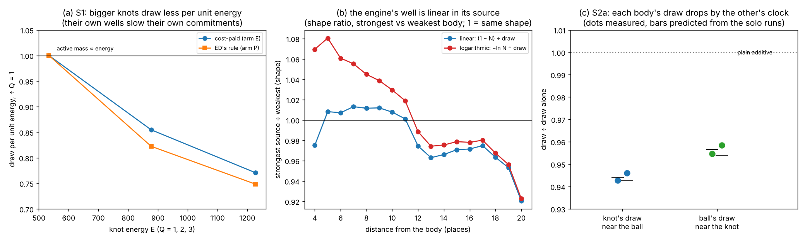

---

### Run 20: β measured directly in CO's engine

**Question.** Run 10 reached Mercury's perihelion only with the multiplicative budget ($N=e^{-U}$, β = 1). Run 19 inferred, from knots of different shapes, that CO's engine as adopted makes linear wells ($N=1-U$, β = ½). This run measures β the way Run 10 measured it on its lattice, on one source shape, in the engine. Pre-registration: `PREREG_20.md` (`beta_run.zip`).

**Method.**
- CO's benchmark ball (radius 3) in the adopted engine (box 60, density 8, 9,000 ticks), each of its pairs holding k = 1, 2, 3 reserved commitments. Seeds 1 and 2, against seed-matched controls.
- With $U=D\,g(r)$ at first order, the clock rate $N=1-U+b_2U^2$ gives, shell by shell,

$$
\frac{\delta_k(r)}{D_k}=g(r)-b_2\,g(r)^2D_k,\qquad \beta=\tfrac12+b_2
$$

  So a straight line of δ/D against the measured draw D, at each shell r = 5–12, gives $b_2$. Shells are weighted by inverse variance.

**Results.**

| k | draw D (seeds 1 / 2) | δ at r = 5 | δ at r = 8 |
|---|---|---|---|
| 1 | 15.13 / 15.26 | 0.136 / 0.139 | 0.071 / 0.071 |
| 2 | 23.21 / 23.45 | 0.208 / 0.212 | 0.109 / 0.111 |
| 3 | 28.28 / 28.56 | 0.254 / 0.257 | 0.133 / 0.134 |

- Per shell, $b_2$ = 0.030, −0.004, −0.005 at r = 5, 6, 7, where the second-order term is largest. The farther shells are noisier and lean negative.
- Weighted: **$b_2$ = −0.028 ± 0.025** (the error is the larger of the formal error, 0.021, and the seed-to-seed spread; seeds alone give −0.005 and +0.044).

$$
\beta=0.47\pm0.03\qquad\Rightarrow\qquad\text{Mercury: }42.98''\times\frac{4-\beta}{3}=50.5''\ \text{per century},\qquad\eta=4\beta-\gamma-3=-2.1
$$

| Prediction | Expected | Measured | |
|---|---|---|---|
| $b_2$ | 0.00 ± 0.10 (linear well) | −0.028 ± 0.025 | **pass** |
| the multiplicative budget | $b_2$ = 0.50 | excluded by about 20 standard errors | |

**Reading.**
- **Confirmed directly: CO's engine with the adopted rules has β ≈ ½.** The well per unit of draw does not shrink as the source grows (figure, panel a); a multiplicative well would have shrunk by 7–15% at these strengths.
- With the pattern rule (γ = 1) that puts Mercury at about 50.5″ per century (observed 42.98″) and the Nordtvedt parameter at about −2 (σ = 4.4×10⁻⁴). **Both excluded.**
- **Where this came from:** Runs 14–15's rules were adopted on first-order evidence. Run 10's second-order requirement was never carried into those tests. §5 now makes it a standing check.
- **Why it is structural:** while clocks count passing possibility and possibility wanders on its own, the passing count is a linear field whatever the hop rule (§6). The fix must change what clocks read, not only how possibility wanders.

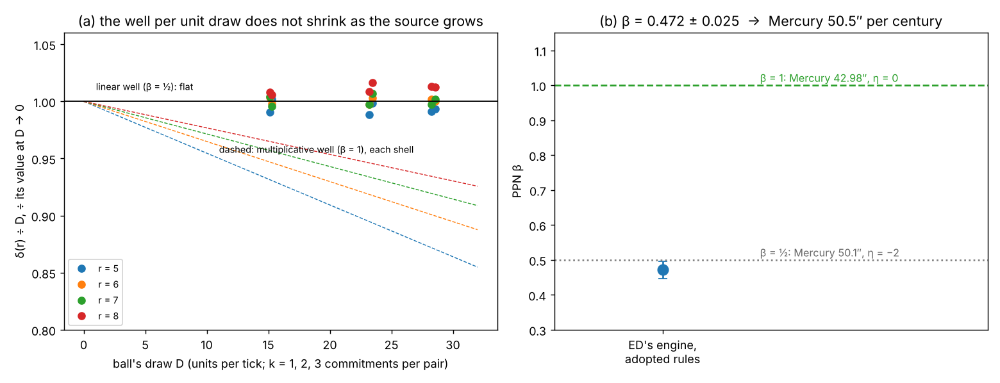

---

### Run 21: probe of Candidate A (stability, and a first look at β)

**Question.** Candidate A (§6) makes two changes:
- possibility's outflow from a place grows as the logarithm of its holding
- a clock counts possibility *present*, not passing

Does the medium stay stable (Run 17's medium froze), and does β move from ½ toward 1? This is a probe before the full test. Predictions were written first (`PROBE_21.md`), but it was not pre-registered against the standing checks.

**Rules.**

$$
p(P)=\frac{c\,\ln(1+P/p_s)}{P},\qquad f(P)=P\,p(P)=c\,\ln(1+P/p_s),\qquad p_s=1,\ \ c=\frac{0.99}{\ln 2}
$$

A commitment holds until $\sum_{\rm ticks}(P_a+P_b)$ reaches $H=\hbar\cdot2\cdot\text{dens}$, so its rate is ∝ P. Everything else is the adopted engine.

**Method.** Box 40, seed 1, 20,000 ticks, read over the last 12,000. CO's ball at k = 1, 2, 3 commitments per pair, plus a control, at densities 8 and 32 (`engine21.py`).

**Results.**
- **Stable.**
  - Mean P is conserved, with no freezing or clumping.
  - Var/mean of P holds at 2.0 (density 8) and 3.2–3.6 (density 32). The prediction was "near 2.2" at density 8; that is the continuous-time theory's value, and the engine's discrete-time medium sits about 9% lower.
  - The maximum stays bounded: 41 (density 8) and 101 (density 32) over the run.
- **Draws:** 7.97, 10.70 and 12.40 per tick at density 8; 8.49, 11.89 and 13.92 at density 32.
- **The wells are deep.** The clock shortage at r = 4 is 0.41, 0.52 and 0.57 at density 8, against 0.18 for the adopted engine's ball. The medium diffuses about 6× (density 8) to 22× (density 32) more slowly, so the same draw digs a deeper well.
- **The written β predictions missed.** `PROBE_21.md` predicted β = 0.94 ± 0.05 (density 8) and 1.00 ± 0.05 (density 32) by Run 20's method. That method gave **0.805** and **1.080**. The method is a weak-field expansion ($N=1-U+b_2U^2$) and is not valid in wells this deep: its per-shell b₂ runs from +0.33 to −0.43 at density 8, and from 0.41 to 0.64 at density 32.
- **After the data were seen, the fit was switched to a deep-well fit:**

$$
N=(1-qU)^{1/q},\qquad \beta=1-q/2,
$$

  with q chosen so that the well's shape is the same at all three strengths. This gave **β = 1.01 ± 0.04** (density 8) and **0.96 ± 0.06** (density 32). The standard engine's Run 20 data give 0.55–0.60 by the same fit.

**Reading (written after Run 22's theory; see Run 22).**
- Stability passed.
- The deep-well fit's numbers were **partly luck**. Run 22's zero-range theory was written after this probe, so these are postdictions, not predictions. With no fitted parameter, it reproduces Run 21's wells: the draws to 1.6% and the profiles to within 0.011 at every shell from 4 to 15. On those same wells it says the deep-well fit should give 0.93 (density 8) and 1.02 (density 32). That fit summarises shape; it is not the weak-field β. Run 22 measures β properly.

---

### Run 22: Candidate A against the standing checks

**Question.** Does Candidate A deliver β = 1 while keeping every first-order result?

Pre-registered: `PREREG_22.md` was hashed before any run (in `ratio_run.zip`). It has two dated amendments:
- **Amendment 1** (the well test) was written before any Run 22 output existed.
- **Amendment 2** (the fall test) was written after the smooth-field code check had failed, but before any engine field was used in a pattern run.

A dated note (`NOTE_22_clocks.md`) recorded a prediction for the density-32 clocks. It was hashed after those runs had started but before any of them had finished.

#### Theory (written after Run 21's probe and before Run 22; no parameter fitted to any run)

**Exact, by conservation.** Write the mean outflow from a place as $z_x=\langle f(P_x)\rangle$, with $f(P)=c\ln(1+P)$. In the steady state, inflow (the neighbours' outflows, one-sixth each) balances outflow, matter's draw $s_x$ and the uniform return $\bar s$:

$$
\tfrac16\sum_{y\sim x}z_y-z_x=s_x-\bar s .
$$

**The outflow is a linear, unscreened field for any hop rule.** This is §6's structural fact. Under the flow clock, the clock read this field directly, which is why β = ½.

**What the presence clock reads.** It reads $\langle P\rangle$, a *nonlinear* function of z. If each place is in local equilibrium, it holds n units with the zero-range weights

$$
\pi_z(n)\propto\frac{z^n}{\prod_{j=1}^{n}f(j)},\qquad \langle P\rangle=R(z).
$$

**β.** Let $y(z)=\ln R(z)$, and write the outflow deficit as $\Delta z=z_0-z$ and the linear field, normalised, as $U=y'(z_0)\,\Delta z$. Expanding $N=R(z)/R(z_0)=e^{\,y(z)-y(z_0)}$ with $a=y''/(2y'^2)$:

$$
N=e^{-U+aU^2+\dots}=1-U+\big(\tfrac12+a\big)U^2+\dots\ \Rightarrow\ b_2=\tfrac12+a,\quad \boxed{\beta=\tfrac12+b_2=1+\frac{y''}{2\,y'^2}}
$$

This is the β of an ideal clock that reads the ambient $\langle P\rangle$. **β = 1 exactly when ln P is a straight line in the outflow**, which is the exponential clock. For $f=c\ln(1+P)$ that holds only when P is large, where $z\approx c\ln P$. The same formula can be read off a measurement with no theory at all. Fill a box uniformly at density ρ, measure z(ρ), and fit $z=z_0+g_1x+g_2x^2+g_3x^3$ with $x=\ln(\rho/P_0)$; then $\beta=1-g_2/g_1$.

**The wells, self-consistently.** Each pair renews at rate $(P_a+P_b)/H$. Solving the exact equation on box 40 with $\langle P\rangle=R(z)$ predicts every draw and every shell profile, parameter-free (`theory22.py`).

**Checked against Run 21's probe (postdictions: the theory was written after the probe).**
- draws: within 1.6%
- profiles: within 0.011 at every shell from 4 to 15
- the probe's deep-well fit: the theory says it should have given 0.926 and 1.024, not the 1.01 and 0.96 measured. That fit was demoted to "reported, not tested".

#### Method

| set | what | ticks (read) |
|---|---|---|
| wells | box 40, CO's ball (radius 3) stacked k = 1, 2, 3, plus control. Density 8 (seeds 2, 3), 32 (seeds 2, 3), 4 (seed 2) | 20,000 (12,000); 30,000 (15,000) at density 32, which relaxes about 4× more slowly |
| uniform medium | box 20, no matter; ladders of 7–9 densities around P₀ = 4, 8, 16, 32, 64, 128, 512, 2048 | burn max(1500, 6(1+ρ)/c), read 5,000 |
| clocks | control and k = 1 with 100 probe clocks (Run 15's layout; designs hold H and 2H; shells 5–14); densities 8 and 32, seeds 2 and 3 | 20,000 (12,000) |
| patterns | Run 16's code, unchanged, in the k = 1 fields and in the theory's smooth field; released 10 and 14 out along six axes; masses 0.7–2.0 | 16 |

- **Recording.** The engine (`engine22.py`) records the mean outflow and the possibility at hop time, and each place's draw by matter.
- **Code check.** With nothing added, it is bit-identical to Run 21's engine.

#### Results

**T1a. β of the medium, from its own equation of state (primary).**

| P₀ | 4 | 8 | 16 | 32 | 64 | 128 | 512 | 2048 |
|---|---|---|---|---|---|---|---|---|
| measured β | 0.8827 | 0.9427 | 0.9754 | 0.9924 | **0.9996** | **1.0015** | **1.0010** | **1.0005** |
| ± (χ²-scaled) | 0.0001 | 0.0003 | 0.0009 | 0.0005 | 0.0004 | 0.0003 | 0.0002 | 0.0001 |
| theory (fixed beforehand) | 0.872 | 0.942 | 0.980 | 0.996 | 1.0006 | 1.0017 | 1.0011 | 1.0004 |
| Mercury (″/century), γ = 1 | 44.66 | 43.80 | 43.33 | 43.09 | 42.99 | 42.96 | 42.97 | 42.97 |
| η = 4(β − 1) | −0.469 | −0.229 | −0.098 | −0.030 | −0.0018 | +0.0061 | +0.0038 | +0.0021 |

- **Mercury's band** (|β − 1| ≤ 0.003): **pass at every P₀ ≥ 64.**
- **β rises from 4 to 32:** every step is positive; 196σ overall. **Pass.**
- **The theory column:** within 0.03 at 4–32. **Pass.**

The engine reproduces the theory's overshoot above 1 near P₀ = 128, which the theory predicted in advance. At low density the theory is close but not exact: it misses by 0.0106 at P₀ = 4 (about 77σ), 0.005 at 16 and 0.003 at 32. That is inside the registered 0.03, but it is the discrete-time engine's medium departing from the continuous-time theory (see T1c).

**T1b. The wells obey the same equation of state (Amendment 1).** Each shell point of every well and control is compared with the uniform medium's curve at the same outflow.

| density | points | max \|Δ ln P\| | r.m.s. | verdict | reported: quadratic estimator (theory curve) |
|---|---|---|---|---|---|
| 8 | 96 | 0.0036 | 0.0007 | **pass** | 0.907 ± 0.003 (0.896) |
| 32 | 96 | 0.0037 | 0.0007 | **pass** | 0.992 ± 0.001 (0.989) |
| 4 | 46 (2 outside the ladders) | 0.0011 | 0.0003 | **pass** | 0.831 ± 0.004 (0.780) |

**The wells obey the matter-free medium's equation of state** to within the band, at densities 4, 8 and 32. The resolution matters. A gap of 0.004 in ln P across the wells' range corresponds to about 0.007–0.01 in β, so T1b ties the wells' β to the medium's at that level, not at Mercury's 0.003. No wells were run at P₀ ≥ 64, where Mercury's band passes.

The one visible trend is at the deepest shells (r = 4, where P/P₀ ≈ 0.43–0.5, k = 2 and 3). There the wells at densities 8 and 32 sit 0.002–0.004 below the uniform curve (figure, panel b). At density 4 the matching points fall outside the ladders and were dropped. The trend looks like an effect near matter's sinks, not a lean medium. It is within the band, and untested.

**T1c. The parameter-free theory.**
- **Draws** (seed means) are within 1.4% of theory: 7.95, 10.66, 12.32 against 8.00, 10.66, 12.21 at density 8, and 8.47, 11.77, 13.88 against 8.59, 11.89, 14.01 at density 32. **Pass.**
- **Profiles at density 32:** max 0.0034, r.m.s. 0.0015. **Pass.**
- **Profiles at density 8:** max **0.0101** against a limit of 0.010 (r.m.s. 0.0043). A **marginal FAIL**: near the ball, k = 2 and k = 3 wells are up to 0.010 deeper than predicted.

  A post-hoc diagnostic redid the prediction with the engine's measured equation of state (`diag_profiles22.py`). That cuts the k = 3 miss to 0.0064, so about 37% of the miss is the discrete-time engine's medium, which differs from the continuous-time theory by +0.8% in z at ρ = 8, +2% at ρ = 2 and 0.00% at ρ = 512. The rest is unexplained.
- **Reported (q-method):** 0.954 ± 0.018 at density 8 (theory 0.926) and 0.90 ± 0.07 at density 32 (theory 1.024). This is a shape summary, too noisy to mean anything at 32.

**T2. Clocks slow by the fractional shortage (Run 15's check): FAIL.**

| density | design 1 (hold H) κ | design 2 (hold 2H) κ | ratio | against own places |
|---|---|---|---|---|
| 8 | 0.931 ± 0.012 | 0.990 ± 0.014 | **0.941** | 1.005, 1.003 |
| 32 | 0.941 ± 0.018 | 0.980 ± 0.017 | **0.961** | 1.000, 1.000 |

The designs disagree by 6% (density 8) and 4% (density 32), against the registered 2%. Design 1 also misses the per-design band (1.00 ± 0.05) at both densities. **Every clock slows exactly with the possibility at its own two places**, but it drains those places itself.

- **A partial model** (`NOTE_22_clocks.md`, `clockself22.py`; worked out after density 8, hashed before any density-32 probe run finished). Its renewals are a sink $q=(P_a+P_b)/(jH)$ at each of its places. This lowers the outflow there by $\Delta z_{\rm self}=6(G_0+G_1)\,q$, with lattice Green's function $G_0=0.2527$ and $G_1=G_0-\tfrac16$. In a well q falls with $P_{\rm own}$, so the self-dip shrinks and the clock slows *less* than its surroundings:

  $$\kappa\approx\frac{1}{1+D_{\rm self}},\qquad D_{\rm self}=y'(z)\,\Delta z_{\rm self}.$$

  **What the model gets right and wrong:**
  - **Right:** the design ratio at density 8, 0.942 against 0.941 measured.
  - **Wrong in size:** its absolute κ values (0.870, 0.923) are about 6% low, and its own-place dips are too small (next bullet).
  - **Its density-32 prediction:** 0.936, with "above 0.97 means the mechanism is wrong". Measured 0.961 ± 0.025, between the two, so not decisive.
- **Direct measurement of the self-dip** (post hoc; `selfdip22.py`, in the control runs). A probe's own places sit below the surroundings by 0.32 (design 1) and 0.256 (design 2) at density 8, and by 0.305 and 0.242 at density 32.
  - **It does not fade with density:** four times the possibility per place shrinks it by only 4–6%. That is what the model claims.
  - **Against these numbers the model's sizes look wrong:** it gives 0.214 and 0.125 at density 8 (0.202 and 0.117 at 32), and a design-2 to design-1 ratio of 0.58 against 0.80 measured. *Corrected by Run 23:* these dips were measured against the box mean, so they include the depletion that 100 probes 2.5 apart cause together. A lone clock in Run 23 dips 0.186 (design 1) and 0.105 (design 2), a ratio of 0.56. The model matches that to 8–10%.

  **Why it does not fade (theory, consistent with the measurement).** Since $y'\to1/c$, the logarithmic outflow refills a drained place only logarithmically, so one commitment's self-dip is $D_{\rm self}\approx6(G_0+G_1)\,q/c$ at every density. In the adopted (linear) medium the same dip would be $\approx2q/P$, vanishing as P grows. That may be why Run 15's flow clocks agreed; it is untested.

**T3. The outflow is unscreened and follows its draw (Runs 14 and 19).** The measured outflow deficit is set against the lattice solution of the exact equation, built from each run's recorded sinks, with no free amplitude.
- **Amplitudes** are 0.985–1.021 (mean 1.002, scatter ±1.0%, 15 runs). Misfits are 0.10–0.42% of the deficit at r = 4.
- **Verdict:** 14 of 15 runs pass (the three density-4 runs give 0.992, 0.990 and 0.998). One (density 8, seed 2, k = 2) is at **1.0205** against 1.00 ± 0.02, a **marginal FAIL**. That is 1.9 scatter-widths from the mean; one such run in 15 is about what chance gives.
- **Screening:** the best-fit length is at the scan's upper edge (unscreened) in 10 runs and 150–180 in 2. In 3 density-32 runs it is 30–36, improving misfits of 0.19–0.29% to 0.10–0.21%. The exact equation has no screening term. This is most likely the residue of incomplete relaxation (diffusion length $\sqrt{4Dt}\approx20$–30 over the window), not tested.
- **Flag:** T3 is exact by conservation; it checks the code.

**T4. Patterns fall (Run 16).**
- **The registered code check failed before any engine field was used.** In the theory's smooth field, $a/a_{\rm pred}$ is 0.85–0.98 (median 0.913), with masses up to 15% apart.

  **Likely causes (untested):** packets of width 4 span strongly curved field in these deep wells, and 14 out they reach within 6 places of the box face, where the gradient reverses. A larger box would fix the second but not the first, and no larger box was run. Shorter fit windows, radius 16 and heavier patterns did not restore Run 16's regime (`diag_fall22.py`). **T4 as registered therefore cannot test the clock-set rate in these wells**; that carries over from Run 16.
- **T4′ (engine noise, Amendment 2):** each engine-field release over the same release in the smooth field.

  | field | all inward | median ρ | range |
  |---|---|---|---|
  | density 8, seed 2 | yes | 1.0005 | 0.991–1.006 |
  | density 8, seed 3 | yes | 1.0024 | 0.990–1.010 |
  | density 32, seed 2 | yes | 1.0014 | 0.997–1.007 |
  | density 32, seed 3 | yes | 1.0029 | 0.986–1.011 |

  **Pass:** the engine's noisy field makes patterns fall as its smooth version does.

#### Against the pre-registration

| test | registered | measured | verdict |
|---|---|---|---|
| T1a | \|β − 1\| ≤ 0.003 at P₀ ≥ 64; rising 4 → 32 | 0.9996, 1.0015, 1.0010, 1.0005; rise 196σ | **pass** |
| T1b (Amendment 1) | max \|Δ ln P\| ≤ 0.005, r.m.s. ≤ 0.003 | 0.0011 / 0.0003 (4), 0.0036 / 0.0007 (8), 0.0037 / 0.0007 (32) | **pass** |
| T1c | theory column ± 0.03; draws ± 3%; profiles max 0.010, r.m.s. 0.005 | all pass except density-8 profiles, max 0.0101 | **marginal fail** (profiles, density 8) |
| T2 | κ = 1.00 ± 0.05 per design; designs within 2% | 0.931 / 0.990 (8), 0.941 / 0.980 (32) | **FAIL** |
| T3 | A = 1.00 ± 0.02, misfit < 2% | 14 of 15 runs; one at 1.0205 | **marginal fail** |
| T4 (code check) | smooth field 0.96–1.00 | 0.85–0.98 | **fail: test not valid in box 40** |
| T4′ (Amendment 2) | median ρ 1.00 ± 0.01; every ρ 0.97–1.03 | 1.000–1.003; 0.986–1.011 | **pass** |

#### Reading

- **Candidate A fixes β, for an ideal clock.** The matter-free medium's own equation of state puts β inside Mercury's band from 64 units of possibility per place upward. The zero-range theory predicted these β values beforehand: within 0.004 at every P₀ ≥ 32, and within 0.001 from 64 up. The wells at densities 4–32 obey the same equation of state to about 0.01 in β.

  This is the first engine rule in the record whose medium gives the exponential metric's second-order term. The adopted engine gave β = 0.47.

  **Two limits.**
  - No well was run where Mercury's band passes.
  - This is the β of a clock that reads the ambient ⟨P⟩. The clocks as built read their own drained places (T2), so no built clock's second-order response was measured.
- **Nordtvedt is not reached.** At 2048 per place, η = +0.0021 ± 0.0003, against σ(η) = 4.4×10⁻⁴. The theory brings it within 2σ only above about 5,000 per place, which is not measured.
- **But Candidate A breaks clock universality, and with p_s = 1 the break looks structural.** A presence clock reads the possibility at its own places, which its own draw depletes by 24–32%. Near matter that self-depletion shrinks, so a clock that draws more slows less. Clocks of different make disagree by 4–6% at both densities tested (8 and 32), and the self-dip shrinks by only 4–6% between them.

  Real clocks of different types redshift alike to about one part per million: null-redshift comparisons of rubidium, caesium, hydrogen and dysprosium clocks bound the difference near 10⁻⁶ (Will 2014, *Living Rev. Rel.* 17, 4, §2.1.3, arXiv:1403.7377). **As built, Candidate A is judged excluded:** T2 fails as registered, and the exclusion comes from setting that failure against the 10⁻⁶ bound, not from a registered rule.
- **The same exponential amplification does both.** It makes β = 1 ($P\propto e^{z/c}$), and it turns one commitment's small outflow deficit into an order-one dip ($\Delta\ln P=\Delta z/c$). With $c\approx1.4$, one commitment is never a small disturbance.

  **Untested way out:** make c large. With $p_s\gg1$, $c=0.99/\ln(1+1/p_s)\approx0.99\,p_s$, and the self-dip should fall as $\approx6(G_0+G_1)q/p_s$ (the theory's form; Run 23 confirmed it: slope −0.94 ± 0.04 over $p_s$ = 4–64). The medium is then linear below $p_s$ (the adopted engine) and logarithmic above it, so β = 1 would need $P_0\gg p_s$. That makes matter light compared with the medium, which is also what gravity's weakness needs. It is a hypothesis for a ruling (§6), not a result.
- **What survives, whatever is ruled:**
  - The β formula, $\beta=1+y''/(2y'^2)$, for a clock reading the ambient ⟨P⟩ in any zero-range medium.
  - The demonstration that the old flow clock could never reach β = 1.
  - A cheap, precise way to measure β with no matter at all.

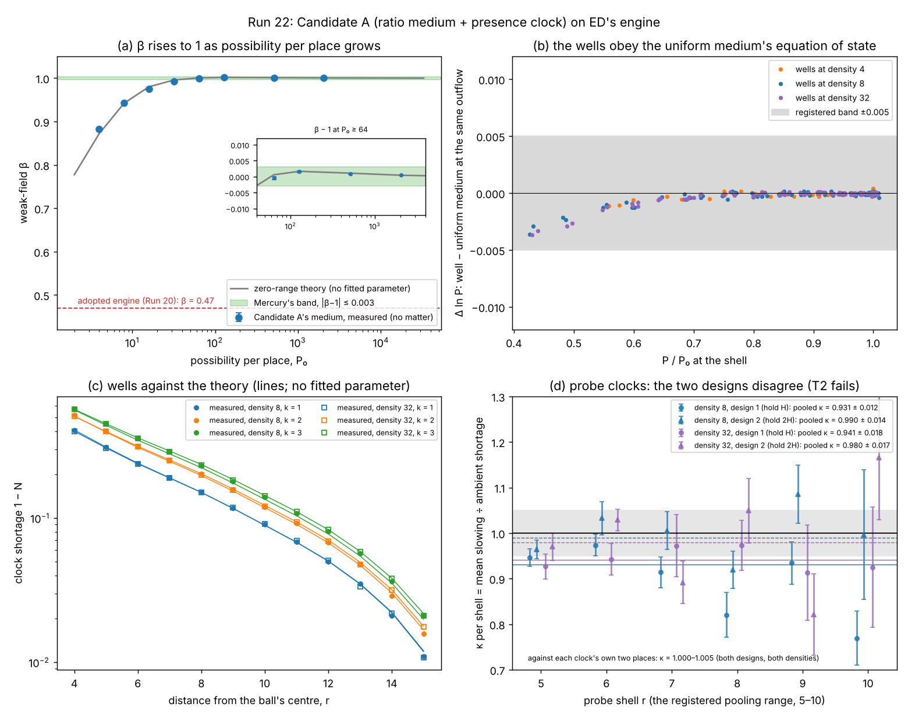

---

### Run 23: does matter become light, and β stay 1, as the crossover grows? (Candidate A′)

**Question.** In Run 22 the theory traced both Candidate A's success (β = 1) and its failure (a clock's own draw dips its own places by an order-one amount) to one exponential amplification. Candidate A′ keeps both rules, but lets the medium stay linear up to a holding $p_s$ and turn logarithmic only above it:

$$
f(P)=c\,\ln\!\Big(1+\frac{P}{p_s}\Big),\qquad c=\frac{0.99}{\ln(1+1/p_s)}\approx0.99\,p_s .
$$

If the theory is right, a clock's self-dip falls as about $1/p_s$ (matter becomes light), while β still tends to 1 once $P_0\gg p_s$. This run tests both cheaply, with a kill rule fixed in advance (`PREREG_23.md`, hashed before any run; `ps_run.zip`).

**Method.**
- **Self-dip:** box 36, no matter, 27 lone probe clocks on a grid 12 apart (designs hold H and 2H, alternating). $P_0=64\,p_s$, $p_s$ = 1, 4, 16, 64; 16,000 ticks, read the last 10,000. The dip is $1-P_{\rm own}/P_{\rm ref}$, with the reference ≥ 5 places from every probe.
- **β:** Run 22's matter-free method, unchanged, at $p_s$ = 4, 16, 64 and $P_0/p_s$ = 64, 256, 1024.

**Kill rule.**
- **K1:** the slope of ln(dip) against ln $p_s$ over 4–64 must be ≤ −0.7.
- **K2:** for each $p_s$, β must rise with $P_0/p_s$ and land within 0.003 of 1 at 1024.
- If either fails, the family is dead and clock-rule tuning stops.

**Results.**

| $p_s$ | 1 | 4 | 16 | 64 |
|---|---|---|---|---|
| dip, design 1 (theory) | 0.186 ± 0.003 (0.202) | 0.075 ± 0.002 (0.081) | 0.020 ± 0.001 (0.024) | 0.0060 ± 0.0008 (0.0064) |
| dip, design 2 (theory) | 0.105 ± 0.004 (0.117) | 0.042 ± 0.003 (0.043) | 0.008 ± 0.002 (0.012) | 0.0039 ± 0.0006 (0.0032) |

| β − 1 | $P_0/p_s$ = 64 | 256 | 1024 |
|---|---|---|---|
| $p_s$ = 4 | −0.0059 | −0.0011 | **−0.0002** |
| $p_s$ = 16 | −0.0073 | −0.0017 | **−0.0004** |
| $p_s$ = 64 | −0.0077 | −0.0019 | **−0.0005** |

β agrees with the theory to 0.0003 or better everywhere (errors below 0.00013, χ²-scaled).

| test | registered | measured | verdict |
|---|---|---|---|
| K1 | slope ≤ −0.7 | **−0.94 ± 0.04** (theory −0.92) | **pass** |
| K2 | β rises; \|β − 1\| ≤ 0.003 at 1024 | rises for every $p_s$; −0.0002, −0.0004, −0.0005 | **pass** |

**Reading.**
- **Matter becomes light as the crossover grows, and β stays 1.** Both kill tests pass, as the theory predicted. The self-dip falls about as $0.3/p_s$, and β depends only on $P_0/p_s$.
- **A correction to Run 22.** A lone clock at $p_s$ = 1 dips 0.186, not 0.24–0.32. Run 22's numbers were taken against the box mean, among 100 probes 2.5 apart, so they include the probes' collective depletion. For lone clocks the theory matches design 1 to 7–18%; design 2 is noisier (−38% to +22%, within about 2σ). Run 22's "underestimates by 1.5×" was that crowding. Run 22's T2 failure stands (it was measured against the shell ambient). Its size, a 4–6% design gap, roughly fits the self-dip difference of 0.08 between the designs here.
- **What this does not show.** It is a necessary condition, measured as a proxy: the self-dip of a lone clock. It is not the registered clock check in a well. Two things remain:
  - **The clock check in a well:** do two clock designs agree near matter at large $p_s$? Expected design gap ≈ the self-dip difference, about 1.2% at $p_s$ = 16 and 0.2% at 64.
  - **Real clocks** (~10⁻⁶) need a design gap of $\approx(0.1\text{–}0.2)/p_s\lesssim10^{-6}$, i.e. $p_s\gtrsim2\times10^5$, and Nordtvedt then needs $P_0/p_s\gtrsim2{,}000$. That is reachable only by extrapolating the measured scaling.

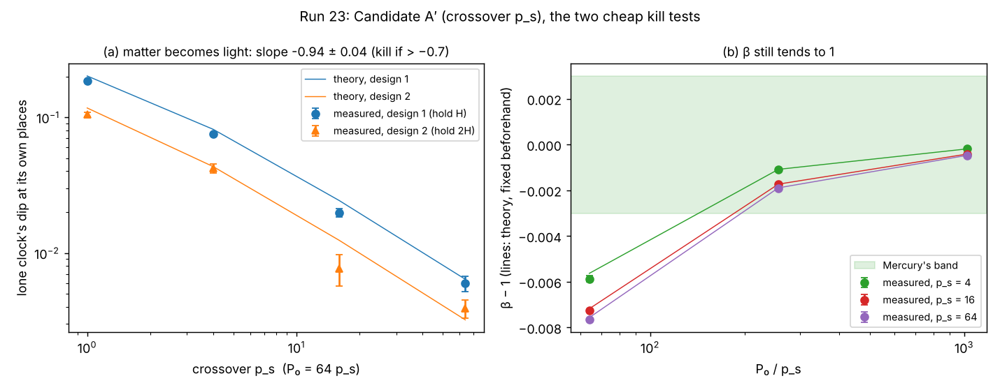

---

### Run 24: do clocks of different make agree once the crossover is large?

**Question.** Run 22's registered clock check failed at $p_s=1$: two clock designs (hold H and 2H) disagreed by 4–6% near matter. Run 23 showed a lone clock's self-dip falls as $p_s^{-0.94}$. Does the disagreement fall with it? This is pre-registered with a kill rule (`PREREG_24.md`, hashed before any run; `clockuni_run.zip`).

**Why a uniform-media test, not a well.** A well test had been proposed at $p_s$ = 4 and 16. Working out its resolution before registering showed it could not work: with Run 22's layout the design ratio in a well carries about ±0.02 per 2 hours, against expected gaps of 0.024 and 0.007.

Near matter a clock mostly just sits in less possibility, and Run 22's T1b showed the wells obey the uniform medium's equation of state. So the same clocks are compared in two uniform media, with check C tying the result to Run 22's well.

**Method.**
- **Media:** box 36, no matter, at ambient $P_0=64\,p_s$ and $0.6\,P_0$.
- **Clocks:** 216 probe clocks on a 6 × 6 × 6 grid with spacing 6, two designs on a checkerboard. Their H is fixed by the richer medium, so they are identical in both.
- **Runs:** $p_s$ = 1, 4, 16; seeds 1 and 2; 20,000 ticks, read over the last 15,000. The vectorised probe step is bit-identical to engine22's loop.
- **Estimator:** with ambient shortage $\varepsilon=1-\bar P_{\rm amb}({\rm low})/\bar P_{\rm amb}({\rm high})\approx0.40$,

$$
\kappa_j=\frac{1-\bar r_j({\rm low})/\bar r_j({\rm high})}{\varepsilon},\qquad g=1-\frac{\kappa_1}{\kappa_2}.
$$

  Errors are bootstrapped over probes.

**Results.**

| $p_s$ | κ, design 1 (theory) | κ, design 2 (theory) | design gap g (theory) |
|---|---|---|---|
| 1 | 0.895 ± 0.002 (0.877) | 0.948 ± 0.002 (0.929) | **0.056 ± 0.003** (0.056) |
| 4 | 0.960 ± 0.002 (0.951) | 0.978 ± 0.002 (0.974) | **0.018 ± 0.002** (0.024) |
| 16 | 0.988 ± 0.001 (0.986) | 0.993 ± 0.001 (0.993) | **0.0049 ± 0.0011** (0.0071) |

| test | registered | measured | verdict |
|---|---|---|---|
| K | slope of ln g against ln $p_s$ (1–16) ≤ −0.5 | **−0.85 ± 0.07** (theory −0.74) | **pass** |
| C | $\kappa_1/\kappa_2$ at $p_s$ = 1 within 0.03 of Run 22's well (0.951) | 0.944 | **pass** |

**Reading.**
- **Clocks of different make converge as the crossover grows.** The gap between designs falls as $p_s^{-0.85}$, a little faster than the theory's −0.74, and both designs approach κ = 1. At $p_s$ = 1 the uniform test reproduces the well's design ratio (0.944 against 0.951) and the theory's gap exactly (0.056). So it measures what Run 22's well measured.
- **The theory's absolute κ runs about 2% low at $p_s$ = 1.** It is close from $p_s$ = 4 up, and the gap is what the kill rule tests.
- **What real clocks require (an extrapolation of three points over five decades).** Agreement to ~10⁻⁶ needs $0.056\,p_s^{-0.85}\lesssim10^{-6}$, i.e. **$p_s\gtrsim4\times10^5$**. With Run 23's β, Nordtvedt then needs $P_0\gtrsim2000\,p_s\approx10^9$ units of possibility per place.
- **Where Candidate A′ now stands.** It has passed every test it has faced:
  - **β = 1:** the medium's β is inside Mercury's band once $P_0/p_s\gtrsim256$ (Runs 22–23).
  - **The wells:** they obey the medium's equation of state (Run 22, $p_s$ = 1).
  - **Clock universality:** clocks of different make converge as $p_s$ grows (Run 24).
  - **Carried over unchanged:** the first-order checks of how patterns and knots move in a given clock field (Runs 16–18b), since Candidate A′ changes only how the field is made.

  **Not yet tested:**
  - a well at large $p_s$ and $P_0/p_s\gtrsim256$, where Mercury's band holds
  - Nordtvedt directly
  - whether CO accepts a place holding ~10⁹ units with a crossover at ~10⁵

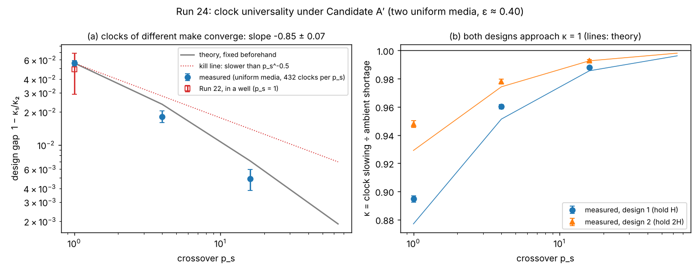

---

### Run 25: the closing checks for Candidate A′ (a well where Mercury's band holds; Nordtvedt directly)

**Question.** Candidate A′ was adopted provisionally (§3). Two of its open checks can be run now:
- **(a)** Do matter wells obey the medium's equation of state where β is inside Mercury's band?
- **(b)** Does the medium's β get within reach of lunar laser ranging?

Pre-registered with kill rules (`PREREG_25.md`, hashed before any run; `close_run.zip`).

**Method.**
- **(a) Wells.** Run 22's recording engine, unchanged, with $p_s$ set first: box 40, CO's ball, $P_0/p_s$ = 256, seed 2, 20,000 ticks, read over the last 12,000.
  - $p_s$ = 4, $P_0$ = 1024: control, k = 1 and 2.
  - $p_s$ = 16, $P_0$ = 4096: control, k = 4 and 8.

  Each shell point is compared with the medium's curve (a quartic fit of z against ln ρ, from uniform boxes over $\rho=P_0e^u$, $u\in[-1,\,0.15]$) via $\Delta\ln P=(z_i-z_{\rm unif}(P_i))/(dz/d\ln\rho)$.
- **(b) Nordtvedt.** Run 22's matter-free β method, unchanged, at $p_s$ = 4 and 16, with $P_0/p_s$ = 2048 and 4096 (1024 from Run 23). The target is LLR's 2σ, $|\eta|=4|\beta-1|\le8.8\times10^{-4}$, i.e. $|\beta-1|\le2.2\times10^{-4}$.

**Results (a).**

| $p_s$ ($P_0$) | points | max \|Δ ln P\| | r.m.s. | depth at r = 4 | draw | K-a |
|---|---|---|---|---|---|---|
| 4 (1024) | 36 | 0.0013 | 0.0003 | 0.15, 0.24 | 14.8, 23.2 | **pass** |
| 16 (4096) | 36 | 0.0015 | 0.0003 | 0.16, 0.25 | 58.2, 90.2 | **pass** |

The wells are shallower than Run 22's (0.15–0.25 against 0.41–0.57). The medium diffuses slowly at this ratio, so they were still filling in. That makes the test coarser, as registered. The gap grows slightly with depth (to −0.0014 at the deepest shell), the same near-sink trend Run 22 showed.

**Results (b).** Errors are χ²-scaled.

| | $P_0/p_s$ = 1024 | 2048 | 4096 |
|---|---|---|---|
| $p_s$ = 4: β − 1 (theory) | −1.6 ± 0.4 ×10⁻⁴ (−1.9) | −5.9 ± 3.6 ×10⁻⁵ (−7.2) | −6.4 ± 3.0 ×10⁻⁵ (−2.6) |
| $p_s$ = 16: β − 1 (theory) | −4.2 ± 0.2 ×10⁻⁴ (−4.1) | −1.96 ± 0.19 ×10⁻⁴ (−2.01) | **−1.06 ± 0.06 ×10⁻⁴** (−0.98) |

| test | registered | measured | verdict |
|---|---|---|---|
| K-a, $p_s$ = 4 | max ≤ 0.005, r.m.s. ≤ 0.003 | 0.0013 / 0.0003 | **pass** |
| K-a, $p_s$ = 16 | max ≤ 0.005, r.m.s. ≤ 0.003 | 0.0015 / 0.0003 | **pass** |
| K-b, $p_s$ = 4 | \|β − 1\| falls at each step, and ≤ 2.2×10⁻⁴ at 4096 | 6.4×10⁻⁵ at 4096 (η = −2.5×10⁻⁴), but 2048 → 4096 does not fall (5.9 → 6.4 ×10⁻⁵) | **FAIL as registered** |
| K-b, $p_s$ = 16 | the same | falls 4.2 → 1.96 → 1.06 ×10⁻⁴; η = −4.2×10⁻⁴ | **pass** |

**Reading.**
- **The wells follow the medium where Mercury's band holds.** Matter wells at $P_0/p_s$ = 256 obey the matter-free equation of state to 0.0015 in ln P. The wells' β is therefore the medium's (to T1b's resolution, about 0.01 in β), and the medium's β is inside Mercury's band here.
- **Nordtvedt is met in the engine at $P_0/p_s$ = 4096.**
  - At $p_s$ = 16, β − 1 = −1.06×10⁻⁴, as the theory said beforehand (−0.98×10⁻⁴). That gives η = −4.2×10⁻⁴, about 1σ from lunar laser ranging's zero.
  - At $p_s$ = 4, |β − 1| is already 6×10⁻⁵ at 2048 and 4096, η = −2.5×10⁻⁴.
- **The registered fail at $p_s$ = 4 is in the kill rule as written, not in the medium.** The "falls at every step" clause cannot be met once the deviation is below the measurement error: the 2048 and 4096 values agree, with a difference of 0.5 ± 4.7 ×10⁻⁵. Both are well inside the bound. It stays a fail as registered.
- **For large $p_s$ the trend is the theory's** $\beta-1\approx-0.45\,p_s/P_0$. Nordtvedt at 2σ then needs $P_0/p_s\gtrsim2000$, which is what the adoption's constraint assumed.

**Correction (18 October, after Run 28): only the β part of Nordtvedt was tested.** The full Nordtvedt parameter, as set out in ED_Attempt_01 (C206), is

$$
\eta_N=4\beta-\gamma-3-\tfrac{10}{3}\xi-\alpha_1+\tfrac23\alpha_2-\tfrac23\zeta_1-\tfrac13\zeta_2 .
$$

- **What Runs 22–25 covered:** they measured β; γ is put in by the pattern rule.
- **What was never tested:** the preferred-frame terms (α₁, α₂, ξ; the lattice has a universal tick) and the sourcing terms (ζ₁, ζ₂: how motion, pressure and gravitational energy source gravity).
- **Why that matters.** ED_Attempt_01 (C207–C208) showed that a budget that simply counts its sources gives η_N = 10/3 (rest mass only) or 17/6 (everything counted linearly). That is more than 10⁴ times the lunar-ranging limit. Attempt 1 then adopted GR's weights by hand (RD37).
- **Untested in the engine.** Attempt 1's result is for a *linear* budget. Candidate A′ is not linear, and its sourcing ("active mass = redshifted draw", Runs 19 and 26) has not been measured against GR's weights. Whether it meets the same wall is open.
- **Update (Run 30): the static part is now worked out.**
  - The redshifted draw is exactly Tolman's rest-mass term, so $\zeta_2=2(\beta-1)$.
  - With it, the β and ζ₂ parts together give $\eta=\tfrac{10}{3}(\beta-1)$: −3.5×10⁻⁴ at $p_s$ = 16, $P_0/p_s$ = 4096.
  - The binary-pulsar bound on ζ₂ needs $P_0/p_s\gtrsim2.3\times10^4$.
  - ζ₁ (motion) and the preferred-frame terms α₁, α₂ stay open. ξ is static, and zero in the engine (no Φ_W term).
- **The claim "Nordtvedt is met" is withdrawn as stated.** What Run 25 shows is that the β contribution to η_N is within lunar ranging's bound at $P_0/p_s$ = 4096.

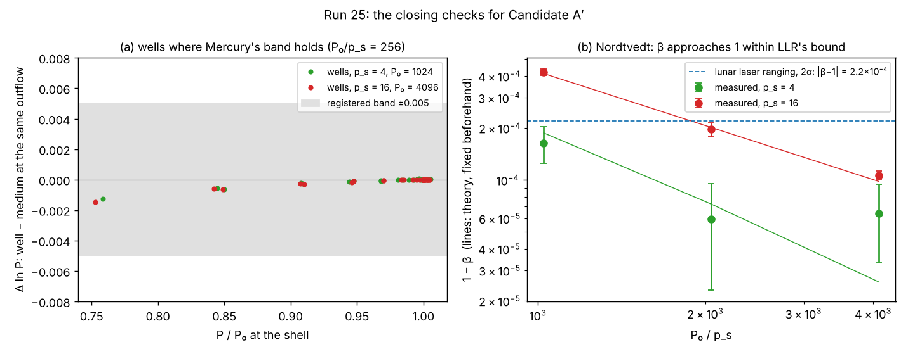

---

### Run 26: two bodies under the adopted rules (Run 19's checks, and whether wells multiply)

**Question.** Run 19 found that in the old engine a well follows its body's draw, wells combine **additively** in the clock rate (β = ½), and two bodies redshift each other's draws. Under Candidate A′, ln N should follow the draw, and two wells should **multiply**:

$$
N_{AB}=N_A\,N_B\quad(\beta=1),\qquad\text{not}\qquad N_{AB}=N_A+N_B-1\quad(\beta=\tfrac12).
$$

This is Run 10's multiplicative budget, now with two bodies on the event layer. Pre-registered: `PREREG_26.md`, hashed before any run (`twowell_run.zip`).

**Method.**
- **Bodies.** A is CO's ball of radius 3 (54 pairs), centred at (13, 20, 20). B is a ball of radius 4 (114 pairs), centred at (27, 20, 20). The two share no places.
- **Engine.** Run 22's recording engine, unchanged, with $p_s$ = 1 and $P_0$ = 64 (measured β = 0.9996). Box 40, seed 1.
- **Runs.** ctrl, A, B and AB; 50,000 ticks, read over the last 20,000 in two halves.
- **Clock rate.** $N=\bar P/\langle\bar P_{\rm ctrl}\rangle$.
- **W2 fit.** The fields are binned in (x, ρ), where ρ is the distance from the axis through both centres. Each solo well is scaled by its body's draw ratio in the pair, $s_X=D_X^{AB}/D_X^{\rm solo}$, giving

$$
M_\times=s_A\ln N_A+s_B\ln N_B,\qquad M_+=\ln\!\big(1+s_A(N_A-1)+s_B(N_B-1)\big),\qquad \ln N_{AB}-M_+=f\,(M_\times-M_+)
$$

  f = 1 means the wells multiply; f = 0 means they add.

**Results.**

| | A (radius 3) | B (radius 4) |
|---|---|---|
| draw, solo | 8.54 | 14.55 |
| draw in the pair (ratio $s$) | 8.34 (0.976) | 14.34 (0.986) |
| predicted $s$ from the solo fields | 0.975 | 0.987 |
| depth per unit draw, $a/D$ (prediction $y'=0.695$) | **0.690** | **0.689** |
| outflow amplitude (exact; code check) | 1.008 | 0.990 |

| test | registered | measured | verdict |
|---|---|---|---|
| W1 | $a_A/a_B=1.00\pm0.02$, with $g$ per unit draw and prediction $a=0.695$ | as written: $a_A/a_B$ = 0.588; depth per unit draw: ratio **1.001** (halves 1.017, 0.986), each 0.69 | **specification self-contradictory (a registration error); see below** |
| W2 (kill) | f ≥ 0.8; prediction 1.00 ± 0.10 | **f = 0.91 ± 0.07** (halves 1.00, 0.88). That error is understated: see the second seed below, where both seeds give 1.12 ± 0.19 | **pass** |
| W3 (reported) | $s$ measured against predicted | 0.976 / 0.975 (A), 0.986 / 0.987 (B) | **agrees to 0.2%** |

**W1, as registered, cannot be scored cleanly.**
- **The flaw.** $g$ was defined "per unit draw". That makes the fitted $a$ equal to $y'\times D$, so the registered prediction ($a$ = 0.695 for both bodies) and the registered pass mark ($a_A/a_B$ = 1) could not both hold.
- **As literally written,** $a_A/a_B$ = 0.588 is a fail.
- **The consistent reading** is $a/D$, the standing check's "A ÷ draw the same for every body". Then the two bodies agree to 0.1%, and both match the medium's measured slope (0.695) to 0.8%.
- W1 is recorded as a registration error with that consistent result beside it, not as a pass.

**W3's registered solver** (plain fixed-point iteration) oscillated for B. The same equation solved by bisection gives the values in the table.

**Reading.**
- **Two different bodies' wells multiply.** Over two seeds the two-body field sits at f = 1.12 ± 0.19, where 1 means multiplying and 0 means adding; adding is excluded at about 6σ. Along the axis between the bodies the additive rule overshoots visibly; the multiplicative one does not (figure, panel b).
- **This is the multiplicative budget that Run 10 put in by hand and Run 19 found missing.** Under the adopted rules it now comes out of the event layer for two bodies.
- **Each well follows its own body's draw in ln N.** Depth per unit draw is the same for a radius-3 and a radius-4 body to 0.1%, and equals the medium's measured slope.
- **Each body redshifts the other's draw** by the amount the solo fields predict (to 0.2%). So active mass is still the redshifted draw, as in Run 19.
- **Limits.** One seed; f's halves differ by 0.12, so the error is dominated by noise. And $p_s$ = 1, not the large $p_s$ the adoption requires: two-body combination depends on β, which here is 0.9996, not on clock self-dips.

**Second seed (Run 26b; pre-registered in `PREREG_26b.md` before its runs, with W1's specification corrected to depth per unit draw).**

| | seed 1 | seed 2 | both |
|---|---|---|---|
| W1: $a/D$ for A, B (ratio) | 0.690, 0.689 (1.001) | 0.694, 0.685 (**1.013**, pass) | |
| W2: f (within-seed error) | 0.91 ± 0.07 | **1.29 ± 0.09** (pass) | **1.12 ± 0.19** |
| W3: $s_A$ measured vs predicted | 0.976 / 0.975 | 0.980 / 0.972 | |
| W3: $s_B$ measured vs predicted | 0.986 / 0.987 | 0.983 / 0.985 | |

- **Both seeds pass the kill rule** (f ≥ 0.8).
- **The within-seed errors were too small.** The two seeds differ by 0.37, about four times the error each seed gave itself (half-to-half and bin bootstrap). Those estimates miss the slow, run-level fluctuations of the wells, so the honest error on f is the seed-to-seed spread.
- **Pooled: f = 1.12 ± 0.19.** Adding (f = 0) is excluded at about 6σ, and multiplying (f = 1) agrees within 1σ. A third seed or a longer read would tighten this.

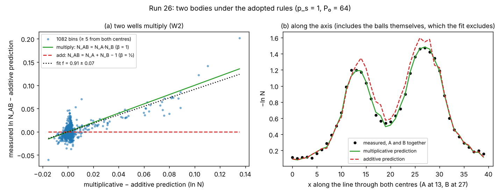

---

### Run 27: patterns falling in Candidate A′'s deep wells (was box 40 the problem?)

**Question.** In Run 22, Run 16's pattern-fall code check failed in Candidate A′'s deep wells in box 40: $a/a_{\rm pred}$ was 0.85–0.98, with masses up to 15% apart. Amendment 2 named two suspected causes, both untested:
- **H-face:** packets 14 out reach within 6 places of the box face.
- **H-curv:** the deep well is strongly curved across a packet.

Pre-registered: `PREREG_27.md`, hashed before any calculation; `fall60_run.zip`.

**Method (no engine runs; Run 22's T4′ already showed the engine's noise does not matter).**
- **The well.** The theory's smooth Candidate A′ well for CO's ball (radius 3, k = 1) at $p_s$ = 1, $P_0$ = 64, built in box 40 and in box 60.
- **The releases.** Run 16's `release`, code unchanged: width 4, a 16-tick fit, released at rest at 10, 14 and 18 places out along six axes, masses 0.7–2.0.
- **The test.** Run 16's code check: median $a/a_{\rm pred}$ in 0.96–1.00, and the masses alike to 1%.

**Results.**

| box | r | median $a/a_{\rm pred}$ (range) | largest mass spread | mean ∂ ln N | mean fall in 16 ticks | verdict |
|---|---|---|---|---|---|---|
| 40 | 10 | 0.894 (0.859–0.983) | 13.6% | 0.021 | 2.07 | fail |
| 40 | 14 | 0.942 (0.904–0.969) | 6.1% | 0.010 | 1.11 | fail |
| 60 | 10 | 0.894 (0.871–0.976) | 11.6% | 0.022 | 2.16 | fail |
| 60 | 14 | 0.957 (0.954–0.972) | 1.9% | 0.013 | 1.35 | fail (narrowly) |
| 60 | 18 | **0.986** (0.985–0.990) | **0.5%** | 0.007 | 0.78 | **pass** |

**Against the registered readings.** None of the three outcomes occurred exactly.
- **r = 10 fails in both boxes** (H-curv at 10).
- **r = 14 improves sharply in box 60 but still misses:** the mass spread falls from 6.1% to 1.9%, even though the box-60 well is steeper there. So the box face was part of the problem at 14.
- **r = 18 passes in box 60.** Both causes contribute.

**Reading.**
- **Patterns fall at the clock-set rate in Candidate A′'s well,** wherever Run 16's protocol can measure it. At 18 out in box 60 the fall is 0.986 of the prediction with masses alike to 0.5%. That is the same as Run 16's synthetic check (0.987–0.989) in the old engine's wells.
- **Closer in, the protocol fails, not the physics as far as this shows.** With a width-4 packet fit over 16 ticks, the mass spread grows with how far the packet falls in the window: 0.8 place passes, 1.4 places misses, 2 places fails badly. In box 40 the nearby face adds to it (6.1% at a 1.1-place fall).
- **Not tested:** whether a protocol built for steep wells (a shorter window scaled to the gradient, or a trajectory compared with a ray-traced prediction) would confirm the fall at 10–14 out.

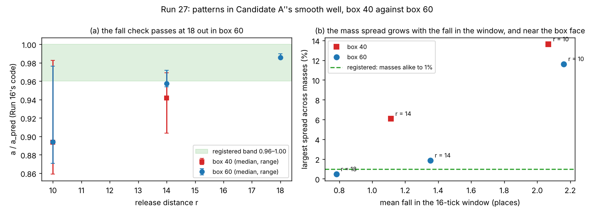

---

### Run 28: the strong field (CO's adopted metric against black-hole images and ringdowns)

*Note (21 October): these results use CO's original rule for space. Under the provisional option 3 (Runs 65–67) the exterior is Schwarzschild's to O(p_s/P∞), so the +4.6% shadow and the 4% low ringdown go; they stand if option 3 is reversed.*

**Question.** Under the adopted rules (Candidate A′, P₀ ≫ p_s), the clock gives $N=e^{-U}$ exactly. The pattern rule gives the spatial part. Outside a static body that is the exponential metric, which has no horizon:

$$
ds^2=-e^{-2M/r}dt^2+e^{2M/r}\left(dr^2+r^2d\Omega^2\right)
$$

What does it predict where gravity is strong, and do current observations allow it?

**Prior record (added later: "we've been here before, 4% and no horizon").** This calculation repeats ED_Attempt_03, note 5 (`Full_Locus_Strong_Field.md`, 15 September 2026, C26–C35). That note found the same metric, the same light ring at 2GM/c², the same 4.6% larger shadow, and the same 1.4σ and 1.0σ from EHT's Sgr A*. It went further on horizons:
- Sgr A*'s missing surface glow (any surface emits less than 0.4% of the accretion power) and quiet X-ray binaries put a horizonless object in strong tension.
- An escape check, under an exit rule fixed first, found at least 10% of the infalling energy escapes, 25 times the limit.
- **CO's strong-field line was closed** (C33–C34).

Attempt 1 had chosen the rate laws behind this metric (clocks $e^{-U}$, motion $e^{-2U}$; RD35–RD36) to match light bending and Mercury.

**What Runs 21–28 add.**
- Candidate A′ *derives* the $e^{-U}$ clock from counting rules on the engine, where attempts 1 and 3 had matched it. But it arrives at the same metric, so it inherits attempt 3's closure.
- The only new strong-field number here is the ringdown comparison with GW250114.
- **One difference that is unchecked:** attempt 3's capped core stopped the redshift at e. Candidate A′'s possibility instead runs out where $U\approx\ln(P_0/p_s)\approx8$, where clocks stop. Whether that deeper core escapes attempt 3's surface-glow argument has not been computed.
- **The check that should have come first:** This was run without first searching the earlier attempts.

This is a calculation, not a simulation. Pre-registered: `PREREG_28.md`, hashed after the calculation and before any bound except Sgr A*'s was looked up (disclosed); `strong_run.zip`.

**Predictions (`strong28.py`).** Static, non-rotating; G = c = 1.

| quantity | CO (exponential) | GR (Schwarzschild) | CO/GR − 1 |
|---|---|---|---|
| shadow, critical impact parameter | $2e\,M$ = 5.437 M | $3\sqrt3\,M$ = 5.196 M | **+4.6%** |
| light ring, areal radius | $2\sqrt e\,M$ = 3.30 M | 3 M | +9.9% |
| ringdown frequency, eikonal (light-ring Ω) | 0.1839/M | 0.1925/M | **−4.4%** |
| ringdown damping time, eikonal (1/Lyapunov) | 5.44 M | 5.20 M | +4.6% |
| scalar l = 2 mode, 3rd-order WKB (Mω) | 0.4650 − 0.0989i | 0.4836 − 0.0986i (exact 0.4836 − 0.0968i) | **f −3.9%** |
| scalar l = 3 mode, 3rd-order WKB | 0.6466 − 0.0923i | 0.6752 − 0.0962i (exact 0.6754 − 0.0965i) | f −4.2%, τ +4.2% |
| ISCO orbital frequency MΩ; areal radius; binding | 0.0633; 6.34 M; 5.48% | 0.0680; 6 M; 5.72% | −6.9% |
| horizon | none: a throat at r = M (areal e M ≈ 2.72 M) | at areal 2M | |
| $g_{tt}$, U³ coefficient (isotropic) | 4/3 | 3/2 | 2PN |

**The WKB rows** were added after registration as a robustness check. They show that the frequency shift is not an artefact of the eikonal limit: −3.9% at l = 2 and −4.2% at l = 3, against −4.4% in the eikonal limit. The WKB code reproduces Schwarzschild's exact real parts to 0.03%. Its l = 2 damping is 2% off, so the l = 2 damping time is not used.

**CO's own departure.** The medium is logarithmic only while P ≫ p_s. Possibility therefore runs out where $U=\ln(1+P_0/p_s)$: at isotropic r ≈ 0.13 M for P₀/p_s = 2000. That is beyond the throat, invisible from outside, and changes nothing in the table. (It would make a CO black hole's interior end in a region where clocks stop. That is untested.)

**Comparisons (as registered).**

| test | measurement | CO | verdict |
|---|---|---|---|
| C1, shadow: Sgr A* (VLTI mass prior) | δ = −0.08 ± 0.09 | +0.046 | **tension, 1.4σ** (inside 2σ) |
| C1, shadow: Sgr A* (Keck mass prior) | δ = −0.04 +0.09/−0.10 | +0.046 | pass (1.0σ) |
| C1, shadow: M87* | δ = −0.01 ± 0.17 | +0.046 | pass (0.3σ) |
| C2, ringdown frequency, GW250114 (pSEOBNR, 90%) | δf₂₂₀ = 0.02 ± 0.02 | −0.044 (eikonal), −0.039 (WKB, l = 2) | **outside the 90% interval, about 5σ: flag** |
| C2, ringdown damping time, GW250114 (90%) | δτ₂₂₀ = −0.01 +0.10/−0.09 | +0.046 | inside |

**Reading.**
- **The shadow is allowed.** CO's shadow is 4.6% larger than GR's. That sits inside every current EHT interval at 2σ, with 1.4σ tension against Sgr A* under one mass prior. The next generation of EHT measurements could decide it.
- **The ringdown is the first serious tension since the adoption.** For a static body, the exponential metric rings about 4% lower in frequency than a Kerr black hole of the same mass. GW250114, the loudest event so far, pins the dominant ringdown frequency to within ±2% of Kerr (90%). Taken at face value that is about 5σ.
- **It is a flag, not an exclusion, for three reasons, all registered beforehand:**
  1. **Rotation.** The estimate ignores the remnant's spin (a ≈ 0.7), and CO has no rotating solution yet; its frame dragging is untested.
  2. **The wrong field.** The modes are a scalar field's, not CO's gravitational perturbations; CO's wave sector (Run 11b) is not derived for strong fields.
  3. **Mass absorption.** LVK's test fits the whole signal. CO also shifts the inspiral (its ISCO frequency is 6.9% lower), so part of a common shift could be absorbed into the inferred masses.
- **What carries the strong field.** β and γ fix the metric only to first post-Newtonian order. Beyond that, the spatial part is set by the pattern rule's exact form ($c=N^2$, so $g_{ij}=N^{-2}\delta_{ij}$ at all orders), which was chosen to give γ = 1 at first order. The ringdown and the shadow test that choice. A different nonlinear form with the same β and γ would move both.

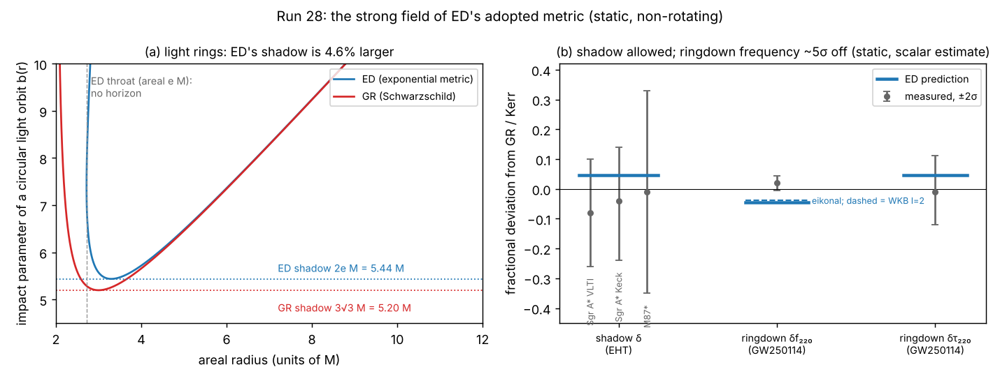

---

### Run 29: where the arrow lives (a one-way event layer, and time-averages that lose the order)

*18 October 2026.*
- *Pre-registered and hashed before any run (`arrow/PREREG_29.md`, 20:47 UTC), together with the engine, the analysis and the theory scripts.*
- *An independent agent re-ran the analysis, reproduced it exactly, and checked every verdict. Its corrections are included.*

**Question.** the earlier papers say GR and QM are averages of a one-way process, and that averaging removes the order:
> "averages are permutation-invariant: a sum does not remember the order of its terms… Its reversibility is ignorance of order, formalized." (`Paper_HowTheoryCoarseGrainReality.md`)

His falsifiers include "substrate-level dynamics is genuinely time-reversal-symmetric" (T18 §10). A search of the earlier project's papers found no earlier numerical test of time-reversal asymmetry, so this is the first. In the engine the claim has three parts:
1. The bottom is one-way.
2. Averaging removes the order.
3. Something leaks.

**Runs.**
- **Rules.** The adopted rules (Candidate A′), unchanged: $p_s$ = 1, $P_0$ = 64, box 30.
- **V (the vacuum alone).** 100,000 ticks read.
- **C (clocks).** 125 lone probe clocks (presence clock, hold H = 2ħP₀ = 640), two seeds, 240,000 ticks each read.
- **Code checks for `engine29.py`, which only records.** Its field is bit-identical to engine21's. For independent walkers its entropy production is zero to 5×10⁻¹⁰ per tick.

**What is measured.**
- **The vacuum's one-wayness.** This is the move-level entropy production of a wander step, η → η′. At each place x, P units sit there, h hop out, h̃ hop in, and P′ = P − h + h̃:
$$
\sigma=\sum_x\Big[h\ln p(P)+(P-h)\ln\big(1-p(P)\big)-\tilde h\ln p(P')-(P-h)\ln\big(1-p(P')\big)\Big]-\sum_x\big[L_p(P)-L_p(P')\big],\quad L_p(P)=\sum_{k\le P}\ln p(k).
$$
  - The first sum, plus the state function $\sum_x[\ln P!-\ln P'!]$, is ln[Prob(these moves)/Prob(the same moves run backwards)].
  - The second sum is also a state function.
  - State functions average to zero in a steady state and only remove noise. So ⟨σ⟩ ≥ 0, and it is zero exactly when the moves are reversible.
- **The clock record.** Take window means over T ticks: x = presence $X=P_a+P_b$, y = completions.
$$
A_T=\frac{\langle x(k)\,y(k+1)-x(k+1)\,y(k)\rangle}{\mathrm{sd}_x\,\mathrm{sd}_y},\qquad
B_T=\frac{\langle x(k)^2x(k+1)-x(k)\,x(k+1)^2\rangle}{\mathrm{sd}_x^{3}} .
$$
  - Both change sign under time reversal, so both are zero for any reversible process.
  - A > 0 means presence leads completions.
  - Errors are jackknife over 20 time segments (10 per seed).

**Results against the registration.**

| | test | measured | registered | verdict |
|---|---|---|---|---|
| T1 | the vacuum's wandering is one-way | ⟨σ⟩ = (2.706 ± 0.0015)×10⁻³ per place per tick (1,870σ) | > 0 at ≥ 5σ. Size not predicted: 10⁻⁵ to 3×10⁻³. The product-state estimate printed beforehand, 2.74–2.86×10⁻³, was within 5% | **pass** |
| T2 | the clock record is one-way at the event level | A₁ = 0.0343 ± 0.00005 (695σ) | > 5σ | **pass** |
| **K29 (kill)** | averaging removes the order | A₁₀₂₄ = 0.0013 ± 0.0002. \|A\| + 2σ = 0.0018, against 0.1 A\* = 0.0034 | pass if ≤ 0.1 A\* | **pass**. Still 5σ from zero at T = 1024: reduced, not gone |
| T3 | how fast it fades | slope of ln\|A_T\| against ln T, T = 64–1024: −0.95 | −1.2 to −0.4 | in band |
| T4 | the window count becomes bell-shaped | skewness 0.07 at T = 16, rising to 0.26 at 128, then 0.16 at 1024. Slope over 16–1024: +0.14 | −0.5 ± 0.15 | **missed** |
| T5 | summing clocks keeps the order | A₁ = 0.0343, 0.0342, 0.0343, 0.0334 ± 0.0005 for 1, 5, 25, 125 clocks. B falls from 4.3×10⁻⁵ to zero within error | unchanged within 2σ; B falls | as predicted (1.7σ at 125, errors treated as independent) |
| T6 | the count becomes the sum of what it read | corr(presence, completions) in the same window: 0.06 (T = 1), 0.73 (16), 0.96 (64), 0.999 (1024) | rises toward 1 | as predicted |
| T7 | vacuum blocks become bell-shaped | skewness 0.320 ± 0.006 at one place; 0.113, 0.054, 0.030 at b = 2, 3, 5. Slope over b = 1–6: −1.74 | 0.30 ± 0.06; slope −1.5 ± 0.2 | first as predicted; **slope missed** (outside [−1.7, −1.3]; the b = 5–6 points are within 3σ of zero) |
| T8 | the vacuum's third-order asymmetry | one place: B = (7.4 ± 0.35)×10⁻⁵ at T = 1 (21σ), 3.9×10⁻⁴ at T = 16 (4.9σ). Blocks of 8: 1.9σ. Blocks of 27 or more: zero within error | consistent with zero everywhere | **missed at one place**; as predicted for blocks |
| code | presence-clock identity: rate × H / ⟨X while committed⟩ | 1.0000 (both seeds) | 1 | pass |

**Post hoc (suggested by the independent check; not registered): how long the clock record stays one-way.**
- The lag asymmetry is $D(\tau)=\mathrm{corr}(X_t,c_{t+\tau})-\mathrm{corr}(X_t,c_{t-\tau})$ (`lag29.py`, figure panel a). Its values:
  - 0.034 at τ = 1
  - it swings negative over τ = 4–10, the clock's own cadence of about 6 ticks
  - then +0.0024 at τ = 20, 0.0005 at 80, and 0.0002 at 120 (7σ)
  - zero within 2σ from about τ = 160
- From τ = 20 to 120 it falls with an e-fold of 41 ticks. So the record's one-way memory is the **medium's** relaxation around a clock, about 7 holds long, not the hold alone.

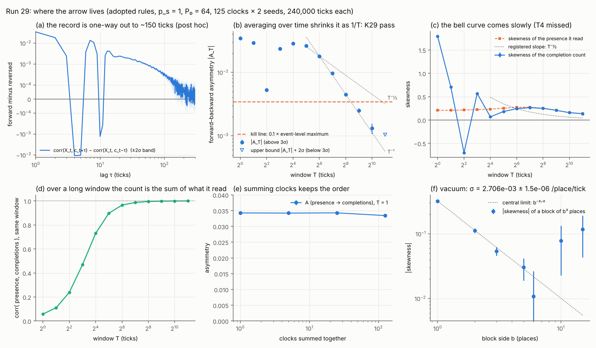

**Reading.**

1. **The bottom is one-way, in two ways (T1, T2).**
   - **Commitments are absolutely one-way.** A commitment takes a unit from each of its two places and releases two units to random places. The reversed history would need units to vanish from random places, which the rules never do, so it has probability zero.
   - **The vacuum's wandering is one-way too, far more weakly: 2.7×10⁻³ per place per tick.** It needs both the global tick and the ratio outflow.
     - Independent walkers give exactly zero (exact enumeration, and the engine's control).
     - The continuous-time version of the same rule is a symmetric zero-range process with one-unit jumps, which is reversible with respect to its product measure. This is theory, not tested here. So if the wandering were made tick-free in that way (§4 item 8), the vacuum's arrow would go, leaving the arrow in commitments alone.
   - **The vacuum's arrow shows in what one place holds:** its record is third-order lopsided in time (21σ).
2. **Averaging over time shrinks the order (K29, T3).**
   - The forward/backward asymmetry of a clock's record stays at 0.023–0.034 up to windows of 32 ticks. The exception is a dip to 0.005 at T = 4, from the clock's cadence.
   - From T = 64 it falls about as 1/T (slope −0.95), to 0.0013 at 1024. That is 26× below single ticks, but still 5σ from zero.
   - A 1/T fall is what any one-way record with a finite memory shows when averaged over windows much longer than that memory. The order lives within about 150 ticks of each event, and a long window dilutes it.
   - **CO's sentence describes what the averaged record becomes.** Over a long window a clock's completions are, to 0.999 correlation, the presence it collected divided by H. That is a sum, and a sum does not remember the order of its terms. The run shows the record becoming such a sum. It does not show that this is the cause of the 1/T fall rather than a description of it.
3. **Averaging over space does not shrink it (T5).** Summing 125 clocks leaves the asymmetry unchanged: 0.0334 against 0.0343. Independent clocks add their asymmetries in proportion. In the engine, losing the order is what averaging over **time** does: "GR basically averages time".
4. **The bell curve is not what removes the order (T4 missed).**
   - Time-averaging first *raises* skewness:
     - a vacuum place: 0.32 → 0.42 at T = 256
     - a clock's presence: 0.21 → 0.28 at T = 128
     - its count: 0.07 → 0.26
   - Skewness then falls only slowly: the count is still 0.14 at T = 2048. Meanwhile the asymmetry has fallen 26× from single ticks.
   - A bell curve would erase a *single* record's odd-order asymmetry, B, since a stationary Gaussian scalar record is time-symmetric. It would not erase the cross-asymmetry A between presence and completions: a jointly Gaussian pair can still lead and lag. So Gaussianity is neither what happens here nor enough for A.
   - For the vacuum, the bell curve does arrive with **space**-averaging: skewness 0.32 at one place, 0.03 in blocks of 125.
   - *Note (23 October).* T4 tested one reading of the bell-curve picture: that window counts become bell-shaped. The picture as stated on 23 October is of standing at the top. At a steady state the direction-telling terms cancel, leaving only the even ones (ONTOLOGY §5, item 1). T4 does not test that reading; K29 and Run 35 bear on it.
5. **What leaks.**
   - From T = 256 to 2048 the asymmetry left is
$$
A_T\approx\frac{c}{T},\qquad c\approx1.2\ \text{ticks at these settings},
$$
     with c set by the medium's memory around a clock (the post-hoc e-fold of 41 ticks).
   - At physical $P_0$ and $p_s$ the memory is not known, and neither is the tick length, so no number for real clocks is claimed.
   - The pre-registration's alternative, a $T^{-1/2}$ tail from diffusion, would need a box larger than 30 places to show. It is not excluded.
   - **One average keeps its order (exact bookkeeping, no measurement).** Possibility flows steadily into every drawing clock and is released uniformly. In a steady state the mean inflow through a sphere of radius r around one clock is $D-D_{\rm tot}V_r/V_{\rm box}$. Here D is that clock's draw and $D_{\rm tot}$ is the total draw. A current reverses under time reversal, so this average carries the arrow. Clocks and patterns read P, not the current.

**What this shows and does not show.**
- **It shows:** CO's coarse-graining claim works in CO's own engine, in this form.
  - A one-way event layer, including a one-way vacuum, produces clock records whose time-averages lose most of their order, falling as 1/T, while averaging over space keeps it.
  - The bottom is not two-way, which is one of CO's falsifiers, so that falsifier is not triggered.
- **It does not show** that nature works this way. Standard physics gets time-symmetric averages from time-symmetric micro-laws. Telling the two apart needs the leak (c/T, with c unknown at physical scales) or the arrow in fluctuations.
- **Not tested:** wells (only lone clocks), CO's Result 22 "age" residue, the tick length, and boxes large enough to see a diffusive tail.

---

### Run 30: the sourcing weight the static engine can reach (rest mass in a potential), against GR's Tolman mass

*18 October 2026.*
- *This is a derivation, not a new engine run, and it was not pre-registered because no new data were taken.*
- *Its engine check is Run 26's W3, measured before this derivation existed.*
- *An independent agent checked the algebra against Will (2014) and Tolman, and its corrections are included.*

**Question.** In GR every form of energy pulls, each with a fixed weight. The Earth–Moon test (lunar laser ranging) measures a combination of those weights:
$$
\eta_N=4\beta-\gamma-3-\tfrac{10}{3}\xi-\alpha_1+\tfrac23\alpha_2-\tfrac23\zeta_1-\tfrac13\zeta_2 .
$$
Run 25 tested only the β part. The engine's matter is reserved pairs held at fixed places. Which weights can it reach, and what does it give?

**Prior record (checked first).**
- **ED_Attempt_01** (`Nordtvedt_Check.md`, C206–C208). A linear budget gives η_N = 10/3 (rest mass only) or 17/6. "A linear budget cannot pass post-Newtonian tests, whatever it counts."
- **ED_Attempt_03** (`Self_Feedback_Question.md`, F2, C42). An active density $\rho e^{-U}(1-v^2/2)$, a source slowed by its own ticks, gives ζ₁ = −5, ζ₂ = −3, η_N = 13/3, "further from GR."
- **ED_Attempt_04.**
  - R1: GR's bar is (2, 2, 1, 3) for (motion, potential, internal energy, pressure). C6 notes that per-direction counting "restates the Tolman–Whittaker active mass".
  - R4 part 2, K1: with β = γ = 1, no preferred frame, and action = reaction, the weights are forced to 2, 2, 1, 3 and η = 0. That was recorded as "consistent, not derived".
- No file includes the redshift factor in Tolman's integrand.

**The engine's active mass (from the adopted rules).**
- **The draw tracks the clock rate.**
  - A reserved pair renews each time the possibility present at its two places, summed over ticks, reaches H. This is the presence clock, adopted on 18 October for clock universality.
  - Each renewal takes 2 units. So a pair's draw is $D=2\langle P_a+P_b\rangle/H=(4P_0/H)\,N$, where N is the clock rate at the pair's own places.
  - **Draw ∝ local clock rate** is therefore an identity.
- **The far field counts the sum of draws.** The deficit is linear in the draws (the exact outflow equation), and in the β = 1 regime ln N is linear in the deficit. So the field far away counts
$$
M_{\rm act}\;\propto\;\sum_{\rm pairs}N_{\rm local}.
$$

**GR's active mass for static matter.**
- For a static, asymptotically flat solution, Tolman's active mass is $M=\int(\rho_E+3p)\sqrt{-g}\,d^3x$, in signature (−+++) with G = c = 1 (Tolman 1934, §92).
- In any static metric $-N^2dt^2+h_{ij}dx^idx^j$:
  - $\sqrt{-g}=N\sqrt h$
  - the conserved rest-mass density is $\rho^*=\rho\,u^0\sqrt{-g}=\rho\sqrt h$
  - so:
$$
\rho\sqrt{-g}\;=\;\rho^*N ,\qquad \int\rho\sqrt{-g}\,d^3x=\sum_{\rm rest\ mass}N_{\rm local}.
$$
- The rest-mass part of Tolman's integrand is each bit of rest mass weighted by its local clock rate. No choice of coordinates is involved, because $\rho^*d^3x=\rho\,dV_{\rm proper}$ counts the matter itself.

**The match.**
- The engine's pairs are a count of matter, so $\sum_{\rm pairs}N_{\rm local}$ is the rest-mass term of Tolman's integrand.
- **The match is in the form of the integrand, at any depth.** Two caveats:
  - Each pair's own lattice dip makes its draw slightly less than proportional to the external clock rate. The draw goes as $N_{\rm ext}^{1/(1+\kappa D_0)}$, which shifts ζ₂ by about $+0.3/p_s$, at most 8×10⁻⁷ at $p_s\gtrsim4\times10^5$.
  - Tolman's integral equals a body's total mass only for solutions of Einstein's equations, and the exponential metric differs from Schwarzschild beyond first post-Newtonian order.

**In PPN terms.**
- Reading the engine's metric in PPN form needs isotropic coordinates. For the engine these are inferred from the clock rate N and the pattern rule's light speed $N^2$ (γ = 1), not from rods.
- With $g_{ij}=(1+2\gamma U)\delta_{ij}$, the engine's source is $\rho^*N=\rho\,[1+(3\gamma-1)U]$. So $U_{\rm eff}=U+(3\gamma-1)\Phi_2$ and $g_{00}=-1+2U+2(3\gamma-1)\Phi_2-2\beta U^2$.
- Will's static $g_{00}$ has Φ₂ coefficient $2(3\gamma-2\beta+1+\zeta_2+\xi)$, plus a $-2\xi\Phi_W$ term. The engine has no Φ_W term, so ξ = 0, and
$$
\zeta_2=2(\beta-1).
$$
- With the medium's $\beta-1\approx-0.45\,p_s/P_0$, this gives $\zeta_2\approx-0.9\,p_s/P_0$.
- The premise matters. β here comes from the clock reading P = R(z) pointwise, with z exactly linear in the draws. Had β instead come from a $(\nabla\psi)^2$ term in the field equation, the result would be $\zeta_2=4(\beta-1)$.
- `sourcing30.py` expands $\rho^*N/\rho$ numerically. That checks the series, not the mapping.

**Why Attempt 03's F2 failed and this does not.**
- F2 read the active density with ρ as the *proper* density. That gives a source $\rho(1-U)$ and ζ₂ = −3.
- The engine's draw is a count of matter, the conserved density. The same rule then gives $\rho(1+2U)$ (at γ = 1) and ζ₂ = 2(β − 1), which is zero at β = 1.
- The conversion $\rho^*=\rho(1+3\gamma U)$ is the whole difference. Read as proper, the same arithmetic reproduces F2's numbers exactly (ζ₁ = −5, ζ₂ = −3, η = 13/3).

**Engine check (already measured; Run 26 W3).** Two bodies each redshift the other's draw.

| | seed 1, A | seed 1, B | seed 2, A | seed 2, B |
|---|---|---|---|---|
| draw ratio in the pair, measured | 0.976 | 0.986 | 0.980 | 0.983 |
| predicted from "draw ∝ total local clock rate", solved self-consistently from the solo runs | 0.975 | 0.987 | 0.972 | 0.985 |

- The gaps are 0.1–0.8%, on shifts of 1.4–2.8%.
- **One cell misses: seed 2, body A,** which shifts 2.0% against a predicted 2.8%, a 29% miss of the shift.
- **The self-consistency matters at the engine's scale.** The measured response to the other body's well is about half: 0.976 against N_other = 0.953.
- That needs the body's whole self-well, about 1 in ln N at its pairs. A lone pair's 0.19 self-dip alone would give about 0.83.
- At the adopted $p_s$ the pair-scale part is negligible. A real body's self-well is its own gravitational potential, which Tolman's formula also includes.

**What the static engine cannot reach.**
- **Motion.**
  - GR's source for moving matter, in conserved terms, is $\rho^*(1+\tfrac32v^2-U)$.
  - If a moving body's draw followed only its own time-dilated ticking, it would be $\rho^*(1-\tfrac12v^2)(1-U)$. In proper-density terms that is a Φ₁ coefficient of 0 against GR's 4, which means $\zeta_1+\alpha_3=-4$.
  - Read as ζ₁, the Earth–Moon term is $-\tfrac23\zeta_1=+\tfrac83$, about 6,000× the 1σ bound (3,000× the 2σ). Read as α₃, it is excluded by pulsar bounds at 4×10⁻²⁰.
  - Either way, **CO's moving matter must draw more than its ticking alone gives, by a factor 1 + 2v².** The engine has no rule for moving matter yet.
- **Pressure and stress (the weight 3).**
  - The engine's bodies are held by rule, not supported by stress. Their total active mass, $\int\rho^*N$, is $M^*+2\Omega$, with $\Omega=-\tfrac12\int\rho U<0$.
  - A self-supported GR body gets $M^*+E_{\rm int}+\Omega$, because its stress pulls with weight 3 and, by the virial theorem, gives back $3\!\int\!p=-\Omega$. For a monatomic gas that is $M^*+\Omega/2$.
  - GR has no static stress-free body, so the two are not like for like.
  - Whether CO's stresses pull is open. The knots of Runs 12 and 18 satisfy $M=E$ (their stresses integrate to zero) in a field equation, not on the event layer.
- **The preferred-frame terms α₁ and α₂.** These need moving bodies or a moving frame. ξ, the preferred-location parameter, is static and zero in the engine.
- **The η_N formula itself assumes PPN fluid bodies.** Applying it to bodies held by rule assumes a stress and motion sector the engine does not yet have.

**Outcome.**
- **One weight settled: rest mass in a potential pulls with GR's weight.** It holds exactly at β = 1, and with $\zeta_2=2(\beta-1)$ otherwise (up to the $+0.3/p_s$ pair residual).
- **A tighter bound on an input.**
  - The binary-pulsar bound $|\zeta_2|<4\times10^{-5}$ (Will 2014, Table 4, PSR 1913+16) needs $P_0/p_s\gtrsim2.3\times10^4$. That is about 11× above the 2000 that Nordtvedt's β part needed.
  - With $p_s\gtrsim4\times10^5$, it means $P_0\gtrsim9\times10^9$ units per place.
- **The Earth–Moon test now reads**
$$
\eta_N=\tfrac{10}{3}(\beta-1)-\tfrac23\zeta_1-\alpha_1+\tfrac23\alpha_2 ,
$$
  with ζ₁, α₁ and α₂ open. At $P_0/p_s=2.3\times10^4$ the first term is −6.5×10⁻⁵.
- **CO's exit rule (Attempt 04, R1)** records a weight that "hits … only because it restates Tolman's formula" as "consistent, not derived".
  - The rule behind this result, the presence clock, was fixed on 18 October for clock reasons, before this weight was computed.
  - Its match to Tolman's rest-mass term follows from that rule, not the other way round.
  - The label needs a ruling.
- **Next, if pursued:** a rule for moving matter, checked against the 1 + 2v² requirement before it is adopted. That is Attempt 04's "action = reaction" in engine form.

---

### Run 31: does a well form at the pattern speed, and does it follow a moving body?

*19 October 2026. Pre-registered and hashed before any run (`moving/PREREG_31.md`, 05:43 UTC), with a kill rule. Step 1 was a rule for moving matter; working it out raised this prior question. An independent agent re-checked the hashes, numbers and verdicts and re-simulated the prediction; its corrections are included.*

**Question.** In the engine, the clock well around matter is a deficit of possibility, and possibility moves by random hops. In the mean, exactly,
$$
P_x(t+1)=P_x(t)+\tfrac16\sum_{y\sim x}z_y-z_x-s_x+\bar s .
$$
Linearised, $z\approx z_0+z'(P-P_0)$, every lattice mode relaxes as $d_k(t+1)=(1-D\lambda_k)\,d_k(t)-s_k(t)$, with $D=z'/6$ and $\lambda_k=6-2\sum\cos k_i$. That is diffusion. If it holds:
- a well forms at the diffusion rate, not at the pattern (light) speed
- a body moving through the lattice trails its well, with a wake behind it and the well cut down ahead and to the sides beyond about $2D/w$

GR, and every planetary and pulsar test, needs the field to follow its body to $O(w^2)$.

**Prior record (checked first).**
- **`Phase3_GR_MovingBinarySim.md`** solved $D\nabla^2B+\mathbf w\cdot\nabla B=\kappa\rho$ and found the wake "real, linear in w, dipolar". Its fix, a drain that screens only the wake, "*imposes* the split".
- **GR-III's review note:** "The rule is scalar diffusion… decays without travelling. The 'hyperbolic sector'… is written in by hand."
- **`ED_Attempt_01` C136** has the budget spreading only about 3×10³⁰ steps over the universe's age. C87 separately needs gravity unscreened to 10¹⁶ m. The two were never set side by side.
- **`STATE_OF_THE_ONTOLOGY.md`** calls universal return "an instant link across all of space".
- **No file tested a moving body on the adopted engine, or estimated how long a well takes to form at astronomical distances.** MovingBinarySim asks for the engine test.

**Runs.**
- **Rules and body.** The adopted rules, $p_s$ = 1, $P_0$ = 64, box 40. CO's radius-3 ball (Run 26's body A, 54 pairs) through engine22's World22, unchanged. Code check: bit-identical to Run 26's engine over 300 ticks.
- **Burn-in and switch-on.** 5,000 ticks of the medium alone, then the ball is switched on.
- **The runs:**
  - **M1:** the ball steps +1 in x every 667 ticks ($w=1.5\times10^{-3}$), for 90,000 ticks, read over the last 50,000 in the ball's frame. It moved 134 places.
  - **M2:** every 2,667 ticks ($w=3.75\times10^{-4}$), the same length. It moved 33 places.
  - **S:** static, 40,000 ticks.
- **Predictions** (`theory31.py`, before any run):
  - **D:** 0.00385 places² per tick, from Run 22's matter-free ladder at $P_0$ = 64.
  - **Sink shape:** Run 26's solo ball.
  - **The moving ball:** the periodic steady state in its frame, exact for the linear dynamics.

**Results against the registration.**

| | test | measured | predicted (diffusion) | a field that follows its body | verdict |
|---|---|---|---|---|---|
| **K31** | fore-aft asymmetry α, M1 | **+0.672** (halves 0.694, 0.650) | +0.748 (band 0.56–0.94) | 0 | in band |
| | sideways well, moving/static, M1 | **0.537** (halves 0.552, 0.521) | 0.443 (band 0.33–0.55) | 1 | in band |
| | α, M2 | **+0.321** (halves 0.321, 0.321) | +0.400 (band 0.30–0.50) | 0 | in band |
| | sideways, M2 | **0.928** (halves 0.919, 0.937) | 0.880 (band 0.66–1.10 in the code; the registration's text said 0.66–1.00) | 1 | in band under both |
| | | | | | **outcome A: killed.** The well is carried by diffusion |
| **B31** | build-up, measured/predicted deficit, median over 16 (r, t) points | **0.970** | 1.00 ± 0.15 | — | **pass** |
| | fraction of the well formed at r = 10, 1,000 ticks after switch-on | **0.036** | −0.029 | 1 (after 10 ticks) | **pass** |
| reported | draw, ball moving | **9.27** per tick (M1), **8.63** (M2) | — | — | static: 8.54 (Run 26), 8.49 (S, end) |

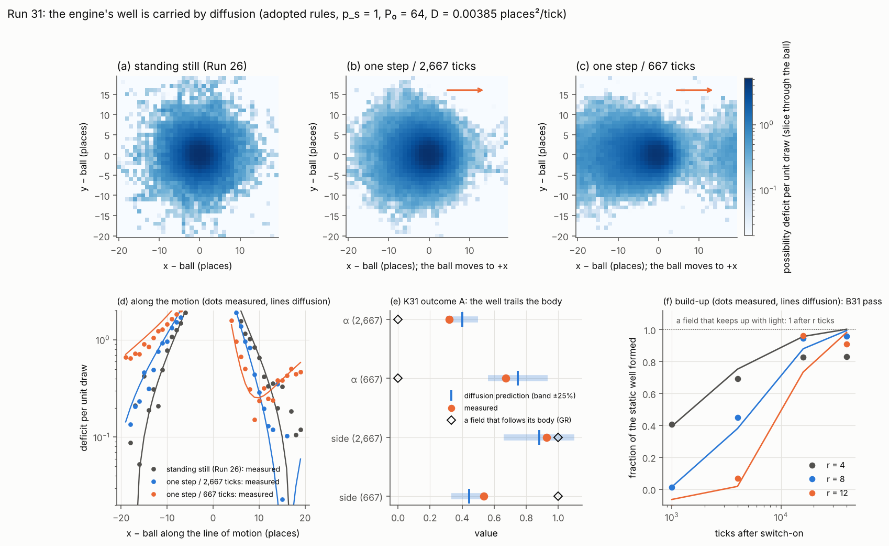

**Reading.**
1. **The well is carried by diffusion, as the mean equation says (B31).**
   - At 10 places, 1,000 ticks after switch-on, 4% of the well has formed. A field keeping up with light would be complete after 10 ticks.
   - Over the whole build-up, measured and predicted deficits agree to a median 0.97. Individual points range from 0.83 to 1.75; the scattered ones are early or far out, where the deficit is small.
   - The linear theory over-predicts the well next to the ball: 0.83 of the predicted depth at r = 4 late on, much as Run 26's static well came in at 0.94 of theory. That is consistent with the mean-field $D(\rho)=c/(6(p_s+\rho))$ rising where the medium is depleted. This is an inference, not tested.
2. **A moving body trails its well (K31, outcome A).**
   - The well is lopsided toward behind the ball at both speeds, and cut down sideways. All four statistics are within the registered bands.
   - All four deviate toward a weaker wake than the linear prediction. Two sit near the band edges: M1 sideways 0.537 (edge 0.553) and M2 α 0.321 (edge 0.300). That is consistent with the same faster diffusion in the depleted well, which is untested.
   - Halves agree to 0.05 or better.
   - A field that followed its body would show 0 and 1.
3. **A moving body draws more.** It keeps stepping into medium its own well has not yet drained.
   - The excess is +8.5% at the faster speed and +1.05% at the slower: about 8× for a 4× change in speed, roughly $w^{1.5}$.
   - The slower figure is close to the spread between the two static references (8.54 and 8.49).
   - Diffusion makes the excess first order in w only in the small-speed limit. At physical speeds a body never sits in its own well, so the excess saturates: its pull would be that of a body with no self-redshift.
   - Either way a body's active mass depends on its speed through the lattice. That is another preferred-frame effect.
4. **What it means at the adopted scales (registered arithmetic).** This assumes one place is one Planck length and one tick one Planck time.
   - With $P_0/p_s\gtrsim2.3\times10^4$ (Run 30), D ≈ 7×10⁻⁶ places² per tick.
   - A well can spread only $\sqrt{6Dt}\approx$ 0.3 μm in the age of the universe.
   - A body moving at 370 km/s (the Sun against the CMB) keeps its well within about $2D/w\approx$ 0.01 of a place.
   - More generally, any carrier that random-walks at no more than the pattern speed fails. Its persistence length λ is the same for every body, and:
     - 1/r needs $r\gg\lambda$
     - following a body needs $r\ll2D/w\le\tfrac23(c/w)\lambda$
     - so the window is a factor of about $\tfrac23c/w\approx540$ at 370 km/s
   - Observation needs 1/r from laboratory torsion balances (sub-millimetre) to the Sun's field following it out to the outer planets (10¹³ m). The double pulsar's fields do so at $w\sim10^{-3}c$.
   - The closest classic analogue is Laplace's bound on the aberration of gravity. Le Sage's shadow models failed differently: by drag and heating, in the ballistic regime.

**What stands and what doesn't.**
- **Stands, as steady states:** the static results of Runs 14–30 (steady wells, β = 1, clocks, free fall in static wells, sourcing). They are properties of the engine's steady state, and B31 confirms that state is reached, by diffusion.
- **But the steady state is never reached at physical distances.** At the adopted scales diffusion takes it only about 0.3 μm in the universe's age, even for a body at rest, and no real body is at rest in the lattice. So the static results describe gravity only under a field-dynamics rule that reaches the same static limit at the pattern speed. A deficit carried as a wave does, and keeps every one of them.
- **Fails:** the engine's field dynamics as a model of gravity, for bodies at rest (formation) and in motion (the wake). Any test of a moving-matter draw rule (Run 30's 1 + 2v²) needs that rule first. Run 11b required "capacity set by matter at each moment", and the engine's medium does not supply it.

**Fixes in the record** (none built on the engine):
- **Screen the wake and keep the static part** (MovingBinarySim). The engine has one field, so a drain that screens its wake screens the static well too, which is Run 14's reach/strength trade-off. It needs two channels.
- **Carry the deficit as a wave** (HyperbolicBuild).
  - The static limit is the same: $\tfrac1{c^2}\partial_t^2\delta=\nabla^2\delta-s/D$ reduces to $D\nabla^2\delta=s$, so every static result carries over.
  - Changes travel at c, and a moving body's field follows it.
  - The deficit then needs inertia, a field (amplitude) rather than units hopping. Run 16's patterns already move this way.
- **Places move with matter** (Run 11b's "sliding places is free"). Relative motion becomes shear of relations, which Run 11b showed radiates GR's power at c.
- **An instantaneous constraint.** This follows steady motion, but it allows instant influence in the lattice frame, against the ontology's §10.

---

### Run 32: can the adopted rules make a horizon? (and do the earlier radiation papers apply?)

*Note (21 October): under the provisional option 3 with CO's medium (Run 67) the same cold zero-clock surface appears, of the same form with GR's lapse in place of e^{−M/r}, just outside where GR's horizon would be.*

*19 October 2026. Pre-registered and hashed before any run (`horizon/PREREG_32.md`, 05:47 UTC), with a kill rule. (step 2: whether the surface where possibility runs out is a horizon).*

**Prior record (checked first).** Much of this was already found in other CO models. This run puts it on the adopted rules.
- **Attempt B, B-39** (O165, W103, W104): the body's slowing clock cuts its own draw. "The brake wins by a factor of ~30… the bandwidth seal OPENS". The clock slows as a power law, $t^{-0.55}$ to $t^{-0.67}$; "nothing freezes."
- **MODEL_RESULTS, result 17:** "ED's ingredients make neither [a horizon] nor an exact permanent cut."
- **Attempt C, C-O39:** "the draw is self-limiting… so clocks never reach zero."
- **`ED_Acoustic_Metric_Curvature.md`:** "κ = 0… ED horizons are generically cold."
- **The earlier radiation papers** (039, 047, 050, 052; `BH_Thermal2Pi`; `ED10_Horizons`) all assume a horizon with κ > 0.

**Theory** (`theory32.py`, before any run).

(a) **The surface where possibility runs out is cold.**
- Outside a static body the outflow deficit is harmonic, $z=z_0-A/r$, and the logarithmic outflow gives $P=p_s(e^{z/c}-1)$. With $Q=P_0/p_s$ and $U=M/r$:
$$
N(r)=\frac{(1+Q)\,e^{-M/r}-1}{Q},\qquad N=0\ \text{at}\ r_e=\frac{M}{\ln(1+Q)} .
$$
- N falls to zero linearly. With the pattern rule's $g_{rr}=N^{-2}$, the time–radial metric is $-f\,dt^2+dr^2/f$ with $f=N^2$, a double zero. So
$$
\kappa=\tfrac12 f'(r_e)=N\,N'\big|_{r_e}=0,\qquad T=\kappa/2\pi=0 .
$$
- For Q = 64, 2000 and 2.3×10⁴:
  - κ is 10⁻¹⁸ to 10⁻²³ (rounding)
  - the proper distance to the surface grows as ln(1/ε), so it is infinite
  - the areal radius r/N diverges
  - a radial light ray reaches it at finite affine parameter
- This is an extremal-type end with infinite area and zero temperature, the same verdict as CO's acoustic-metric arc.

(b) **A static body cannot make that surface.**
- Its draw is its ticking (presence clock). For a thin shell of bare compactness μ (the U it would make if its clocks did not slow), the shell's clock rate solves
$$
N_b=\frac{(1+Q)\,e^{-\mu N_b}-1}{Q} .
$$
- At $N_b=0$ the right side is 1, so the root lies in (0, 1).
- More generally, outside matter $\tfrac16\nabla^2z=-\bar s<0$, so z is smallest on the matter and positive outside it.
- U at the surface grows only like ln μ, toward ln(1 + Q) ≈ 10 at Q = 2.3×10⁴, and never reaches it (figure, panel a).

**Engine check.** CO's radius-3 ball with k = 8, 32 and 128 commitments per pair, at $p_s$ = 1, $P_0$ = 64, box 40. Each run is 25,000 ticks, read over the last 12,000. The engine is unchanged.

| k | draw (theory) | mean P at the ball (theory) | lowest ball place | N at r = 4 (theory) | lowest shell P, r = 4–15 | lowest outflow outside the ball |
|---|---|---|---|---|---|---|
| 1 (Run 26) | 8.54 (8.55) | — | — | — | — | — |
| 8 | 20.05 (19.86) | 7.43 (7.36) | 4.19 | 0.310 (0.309) | 19.9 | 2.67 |
| 32 | 29.11 (28.20) | 2.70 (2.61) | 1.01 | 0.183 (0.186) | 11.7 | 1.31 |
| 128 | 36.49 (33.84, not converged) | 0.96 (0.83) | 0.12 | 0.113 (0.113) | 7.2 | 0.32 |

- **K32 (kill rule: no zero-clock surface outside matter): pass.**
  - Shell means at r = 4–15 are 7.2 or more, against the 0.5 threshold. The lowest single place at r = 4 holds 4.46.
  - Places without pairs, including those inside the ball's radius, keep an outflow of at least 0.32, against 0.059. The deepest of them holds 0.35 (N ≈ 0.005).
- **T32a (theory): pass.** At k = 8 and 32 the draw agrees to 1% and 3%, P at the ball to 1% and 3%, and N(r = 4) to 0.004.
- **T32b (saturation): as registered.** At k = 128 the draw is 36.5, below 45.
- **The draw saturates.** Sixteen times the commitments (8 → 128) gives 1.8× the draw. Per commitment the draw falls from 8.5 to 2.5, 0.91 and 0.29 (figure, panel b). Inside the ball P falls toward zero, to 0.12 at the lowest place, but outside it the clock rate never reaches zero.

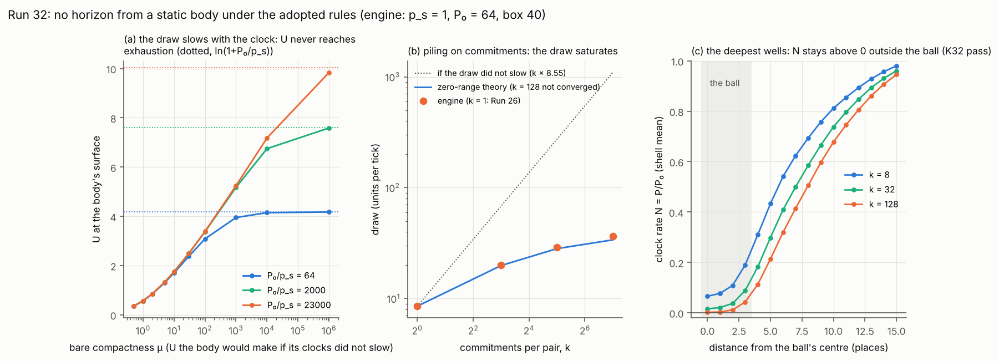

**Reading.**
1. **Under the adopted rules a static body never makes a horizon.** Its draw is its ticking, so a deepening well slows the very draw that digs it. This is the Tolman self-consistency of Run 30, seen at full depth, and it matches Attempt B's B-39 and Attempt C's C-O39 on a different engine.
2. **Even the idealised end, where possibility runs out, is at zero temperature.** So the earlier radiation papers, which derive $T=\kappa/2\pi$ from a horizon with κ > 0, do not apply to the engine's static solutions. A static engine body has no horizon, so standard Hawking radiation does not arise. The engine models no quantum fields, and its check ran only at Q = 64.
3. **What that leaves.**
   - **An ultra-compact body with a surface at finite redshift.** For $U_b>\tfrac12$ (thin shell: μ ≳ 0.9) the exponential metric's light ring, at $r=2M$ or U = ½, lies outside the body, so Run 28's shadow (+4.6%) and ringdown (about 4% low) apply. The registration's "$U_b>2$" was wrong.
   - **The missing surface glow of Sgr A*** (Attempt 03's closure, 25× over the limit at redshift e) applies to that surface. Whether a very large redshift, with its long equilibration time, escapes the steady-state argument has not been computed. The record does not try it either.
   - **Collapse.** Barceló et al.'s horizonless (quasi-Hawking) radiation needs a surface redshift that grows exponentially in time. Attempt B's B-39 found a power law. Not run here, and on Run 31's diffusive medium a collapse would in any case run at the diffusion rate.
4. **Information.** With no horizon there is nothing for information to be lost behind. CO's "records, not reversibility" reading is not needed for static solutions. It would matter only if a rule change brings back a horizon.

---

### Run 33: does a pattern's energy pull? (a decision memo; no run)

*19 October 2026. (step 3: give a pattern a cadence on the event layer and measure whether it pulls by ħω). A search of the earlier project's papers found no existing CO rule that turns a pattern's energy into draw. By CO's own rule (ED_Attempt_04, `Picture.md`: "The counting rule is fixed … **before** any weights are computed"), the rule has to be chosen first. This memo sets out the candidates and what each one gives, for that choice. Nothing is run.*

**What is measured.** Energy in every form pulls with the same weight as rest mass.
- **Binding energy.**
  - Nuclei and atoms weigh less than their parts by their binding energy: $\Delta m=E/c^2$ is confirmed to 4×10⁻⁷ (Rainville et al. 2005).
  - That mass falls like any other: titanium and platinum agree to 10⁻¹⁵ (MICROSCOPE), and their binding fractions differ by about 10⁻³.
  - It pulls like any other: the Moon's aluminium crust and iron mantle agree to 4×10⁻¹² (Bartlett & van Buren 1986).
  - About 99% of a proton's mass is the energy of its quark–gluon pattern.
- **Radiation.** Radiation gravitates. The expansion rate in the radiation era, read from primordial nucleosynthesis and the CMB, counts photons and neutrinos at full weight: $N_{\rm eff}=2.99\pm0.17$ (Planck 2018).
  - In GR that rate is set by the energy density through the Friedmann constraint.
  - A theory whose expansion is driven by the active mass, $\ddot a/a=-\tfrac{4\pi G}{3}(\rho+3p)$, needs radiation's pressure weight too. With energy alone and $\rho\propto a^{-4}$, it gets $H^2=\tfrac{4\pi G}{3}\rho$, half of GR's.
- **GR's requirement, in engine terms.** The active source of static or slowly moving matter is $(T^{00}+T^{ii})$ weighted by the local clock rate (Tolman, Komar). That is:
  - rest mass with weight 1, which is Run 30's result
  - internal and binding energy with weight 1
  - momentum flux (pressure, and a moving body's $\rho v^2$) with weight 1 per direction

**What the record says** (all quoted from the earlier papers).

| file | says | status |
|---|---|---|
| Attempt C `RULES.md`, DSR-4 (2026-10-05) | "mass is a frequency of becoming (E = ħω), so greater mass is a higher duty cycle" | ruled; "true by construction" |
| `Paper_MassWithoutMass_BindingInertia.md` (July 2026) | "the commitment rate and mass are different phenomena… mass is a separate thing that comes from binding" | simulator-tested (V5) |
| `Note_MassRate_Reconciliation` (2026-09-06) | $m\propto\Gamma_{\rm commit}\times$ reserve | "a stated bridge, conditional" |
| ontology §12 (2026-10-11) | superpositions do "not generate curvature"; "quantum systems… have low ED" | argued |
| Attempt 04 R4, ruling D30 | "Does uncommitted pattern (light) send influence? **Yes**… Radiation gravitates" | "consistent, not derived" |
| `run_event_layer.py` | a pattern's phase advances DPHI = 0.1 per completed blink, "ours" | harness setting |

Two pairs of these conflict: DSR-4 with Mass Without Mass, and §12 with D30.

**Candidate rules, and what each gives.** The first two columns of results follow from Run 30's static result and standard post-Newtonian bookkeeping. The cosmology column is the measured radiation-era expansion.

| rule | rest + binding + internal energy | moving matter (GR: weight $\tfrac32v^2$ in conserved terms) | stress (GR: 3p) | radiation | verdict before any run |
|---|---|---|---|---|---|
| **R-a. Cadence draw:** a pattern draws in proportion to its frequency ω = E/ħ (DSR-4 extended) | weight 1 ✓, since a bound state's ω includes its binding and internal energy | lab-frame ω = γm gives $+\tfrac12v^2$: Φ₁ coefficient 2 against GR's 4, so $\zeta_1+\alpha_3=-2$ and an Earth–Moon term of $+\tfrac43$ if it is ζ₁. If cadence means the tick rate seen in the lab (ω₀/γ), the weight is $-\tfrac12v^2$ and $\zeta_1+\alpha_3=-4$ | 0 against 3 | pulls by its energy only. That fails the radiation era if the expansion is driven by the active mass (half GR's H²). It is untested if CO has an energy-only Friedmann constraint | fails motion and stress |
| **R-b. Cadence plus flux:** a pattern draws for its energy *and* for its momentum flux, the possibility it carries through each place, per direction | ✓ | ✓: energy gives $\tfrac12v^2$ and flux gives $v^2$, together $\tfrac32v^2$. This covers the source of $g_{00}$ only; frame dragging, α₁ and α₂ still need the field dynamics (Run 31) | ✓ (3p) | ✓ (energy, plus the pressure weight: 2E in bulk) | GR's weights at first post-Newtonian order. It is Tolman–Komar's source, so under CO's R1 it is "consistent, not derived" unless CO gives an independent reason for the flux to draw. D30's "influence carries motion and energy" points that way |
| **R-c. Only commitments pull;** patterns and radiation do not (§12) | only if bound patterns *are* renewing commitments whose rate includes their binding | as R-a, via the commitments | 0 | does not pull: against the measured radiation era and against D30 | fails radiation |
| **R-d. Mass from binding,** separate from the commitment rate (Mass Without Mass) | depends on the binding rule | — | — | — | conflicts with Run 30's identification of active mass with the draw |

**Reading.**
- Only a rule that counts momentum flux as well as energy (R-b) gives GR's weights for moving matter and stress.
- A pure "draw = ħω" rule (R-a) gets binding energy right, which is the part the Moon and MICROSCOPE test most directly. It misses motion and stress, as Attempt 01 and 03 found for their counting rules.
- The stress weight bites for self-gravitating bodies, where by the virial theorem $3\int p=-\Omega$. It bites less for bodies held by non-gravitational stresses, whose integrated stress vanishes (von Laue).
- Every rule's motion weight is downstream of Run 31. If the engine's field cannot follow a moving body, no draw rule for moving matter can be checked on the engine as built.

**Needs a ruling.**
1. Which mass reading is canonical: DSR-4 (frequency) or Mass Without Mass (binding)?
2. Do patterns and radiation pull (D30) or not (§12)?
3. If R-b: what in CO makes possibility in transit draw, so that it is a reason rather than Tolman restated?

**Then, pre-registered:**
- a bound pattern (a Klein–Gordon pattern in a box well, binding a few % of its energy) whose draw follows the chosen rule. Its far field is measured against $E=\hbar\omega$, with binding counted, to 1%.
- moving patterns against the 1 + 2v² requirement, once the field can follow them (Run 31).

**Ruling (19 October):** a pattern's rest energy (ħω, binding included) draws, as in D30. With the Lorentz input (Run 34) its momentum flux draws too, so the adopted rule is R-b. Tested in Run 36.

### Run 34: a clock field fixed each tick, plus a current field — can it pass the preferred-frame tests? (a calculation)

*19 October 2026. The criteria and candidate rules were fixed and hashed before the numerical check ran and before the record search on frame dragging was read (`vector/PREREG_34.md`, 09:21 UTC). The general relation had been sketched in conversation while scoping, and was registered as a prediction. An independent agent re-derived the matching against Will (2014, Box 2 and Table 4) and GP-B's final result. It confirmed the algebra and found eight problems in how the result was stated; all are corrected below, and listed at the end.*

**Question.** Run 31 showed the engine's field is carried by diffusion. The proposed fix has three parts:
1. The clock field is fixed fresh each tick: possibility relaxes completely between commitments, so the field is the steady state for the current draws.
2. A current field ($g_{0i}$) is sourced by moving matter.
3. Radiation is shear of relations (Run 11b).

Part 1 keeps every static result and removes the wake. The question here is what part 2 must be for the preferred-frame tests to pass, and whether anything in CO supplies it.

**Prior record (checked after the registration, before writing up).** Much of this is already in CO's Phase-3 GR notes. Run 34 puts numbers to it and adds one derived piece.
- **`Phase3_GR_PPN_RouteB_EtaCrossCheck.md`:** "The scalar rule `ḃ = D∇²b − κρ`, by itself, sources no physical `g_{0i}`", because its current is curl-free, and "the conservative skeleton leans `α_1=O(1)`". Run 34 gives the number: α₁ = −8, α₂ = −1.
- **`Phase3_GR_DirectedFluxSector.md`:** a directed flux, $D\nabla^2A^i=\kappa_J\rho w^i$ with $g_{0i}=A_i$ and $\kappa_J=\lambda_J\kappa$, "kept symbolic". That is candidate C2.
- **`Phase3_GR_PinningLambdaJ.md`:** boosting the static metric gives $g'_{0i}=4w_iU$, so "α₁ = 0 ⟺ λ_J = 4". It adds that "ED's rule is not boost-covariant" and that the naive estimate is λ_J ~ O(1), "not computed". Run 34's $k_1=-4$ is the same condition.
- **`GR_SC_2_0_Consolidation.md`:** "No magnetic Weyl, no frame-dragging" in CO's static acoustic metric.
- **Paper 046** (Kerr twist): frame dragging is "INHERITED".
- **`Phase3_GR_Alpha2_Vanishes_Alpha1_Reconciled.md`** and **GR-IV:** α₂ = 0 and $\alpha_1=-4c_{14}\approx10^{-93}$, from khronometric formulas with both speeds tuned to c. The 12 September review marks α₂ = 0 "not established".
- **Not in the record:** α₂ = 0 coming out of possibility's own conservation (C1 below), given C1's principle and two stated premises.

**The calculation** (`run34.py`). In the lattice frame, taken as the PPN preferred frame, the engine family has:
- $g_{00}=-N^2$, $\ln N=-U_{\rm eff}$, with $U_{\rm eff}$ instantaneous (part 1). There are no $\mathcal A$, $\mathcal B$ or $\Phi_W$ terms, and the motion weight is $a_1$ in proper-density terms.
- $g_{ij}=N^{-2}\delta_{ij}$, so γ = 1.
- $g_{0i}=k_1V_i+k_2\chi_{,0i}$, with $V_i=\int\rho'v'_i/|x-x'|$, $\chi=-\int\rho'|x-x'|$ and $\chi_{,0i}=V_i-W_i$.

With isotropic $g_{ij}$ and no $\mathcal B$ term, the only time relabelling left at this order ($t\to t+\lambda\chi_{,0}$) would add a $\mathcal B$ term, so λ = 0: the lattice frame is already in Will's standard gauge, and coefficients can be read off directly. Matching term by term gives, exactly:
$$
\xi=0,\qquad \zeta_1=0,\qquad \alpha_1=-2k_1-8,\qquad \alpha_2=2k_2-1,\qquad \alpha_3=2a_1-4 .
$$
- **GR** is $k_1=-4$, $k_2=\tfrac12$, $a_1=2$ (conserved-density weight $\tfrac32$).
- **The bounds** (Will 2014, Table 4) are $|\alpha_1|<4\times10^{-5}$ (binary pulsar PSR J1738+0333; lunar laser ranging gives 10⁻⁴), $|\alpha_2|<2\times10^{-9}$ (millisecond pulsars) and $|\alpha_3|<4\times10^{-20}$ (pulsar period derivatives). Any rule, derived or chosen, must therefore give
$$
|k_1+4|<2\times10^{-5},\qquad |k_2-\tfrac12|<10^{-9},\qquad |a_1-2|<2\times10^{-20}.
$$
- **Frame dragging is the same test as α₁.** For a stationary rotating body $\chi_{,0}=0$, so $g_{0i}=k_1V_i$, and frame dragging is $k_1/(-4)=1+\alpha_1/8$ of GR's. Gravity Probe B measured 37.2 ± 7.2 mas/yr against GR's 39.2, a test of $k_1/(-4)$ to 19%. The α₁ bound tests the same number to about 5×10⁻⁶, some 10⁴ times tighter. The registration listed frame dragging as a separate test; it is not.
- **Checks.** The linear matching was also solved directly and agrees with the closed forms. The grid computations are consistency checks only:
  - $\chi_{,0i}=V_i-W_i$ holds to 2% on a free-space grid (finite-difference error);
  - the flow below matches its formula to 6%, which re-checks the identity $\nabla^{-2}\partial_tU=-\tfrac12\chi_{,0}$;
  - its curl is zero to 10⁻¹⁶ automatically, because the flow is built as a gradient;
  - the far-field form $W=U(\mathbf w\cdot\mathbf n)\mathbf n$, listed in the code's docstring, was not checked.

**The candidates.**

| | rule | k₁ | k₂ | α₁ | α₂ | frame dragging (fraction of GR) | status |
|---|---|---|---|---|---|---|---|
| C0 | part 1 with no current field ($g_{0i}=0$) | 0 | 0 | **−8** | **−1** | 0 | excluded |
| C1 | possibility's own flow carries patterns, $g_{0i}=-u_i$ (the acoustic metric) | 0 | **½** | −8 | **0** | 0 | k₂ derived (given the principle and premises below); excluded on α₁ |
| C2 | C1, plus matter's momentum sourcing a current field by the same Poisson law as the draw, strength k₁ | −4 if chosen | ½ | 0 | 0 | 1 | passes only with **k₁ = −4 put in** and $a_1=2$ put in |
| C3 | the field of a moving body is its boosted rest field | −4 | ½ only after relabelling time | 0 | 0 | 1 | GR put in by hand; in lattice time it conflicts with part 1 (below) |

For C0–C2, α₃ = 0 needs the motion weight $a_1=2$, which is Run 33's R-b (energy plus momentum flux); R-a gives α₃ = −2. C3 brings its own $a_1=2$ with the boost.

**C3 in lattice coordinates.** Boosting the rest field, with the lattice's own time, gives $g_{0i}=-4V_i$ (k₂ = 0) and an $\mathcal A$ term in $g_{00}$ from Lorentz contraction. The ½ in $g_{0i}$ and $a_1=2$ appear only after relabelling time, $t\to t-\tfrac12\chi_{,0}$, which removes the $\mathcal A$ term. If lattice time is physical, as CO's global tick says, that relabelling is not free, and C3's $g_{00}$ (with an $\mathcal A$ term) contradicts part 1's (none). So C3 is not a third route; it is GR assumed, at the cost of part 1 or of the tick's meaning. C2 has no such conflict: part 1, C1 and $k_1=-4$ together are GR's standard gauge written in lattice time.

**Why C1's k₂ = ½ is derived (given C1's principle).**
- Under part 1, a moving body's deficit $\delta P=-P_0U(x-wt)$ moves with it. Conservation then forces possibility to flow, with $\nabla\cdot\mathbf u=\partial_tU$ (u = flux/P₀).
- The engine's mean flux is always a gradient, $\mathbf J=-\tfrac16\nabla z$, so the flow is irrotational. That gives
$$
\mathbf u=-\tfrac12\nabla\chi_{,0}.
$$
- If patterns ride possibility's flow ($g_{0i}=-u_i$), this is exactly GR's $+\tfrac12\chi_{,0i}$, and α₂ = 0, with no number chosen.
- **Premises, stated.**
  - *Normalisation:* $\delta P/P_0=-U$, with the same U that sets $\ln N$. This is the presence clock's $N=P/P_0$ at linear order; a different normalisation would scale k₂ directly, and the bound allows 10⁻⁹.
  - *The steady inflow is dropped.* The registration defines u as the full drift J/P, which also includes the steady inflow into the sinks, $\mathbf J_s=DP_0\nabla U$. The derivation drops it. It is a static gradient, so it has no curl and is not of PPN form. It could be removed by relabelling time, but not freely if lattice time is physical. Its size is $D\,U/r$ in lattice units: about 7×10⁻⁶ U/r, which at a metre (6×10³⁴ places, if a place is a Planck length) is about 10⁻⁴⁰ U, and smaller further out. Negligible at the adopted scales, but a term the derivation sets aside, not one it removes.
- **The principle itself is not yet a CO rule.** EtaCrossCheck matched the acoustic form from outside, and the acoustic arc sets the flow to zero. Adopting C1 is a choice of principle, not of a number.

**Why that is not enough.** The same gradient structure means the engine's possibility flow can never circulate, in any time labelling. A stationary rotating body makes no flow at all ($\partial_tU=0$). So C1 has k₁ = 0: α₁ = −8 and no frame dragging. The missing piece is the transverse $-4V_i$: moving matter's momentum must source a circulating current. In GR the 4 is $2(1+\gamma)$, which is what boosting a static field gives.

**Outcome.**
- **K34: no derived candidate passes.** The kill rule as registered accepted candidates that are put in, and C3 is GR by construction, so it could not fire. That was a flaw in the registration. Read honestly: parts 1–3 pass the preferred-frame bounds **only by input**, through C2. That needs:
  - part 1 (possibility relaxes between ticks)
  - C1 (patterns ride possibility's flow), which makes α₂ = 0 derived, given its premises
  - a momentum channel with $k_1=-4$ to 2×10⁻⁵ (λ_J = 4), which is input
  - the motion weight $a_1=2$ to 2×10⁻²⁰ (Run 33's R-b), which is input
- **Part 1 with no current field fails the preferred-frame tests** (α₁ = −8, α₂ = −1). The engine as built, with its diffusive wake, is not of PPN form, so its α's are not defined. What holds for it regardless is that it has no frame dragging: any $g_{0i}$ it could carry is a gradient. That is §4 item 5, now with numbers.
- **Hypothesis: the momentum channel and R-b are one piece of physics.** Moving matter's momentum must act in two places: on the clock field's source ($\tfrac32v^2$, the Earth–Moon test) and on the current field (the 4, α₁ and frame dragging). In GR both come from the boost. Nothing in CO links them yet. CO's D30 ruling, "influence carries motion and energy", is a possible hook for both.
- **What would make the 4 derived.** A rule in CO that fixes how strongly a moving commitment imparts momentum to possibility, with no number chosen to match, landing within 2×10⁻⁵ of 4. PinningLambdaJ's naive estimate (λ_J of order 1) shows the rule is not yet there.
- **GR-II's falsifier** ("an additional vector mode") is not triggered by C2 if the current field is set each tick like part 1, a constraint rather than a travelling mode.

**The rulings (19 October, after this run) and the input chosen.**

- **Adopted:** part 1 (the clock field is fixed each tick) and C1 (patterns ride possibility's flow).
- **The tick is not physical time** (ruled 19 October). Physical time is what clocks read, which is commitments; the tick only orders updates. Consequences:
  - Relabelling the tick, $t\to t+\lambda\chi_{,0}$, is a choice of coordinates, not a change of physics.
  - C3 no longer conflicts with part 1. Its boosted field, relabelled by $t\to t-\tfrac12\chi_{,0}$, is part 1's field with $k_2=\tfrac12$, $k_1=-4$ and $a_1=2$. So C2 (with R-b) and C3 become one candidate.
  - The steady inflow that C1's derivation dropped is a static gradient, which a relabelling removes. It is pure coordinates.
- **The input chosen**. One input, not two numbers: **Lorentz invariance at first post-Newtonian order. A moving body's field is its boosted rest field, up to relabelling the tick.**
  - It fixes $k_1=-4$ (λ_J = 4) and $a_1=2$ together and exactly, so the tolerances are met by construction.
  - It is the input already tracked for Run 18 (twist charged on loops that include a tick), so the ledger gains no new kind of input.
  - It makes correction 8's hypothesis true by input: the momentum channel and the motion weight come from one source, as in GR.
  - **A check the derived piece passes.** In the slicing where part 1 holds (no $\mathcal A$ term), the boost requires $k_2=\tfrac12$. C1 derives $k_2=\tfrac12$ from conservation. Had conservation given any other value, this input would contradict CO's own flow. It does not.
  - **What future learning should look for:** one CO rule that makes physics independent of the lattice's rest frame. It would replace this input and Run 18's together.
- **The first post-Newtonian parameters under the adopted rules** (Candidate A″ = A′ + part 1 + C1 + this input):

| parameter | value | how |
|---|---|---|
| γ | 1 | the pattern rule $c=N^2$ (input; Runs 9, 17) |
| β | $1-$ about $2\times10^{-5}$ at $P_0/p_s=2.3\times10^4$ | the medium (Candidate A′; Runs 22–25, 30) |
| ξ | 0 | part 1: no $\Phi_W$ term (derived) |
| ζ₁ | 0 | part 1: no $\mathcal A$ term (derived) |
| ζ₂ | 2(β − 1) | Tolman sourcing (derived; Run 30) |
| α₂ | 0 | C1: possibility's conservation flow (derived, given C1) |
| α₁, α₃ | 0 | the Lorentz input |
| ζ₃, ζ₄ (internal energy, pressure) | open | whether pattern energy and stress draw (Run 33). The input covers kinetic pressure (moving particles) only |

- **The Earth–Moon test is then met in full.** With these values,
$$
\eta_N=4\beta-\gamma-3-\tfrac{10}{3}\xi-\alpha_1+\tfrac23\alpha_2-\tfrac23\zeta_1-\tfrac13\zeta_2=\tfrac{10}{3}(\beta-1)\approx-6.5\times10^{-5}
$$
  at $P_0/p_s=2.3\times10^4$, against lunar laser ranging's σ = 4.4×10⁻⁴.
- **No scalar radiation.** A clock field fixed each tick is a constraint, so it carries no waves. Gravitational radiation is then only part 3's shear of relations (Run 11b, 0.98 of GR), with no scalar dipole radiation, which binary pulsars require.
- **Open: signalling through the constraint.** The field updates everywhere at once on each slice. It cannot carry a signal only if every change in the draws is one that conservation allows (as in GR, whose instantaneous potential in this gauge carries none). With the inputs that holds at first post-Newtonian order; it is untested beyond.

**Corrections from the independent check** (the registration is unchanged; these change only how the result is stated):
1. The α₁ bound of 4×10⁻⁵ is from the pulsar PSR J1738+0333, not lunar laser ranging (10⁻⁴). The registration mislabelled it.
2. Frame dragging is $1+\alpha_1/8$ of GR's, so it is the α₁ test, weaker by 10⁴; it is not a separate exclusion.
3. K34 could not fire as registered; restated as "no derived candidate passes".
4. C3's k₂ = ½ and $a_1=2$ need a time relabelling that conflicts with part 1 if lattice time is physical.
5. α₁ = −8, α₂ = −1 hold for part 1 with $g_{0i}=0$, not for the diffusive engine "independently of the wake". Only "no frame dragging" holds regardless.
6. The grid checks are consistency checks; the far-field W was not checked.
7. C1's premises (normalisation; the dropped steady inflow) and the tolerances on k₁, k₂ and $a_1$ are now stated.
8. "The momentum channel is the same physics as R-b" is a hypothesis.

### Run 35: the engine on the adopted rules (a construction run)

*19 October 2026. Pre-registered and hashed before any registered run (`adopted/PREREG_35.md`, 10:10 UTC), with the engine, the theory and the analysis. An independent agent re-ran the analysis (byte-identical), checked the engine against engine22 and the registration's timing, and re-derived the physics claims; its corrections are included.*

**What this run is.**
- The rules are adopted by ruling, so nothing here can refute them. Every check compares the engine with what the rules imply, computed beforehand. A failed check would have meant the build was wrong, so there is no kill rule.
- One item (D35) bears on a claim from an earlier run: Run 29's post-hoc reading that the clock record's long one-way tail needs memory in the medium.

**The engine on Candidate A″** (`engine35.py`, `zrp35.py`).
- **The medium (part 1).** The wander rule is a zero-range process: a place holding n units sends out $f(n)=c\ln(1+n/p_s)$ a tick on average, evenly to its six neighbours. For given draws its stationary state is the product measure
  $$
  \pi_x(n)\;\propto\;\frac{z_x^{\,n}}{\prod_{k\le n}f(k)},\qquad \tfrac16\sum_{y\sim x}z_y-z_x=s_x-\bar s ,
  $$
  where the fugacity $z_x=\langle f(P_x)\rangle$ solves the engine's exact outflow equation (Run 31) for the current draws $s_x$.
  - "Possibility relaxes completely between commitments" means: each tick the medium is an independent draw from π, conditioned on the conserved total. Units held by live commitments are off the lattice, as before.
  - The draws are each pair's expected draw, $(\bar P_a+\bar P_b)/\text{hold}$ at each of its places, solved self-consistently (theory27's method). A rigid body's relaxed field translates with it.
- **Unchanged:** matter as reserved pairs under the presence clock, the order within a tick, and a vacuum that never commits.
- **Patterns riding a flow** (C1, and the input's current field). A pattern is carried by the flow $\mathbf v=-g_{0i}$ in the convective form
  $$
  D\psi=\nabla^2\phi-m^2N^2\phi,\qquad \psi=D\phi,\qquad D=\partial_t+\mathbf v\cdot\nabla ,
  $$
  which is Run 16's equation when v = 0. Possibility's conservation flow and the input's current field are computed by `flow_u` and `current_V` for later runs.

**Runs.** P₀ = 64, p_s = 1, seed 1 (clocks: seeds 1 and 2).
- **V:** the vacuum, box 40, 2,000 ticks.
- **S:** Run 26's ball (radius 3, 54 pairs), box 40, 20,000 ticks.
- **M1:** the ball stepping +1 in x every 667 ticks ($w=1.5\times10^{-3}$, as in Run 31), 40,000 ticks.
- **MF:** the ball stepping every 4 ticks ($w=0.25$, about 167 times faster), 20,000 ticks. It went round the box about 125 times (119 within the read window).
- **K:** Run 29's 125 lone probe clocks, box 30, 2 × 200,000 ticks.

**Results against the registration.**

| | check | measured | predicted (before any run) | verdict |
|---|---|---|---|---|
| C35a | the relaxed vacuum | mean 64 exactly, total fixed every tick; var/mean **4.1021** | 4.1044 (the diffusive engine: 3.975) | pass |
| C35b | static ball | draw **8.5492** per tick; shell means r = 4–15 within a relative **1.7×10⁻⁴** of theory | 8.5451 (Run 26 measured 8.54) | pass |
| C35c | moving ball, $w=1.5\times10^{-3}$ (moved 59) | α **−0.0020**; lateral ratio **1.0008**; draw ratio **0.9997** | 0, 1, 1. Run 31 (diffusive): **+0.672, 0.537, 1.085** | pass |
| | moving ball, $w=0.25$ (moved 4,999) | α **−0.0024**; lateral **1.0013**; draw ratio **0.9990** | 0, 1, 1 | pass |
| D35 | clock rate | **0.16641** per tick | 0.16641 (mean field) | pass |
| **D35a** | presence leads completions by one tick | D(1) = **+0.0857 ± 0.0002** | +0.0857 ± 0.0002 (model). Run 29: +0.0343 | **pass** |
| **D35b** | **the long one-way tail** | mean D over τ = 20–120: **(+0.1 ± 0.2)×10⁻⁵** | 0. Run 29: **+8.3×10⁻⁴** | **pass**: the tail is gone |

**Notes on the table.**
- The static ball's own α is −0.0018, so the moving balls' −0.002 comes from the ball's layout, not from motion.
- The model behind D35 is an integrate-and-fire clock fed an independent presence each tick. It shares no code with the engine's clock step.
- C35a's 4.1021 against 4.1044 is about 4σ. It is the expected bias of the approximate conditioning on the total, about −0.06%, well inside the criterion.

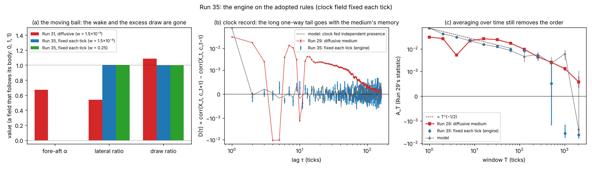

**Reading.**
1. **The build does what the rulings say.**
   - The static ball agrees with the zero-range steady state to 0.05% in draw and a relative 1.7×10⁻⁴ in its shells. That is agreement with the theory the build implements.
   - **Against the diffusive engine** (Run 26's same ball, two seeds; post hoc, not registered):
     - the draw agrees to 0.1%
     - the deficit agrees to 0.4% at r = 4
     - Run 35's deficit is 2–4% deeper at r = 7–13, and about 10% at r = 15, where it is under one unit
     - The difference may be Run 26 not quite reaching the steady state at box scale (relaxation time about 10⁴ ticks), or the two media's slightly different single-place laws (var/mean 4.10 against 3.98). The run does not separate them.
   - A moving body keeps its well and its draw at both speeds. Run 31's wake and its 8.5% excess draw are gone, at about 167 times Run 31's speed as well.
   - All of this follows from the rules by construction. The run checks the build, not CO.
2. **What D35 shows about Run 29's tail.**
   - With presence drawn independently each tick, D(τ ≥ 2) = 0 is what an integrate-and-fire clock must give. So D35b mainly confirms that the build's presence is independent, and that the clock alone carries no long tail.
   - It follows that Run 29's tail needed memory in the medium between ticks. Two such memories were present in Run 29:
     - ambient fluctuations of possibility
     - the clock's own reservation hole: each renewal takes a unit from each of its places, and the hole relaxes over tens of ticks, exactly the τ = 20–120 window
   - Part 1 removes both, and this run does not separate them. What remains is the clock's own lead: presence at one tick raises the chance of a completion at the next (D(1) = 0.086).
3. **Averaging over time still removes the order.** For a clock fed independent presence the window statistic is, to a good approximation,
   $$
   A_T\approx\frac{q}{\sqrt{T\,(Tq^2+g_T)}},\qquad q=\frac{\mathrm{sd}(X)}{H}=\frac{20.4}{640},\qquad g_T=f(1-f),\ f=\mathrm{frac}(rT),
   $$
   where r is the clock rate, and $g_T\to\tfrac16$ once the window count spreads. This formula was derived by the independent check after the run.
   - It reproduces T = 1–16: 0.0854, 0.0477, 0.0335, 0.0235 and 0.0163, against 0.0857, 0.0474, 0.0334, 0.0244 and 0.0159 measured.
   - So $A_T$ falls as $T^{-1/2}$ while $Tq^2\ll\tfrac16$ (to T ≈ 100), then as 1/T.
   - At T = 1024 and 2048 the measured −0.0036 ± 0.0021 and −0.0042 ± 0.0018 sit 2.1σ and 2.6σ below that expectation (+0.0009, +0.0005). The independent model, with the same estimator, scattered +1.8σ at T = 1024. With about ten windows per jackknife segment, the errors at large T are rough.
   - Either way the order fades with averaging, as K29 required.
4. **Where the arrow lives under the adopted rules** (derived, not run).
   - A vacuum redrawn independently each tick has no arrow at tick resolution by construction. The question is whether the relaxed law itself hides a current. It does not: in the vacuum it is in detailed balance with the wander rule's continuous-time process,
     $$
     \pi(\eta)\,\frac{f(\eta_x)}{6}=\pi(\eta^{x\to y})\,\frac{f(\eta_y+1)}{6},
     $$
     because $\pi(\eta^{x\to y})/\pi(\eta)=f(\eta_x)/f(\eta_y+1)$ for the product measure at uniform fugacity.
   - Run 29's T1 (the vacuum's wandering one-way at 2.7×10⁻³ per place per tick) is then attributable to updating every place at once. A synchronous update need not be reversible even when its continuous-time version is. Part 1 replaces that update with the relaxed law.
   - The arrow then lives in three places:
     - commitments, which are one-way by rule
     - the steady inflow of possibility into matter, a driven current that detailed balance does not cover
     - how clocks integrate presence (D35a)
   - That is in line with "the vacuum never commits": time's direction belongs to commitment, not to the medium.
5. **Ready for later runs.** The engine now has a field that is the steady state at every tick, moving bodies, possibility's flow, and the input's current field, all available to patterns.
   - The pattern–flow coupling was checked only on given flows. These checks are deterministic and were run before registration as code checks: in a uniform flow the drift is 0.990 of $v_0T$ (the lattice gradient takes 1%); in a sheared flow it is 0.970 of the starting density-weighted flow, as the packet spreads into slower flow.
   - Not done here: frame dragging on a pattern near a rotating body, signalling through the constraint, pattern energy, the strong field.

**Corrections to the registration's disclosures** (`PREREG_35.md` is hashed and unchanged).
- The smoke-test outputs (seeds 98 and 99) were deleted from `runs35/`. Renamed copies used to test `analyse35.py` (named `_s1`, `_s2`) remained in a scratch folder until after this check. They are not the registered streams: their clock presence matches the registered records on 1.4% of entries.
- The unconditioned draw's total varies by about ±4,100 units (one standard deviation), not ±1,500.
- `analyse35.py` labels Run 29's tail error "reported only", but it enters D35b's criterion. The margin is about 220σ, so this changes nothing.

### Run 36: does a bound pattern's energy pull, with binding counted once?

*19 October 2026. Ruled: a pattern's rest energy (ħω, binding included) draws. Pre-registered and hashed before the run (`patternE/PREREG_36.md`, 11:25 UTC), with a kill rule. A trial computation of the ball alone and the unperturbed ground state at m = 0.3 was made while writing the code, and is disclosed there. The diagnostics after the kill rule fired are post hoc and labelled as such. An independent agent checked the hashes, numbers and physics; its corrections are included.*

**Question.** Energy in every form pulls with the same weight as rest mass. Materials with different binding fractions pull alike: the Moon's aluminium and iron agree in their active-to-passive mass ratio to 4×10⁻¹² (Bartlett & van Buren 1986). And a bound system's mass is its total energy, with binding counted once. Under the adopted rules, does the far field of the ball plus a pattern bound in its clock well equal the ball's own far field plus the pattern's ħω?

**Why it is a test.**
- Each body's draw is redshifted by the other's well. The ball's draw is its ticking (Run 30), so the pattern's well lowers it. The pattern's ω is lowered by the ball's well. Counting only energies would therefore count the binding about twice.
- GR's Tolman–Komar bookkeeping repairs this with the momentum-flux term. The bound pattern's internal motion contributes +2KE, which the adopted rule includes (R-b, required by the Lorentz input).
- Whether the engine's own response supplies the cancellation is not built in: the ball's draw falling by exactly the pattern's flux term.

**Setup** (`pattern36.py`, `run36.py`).
- **Engine:** Candidate A″'s relaxed medium in its mean field, which the stochastic engine follows (Run 35). Box 60, P₀ = 64, p_s = 1.
- **The ball:** Run 26's body A, 54 pairs under the presence clock, self-consistent. It draws 8.267 per tick in this box.
- **The pattern:** Run 16's pattern in its ground state, one quantum,
$$
-\nabla^2\psi+m^2N^2\psi=\omega^2\psi,\qquad N=\bar P/P_0 .
$$
- **Its draw:** κ times a local density.
  - **R-b, adopted:** $T^{00}+\sum_iT^{ii}=\psi^2(4m^2N^2-2\omega^2)+6g$, which totals $\kappa(\omega+K/\omega)$.
  - **R-a, contrast:** $T^{00}$ alone, totalling κω.
  - Here g is the local share of $|\nabla\psi|^2$ and $K=\sum|\nabla\psi|^2/\sum\psi^2$.
  - κ is set so the pattern draws 10⁻³ per tick (a test pattern). Doubling it changes the result by 10⁻⁵.
- **Self-consistency:** field and ground state are iterated to 10⁻¹¹.

**Kill rule K36.** Under R-b at m = 0.3, $|\Delta D_{\rm total}/(\kappa\omega)-1|\le0.02$, where $\Delta D_{\rm total}=D_{\rm ball}+D_{\rm pattern}-D_{\rm ball,0}$.

**Results (registered medium).**

| m | binding 1 − ω/m | flux term K/ω² | R-b: ΔD_total/(κω) | ball's change /(κω) | R-a: ΔD_total/(κω) |
|---|---|---|---|---|---|
| **0.3** | 6.0% | 0.193 | **1.134** | −0.058 | 0.911 |
| 0.2 | 1.5% | 0.051 | 1.041 | −0.010 | 0.978 |
| 0.4 | 12.0% | 0.258 | 1.152 | −0.106 | 0.855 |

**K36 fails.** Under the adopted rule the far field overshoots ħω by 13% at m = 0.3, while energy alone undershoots by 9%. Neither counts the binding once. The cancellation fails because the ball's draw falls by only 0.058 κω, against the 0.19 κω it would need.

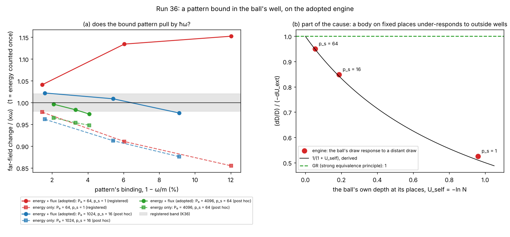

**Diagnostics (post hoc, not registered; checked by an independent agent).**
1. **The ball under-responds to outside wells.**
   - A weak, distant draw lowers the ambient at the ball by δU. The ball's draw then falls by a fraction 0.526 δU, not δU.
   - That is derived. For P ≫ p_s, ln P is linear in the outflow z (d ln P/dz is 0.698 at the ball, 0.694 far away). The ball's own deficit is linear in its draw D. So $P=P_{\rm amb}\,e^{-U_{\rm ext}}e^{-kD}$ with D ∝ P, which gives
   $$
   \frac{d\ln D}{d(-U_{\rm ext})}=\frac{1}{1+U_{\rm self}},\qquad U_{\rm self}=kD\approx-\ln N_{\rm ball}.
   $$
     Strictly, $U_{\rm self}$ is a draw-weighted average of $-\ln(P/P_{\rm amb})$ at the ball's places.
   - The registered ball sits at N = 0.38 at its own places, so 1/(1 + U_self) ≈ 0.50–0.51, depending on the definition and reference. Measured: 0.526, which agrees to about 4%.
   - **In GR the response is exactly 1, and the reason makes this testable.**
     - The static lapse equation $D^2N=4\pi N(\rho+\sum p)$ is homogeneous in N, so a uniform outside potential rescales a body's Tolman mass by exactly the lapse, at any compactness.
     - In these (isotropic) coordinates the body also shrinks by $e^{-U_{\rm ext}}$.
     - Within CO's own law, the self-coefficient k goes as 1/R. A body whose size and draw both scale by $e^{-U_{\rm ext}}$ keeps kD fixed, and so responds with exactly 1.
     - The engine's ball is held on fixed places and cannot shrink.
2. **The under-response is only part of the failure.**
   - Rescale the ball's change to a response of 1 (dividing by 0.526) and keep the flux term. That gives 1.082 at m = 0.3, 1.032 at m = 0.2 and 1.057 at m = 0.4. K36 still fails.
   - So the fixed places explain about 0.05 of the 0.13 excess. This is an estimate, since the pattern's potential at the ball is not uniform. The rest is unresolved.
   - It grows as the pattern overlaps the ball. That is consistent with the ball's internal adjustment (its stresses), which a body held by rule does not have, but it is not shown.
3. **With weaker-field matter (larger crossover), the adopted rule comes closer, and always closer than energy-only.**

| medium | ball's N at its places | response (1/(1+U_self)) | R-b at bindings | R-a, same patterns |
|---|---|---|---|---|
| P₀ = 64, p_s = 1 (registered) | 0.38 | 0.526 (≈0.51) | 1.041, 1.134, 1.152 (b = 1.5, 6.0, 12.0%) | 0.978, 0.911, 0.855 |
| P₀ = 1024, p_s = 16 | 0.83 | 0.849 (0.842) | 1.022, 1.009, 0.976 (b = 1.6, 5.4, 9.1%) | 0.962, 0.913, 0.876 |
| P₀ = 4096, p_s = 64 | 0.95 | 0.950 (0.948) | **0.996**, 0.984, 0.974 (b = 2.1, 3.3, 4.1%) | 0.965, 0.954, 0.948 |

   - **At p_s = 64:** the adopted rule misses by 0.2–0.6 times the binding (0.4–2.6%), and energy-only by 1.3–1.7 times.
   - **At p_s = 16:** the adopted rule misses by 0.2–1.4 times the binding, and energy-only by 1.4–2.4 times.
   - The adopted rule does not count binding once cleanly beyond the most diffuse pattern. Its miss grows with the pattern's overlap with the ball.
   - The far field sits at N = 1.036 in this periodic box, so "binding" carries a reference uncertainty of a few percent. The ratios themselves do not.

**Reading.**
- **The kill rule fired. The engine, under the adopted rules, does not count a bound pattern's binding energy once.** Under the adopted rule its far field overshoots ħω by 13% at the registered setting, and by 0.4–2.6% with weak-field matter.
- **Part of the cause is identified, post hoc.** A body held on fixed places, whose draw is its ticking, responds to outside wells with weight 1/(1 + U_self), not GR's 1. GR's bodies shrink in these coordinates, which keeps the response at 1. CO's law would do the same for a body that shrank, so a body that can adjust is the fix to try. The rest of the gap is unresolved.
- **The chosen pattern rule is closer to measured physics than energy-only at every setting**, but this run does not show it to be right.
- **This sharpens an open item already on the list:** bodies held by rule, not supported (Run 30, "whether stress pulls").
  - At physical scales $U_{\rm self}$ combines each clock's own dip (about 0.3/p_s ≈ 10⁻⁶ at p_s ≈ 4×10⁵) with a body's own potential: Earth 7×10⁻¹⁰, Sun 2×10⁻⁶, a neutron star about 0.2.
  - **Extrapolating from a ball held on lattice places** (not computed for any real body), a neutron star's active mass would respond to outside wells about 17% weakly. Strong-field pulsar tests bound related effects far below that. The PSR J0337+1715 triple bounds the passive-mass analogue to about 2×10⁻⁶.
  - So if CO's bodies really cannot adjust, that would very likely be excluded. A body that adjusts as GR's does avoids it.
- **Next, to register:**
  - the same test with a ball whose size scales with the outside well (shrinking by $e^{-U_{\rm ext}}$), to see whether that restores a response of 1 and closes the gap;
  - then a supported body, with stresses.

### Run 37: which memory carried Run 29's tail?

*19 October 2026. (step 3). Pre-registered and hashed before any registered run (`tail/PREREG_37.md`, 11:19 UTC), with registered verdict thresholds.*

**Question.** In Run 29 a clock's record leads in time over 20–120 ticks: the mean lag asymmetry D over τ = 20–120 is +8.3×10⁻⁴. Run 35 showed this tail needs memory in the medium between ticks. Run 29's engine has two such memories:
- **H-hole:** the clock's own reservation hole. Each renewal takes a unit from each of its two places, and the hole relaxes over tens of ticks.
- **H-ambient:** ambient fluctuations of possibility, which the clock integrates.

**Method.**
- `engine37.py` is Run 29's engine with one change. A renewing clock takes its two units from the whole box, uniformly by unit, not from its own places, so it leaves no hole of its own.
- Everything else is Run 29's: medium, release, presence clock, 125 clocks in box 30, P₀ = 64, p_s = 1, 2 seeds × 240,000 ticks read.
- Without its self-dip a clock collects more presence (128.0 against 106.6) and ticks faster (0.2000 against 0.1665 per tick).
- **Verdict (registered):** R = tail(Run 37)/tail(Run 29).
  - **H-hole:** R < 0.1, and Run 37's tail within 3σ of zero.
  - **H-ambient:** R > 0.5.
  - **Both:** anything between.

**Result.**

| | tail: mean D over τ = 20–120 | D(1) | D at τ = 5 |
|---|---|---|---|
| Run 29 (own hole) | (8.29 ± 0.02)×10⁻⁴ | +0.0343 | −0.0103 |
| **Run 37 (no own hole)** | **(9.27 ± 0.02)×10⁻⁴** | +0.0033 | +0.0029 |
| Run 35 (no memory in the medium) | (0.1 ± 0.2)×10⁻⁵ | +0.0857 | +0.0003 |

**R = 1.118 ± 0.004: H-ambient.** Ambient fluctuations of possibility carried Run 29's long tail. Without its own hole the tail is unchanged, slightly larger and slower to fall: 3.7×10⁻⁴ against 2.1×10⁻⁴ at τ = 120.

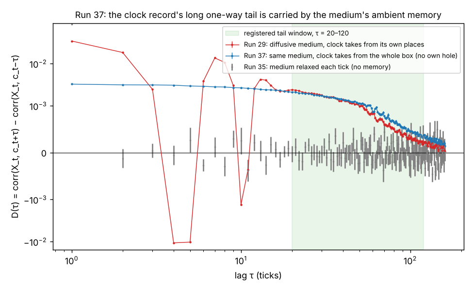

**Reading.**
1. **The long tail is the medium's ambient memory.** A clock integrates presence, and presence at a place is correlated over tens of ticks in the diffusive medium. So the record leads with that correlation's shape.
   - Removing the medium's memory (Run 35) removes the tail.
   - Removing only the clock's own hole (this run) leaves it.
2. **The clock's own hole shaped the short lags.** Without it:
   - the swings at τ = 4–10 (the clock's own cadence) vanish
   - D(1) falls from 0.034 to 0.0033
   - the profile becomes smooth and monotone
3. **For Run 29's arrow-of-time reading:** the "leak" of time order into a clock's long-window record came from the medium's slow fluctuations. Under the adopted rules (Run 35) the medium relaxes each tick, and that leak becomes the clock's own one-tick lead.

### Run 38: frame dragging on the engine (a construction check)

*19 October 2026. (step 4). This is a construction check, not registered. The script's docstring set a 3% criterion, which the in-well releases miss (1.068). The no-well releases and the diagnostic were added after that in-well result was seen. The strength of frame dragging is the Lorentz input (Run 34), so nothing here can test CO. It checks that the engine carries a pattern with the current field.*

**Setup** (`drag/run38.py`).
- A ring of 32 committed pairs, radius 8, in the plane z = 20 of box 40, on Candidate A″'s relaxed medium (mean field). It draws 8.48 per tick.
- It rotates at tangential speed w = 0.2. Its field is static and axisymmetric (up to the lattice), so possibility's own flow is zero.
- The input's current field $g_{0i}=-4V_i$ solves the same Poisson law as the clock field's deficit, sourced by the draw density times velocity.
- A pattern (Run 16's, m = 1, width 3) is released at rest 4 places from the axis, inside the ring. The engine carries it by $\mathbf v=-g_{0i}=4\mathbf V$ (Run 35's convective form).

**Results.**

| release | sideways drift ÷ (the flow, density-weighted, integrated along the path) |
|---|---|
| no clock well (N = 1), w = 0.2 | **0.998** |
| no clock well, w = 0.05 | **0.998** |
| in the ring's clock well, w = 0.2 | 1.068 |
| in the ring's clock well, w = 0.05 | 1.068 |

- **The pattern is dragged with the ring's rotation, at the flow's speed to 0.2%.** At the release point $4V_y=0.072$, against the ring's w = 0.2.
- **In the clock well** the packet also falls outward toward the ring while it co-rotates.
  - The flow's shear turns its outward momentum, $\dot k_y=-k_x\,\partial_yv_x$: the frame-dragging (gravitomagnetic) force on a falling body.
  - ⟨k_y⟩ rises to 0.0066 at t = 15 and is 0.0056 at t = 20.
  - Its integral, $\int\langle k_y\rangle dt/\omega\approx0.087$ (with ω ≈ mN ≈ 0.84), accounts for the extra sideways drift, 1.335 − 1.250 = 0.085. So the extra 7% is that force at work, not an error in the coupling.
- **A uniform flow inside the same well** (post hoc) gives 0.979 of vT. The well is not carried with the flow, so the motion is not a pure boost.
- A centroid-based angular measure for a packet this wide and this near the axis is not clean. It gives 0.94–1.04, so it is not used.

**Reading.** The engine's patterns ride the current field as the adopted rules say, and they co-rotate with a rotating body. Its strength (GR's 4V, and Gravity Probe B's 37 mas/yr) is the Lorentz input, not a result.

### Run 39: the ringdown with the remnant's spin (a calculation)

*Note (21 October): under the provisional option 3 with the current field in GR's form (§3), a rotating hole's far exterior is Kerr to O(p_s/P∞), so this run's CO exterior is superseded there; the near zone, where the ringdown is set, is Kerr's as well, to O(ε/α), under the provisional ruling of Run 69 (the medium's clock is the ZAMO lapse). It stands as written under option 1.*

*19 October 2026. (step 2). The rule, method, comparisons and reading rules were fixed and hashed before the code was written (`strong/PREREG_39.md`, 11:20 UTC). Disclosed there: the first-order frame-dragging rates at the two light rings had been estimated by hand during scoping. An independent agent checked the code, numbers and bounds; its corrections are included.*

**Question.** Run 28 found that a static body under the adopted metric rings 4.4% below Schwarzschild (eikonal). GW250114 allows $\delta\hat f_{220}=+0.02^{+0.02}_{-0.02}$ and $\delta\hat\tau_{220}=-0.01^{+0.10}_{-0.09}$ at 90% (pSEOBNR, arXiv:2509.08099). Its remnant spins: χ_f = 0.68 ± 0.01, M_f = 62.7 (+1.0/−1.1) M☉ in the source frame (arXiv:2509.08054). The adopted rules now give a current field. What does CO's rotating exterior, at the order the rules define it, do to the ringdown?

**CO's rotating exterior.** In lattice (isotropic) coordinates, outside a body of angular momentum J:
$$
ds^2=-e^{-2M/r}dt^2-\frac{4J\sin^2\theta}{r}\,dt\,d\phi+e^{2M/r}\left(dr^2+r^2d\Omega^2\right).
$$
- The $g_{t\phi}$ term is the adopted current field (C2 with the Lorentz input's strength 4). It is linear in lattice coordinates, as the engine sets it.
- There are no $J^2$ terms. The rules give none until the rotation's effect on the clock field is worked out.

**Method.**
- **Eikonal (2,2) mode:** $\omega_R=2\Omega_{\rm LR}$ and $\tau=2/\lambda$, from the prograde equatorial circular null orbit and its Lyapunov exponent.
- **Three metrics at the same asymptotic M and J = aM²:**
  - **CO₁:** above.
  - **Kerr₁:** Schwarzschild plus the same first-order $g_{t\phi}$.
  - **Kerr:** exact Kerr.
- **Code checks:**
  - Kerr's light ring matches $\Omega=1/(r_{\rm ph}^{3/2}+a)$ exactly at a = 0, 0.3, 0.68 and 0.9.
  - At a = 0, CO reproduces Run 28 (Ω = 0.18394/M; 1/λ = 5.437 M).
  - Schwarzschild's λ equals Ω.

**Results** (CO / GR − 1 in the eikonal (2,2) mode).

| spin a | CO's light ring (isotropic r; throat at 1) | frequency: CO₁/Kerr₁ | CO₁/Kerr | damping time: CO₁/Kerr₁ | Kerr₁'s own error (frequency) |
|---|---|---|---|---|---|
| 0 | 2.00 | −4.4% | −4.4% | +4.6% | 0 |
| 0.05 | 1.89 | −3.8% | −3.8% | +6.3% | 0.02% |
| 0.10 | 1.78 | −3.0% | −2.9% | +8.8% | 0.1% |
| 0.15 | 1.64 | −1.8% | −1.6% | +13% | 0.3% |
| 0.20 | 1.46 | −0.2% | +0.3% | +21% | 0.5% |
| 0.25 | 1.23 | +2.6% | +3.5% | +38% | 0.9% |
| 0.30 | 0.95 (inside the throat, reached at a ≈ 0.29) | +7.7% | +9.2% | +27% | 1.4% |
| 0.68 | 0.69 (inside the throat) | — (Kerr₁ has no prograde light ring above a ≈ 0.58) | +70% | — | — |

The frequency offset's slope at a = 0 is d(δf)/da = +0.110: CO's frequency rises 0.184 per unit spin against Kerr's 0.148.

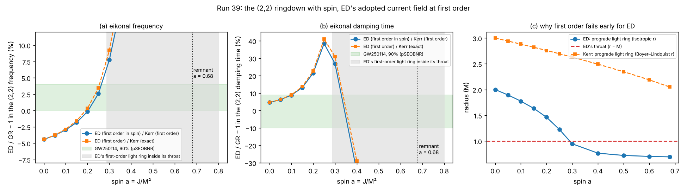

**Verdict (as registered): undecided.** The registered comparison is undefined at a = 0.68. Both first-order exteriors fail well before the remnant's spin:
- Kerr's truncation loses its prograde light ring above a ≈ 0.58.
- CO's first-order light ring falls through CO's throat at a ≈ 0.29, beyond which the first-order metric means nothing.

**Reading.**
- **Run 28's "4% low" does not carry over to a spinning remnant.**
  - CO's ringdown is more sensitive to spin than Kerr's: its relative frequency slope is 0.50 per unit a, against Kerr's 0.385 (about 1.3 times). Frame dragging at CO's light ring (isotropic r = 2M, close to its throat) is stronger than at Kerr's.
  - The comparison can be taken to a ≤ 0.15, where Kerr's first-order truncation errs by 0.3% in frequency and 0.5% in damping time. CO's own spin-squared error is unknown.
  - Over that range spin moves CO's frequency offset from −4.4% to −1.8%: by a = 0.15, CO's frequency has risen 9.4% against Kerr₁'s 6.5%.
  - It moves the damping-time offset the other way, from +4.6% to +13%. At first order it passes +9% near a = 0.10. GW250114's 90% bound of +9% (pSEOBNR) applies at a = 0.68, not there.
  - **Linear extrapolation to a = 0.68** (not registered, and beyond where first order holds): frequency −4.4% + 0.110 × 0.68 = **+3.1%**, inside GW250114's [0, +4%]; damping time +4.6% + 0.262 × 0.68 = **+22%**, outside +9%.
- **So at first order, spin trades the frequency tension for a damping tension.** Neither number at a = 0.68 can be computed from the rules as they stand.
- **What would decide it.** CO's rotating solution beyond first order: how rotation changes the clock field, and how the current field behaves at strong field (the engine's linear rule, or the boosted-field completion). Then the gravitational (not scalar) modes, and the mass-absorption question from Run 28.
- **The adopted rules do not yet define these.** The next input, or derivation, the strong field needs is the $J^2$ structure of a rotating CO body.

### Runs 40, 40b, 40c: Run 36 with a body that keeps its proper size

*19 October 2026. (step 1). Three registered runs, each hashed before it ran:*
- *Run 40, in Run 36's periodic box (`adjust/PREREG_40.md`, 12:52 UTC);*
- *Run 40b, in an unbounded medium, after an independent check found Run 40's pass depended on the body model (`adjust/free/PREREG_40b.md`, 13:06 UTC);*
- *Run 40c, the same at weak field (`adjust/free/PREREG_40c.md`, 13:15 UTC).*

*Trial runs used to choose the patterns' masses are disclosed in each registration.*

**Question.** Run 36's kill rule fired. Under the adopted rule a bound pattern's far field overshot ħω by 13%. Part of the cause was a body held on fixed places, which responds to outside wells with weight 1/(1 + U_self) instead of 1. A GR body keeps its proper size, so in lattice (isotropic) coordinates it shrinks by $e^{-U_{\rm ext}}$. Two questions follow:
- Does a body that does the same respond with weight 1?
- With such a body, and a pattern that stays off it, does the far field count ħω once, binding included?

**Setup.** Run 36's engine and rules: the A″ relaxed medium's mean field, Run 16's pattern, drawing by energy plus flux (adopted) or energy only (contrast), at test strength.
- **The body:** a smooth ball of 54 pairs, radius 3, each committed place drawing 2P/H.
  - **Held:** R = 3.
  - **Adjusting:** $R=3\,e^{-\bar U_{\rm ext}}$, with its count of committed places conserved.
  - **Self-similar:** the edge also scales with R.
- **The pattern:**
  - **xy state:** odd in x and y about the ball, so it has nodes through the ball and stays mostly off it.
  - **Ground state:** overlaps the ball.

**A body's response to an outside well.** With the self-term's scaling $s=d\ln k/d\ln R$,
$$
\frac{d\ln D}{d(-U_{\rm ext})}=\frac{1-U_{\rm self}\,s}{1+U_{\rm self}} .
$$
This is 1 when s = −1, and 1/(1 + U_self) when the body is held. The independent check found the formula good to about 2%.

| medium | body | s | response: measured (formula) |
|---|---|---|---|
| periodic box 60, p_s = 1 (Run 40, C40a registered "1 within 1%") | adjusting, fixed edge | −0.94 | **0.962** (0.970): C40a **fails** |
| | held | — | 0.544 (0.535) |
| | adjusting, self-similar (post hoc; R = 3, 6, 10) | −1.18, −1.32, −1.61 | 1.09, 1.13, 1.17 |
| **unbounded, p_s = 1 (Run 40b, C40b registered "1 within 2%")** | **adjusting, self-similar** | −1.027 | **1.008** (1.013): C40b **passes** |
| | adjusting, fixed edge | −0.81 | 0.893 (0.909) |
| | held | — | 0.518 (0.515) |
| unbounded, p_s = 64 (Run 40c) | adjusting, self-similar | — | **1.001** |
| | held | — | 0.948 (U_self = 0.055) |

**A body that keeps its proper size responds with weight 1 in an unbounded medium.** Run 40's box gave it a self-term that does not scale as 1/R (s ≠ −1): the zero-mean field adds a constant.

**The bound pattern's pull.** ΔD_total/(κω), with misses also in units of the pattern's binding b = 1 − ω/m (against N = 1 at infinity; the periodic box has no clean reference). "Counted once" is ΔD_total = κω. A miss of −2b means the binding is counted three times.

| run | body | pattern | binding b | energy + flux (adopted) | energy only |
|---|---|---|---|---|---|
| 40 (box) | adjusting, fixed edge | xy, m = 0.7 | 3.9% (box mean), 7.4% (box corner) | **0.9986: K40 passes** | 0.833 |
| 40 (box) | held | xy | | 1.094 | 0.906 |
| 40 (box) | adjusting / held | ground, m = 0.3 | | 1.086 / 1.139 | 0.816 / 0.896 |
| 40 (box, post hoc by the check) | adjusting, self-similar | xy | | 0.969 | |
| **40b (unbounded, p_s = 1)** | **adjusting, self-similar** | xy, m = 0.7 | 12.3% | **0.882 (−0.96b): K40b fails** | 0.754 (−1.99b) |
| 40b | adjusting, fixed edge | xy | 12.3% | 0.916 (−0.68b) | 0.782 (−1.77b) |
| 40b | held | xy | 12.3% | 1.030 (+0.24b) | 0.874 (−1.02b) |
| 40b | adjusting, self-similar / fixed edge / held | ground, m = 0.3 | 14.8% | 0.951 (−0.33b) / 0.978 (−0.15b) / 1.068 (+0.46b) | 0.727 / 0.758 / 0.860 |
| **40c (unbounded, p_s = 64)** | **adjusting, self-similar** | xy, m = 2.0 | 0.52% | **0.99975 (−0.05b): K40c passes** (band ±0.25b) | 0.98945 (−2.01b) |
| 40c | held | xy, m = 2.0 | 0.52% | 1.00032 (+0.06b) | 0.99002 (−1.90b) |
| 40c | adjusting, self-similar / held | xy, m = 2.5 | 0.81% | 0.99929 (−0.09b) / 1.00018 (+0.02b) | 0.98381 (−2.00b) / 0.98468 (−1.89b) |

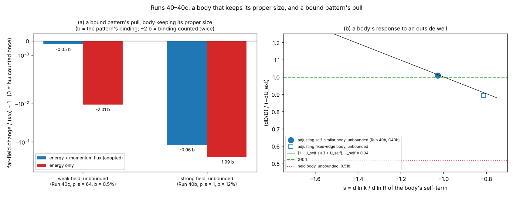

**Reading** (checked by an independent agent, whose corrections are included).
1. **Run 40's pass did not survive.**
   - Its registered C40a failed (0.962). The check showed the K40 pass depended on the body model (0.969 with a self-similar ball).
   - In an unbounded medium, where the field at the pattern is about three times stronger, the case fails (40b: 0.882).
   - The box and the field strength change together between Run 40 and 40b, so 40b alone does not separate them.
2. **At weak field the adopted rules count a bound pattern's binding once.**
   - In an unbounded medium at p_s = 64, the mean potential over the pattern is 0.0105. The adopted rule misses by 0.05 of the binding (0.09 at m = 2.5).
   - Energy-only misses by two bindings (it counts the binding three times), in every body model at weak field (−1.9 to −2.0b).
   - That is GR's first-order statement, a bound system pulls by its total energy. It holds because the pattern's momentum flux draws (the Lorentz input) and the body's redshift is counted.
   - It is the small end of a second-order term, not an exact closure (item 3).
3. **At strong field it does not close.**
   - At p_s = 1 the mean potential over the pattern is about 0.24 (binding 12%). With an ideal body, the adopted rule misses by about one binding (0.882).
   - The ideal-body response holds for the pattern's own near field too (1.010 at strong field, 1.0014 at weak).
   - The miss splits into two second-order pieces:
     - the flux draws $K/\omega^2=1.50b$ where weak field gives 2b, which is −0.50b;
     - the flux draw redshifts the body by a further −0.46b.
   - Across all the self-similar cases the miss scales as about $-(8\text{–}11)\,b^2$ (with $b\approx\bar U/2$). Two of those points share a medium, which partly controls for the change of medium between 40b and 40c.
   - In GR a test body adds exactly its Killing energy to the total mass at any field strength. So −0.96b is a real departure from GR, beyond first order.
   - At strong field the body model also moves the result by about 1.2b (−0.96, −0.68, +0.24b).
   - Linking the departure to the engine's nonlinear structure (the exponential clock map; Run 16's pattern equation), and to Runs 28 and 41, is interpretation.
4. **What carries to physical scales.**
   - Ordinary matter is weak-field. Body potentials GM/Rc² are 7×10⁻¹⁰ for Earth and 2×10⁻⁶ for the Sun. Each clock's own dip is about 0.3/p_s (Run 23), about 10⁻⁶ at the adopted p_s. There, under the adopted rules, energy pulls with binding counted once.
   - This run **suggests**, from one configuration (a test pattern bound to a separate ball), that compact bodies are where it fails.
   - A body held on fixed places also under-responds by 1/(1 + U_self). That is negligible for ordinary bodies and large for compact ones. A body that keeps its proper size fixes this part (C40b).
5. **Patterns inside a body** (the ground state) were tested only in the box and at strong field. Internal binding at weak field (atoms, nuclei: patterns inside patterns) has not been run.
   - Missing internal stresses is one explanation. Two others:
     - the adopted rule's local draw density turns negative where N < ω/(√2 m);
     - the outside potential is ill-defined for a source that overlaps the body.

### Run 41: CO's rotating exterior at the remnant's spin (a calculation)

*Note (21 October): under the provisional option 3 with the current field in GR's form (§3), a rotating hole's far exterior is Kerr to O(p_s/P∞), so this run's CO exteriors are superseded there; the near zone, where the ringdown is set, is Kerr's as well, to O(ε/α), under the provisional ruling of Run 69 (the medium's clock is the ZAMO lapse). They stand as written under option 1.*

*19 October 2026. (step 3). Exteriors, method and reading rules were fixed and hashed (`strong/PREREG_41.md`, 12:49 UTC) immediately before the code was saved. The code itself was not hashed; it was not edited after the run. An independent agent checked the metric, the numbers and the verdict; its corrections are included.*

**Question.** Run 39 could not reach GW250114's remnant spin (a = 0.68) because it cut CO's rotating exterior at first order. Two exteriors exist at all spins. What does each give for the (2,2) ringdown at a = 0.68?

**The two exteriors** (G = c = M = 1).

**E — the engine's rule, taken literally.** The engine's current field is a linear Poisson field in lattice coordinates, so $g_{t\phi}=-2J\sin^2\theta/r$ holds exactly for the engine at all spins; it is not a truncation. Rotation reaches the clock field only through the body's quadrupole:
$$
U=\frac{M}{r}+\frac{Q\,P_2(\cos\theta)}{r^3},\quad Q=-q\frac{J^2}{M},\qquad g_{tt}=-e^{-2U},\quad g_{ij}=e^{2U}\delta_{ij}.
$$
The quadrupole depends on the body. Three values are taken:
- q = 0;
- **q = 5/7**, a rigid uniform ball whose draw carries the adopted motion weight 1 + 2v². That gives $Q=-\tfrac{4}{35}M\omega^2R^4$ with $J=\tfrac25MR^2\omega$. This is a leading-order (v²) value: reaching J = 0.68M² needs surface speeds of 0.85 or more for R ≤ 2M. So q = 0 to 1 is a bracket, not a prediction;
- q = 1 (Kerr's value).

**NJ — the Newman–Janis completion of CO's static metric** (Azreg-Aïnou's form). With $F=e^{-2M/r}$, $K=r^2e^{2M/r}$, $\rho^2=K+a^2\cos^2\theta$, $2\tilde f=K(1-F)$ and $\Delta=FK+a^2$:
$$
g_{tt}=-\Big(1-\frac{2\tilde f}{\rho^2}\Big),\quad g_{t\phi}=-\frac{2a\tilde f\sin^2\theta}{\rho^2},\quad g_{\phi\phi}=\frac{(K+a^2)^2-a^2\Delta\sin^2\theta}{\rho^2}\sin^2\theta,\quad g_{rr}=\frac{\rho^2}{\Delta}.
$$
- With Schwarzschild as the seed it gives exact Kerr. That was checked: light ring and damping time to all printed digits at a = 0, 0.3, 0.68 and 0.9.
- It agrees with CO's current field far away. Near the light ring its frame dragging is weaker: $-a(1-e^{-2M/r})$ against E's $-2a/r$ on the equator.
- **It is not derived from CO's rules.** Adopting it would change the engine's current field at strong field.

**Results** (eikonal (2,2) mode, CO / Kerr − 1 at the same mass and spin).

| exterior | a = 0 | a = 0.3 | **a = 0.68: frequency** | **a = 0.68: damping time** | quality factor f·τ at 0.68 | light ring at 0.68 |
|---|---|---|---|---|---|---|
| E, q = 0 | −4.4%, +4.6% | +9.2%, +31% | **+70%** | **−67%** | −44% | inside the throat |
| E, q = 5/7 | −4.4%, +4.6% | +3.9%, +20% | **+9.5%** | **−52%** | −47% | inside the throat |
| E, q = 1 | −4.4%, +4.6% | +2.5%, +15% | **+1.2%** | **−46%** | −45% | inside the throat |
| NJ | −4.4%, +4.6% | −7.3%, −0.1% | **−16.6%** | **−21%** | −34% | outside |
| GW250114, 90% | | | 0 to +4% | −10% to +9% | | |

**Verdict (as registered): every exterior fails at a = 0.68.** E's frequency can land inside the window (q = 1), but its damping time is about half of Kerr's. NJ's frequency is too low and its damping time too short.

The eikonal approximation's own error at a = 0.68 is larger than the registered 'marginal' band assumed: for Kerr's (2,2) mode it is +5.0% in frequency and −6.5% in damping time, against fitted values of Mω = 0.5267 and τ = 12.17M. Comparing eikonal with eikonal cancels much of it, and no verdict changes.

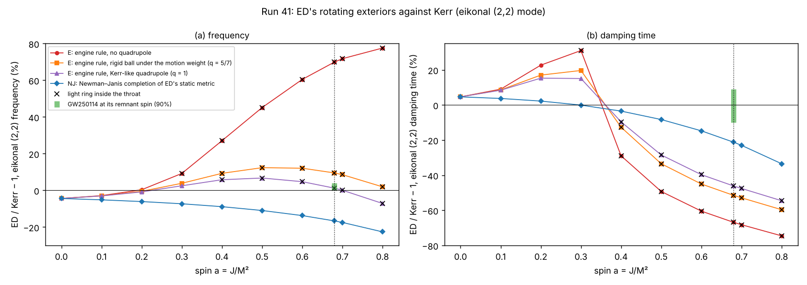

**Reading.**
1. **Under the adopted rules, in the scalar eikonal approximation, at the remnant spin LVK infers under GR, CO's spinning remnant does not ring like GW250114's.** Two independent signs:
   - **The engine's own exterior (E)** has no prograde light ring outside CO's throat from a ≈ 0.3–0.4. Its only prograde circular photon orbit lies beyond the throat, where it is far more unstable than Kerr's. Damping times are 0.33–0.54 of Kerr's, if that orbit sets the ringdown seen from outside at all, which is unclear.
   - **The standard completion (NJ)** keeps the light ring outside, but rings 17% low, and its damping time is 21% short.
   - **The quality factor f·τ does not depend on the mass.** For E it is 1.67–1.78 (eikonal Ωτ), below any Kerr value (minimum 2.00, at a = 0), so no choice of mass or spin can absorb it. NJ's is 2.069, 34% below Kerr's at a = 0.68 but equal to that of a nearly non-spinning Kerr (a ≈ 0.08). So NJ's failure assumes the spin LVK infers under GR. A joint shift in mass and spin could absorb NJ's (2,2) mode alone; its overtone or (4,4) mode would test that.
2. **What is not settled.**
   - These are eikonal modes of a scalar field, not CO's gravitational perturbations, which are not derived.
   - LVK infers the remnant's spin as well as its mass from the whole signal, assuming GR. A joint CO fit (inspiral, ISCO and ringdown together) has not been made.
   - The light ring's being outside the body is assumed. For E it lies inside the throat, which needs a body more compact than the throat.
3. **Run 28's flag becomes a tension the adopted rules cannot remove at this level of analysis.** The static exponential metric's strong field, completed either way, is what disagrees. Run 28 noted this is set by the pattern rule's exact nonlinear form ($c=N^2$ at all orders) and the clock map ($N=e^{-U}$), chosen for first-order agreement.
4. **What would remove it.** A strong-field input in the spirit of the others:
   - "outside matter, the field is GR's (Kerr's)", which keeps CO's possibility-limited core in place of a horizon (Paper_042: no singularity);
   - or a derivation that changes the pattern rule or the clock map beyond first order.
   - **This needs a ruling.** Bodies whose surface sits just outside the would-be horizon (horizonless compact objects) ring like Kerr at first, and differ through late echoes, which have their own bounds.

### Note A: two recorded choices (19 October)

*These two calls were made without a separate ruling. They are recorded as choices, tracked, and open to reversal.*

**1. Bodies keep their proper size (a tracked input, the strong equivalence principle for bodies).**
- A body's extent is set in proper units. In a well its coordinate size shrinks by $e^{-U_{\rm ext}}$, as a GR body's does in isotropic coordinates.
- **Why:** Run 36 showed that a body held on fixed places responds to outside wells with weight 1/(1 + U_self), not 1. That would be a large strong-field equivalence-principle violation for compact bodies. In an unbounded medium, a self-similar body that keeps its proper size responds with 1.008 (Run 40b) and 1.001 (Run 40c).
- **What it does not cover:**
  - the strong-field bookkeeping: at p_s = 1 a bound pattern's binding is still not counted once (Run 40b);
  - a body's internal stresses: patterns inside a body, and internal binding of atoms and nuclei at weak field, are not yet run.
- **What would replace it:** a CO rule that sets a body's extent from its own commitments, in proper units.

**2. The canonical mass reading is DSR-4: mass is a frequency of becoming, E = ħω.**
- **Why:**
  - It was ruled that a pattern's ħω draws.
  - Run 30 found active mass equals draw equals ticking.
  - Run 40c found that at weak field a bound pattern pulls by ħω, binding counted once to 5% of itself, when its momentum flux draws. Energy alone misses by two bindings.
- **What becomes of the other reading.** Mass Without Mass's "mass comes from binding" is read as how binding sets the frequency (binding lowers ω), not as a second, separate source of mass. Its simulator result (V5) stands as a statement about how binding shapes ω.
- **Open:** whether a superposed pattern draws by its average energy (semiclassical) or only on commitment (ontology §12). This decides gravity's response to quantum superpositions.

**Not decided: the strong field (Run 41).** Both rotating completions of the adopted metric fail GW250114's ringdown at the remnant's spin. The options are:
- a tracked input that the exterior field is GR's (Kerr's), keeping CO's possibility-limited core instead of a horizon;
- or a change to the pattern rule or clock map beyond first order.

This is left for a ruling.

**Rulings (19 October).**
- "1: A — take GR's black-hole exterior as a tracked input, keep ED's no-singularity core; B is the long-term goal."
- "2: Yes, run it" (Run 42).
- "3: Keep both" (bodies keep their proper size; DSR-4).

So the strong field is now settled by a tracked input:
- **Outside a compact object the field is GR's (Kerr's).**
- **Inside, where GR has a horizon and a singularity, CO has a core where possibility runs out:** no singularity, no infinity (Paper_042).
- **Long-term goal:** derive this exterior from CO's own rules, by changing the pattern rule or the clock map beyond first order.
- **What the input buys:** GW250114's ringdown and the black-hole shadows match by construction.
- **What it opens:** tests of the core itself (Run 43).

### Run 42: a pattern inside a body, at weak field

*19 October 2026. Pre-registered and hashed with its code before the run (`inside/PREREG_42.md`, 13:51 UTC). The registration discloses a trial of the unperturbed ground states, used to choose m. An independent agent checked the run; its corrections are included.*

**Question.** Run 40c showed that at weak field a pattern bound **outside** a body pulls by ħω, binding counted once. Atoms and nuclei are bound **inside**: they are patterns within the matter that binds them. That is what the Moon's aluminium and iron test (Bartlett & van Buren). Does the far field count ħω once when the pattern sits inside the body?

**Why it might not.**
- A pattern outside a ball pulls on the ball's matter evenly (the shell theorem), so the ball needs no extra internal support.
- A pattern inside pulls the ball's matter inward, and the ball must hold itself up with internal stress. In GR that stress pulls too, with weight 1 per direction (Tolman's ρ + 3p; PPN ζ₄).

With $\partial_jT^{ij}=f^i$ and a free surface, the virial theorem gives the stress's total:
$$
S=\int\sum_iT^{ii}\,dV=-\int\mathbf x\cdot\mathbf f\,dV=-\sum_x s_b(x)\,(\mathbf x-\mathbf c)\cdot\nabla U_p(x)\;>0 .
$$
Here $s_b$ is the ball's draw density and $U_p$ is the pattern's potential. S is positive because the pull is inward, so the stress is compressive, as in Tolman's ρ + 3p.

The engine's bodies have no stresses, so two arms were registered:
- **(a)** the adopted rules as they stand;
- **(b)** the ball's stress draws: S is added, spread like the ball's draw, and recomputed self-consistently.

**Setup.** Run 40c's unbounded, weak-field medium (p_s = 64, P₀ = 4096).
- **The ball:** self-similar and keeping its proper size; 54 pairs, radius 3, potential 0.072 at its centre, draw-weighted self-potential U_self = 0.055.
- **The pattern:** its ground state under the adopted rule (energy + flux), at test strength.

**Results** (ΔD_total/(κω), with the miss in units of the pattern's binding b).

| pattern | binding b | inside r < 3 | **(b) stress draws** | (a) no stress | stress term S/(κω) |
|---|---|---|---|---|---|
| **ground, m = 5 (registered)** | 4.9% | 84% | **0.99576 (−0.086 b): K42 passes** | 0.95901 (−0.83 b) | +0.0388 (0.79 b) |
| ground, m = 3 | 3.7% | 54% | 0.99685 (−0.084 b) | 0.97481 (−0.67 b) | +0.0233 |
| ground, m = 8 | 5.7% | 97% | 0.99516 (−0.085 b) | 0.94783 (−0.92 b) | +0.0499 |
| xy, m = 2 (outside: check) | 0.52% | 0% | 0.99977 (−0.043 b) | 0.99975 (−0.048 b, as Run 40c) | +0.00003 |

At m = 5, both with the stress drawing:
- **Held ball:** 0.99906 (−0.019 b).
- **Energy-only:** 0.97642 (−0.48 b).

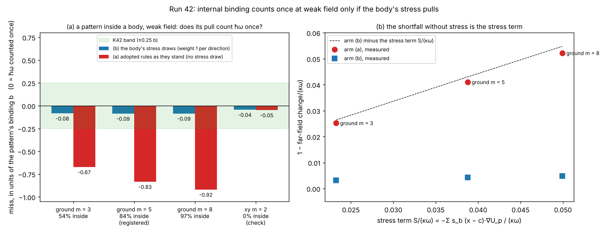

**Checks** (independent agent).
- **Resolution.** The ball is only 3 cells in radius, so S depends on how it is computed.
  - A 4th-order gradient gives S = 0.0413 κω (+0.05 b on arm b).
  - A rough spherical hydrostatic 3∫p gives 0.047 (+0.17 b).
  - K42 passes either way.
- **Spreading.** Spreading S as 3p(r) instead of like the draw gives −0.090 b (adjusting) and −0.023 b (held).
- **Balance.** The net force on the ball is about 10⁻¹⁶ against Σ|f| = 1.6×10⁻⁵, and S is unchanged when the origin moves by half a cell.
- **What arm (a) is missing.** Arm (a) misses by 0.833 b. The stress term alone is 0.788 b; the rest is the stress draw's feedback on the ball.

**The remaining −0.085 b shrinks with the body's own field (post hoc, independent agent; not registered).** The ball was rerun at ½ and ¼ strength, with U_self = 0.055, 0.028 and 0.014:

| ball strength | 1 | ½ | ¼ |
|---|---|---|---|
| adjusting, stress drawing | −0.086 b | −0.047 b | −0.019 b |
| held, stress drawing | −0.019 b | −0.010 b | +0.002 b |

So the miss is about −1.5 U_self·b: a term of order b·U_self, second order, not a first-order failure. That is why it is the same at m = 3, 5 and 8, whose bindings differ but whose ball does not.

The gap between held and adjusting also scales as U_self. The ball's draw changes with its size (dD₀/d ln R = 1.10 ≈ D₀U_self), which gives δD ≈ −0.067 b. Making the ball also draw stress for its own binding does not remove the gap (−0.093 b adjusting, −0.053 b held).

Likely sources are:
- cross terms of order U_self·U_p in the engine's nonlinear clock map;
- the uniform $e^{-\bar U_p}$ rescale applied to a U_p that varies 1.7× across the ball.

**In GR terms.**
- Nothing is counted twice. The adjusting ball carries its own binding's response (Run 40c), and S carries the stress from the mutual pull. Both appear in the Komar mass $\int\alpha(\rho+\sum T^{ii})\sqrt\gamma$.
- GR's first law makes the change in total mass the pattern's Killing energy, with the star's rearrangement entering only at second order. So in GR the held and adjusting balls agree, and the residual vanishes.
- The engine's ball is not an extremum (dD/d ln R ≠ 0), so neither arm is "the GR one". To first order they coincide, and both pass.

**Reading.**
1. **Internal binding counts once at weak field, but only if the body's internal stress pulls.**
   - With the stress drawing, all three masses land within 0.09 of a binding, with 54–97% of the pattern inside the ball. What remains is second order in the body's field.
   - Without it, they miss by 0.67–0.92 bindings, almost all of it the stress term.
   - The check case behaves as it should. With the pattern outside, the stress term is about zero, and both arms match Run 40c.
2. **"Stress pulls" (PPN ζ₄) is therefore needed, not optional.** Measured physics requires internal binding to pull like rest mass (aluminium against iron, to 4×10⁻¹²).
   - Under the adopted rules that happens only if a body's internal stresses draw, with weight 1 per direction, just as a pattern's momentum flux does.
   - **It is the same input in a fuller form:** the Lorentz input extended from moving matter's kinetic pressure to all of a body's stresses (the whole source transforms together).
   - **Adopted (19 October): "Yes — stress pulls, as part of the Lorentz input"** (Note B).
3. **Energy-only misses by about half a binding** even with the stress drawing. So the patterns' momentum flux is still needed, as in Run 40c.
4. **Not settled here:** S at higher resolution, and the U_self scaling as a registered test.

### Run 43: what option A implies for CO's core

*Note (21 October): under the provisional option 3 with CO's medium (Run 67), the core's surface is where GR's lapse would be p_s/P∞, and it lies at infinite tortoise distance, so it absorbs: a reflecting wall (the echo table's first row) does not arise in the static vacuum solution. The end state of a collapse is not computed. The rest stands for option A as an input.*

*19 October 2026. Option A was chosen: "take GR's black-hole exterior as a tracked input, keep ED's no-singularity core." The calculation and its reading were registered before the code was written (`core/PREREG_43.md`, 13:58 UTC). An independent agent checked the numbers and the literature; its corrections are included.*

**What the input settles.** Outside a compact object the field is Kerr's. So GW250114's ringdown and the M87* and Sgr A* shadows match GR by construction, and are no longer tests of CO.

**What it opens.** Where GR has a horizon, CO has a core where possibility runs out. Its surface sits at a small lapse (clock rate) $\alpha_s>0$. Three kinds of observation test such a surface.

**1. Echoes.** Waves bounce between the surface and the light ring, and come back again and again, spaced by a fixed delay. For GW250114's remnant (a = 0.68; detector-frame mass 62.7 × 1.09 M☉, so GM/c³ = 0.3366 ms), the delay is
$$
\Delta t=2\int_{r_s}^{r_{\rm LR}}\frac{r^2+a^2}{\Delta}\,dr\;\approx\;\Big[\frac{2}{\kappa}\ln\frac{1}{\alpha_s}-9.7\Big]M,\qquad \kappa=\frac{r_+-r_-}{2(r_+^2+a^2)}=0.2115/M .
$$
- The integrand is Kerr's tortoise coordinate, which does not depend on latitude. Only where the wall sits is set by the equatorial lapse. A wall set by the polar lapse adds 0.23 ms.

| where the surface sits | lapse α_s | r_s − r₊ (Boyer–Lindquist radius, in M) | echo delay |
|---|---|---|---|
| where CO's medium changes regime (P ≈ p_s), at the smallest allowed P₀/p_s = 2.3×10⁴ | ≤ 4.3×10⁻⁵ | 5×10⁻⁹ | **≥ 85 M = 29 ms** |
| | 10⁻¹⁰ | 3×10⁻²⁰ | 208 M = 70 ms |
| | 10⁻²⁰ | 3×10⁻⁴⁰ | 426 M = 143 ms |
| one Planck length from the horizon | 3×10⁻⁴¹ | 3×10⁻⁸¹ | 871 M = 293 ms |

How to read the table:
- **The first row is a natural scale, not a derived surface.** The engine's lapse is P/P₀, and its medium changes regime at P ~ p_s. Whether lapse = P/P₀ still holds at P ~ p_s is untested.
- **P₀/p_s ≥ 2.3×10⁴ is a lower bound, so 29 ms is the shortest delay.** It grows by 7.3 ms for every tenfold increase in P₀/p_s, and reaches 50 ms at P₀/p_s ≈ 2×10⁷.
- **"One Planck length" is a proper distance s.** Near the horizon the lapse grows as α ≈ κs, while the coordinate gap r − r₊ grows as s². That is why the third column is so much smaller.
  - This row matches the standard formula 4M(1 + 1/√(1 − a²)) ln(M/ℓ_P) = 292 ms (Abedi et al.).
  - Using the source-frame mass for ℓ_P/M changes it by 0.3 ms.

**What the echo search says.** The GWTC-3 echo search covered O1–O3 events, not GW250114 (arXiv:2302.12158).
- It looked from 50 to 350 ms after merger (and 0.2 to 1.2 s for longer delays), and found no echoes.
- Its limits are 0.11–0.75 of the ringdown's strength (in h_rss over 15 events). That is the echo amplitude only if echo and ringdown have the same shape.
- For a remnant like GW250114's with a 29 ms delay, the first echo falls in the search's 50 ms blind time, but later ones (57, 86, … 344 ms) fall inside its window.

**So echoes at CO's natural scale are within reach of searches of this kind, unless the core absorbs enough to keep them weak.**

**2. The ergoregion instability.** Spinning objects without a horizon and with a reflecting surface amplify waves and spin down. Absorbing part of what reaches the surface quenches this (Maggio et al., arXiv:1807.08840):
- at least 0.3% for spin ≲ 0.7, which covers GW250114's remnant (0.68);
- at least 6% for spin ≲ 0.9;
- about 60% only if near-extremal objects must be stable.

**3. Surface glow.** If Sgr A*'s accreted energy hit a surface and was re-emitted as heat, the EHT would see it (Carballo-Rubio et al., arXiv:2205.13555).
- For a surface far closer to the horizon than CO's, that bound needs absorption κ ≪ 10⁻¹⁴. Absorption of 10⁻⁵ weakens it by about nine orders of magnitude, and near-total absorption (1 − κ ≈ 10⁻²) removes it.
- For a core at CO's natural scale (surface compactness μ = 1 − 2M/R ≈ α_s² ≈ 2×10⁻⁹), their eq. 18 needs only κ ≳ (27/8)μ/10⁻² ≈ 6×10⁻⁷.

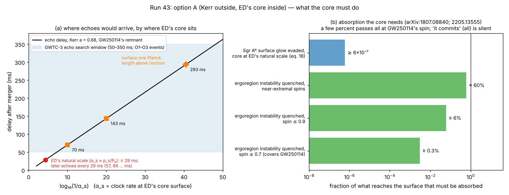

**Reading** (corrected by the check: the registration said "viable only if the core is a strong absorber", which overstates it).
1. **Option A is viable if CO's core absorbs a few percent of what reaches it.**
   - That quenches the instability at the spins seen.
   - The surface-glow bound at CO's natural scale needs far less.
   - Current echo searches do not demand more.

   A perfectly reflecting core would fail the instability test.
2. **Near-total absorption is enough but not required, and it would make option A observationally silent in all three channels.** Partial absorption leaves echoes, and their spacing is set by ln(P₀/p_s): at least 29 ms for a GW250114-like remnant. That would be CO's distinctive signal under option A.
3. **So CO needs a rule for what happens at the core.** It was ruled that it commits (19 October; Note B). The two options were:
   - **"A pattern or piece of matter that reaches the core commits."** It becomes record, so the core keeps it: a total absorber in CO's own terms. Infalling information goes into the record, not lost (CO's "no information loss"). It passes every bound, and leaves no echo.
   - **A partly reflecting core.** It needs a CO rule for the reflected fraction, and would predict echoes spaced by ≥ 29 ms (for this remnant) with a strength set by that fraction.
4. **Whether the core re-emits is constrained, not ruled out.** If it radiates, as CO's "black holes radiate" papers propose, the surface-glow bound limits how much of the infalling energy comes back out as thermal light.

### Note B: the rulings on Runs 42–43 (19 October)

*Ruled 19 October: stress pulls, as part of the Lorentz input; the core commits.*

**1. Stress pulls (a tracked input: the Lorentz input in its full form).**
- **The rule.** Every part of a source draws with GR's weights:
$$
\text{draw density}\;\propto\;\alpha\Big(T^{00}+\sum_iT^{ii}\Big).
$$
  The earlier inputs are special cases of it:
  - rest mass by its ticking (Run 30);
  - moving matter, $\rho(1+2v^2)$, to first order;
  - a pattern's energy and momentum flux (Run 36's adopted rule).

  What is new is a body's internal stress, with weight 1 per direction (Tolman's 3p; PPN ζ₄).
- **What it buys:** internal binding pulls like rest mass at weak field. A pattern inside a body counts ħω once, to within 0.09 of its binding (Run 42), as Bartlett & van Buren's aluminium–iron test requires.
- **What would replace it:** a CO rule from which a stressed body's extra draw follows. One example would be stress as commitments held against a pull.

**2. The core commits (a CO rule, chosen to fit the ontology and the bounds).**
- **The rule.** A pattern or piece of matter that reaches the core commits there. A commitment is not undone, so nothing is sent back out: the core is a total absorber. What falls in becomes record, so information is kept, not lost.
- **What it buys:** option A passes every bound on the core (Run 43).
  - Spinning remnants are stable.
  - Sgr A* shows no surface glow.
  - Mergers leave no echoes.
- **What it costs:** from outside, CO's compact objects are now GR's black holes. CO's differences are inside, where there is no singularity and what falls in is kept as record. They are also in whether committed record is ever re-emitted, which the earlier radiation papers propose and the Sgr A* glow bound limits.
- **What an echo would have been.** A merged remnant rings like a struck bell, and the ringing dies away as it falls into the hole. Had the core bounced part of it back, fainter repeats would have followed at a fixed spacing: at least 29 ms for a GW250114-like remnant at CO's natural scale. Under this ruling there are none.

### Run 44: Run 42 on a grid twice as fine, and whether its residual is second order

*19 October 2026. Registered and hashed with its code before the run (`fine/PREREG_44.md`, 14:31 UTC). A trial of the ball alone and the unperturbed ground state at both resolutions is disclosed there. An independent agent checked the run; its corrections and one post hoc scan are included.*

**Question.** The check of Run 42 raised two points:
- the stress term depended on the stencil (6%), because the ball is only 3 places in radius;
- post hoc, the remaining −0.086 b shrank with the ball's own field.

Does Run 42's pass survive a grid twice as fine? Is the residual second order, as a registered test?

**Setup.** As Run 42, with every length doubled in places:
- ball radius R₀ = 6 and edge width 1.4, with 216 occupants, so the potential U(r) is unchanged;
- pattern m = 2.5, so the binding is unchanged.

The trial reproduced the same body:

| | U_self | U(centre) | binding | inside r < R₀ |
|---|---|---|---|---|
| base | 0.0553 | 0.0720 | 4.92% | 84% |
| double | 0.0549 | 0.0715 | 4.85% | 86% |

The ball's strength s (occupants × s) was set to 1, ½ and ¼, at both resolutions. The stress term was taken with a 2nd-order or a 4th-order gradient.

**Results** (miss in units of the pattern's binding b; body keeping its proper size unless "held").

| | s = 1 | s = ½ | s = ¼ | linear fit in U_self: intercept, slope |
|---|---|---|---|---|
| U_self (double / base) | 0.0549 / 0.0553 | 0.0282 / 0.0284 | 0.0143 / 0.0144 | |
| **double, stress drawing** | **−0.073 (K44a passes)** | −0.042 | −0.022 | **−0.005 b, −1.25 (K44b passes)** |
| base, stress drawing (Run 42) | −0.086 | −0.047 | −0.019 | +0.002 b, −1.62 |
| double, held | −0.008 | −0.006 | −0.002 | −0.001 b, −0.14 |
| base, held | −0.019 | −0.010 | +0.002 | +0.007 b, −0.49 |
| double, no stress draw (arm a) | −0.832 | | | |
| stress drawn with the 4th-order S (double / base) | −0.060 / −0.038 | | | |

The linear fits are good to 0.002–0.004 b. With three points the intercept depends on the fit's form, though K44b passes under every form tried:

| fit | double: intercept | double: coefficient of U_self | base: intercept |
|---|---|---|---|
| linear (registered) | −0.005 b (formal 95% half-width ±0.04) | −1.25 | +0.002 b |
| through the origin | — | −1.37 | — |
| exact quadratic | +0.003 b | −1.8 (leading) | +0.017 b |

The held ball's quadratic intercepts are +0.006 b (double) and +0.020 b (base).

**A shape-preserving scan (post hoc, independent agent; not registered).** As the ball weakens, the pattern spreads out: the share inside R₀ goes 0.86 → 0.70 → 0.49. So lowering U_self also moves the pattern toward the outside case. The check reran the double-resolution, stress-drawing case with m = 2.5/√s, which keeps 86–88% inside. That scan is linear to 1×10⁻⁴: intercept −0.004 b, slope −1.26. It supports K44b and the coefficient −1.25.

**The stress term.** At s = 1 the 2nd- and 4th-order values are:
- base: S/(κω) = 0.0388 and 0.0413, a gap of 6.1%;
- double: 0.0388 and 0.0395, a gap of 1.7%.

**K44c passes.** Against the converged value, the 2nd-order gap went 6.96% → 1.74%, exactly the fourfold shrink a 2nd-order stencil's h² error predicts. The converged value comes from higher-order stencils: S/(κω) = 0.04168 at base, 0.03949 at double. The 6.1% → 1.7% quoted against S₄ looks smaller only because S₄ is itself 0.9% off at base.

The 2nd-order value staying at 0.0388 on both grids is a cancellation. The exact-gradient S fell 5.6% between grids, as the pattern's shape changed with the lattice.

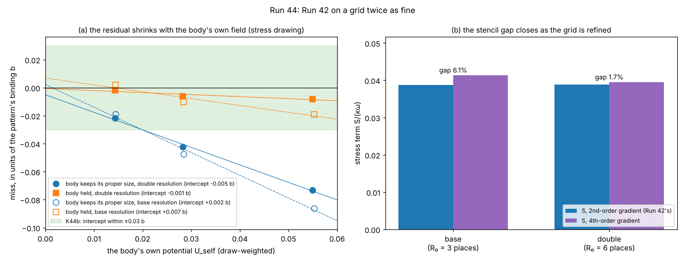

**Reading.**
1. **Run 42's pass survives the finer grid.** With the body's stress drawing, the far field counts a bound pattern's ħω once to within 0.04–0.09 of its binding on the grids and stencils run. Extrapolated to an infinitely fine grid it is about −0.07 b. At base resolution with an exact gradient it would be about −0.03 b (estimated, not run).

   Without the stress draw, the miss is the same on both grids (−0.83 b). So "stress pulls" is needed independently of resolution.
2. **What is left is second order, as registered.** On both grids and for both body models the miss goes to zero with the body's own field. The intercepts are within 0.007 b of zero for the linear fit, and within 0.006 b (double) or 0.02 b (base) for exact quadratics. Its size is
$$
\frac{\Delta D_{\rm total}}{\kappa\omega}-1\;\approx\;-1.25\,U_{\rm self}\,b\qquad(\text{body keeping its proper size, double resolution}).
$$
   - At this order it is a departure from GR, whose first law makes the residual vanish. It is of the same kind as Run 40b's strong-field miss (second order in the field), though the two configurations differ.
   - **Here b is binding in the body's own gravitational well.** Nuclear binding is not modelled.
     - Read literally, with b ~ U_self, the term is about U_self², about 10⁻²¹ for the Moon.
     - If the same form held for binding by other forces (untested), the aluminium–iron difference in binding fraction (about 5×10⁻⁴) would give about 1.25 × 4×10⁻¹¹ × 5×10⁻⁴ ≈ 2×10⁻¹⁴, below the bound of 4×10⁻¹².
     - Either way it is negligible for ordinary bodies.
3. **The held ball comes closer on the finer grid** (slope −0.14 against −0.49). The difference between the two body models is itself of order U_self·b. The check found the engine's ball is not an extremum (dD/d ln R ≠ 0), which is why the two body models differ at all.
4. **Neutron stars: a potential falsifier.** A neutron star's binding is gravitational, the kind this run models, and large: U_self ≈ 0.2, binding b ≈ 0.15.
   - Read across naively, the term is 1.25 × 0.2 × 0.15 ≈ 4×10⁻² of the star's mass.
   - Pulsar tests of the strong equivalence principle bound how a neutron star **falls** relative to white dwarfs: the triple system PSR J0337+1715 gives Δ = (+0.5 ± 1.8)×10⁻⁶ at 95% (Voisin et al. 2020).
   - This run measures how a pattern **pulls** (the far field), not how a body falls. The two agree in GR, but that is not shown for the engine.
   - The fit is extrapolated from U_self ≤ 0.055.
   - Option A's input covers black-hole exteriors, not neutron stars.
   - **If pull and fall agree in the engine and the term holds at U_self ≈ 0.2, it would exceed the bound by about 10⁴.** Not computed; the next registered test.

### Note C: The earlier black-hole radiation papers under option A and "the core commits" (a reading)

*19 October 2026. (step 2: look at re-emission in the papers). An agent read the papers, the Attempt B cards, the derivation attempts and the 12 September review. A second, independent agent checked the quotes and numbers; its corrections are included.*

**Question.** It was ruled that the core commits what reaches it, and a commitment is never undone. The earlier radiation papers (039, 047, 047_5, 050, 052) say black holes radiate. Do the two fit together, and does either give a signal that differs from GR?

**What the papers say.**

| paper | claim | how radiation or information leaves | formulas | what it assumes |
|---|---|---|---|---|
| 039 Horizon decoupling | the horizon is a decoupling surface, where cross-bandwidth Γ_cross → 0 | correlations at the surface turn thermal (KMS); "committed information cannot cross the substrate-level decoupling surface" (§3.4); entanglement set up before the horizon formed "straddles" it (§3.5) | $T_H=\hbar\kappa/2\pi k_B c$; $dM/dt\sim-\hbar c^4/G^2M^2$; Planck remnant $M_\star=M_P$; $n_{\rm CO}=n_{\rm Planck}[1-c_1(\omega/\omega_c)^2]$, $\omega_c=c/\ell_P$, c₁ = ½–1 | r_H and κ are GR's ("not derived independently", §3.2); no anti-evaporation (P11, V1) |
| 042 No singularity | a cumulative bound $C_{\rm cum}(r)\le C_{\max}\sim(r/\ell_P)^3$ | silent | — | the bound is posited (its derivation was attempted and failed); C_cum grows monotonically |
| 047 Hawking spectrum | Planck spectrum at T_H, with the (ω/ω_c)² correction | as 039 | $n=1/(e^{\hbar\omega/k_BT_H}-1)$ | κ inherited from GR (Kerr: from M, J) |
| 047_5 Universalization | T = ħκ/2πk_Bc for every horizon (Rindler, de Sitter, acoustic) | — | Unruh, Gibbons–Hawking, acoustic κ | the same formula applied to each case; the review notes the acoustic case "has no testable content" |
| 050 Page curve | entanglement rises, then falls after the Page time | two postulates (P-V5-EntBudget, P-Re-routing) re-route information into the radiation | $S\approx(dS/dt)_H\,t$, $(dS/dt)_H\sim c^3/GM$; t_Page ≈ 0.54 τ_BH (inherited) | the postulates |
| 052 Paradox synthesis | the paradox "is not generated" (a framing its own claim table says was softened, to "supplies a mechanism for unitarity-preserving evolution") | infall → straddles the surface → re-routed into radiation → residue in the Planck remnant | — | "No claim that this paper supplies novel empirical predictions beyond Papers 039/047/050" |
| 052_5 Merger lag | a delay between GR's merger time and the substrate's | not about radiation | $\tau=\tau_{V5}+\tau_{\rm mob}+\tau_{\rm cascade}$ | predicts existence only; τ_V5 open; as written $\tau_{\rm mob}\sim\int|\nabla\mu|^2/\mu^2\,dt/c^2$ has units s³/m⁴, not seconds |

**Status.**
- The review notes added to the papers on 12 September say:
  - 039: "The 'decoupling surface' is a relabeling. It is placed at the GR horizon (§3.2, as the paper says), and Γ_cross → 0 there is asserted, not computed."
  - 047: "κ and the horizon location are borrowed from GR, and the periodicity is the standard Euclidean one."
- `STATE_OF_THE_ONTOLOGY.md` says: "The accounts of horizons, Hawking radiation… are readings. None has been tested and none adds content."
- Nothing is withdrawn.

**Reading.**
1. **The papers fit "the core commits".** Their radiation comes from correlations at the surface, not from anything released by the interior, and 039 already says committed information cannot cross.
   - Under option A the exterior is Kerr, so the number they need is there: $\kappa=(r_+-r_-)/2(r_+^2+a^2)$, borrowed from GR, as the papers say.
   - **But a number in the metric is not emission.** Under option A the core sits where the horizon would be, and Run 43 placed its surface just outside r₊.
     - Steady emission at $T_H=\hbar\kappa/2\pi k_Bc$ needs a horizon, or a surface that puts quantum fields in a horizon's state.
     - A static surface without a horizon does not radiate. That was Run 32's zero-temperature point.
   - **Assumed, not derived: the committing core acts on quantum fields as a horizon would.** Without that assumption, CO's black holes do not radiate at all.
2. **The ruling meets the bound that ended Attempt 03's line, by input and rule. It does not reopen that line.**
   - Attempt 03 (C31–C34) found that a shallow, capped core releases 63% of what falls on it as heat. Even the kindest count, the 10% that escapes on first emission, is about 25 times what Sgr A* allows. Its verdict: "ED's strong-field line is closed under its exit rule (RD6, C33)".
   - Under option A plus "the core commits", nothing is re-emitted except Hawking radiation, if that is assumed. For Sgr A* (4.3×10⁶ M☉) that is at about 1.4×10⁻¹⁴ K, so the bound is met.
   - Option A replaces CO's own strong field rather than repairing it, so Attempt 03's verdict on that field stands.
3. **No CO-specific signal.** Hawking radiation from astrophysical black holes is far too faint to see. GW250114's remnant would sit at about 8×10⁻¹⁰ K, and a solar mass at 6.2×10⁻⁸ K. The paths to a difference all fail:
   - **The (ω/ω_c)² correction** scales as (M_P/M)², about 10⁻⁷⁶ for a solar mass, with c₁ unfixed.
   - **The Planck remnant** matters only for primordial black holes.
   - **The Page time** is inherited.
   - **The merger lag (052_5)** predicts only that a lag exists, and is not a signal of the core. It should not be cited as one until its τ_V5 and units are fixed.
4. **One question needs a ruling: do CO's black holes evaporate?** 039 has the black hole lose mass ($dM/dt<0$). 042 has the core's record only grow, and the ruling makes it permanent. Two readings are consistent with the ruling:
   - **(a) Yes, they evaporate.** This needs two assumptions:
     - the committing core acts on quantum fields as a horizon would (item 1);
     - the pull, which in the engine is the core's ticking (Run 30), can be lowered by emission at the surface while the record stays. Run 30 allows this but does not supply a mechanism, and the engine has none yet.
     
     This keeps 039 and 047. If 050's postulates are also adopted, they return the same information to the radiation that the record keeps. That counts it twice, unless the record is classical.
   - **(b) No, they never evaporate.** Nothing lowers the core's pull, and no new mechanism is needed. 039, 047 and 050 do not apply to black holes under option A.
   - **The two differ observably only for small primordial black holes.** Bounds on those from the gamma-ray background assume they evaporate.
   - **This needs a ruling.**

   **Ruled (19 October): black holes evaporate.** That is reading (a). Its two assumptions are now tracked: *(Superseded 21 October: Run 68 found that under option 3 with CO's medium the holes do not evaporate, and it was ruled that CO's holes are stable, reading (b).)*
   - the committing core acts on quantum fields as a horizon would;
   - its pull (its ticking) drops by emission at the surface, while its record stays.

   **The framing (19 October): "the precise way to say it is near-max commitment… max commitment is probably an unreachable limit."** A black hole is a core at near-maximum commitment, not a singularity.
   - This matches the engine: a body's draw throttles itself, so its clock slows but never stops (Run 32; Attempt B: "approaching but never reaching zero return").
   - It also matches Run 43, where the core's surface sits at a small, nonzero clock rate.
   - Strictly, then, there is no true horizon, only a surface very near where one would be. The two working assumptions apply to that surface: it absorbs everything (no echoes), and it radiates as a horizon would.

   **The endpoint is not ruled.** Paper 039's Planck-mass remnant ($M_\star=M_P\approx2.18\times10^{-8}$ kg) came from an earlier session. Full evaporation is favoured as simpler, without committing to it.
   - **The question both endpoints share** is whether the radiation carries out the information about what fell in. Paper 050 says it does, through correlations (the Page curve), by two postulates. That is open in mainstream physics too: the black-hole information problem.
   - **A Planck-mass remnant** must hold whatever the radiation does not carry out. If the radiation were purely thermal, that would be everything that ever fell in, an unbounded amount in a Planck mass: the known problem with remnants. If 050 holds, the remnant need hold only a residue (052).
   - **Full evaporation** has no leftover object to fill. "Kept as record" then means kept in the history (the commitments happened), which is what the record already is in CO.
   - **The record and the pull.** In the engine, what pulls is matter present now times its clock rate (Run 30), not the history of commitments. So the mass can be radiated away while the record of past commitments stands. This is how the engine already works, not a new problem.
5. **Also open:**
   - Information from matter that falls in after the horizon forms. 039's straddling covers only what was entangled before. Under "the core commits" that information is kept as record, not lost, but it reaches the radiation only through 050's postulates.
   - The units in 052_5.

### Run 45: a body at neutron-star strength — does its binding pull and fall like its energy?

*19 October 2026. Registered and hashed with its code before the run (`nstar/PREREG_45.md`, 16:12 UTC).*

*The first launch stopped on an array-shape bug before any result. The fix (`.ravel()`, as `body42.py` does) is disclosed and re-hashed in an amendment (16:16 UTC). Removing it reproduces the original hashes exactly.*

*A trial of the body alone, used to choose the strengths, is disclosed in the registration. `analyse45.py` was written before any result but not hashed. The diagnosis script `diag45.py` was written at 16:23 UTC, about 70 s after the first registered case printed, and ran alongside the rest; it is post hoc.*

*An independent agent checked the run; its corrections are included.*

**Question.** Run 44 left a second-order term in how a bound pattern pulls, about −1.25 U_self·b. Read across naively to a neutron star (U ≈ 0.2, binding ≈ 0.12–0.15), it is a few ×10⁻². The pulsar triple PSR J0337+1715 bounds how a neutron star *falls* relative to white dwarfs: Δ = (+0.5 ± 1.8)×10⁻⁶ at 95% (Voisin et al. 2020). Does the engine make a body's binding pull and fall like its energy at that strength?

**Part 1: first order (calculation).** CO's Nordtvedt parameter is η_N = (10/3)(β − 1). The record's theory for β − 1 gives about −0.45 p_s/P₀ at large p_s, so η_N ≈ −1.5 p_s/P₀ (−6.5×10⁻⁵ at P₀/p_s = 2.3×10⁴). A 1.44 M☉ neutron star's binding fraction is about 0.12, so
$$
|\Delta|\approx|\eta_N|\times0.12\approx0.18\,\frac{p_s}{P_0}\;\lesssim\;2\times10^{-6}\quad\Longrightarrow\quad \frac{P_0}{p_s}\gtrsim9\times10^{4}.
$$
- **The sign matters.** η_N < 0 gives Δ > 0, and the 95% upper limit (+2.3×10⁻⁶) then gives 7.8×10⁴. The other sign would give 1.4×10⁵.
- **Either way, about 10⁵**, roughly four times the current lower bound (2.3×10⁴, from ζ₂). The pulsar triple tightens the scale bound; it does not falsify the rules at first order.
- **Two approximations.** The linear Nordtvedt form is not exact at neutron-star compactness. And Part 1 assumes bound matter's energy falls by GR's weights, which Part 2 shows the coded patterns do not do.

**Part 2: setup.**
- **Medium:** Run 40c's unbounded mean-field medium, P₀ = 4096, at P₀/p_s = 64 and 256.
- **The body:** double resolution (R₀ = 6), keeping its proper size, at U_self ≈ 0.056, 0.11 and 0.22.
- **Stress pulls (the ruling).** The body's stress holds it against its own field and against the pattern's: $S=-\sum_x s_b(x)\,(\mathbf x-\mathbf c)\cdot\nabla U_{\rm bal}(x)$, drawn at weight 1 per direction. This is the first run with stress for the body's own binding.
- **The pattern:** Run 16's equation, as in Runs 36–44: $-\nabla^2\psi+m^2N^2\psi=\omega^2\psi$. This is a flat-space wave with its mass redshifted; the pattern keeps speed 1. The record calls it the "clock half". It is not the wave equation of a metric with only $g_{tt}$ changed, which would give half the defect found below. Its mass m = 2.5√(0.055/U) keeps its shape.
- **Fall** is the response of the body's energy at infinity (its total draw E: z is linear in the draw, so the far field sees exactly E) to a uniform outside potential, a shift of the background P → P₀e^{−U_ext}:
$$
\Delta=\frac{d\ln E}{d(-U_{\rm ext})}-1\qquad(\text{GR: }0),
$$
  at U_ext = 0.005 and 0.01, extrapolated to 0.
  - Passive mass = d(energy at infinity)/d(−U) is a stated assumption: the engine's bodies are held, not moved.
  - The uniform shift captures the redshift, and the coupling between background and self-field through the medium. It misses tidal terms and the support of a body held in a gradient.
  - Without stress, the body's fall at U = 0.056 is +1.10×10⁻³. Run 40c's distant point draw gave +1.24×10⁻³, which supports the proxy.

**Results.**

| | U_self | 0.056 | 0.110 | 0.218 |
|---|---|---|---|---|
| **body's own pull**, E/D_rest (GR, first order: 1 − U/2) | P₀/p_s = 64 | 0.97190 (0.97181) | 0.94547 (0.94526) | 0.89185 (0.89108) |
| | 256 | 0.97188 | 0.94504 | 0.89175 |
| | no stress (64) | 0.94653 | 0.90081 | 0.81832 |
| **body's own fall** Δ | 64 | +3.8×10⁻⁴ | +8.1×10⁻⁴ | +1.9×10⁻³ (base resolution: +3.9×10⁻³) |
| | 256 | +3.9×10⁻⁵ | +1.1×10⁻⁴ | +3.2×10⁻⁴ |
| | no stress (64) | +1.1×10⁻³ | +2.1×10⁻³ | +4.1×10⁻³ |
| **bound pattern's fall** Δ (clock half) | 64 | −0.040 (−0.81 b) | −0.080 (−0.86 b) | −0.170 (−1.00 b) (base: −0.166) |
| | 256 | −0.040 | −0.084 | −0.165 |
| **pattern's pull**, miss in b (stress: self + pattern) | 64 / 256 | −0.065 / −0.065 | −0.137 / −0.138 | −0.285 / −0.286 |
| pattern's pull, pattern's stress only (Runs 42–44) | 64 / 256 | −0.060 / −0.060 | −0.124 / −0.125 | −0.249 / −0.249 |

The pattern's binding b is 0.050, 0.093 and 0.171 at the three strengths. The composite's fall equals the body's to within 10⁻⁵, since the pattern is at test strength.

**Verdicts, as registered.**
- **K45a passes.** The fit of (E/D_rest − 1)/U_self against U_self has intercept −0.4991 in both media (registered: −0.5 ± 0.05; slopes +0.012 and +0.009). With its stress drawing, the body's own binding pulls once at first order.
  - This is analytic. The clock-rate draw gives −2|W|, and the virial stress gives +|W|, so E = M(1 − Ū/2).
  - So K45a checks that the stress rule is implemented as Tolman's term. It is not independent physics.
  - Without stress the body counts its binding twice (slope −0.97).
- **K45b: not falsified at about 10⁻³ resolution.**
  - Removing the medium's part as registered gives Δ_∞ = (4Δ₂₅₆ − Δ₆₄)/3 = −2.1×10⁻⁴ at U = 0.218. For any medium part ∝ (p_s/P₀)^k with k ≥ 1, Δ_∞ lies in [−2.1, +3.2]×10⁻⁴.
  - But the base-resolution case is 2.08 times the double-resolution one. That narrowly misses the registered factor-2 agreement, which matters only for the falsified branch.
  - The lattice error, about 0.7–2 ×10⁻³ by Richardson extrapolation, passes into Δ_∞ undiminished. So the honest statement is "not falsified at ~10⁻³", not "at 2×10⁻⁴".
  - The medium's part has the sign that −η_N U/2 predicts. It is 0.58–0.75 of that prediction at P₀/p_s = 64 and 0.23–0.50 at 256.
  - The 2×10⁻⁶ bound itself is beyond this engine.
- **K45c: falsified, as registered.** The bound pattern's fall defect is Δ_∞ = −0.163 at U = 0.218, and the base-resolution case agrees (−0.166). **The engine's massive patterns, as coded, fail PSR J0337+1715 by about 10⁵.**
  - Read across the same way, they would also fail lunar laser ranging by about 10⁴.
  - The registration expected the missing spatial half to matter only at second order. That expectation failed: it matters at first order.

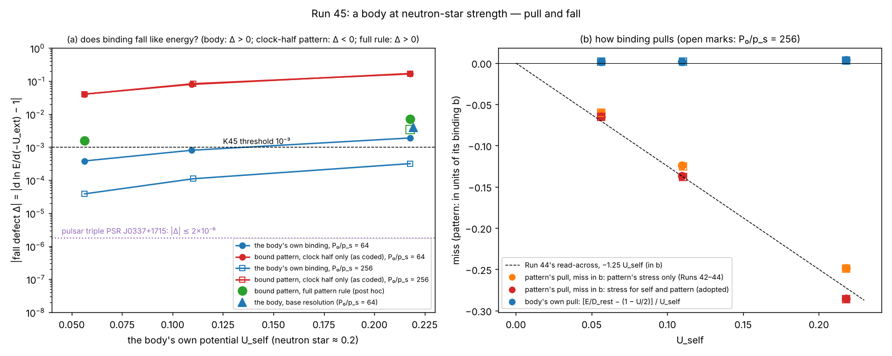

**Diagnosis (post hoc, `diag45.py`; not registered).**

**The defect law.** If the body's field rescales as $N(\mathbf x)\to\lambda N(\mathbf x/\lambda)$ with λ = e^{−U} (proper size), the coded equation gives $(\omega/\lambda)^2$ = eigenvalue of $(-\lambda^{-4}\nabla^2+m^2N^2)$. So
$$
\Delta_{\rm clock}=-\,\frac{2K}{\omega^2},\qquad K=\langle-\nabla^2\rangle .
$$
The defect is first order in the pattern's internal gradient energy, which for gravitational binding is first order in the binding. The check confirmed it numerically: −0.0408 against −0.0393 measured at U = 0.056, and −0.168 against −0.157 at U = 0.22 (base resolution).

**The full rule.** The adopted rule (17 October, c = N², which light obeys) puts a pattern in the metric $-N^2dt^2+N^{-2}d\mathbf x^2$. Its wave equation is then, exactly ($\sqrt{-g}=N^{-2}$, $\sqrt{-g}\,g^{ij}=\delta_{ij}$, $\sqrt{-g}\,g^{tt}=-N^{-4}$),
$$
-N^4\nabla^2\psi+m^2N^2\psi=\omega^2\psi\quad\Longleftrightarrow\quad(-\nabla^2+m^2N^{-2})\,\psi=\omega^2N^{-4}\psi .
$$
Under the same rescaling every term scales alike, so ω → ωe^{−U} exactly. That holds only in the continuum, and only if the medium's field map is exactly exponential; it departs from that at order p_s/P₀.

**The test.** A test pattern's frequency was computed in the same body fields under both equations (ω only; no full-rule draw rule is defined yet):

| | U_self | clock half: b, fall defect | full rule: b, fall defect |
|---|---|---|---|
| P₀/p_s = 64, double | 0.056 | 0.050, −3.9×10⁻² (−0.79 b) | 0.053, +1.6×10⁻³ (+0.030 b) |
| P₀/p_s = 64, double | 0.218 | 0.171, −0.160 (−0.94 b) | 0.201, +7.2×10⁻³ (+0.036 b) |
| P₀/p_s = 64, base (the check's rerun) | 0.219 | | +1.53×10⁻² |
| P₀/p_s = 256, double | 0.218 | 0.171, −0.162 (−0.95 b) | 0.201, +3.4×10⁻³ (+0.017 b) |

**The full rule removes most of the first-order defect: 22–47 times smaller, case by case.** What remains depends on both the medium and the grid:
- It roughly halves from P₀/p_s = 64 to 256.
- It doubles from double to base resolution. Richardson extrapolation gives +4.5×10⁻³ if the lattice error goes as h², or −1×10⁻³ if it goes as h.
- So most of it is lattice error.
- Removing the medium's part at double resolution leaves +2.2×10⁻³, above the registered 10⁻³. **As measured, the full rule would itself fall in K45c's falsifying region.** Only a registered, converged test (Run 46) can say whether it passes.

The independent check reproduced the diagnosis's ω values to 10 digits and its defects exactly, with a different form of the full-rule operator and a generic start.

**Reading.**
1. **The engine's massive patterns, as coded, fail.** With a redshifted mass only, bound energy falls with the wrong weight, Δ = −2K/ω², at first order. By the same scaling argument (not run), any binding (not only gravitational) would do the same. If real matter's bound constituents obeyed this equation, laboratory tests of the equivalence principle would fail by many orders of magnitude.
2. **The adopted rule is worded for all patterns, but its form for massive patterns was never written down.**
   - §4 item 9 flagged the spatial half for light and fast motion. Item 10 still lists whether matter's own commitments obey the pattern rule.
   - The wave equation in $-N^2dt^2+N^{-2}d\mathbf x^2$ used here is a reading of the rule, adopted post hoc.
   - It removes most of the defect, but has not been tested as registered, and its draw rule is not yet written.
3. **Runs 36–44 used the coded patterns.** Their first-order pull results stand under the full rule only if its covariant draw reduces to the adopted rule R-b at first order. That is to be shown and registered in Run 46. Their second-order residuals (Run 44's −1.25 U_self·b) may change.
4. **The body's own binding passes what the engine resolves.**
   - It pulls once to first order (K45a, by construction of the stress rule).
   - Its fall defect is ≤ 2×10⁻³ at double resolution (3.9×10⁻³ at base), and shrinks toward the physical medium and with the grid.
   - With stress pulling it is 2.2–2.9 times smaller than without at P₀/p_s = 64, and 4.8–11.5 times smaller at 256.
5. **The pattern's pull at neutron-star strength.** At U = 0.218 the read-across is −0.27 b, and the two arms bracket it (−0.25 b, −0.29 b). These are clock-half patterns, to be redone under the full rule.
6. **Run 46 should register:**
   - the full rule's covariant draw, with its weak-field expansion shown before running;
   - the exact generalized eigenproblem, with the coded equation kept as a control (predicted Δ = −2K/ω²);
   - fall (by draw and by ω) and pull at U = 0.056, 0.11 and 0.22;
   - three media (P₀/p_s = 64, 256, 1024), two resolutions in each, and a third at U = 0.22;
   - a registered separation of lattice and medium parts, and in advance what counts as a pass;
   - the weak-field pull of Runs 40c, 42 and 44 rechecked;
   - every script hashed.

### Run 46: the full pattern rule for massive patterns

*19 October 2026. Registered and hashed with all its scripts, including the analysis, before the run (`fullrule/PREREG_46.md`, 17:29 UTC). Trials of the strengths in the third medium, of the body at triple resolution, and a code check on uniform fields are disclosed there. Run on two cores as two fixed case lists. The post hoc fits (`posthoc46.py`) were written after all results. An independent agent checked the run, found the source of the draw-based scatter, and its corrections are included.*

**Question.** Run 45's K45c failed. The engine's massive patterns, coded as flat-space waves with a redshifted mass, let bound energy fall with the wrong weight, Δ = −2K/ω². Does the pattern rule adopted on 17 October fix that, when read for massive patterns as the wave equation in the metric it gives light?

**The rule, as registered.**

The equation, exactly:
$$
(-\nabla^2+m^2N^{-2})\,\psi=\omega^2N^{-4}\psi\quad\Longleftrightarrow\quad-N^4\nabla^2\psi+m^2N^2\psi=\omega^2\psi,
$$
with one quantum normalized by $2\omega\sum N^{-4}\psi^2=1$.

The draw is the covariant (Tolman/Komar) form of "every part of a source draws by α(T⁰⁰ + ΣTⁱⁱ)", namely $N(\rho+\sum p)\sqrt\gamma$:
- for a matter count at rest it is count × N, the engine's existing rule;
- for the pattern it is
$$
d_x=\kappa\,(4\omega^2N^{-4}-2m^2N^{-2})\,\psi_x^2,\qquad\sum_x d_x=\kappa\Big(\omega+2\sum|\nabla\psi|^2\Big),
$$
  which is exact on the lattice: an algebraic identity, checked to 10⁻¹⁵ in every case. That verifies the eigen-solve and the summation, not the Komar physics itself.

The weak-field expansion was stated before running: at first order the total draw is R-b's, so binding should count once.

**Setup.** Run 45's body, stress rule and uniform outside potential, with these differences:
- three media, P₀/p_s = 64, 256 and 1024;
- strengths U_self ≈ 0.056, 0.11 and 0.22;
- base and double resolution in every medium, plus triple (h = ⅓) at U ≈ 0.22;
- Run 40c's outside (xy) case added;
- Run 45's coded equation kept as a control.

**Verdicts, as registered.**
- **K46a passes. Weak-field pull, binding counted once.** The misses, against ±0.25 b, are:
  - Run 40c's analogue (xy, base): +0.010 b (Run 40c: −0.05 b);
  - Run 42's (ground state, base): −0.015 b (Run 42: −0.086 b);
  - Run 44's (ground state, double): −0.038 b (Run 44: −0.073 b without stress for the body's own binding; −0.065 b with it under the coded equation, Run 45).

  All are closer to zero than under the coded equation.
- **K46b is undecided: a bound pattern's fall, by draw, at U ≈ 0.22.** The registered fit Δ = Δ_∞ + A·(p_s/P₀) + C·h^q gives Δ_∞ = +3.7×10⁻⁴ (q = 1) and +3.7×10⁻³ (q = 2). Its scatter is rms 4.4×10⁻³, as large as the numbers themselves, so the registered form does not describe the draw-based defect. It reaches +0.080 b (P₀/p_s = 256, base) at this strength and +0.13 b at U ≈ 0.056, against about −1 b in Run 45. It is neither passed nor falsified. The scatter is noise from the code's lookup table (below).
- **K46c is undecided: the body's own fall.** The fit gives Δ_∞ = −1.5×10⁻³ (q = 1) and −0.6×10⁻³ (q = 2).
- **K46d passes. The control.** The coded equation's ω-defect lands at 0.96–0.99 of the predicted −2K/ω² in every double-resolution case. That confirms Run 45's diagnosis.

**Results at U ≈ 0.22.**

| P₀/p_s | grid | pattern's fall by draw | pattern's fall by ω | body's own fall | pull miss |
|---|---|---|---|---|---|
| 64 | base / double / triple | +13.2 / +5.1 / −3.2 ×10⁻³ | +15.3 / +7.2 / +5.9 ×10⁻³ | +3.9 / +1.9 / +1.9 ×10⁻³ | −0.177 / −0.195 / −0.199 b |
| 256 | base / double / triple | +16.3 / +9.6 / +7.3 ×10⁻³ | +11.5 / +3.4 / +2.2 ×10⁻³ | +2.4 / +0.32 / +0.36 ×10⁻³ | −0.178 / −0.196 / −0.200 b |
| 1024 | base / double / triple | +2.9 / +6.0 / +3.1 ×10⁻³ | +10.4 / +2.4 / +1.1 ×10⁻³ | +1.9 / −0.13 / −0.09 ×10⁻³ | −0.178 / −0.196 / −0.201 b |
| Run 45, coded equation, 64 double | | −0.170 | −0.160 | +1.9×10⁻³ | −0.285 b |

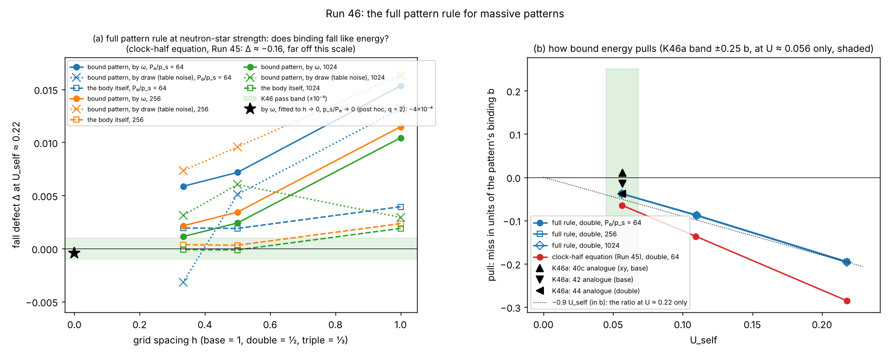

**Post hoc (not registered; `posthoc46.py`).**
- **The pattern's fall by ω converges cleanly, though its limit depends on the fit's exponent.** With q = 2 the same fit describes all nine points to rms 9×10⁻⁵ and gives Δ_∞ = −4.4×10⁻⁴. With q = 1 it is five times worse (rms 4.8×10⁻⁴) and gives −4.5×10⁻³. The successive differences fall by 6.3 in every medium (h²: 5.4; h: 3.0). With q free the best fit is q = 2.25:

| q | 1.5 | 2 | 2.25 (best) | 2.5 | 3 |
|---|---|---|---|---|---|
| Δ_∞ | −1.7×10⁻³ | −4.4×10⁻⁴ | −0.4×10⁻⁴ | +2.7×10⁻⁴ | +6.8×10⁻⁴ |

  **So |Δ_∞| ≲ 7×10⁻⁴ for q between 2 and 3, with q = 1 disfavoured by its fit. Read by its frequency, a bound pattern's binding falls like its energy under the full rule, to the engine's resolution.** Applied to these numbers, the registered both-fits rule would still say undecided.
- **The body's own fall has converged in the grid.** Double and triple agree in every medium. A fit in the medium alone over those six points (rms 3×10⁻⁵) gives Δ_∞ = −2.2×10⁻⁴.
- **The draw-based fall's scatter is noise from the medium's lookup table (found by the check).**
  - The medium's response R(z) is a piecewise-linear table of 4096 nodes, about 7×10⁻⁴ apart in ln P.
  - The pattern's part of the energy, E_composite − E_body, is only about 5×10⁻⁵ of the total. Its response to the outside potential therefore picks up the jumps in the table's slope as the shift moves z across nodes.
  - The check reran P₀/p_s = 256, double, U ≈ 0.22 at four ε:

| ε | 0.0025 | 0.005 | 0.0075 | 0.01 |
|---|---|---|---|---|
| R_pat − 1, the engine's table | 1.77×10⁻² | 5.38×10⁻³ | 2.06×10⁻³ | 1.19×10⁻³ |
| R_pat − 1, a table 16× finer | 1.06×10⁻³ | 1.12×10⁻³ | 0.95×10⁻³ | 0.88×10⁻³ |

  - With the engine's table the extrapolated defect depends on which ε are used: +9.6×10⁻³ from (0.005, 0.01), +3.0×10⁻² from (0.0025, 0.005). With the finer table it is +1.0 to +1.4×10⁻³, near the ω-based value for that grid (+3.4×10⁻³).
  - The pull hardly moves (E_pat changes by 2×10⁻⁵, relatively), and the body's fall jitters by only about 1.5×10⁻⁵. Pull levels in Runs 40c–46 are safe; responses taken as finite differences of small parts may not be.
- **The pull at neutron-star strength has converged at −0.20 b, the same in every medium** (coded equation: −0.29 b). A second-order miss remains under the full rule.
  - In units of U_self, miss/U = −0.67, −0.79 and −0.90 at U = 0.056, 0.11 and 0.22, roughly −0.62 − 1.3U.
  - Run 44's read-across (−1.25 U_self·b) predicted −0.14 b and −0.27 b; the full rule gives −0.087 b and −0.20 b.
  - **Here b = 1 − ω/m ≈ U_self**, the pattern's redshift-like binding in the body's well, not a binding fraction. At U_self ≈ 0.22 the body's own binding is 10.8% (self-pull 0.892), close to a neutron star's 12%. At that compactness the pattern pulls 0.20 × 0.20 = **4.0% less than its energy** (pull ratio 0.960).
  - In GR the Komar mass equals the total (ADM) mass, so any nonzero miss is a split between active mass (how a body pulls) and passive mass (how it falls, which this run's fall measures).
  - Whether a 4% active/passive split for bound patterns conflicts with binary-pulsar tests is not computed.

**Reading.**
1. **The full pattern rule removes Run 45's first-order failure.** The control reproduces the coded equation's −2K/ω² defect. The full rule's ω-based defect extrapolates to −4×10⁻⁴ (post hoc). The weak-field pull still counts binding once (K46a). **The written form, the wave equation in −N²dt² + N⁻²dx² with the Tolman/Komar draw, is recommended as the engine's rule for massive patterns. It needs a ruling, since the form is a reading of the 17 October rule.**
2. **The registered fall test is undecided, not passed.** The draw-based measure's scatter is lookup-table noise. A finer table gives about +1×10⁻³ in the one case rerun, and the ω-based measure gives |Δ_∞| ≲ 7×10⁻⁴ (post hoc). The engine's verdict at neutron-star strength is "no first-order failure; second-order fall consistent with zero at about 10⁻³, pending a registered rerun with a finer table". The pulsar triple's 2×10⁻⁶ remains far beyond it.
3. **The strong-field pull miss remains:** −0.20 b at U ≈ 0.22 (4% of the pattern's energy), converged in grid and medium. It is the same kind of second-order bookkeeping departure as Runs 40b and 44. Under option A it matters only inside compact objects and in neutron stars, where its consequence (active against passive mass) is not yet worked out.
4. **Runs 36–44's first-order pull results are consistent under the full rule for the three analogues tested** (K46a, at U ≈ 0.056 inside a ±0.25 b band), as the weak-field expansion predicted. Their second-order numbers change: like for like, the Run 44 analogue moves from −0.065 b (coded equation, with stress for the body's own binding) to −0.038 b.
5. **Next, Run 46b:** K46b's nine points rerun with a medium table of at least 65,536 nodes (or a smooth R(z)), four ε values and a linear fit, plus one case at 262,144 nodes to confirm the table has converged. Also audit the earlier finite-difference responses taken through the same table (Runs 40c, 45).

### Run 46b: the fall test with a finer medium table

*20 October 2026. Registered and hashed with its scripts and dependencies before the run (`fullrule/PREREG_46b.md`, 21:09 UTC on 19 October). Code checks (building the finer tables) are disclosed there. The registration said no case had been computed before. In fact the checker's pre-registration test had computed one of the nine cases, P₀/p_s = 256 double at 65,536 nodes, and its numbers match the registered case to 10⁻⁹. The post hoc fits (`posthoc46b.py`) were written after all results. An independent agent checked the run; its corrections are included.*

**Question.** Run 46's registered fall test was undecided because the draw-based measure scattered. The check traced the scatter to the medium's piecewise-linear table R(z) (4096 nodes). With a finer table, does the full pattern rule make a bound pattern's binding fall like its energy at neutron-star strength?

**What changed.**
- The medium's table has 65,536 nodes (16× finer), and one case uses 262,144 nodes as a convergence check.
- There are four outside-potential steps, U_ext = 0.0025 to 0.01, fitted linearly in ε. That replaces Run 46's two steps and Richardson extrapolation.
- Everything else is Run 46's.

**Results at U ≈ 0.22** (fall defects).

- **The ω-based and body responses** are linear in ε to 10⁻⁷–10⁻⁸.
- **The draw-based responses** still carry table noise of 0.5–2.6×10⁻⁴ per ε. The four-step linear fit amplifies that noise: its intercept has about 2.4 times the spread of a mean with a known slope.

| P₀/p_s | grid | pattern's fall by draw | by ω | body's own fall | pull miss |
|---|---|---|---|---|---|
| 64 | base / double / triple | +15.1 / +5.5 / +5.8 ×10⁻³ | +15.3 / +7.2 / +5.9 ×10⁻³ | +3.9 / +1.9 / +1.9 ×10⁻³ | −0.177 / −0.195 / −0.199 b |
| 256 | base / double / triple | +9.8 / +1.19 / +0.79 ×10⁻³ | +11.5 / +3.4 / +2.1 ×10⁻³ | +2.4 / +0.32 / +0.36 ×10⁻³ | −0.178 / −0.196 / −0.200 b |
| 1024 | base / double / triple | +8.5 / −0.79 / −0.47 ×10⁻³ | +10.5 / +2.4 / +1.2 ×10⁻³ | +1.9 / −0.10 / −0.06 ×10⁻³ | −0.178 / −0.196 / −0.201 b |
| 256, 262,144-node table | double | +0.90×10⁻³ | +3.4×10⁻³ | +0.32×10⁻³ | −0.196 b |

**Verdicts, as registered.**
- **Table convergence fails.** The 262,144-node case's draw-based fall is +0.90×10⁻³, against +1.19×10⁻³ at 65,536 nodes. The difference, 2.9×10⁻⁴, is over the registered 2×10⁻⁴.
- **K46b′: undecided (table not converged).**
  - The fits would have said undecided anyway, but only just. They gave Δ_∞ = −6.9×10⁻³ (q = 1, past the 3×10⁻³ falsification line, rms 1.1×10⁻³) and −2.85×10⁻³ (q = 2, rms 7×10⁻⁴). **The q = 2 fit came within 0.15×10⁻³ of the falsification line, with the same sign.**
  - The registered form does not describe the draw-based numbers well.
  - The convergence failure itself comes mostly from the linear fit's amplified noise. The ε-averages of the two tables differ by only 0.9×10⁻⁴. The checker's pre-registration test had already shown 2.4×10⁻⁴ of scatter across ε at 65,536 nodes, so the 2×10⁻⁴ criterion was nearly certain to fail. The verdict stands as registered.
- **K46c′: undecided,** as in Run 46: −1.5×10⁻³ (q = 1) and −0.6×10⁻³ (q = 2).
- **The ω-based fall** gives Δ_∞ = −4.3×10⁻⁴ (q = 2, rms 8×10⁻⁵) and −4.5×10⁻³ (q = 1), both reported, as in Run 46.

**The audits.**
- **Run 45's K45c stands.** Through the 65,536-node table the coded equation's fall defect is −0.1698 (Run 45: −0.170), and the body's +1.90×10⁻³ (Run 45: +1.90×10⁻³).
- **Run 40c's response stands.** It is 1.0012390 through the 4096-node table and 1.0012388 through the 65,536-node one.
- The table noise mattered only for small-part responses such as the draw-based pattern fall. Pull levels and body responses are unaffected.

**Post hoc (not registered).**
- **By ω, the fall converges cleanly in the grid.** Its three grids follow one power law in every medium. The ratio of successive steps is 6.25, which means an error falling as h^2.24.
  - Removing that grid error medium by medium, then fitting the medium, gives about −0.2×10⁻⁴.
  - The registered nine-point form with q = 2.2 gives −1.0×10⁻⁴ (rms 3.7×10⁻⁵).
  - **By ω, a bound pattern's binding falls like its energy to about 0 ± a few ×10⁻⁴.**
  - On the finest grid alone, the medium-extrapolated value is +0.9×10⁻³. About that much is grid error still left at h = ⅓.
- **By draw, on the finest grid,** the medium-only extrapolation gives −0.9×10⁻³ (P₀/p_s = 64, 256, 1024: +5.8, +0.79, −0.47 ×10⁻³). Its error is wider:
  - each intercept carries ±2–4×10⁻⁴ of table noise;
  - averaging R over ε instead of fitting gives −0.7×10⁻³;
  - its double→triple steps are noise, so its grid convergence is unknown;
  - at triple it differs from the ω-based value by 1.3–1.6×10⁻³, the present systematic error.
  - **Draw-based: −0.9 ± 0.4×10⁻³; |Δ| ≲ 1.5×10⁻³.**
- **The body's own fall,** extrapolated the same way, is −0.2×10⁻³.

**Reading.**
1. **Not falsified as registered, but not comfortably.** The registered q = 2 fit came within 0.15×10⁻³ of the falsification line. Post hoc, the ω-based fall goes to about zero once its grid error is removed, and the draw-based fall is −0.9 ± 0.4×10⁻³. The two estimators still differ by about 10⁻³.
2. **A cleaner registered decision is within reach, so this line should not close yet.** With the 262,144-node table the per-ε noise falls about 50-fold for about 10% more run time.
   - **Run 46c:** the nine points at 262,144 nodes (about 70 minutes on two cores), a fit fixed in advance (double and triple only, or q fixed at ω's observed 2.24), a pooled ε slope, and a convergence check at two points. This run motivated it, which would be disclosed.
   - Close the line on that result, whatever it is.
   - The pulsar triple's bound (2×10⁻⁶) stays about 500 times beyond the engine either way.
3. **The audits leave Runs 40c and 45 as they were.**
4. **The pull miss at neutron-star strength is firm in sign and size: −0.20 to −0.21 b, about 4% of a bound pattern's energy at that compactness.** It is −0.195 at double and −0.200 at triple, and extrapolates to about −0.205. It is the clearest remaining departure from GR at strong field, and **the more dangerous line.**
   - If a 4% active-mass deficit for gravitationally bound matter meant a neutron star and a white dwarf pulled differently from how they fall, binary-pulsar limits on that difference (self-acceleration) would test it hard.
   - That should be registered next, ahead of or alongside Run 46c.

### Run 47: can pulsar timing see a neutron star that pulls 4% less than its energy?

*20 October 2026. Registered and hashed with its code before it was run (`apmass/PREREG_47.md`, 23:20 UTC on 19 October). A keyword name in the code was fixed before hashing; nothing was run before. An independent agent checked the run. Its corrections are included: K47a holds by construction; K47b's signal is mostly absorbed by a timing fit; the inertial mass is an assumption; the ζ₂ reading; the first-law statement; the double pulsar.*

**Question.** At neutron-star compactness (U_self ≈ 0.22), a bound pattern's draw, its **active** mass, is 4% short of its energy at infinity κω (Runs 46–46c).
- Its fall, by ω, is consistent with zero. So its **passive** mass, taken as the Killing energy's response to a potential, is κω.
- The engine has no inertia. **This run assumes its inertial mass is also κω**, so m_P = m_I. The alternatives are in Reading 4.
- Under that assumption, does a 4% active deficit clash with binary-pulsar limits?

**The engine's numbers.**
$$
m_A=(1-\delta)\,m_P,\qquad m_P=m_I\ (\text{assumed}),\qquad \delta\approx0.04\times(\text{share of the star's energy in such patterns}).
$$
- The δ is second order in the body's own potential: the miss is about 0.6–0.9 U·b, with b ≈ U.
- **The ζ₂ bound.** Pulsars bound the self-acceleration of eccentric binaries to |ζ₂| < 1.3×10⁻⁵ (Miao et al. 2020, ApJ 898, 69; arXiv:2006.09652).
  - That test needs an active mass that *varies with the companion's potential* differently from the passive mass.
  - A fixed ratio m_A/m_P per body, as here, gives only a periodic wobble (below).
- **In the engine, that variation is the gap between the draw-based and ω-based falls, Δ_draw − Δ_ω.**
  - It is −1.4 to −2.9×10⁻³ at finite grid (Run 46c) and not converged, about 100 times the bound.
  - **So the engine leaves that test unresolved; it does not pass it.** The dilation argument (Run 46c) predicts zero in the continuum.
- **At weak field**, ζ₂ = 2(β − 1) ≈ −0.9 p_s/P₀ (Run 30). The newer bound then needs P₀/p_s ≳ 7×10⁴, which is inside the triple's ≳ 10⁵ (Run 45).

**The claim (analytic).** With m_P = m_I for every body, each body's acceleration in a Newtonian N-body system is
$$
\ddot{\mathbf x}_i=\sum_{j\ne i}G\,m_{A,j}\,\frac{\mathbf x_j-\mathbf x_i}{|\mathbf x_j-\mathbf x_i|^3},
$$
because the passive and inertial masses cancel. That is exactly an ordinary Newtonian system with masses m_A,j.
- The active-weighted centre is unaccelerated: Σ m_A,i ẍ_i = 0 by antisymmetry, whether or not the bodies' deficits differ.
- So there is no secular self-acceleration at any eccentricity.
- Every orbit is the ordinary one. Only the inertia-weighted centre wobbles, periodically.

**The check (registered).** An 8th-order integrator (DOP853, tolerance 10⁻¹³) ran each system twice:
- **A:** the pulsar with m_A = 0.96 m and m_P = m_I = m;
- **B:** an ordinary system with the pulsar's mass set to 0.96 m.

Both start from the same initial conditions, set by Kepler with the active masses.

| system | A against B, pulsar position | other measure | verdict |
|---|---|---|---|
| two-body, e = 0.6, 20 orbits | 1.2×10⁻¹² of a | active-weighted centre drift 2×10⁻¹⁵ of a per orbit; inertia-weighted centre wobbles by 7.8×10⁻³ of a, periodically | **K47a passes, by construction** |
| triple shaped like PSR J0337+1715 (1.438 + 0.198 M☉ at 1.63 d; 0.410 M☉ at 327 d), 3 outer orbits | 8.9×10⁻¹¹ of the inner orbit | — | **K47a passes, by construction** |
| the same triple with a real equivalence-principle violation, m_P = (1 + 10⁻⁶) m_I (C) | 7.0×10⁻⁴ of the inner orbit in raw positions. Most of that is a change of orbital periods, which a timing fit absorbs. Refitting an ordinary triple (masses and initial conditions, linearised; noise floor 1.6×10⁻¹²) leaves 7.5×10⁻⁹ of the inner orbit, or 3.6×10⁻⁹ along one line of sight (about 60–120 ns) | — | **K47b passes** (registered: > 10⁻⁹), by a margin of 4–7 after refitting |

**K47a is a tautology.**
- With m_P = m_I, A and B are the same equations; their accelerations agree to 1.5×10⁻¹⁶.
- The differences in the table are rounding error that grows over the run.
- So the integrations confirm the algebra; they do not test anything beyond it.

**Reading.**
1. **If passive and inertial mass are equal, binary-pulsar timing cannot see the engine's 4% active-mass deficit at Newtonian orbital order.** That holds in two-body and three-body systems, at any eccentricity.
   - A neutron star's measured mass is then its active mass.
   - In the engine that mass is up to about 4% below the sum of its constituents' energies at infinity.
2. **What pulsars do test is m_P against m_I:** the triple's Δ = (+0.5 ± 1.8)×10⁻⁶. That is the fall test of Runs 45–46c. The engine resolves it only to about 10⁻³; the dilation argument (Run 46c) would carry it further.
3. **Where the deficit could still be seen:**
   - **Post-Newtonian orbital terms and radiation (the deciding open question).** The double pulsar J0737−3039A/B agrees with GR in its post-Keplerian parameters to about 10⁻⁴ (Kramer et al. 2021, Phys. Rev. X 11, 041050; arXiv:2112.06795). Suppose CO's post-Newtonian two-body law put inertial mass in one term and active mass in another. A 4% mismatch would then be about 100 times too large. The engine has no such law yet.
   - **The star's mass against its constituents.** For J0737−3039B, electron-capture supernova models give a baryonic mass of 1.358–1.375 M☉, against a gravitational mass of 1.2489 M☉ (Podsiadlowski et al. 2005, astro-ph/0506566; Newton & Li 2009, arXiv:0908.1731). That puts the binding energy at 0.11–0.126 M☉, a window of about 0.017 M☉. A 4% deficit on most of the star's mass is about 0.05 M☉.
     - The comparison depends on the formation model and the equation of state.
     - It is **a possible tension, not computed**.
     - SN 1987A's neutrinos, NICER and GW170817 are not independent tests here: their inferences depend on the equation of state.
4. **Which energy is inertial decides what the 4% means.** The engine fixes the active mass (the draw) and the fall, but not the inertia.
   - **Inertia = κω (this run's assumption):** the deficit is invisible at Newtonian order. Post-Newtonian order is open (item 3). *Adopted: inertia = total energy (20 October, §3).*
   - **Inertia = the far field, m_A**, as the boosted-field input (Run 34) suggests *(corrected after Run 55's check: the boosted far field carries active momentum, not inertia)*: the draw-based fall then fixes the passive mass. If that fall is zero (the dilation argument, in the continuum), all three masses are equal. The 4% is then only a first-law anomaly: how a star's mass relates to its constituents (item 3, second bullet).
   - **Mixed** (passive by draw, inertial κω): a 4% equivalence-principle violation, excluded by about 10⁴.
5. **As theory, it is a departure from GR, perhaps partly from the body model.**
   - In GR, adding a quantum whose energy at infinity is ħω to a static star raises its total mass by ħω to first order, when the star re-equilibrates at fixed baryon number and entropy (Hartle–Sharp; Sorkin–Wald–Zhang).
   - The quantum's own Tolman integral is not ħω in GR either: `body46.py` gives κ(ω + 2Σ|∇ψ|²), and the star's stress response makes up the rest.
   - The engine holds the body at fixed proper size by rule, not by re-equilibrating. So part of the 4% may come from that body model rather than from CO.

*Later (Run 49, post hoc): sized by exact hydrostatics, the stress turns the 4% deficit into a +0.6% excess, so the deficit analysed here may not exist. Run 50 is to settle it.*

### Run 46c: the fall test, settled at the engine's resolution

*20 October 2026. Registered and hashed before the run, with its scripts and main dependencies (`fullrule/PREREG_46c.md`, 23:22 UTC on 19 October; the run started seconds later). Two imported helper modules, `pattern36.py` and `free40c.py`, were not hashed; both predate the registration. Run 46b and its check motivated the choices, as disclosed in the registration: the 262,144-node table, the pooled ε slope, both fit forms, and q = 2.24, which came from Run 46b's ω-based fall. One of the nine cases (P₀/p_s = 256 double) had already been run with this table in Run 46b. The post hoc analysis (`posthoc46c.py`) was written after all results. An independent agent checked the run; its corrections are included, and the dilation argument below is its.*

**Question.** Does a bound pattern's binding fall like its energy at neutron-star strength (U ≈ 0.22) under the full pattern rule? This time the medium's table has converged, and the fit is fixed in advance. The registration also fixed a **closing rule**: whatever the verdict, the fall line closes at the engine's resolution.

**Setup.** Run 46b's nine points (P₀/p_s = 64, 256, 1024; base, double, triple), with these changes:
- a 262,144-node medium table;
- R(ε) = −ln(E(ε)/E(0))/ε at ε = 0.0025–0.01;
- one ε slope k for all cases (the median of the nine per-case slopes), and each case's defect Δ = mean_ε(R − kε) − 1.

Fits, both of the form Δ = Δ_∞ + A·(p_s/P₀) + C·h^q:
- **primary:** all nine points, q = 2.24;
- **secondary:** double and triple only, q = 2.

**Results** (fall defects ×10⁻³ at U ≈ 0.22).

| P₀/p_s | grid | pattern's fall by draw | by ω | body's own fall | pull miss |
|---|---|---|---|---|---|
| 64 | base / double / triple | +14.69 / +5.77 / +5.97 | +15.41 / +7.18 / +5.87 | +4.02 / +1.90 / +1.94 | −0.177 / −0.195 / −0.199 b |
| 256 | base / double / triple | +9.76 / +0.90 / +1.11 | +11.55 / +3.43 / +2.13 | +2.42 / +0.32 / +0.36 | −0.178 / −0.196 / −0.200 b |
| 1024 | base / double / triple | +8.40 / −0.38 / −0.18 | +10.52 / +2.43 / +1.14 | +1.99 / −0.10 / −0.06 | −0.178 / −0.196 / −0.201 b |

**The table has converged.** At the two check points, the 1,048,576-node table moves the draw-based fall by 0.4×10⁻⁵ and 1.2×10⁻⁵, well inside the registered 10⁻⁴. With the converged table, the per-ε scatter is below 10⁻⁵. Run 46b's was 0.5–2.6×10⁻⁴.
- The registration gave K46c″ "the same rules", but the code applies the convergence condition only to K46b″.
- For the body the two tables differ by 10⁻⁹, so this changes nothing.

**Verdicts, as registered.**

| test | primary (9 points, q = 2.24) | secondary (double + triple, q = 2) | verdict |
|---|---|---|---|
| **K46b″** a bound pattern's fall, by draw | Δ_∞ = −2.12×10⁻³ (rms 6.1×10⁻⁴) | −0.40×10⁻³ (rms 2.3×10⁻⁵) | **UNDECIDED** |
| **K46c″** the body's own fall | −0.56×10⁻³ (rms 1.4×10⁻⁴) | −0.15×10⁻³ (rms 8×10⁻⁶) | **PASS** |
| the pattern's fall by ω (reported) | −0.06×10⁻³ (rms 3.5×10⁻⁵) | −0.20×10⁻³ (rms 2.0×10⁻⁵) | within the pass band |

- **K46b″** is undecided because the primary fit lands at −2.1×10⁻³. That is past the 10⁻³ pass line and short of the 3×10⁻³ falsification line.
- **Under the registered closing rule, the fall line is now closed at the engine's resolution.** It has had three registered tests (K46b, K46b′, K46b″). None was falsified, and the last two fits were on the near side of the line.

**Why the primary fit misses (post hoc).** The two measures change with the grid in different ways.

- **By ω**, every refinement lowers the defect: base→double by −8.1 to −8.2×10⁻³, then double→triple by −1.3×10⁻³, in all three media. That is the single power law, h^2.24, that the primary form assumes, and it fits with rms 3.5×10⁻⁵.
- **By draw**, base→double drops by −8.8 to −8.9×10⁻³. But double→triple *rises* by +0.20×10⁻³, the same in all three media within ±4×10⁻⁶. The body's own fall does the same, more weakly (+0.04×10⁻³).
- So the draw-based grid error is not one power law. Its last step is small and of the opposite sign. With converged tables this rise is a real feature of the grid, not noise. The primary form, borrowed from ω, cannot follow it. Its rms (6.1×10⁻⁴) is about 27 times the secondary's.

**Post hoc numbers** (medium-only extrapolation to p_s/P₀ → 0 at each grid).

| grid | by draw | by ω | body's own |
|---|---|---|---|
| base | +8.0×10⁻³ | +10.2×10⁻³ | +1.9×10⁻³ |
| double | −0.76×10⁻³ | +2.1×10⁻³ | −0.23×10⁻³ |
| triple | **−0.56×10⁻³** | +0.85×10⁻³ | −0.19×10⁻³ |

- **On the finest grid, the draw-based fall is −0.56×10⁻³.** The ω-based fall is +0.85×10⁻³ there and still falling with the grid.
- The two estimators differ by 1.4×10⁻³ at triple. The difference is not monotone in the grid (−2.2, −2.9, −1.4 ×10⁻³ at base, double, triple), so it has not converged.
- **Three grids cannot pin down a two-term grid error, so the draw-based limit as h → 0 is not determined, nor is its sign.**
  - The registered fits are only two choices of form.
  - Other two-term forms fit the three values above exactly (×10⁻³):

| grid form | by draw | by ω | body's own |
|---|---|---|---|
| h² + h⁴ | +0.01 | −0.14 | −0.06 |
| h^2.24 + h⁴ | −0.08 | −0.02 | −0.08 |
| h² + h³ | +0.42 | −0.09 | +0.04 |
| h^1.5 + h² | +2.4 | +0.14 | +0.51 |
| h + h² | +4.5 | +0.38 | +1.0 |

  - With a leading h² error, as the engine's second-order stencils suggest, the draw-based limit lies between −2.1 and +0.4×10⁻³, and h² + h⁴ gives zero.
  - **By ω the limit is robust:** −0.14 to +0.38×10⁻³ in every form.
- **The engine's statement at its resolution:**
  - a bound pattern falls like its energy at neutron-star strength to a few ×10⁻⁴ by its frequency;
  - by its far field, to within about 2×10⁻³, if the leading grid error is h²;
  - the body's own binding passes as registered, to within about 6×10⁻⁴.

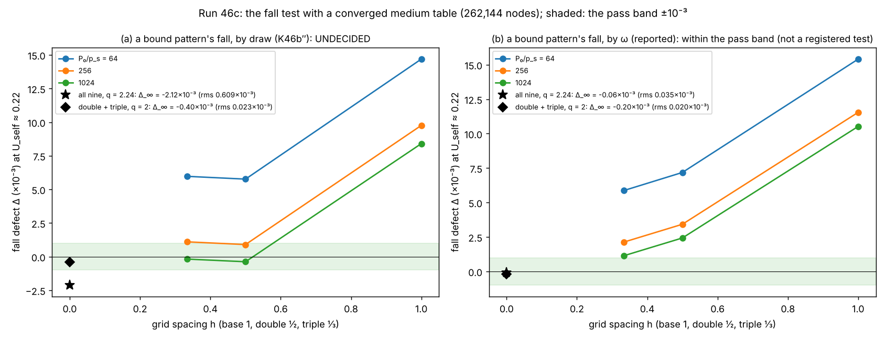

**The pull.**
- The pull miss is −0.199 to −0.201 b on the finest grid in every medium. That is −0.204 b extrapolated in the grid (q = 2), about 4% of a bound pattern's energy at this compactness.
- Run 47 shows that Newtonian-order timing cannot see this, if passive and inertial mass are equal. That is an assumption: the engine has no inertia (Run 47).

**The dilation argument (from the independent check; not registered).** Take λ = e^{−U_ext}, a scale-free medium (P ≫ p_s) and the continuum. Then the outside potential changes nothing but scale.

- **The medium.** Where P ≫ p_s, the table gives P ≈ p_s e^{z/c}. So the potential is linear in the sources:
$$
\ln P=\ln P_{\rm bg}-\tfrac{6}{c}\,(G*s).
$$
- **The body.** P(x) = λP₀(x/λ) solves the case with the outside potential.
  - The proper-size rule gives R = λR₀.
  - The occupant count is fixed, so the draw density becomes λ⁻²·s₀(x/λ). With a 1/r kernel, the convolution is unchanged.
  - The stress scales as S → λS.
- **The full pattern rule.** N → λN and ∇² → λ⁻²∇² multiply the operator by λ²:
$$
-N^4\nabla^2\psi+m^2N^2\psi=\omega^2\psi\;\Rightarrow\;\omega=\lambda\,\omega_0\ \text{exactly}.
$$
  - ψ = φ(x/λ) keeps the normalisation 2ωΣN⁻⁴ψ² = 1.
  - The draw's total scales as λ.
- **So E_body, E_pat and κω all scale as λ at every ε.**
  - Δ_draw = Δ_ω = Δ_body = 0, and the ε slope is zero.
  - E_pat/κω, the 4% pull, does not depend on U_ext.
- **What breaks the scaling in the engine:**
  - the medium's scale p_s, which gives the A·p_s/P₀ term;
  - the lattice, which gives the C·h^q term;
  - table interpolation, about 10⁻⁵.
- **The coded equation breaks it at first order.** Its operator −∇² + m²N² does not scale, which is Run 45's −2K/ω².
- **The data agree.** The h² + h⁴ form gives zero for all three measures, and the medium term A barely depends on the grid.
- **Caveats:**
  - whether the self-consistent solution is unique;
  - the uniform shift stands in for an outside body, so tides are left out;
  - the body model itself.

**Reading.**
1. **The fall line is closed at the engine's resolution, as registered. It is not falsified.**
   - At neutron-star strength, the full pattern rule makes a bound pattern fall like its energy to a few ×10⁻⁴ by frequency. By far field it is within about 2×10⁻³, with a leading h² grid error.
   - The coded equation it replaced missed by 0.16 (K45c).
2. **The pulsar triple (2×10⁻⁶) is far beyond this engine's grid. But the grid may not be the real obstacle.**
   - If the dilation argument holds, the full rule's fall is exact in the continuum with a scale-free medium. The triple then bounds only the medium's scale:
$$
|A|\,\frac{p_s}{P_0}\lesssim4\times10^{-6},\qquad A\approx0.42\ (\text{draw}),\ 0.33\ (\omega),\ 0.14\ (\text{body}).
$$
   - That needs P₀/p_s ≳ 10⁵, times the share of the star's energy in such patterns. It is the same scale the first-order Nordtvedt bound already requires (Run 45).
   - Writing the argument up as a registered analytic claim, checked independently, is the way to reach the pulsar level.
3. **The remaining spread in the draw-based limit is a property of the grid, not of the medium.** The medium term A is the same in both fits (0.421, 0.418), the grid steps match across media, and the table has converged.
4. **The body's own binding passes as registered (K46c″).** This is the first PASS under a registered pass/falsify rule for a strong-field fall.
   - K45b met the same 10⁻³ threshold but had only a falsification branch.
   - K46c and K46c′ were undecided.
   - A pass here means |Δ| ≲ 10⁻³, about 500 times above the triple's bound.

### Run 48: the dilation argument, made exact

*20 October 2026. Registered and hashed with every imported module before the run (`dilation/PREREG_48.md`, `PREREG_48_49.sha256`). Disclosures:*
- *The time stamp inside the hash file (06:16 UTC) is self-reported. The file was rewritten at 06:17 to move a note out, with the hashes unchanged. Every hashed file is older than the outputs.*
- *Runs 48 and 49 were first started as untracked processes, stopped within about 20 s with no output, and restarted as tracked jobs (`RESTART_NOTE.md`).*
- *One code check (h = 0.9, not a registered point) ran before registering.*
- *The argument came from Run 46c's independent check.*
- *The post hoc analyses (`posthoc48.py`) were written after the results.*
- *An independent agent checked the run; its corrections are included.*

**Question.** Run 46c closed the fall line at the engine's resolution, about 10⁻³. Its check suggested that a uniform outside potential only rescales everything. If that is exact, the fall defect is a grid effect plus a medium effect, and the pulsar triple tests only the medium.

**The claim (registered).**

**(i) Exact discrete dilation.** Take an exactly scale-free medium, R(z) = p_s e^{z/c}, and let λ = e^{−ε}. Then the engine at grid spacing h in an outside potential ε is the same lattice computation as the engine at spacing h e^{ε} with none: same draws, same radius in lattice units, P → λP, m → λm, ω → λ²ω, ψ² → λ²ψ², with amplitude κ′ = λ²κ. Hence
$$
E_{\rm body}(\varepsilon;h)=E_{\rm body}(0;he^{\varepsilon}),\qquad
\omega(\varepsilon;h)=e^{-2\varepsilon}\,\omega(0;he^{\varepsilon}),
$$
$$
E_{\rm pat}(\varepsilon;h;\kappa)=E_{\rm pat}(0;he^{\varepsilon};e^{-2\varepsilon}\kappa).
$$

**(ii) The fall defect is a grid derivative.** With e(h) the physical energy at U_ext = 0,
$$
\Delta=-\frac{d\ln e(h)}{d\ln h}.
$$
The ε slope is ½ dΔ/d ln h.

**(iii) Continuum.** Δ → 0 wherever e(h) converges. The check adds a condition: the limit must be h → 0 with the box growing (Lh → ∞). The engine's box is fixed at 80 cells, and its periodic pattern box shrinks in physical units as h → 0.

**(iv) The real medium.** The registration wrote Δ = Δ_lattice + A·p_s/P₀. That variable is wrong; see K48b.

**Results** (fall defects ×10⁻³ at U ≈ 0.22, scale-free medium).

| h | pattern by far field | by frequency | body's own | Run 46c targets (far field / frequency / body) | pull miss |
|---|---|---|---|---|---|
| 1 | +8.237 | +10.332 | +1.876 | +8.015 / +10.159 / +1.803 | −0.179 b |
| ½ | −0.531 | +2.314 | −0.151 | −0.747 / +2.144 / −0.223 | −0.196 b |
| ⅓ | −0.339 | +1.032 | −0.107 | −0.538 / +0.863 / −0.180 | −0.201 b |
| ¼ | −0.210 | +0.581 | −0.069 | — | −0.202 b |
| ⅕ | −0.140 | +0.371 | −0.047 | — | −0.203 b |

**Verdicts, as registered.**
- **K48a passes.** Case 1 (h = ½, ε = 0.01) and case 2 (h e^{0.01}, no potential, e^{−0.02}κ) agree:

| quantity | relative difference |
|---|---|
| E_body | 1.1×10⁻¹⁶ |
| ω | 4.4×10⁻¹⁶ |
| E_pat | 3.1×10⁻¹² |
| U_self | 1.1×10⁻¹⁶ |
| R | 0 |

  - The check confirmed (i) line by line in the code: the shift, the draws, the proper-size rule against its unshifted reference, the stress, and the pattern's mass and amplitude.
  - Nothing trivial makes the two cases coincide: they differ in h, R₀, count, m, κ, U_ext and starting guess.
  - The test shows the code has no hidden scale. It cannot catch an error common to both cases.
- **K48b: undecided** (worst point 2.45 tolerances).
  - Every point sits above its target by an offset that does not change with the grid: +2.0 to +2.2 (far field), +1.7 (frequency) and +0.7 (body) ×10⁻⁴.
- **K48c (reported):**
  - All three defects shrink from h = ⅓ to ⅕, as expected.
  - The frequency prediction missed by +28% and +35%. It was built on q = 2.244, an exponent taken from the offset targets. The miss splits exactly into the offset (×1.196) and the exponent (×1.07 and ×1.13).

**Post hoc (not registered; corrected by the check).**
1. **Why K48b missed: the targets were extrapolated in the wrong variable.**
   - Run 46c's media all had P₀ = 4096 and differed in p_s. Each departs from scale-free by g = c d ln R/dz − 1, with g·P₀ = 62.4, 13.7, 1.03 = p_s − (1.6, 2.3, 3.0).
   - g·P also rises as P falls inside the body, by an amount nearly independent of p_s.
   - To first order the outside shift breaks the dilation through the *change* of g across the body:
$$
\Delta=\Delta_{\rm lattice}(h)+A'\,\Delta g,\qquad \Delta g\equiv g(P_{\rm inside})-g(P_0).
$$
   - Extrapolating Run 46c in Δg, for any P_inside between 0.6P₀ and 0.9P₀, shrinks eight of the nine offsets to ≤ 1.5×10⁻⁵. The far field at h = ⅓ is −2 to −3×10⁻⁵, a quarter of its tolerance.
   - Extrapolating in g(P₀) alone overcorrects, with offsets proportional to A.
   - The U_self mismatch (+1.4×10⁻⁴) is not the explanation; its effect on Δ is about 10⁻⁶.
   - **With the right variable, the medium's departure from scale-free accounts for the leftover.**
2. **In the scale-free medium the frequency-based fall goes as h² exactly:** Δ_ω/h² = 9.26, 9.29, 9.30, 9.28 ×10⁻³ from ½ to ⅕. Run 46c's exponent of 2.24 came from the medium offset.
3. **Continuum limits.**
   - Fitting c₀ + ah² + bh⁴ to the four finest grids gives c₀ = +1.6, −1.1 and −1.5 ×10⁻⁶ (far field, frequency, body), with residuals ≤ 4×10⁻⁷.
   - Other forms spread the far field's limit by about 5×10⁻⁵, and the others' by about 10⁻⁵.
   - The far-field and body defects are not yet in the h² regime: Δ/h² is still drifting.
   - **Consistent with zero, about 100 times tighter than Run 46c, but not at the pulsar level.**
   - The pull miss goes to −0.2046 ± 0.0001 b.

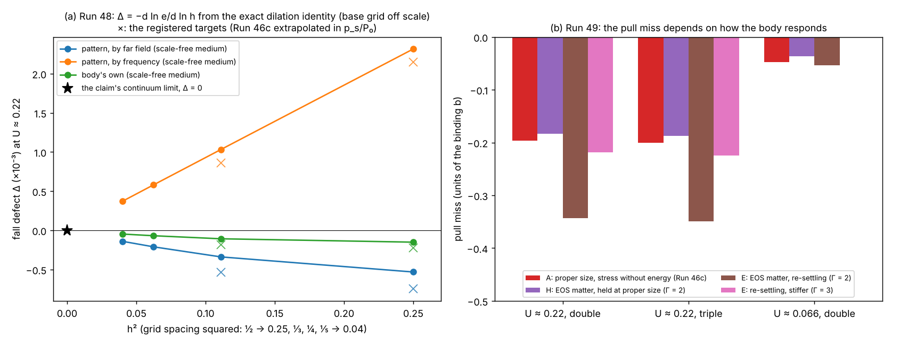

**Reading.**
1. **The dilation identity is exact in the engine (K48a).** So in a scale-free medium a body's fall defect, and a bound pattern's, is the grid derivative of its energy. It vanishes in the continuum, with the box growing. Numerically it is zero to 10⁻⁵–5×10⁻⁵.
   - In plain terms: at neutron-star strength the full pattern rule makes bound matter fall exactly like its energy. What was left in Runs 45–46c is the grid and the medium, not the rule.
   - For body A this is partly built in: the proper-size rule is what makes the body's size follow the potential.
2. **The registered medium attribution is undecided.** The post hoc analysis supports it with the right variable: the leftover is the medium's change of log-slope across the body, not p_s/P₀.
3. **The pulsar triple now tests CO's medium, not the engine.**
   - Published 95% bounds: |Δ| < 2.6×10⁻⁶ (Archibald et al. 2018) and |Δ| < 1.5–2.3×10⁻⁶ (Voisin et al. 2024).
   - Per unit Δg at 0.8P₀, A′ = 1.63, 1.26 and 0.53 (far field, frequency, body).
   - So the triple needs |Δg| ≲ 1.4×10⁻⁶ ÷ (the share of the star's energy in bound patterns) and |Δg| ≲ 4×10⁻⁶ from the body's own binding, whose share is 1.
   - In the engine's toy medium, Δg includes a part that does not depend on p_s. So this constrains CO only if that toy is CO's medium and nothing else breaks the dilation.
   - The coefficients were measured only at U ≈ 0.22, and the triple compares a neutron star with a white dwarf, not one body with nothing.
   - **CO's prediction is an equivalence-principle violation whose size is set by how far its medium departs from scale-free across a star's depth.**
4. **The fall line is no longer limited by the engine's resolution.** It is now a question about CO's medium.

### Run 49: is the 4% pull miss CO's, or the engine's body model?

*20 October 2026. Registered and hashed with every imported module before the run (`dilation/PREREG_49.md`; same hash file and restart note as Run 48). One code check (base grid, weak field, not a registered case) ran before registering. The post hoc runs were made after the results and after the independent check: the checker's `check4849/` and `posthoc49.py`. An independent agent checked the run; its corrections are included and change the reading.*

**Question.** At neutron-star strength a bound pattern's pull falls 4% short of κω: the miss is −0.20 b (Runs 46–46c). In GR, adding a quantum of Killing energy ħω to a static star raises its mass by ħω to first order. That holds for any equation of state, because an equilibrium star is a stationary point of its mass at fixed baryon number and entropy (Hartle–Sharp).

The engine's body is different in two ways:
- its stress has no energy of its own;
- its size is fixed by a rule.

Is the 4% the body model?

**The three bodies (registered).** All use the scale-free medium of Run 48, the full pattern rule and the Tolman/Komar draw.
- **A, the control** (Run 46c's body):
  - stress that holds it, with no energy of its own, set by the virial with weight sb (the rest draw);
  - proper size.
- **H, matter held at proper size:**
  - internal energy and pressure from ε = K n^{Γ−1} (n = νN³), p = (Γ−1)nε;
  - stress = what holds it, with weight sb(1 + Γε);
  - proper size.
- **E, the same matter re-settling** at fixed count and entropy:
  - stress = its own pressure, σ = 3(Γ−1) sb ε (Tolman's 3pN√γ);
  - radius from the balance Σσ = S_need(R), for a self-similar (homologous) ball.
- The isolated H and E bodies coincide at R₀ by calibration, with U_self matched to A's.

**Results** (miss in units of b).

| body | U ≈ 0.22, double | U ≈ 0.22, triple | U ≈ 0.066, double | radius change from the pattern (double) |
|---|---|---|---|---|
| A | −0.196 | −0.201 | −0.047 | — |
| H (Γ = 2) | −0.183 | −0.188 | −0.037 | −1.4×10⁻⁵ |
| E (Γ = 2) | **−0.343** | **−0.349** | −0.054 | −1.2×10⁻⁴ |
| E (Γ = 3) | −0.218 | −0.224 | — | −5.6×10⁻⁵ |

**Verdicts, as registered.**
- **K49a passes:** −0.1964 and −0.2008, against −0.1962 and −0.2007.
  - It is not an independent control: it runs the same code as Run 48's h = ½ point (−0.19638).
- **K49b: neither registered outcome.**
  - The analysis script prints "PARTLY", the otherwise branch, but the miss *grew*: re-settling took it from −0.196 to −0.343 b (double) and from −0.201 to −0.349 b (triple).
  - The "share removed" is −75%.

**What the check found: the equilibrium rule sets the answer.**
- A static fluid obeys ∂ᵢp = −(ρ + p) ∂ᵢ ln N. Take its moment with the Tolman measure N√γ = N⁻², the same measure the stress draw uses:
$$
3\sum p\,N\sqrt{\gamma}=-\sum(\rho+3p)\,N\sqrt{\gamma}\;\mathbf x\cdot\nabla U .
$$
- **So the weight in the virial should be the matter's whole draw, (ρ + 3p)N√γ.** For E and H matter that is w = sb[1 + (3Γ − 2)ε]. For body A it is sb + st, the rest draw plus the stress draw.
- Run 49 used sb(1 + Γε). Runs 42–46c used sb for body A.
- The difference is a post-Newtonian term, the same order as the 4%. It shrinks with the field, so the first-order results (the intercepts of Runs 42–46) stand. Run 44's second-order slope, ≈ −1.25 U·b, came from the same weight.
- The re-settling term equals the slope of the engine's energy at the virial point times the radius change. At h = ½ that is dẼ/d ln R = 0.178 times −1.09×10⁻⁴, which gives −0.160 b, against −0.160 b measured.
- At Newtonian order the engine *is* stationary: E − H is then second order in the pattern's amplitude, for any weight.
- So these numbers do not show that the engine lacks GR's stationarity. They show that its stress and equilibrium rules were fixed, at post-Newtonian order, in a way that matters here.

**Post hoc, with the stress weight of exact hydrostatics** (miss in units of b).

| body | U ≈ 0.22, double | U ≈ 0.22, triple | U ≈ 0.066, double | source |
|---|---|---|---|---|
| A (weight sb + st) | **+0.038** | **+0.031** | +0.012 | `posthoc49.py` |
| E (Γ = 2, weight 1 + 4ε) | **+0.029** | — | +0.017 | the check |
| H (Γ = 2, weight 1 + 4ε) | −0.116 | — | −0.017 | the check |

- With the hydrostatic weight, both self-consistent bodies show a small *excess*, not a deficit, of about +0.03 b (about 0.6% of κω):
  - A, stress-supported and held;
  - E, matter that re-settles.
- The 4% deficit is gone.
- H mixes an EOS internal energy with a stress that is not its pressure, and it lands at −0.12 b.
- These remain homologous balls, not hydrostatic profiles. Different exact moments disagree at O(U) for a non-hydrostatic profile, so about ±0.1 b is a systematic error of the body model.

**Reading.**
1. **The 4% deficit is not CO's; it came mostly from the stress rule.**
   - Runs 42–46c sized the stress by the virial with the rest draw as weight. Exact hydrostatics weights by the whole draw, stress included.
   - With that weight the held body's miss goes from −0.20 b to +0.03 b, and re-settling matter gives about the same.
   - This is post hoc. It needs a registered run before the record treats it as settled.
2. **The registered question gets no clean answer.** The re-settling body's number is set by the equilibrium rule's post-Newtonian weight:
   - with Run 49's weight, −0.34 b;
   - with the hydrostatic weight, +0.03 b.
3. **At ordinary strengths the differences shrink.** All bodies and weights lie within −0.054 to +0.017 b at U ≈ 0.066, and the first-order results stand.
4. **What would settle it: a body in local hydrostatic equilibrium on the lattice.** That means a non-homologous profile solved point by point from ∂p = (ρ + p)∂U with an equation of state. It needs no weight choice and no homologous approximation.
   - In GR the first law makes that answer zero for every Γ.
   - If the engine gives zero too (to the grid), CO's static rules have GR's mass bookkeeping at strong field. If not, the miss is a genuine CO departure.
5. **Run 47's discussion of a 4% active-mass deficit** (pulsar timing, J0737−3039B's binding energy) **is on hold until then.** The deficit may not exist.

### Run 50: a star in exact hydrostatic balance — does a quantum raise its far field by exactly ħω?

*20 October 2026. Registered and hashed with every imported module before the run (`firstlaw/PREREG_50.md`, 07:43 UTC; the main run started seconds later). Disclosures:*
- *One code check ran before registering, at h = 1, which is not a registered grid. Its numbers are in the registration (`check50.json`, hashed).*
- *Run 49's check motivated the run.*
- *The radius scans (`posthoc50.py`; the checker's h = ⅕ scan in `check5051/`) are post hoc, made after K50b came out undecided.*
- *The reported extras did not finish (below).*
- *An independent agent checked the derivation, and its corrections are included.*

**Question.** With the body model of Runs 42–46c, a bound pattern's pull at neutron-star strength was 4% short of its energy. That model had three parts: a stress sized by the virial with the rest draw as weight, a proper-size rule, and a fixed homologous shape. Post hoc, Run 49 traced most of the 4% to the stress weight.

In GR, adding a quantum of Killing energy ħω to a static star raises its mass by exactly ħω (the first law). Here a star is built in exact point-by-point hydrostatic balance, with no stress rule, no proper-size rule and no assumed shape, and the same question is asked.

**The claim (registered; the check confirms the signs, factors and normalisation).** Take an exactly scale-free medium (N = e^{−U}, U = (6/c) G∗d_total, with G the inverse of the lattice Laplacian). Model the matter as a polytrope, p = Kn^Γ, with n = νN³ and √γ = N⁻³.

**(i) The engine's statics, with this matter, come from one action.**
$$
\mathcal L=-\frac{c}{12}\sum_{\rm links}(\Delta U)^2-k_0\sum\nu N\,(1+\epsilon)+\kappa\sum\Big[\omega^2N^{-4}|\psi|^2-|\nabla\psi|^2-m^2N^{-2}|\psi|^2\Big]
$$
- **Varying U gives the field law.** The draws come out as follows:
  - matter: k₀νN(1 + ε + 3p/n), Tolman's (ρ + 3p)N√γ;
  - the pattern: its Tolman/Komar draw, κ(4ω²N⁻⁴ − 2m²N⁻²)|ψ|².
- **Varying ν at fixed count gives hydrostatic balance:**
$$
N\,h(n)=\tilde\mu,\qquad h=1+\epsilon+p/n ,
$$
  which is ∂p = −(ρ + p)∂ ln N.
- **Varying ψ gives the full pattern rule.**

**(ii) Discrete first law.** dE/dκ = ω at fixed count and entropy, where
$$
E=W_f+k_0\sum\nu N(1+\epsilon)+\kappa\omega,\qquad W_f=\tfrac12\sum U\,d_{\rm total}.
$$

**(iii) Virial identity (continuum).** Stationarity under dilation gives
$$
W_f=3\!\int\!pN\sqrt\gamma+2\kappa\!\int\!|\nabla\psi|^2,
$$
so the far-field mass D equals E.

**(iv) Far-field first law.** dD/dκ → ω as h → 0. The check adds the conditions: on any smooth equilibrium branch that exists, with the box growing.

**The star.** Γ = 2, calibrated at h = ½ to U_self = 0.2178 and a surface radius of 4.0 (base units). The same physical star is used at h = ⅓, ¼, ⅕ (N_b ∝ 1/h, K ∝ h^{−2}). The pattern is as in Run 48.

**Results** (Γ = 2, U ≈ 0.215–0.218).

| h | U_self | b | discrete first law, ΔE/κω̄ − 1 | far-field miss, (ΔD/κω̄ − 1)/b | lattice virial defect (D − E)/D |
|---|---|---|---|---|---|
| ½ | 0.2178 | 0.202 | +7.9×10⁻⁹ | −0.006 | 6.7×10⁻⁴ |
| ⅓ | 0.2158 | 0.199 | +7.7×10⁻⁹ | −0.028 | 3.1×10⁻⁴ |
| ¼ | 0.2150 | 0.199 | +4.1×10⁻⁹ | −0.002 | 1.7×10⁻⁴ |
| ⅕ | 0.2147 | 0.198 | +7.4×10⁻⁹ | +0.015 | 1.1×10⁻⁴ |
| *for comparison: the old body model (Run 48), h = ½* | 0.2179 | 0.202 | — | *−0.196* | — |

**Verdicts, as registered.**
- **K50a passes.** The discrete first law holds at every grid: 4–8×10⁻⁹ at the registered points and ≤ 5×10⁻⁸ across all scan points. (Run 53's check: these residuals are the trapezoid estimate of ∫ω dκ; with exact quadrature the first law holds to about 10⁻⁹.)
  - The check confirmed this is a real test. Altering the matter draw's 3p/n to 2p/n breaks it by 2×10⁻².
  - But the first-order cancellation holds for any fixed source. Replacing the pattern's Komar draw with another draw moves the residual only to 3×10⁻⁶. So the registered 10⁻⁶ threshold barely tests the pattern's draw; the achieved 10⁻⁸ does.
- **K50b: undecided.** The registered smooth fits give c₀ = +0.044 (two finest) and +0.050 (three finest). Both are under the 0.05 falsification line and above the 0.02 pass line.
  - The four misses oscillate rather than converge smoothly.
  - D − E itself falls as h², but its change when the pattern is added carries a surface-cell term that oscillates with the star's radius in cells. So smooth power-law fits were the wrong tool from the start, and the registration should have said so.
- **K50c (reported).** The lattice virial defect falls as h², with (D − E)/D·h⁻² = 2.70, 2.79, 2.68, 2.66 ×10⁻³.
- **The star's own fall at h = ½** is +3.8×10⁻³. By Run 48's identity it is the grid derivative of the star's energy, but it was computed at one grid only and not shown to converge.
- **The extras did not finish.**
  - The Γ = 3 calibration made no progress in 45 CPU-minutes and was stopped, so the weak-field case never ran.
  - The calibration's starting guess had a sign error (−0.5 where R ∝ K^{+½} implies +0.5), harmless for Γ = 2.
  - The check also found that a softer Γ = 1.5 star has no equilibrium near U ≈ 0.22 on this lattice. So whether a Γ = 3 equilibrium exists there is unverified.

**Post hoc: the scatter is the star's surface on the lattice.**
- At fixed h, K was varied by ±2–6%. That moves the surface across about one cell while the star stays the same.
- The miss swings with the exact set of surface cells, a 3D lattice effect.

| h | points | mean miss | spread (sd) | standard error |
|---|---|---|---|---|
| ⅓ | 7 | +0.026 | 0.037 | 0.014 |
| ¼ | 7 | +0.017 | 0.015 | 0.006 |
| ⅕ (the checker's scan plus the registered point) | 9 | +0.010 | 0.010 | 0.003 |

- **The spread and the mean both shrink with the grid.**
  - Before h = ⅕ was run, c₀ = 0 + ah² predicted +0.012 there, and a constant offset predicted +0.018. The measured +0.010 favours zero.
  - Fits over the three means give c₀ = +0.000 ± 0.009 b (c₀ + ah²), −0.015 ± 0.019 (c₀ + ah) and +0.005 ± 0.006 (c₀ + ah³).
  - A constant +0.012 ± 0.003 still has χ² = 2.1 for 2 degrees of freedom, so it is not excluded.
  - The scan points are samples of a quasi-periodic function, not independent draws, so the standard errors are approximate.
- **Post hoc, c₀ lies between about −0.015 and +0.012 b across fit forms (≲ 0.3% of κω), against −0.20 b with the old body model.** A residual of +0.02 b is disfavoured at about 2σ; +0.01 b is not excluded.

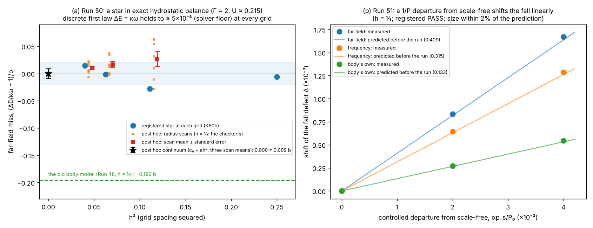

**Reading.**
1. **With matter in exact hydrostatic balance and a scale-free medium, the engine has an energy principle, and its discrete first law holds (K50a).**
   - The field law sourced by Tolman draws, the full pattern rule, and matter whose draw includes its internal energy and pressure are the Euler–Lagrange equations of one action.
   - The new ingredient is the matter rule, N h = μ̃. It replaces the old stress and proper-size rules.
   - In CO's own medium, which is not exactly scale-free, the engine's draw lacks a factor (1 + g), g = c d ln R/dz − 1. So it is not variational at order Δg, the same quantity Run 51 measures.
2. **The far field obeys the same first law as GR to within the lattice noise:** a quantum raises it by ħω to ≲ 0.3% of κω (post hoc). As registered, K50b is undecided.
   - Analytically, (iii) makes it exact in the continuum: the far-field mass equals the action's energy, as Komar = ADM does in GR.
   - **So the 4% "active-mass deficit" was the old body model.** Run 49's post hoc analysis points mainly at its stress weight.
3. **What this does not imply.** This is the first law of the engine's own action, dE = ω dQ + μ̃ dN at fixed entropy, which has GR's form. It does not give:
   - GR's mass–radius relation, total binding or maximum mass;
   - the metric beyond first post-Newtonian order (the engine's is exponential);
   - anything about dynamics, radiation or inertia.

   J0737−3039B's binding energy remains a possible test of the engine's second-order field law, through a star's total binding.
4. **For Run 47:** the 4% deficit is gone in the scale-free continuum. On the grid, post hoc, any residual is ≲ 0.3% of κω.
   - The fall question is separate and stays open. That includes the ζ₂-type gap between the draw-based and frequency-based falls, and the star's own fall, which was not shown to converge.
5. **What carries over:**
   - every first-order result;
   - Runs 48 and 51 on the fall;
   - the rule correction recorded in §3: bodies are matter in hydrostatic balance.

### Run 51: a controlled departure from scale-free, and a larger box

*20 October 2026. Registered and hashed with every imported module before the run (`medium51/PREREG_51.md`, 07:35 UTC; the medium run started seconds later). Code checks were limited to building the 120-cell Green's function and a syntax check. An independent agent checked the run; its corrections are included.*

**Question.** Run 48 showed that in a scale-free medium the fall defect is purely a grid effect. Post hoc, its check found that the leftover in the engine's real media follows the medium's departure from scale-free, g = c d ln R/dz − 1, through its change across the body, Δg. Does it, when that departure is set by hand?

**(a) The controlled medium.**
$$
R(z)=p_s\big(e^{z/c}-\alpha\big)\quad\Rightarrow\quad g=\alpha\,p_s/P\ \text{exactly}.
$$
The engine is Run 48's at h = ⅓, with αp_s/P₀ = 0, 2×10⁻³ and 4×10⁻³. It uses Run 46c's body model, which Run 50 has since replaced. The fall defects come from direct outside potentials (U_ext = ±0.005, centred).

| αp_s/P₀ | U_self | pattern by far field | by frequency | body's own |
|---|---|---|---|---|
| 0 | 0.21765 | −0.3386×10⁻³ | +1.0319×10⁻³ | −0.1074×10⁻³ |
| 2×10⁻³ | 0.21809 | +0.4959×10⁻³ | +1.6736×10⁻³ | +0.1641×10⁻³ |
| 4×10⁻³ | 0.21852 | +1.3324×10⁻³ | +2.3162×10⁻³ | +0.4357×10⁻³ |

**Verdicts, as registered: PASS.**
- **K51c (control).** At α = 0 the direct method reproduces Run 48's identity values to ≤ 5×10⁻⁸.
- **K51a (linearity).** Ratios 2.002, 2.001 and 2.001 (registered 2 ± 0.1).
  - At departures this small, a ratio of 2 is close to automatic for any smooth dependence, so K51a is a weak test.
- **K51b (size).** The slopes per unit αp_s/P₀ are 0.418, 0.321 and 0.136, against the registered 0.409, 0.315 and 0.133: within 2.1% (registered 15%).
  - They match Run 46c's *uncorrected* slopes per unit p_s/P₀ (0.418, 0.323, 0.136) to 0.2–0.5%.
  - The registered division by 1.023, a correction for the media's measured g, is what creates the 2% offset.

**(b) The larger box.** Run 48's h = ⅓ point was repeated in a 120-cell box. The fall defects changed by ≤ 2×10⁻¹⁰ and the pull by 10⁻¹¹.
- The field uses the free-space Green's function, so it never had a box. This tests only the pattern's periodic box, and a difference that small was expected.
- It was tested at h = ⅓ only.

**Reading.**
1. **For a 1/P departure from scale-free, the fall shifts linearly, matching Run 46c's media to about 2%.** With Run 48:
$$
\Delta=\underbrace{-\frac{d\ln e}{d\ln h}}_{\to\,0\ \text{(continuum)}}+\;A'\,\Delta g ,
$$
   with Δg = g(0.8P₀) − g(P₀). At U ≈ 0.22, A′ ≈ 1.67, 1.28 and 0.54 (far field, frequency, body), 2.5% above Run 48's estimate. So Δg at 0.8P₀ is a universal variable only to about 3%.
2. **Only one family of departures was tested.** For it, Δg, g(P₀) and p_s/P₀ are proportional, so "only through Δg" is not yet distinguished from those alternatives. A second family, for example g ∝ 1/P², would test it.
3. **The fall test at neutron-star strength now measures CO's medium.**
   - In the scale-free part, bound matter falls exactly like its energy.
   - The pulsar triple bounds how far the medium departs from scale-free across a star.
   - The coefficients A′ were measured with the old body model. Run 50's check also notes that in a non-scale-free medium the engine's draw is not variational (it lacks a factor 1 + g). The Δg fall defect may partly be that.

### Run 52: should CO's draw be the variational one?

*20 October 2026. Registered and hashed with every imported module before the run (`vardraw/PREREG_52.md`, 11:40 UTC). One code check (h = 1, not a registered grid) is disclosed; it motivated recalibrating every star. The identity reading is post hoc, and the independent check sharpened it; its corrections are included.*

**Question.** Run 50's energy principle holds exactly only in a scale-free medium. CO's field is linear in z, φ = z₀ − z = 6G∗d, and matter feels it through N = R(z)/P₀. So
$$
\frac{dU}{d\phi}=\frac{1+g}{c},\qquad g=c\,\frac{d\ln R}{dz}-1 .
$$
The draw that makes field, matter and pattern the Euler–Lagrange equations of one action, with field term −(1/12c)Σ_links(∇φ)², is
$$
d_V=T\,(1+g),
$$
where T is the Tolman/Komar draw. The engine's rule is d_E = T. Which should CO use?

**Setup.**
- **Star and pattern:** Run 50's star in exact hydrostatic balance (Γ = 2) and its pattern, at h = ½ and ⅓.
- **Medium:** Run 51's controlled medium, g = αp_s/P, at αp_s/P₀ = 4×10⁻³, under rule E and rule V, plus α = 0 as the control.
- **Every star is recalibrated** to Run 50's U_self and surface radius. The α = 0 rows reproduce Run 50 to 10⁻⁸.
- **The kink.** At h = ½ the radius target, 8.000 cells, puts six surface cells exactly at the matter threshold, so the absolute ω and far-field falls there average two branches. The *shifts* between configurations are robust (the check).

**Results.**

| h = ½ / ⅓ | α = 0 | rule E (engine) | rule V (variational) |
|---|---|---|---|
| first law, ΔE_H/κω̄ − 1 (trapezoid; about 10⁻⁹ with exact quadrature, Run 53's check) | 1.0 / 0.8 ×10⁻⁸ | −3.2 / −3.0 ×10⁻³ | 0.9 / 0.8 ×10⁻⁸ |
| active/passive (by construction) | 1 | 1/(1 + ḡ) = 0.99503 | 1 |
| (ΣT − E_H)/ΣT | 6.74 / 3.10 ×10⁻⁴ | 12.2 / 8.5 ×10⁻⁴ | 6.75 / 3.11 ×10⁻⁴ |
| far-field miss (b) | −0.006 / −0.028 | −0.004 / −0.026 | +0.024 / +0.001 |
| shift of the star's energy-based fall | — | +9.84 / +9.74 ×10⁻⁴ | +9.91 / +9.79 ×10⁻⁴ |
| shift of the star's far-field fall | — | +4.6 / +4.4 ×10⁻⁴ | +0.1 / −0.1 ×10⁻⁴ |
| shift of the pattern's ω fall | — | +3.0 / +2.9 ×10⁻³ | +6.2 / +6.0 ×10⁻³ |

**Verdicts, as registered.**
- **K52a passes.** Rule V is variational: its first law holds to 10⁻⁸ in the non-scale-free medium.
- **K52c passes.** Under V the virial identity holds in any medium: (ΣT − E_H)/ΣT is unchanged by the medium to 8×10⁻⁷. The dilation argument never involves R(z).
- **K52b: PARTLY.** The star's far-field-fall shift vanishes under V (class DRAW), and the pattern's ω-fall shift doubles (2.07×).
- **Reported:** V's far-field miss shifts by +0.0306 / +0.0295 b, as predicted from M_far = E_H(1 + ḡ)/(1 + g_bg).

**What the check established.**
1. **The exact relation under V.** E_H is the stationary value of the energy, and the outside potential enters only through the background, so
$$
\frac{dE_H}{dU_{\rm ext}}=-\frac{\sum d}{1+g_{\rm bg}}=-M_{\rm far}
$$
   (Hellmann–Feynman). Hence, if inertia equals E_H (an assumption, since the static action fixes no inertia), the equivalence-principle violation is exactly:
$$
\Delta_{\rm SEP}=\frac{M_{\rm far}}{E_H}-1=\frac{(1+\bar g)\,(\Sigma T/E_H)}{1+g_{\rm bg}}-1\;\approx\;\bar g-g_{\rm bg}\ \ (\text{continuum}).
$$
   - With the lattice part included it predicts the shifts as 9.909 / 9.793 ×10⁻⁴, against measured 9.911 / 9.792.
   - The remaining residuals are finite-difference error in ε.
   - ḡ − g_bg is the body's draw-weighted excess of g over the background's: about 0.25 g_bg for this star.
2. **V does not remove the medium's fall shift; it makes it well defined.**
   - The DRAW class for the far-field fall reflects how the far-field mass is normalised and the g ∝ 1/P shape: S_V(M_far) ≈ (1 − s)(ḡ − g_bg) with s = −d ln g/d ln P = 1. Run 54 confirmed this for s = 2.
   - E's energy fall shifts by nearly the same amount (S_V/S_E = 1.007 and 1.005). But under E there is no conserved energy, so that agreement at O(g) is forced (Run 54's check) and is not a statement about E's physics.
   - The rules disagree for a bound quantum by a factor of about 2.
3. **Under E there is no stationary energy.** ∂ℰ/∂φ ≠ 0, so E_H's derivative is not a passive mass, and comparing identities under E is empty.
4. **Active/passive are definitions in the code, not measurements.** Action = reaction under V is analytic only; no two-body run was made.
   - The earlier claim that E would make binaries self-accelerate is **wrong at Newtonian order**: the centre of mass only wobbles (about 6 cm/s for a neutron star with a white dwarf).
   - A secular effect arises only at first post-Newtonian order, ζ₂-like and of size ~g_bg, marginal against |ζ₂| < 1.3×10⁻⁵. It is not a strong argument for V.
5. **Why the ω fall doubles under V.** V has a Maxwell relation, ∂ω/∂U = −∂M_far/∂κ. So a bound quantum's ω fall is its own passive/inertial − 1, equal to b × its far-field miss (6.19 / 5.99 against 6.17 / 5.88 ×10⁻³).
   - Its shift is the g-weighting of the draw the quantum adds, including the star's restructuring: about 2.5 g_bg.
   - G_eff ∝ (1 + g_bg)² under V, against (1 + g_bg) under E.
   - **So Δ_SEP is not additive:** a bound quantum's violation is about 6 times its host star's. This is not a defect of V.

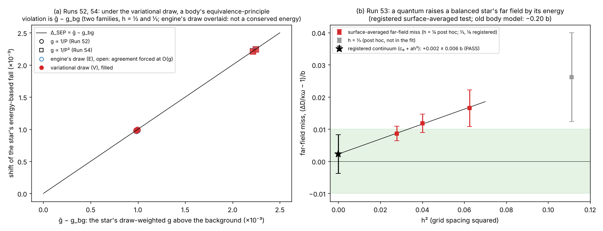

**Reading.**
1. **Rule V is the self-consistent one.** From one action it has:
   - an exact first law;
   - passive = active mass, exactly;
   - the virial identity in any medium;
   - a symmetric interaction energy.

   Rule E breaks the first law at about 0.7 g.
2. **The medium's equivalence-principle violation is physics of the medium's scale, well defined only under V:** Δ_SEP = M_far/E_H − 1 ≈ ḡ − g_bg. It is not additive (point 5).
   - The pulsar triple (|Δ| ≲ 2.3×10⁻⁶) with Δ ≈ 0.25 g_bg for a star like this one gives g_bg ≲ 9×10⁻⁶, i.e. P₀/(αp_s) ≳ 10⁵ in this toy medium: CO's stated range.
3. **Recommendation, as registered: adopt V, on consistency grounds.** The check adds a condition, and the choice needs a ruling:
   - V assumes the field stays linear in z;
   - a second self-consistent option keeps E's draw and makes the field linear in U instead, which takes the medium out of gravity altogether;
   - inertia = E_H remains an assumption.

### Run 53: the far-field first law, surface-averaged and registered

*20 October 2026. Registered and hashed before the run (`firstlaw53/PREREG_53.md`, 11:41 UTC).*
- *The scans started about 6 minutes after registration. A waiting loop that never fired had to be replaced first; nothing had been computed.*
- *The h = ¼ scan used in the fit is Run 50's post hoc scan, disclosed as known.*
- *An independent agent checked the run; its corrections are included.*

**Question.** Run 50's far-field test was undecided as registered, because the miss oscillates with the star's surface cells. Post hoc, surface averages pointed to zero. This run registers that analysis: new radius scans at h = ⅕ and ⅙ with the fit fixed in advance.

**Design.**
- Run 50's Γ = 2 star in the scale-free medium, with the count fixed and K multiplied by f = 0.945, 0.9575, …, 1.045: 9 points per grid.
- The surface moves across 1.6–1.9 cells.
- The fit is weighted, c₀ + ah², over the means at h = ¼ (Run 50's 7 points), ⅕ and ⅙.

**Results** (far-field miss in units of b).

| h | points | mean | standard error |
|---|---|---|---|
| ⅓ (Run 50, post hoc; not in the fit) | 7 | +0.026 | 0.014 |
| ¼ (Run 50, post hoc) | 7 | +0.0165 | 0.0057 |
| ⅕ | 9 | +0.0118 | 0.0029 |
| ⅙ | 9 | +0.0086 | 0.0022 |

The scan points sample a quasi-periodic function, so these standard errors are uncertain by about 25%.

**Verdicts, as registered.**
- **K53a passes:** c₀ = +0.002 ± 0.006 b.
  - The fit extrapolates a long way: c₀ = −0.72 m(¼) − 0.23 m(⅕) + 1.95 m(⅙).
  - A constant, +0.010 ± 0.002 b, fits only slightly worse (χ² = 2.0 for 2 degrees of freedom).
  - Adding the h = ⅓ scan gives c₀ = +0.003 ± 0.005 b.
  - The main evidence that the miss depends on h is that all four means fall steadily. That would happen about 1 time in 24 if the miss were constant.
- **K53b fails as registered.** With the pattern's amplitude raised tenfold, the first-law residual is +4.4×10⁻⁷ at h = ⅕ and −1.1×10⁻⁷ at ⅙, above the registered 5×10⁻⁸. The check traced this to how ∫ω dκ was integrated, not to the physics:

| κ multiple | h = ⅕ | h = ⅙ |
|---|---|---|
| ×1 | +6.9×10⁻⁹ | −1.8×10⁻⁸ |
| ×3 | +5.4×10⁻⁸ | +8.5×10⁻⁹ |
| ×10 | +4.4×10⁻⁷ | −1.1×10⁻⁷ |

  - The registered test estimated the integral with the trapezoid rule, ∫ω dκ ≈ κ(ω₀ + ω₁)/2. At h = ⅕ that error grows as κ²:
    - integrating a quadratic ω(κ) exactly leaves 9×10⁻¹⁰ and −2×10⁻¹⁰;
    - at ×10, 48 surface cells switch off and ω(κ) has kinks.
  - At h = ⅙ the star sits on such a kink: 192 cells empty within the amplitude range. An 8-step trapezoid gives +9×10⁻¹⁰, and Simpson's rule +1.3×10⁻⁹.
  - **So the discrete first law holds to about 10⁻⁹.** The "~8×10⁻⁹" quoted in Runs 50 and 52–54 is trapezoid error. The registered threshold failed, not the first law.
- **The reported extras did not complete.**
  - The Γ = 3 existence scan made no progress in about 17 CPU-minutes and was stopped. Its log is empty.
  - The check notes that the solver returns no convergence flag, so such a scan could record a non-converged state as an equilibrium. It needs a flag and a time cap.
  - The weak-field case, run on its own afterwards with the same settings (`weak53.py`), gave U_self = 0.066, b = 0.062, first law 2×10⁻¹⁰, and a far-field miss of −0.013 b. That is a single star, not surface-averaged.

**Reading.**
1. **The far-field first law holds as registered.** Adding a quantum to a star in exact hydrostatic balance at neutron-star strength raises its far-field mass by its energy.
   - The continuum miss is consistent with zero: |c₀| ≲ 0.014 b at 2σ, about 0.3% of κω. *(Superseded by Run 56: with a fourth grid the form of convergence is unsettled, and the grids neither confirm nor contradict c₀ = 0 to better than about 1% of κω.)*
   - A constant offset near 0.01 b is disfavoured only weakly.
   - Adding h = 1/7, or more points per scan, would sharpen it.
2. **The old body model's 4% deficit is gone for a balanced star.** That it was *caused* by the old body model is an interpretation, consistent with Runs 49–50; this run did not test the old model.
3. **The first-law tests should integrate over amplitude with Simpson's rule** (adding ω at κ/2) and avoid kinks. The record's first-law precision is about 10⁻⁹.

### Run 54: a second family of media, both draw rules

*20 October 2026. Registered and hashed before the run (`family54/PREREG_54.md`, 11:49 UTC). Run 52's results motivated it, and the identity it tests was post hoc in Run 52. An independent agent checked the run; its corrections are included and retract two of the draft's readings.*

**Question.** Run 52, in one family of media (g ∝ 1/P), suggested two things:
- under the variational draw (V), a body's equivalence-principle violation is M_far/E_H − 1 ≈ Δḡ;
- under the engine's draw (E), the far-field fall follows Δg(0.8P₀).

Do these hold in a family with a different depth profile?

**The medium.**
$$
R=\sqrt{p_s^2e^{2z/c}-\beta P_0^2},\qquad g=\beta\,(P_0/P)^2,\qquad \beta=4\times10^{-3}.
$$
- The background g is Run 52's, but deeper in it grows twice as fast (s ≡ −d ln g/d ln P = 2).
- The star, pattern, recalibration and grids are Run 52's, so the h = ½ kink applies again. The shifts are robust, and h = ⅓ agrees.

**Results.**

| h = ½ / ⅓ | rule E (engine) | rule V (variational) |
|---|---|---|
| first law (trapezoid) | −4.1 / −3.9 ×10⁻³ | 0.9 / 0.8 ×10⁻⁸ |
| Δḡ = ḡ − g_bg | 2.244 / 2.217 ×10⁻³ | 2.245 / 2.217 ×10⁻³ |
| shift of the star's energy-based fall | 2.239 / 2.212 ×10⁻³ | 2.239 / 2.209 ×10⁻³ |
| shift of the star's far-field fall | +9.1 / +8.9 ×10⁻⁴ | −2.30 / −2.31 ×10⁻³ |
| shift of the bound pattern's ω fall | +7.2 ×10⁻³ (½) | +1.55 / +1.50 ×10⁻² |

**Verdicts, as registered.**
- **K54a passes.** Under V the energy fall's shift equals Δḡ (ratios 0.998 and 0.997), and E_H's fall equals M_far/E_H − 1 to 3×10⁻⁶.
  - The lattice form, (ḡ − g_bg)(1 + v)/(1 + g_bg) plus the change in the lattice virial term v, predicts 2.2390 and 2.2097 ×10⁻³, against measured 2.2393 and 2.2094. That fully explains the ratios.
  - The 3×10⁻⁶ is finite-difference error in ε (Run 52's check: 4×10⁻⁹ as ε → 0).
- **K54b passes, but its premise is retracted.** Under E the far-field-fall shift is 0.89 of the Δg(0.8P₀) prediction at both grids, inside the registered 15%.
  - The check shows the 0.89 is systematic: E's shift is Δḡ − s·δv_E, where δv_E is E's virial excess.
  - That predicts 4.51 / 9.08 ×10⁻⁴ (h = ½, the two families) against measured 4.55 / 9.14, and 4.46 / 8.98 against 4.43 / 8.87 (h = ⅓).
  - The family ratio is 2.0, not the 2.25 that Δg(0.8P₀) implies. **Δg(0.8P₀) is not the controlling variable.**
- **Confirmed, not registered.** For s = 2, V's far-field-fall shift is −Δḡ, as the check had predicted: −2.30 / −2.31 against −2.24 / −2.22 ×10⁻³.

**Reading.**
1. **Under V, a whole body's equivalence-principle violation is**
$$
\Delta_{\rm SEP}=\frac{M_{\rm far}}{E_H}-1\;\approx\;\bar g-g_{\rm bg},
$$
   where ḡ − g_bg is its draw-weighted excess of g over the background's. This holds in both families, assuming inertia equals E_H.
   - For a star at U ≈ 0.22, Δḡ/g_bg = 0.25 (s = 1) or 0.56 (s = 2).
   - The pulsar triple (|Δ| ≲ 2.3×10⁻⁶) then needs g_bg ≲ 9×10⁻⁶ (s = 1) or ≲ 4×10⁻⁶ (s = 2) in this toy medium.
2. **It is not additive.** A bound quantum's own violation is set by the g-weighting of the draw it adds, including the star's restructuring. Its ω-fall shift is about 6.9 times the star's here (6.2 in the first family), consistent with V's Maxwell relation (b·Δmiss: 1.55 / 1.47 ×10⁻²).
3. **The rules do not "agree on falling" (retracted).**
   - Under E there is no conserved energy, so E_H's fall is not a mass ratio. Its agreement with V at O(g) is forced: E's virial excess cancels the extra term.
   - The rules disagree for a bound quantum by a factor of 2.15.
   - Only under V is the medium's equivalence-principle violation well defined.
4. **The far-field fall is a convention-dependent measure** (≈ (1 − s)Δḡ under V). It should not be used as the equivalence-principle test.

### Run 55: CO's medium and the pulsar triple, under the variational draw

*20 October 2026. (steps 2–3). Registered and hashed before the run (`medium55/PREREG_55.md`, 12:40 UTC). An independent agent checked the run. Its corrections change the reported pulsar numbers but no registered verdict. Disclosed:*
- *The registered star at U_self = 0.30 failed (its calibration hit an invalid value). The star table was extended post hoc by continuation (`posthoc55b.py`, `posthoc55c.py`). A first retry (`posthoc55_failed.py`) started from a count 16% too large, a scaling slip, and was stopped.*
- *The registered mapping of the pulsar's radius to its surface potential was wrong, and the registered analysis clamped C at the table's end instead of extrapolating. Both were corrected post hoc (`posthoc55_pulsar.py`).*
- *During the run it was ruled that inertia = total energy (§3).*

**Question.** Under the adopted variational draw, a body's equivalence-principle violation is (Runs 52, 54)
$$
\Delta=\frac{M_{\rm far}}{E_H}-1\;\approx\;\bar g-g_{\rm bg},\qquad g=c\,\frac{d\ln R}{dz}-1 ,
$$
given inertia = E_H. What does that predict for CO's own medium, the A″ mean field, and how does it compare with the pulsar triple PSR J0337+1715?

**1. CO's medium is not scale-free (K55a: PASS).** Computed from the medium's exact mean occupancy (f(n) = c ln(1 + n/p_s), π(n) ∝ zⁿ/∏f(k); Run 35):

| p_s | P/p_s = 16 | 64 | 256 | 1024 |
|---|---|---|---|---|
| 64: g·P/p_s, s | 0.9857, 1.0075 | 0.9752, 1.0079 | 0.9645, 1.0081 | 0.9537, 1.0082 |
| 256 | 0.9964, 1.0018 | 0.9938, 1.0019 | 0.9911, 1.0020 | 0.9884, 1.0021 |
| 1024 | 0.9991, 1.0005 | 0.9985, 1.0005 | 0.9978, 1.0005 | 0.9971, 1.0005 |

- Registered: PASS if |g·P/p_s − 1| ≤ 4/p_s and |s − 1| ≤ 0.02 at every point with p_s ≥ 64. All 12 points pass.
- *Correction (check):* the run's p_s = P/p_s = 1024 entry (0.997079, s = 0.9978) was a float64 rounding artifact. The table gives the exact values from the check's cumulant computation.
- **The exact form** (the check, from the identities ⟨f(n)⟩ = z and Cov(n, f(n)) = z; it matches the exact values to 10⁻⁵ for p_s and P/p_s from 16 to 16384):
$$
g=\frac{p_s-b}{P},\qquad b=\tfrac12\ln\!\Big(1+\frac{P}{p_s}\Big)-\tfrac12,\qquad s\equiv-\frac{d\ln g}{d\ln P}\approx1+\frac{1}{2p_s}.
$$
- At CO's physical scales (p_s ≳ 4×10⁵, P₀/p_s ≳ 10⁵), g·P/p_s = 1 − b/p_s ≈ 1 − 1.4×10⁻⁵ and s − 1 ≈ 1.3×10⁻⁶. *Correction:* the registration's "to better than 10⁻⁵" is slightly too strong. The medium is Run 51's controlled medium with α = 1, to about 10⁻⁵.
- With s = 1 the violation becomes one number per star:
$$
\bar g-g_{\rm bg}=g_{\rm bg}\,C,\qquad C=\Big\langle\frac{P_0}{P}\Big\rangle_T-1,\qquad \Delta\simeq C\,\frac{p_s}{P_0}.
$$
  The average is weighted by the Tolman draw T. The check confirms ḡ − g_bg = g_bg·C to 4×10⁻⁵ relative, including the star's own restructuring.

**2. The formula at another compactness (K55b: PASS).** At U_self = 0.12 (h = ⅓, g = αp_s/P at 4×10⁻³, variational draw), the energy-based fall shifts by 5.1295×10⁻⁴, against ḡ − g_bg = 5.1484×10⁻⁴: a ratio of 0.9963, inside the registered 3%.
- The lattice form (1 + ḡ)(ΣT/E_H)/(1 + g_bg) − (ΣT/E_H)₀ predicts 5.1293×10⁻⁴. The −0.4% is the 1/(1 + g_bg) factor.
- First law (trapezoid): 2.5×10⁻⁹ in both media.
- Given the Hellmann–Feynman relation and the virial identity this is close to algebraic: a consistency check at a second compactness.

**3. C against compactness.** Γ = 2 and Γ = 3 stars in exact hydrostatic balance, h = ⅓, scale-free medium. U_s = −ln μ̃ is the surface potential.

| | (U_s, C) |
|---|---|
| Γ = 2, registered (radius 12.3 cells) | (0.033, 0.051), (0.065, 0.106), (0.096, 0.164), (0.125, 0.225), (0.154, 0.291) |
| Γ = 2, post hoc (count × 1.00 … 1.25 at fixed K) | (0.134, 0.246), (0.152, 0.288), (0.174, 0.345), (0.189, 0.385), (0.209, 0.451), (0.218, 0.481) |
| Γ = 3, post hoc (count × 1.00 … 1.80 at fixed K) | (0.156, 0.246), (0.176, 0.283), (0.196, 0.325), (0.211, 0.355), (0.218, 0.371), (0.234, 0.406), (0.251, 0.448), (0.279, 0.522), (0.335, 0.695) |

- **Weak-field check.** C/U_s → 1.515 for Γ = 2, against the Newtonian n = 1 polytrope's 6/(5 − n) = 1.5. For Γ = 3 the check's two weak-field stars extrapolate to 1.336, against 4/3 for n = ½.
- **Grid dependence is small.** C at fixed U_s moves by +0.3% at h = ½ and −0.2% at h = ¼ (the check). The branch stars shrink to about 9 cells in radius, which changes C by ≤ 0.3%.
- **The end of the Γ = 2 branch.** Count continuation at fixed K converges up to × 1.25 (U_s = 0.218) and fails at × 1.26 and × 1.28. The failed solves stall at residuals that grow with distance (1.1×10⁻³, 5.9×10⁻³), and the step in U_s grows as a fold's would (dU_s/df: 0.21, 0.23, 0.26, 0.29, 0.36, 0.52, 0.88). A fold fit, U_s = U* − a√(f* − f), gives f* ≈ 1.258 and **U* ≈ 0.235** (the check).
  - Claimed: no Γ = 2 equilibrium past count × 1.26 at this K; the data fit a maximum-count fold at U_s ≈ 0.235; so no Γ = 2 star reaches 11 km (U_s ≥ 0.244).
  - Not claimed: that the fold is proven (that needs continuation through the turn), or anything about equilibria beyond it, whose stability a static engine cannot judge.
  - The check's earlier "turns over near 0.20" at h = ½ came from a coarse step and is withdrawn.
- **Γ = 3 converges past U_s = 0.33** (stopped by hand there; its end was not sought).

**4. The pulsar, corrected.** PSR J0337+1715's pulsar has M = 1.438 M☉ (GM/c² = 2.123 km); its radius is unmeasured, taken as 11–13 km. *Correction (check):* the registration set U_s = GM/(Rc²), treating the areal radius as the engine's coordinate radius. The engine's exterior is U = GM/r exactly in isotropic coordinates, so:

| R (km) | GM/(Rc²) | U_s, engine's areal radius (U e^{−U} = GM/Rc²) | U_s, surface redshift (−½ ln(1 − 2GM/Rc²)) |
|---|---|---|---|
| 13 | 0.163 | 0.199 | 0.198 |
| 12 | 0.177 | 0.221 | 0.218 |
| 11 | 0.193 | 0.247 | 0.244 |

The registered 0.164–0.193 understated U_s by 20–26%.

**5. The bound.** C is interpolated (monotone cubic through the origin) inside each equation of state's converged range. The registered analysis instead held C at the table's last value (0.291) beyond U_s = 0.154 and reported P₀/p_s ≥ 1.27×10⁵; that number is superseded. The bound is Voisin et al. 2025 (A&A 693, A143), 95%: |Δ| < 2.3×10⁻⁶ with red timing noise, < 1.5×10⁻⁶ with a circum-ternary planet.

| R | C, Γ = 3 | C, Γ = 2 | P₀/p_s ≥ (2.3×10⁻⁶) | P₀/p_s ≥ (1.5×10⁻⁶) |
|---|---|---|---|---|
| 13 km | 0.33 | 0.41–0.42 | 1.4–1.8×10⁵ | 2.2–2.8×10⁵ |
| 12 km | 0.37–0.38 | 0.48–0.49 (just past the last converged star, inside the fitted fold) | 1.6×10⁵ (Γ = 3); 2.1×10⁵ (Γ = 2) | 2.5×10⁵; 3.2×10⁵ |
| 11 km | 0.43–0.44 | no star (beyond the fold) | 1.9×10⁵ | 2.9×10⁵ |

The ranges within a cell are the two radius mappings, which differ by about 1%. So, from converged stars:
$$
\frac{P_0}{p_s}\gtrsim1.4\text{–}1.9\times10^5\ \ (2.2\text{–}2.9\times10^5\ \text{with the planet model}),\qquad \frac{p_s}{P_0}\lesssim3.4\text{–}7\times10^{-6},
$$
rising to about 2.1×10⁵ (3.2×10⁵) if the Γ = 2 star at 12 km is included.
- The spread comes from the radius (about 30%), the equation of state (Γ = 3 is 20% below Γ = 2 at 13 km: 0.330 against 0.415) and the noise model. A realistic equation of state is neither polytrope.
- The white dwarfs' C ≈ 1.7U ≈ 3×10⁻⁵ is negligible.

**6. Inertia.** The registration's von Laue note was checked:
- **Right:** for a static closed system with a conserved total energy–momentum tensor, the total stress integrates to zero and (E, P) is a four-vector. The virial identity under V, W_f = 3∫pN√γ + 2κ∫|∇ψ|², is the trace of that condition and holds in any medium.
- **Overstated:**
  - only the trace is shown (a full proof needs ∫T^{xx} = 0 along the boost; the trace gives it for spherical or cubic bodies);
  - any equilibrium of a covariant theory satisfies the identity, so it adds no evidence;
  - the adopted Lorentz input covered first post-Newtonian order only.
- **So inertia = E_H needed an input,** and a ruling supplied it: the Lorentz input extended to the complete dynamics (§3). The boosted far field carries the active momentum M_far·v, and the difference from E_H·v is the Nordtvedt effect, as in Brans–Dicke-type theories.

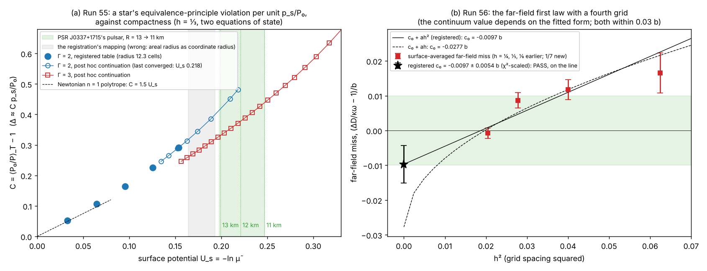

**Reading.**
1. **CO's medium, as specified, is not scale-free.** The scale p_s, brought in after Run 22 so that clocks of different design agree, makes the medium depart from scale-free as g = (p_s − b)/P ≈ p_s/P.
2. **With inertia = total energy, CO predicts a strong-equivalence-principle violation for compact bodies:**
$$
\Delta=\frac{m_{\rm grav}}{m_{\rm inertial}}-1\;\simeq\;C\,\frac{p_s}{P_0}>0 .
$$
   - It is negligible for light bodies, grows with compactness (C ≈ 0.33–0.49 for the pulsar, Γ = 3 to Γ = 2), and is not additive.
   - GR predicts exactly zero.
3. **Its size is not predicted.** CO does not yet fix P₀/p_s. The pulsar triple requires P₀/p_s ≳ 1.4–2.9×10⁵, tighter than, and consistent with, the first-order bound of Run 45 (10⁵). If CO fixed P₀/p_s, this would become a definite number for pulsar timing, with a definite sign.

### Run 56: housekeeping — a finer scan, Simpson's rule, and a stiffer star

*20 October 2026. (step 4). Registered and hashed before the run (`house56/PREREG_56.md`, 12:41 UTC). An independent agent checked the run; its corrections are included. Two deviations are disclosed:*
- *The scan's 9th point was computed post hoc with the outer loop capped at 30 (`posthoc56_ninth.py`). In the registered run its composite cycled between two states 4×10⁻¹² apart, which never meets the 10⁻¹² stopping test, so it would have run for hours to the 200-iteration cap. The check estimates the cycle's effect on the miss at about 3×10⁻⁷ b.*
- *The fit's error is discussed beyond the registered form, at the check's suggestion.*

**Question.** Three loose ends from Runs 50–53:
1. Does the far-field first law still hold in the continuum with a fourth, finer grid?
2. With Simpson's rule, does the discrete first law hold to about 10⁻⁹, as Run 53's check expected?
3. Does a stiffer equation of state (Γ = 3), which stalled twice before, behave the same?

**Design.**
- **K56a.** Run 53's radius scan at h = 1/7: 9 points, K × f with f = 0.945 … 1.045, with the star's radius about 28 cells. The registered fit is weighted, c₀ + ah², over the scan means at h = ¼, ⅕, ⅙ and 1/7.
- **K56b.** The first law integrated by Simpson's rule,
$$
\Delta E\;\text{vs}\;\frac{\kappa}{6}\big(\omega_0+4\,\omega_{\kappa/2}+\omega_\kappa\big),
$$
  at the scan's middle point and at the Γ = 3 stars. PASS if every residual is ≤ 5×10⁻⁹.
- **Γ = 3.** An existence scan in K (20–2000) at h = ½, with a convergence flag and a time cap per solve. Then calibration to U_self = 0.2178 at radius 8.3 cells, and the first law and far-field miss at h = ½ and ⅓.

**Results: the h = 1/7 scan** (far-field miss in units of b).

| f | radius (cells) | U_self | miss (b) | first law (trapezoid) |
|---|---|---|---|---|
| 0.945 | 27.000 | 0.2249 | −0.0046 | 7.2×10⁻⁹ |
| 0.9575 | 27.302 | 0.2224 | −0.0026 | 6.6×10⁻⁹ |
| 0.970 | 27.594 | 0.2200 | −0.0032 | 8.0×10⁻⁹ |
| 0.9825 | 27.877 | 0.2176 | +0.0049 | 9.3×10⁻⁹ |
| 0.995 | 28.162 | 0.2153 | −0.0032 | 7.5×10⁻⁹ (Simpson 1.6×10⁻⁹) |
| 1.0075 | 28.449 | 0.2131 | −0.0011 | 7.3×10⁻⁹ |
| 1.020 | 28.727 | 0.2110 | +0.0050 | 5.2×10⁻⁹ |
| 1.0325 | 28.996 | 0.2089 | −0.0067 | 6.6×10⁻⁹ |
| 1.045 (post hoc, capped) | 29.277 | 0.2068 | +0.0047 | −9.3×10⁻⁸ |

The last point's larger trapezoid residual is a kink: in the check's reproduction, 78 surface cells switch on inside the composite (Run 53's finding). It is not a K56b point.

| h | points | mean miss (b) | standard error |
|---|---|---|---|
| ¼ (Run 50, post hoc) | 7 | +0.0165 | 0.0057 |
| ⅕ (Run 53) | 9 | +0.0118 | 0.0029 |
| ⅙ (Run 53) | 9 | +0.0086 | 0.0022 |
| 1/7 | 9 | −0.0007 | 0.0015 |

**Verdicts, as registered.**
- **K56a: PASS, on the line, and resting on the post hoc point.** c₀ = −0.0097 ± 0.0032 b (χ² = 5.6 for 2 degrees of freedom), against the PASS threshold |c₀| ≤ 0.01.
  - **The PASS depends on the 9th point.** With the 8 registered points c₀ = −0.0107 (UNDECIDED); any 9th miss below +0.0038 would have left it UNDECIDED. The capped point is a fair stand-in for the registered one: the cycle changes its miss by about 3×10⁻⁷ b, against a margin of 9×10⁻⁴ b.
  - **The fit leans on the new grid:** c₀ = 1.54 m(1/7) + 0.18 m(1/6) − 0.39 m(1/5) − 0.34 m(1/4). The h = 1/7 mean is 5σ below Run 53's fit extrapolated to h = 1/7 (+0.0067).
  - **The quoted error is too small.** The points are samples of a deterministic function of the surface radius, and χ²/dof = 2.8. Scaling by √(χ²/dof) gives ±0.0054. Dropping one grid at a time gives c₀ from −0.014 to +0.002.
  - **The form is not established.** c₀ + ah fits slightly better (χ² = 3.9) and gives c₀ = −0.028 ± 0.009 b (χ²-scaled), near the FAIL line (0.03). A star's sharp surface can give lattice errors of first order in h.
  - **A constant is excluded** (χ² = 26.6 for 3), so the miss does depend on the grid.
- **K56b: PASS.** Simpson residuals are +1.6×10⁻⁹ (h = 1/7, middle point), +5.8×10⁻¹⁰ (Γ = 3, h = ½) and +2.0×10⁻¹⁰ (Γ = 3, h = ⅓).
- **Γ = 3, reported.**
  - All 11 K converged (U_self from 0.29 at K = 20 to 0.09 at K = 2000), bracketing 0.2178. Calibrated to U_self = 0.21780 at radius 8.300 cells (residuals ≤ 2×10⁻¹²). The h = ⅓ star is that star rescaled (count × 3/2, K × (2/3)⁻⁴), not recalibrated, so its U_self is 0.2169.
  - The calibration and the composites carry no convergence flag. The first-law residuals of ≤ 6×10⁻¹⁰ show they converged.
  - Far-field misses: −0.030 b (h = ½) and +0.045 b (h = ⅓). These are single stars, within the surface scatter seen at those grids.
  - The lattice virial defect falls 6.7× from h = ½ to ⅓, where h² would give 2.25×, so no h² convergence is claimed for Γ = 3.
  - Run 53's stall is not explained: its scan started at K = 5, this one at K = 20.

**Reading.**
1. **The discrete first law holds to ≤ 2×10⁻⁹ with Simpson's rule, at three kink-free points and for both equations of state:**
$$
\frac{dE_H}{d\kappa}=\omega,\qquad E_H=W_f+k_0\sum\nu N(1+\varepsilon)+\kappa\omega .
$$
2. **The far-field first law: zero in the continuum is analytic, and the grids are consistent with it to about 1%.** That c₀ = 0 in the continuum follows from the dilation symmetry (Run 50). The four grids neither confirm nor contradict it to better than about 1% of κω: the 2σ envelope across fit forms reaches about 0.05 b (b ≈ 0.2), and the form of convergence (h² or h) is unsettled. This supersedes Run 53's "≲ 0.3% of κω". Either way it is far from the old body model's 4% (−0.20 b).
3. **Solver housekeeping.** Future scans should record the outer iteration count and flag any point that reaches the cap.

### Note D: what fixes P₀/p_s? The earlier clock and medium papers (a reading)

*20 October 2026. The earlier project's papers, working notes and event-layer models were fetched, as current on 11 October. An agent surveyed the papers and notes for clock and medium papers, and the core ones and the event-layer models were read in full. Point 4 is an inference, not the corpus's. An independent agent checked the quotes against the papers and the inference against the engine's code; its corrections are included.*

**The question.** Run 55 left CO's strong-equivalence-principle prediction bounded but not sharp:
$$
\Delta\simeq C\,\frac{p_s}{P_0},\qquad \frac{P_0}{p_s}\gtrsim(1.7\text{–}2.1)\times10^5\ \ \text{(the pulsar triple, Run 57)} .
$$
- p_s is the medium's crossover: a place's outflow is linear below it and logarithmic above it, f(n) = c ln(1 + n/p_s).
- P₀ is the vacuum's possibility per place.
- Does anything in CO fix P₀/p_s, or either number?

**1. The clock papers fix the lapse's form, never an absolute level.**
- **GR-I** (`Paper_GR-I_WeakFieldEinsteinMetric.md` §4): from the null condition and a commitment rate linear in bandwidth (Γ ∝ b, P-Commitment-Linear),
$$
N^2\sim b,\qquad g_{ij}\sim b^{-1},
$$
  with "b enters as the dimensionless ratio to its asymptotic value". The 12 September outside review notes that with b harmonic this gives PPN β = 0.
- **GR-III** (`Paper_GR-III_DynamicalRule.md` §3–4): the medium is linear diffusion with a sink, ḃ = D∇²b − κρ, with b → 1 in the vacuum. α = 1 is argued from P11, and only κ/D is fixed.
- **The relational tick** (`Paper_RelationalTick_v1.md`): "the vacuum event-density magnitude is robust but unpinned" (§2, on α₁), and "an order-one commitment factor that the corpus inherits everywhere and derives nowhere" (§3, on mass as memory).
- **The commitment concept note:** Γ_commit ~ b_int/reserve, with "one unnamed rate constant".

**2. The medium papers give no per-place capacity and no crossover.**
- **P04** (the bandwidth primitive): bandwidth is a dimensionless, non-negative, additive scalar. "Canonical P04 gives non-negativity, not an upper bound." Arcs that need a bound must name one; the named bounds have no values:
  - P-Locus-Bandwidth-Bound (`Paper_UnifiedP04TransportBudget`);
  - P-V5-Budget (`Paper_065_Monogamy`).
- **The working note "N_bw needs a quantum" (7 September 2026), §5–6:** the ratio of a place's capacity to its smallest unit, N_bw = B_max/b_min, "needs a quantum", and "the bandwidth quantum is ABSENT and UNFORCED". That ratio is the nearest thing in the corpus to P₀/p_s.
- **"Where ED is silent"** (question 9) says the same. The state-of-the-ontology summary, an AI session's account, agrees: "the upper limit is not in any primitive".
- **The one per-cell number** (`Paper_112_hbar_Origin` §3.6, B_P04 ≈ 10⁹ W per cell) is a relabelling of ħ by its own disclaimer. It is also dimensionful, against P04's [b] = 1.
- **No logarithmic outflow anywhere.** CO's saturating laws (the PDE notes and `Arc_BH_3`) are jamming forms, with no values. GR-III's medium is linear. The engine's logarithm was brought in for β = 1 (Runs 21–25).
- **The event-layer models** (their results summary, result 23): possibility per place is a setting (1 to 8 units), and the one ceiling is CO's own, a place committing at most once per ħ.
  - Their trade-off between how far a shortage reaches and how strongly clocks feel it (`Gravity_As_Accounting.md` §4) comes from a vacuum that commits, which screens the shortage.
  - **The engine's vacuum never commits,** so its shortage is unscreened whatever P₀ or p_s. The clock's response per unit of draw is set by c ≈ p_s alone, and P₀/p_s controls only the departure from scale-free. The analogy holds for p_s and for strength only.

**3. Where CO does give numbers, they do not fit the engine's two scales.**
- **Capacity at saturation:** about one degree of freedom per Planck area (`Paper_025_HolographicBound.md`, N(R) ≤ 4πR²/ℓ_ED²; `Paper_HorizonTilingThreeCounts.md`). Read as p_s, that is p_s ~ 1, which clocks of different design exclude. Run 24 measured a 5.6% design gap directly at p_s = 1.
- **The vacuum's occupancy:**
  - `Phase3_GR_Alpha1_Magnitude.md` gives ρ_event/ρ_Planck ≲ 10⁻⁹³ (from the source) down to a floor of 10⁻¹²². The 12 September review withdrew the α₁ argument built on it as "a dimensional estimate". `Phase3_GR_LambdaOfRho_Derivation.md` leaves the magnitude unpinned ("10⁻⁵? 10⁻⁴⁷?").
  - These count *commitments*, which the engine puts only in matter. CO's possibility-like b is only ever normalized (b = 1), so the corpus has no per-place number for vacuum possibility.
- **The large numbers on offer are cosmological** (10⁶¹, 10¹²², Θ_ED; `Scoping_ThetaED_FirstPrinciples_2026-07-06.md`). The corpus warns against matching them: "it's easy to take a big number like 10¹²² and find matches", and "ED's 10¹²² is 1/Λ taken from observation" (ED_Attempt_03, `Specificity_Mechanisms.md`).

**4. One structural tie, in the engine (an inference, checked against the code).**
- **The field.** In a scale-free medium the engine's coupling per unit of draw is set by p_s:
$$
U=\frac{6}{c}\,G_{\rm lat}\!*s,\qquad c=\frac{0.99}{\ln(1+1/p_s)}\approx0.99\,p_s ,
$$
  so a body drawing S units per tick has U → 3S/(2πc r), with r counted in hops (`zrp35.py`: the traffic equation gives Δz = 6(s − s̄)).
- **The draw.** A reserved pair renews at rate (P_a + P_b)/H, each renewal takes one unit from each of its places, and H = 2ħ_t P₀. So a pair draws S = 2/ħ_t per tick.
- **Light speed.** Light crosses ħ_t hops per vacuum hold. That is a ratio of counts, so the ruling that the tick is not physical time does not enter.
- **The energy.** CO says mass is a rate of becoming, so the pair's rest energy is E = aħ/T_hold.
- **The result.** Equating U to GE/(c⁴r):
$$
\frac{G\hbar}{c^3\ell_{CO}^2}=\frac{3}{\pi a\,c}\approx\frac{\kappa}{p_s},\qquad \kappa=\frac{3}{0.99\,\pi a}=0.15\ (a=2\pi),\ \ 0.97\ (a=1).
$$
  CO fixes a nowhere. The event-layer harness's 0.1 rad per blink would give κ ≈ 9.6.
- **P₀ cancels,** through H ∝ P₀. So:
  - **CO's P-G-Closure** (`Paper_027_Newtons_G.md` §2: the coefficient in G = c³ℓ_ED²/ħ "is unity … labelled here rather than absorbed", together with ℓ_ED = ℓ_P) would need
$$
p_s=\big(e^{0.99\pi a/3}-1\big)^{-1}\approx0.0015\text{–}0.55 .
$$
    Run 24 excludes that directly (the 5.6% design gap at p_s = 1).
  - **Otherwise the hop is ℓ_ED ≈ √(p_s/κ) ℓ_P ~ 10^2.5–10^3.2 ℓ_P,** using the extrapolated p_s ≳ 4×10⁵. Or something else carries a factor of about p_s.
  - **The natural carrier would be the draw per renewal,** but a renewal that draws ~p_s units brings back the order-one self-dip that p_s was introduced to remove. So the tie is structural: a commitment that is light compared with the crossover means a weak G per pair.
  - **This bears on p_s only, not on P₀/p_s.** It is the kind of conflict Paper_027's revised falsifier F-P anticipates: a scale fixed independently of G that disagrees with √(ħG/c³).

**Reading.**
1. **Nothing in CO fixes P₀/p_s, or either number.** The corpus's own position is that per-place budget numbers are not in any primitive. P₀ and p_s stay tracked inputs, like Θ_ED in the corpus.
2. **So the strong-equivalence-principle prediction stays bounded, not sharp:** a sign (Δ > 0), a growth with compactness and a non-additivity, with its size limited by the pulsar triple.
3. **The engine and the corpus differ in three places:**
   - the lapse (the engine's N = P/P₀ against GR-I's N² ∼ b);
   - the medium (logarithmic outflow above p_s against GR-III's linear diffusion);
   - where the vacuum sits (far above its crossover in the engine; far below saturation in the corpus).

   These record where the engine departed from the corpus to pass β = 1 and clock universality.
4. **The engine's G ties p_s to the hop.** P-G-Closure with ℓ_ED = ℓ_P is incompatible with the engine's clocks. If the engine stands, CO's hop is about 10^2.5–10^3 Planck lengths, or the corpus is carrying two scales under one name (Paper_027's F-P).

### Run 57: realistic neutron-star equations of state, in CO's continuum equations

*Note (21 October): these CO results use CO's original rule for space. Under the provisional option 3 (Run 65) CO's stars and exterior are GR's; the results here stand if option 3 is reversed.*

*20 October 2026. (step 2). Registered and hashed before the run (`eos57/PREREG_57.md`, 15:37 UTC). An independent agent checked the run; its corrections are included.*

**Question.** Run 55 left the pulsar's coefficient C spread over 0.33–0.49, from its unmeasured radius and two polytropes. With a realistic equation of state, the star of the pulsar's measured mass has a definite compactness. What are its C and U_s in CO's own equations? And, as reported (not registered as a test), what is CO's maximum neutron-star mass?

**Method: the engine's static equations in the continuum.** For a spherical star in the scale-free medium (G = c = 1):
$$
ds^2=-e^{-2U}dt^2+e^{2U}d\mathbf x^2,\qquad \frac1{r^2}\big(r^2U'\big)'=-4\pi\,(e+3p)\,e^{2U},\qquad h(n)\,e^{-U}=e^{-U_s}.
$$
- The field equation is U = (6/c)G∗d with the draw d = (ρ + 3p)N√γ per coordinate volume. The balance is N h = μ̃.
- Outputs:
  - M_far, the coefficient of 1/r outside;
  - the rest mass M₀ = ∫ n e^{3U} dV;
  - the areal radius R = r_s e^{U_s};
  - C = ⟨e^U⟩_T − 1.
- x = r e^{U_c} removes the unknown central potential; the integration runs in ln h (Lindblom's method).
- Equations of state: Read et al. 2009's piecewise polytropes (SLy crust; SLy, APR4 and MPA1 cores).

**Verdicts, as registered.**
- **K57a FAILS as registered, narrowly.** The continuum C at the lattice stars' U_s lies 0.2–1.1% below the lattice for Γ = 2 and 0.04–0.36% below for Γ = 3. One point is outside the registered 1%: Γ = 2 at U_s = 0.218, at −1.06%.
  - **The failure is lattice error, and the tolerance was set too tight** (the check). The 1% came from one 12-cell star at U_s 0.134, with no allowance for growth toward the fold.
    - Along Run 55's branch at h = ⅓ the gap grows from 0.26 to 1.07% as the star shrinks from 12 to 9 cells across.
    - For the same physical stars at h = ½, ⅓ and ¼ it falls as h². At the 12-cell star it is 0.57%, 0.26% and 0.14%, and extrapolates to −0.002%.
    - The FAIL stands as registered; the continuum solver is not in question.
- **K57b PASSES.** GR's TOV with the same code reproduces Read et al.'s Table III. That table lists the *tabulated* equations of state; the piecewise fits' own errors explain APR4's 1.1% (the fit: −1.08% in M_max, −0.90% in R₁.₄). Against the fits themselves the code agrees to ≤ 0.05%.

| | M_max (here / published) | R₁.₄ (here / published) |
|---|---|---|
| SLy | 2.048 / 2.049 | 11.71 / 11.74 km |
| APR4 | 2.188 / 2.213 | 11.32 / 11.43 km |
| MPA1 | 2.456 / 2.461 | 12.43 / 12.47 km |

- **K57c PASSES.** The Γ = 2 maximum of M₀ at fixed K is at U_s = 0.238, against the lattice's fitted fold at about 0.235. The lattice folds at a count about 1.5% lower.
  - M₀ and M_far peak at the same star, and the check found why: along every sequence dM_far/dM₀ = e^{−U_s} to 10⁻⁶. That is Run 50's first law plus the virial identity.
  - The coincidence also confirms the draw factors, since a wrong factor would break it.

**Reported: the pulsar and CO's maximum mass.**

| equation of state | CO: the 1.438 M☉ star (U_s, R, C) | P₀/p_s ≥ (2.3×10⁻⁶ / 1.5×10⁻⁶) | CO M_max | GR M_max |
|---|---|---|---|---|
| SLy | 0.244, 11.11 km, **0.474** | 2.1×10⁵ / 3.2×10⁵ | **1.65 M☉** | 2.05 |
| APR4 | 0.254, 10.77 km, **0.492** | 2.1×10⁵ / 3.3×10⁵ | **1.69 M☉** | 2.19 |
| MPA1 | 0.219, 12.06 km, **0.400** | 1.7×10⁵ / 2.7×10⁵ | **1.91 M☉** | 2.46 |

- In CO a star of given mass is more compact than in GR: for SLy at 1.4 M☉, 11.2 km against 11.7 km.
- **The check reproduced every number** with its own equation-of-state code and an independent shooting solver, to a few parts in 10⁵. It also confirmed the continuum equations from `star50.draws`: they are the Euler–Lagrange equations of the engine's action at fixed count.
- **No heavier static star exists for these equations of state.** M_far along the sequence is a damped spiral; for SLy it goes 1.646 at the peak, then 1.29, 0.99, 1.14 and 1.09 at h_c = 3, 10, 30 and 100. So "no static, spherical, cold equilibrium heavier than M_max" needs no stability criterion.
- CO's maximum-mass stars are causal at the centre (v_s² = 0.72, 0.94, 0.82).
- **CO's maximum mass is about 0.78 of GR's, and with all three standard equations of state CO fails PSR J0740+6620** (2.08 ± 0.07 M☉). All three maxima are below Run 59's FAIL line of 1.94.
  - SLy and APR4 also fail PSR J0348+0432 (2.01 ± 0.04).
  - Only MPA1 holds PSR J1614−2230 (1.908 ± 0.016), at 1.911.
  - GR holds J0740 with APR4 and MPA1, and SLy is within 1σ.
- **The registered stance:** maximum mass was reported, not tested. Run 59 tests it.

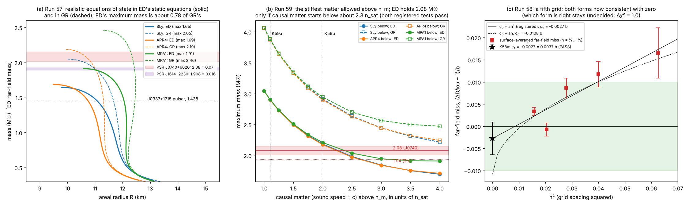

**Reading.**
1. **With realistic equations of state, the pulsar's coefficient is C ≈ 0.40–0.49,** and the triple requires P₀/p_s ≳ 1.7–2.1×10⁵ (red noise) or 2.7–3.3×10⁵ (the planet model). This replaces Run 55's range of 1.4–2.9×10⁵. The remaining spread is the equation of state.
2. **CO's static strong field holds less mass than GR's.** The source term (e + 3p)e^{2U} grows deep in the well (e^{2U} ≈ 5.5–6 at the centre of a maximum-mass star), so stars turn over sooner. **With SLy, APR4 or MPA1 as they are, CO cannot hold the measured 2 M☉ pulsars.** Whether any allowed equation of state can is Run 59.
3. **Scope.** Option A (Run 44: "outside a compact object the field is GR's") covers black-hole exteriors only. The neutron-star interiors here are CO's own static equations. Whether a failure here could be absorbed by extending that tracked input to neutron-star interiors was put up for a ruling. It was ruled (20 October) that CO's interior equations bind (§3).

### Run 58: a fifth grid for the far-field first law

*20 October 2026. (step 3, housekeeping). Registered and hashed before the run (`grid58/PREREG_58.md`, 15:37 UTC). An independent agent checked the run; its corrections are included.*

**Question.** Run 56 passed the far-field first law on the line, with a post hoc 9th point, and could not tell whether the miss shrinks as h or h². Does a fifth grid settle it?

**Setup.**
- Run 53's radius scan at h = ⅛: 9 points, radius about 31–33 cells.
- The outer loop is capped at 30, its count is recorded, and any point that reaches the cap is flagged.
- Simpson's rule for the first law at the middle point.
- The fit is weighted over the scan means at h = ¼, ⅕, ⅙, 1/7 and ⅛.

**Results.**

| h | ¼ | ⅕ | ⅙ | 1/7 | ⅛ |
|---|---|---|---|---|---|
| mean miss (b) | +0.0165 | +0.0118 | +0.0086 | −0.0007 | **+0.0034** |
| standard error | 0.0057 | 0.0029 | 0.0022 | 0.0015 | 0.0009 |

- Two of the nine h = ⅛ points reached the cap (f = 0.970 and 1.045, flagged as registered).
  - The check replayed f = 0.970. The composite drifts until iteration 9, when 60 surface cells switch on, then settles into a two-state cycle whose misses differ by 1.8×10⁻⁶ b.
  - Dropping both capped points moves c₀ by under 0.001 b.
- Simpson's rule at the middle point gives a first-law residual of 3.2×10⁻¹⁰.

| form | c₀ (b) | error (χ²-scaled) | χ²/dof |
|---|---|---|---|
| **c₀ + ah² (registered)** | **−0.0027** | 0.0037 | 12.4/3 |
| c₀ + ah | −0.0108 | 0.0085 | 13.4/3 |
| c₀ + ah + bh² | +0.017 | 0.048 | 11.5/2 |
| constant | +0.0037 | — | 26.9/4 |

**Verdicts, as registered.**
- **K58a PASSES.** c₀ = −0.0027 ± 0.0037 b, within the threshold of 0.01.
- **K58b is UNDECIDED.** Δχ² = +1.0 between the two forms.

**Reading** (corrected by the check).
1. **c₀ = 0 in the continuum is analytic** (Run 50's dilation argument). Five grids give c₀ = −0.003 ± 0.004 b with the h² form or −0.011 ± 0.009 b with the h form, so the form is still undecided.
2. **On the lattice the far-field first law now holds to about 0.5% of κω.** The two-form 2σ envelope is about −0.028 to +0.006 b (b ≈ 0.2). The three-term form is unconstrained. This supersedes Run 56's "about 1%".
3. **The scan means are not independent samples, and their errors understate the scatter.**
   - The spread within each scan scales as h² (sd/h² = 0.17–0.24), so each mean samples a quasi-periodic surface term over a non-integer number of periods.
   - Almost all the χ² comes from h = 1/7: dropping it leaves χ² = 0.5 for 2 degrees of freedom. The h = ⅛ mean is about 5σ above the four-grid prediction.
   - Leaving out one grid at a time gives c₀ from −0.010 to −0.002 (h²) and from −0.028 to −0.009 b (h).
4. **The discrete first law holds to ≤ 2×10⁻⁹ at every kink-free point tested** (Runs 56, 58; Simpson's rule at the h = ⅛ middle point gives 3.2×10⁻¹⁰).

### Run 59: can CO's stars reach the measured 2 M☉ pulsars?

*Note (21 October): these CO results use CO's original rule for space. Under the provisional option 3 (Run 65) CO's stars and exterior are GR's; the results here stand if option 3 is reversed.*

*20 October 2026. It follows the conditional next step set out after Run 57. Registered and hashed before the run (`mmax59/PREREG_59.md`, 15:46 UTC). An independent agent checked the run; its corrections are included.*

**Question.** In CO's static equations the standard equations of state give maximum masses of 1.65–1.91 M☉ (Run 57). PSR J0740+6620 is 2.08 ± 0.07 M☉. The equation of state above about twice nuclear density is uncertain. Can **any** matter that respects causality and nuclear theory hold 2.08 M☉ in CO?

**Method.** The stiffest matter physics allows above a matching rest-mass density n_m: sound speed equal to c, joined continuously to a realistic equation of state below:
$$
p=p_m+(e-e_m),\qquad h=h_m\,\frac{n}{n_m},\qquad e=\tfrac12\Big[(e_m+p_m)\Big(\frac{n}{n_m}\Big)^2+e_m-p_m\Big].
$$
This is the standard maximum-mass construction (Rhoades & Ruffini 1974; Koranda, Stergioulas & Friedman 1997). n_sat = 0.16 fm⁻³. MPA1 below n_m is registered; SLy and APR4 are reported. The same matter is also run in GR.

**Verdicts, as registered** (against J0740: FAIL below 1.94 M☉, PASS at or above 2.08).
- **K59a PASSES** (causal above 1.1 n_sat, where chiral effective field theory is trusted): CO M_max = **2.91 M☉** (GR 3.88).
- **K59b PASSES** (causal above 2 n_sat): CO M_max = **2.21 M☉** (GR 2.94).

**Reported.**

| causal above (n_sat) | 1.0 | 1.1 | 1.5 | 2.0 | 2.5 | 3.0 | 4.0 |
|---|---|---|---|---|---|---|---|
| CO M_max, MPA1 below | 3.05 | 2.91 | 2.51 | 2.21 | 2.04 | 1.95 | 1.91 |
| CO M_max, SLy below | 3.05 | 2.91 | 2.50 | 2.19 | 1.98 | 1.85 | 1.70 |
| GR M_max, SLy below | 4.07 | 3.88 | 3.34 | 2.92 | 2.64 | 2.45 | 2.22 |

- **CO/GR ≈ 0.75 for every causal core,** at every matching density and with all three low-density equations of state (0.749–0.77).
- **The check reproduced K59a and K59b** with its own causal construction and solver (CO 2.9083 and 2.2104; GR 3.8820 and 2.9439). Choosing MPA1 below 1.1 n_sat hardly matters: SLy below gives 2.907.
- **CO reaches 2.08 M☉ only if causal matter begins below about 2.35 n_sat with MPA1 below** (the check's exact crossing; the registered analysis interpolated to 2.38), or about 2.21–2.24 with SLy or APR4 (interpolated 2.24–2.26, probably 0.02–0.03 high in the same way). It reaches 1.94 M☉ only below 2.6–3.1 n_sat. GR reaches 2.08 with APR4 and MPA1 as they are.
- **The ratio is not universal.** It is 0.75 for causal cores and 0.77–0.80 for the standard equations of state. For a softer core, a constant v_s² ≈ 0.33 from 1.1 n_sat, it is 0.875: that core reaches 2.08 M☉ in CO, against 2.38 in GR (the check).
- **The 2.08 M☉ CO star** (causal above 2 n_sat) has an areal radius of 11.8–12.2 km and U_s = 0.36–0.38. NICER's radius for J0740+6620 is about 12.4 km (+1.3/−1.0; inferred assuming GR's exterior).
- **Every maximum-mass star sits at U_c ≈ 0.99–0.995,** so the turning point comes where the central potential reaches about 1.

**Reading.**
1. **No falsification.** CO's static strong field can hold the heaviest measured pulsars with matter allowed by causality and by nuclear theory near saturation density.
2. **The price is stiff matter.** With SLy, APR4 or MPA1 as they are, CO cannot hold J0740 (1.65–1.91 M☉). It needs matter far stiffer than these at 1–3 n_sat. Two examples:
   - MPA1 up to about 2.35 n_sat, then the causal limit;
   - a sustained v_s² ≈ 0.33 from 1.1 n_sat. That gives a pressure at 2 n_sat of about 55 MeV/fm³: 2.2× MPA1's 24.8 and 3× SLy's 18.5.

   GR holds J0740 with APR4 and MPA1 unchanged. This is a requirement on nuclear physics that CO's gravity imposes.
   - It becomes testable through three routes:
     - radii of heavy stars (NICER);
     - tidal deformabilities (gravitational-wave mergers);
     - the dense-matter equation of state from nuclear theory.
   - The constraints astrophysics now quotes on that equation of state were inferred assuming GR. They would have to be redone with CO's equations before they can be used against it.
   - **The gravity-independent test is nuclear theory itself:** chiral effective field theory up to about 1.1–2 n_sat, causality, and perturbative QCD carried down from high density. CO's required pressures (for example about 55 MeV/fm³ at 2 n_sat on the softer route) can be set against those bands directly. That has not been done yet.
   - **K59a's PASS rules out only a causal-limit falsification.** It is not support for CO.
3. **Stability.** Failure-type statements need no stability criterion: along each sequence M_far is a damped spiral, so no static equilibrium is heavier than the turning point (the check). Pass-type statements use the turning point as the stability limit, as in GR, because CO's statics come from one action. Stability beyond it is not derived.
4. **Scope.** These are CO's own interior equations. Option A's GR input covers black-hole exteriors only (Run 44), and it was ruled (20 October) that CO's interior equations bind for neutron stars (§3).

### Run 60: can CO hold 2 M☉ with matter that nuclear theory and QCD allow?

*Note (21 October): these CO results use CO's original rule for space. Under the provisional option 3 (Run 65) CO's stars and exterior are GR's; the results here stand if option 3 is reversed.*

*20 October 2026. (CO's interior equations bind for neutron stars; step 2 is the gravity-independent test). Registered and hashed before the run (`nuc60/PREREG_60.md`, 17:09 UTC). An independent agent reproduced it with its own code; its corrections are included.*

**Question.** Run 59 limited dense matter only by causality. Nuclear theory and QCD limit it further without assuming any theory of gravity. Can CO hold PSR J0740+6620 (2.08 ± 0.07 M☉) with matter they allow?

**The gravity-independent limits.**
- **Chiral effective field theory** at 1.1 n_s (Hebeler et al. 2013, as tabulated by Komoltsev & Kurkela 2022): n_L = 0.176 fm⁻³, p_L ∈ [2.163, 3.542] MeV/fm³. At 2 n_s the N3LO neutron-matter sound speed is c_s² = 0.10 ± 0.07 (Drischler et al. 2020).
- **Causality:** c_s² ≤ 1.
- **Perturbative QCD** at μ_H = 2.6 GeV (Komoltsev & Kurkela 2022, X = 1, 2, 4). A point (μ, n, p) can be joined to QCD by a causal, stable, consistent equation of state if and only if
$$
\frac{n}{\mu}\le\frac{n_H}{\mu_H},\qquad \frac{n(\mu_H^2-\mu^2)}{2\mu}\;\le\;p_H-p\;\le\;\frac{n_H(\mu_H^2-\mu^2)}{2\mu_H},
$$
  with μ = h m_N and n_B = ρ/m_N (so μ n_B = e + p exactly). The check confirms these are the complete conditions from the high-density side.

**Method.** A realistic equation of state up to n_χ, then a constant sound speed c_s² = s:
$$
h=h_m\Big(\frac{n}{n_m}\Big)^{s},\qquad e=e_m+\frac{h_m n_m}{1+s}\Big[\Big(\frac{n}{n_m}\Big)^{1+s}-1\Big],\qquad p=p_m+s\,(e-e_m).
$$
CO's stars of 2.08 and 1.94 M☉ are found with Run 57's solver, and the QCD test is applied at every point from n_χ to each star's centre.

**Verdicts, as registered** (X = 2; X = 1 and 4 agree).
- **K60a PASSES** (chiral EFT to 1.1 n_s, then any c_s² ≤ 1, QCD). With MPA1 or SLy below, CO reaches 2.08 M☉ for s ≥ 0.35 (0.327 on a continuous scale). Every such star passes QCD.
- **K60b PASSES** (SLy or APR4 to 2 n_s, then QCD). CO reaches 2.08 M☉ for s ≥ 0.80. The stars' centres are at 3.1–3.2 n_s and pass QCD. With MPA1 to 2 n_s (reported) s ≥ 0.70 suffices.

| case | smallest s for 2.08 M☉ | CO M_max at s = 1 | GR M_max at that s | centre of the 2.08 M☉ star | CO radius at 2.08 / 1.4 M☉ |
|---|---|---|---|---|---|
| MPA1 or SLy to 1.1 n_s | 0.35 | 2.91 | 2.47 (s = 0.35) | 2.4 n_s (s = 0.35) | 13.8 / 13.9–14.4 km |
| SLy to 2 n_s | 0.80 | 2.19 | 2.72 (s = 0.8) | 3.1 n_s | 11.6 / 12.1 km |
| APR4 to 2 n_s | 0.80 | 2.18 | 2.70 (s = 0.8) | 3.2 n_s | 11.3 km / — |

**What the check added.**
1. **QCD never binds inside these stars.** Continuing each equation of state past the centre, the QCD test first fails at 2.2–2.5 n_s for s = 1 from 1.1 n_s, at 8–15 n_s for s = 0.35, and at 4.4–5.6 n_s for s = 0.8 from 2 n_s. Each is above the centre of the 2.08 M☉ star (1.3, 2.4 and 3.1–3.2 n_s). So both verdicts are set by causality and by where chiral EFT is trusted. That matches Komoltsev & Kurkela's own statement that QCD first limits the equation of state at about 2.2–2.5 n_s.
2. **A jump in c_s² at 2 n_s is not excluded by anything gravity-independent.** p, e and n stay continuous, and the paper allows even first-order transitions.
3. **The reproduction matches.** Centre densities and radii agree with Run 60's own numbers; s = 1 from 1.1 n_s puts the 2.08 M☉ star far down a branch that tops out at 2.91 M☉, so it is large and dilute (centre 1.3 n_s, radius 15.3 km).

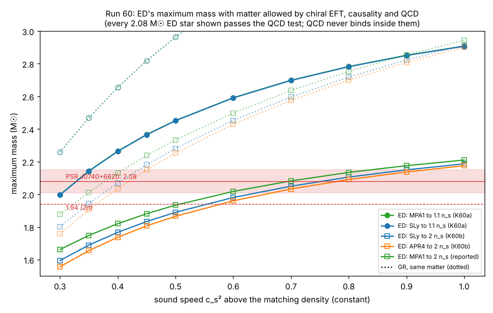

**Reading.**
1. **CO's interior equations survive the gravity-independent test only if dense matter is at or near the causal limit just above where nuclear theory is trusted.** That is a definite, falsifiable requirement on the equation of state, not support for CO. CO needs one of two things:
   - **(a) c_s² ≥ 0.33 from 1.1 n_s.** This sets chiral EFT aside above 1.1 n_s: at 2 n_s it is about 3σ above the N3LO neutron-matter band, and β-equilibrium matter is softer still. It gives large radii, 13.8–15.3 km at 2.08 M☉.
   - **(b) Chiral-EFT-like matter to 2 n_s, then c_s² ≥ 0.8 up to the centre (3.1–3.2 n_s).** SLy and APR4 sit at the stiff 1σ edge at 2 n_s, so a softer base would need s closer to 1. Its radii are about 11.6 km at 2.08 M☉ and 12.1 km at 1.4 M☉.
2. **GR needs neither.** It holds J0740 with APR4 and MPA1 as they are, and with SLy within 1σ. With K60b's s = 0.8 matter it would give 2.7 M☉.
3. **The next tests are radii and tidal deformability.**
   - NICER and GW170817 suggest radii of roughly 12–13 km (to be checked against the papers). That would disfavour route (a) and leave route (b).
   - Those inferences use GR's exterior. CO's exterior agrees with it at first post-Newtonian order but differs at O(U²) in the spatial metric, and CO's tidal Love numbers have not been derived.
   - So the comparison needs CO's own light bending to O(U²) and Love numbers first.

### Run 61: CO's neutron stars against tidal deformability (GW170817) and radii (NICER)

*Note (21 October): these CO results use CO's original rule for space. Under the provisional option 3 (Run 65) CO's stars and exterior are GR's; the results here stand if option 3 is reversed.*

*20 October 2026. The steps:*
1. *derive CO's exterior beyond first order and its tidal Love numbers, then use GW170817 and the NICER radii;*
2. *tighten K60b with a softer chiral-EFT base;*
3. *track the hop as an open tension (§3, §4).*

*Registered and hashed before the run (`tidal61/PREREG_61.md`, 18:00 UTC). One amendment before any result (18:25 UTC; below). An independent agent reproduced the run with its own code; its corrections are included.*

**Question.** Run 60 left CO two routes to PSR J0740+6620 (2.08 M☉) with matter that nuclear theory and QCD allow:
- **(a)** c_s² ≥ 0.33 from 1.1 n_s;
- **(b)** chiral-EFT-like matter to 2 n_s, then c_s² ≥ 0.8.

Stiff matter makes large stars that deform easily under a companion's tide. Does either route also fit how little the stars in GW170817 deformed, and the radii NICER measures?

**CO's exterior, beyond first order.** Outside a star the engine's metric is exactly
$$
ds^2=-e^{-2M/r}dt^2+e^{2M/r}\big(dr^2+r^2d\Omega^2\big)\qquad(\text{isotropic }r).
$$
- It agrees with Schwarzschild at first post-Newtonian order.
- The spatial metric differs at O(U²): e^{2U} = 1 + 2U + 2U², against Schwarzschild's (1 + U/2)⁴ = 1 + 2U + 1.5U².
- For light the medium acts as an optical index n(r) = e^{2M/r}.

**CO's tidal Love number (derived).** A static ℓ = 2 tide perturbs U by δU = H(r)Y₂ₘ.
- The matter stays in balance, h e^{−U} = const, so δh/h = δU.
- With dp = n dh and c_s² = dp/de, this gives δ(e + 3p) = (e + p)(3 + 1/c_s²) δU.
- The source's factor e^{2U} adds 2(e + 3p) δU.
- CO's field equation ∇²U = −4π(e + 3p)e^{2U} is linear in its flat Laplacian, so
$$
H''+\frac2rH'-\frac{6}{r^2}H=-4\pi e^{2U}\Big[(e+p)\Big(3+\frac1{c_s^2}\Big)+2(e+3p)\Big]H .
$$
- Outside the star the right side vanishes, so H = a r² + b r⁻³ exactly. The ratio b/(3a) is the tidal deformability λ, the same quantity the Newtonian limit and GR's asymptotic expansion define.
- With y = rH'/H at the surface and U_s = M/R_coord:
$$
\Lambda\equiv\frac{\lambda}{M^5}=\frac{2-y_s}{3\,(3+y_s)\,U_s^5},\qquad k_2=\frac{2-y_s}{2(3+y_s)}\ \text{(weak field)}.
$$
- GR's Λ (Hinderer 2008; Postnikov et al. 2010) is computed with the same equation-of-state code, for comparison.

**Data.**
- **GW170817:**
  - Λ̃ = 300 (+420/−230), the 90% highest-density interval with a low-spin prior (Abbott et al. 2019, PRX 9, 011001), so Λ̃ ≤ 720;
  - chirp mass 1.186 M☉, so equal masses of 1.362 M☉, where Λ̃ = Λ(1.362);
  - Λ(1.4) = 190 (+390/−120), 90% (Abbott et al. 2018, PRL 121, 161101). It was registered as reported only; it rests on GR's quasi-universal relations, so it is shown but not used as a test (the check).
- **NICER (68%):**
  - PSR J0437−4715: 11.36 (+0.95/−0.63) km at 1.418 M☉ (Choudhury et al. 2024);
  - PSR J0740+6620 at 2.08 M☉: 12.39 (+1.30/−0.98) km (Riley et al. 2021), 12.92 (+2.09/−1.13) km (Dittmann et al. 2024), 13.7 (+2.6/−1.5) km (Miller et al. 2021).
- **NICER's radii assume GR's exterior.** For CO's stars the run gives two "GR-equivalent" radii: the Schwarzschild radius with the same grazing deflection of light, and the one with the same surface redshift.

**Families.**
- **The softer base (new):** SLy to 1.1 n_s; then a constant c_s² = c₁ to 2 n_s, with c₁ = 0.10 (N3LO's central value; registered), or 0.03 and 0.17 (its 1σ edges); then c_s² = s.
- **Run 60's families:** route (a), SLy to 1.1 n_s then s = 0.35–1; route (b), SLy, APR4 or MPA1 to 2 n_s then s = 0.7–1.

**The amendment (before any result).** The first launch computed c_s² as a numerical derivative. Near the surface h − 1 falls below double precision, the derivative vanished, the tidal equation went stiff and the process ran out of memory. The fix uses the analytic c_s² = KΓn^{Γ−1}/h of each polytropic piece. It was recorded in the pre-registration and re-hashed before relaunch; nothing else changed.

**Verdicts, as registered.**
- **K61c PASSES (code check).** At weak field CO's Love number is 0.25986, against the Newtonian n = 1 polytrope's (15 − π²)/(2π²) = 0.25991 (largest deviation 0.06%). GR's code gives SLy Λ(1.4) = 296 at R = 11.71 km, against the literature's roughly 300. (GR's own weak-field values, 0.2624 and 0.2546, are cancellation noise in GR's k₂ formula at tiny compactness and are not a check.)
- **K61a PASSES (the softer base).** With N3LO's central c_s² = 0.10 from 1.1 to 2 n_s, CO holds a QCD-allowed 2.08 M☉ star for s ≥ 0.8 (M_max 2.10, 2.14, 2.18 for s = 0.8, 0.9, 1.0; 2.05 for s = 0.7). At c₁ = 0.03 it needs s ≥ 0.9; at c₁ = 0.17, s ≥ 0.7.
- **K61b PASSES (GW170817), conditionally.** Every route-(b) family that holds 2.08 M☉ has Λ_ED(1.362) = 374–658 ≤ 720. The condition (the check): the bound was extracted with GR's inspiral phasing through 3.5 post-Newtonian orders, which CO has not been shown to share (below).

| family (base, then c_s²) | CO M_max | Λ(1.362), CO (GR) | Λ(1.4) | R(1.418) [GR-equivalent] | R(2.08) [GR-equiv.: deflection / redshift] |
|---|---|---|---|---|---|
| **route (a):** SLy to 1.1 n_s, s = 0.35 | 2.14 | **1230** (1401) | 1068 | 13.93 [13.46] | 13.78 [13.02 / 13.57] |
| route (a): s = 1.0 | 2.91 | **1588** (1765) | 1400 | 14.41 [13.94] | 15.31 [14.57 / 15.14] |
| **softer base** c₁ = 0.10, s = 0.8 | 2.10 | 463 (570) | 395 | 12.18 [11.70] | 11.60 [10.78 / 11.31] |
| c₁ = 0.10, s = 1.0 | 2.18 | 475 (582) | 407 | 12.22 [11.74] | 12.03 [11.23 / 11.77] |
| c₁ = 0.03, s = 0.9 / 1.0 | 2.11 / 2.15 | 374 / 382 | 321 / 329 | 11.63 / 11.67 [11.14 / 11.18] | 11.38 / 11.61 |
| c₁ = 0.17, s = 0.7–1.0 | 2.10–2.22 | 651–658 (794–799) | 549–557 | 12.81–12.83 [12.33–12.35] | 11.98–12.51 |
| **route (b):** SLy to 2 n_s, s = 0.8 / 1.0 | 2.11 / 2.19 | 449 / 461 (552 / 563) | 384 / 395 | 12.08 / 12.12 | 11.61 / 12.01 |
| APR4 to 2 n_s, s = 0.8 / 1.0 | 2.09 / 2.17 | 408 / 423 (504 / 518) | 350 / 364 | 11.82 / 11.88 | 11.33 / 11.84 |
| MPA1 to 2 n_s, s = 0.7 / 1.0 | 2.08 / 2.21 | 506 / 518 (620 / 631) | 432 / 444 | 12.29 / 12.33 | 11.48 / 12.22 |
| **bound** | ≥ 2.08 | **≤ 720** (90%) | (≤ 580, shown only) | 11.36 (+0.95/−0.63), J0437 | 12.39 (+1.30/−0.98), J0740 (Riley) |

Radii are areal, in km; the GR-equivalent radius in brackets is the one with the same grazing deflection. Every 2.08 M☉ star listed passes the QCD test (X = 1, 2, 4); their centres are at 2.5–3.4 n_s on route (b) and 1.3–2.4 n_s on route (a).

**Reported.**
1. **Route (a) is excluded by GW170817 and disfavoured by J0437, independently.**
   - Λ(1.362) = 1230–1588, 1.7–2.2 times the 90% bound. A modest systematic in the inspiral phasing would not close a factor of about 2.
   - R(1.418) = 13.9–14.4 km (GR-equivalent 13.5–13.9 km): 1.1–1.6 km above the upper end of J0437's 68% interval (12.31 km).
2. **Route (b) fits GW170817 and J0437.** Λ(1.362) = 374–658 sits inside GW170817's 90% interval, above its median of 300. R(1.418) = 11.6–12.8 km (GR-equivalent 11.1–12.35 km) lies inside J0437's 68% interval, with c₁ = 0.17 at its upper edge.
3. **Route (b) is in mild tension with J0740's radius.** At 2.08 M☉ it gives R = 11.3–12.5 km in CO's metric; a GR-based analysis would read these stars as 10.5–11.7 km (same deflection) or 11.0–12.3 km (same redshift).
   - That sits at or below the lower ends of the 68% intervals: Riley et al. 11.41 km, Dittmann et al. 11.79 km, Miller et al. 12.2 km. In σ, the GR-equivalent radii are 0.7–1.9σ below Riley and up to about 2σ below Dittmann and Miller.
   - Route (a) (13.8–15.3 km) fits Dittmann and Miller and sits at Riley's upper edge.
   - Reported, not tested: NICER's pulse-profile fits were not redone in CO's metric.
4. **How large the metric difference is.** For the same star a GR-based reading is smaller than CO's areal radius by 0.47–0.49 km at 1.418 M☉ and 0.74–0.84 km at 2.08 M☉ (same grazing deflection), or by 0.07–0.10 and 0.17–0.31 km (same redshift). A real pulse-profile fit would land between the two.
5. **CO's stars deform less than GR's for the same matter:** Λ_ED(1.362) = 0.80–0.82 Λ_GR on route (b) and 0.88–0.90 on route (a). A star of given mass is more compact in CO (Run 57): at 1.4 M☉ about 0.2–0.3 km smaller.
6. **GR does not need any of these families.** With route (b)'s matter it would give 2.6–3.0 M☉ maxima and Λ(1.362) = 462–799; the c₁ = 0.17 families would fail GW170817 in GR (794–799).

**What the check added.**
1. **The tidal equation and Λ are confirmed.** The agent derived the ℓ = 2 equation itself (δe = (e + p)δU/c_s², δp = (e + p)δU, plus 2(e + 3p)δU from e^{2U}) and confirmed λ = b/(3a) as the quantity the leading tidal term of a waveform measures.
   - Changing from isotropic to areal radius adds no r⁻³ term (the change is a terminating polynomial).
   - Reading the response from g_tt = −e^{−2U} instead of from U changes Λ by only −4/45.
2. **The reproduction matches.** With its own code: route (b), SLy to 2 n_s with s = 0.8, Λ(1.362) = 448.8, R(1.418) = 12.079 km, R(2.08) = 11.607 km; route (a), s = 0.35, 1230.4, 13.927 and 13.780. Its own TOV gives SLy's GR Λ(1.4) = 295.6. Its own light-bending quadrature, in u = 1/r, matches the GR-equivalent radii to better than 1 m. The integration warnings came from the bracket end next to GR's photon sphere; the roots sit at R/M ≈ 3.5–4.5.
3. **Does GW170817's bound apply to CO? Conditionally.**
   - What carries over: the leading tidal physics. CO's exterior field is linear, so superposition and Newtonian tidal coupling hold exactly at that order, and the chirp mass is a far-field mass, as in GR.
   - What does not: Λ̃ was extracted with GR waveform models (GR point-particle phasing through 3.5PN, NR-calibrated tidal terms). Λ̃ enters at 5PN, so any CO difference at 1–3.5PN would bias it. CO's two-body dynamics beyond first post-Newtonian order, and its radiation beyond the leading quadrupole, have not been derived. The registered reading ("ED reproduces both") was too strong.
4. **Provenance.** The current files match the amendment's hashes, and the registration text is unchanged apart from the added amendment section. The original `star61.py` was not kept, so that only `cs2` changed rests on this record rather than on a hash. The analytic sound speed it now uses is correct (c_s² = KΓn^{Γ−1}/h = Γp/(e + p) for a polytropic piece).

**Reading.**
1. **CO survives the tidal and radius tests on one route only.** With CO's interior equations binding (the ruling), the heaviest pulsars, nuclear theory, QCD and GW170817 together leave CO one kind of dense matter:
   - like chiral EFT up to about 2 n_s (c_s² ≈ 0.03–0.17);
   - then a sharp stiffening, to c_s² of at least 0.7–0.9 (depending on the base below), from about 2 n_s up to the centres of the heaviest stars (2.5–3.4 n_s).
   - Route (a), stiff from 1.1 n_s, is excluded by GW170817 and disfavoured by J0437.
2. **This is a definite prediction about nuclear matter between 2 and 3 n_s, independent of gravity:** the sound speed must rise from about 0.1 to at least about 0.7–0.9 there. GR needs no such rise. Laboratory constraints at 2–4 n_s (heavy-ion collision flow) and nuclear theory carried to 2–3 n_s can test it.
3. **The surviving route is not comfortable.** Its heavy stars are small: J0740's radius sits 1–2σ above what a GR-based analysis would infer for them. Redoing NICER's fit with CO's exterior would make this a test.
4. **Conditions on the tidal verdict.** CO's Λ and radii here are its own, from its exact exterior and its own Love-number equation. K61b's PASS holds if CO's inspiral matches GR's through 3.5PN, which has not been derived. Route (a)'s exclusion is less exposed to that condition: it misses by a factor of about 2, and J0437 disfavours it without any waveform. *Later (Run 63): CO's own exterior gives a different inspiral from GR's at 2PN, so the condition is not met as such; how much that biases Λ̃ is not yet known.*

### Run 62: the dense matter CO needs, against heavy-ion collisions

*Note (21 October): these CO results use CO's original rule for space. Under the provisional option 3 (Run 65) CO's stars and exterior are GR's; the results here stand if option 3 is reversed.*

*20 October 2026. (step 1: set route (b)'s pressure at 2–4 n_s against the heavy-ion collision bounds, which come from collision experiments, not gravity). Registered and hashed before the run (`hic62/PREREG_62.md`, 19:09 UTC). An independent agent checked it; its corrections are included.*

**Question.** Runs 60–61 leave CO one kind of neutron-star matter: like chiral EFT up to about 2 n_s, then a sharp stiffening (c_s² ≳ 0.7–0.9) up to the centres of the heaviest stars. Gold-nucleus collisions compress nuclear matter to 2–4.5 n_s in the laboratory, and the flow of the debris measures its pressure, with no theory of gravity involved. Do they allow the matter CO needs?

**The laboratory data.**
- **Symmetric nuclear matter (equal neutrons and protons) at 2 n₀:** P = 10.1 ± 3.0 MeV/fm³. This is the flow band of Danielewicz, Lacey & Lynch (2002) at 2 n₀, as tabulated by Tsang et al. (2024); FOPI's flow gives 10.3 ± 2.8.
- **Above 2 n₀:** the sound speed of symmetric matter from STAR's flow (Oliinychenko, Sorensen, Koch & McLerran 2023, Bayesian best fit):
  - c² = 0.47 ± 0.12 on 2–3 n₀;
  - c² = −0.08 ± 0.14 on 3–4 n₀, a softening the authors read as a possible phase transition.
  - The authors caution that the model's systematic errors are not yet assessed, and that the older E895 data prefer a moderately soft equation of state on both intervals.
- **From symmetric to neutron-rich matter: the symmetry energy.** Above 2 n₀ it is poorly known. DLL bracketed it with two forms (u = n/n₀):
$$
S_{\rm F1}=12.7\,u^{2/3}+38\,\frac{u^2}{1+u}\ \text{(stiff)},\qquad S_{\rm F3}=12.7\,u^{2/3}+19\,u^{1/2}\ \text{(soft)}\quad[\text{MeV}],\qquad P_{\rm sym}=n^2\frac{dS}{dn}.
$$
  F1 is generous: its slope at n₀ is L ≈ 111 MeV, above most current estimates (about 40–80 MeV).

**The bound on neutron-star matter.** The symmetric-matter pressure is integrated from its anchor with the measured sound speeds,
$$
\frac{de}{dn}=\frac{e+p}{n},\qquad dp=c^2\,de ,
$$
and the symmetry pressure is added:
$$
B(n)=P_{\rm SNM}(n)+P_{\rm sym}(n)\ \ge\ P_\beta(n)=P_{\rm SNM}+\delta^2P_{\rm sym}+P_{\rm lep}.
$$
Neutron-star matter (β-equilibrium, neutron excess δ < 1) sits below pure neutron matter, so B caps it.

| bound | P(2n₀) | c² on 2–3 / 3–4 n₀ | symmetry energy | B at 2, 2.5, 3, 3.5, 4 n₀ (MeV/fm³) |
|---|---|---|---|---|
| **B2** (K62a) | 16.1 (+2σ) | 0.71 / 0.20 (+2σ) | stiff (F1) | 42, 118, 207, 251, 298 |
| **B1** (K62b) | 13.1 (+1σ) | 0.59 / 0.06 (+1σ) | stiff (F1) | 39, 104, 178, 206, 238 |
| B2, soft symmetry (reported) | 16.1 | 0.71 / 0.20 | soft (F3) | 25, 89, 164, 190, 217 |
| B1, no softening (reported) | 13.1 | 0.59 / 0.59 | stiff (F1) | 39, 104, 178, 262, 354 |

The bound acts on 2–4 n₀, where the sound-speed intervals are; above 4 n₀ only causality applies.

**Method.** The stiffest matter each bound allows: a base equation of state to 2 n_s, then c_s² = s, following the bound wherever the s-path would cross it (never stiffer than s), and c_s² = s again above 4 n₀. s = 1 is the stiffest. Bases: SLy or APR4 to 2 n_s, or SLy to 1.1 n_s then c_s² = 0.03, 0.10 or 0.17 to 2 n_s (Run 61). CO's stars come from Run 57's solver and Run 61's tidal code.

**Verdicts, as registered.**
- **K62c PASSES (code check).** With no bound, the tabulated equation of state reproduces Run 61's family (SLy to 2 n_s, s = 0.8 and 1.0) to 10⁻⁹ in M_max and Λ(1.362).
- **K62a PASSES (B2: 2σ, stiff symmetry energy).** 15 families hold a QCD-allowed 2.08 M☉ CO star with Λ(1.362) ≤ 720. CO's largest maximum mass is 2.19 M☉.
- **K62b PASSES (B1: 1σ, stiff symmetry energy), with little room.** 13 families pass; CO's largest maximum mass is 2.13 M☉. Several pass by a few hundredths: SLy at s = 0.8 gives 2.084, and the c₁ = 0.10 base at s = 0.8 gives 2.080.

| base to 2 n_s | B2 (K62a): smallest s for 2.08 / M_max at s = 1 | B1 (K62b): smallest s / M_max at s = 1 | B2, soft symmetry energy: M_max at s = 1 | B1, no softening: M_max at s = 1 |
|---|---|---|---|---|
| SLy | 0.8 / 2.17 | 0.8 / 2.11 | 2.05 | 2.13 |
| APR4 | 0.8 / 2.16 | 0.9 / 2.11 | 2.05 | 2.13 |
| SLy, then c_s² = 0.03 from 1.1 n_s | 0.9 / 2.14 | 1.0 / 2.10 | 2.05 | 2.12 |
| SLy, then c_s² = 0.10 from 1.1 n_s | 0.8 / 2.17 | 0.8 / 2.11 | 2.05 | 2.12 |
| SLy, then c_s² = 0.17 from 1.1 n_s | 0.7 / 2.19 | 0.7 / 2.13 | excluded at 2 n_s | 2.14 |
| MPA1 (reported) | 0.8 / 2.19 | 0.8 / 2.12 | — | — |

Every 2.08 M☉ star in the table passes the QCD test; their centres are at 2.6–3.6 n_s. The bound binds in every family that reaches 2.08 M☉, from about 2.2–3.3 n_s up to 4 n₀.

**Reported.**
1. **With the soft symmetry energy (F3), CO cannot reach 2.08 M☉.** Its largest maximum mass is 2.055 M☉ (APR4 base, s = 1). That is short of J0740's central mass but within its 1σ (2.08 ± 0.07). The c₁ = 0.17 base is excluded outright: its pressure at 2 n_s (28.5 MeV/fm³) is above the bound there (24.7).
2. **Without the softening above 3 n₀ (B1, no softening)** CO passes, with the largest maximum mass 2.14 M☉. So K62b's narrow pass is set mostly by the bound on 2–3 n₀ and the symmetry energy, not by the softening.
3. **Run 61's route-(b) families against the bounds** (largest p/B between 2 n_s and the 2.08 M☉ star's centre): 0.85–1.08 under B2, 0.99–1.23 under B1, 1.15–1.42 with the soft symmetry energy. Those with s = 1 overshoot B2 slightly (by up to 8%), which the capped families avoid at little cost in mass.
4. **GR with the same capped matter** reaches 2.55–2.72 M☉ (s = 1), so the heavy-ion bound leaves GR ample room. CO's maxima are 0.80–0.83 of GR's.

**How stiff must the symmetry energy be? (post hoc, reported).** A one-parameter family between DLL's two forms,
$$
S_w=12.7\,u^{2/3}+19\Big[w\,\frac{2u^2}{1+u}+(1-w)\,u^{1/2}\Big],\qquad L=53.9+57\,w\ \text{MeV},\qquad S_w(2n_0)=47.0+23.8\,w\ \text{MeV},
$$
with the stiffest matter (s = 1) on the SLy, APR4 and c₁ = 0.17 bases:

| w (L, S(2n₀)) | 0 (54, 47) | 0.25 (68, 53) | 0.5 (82, 59) | 0.75 (97, 65) | 1 (111, 71) |
|---|---|---|---|---|---|
| CO's largest M_max, 2σ SNM | 2.055 | 2.100 | 2.136 | 2.165 | 2.189 |
| CO's largest M_max, 1σ SNM | — | 1.978 | 2.043 | 2.089 | 2.127 |

- So CO reaches 2.08 M☉ within the 2σ bound if L ≳ 63 MeV (S(2n₀) ≳ 51 MeV), and within the 1σ bound only if L ≳ 94 MeV (S(2n₀) ≳ 64 MeV).
- In this family that is a statement about P_sym at 2–3 n₀; L and S(2n₀) only label it.

**What the check added.**
1. **The data readings and the bound values are confirmed:** the DLL anchor (Tsang et al. 2024, Table I, 1σ error bars), Oliinychenko et al.'s best-fit values, DLL's two symmetry energies (S(2n₀) = 70.8 and 47.0 MeV, L = 110.9 and 53.9 MeV), and the tabulated B1 and B2.
   - Reading Oliinychenko et al.'s ± as 1σ is reasonable but not stated in the paper.
   - B2's +2σ anchor (16.1) already lies beyond DLL's published band, and taking the same edge on all three inputs at once is more generous than a joint 1σ or 2σ.
2. **The reproduction matches**, with the agent's own code: B1, SLy, s = 0.8 gives 2.0841 M☉ (centre of the 2.08 M☉ star at 3.333 n_s); the soft-symmetry APR4 and SLy cases give 2.0547 and 2.0536.
3. **The cap is sound but loose, and that decides the reading.**
   - The inequality P_β ≤ P_SNM + P_sym holds throughout (the agent solved β-equilibrium with electrons and muons).
   - But with the stiff symmetry energy the proton fraction is large (0.16–0.27), so pure neutron matter overstates neutron-star pressure by 12–74 MeV/fm³.
   - The cap the same inputs actually imply is
$$
B_\beta(n)=P_{\rm SNM}(n)+\delta^2(n)\,P_{\rm sym}(n)+P_{\rm lep}(n),
$$
     with δ and the lepton pressure from β-equilibrium. Under it, the agent found CO's best maximum mass to be 2.09 M☉ at 2σ (K62a would pass by about 0.01) and 1.96 M☉ at 1σ (K62b would be UNDECIDED).
   - The registered verdicts stand as registered; the reading below uses B_β.
4. **Is s = 1 under the cap the best path?** Supported, not proven. It maximises the pressure at each density, not at each energy density. Paths that stay soft and then go causal, which the agent tried, all gave lower CO maxima.
5. **Not purely gravity-independent.** The PASS criterion includes GW170817's Λ ≤ 720, which carries the GR-waveform caveat (Runs 61, 63).
6. **The crash was benign.** The table was built before the exclusion check; it hit only a reported family, and the post hoc record matches the registered intent. Fix the order before any reuse.
7. **Symmetry-energy constraints from the laboratory**, for comparison:
   - ASY-EOS: L = 72 ± 13 MeV (S(2n₀) ≈ 56 ± 5 MeV, the agent's estimate);
   - SπRIT: 42 < L < 117 MeV;
   - PREX-II: L = 106 ± 37 MeV;
   - CREX favours lower L.
   - Constraints on S(2n₀) derived from neutron stars assume GR and are not used.

**The same scan with the β-equilibrium cap (post hoc, after the check).** B_β is computed for each symmetry energy S_w (β-equilibrium with electrons and muons, parabolic in δ):

| w (L, S(2n₀)) | 0 (54, 47) | 0.25 (68, 53) | 0.5 (82, 59) | 0.75 (97, 65) | 1 (111, 71) |
|---|---|---|---|---|---|
| proton fraction at 2 / 3 / 4 n₀ | 0.08 / 0.10 / 0.12 | 0.10 / 0.14 / 0.17 | 0.12 / 0.17 / 0.21 | 0.14 / 0.20 / 0.24 | 0.16 / 0.23 / 0.27 |
| B_β at 3 n₀, 2σ / 1σ (MeV/fm³) | 160 / 131 | 165 / 136 | 168 / 139 | 170 / 141 | 171 / 142 |
| CO's largest M_max, 2σ SNM | 2.04 | 2.06 | 2.07 | 2.086 | 2.09 |
| CO's largest M_max, 1σ SNM | 1.88 | 1.92 | 1.94 | 1.95 | 1.96 |

- At 2σ, the c₁ = 0.17 base is excluded at 2 n_s for w ≤ 0.5 (its pressure there, 28.5 MeV/fm³, is above B_β).
- **So with the cap the inputs actually imply, CO reaches 2.08 M☉ only at the +2σ edge of all three heavy-ion inputs together and with L ≳ 95 MeV (S(2n₀) ≳ 64 MeV).** At the 1σ edge no symmetry energy up to DLL's stiff one gets it past 1.96 M☉.
- These maxima are within J0740's 2σ (2.08 ± 0.07, so ≥ 1.94) except at 1σ with the softest symmetry energies (1.88–1.92).

**Reading.**
1. **The registered verdicts pass, but the corrected reading is a squeeze, not a pass.** With the bound the same laboratory inputs imply for neutron-star matter (B_β), CO holds PSR J0740+6620 at its central mass only if three things hold at once:
   - symmetric matter's pressure at 2–4 n₀ sits at the +2σ edge of every heavy-ion input at once;
   - the symmetry energy is stiff (L ≳ 95 MeV, S(2n₀) ≳ 64 MeV), against ASY-EOS's 72 ± 13 MeV and PREX-II's 106 ± 37;
   - c_s² ≈ 1 from about 2 n_s up to the centre.
   Otherwise CO's heaviest stars are 1.88–2.07 M☉: below J0740's central mass, mostly within its 2σ.
2. **This is the sharpest constraint on CO's interior equations so far, and it is gravity-independent** (apart from Λ ≤ 720, which only selects among already-stiff families). It is not a falsification: the heavy-ion inputs are model-dependent transport analyses, the 2σ edges are where CO still fits, and J0740's mass is uncertain by 0.07 M☉.
3. **GR is comfortable on the same inputs:** 2.55–2.72 M☉ with the neutron-matter cap, so well above 2.08 with any cap.
4. **What would decide it:**
   - the symmetry energy at 2–3 n₀ (FRIB, FAIR, more neutron-skin data): L well below about 90 MeV would leave CO short of J0740's central mass;
   - heavy-ion flow at 2–4 n₀ with assessed model systematics (Oliinychenko et al.'s own caveat);
   - a heavier pulsar: anything above about 2.1 M☉, measured precisely, would exceed every CO maximum under B_β.

### Run 63 (a derivation): CO's inspiral beyond first order, in the test-mass limit

*Note (21 October): these CO results use CO's original rule for space. Under the provisional option 3 (Run 65) CO's stars and exterior are GR's; the results here stand if option 3 is reversed.*

*20 October 2026. (step 2: derive CO's two-body motion beyond first order, the condition for GW170817's tidal bound to apply to CO). This is a derivation, not a registered test: the numbers below are exact and were derived before any comparison was set up, so nothing here is scored. An independent agent checked it; its corrections are included.*

**Question.** GW170817's tidal bound (Run 61) and the gravitational-wave tests of GR assume the inspiral's phase follows GR's to 3.5 post-Newtonian orders. CO matches GR at first order (Run 34). Where does it first differ, and by how much?

**What can be derived now: the test-mass limit.** A small body orbiting a much heavier one follows a geodesic of CO's exact exterior (the pattern rule, Runs 16, 46):
$$
ds^2=-A\,dt^2+B\,(dr^2+r^2d\Omega^2),\qquad A=e^{-2M/r},\quad B=e^{2M/r}.
$$
- **Circular orbits.** For a static metric, Ω² = A′/(Br²)′ and the energy per unit rest mass is E = A/√(A − Br²Ω²). With y = M/r:
$$
(M\Omega)^2=\frac{y^3e^{-4y}}{1-y},\qquad E=e^{-y}\sqrt{\frac{1-y}{1-2y}} .
$$
- **As a series in x = (MΩ)^{2/3}** (exact rational arithmetic, `inspiral63/derive63.py`):
$$
E_{\rm CO}-1=-\frac x2\Big[1-\tfrac34x-\tfrac{89}{24}x^2-\tfrac{7195}{576}x^3-\dots\Big],
$$
$$
E_{\rm GR}-1=-\frac x2\Big[1-\tfrac34x-\tfrac{27}{8}x^2-\tfrac{675}{64}x^3-\dots\Big].
$$
- **So CO and GR agree at first order and differ at second:** CO's 2PN binding coefficient differs by −1/3 (8/81, about 10%, larger in magnitude). The 3PN coefficients differ too (−7195/576 against −6075/576). The cause is the spatial metric at O(U²): e^{2U} = 1 + 2U + 2U², against Schwarzschild's 1 + 2U + 1.5U²; g_tt also differs at O(U³).
- **The innermost stable orbit** (as in Run 28): r = (3 + √5)M in isotropic coordinates (areal radius 6.34M, GR 6M), at MΩ = 0.0633 (GR 0.0680, 7% lower), with E = 0.9452 (GR 0.9428). It lies outside CO's neutron stars (19.5 km at 2.08 M☉), so it matters for them.
- **The light ring** (Run 28): areal radius 3.30M (GR 3M); critical impact parameter 2eM = 5.44M (GR 3√3M = 5.20M). It lies inside CO's neutron stars (areal radius about 3.8–4.1M at 2 M☉), and under option A black holes have Kerr exteriors, so it applies to neither.

**What it would do to the waveform (conditional).** The gravitational-wave phase (TaylorF2) at 2PN carries φ₄ = 10 r₄, where r₄ is the v⁴ coefficient of E′(v)/F(v).
- With E′/F ∝ v⁻⁹(1 + Σ r_k v^k), the stationary-phase integral gives
$$
\varphi_k=\frac{40\,r_k}{(8-k)(5-k)},\qquad \varphi_4=10\,r_4 ,
$$
  which reproduces GR's test-mass φ₂ = 3715/756, φ₃ = −16π and φ₄ = 15293365/508032.
- If CO's flux F were GR's (not derived: CO's radiation is known only at leading quadrupole order, Run 11b), CO's binding energy alone shifts φ₄ by exactly −10.
- **An illustration, not a prediction:** that is δφ̂₄ = −0.33 in the test-mass limit, or −0.22 for equal masses if the shift did not depend on the mass ratio (an unfounded assumption). CO also changes φ₆, while the published bounds vary one coefficient at a time.
- **No current gravitational-wave bound tests it** (the check, below). GWTC-4.0's combined tests are mostly binary black holes (δφ̂₄ = −0.03 (+0.16/−0.15) and 0.11 ± 0.23 with one common value; about ±0.45 when each event may differ, 90%). Under option A a black hole's exterior is GR's, so this shift does not apply to them.

**What the check added.**
1. **The algebra is confirmed by hand:** the orbit formulas, the series (ln x = ln y − y + y²/6 + y³/9; ln E = −x/2 + x²/4 + 2x³ + (517/72)x⁴), the ISCO (4y² − 6y + 1 = 0) and the light ring. The TaylorF2 map and Δφ₄ = −10 are confirmed.
2. **Test bodies do move on geodesics here.** The adopted pattern rule (Run 46) is exactly the Klein–Gordon equation in −N²dt² + N⁻²dx², whose wave packets follow its geodesics. For bodies at relativistic speed this rests on the ruling that inertia = total energy, up to the strong-equivalence-principle term (≲ 10⁻⁵, Run 55). The exterior applies when the central body is a CO star.
3. **What CO's rules fix and do not fix.** Fixed: the test-mass dynamics in this exterior; the 1PN two-body dynamics for any mass ratio (γ = β = 1, no preferred-frame terms); the leading quadrupole flux. Not fixed, so each needs a ruling:
   - **(i) option A for binaries:** does "GR's exterior" cover the near zone of a binary black hole, or the black hole of a neutron-star–black-hole binary, or only isolated holes?
   - **(ii) the two-body field beyond first order:** does the boosted-rest-field input hold at O(v⁴) and O(v²U); how do two bodies' fields combine (each draw is redshifted by the other's field, and the metric is exponential in the total U); what is the current field at O(v³)?
   - **(iii) motion in that field at 2PN.**
   - **(iv) radiation beyond the quadrupole:** the 1PN source multipoles, propagation on the curved background (GR's 4πv³ tail), any scalar or dipole channel, and which energy balances the flux.
   - **(v) a conserved binary energy including radiation** (Run 52's E_H is defined for static configurations).
   Even the test-mass flux is GR's here only by assumption: in GR the 2PN test-mass flux depends on the background metric at 2PN, which CO changes.

**Reading.**
1. **CO's inspiral is not GR's beyond first order.** Its exterior differs at O(U²), so the binding energy differs at 2PN already in the test-mass limit. *(Run 64: this holds if a body's own binding tension does not shear space; otherwise the test-mass coefficient is −65/24 or −27/8, depending on the ruling.)* GW170817's tidal bound (Run 61) assumed the two agree to 3.5PN, so K61b's PASS rests on an assumption CO's own exterior does not satisfy. How much this biases Λ̃ needs the full two-body phase.
2. **The size is not small:** a 10% change in the 2PN binding coefficient is about −0.2 to −0.3 in δφ̂₄, comparable to what binary-black-hole tests now resolve. Those tests may not apply to CO (option A), and the number itself assumes GR's flux.
3. **What is missing before this is a test** (rulings (i)–(v) above):
   - **Which binaries CO's exterior applies to.** Under option A black-hole binaries may be GR's, so their bounds would test nothing in CO. Neutron-star binaries do test it; GW170817's coefficient bounds exist (Abbott et al. 2019) but are given only in a figure and have not been read here, and the checker knows of no such test with GW190425.
   - **CO's flux beyond leading order.** Run 11b gives the leading quadrupole (0.98 of GR on the lattice). The 1PN flux coefficient alone would be tested at the ±0.07 level (δφ̂₂).
   - **The equal-mass terms at 2PN.** They need CO's field for moving sources beyond first order, where the adopted rules do not yet say what happens.

### Run 64 (a reading, not scored): what CO's rules leave open beyond first order

*20–21 October 2026. Writing ruling 2 out precisely enough to derive CO's second-order two-body dynamics showed that one choice it hides is a decision about CO's statics. This section sets out what is fixed, the decision, and what each option implies. Nothing here is scored. An independent agent checked it; its corrections are included.*

**What the rulings fix.**
- **First order is GR's, for any masses.** CO's g₀₀ = −e^{−2U_T}, where each body draws by its redshifted Tolman draw, gives
$$
U_T=\sum_A\frac{m_A\big(1+\tfrac32v_A^2-U_{\neg A}(x_A)\big)}{r_A},
$$
  and −1 + 2U_T − 2U_T² is GR's first-order g₀₀ written with conserved masses. Combined with γ = β = 1 and the Lorentz input (Run 34), the two-body dynamics are Einstein–Infeld–Hoffmann's.
- **The static two-body interaction is fixed exactly by the redshifted draw.** Without field self-energy (the vacuum draws nothing), the two-body Fokker Lagrangian at rest is
$$
L=-m_1e^{-\mu_2/r}-m_2e^{-\mu_1/r}-\frac{\mu_1\mu_2}{r},\qquad \mu_A=m_Ae^{-\mu_B/r}\ \ (\text{the draw }mN),
$$
$$
L=-(m_1+m_2)+\frac{m_1m_2}{r}-\frac{m_1m_2(m_1+m_2)}{2r^2}+\frac{m_1m_2(m_1^2+m_2^2)/6+m_1^2m_2^2}{r^3}+\dots
$$
  The G² term is Einstein–Infeld–Hoffmann's. The G³ term is CO's own, in CO's coordinates (`open64/static_two_body.py`).
- **The test-mass orbit in CO's static exterior is fixed (Run 63).**

**What they do not fix: whether the tension of the relations around a single body shears space.**
- **Run 11b's premise.** Radiation needs the relations binding a system to carry tension. Momentum conservation, ∂_μ(T^{μν} + t^{μν}) = 0, demands it, and the shear is sourced by matter's stress plus that tension.
- **The same law applies to a single static star.** Its matter's pressure gradient is balanced by the tension of its own relations,
$$
t_{ij}=\frac{1}{4\pi}\Big(\partial_iU\,\partial_jU-\tfrac12\delta_{ij}|\nabla U|^2\Big),\qquad \partial_jt_{ij}=-\rho\,\partial_iU .
$$
- **Patterns must feel the shear.** Gravitational-wave detectors register it through light travel times, and a body must feel it for radiation reaction to remove energy. So if a star's own tension sources shear, CO's static exterior is not exactly the exponential metric at second order. CO's statics (the engine's action, Runs 50–63) have no shear at all.

**A single number carries the physics (the check).** For circular orbits only g₀₀ and the areal radius R matter. Writing g₀₀ against Y = M/R as A = 1 − 2Y + kY³ + …, the test-mass second-order binding coefficient is exactly
$$
e_2=-\frac{27}{8}+k .
$$
CO fixes g₀₀ = e^{−2U} with U = M/r in lattice coordinates, so where the shear is added on the lattice is physical. In GR the same freedom would be a choice of coordinates. The static shear is not pure gauge: removing its anisotropy with a radial coordinate shift leaves a residual −½U²δ_ij and changes g₀₀ at O(U³).

**The options.**

| option | what shears space | static exterior | k | test-mass 2PN coefficient (GR −27/8) | 2PN light deflection (GR 15π/4 (M/b)²) |
|---|---|---|---|---|---|
| **S2** | only tension between distinct bodies | unchanged (exponential) | −1/3 | −89/24 | 4π (M/b)² |
| **S3** | only the time-varying part of the tension | unchanged | −1/3 | −89/24 | 4π |
| **S4** | all tension, but patterns feel only its transverse-traceless part (a static spherical shear has none) | unchanged | −1/3 | −89/24 | 4π |
| **S1** | all tension, a body's own included, added in harmonic gauge (Run 11b's), no feedback on U | g_ij becomes GR's harmonic form at O(U²) | +2/3 | −65/24 | 15π/4 |
| S1, isotropic gauge | as S1, added in isotropic gauge | changed | +1/6 | −77/24 | 15π/4 |
| **S1 + feedback** | as S1, and the tension acts back on the cadence field in GR's form (c3) | GR's through second order | 0 | −27/8 | 15π/4 |

The coefficients are exact rational series (`open64/testmass_family.py`; the check's `check5759/i64/variants.py`). The same code gives GR's −27/8 in both harmonic and isotropic coordinates. The light deflection uses Epstein & Shapiro's π(2 + 2γ − β + ¾δ)(M/b)² with CO's δ = 4/3; it has not been measured at this order.

**The costs.**
- **S2, S3, S4 keep CO's statics (Runs 57–63)**, but each needs a rule for which tension counts:
  - S2 draws an arbitrary line inside extended matter;
  - S3's "time-varying" depends on the frame, against the Lorentz input;
  - S4's transverse-traceless part is nonlocal, so the near field couples nonlocally.
- **S1 changes the pattern rule:** light would no longer travel isotropically at c = N² in lattice coordinates (Run 28's rule).
- **S1 in either form changes CO's static field at second order**, so the neutron-star results (Runs 57–63) must be redone. That needs the shear rule written to all orders, including inside matter, because at a neutron star's centre U ≈ 0.5–1 and a second-order rule is not a controlled approximation.

**The time dependence (c1)** is not in question: time-symmetric near-zone fields, as the Lorentz input at every order requires.

**What the check added.**
1. **The first-order equivalence is confirmed.** Will's U uses the local proper density; with the conserved density ρ* = ρ(1 + v²/2 + 3U), 2U_Will + 4Φ₁ + 4Φ₂ = 2U_T exactly.
2. **The static Fokker Lagrangian is confirmed:** the field term's sign, stationarity in μ, and the series. The G³ term is coordinate-dependent (GR's differs between harmonic and ADM coordinates), so it is CO's own only in CO's coordinates.
3. **The static shear is physical**, not removable by a change of coordinates, and its effect reduces to the number k above. The gauge in which it is added, and any feedback on U, change k.
4. **S4 was missing** from the first draft, and so were S1's gauge and feedback variants.
5. **Corrections to the draft's reading.**
   - S1 without feedback moves CO further from GR (k from −1/3 to +2/3), not closer.
   - The effect on the neutron-star mass deficit (the draft said it "may shrink or change sign") has no calculation behind it. A GR-like completion would likely move CO's statics toward GR's. At neutron-star compactness the change could be of order 10% in M_max, sign and size unknown.

**Reading.**
1. **CO's second-order dynamics are not determined by its present rules, even for a small body orbiting a star.** The answer turns on one number, k (from −1/3 to +2/3 across the options), and on the comparable-mass terms and flux beyond it. So no second-order gravitational-wave or double-pulsar test of CO is meaningful until this is ruled.
2. **The choice is between keeping CO's statics and following Run 11b's logic to the end.**
   - S2, S3 or S4 keep every static result, at the price of a rule for which tension shears space.
   - S1 follows Run 11b, momentum conservation and the detectability of gravitational waves to their conclusion: every body's binding tension shears space.
   - With feedback in GR's form (S1 + feedback), CO's static exterior is GR's through second order, and CO's own content moves to higher order and the deep interior.
3. **S1 + feedback also points toward option B.** If CO's static field matches GR's beyond first order, black holes might come out GR-like from CO's own rules rather than by input (option A). Whether it does needs the nonlinear rule, which would also decide the neutron-star results.

### Run 65: CO's static field equation is GR's lapse equation; option 3's rule for space

*21 October 2026. Option 3 chosen provisionally. Registered and hashed before the run (`rule65/PREREG_65.md`, 04:44 UTC). An independent agent checked it; its corrections are included.*

**Question.** Option 3 was chosen provisionally (Run 64): all binding tension shears space and acts back on the cadence field, as in GR. What is that rule for space when written to all orders? What does it do to CO's stars and holes, and what in CO's static gravity is left of its own?

**The identity.** Write a static metric in isotropic coordinates as ds² = −N²dt² + ψ⁴(dr² + r²dΩ²).
- **GR's equation for the clock rate** (its R₀₀ equation) is
$$
D^2N=4\pi N(e+3p),\qquad D^2f=\psi^{-4}\Big(f''+\frac{2f'}{r}+\frac{2\psi'f'}{\psi}\Big).
$$
- **CO's rule for space** is ψ²N = 1, that is g_ij = N⁻²δ_ij (the pattern rule c = N²). With N = e^{−U} it gives ∇N = −N∇U and ∇²N = N(|∇U|² − ∇²U), and ψ′/ψ = U′/2. So
$$
D^2N=-e^{-2U}N\,\nabla^2U ,
$$
  and the lapse equation becomes exactly CO's field equation, ∇²U = −4π(e + 3p)e^{2U}.
- **Hydrostatic balance**, h N = const, is the same in CO and GR.
- So **CO's static gravity is GR's equation for the clock rate, with a different rule for how space curves.** CO ties space to the clock. GR sets it from the energy density, through the Hamiltonian constraint
$$
\psi''+\frac{2\psi'}{r}=-2\pi\psi^5e\qquad(^{3}\!R=16\pi e).
$$
  The two rules agree at first order (ψ² ≈ 1 + U ≈ 1/N). Beyond it, every static difference between CO and GR found in this record comes from the rule for space.
- **How far CO's stars are from GR's rule.** With ψ = e^{U/2},
$$
\psi''+\frac{2\psi'}{r}+2\pi\psi^5e=\psi\Big(\tfrac14|\nabla U|^2-6\pi p\,e^{2U}\Big),
$$
  which is 16–106% of the source term inside the stars tested. In GR's terms CO's space is curved by the Tolman density minus a negative field-energy term, ³R_ED = 16π(e + 3p) − 2|DU|², against GR's 16πe (the check). In vacuum ³R_ED = −2|DU|² < 0, where GR has 0.

**Option 3, to all orders.** Option 3's rule for space is taken to be GR's Hamiltonian constraint (with the anisotropic equations satisfied in spherical symmetry).
- This is an identification, not a derivation from CO's primitives. A field whose own binding tension acts back consistently ends as GR (Deser 1970).
- The run tests that this system is GR's static gravity. It does not test the identification.

**Verdicts, as registered.**
- **K65a PASSES (the identity).** On CO's own stars (SLy, APR4, MPA1; h_c = 1.1, 1.3, 1.6), GR's lapse equation with ψ = e^{U/2} and N = e^{−U} holds to 6×10⁻¹⁶ of the source. This is an algebraic identity, so the check confirms the algebra rather than testing anything numerical.
- **K65b PASSES (option 3 = GR's stars).** The option-3 system (lapse equation, balance, Hamiltonian constraint) reproduces GR's TOV to 3×10⁻⁸:

| equation of state | M_max, option 3 / TOV | R(1.4 M☉), option 3 / TOV | M_max under option 1 (CO's rule, Run 57) |
|---|---|---|---|
| SLy | 2.048447 / 2.048447 | 11.7063 / 11.7063 km | 1.65 |
| APR4 | 2.188039 / 2.188039 | 11.3199 / 11.3199 km | 1.69 |
| MPA1 | 2.456444 / 2.456444 | 12.4345 / 12.4345 km | 1.91 |

- **K65c PASSES (static holes and exteriors).**
  - In vacuum the option-3 system gives ψ = 1 + M/2r and N = (1 − M/2r)/(1 + M/2r): Schwarzschild in isotropic coordinates. The clock rate reaches zero at r = M/2, a horizon where possibility runs out.
  - Every option-3 star's exterior matches it to 4.5×10⁻⁹.

**Reported.**
1. **The pulsar coefficient under option 3.**
   - The draw-weighted C = ⟨1/N⟩ − 1 for the 1.438 M☉ pulsar of PSR J0337+1715 is 0.425 (SLy), 0.442 (APR4) and 0.375 (MPA1). Under CO's rule it was 0.474, 0.492 and 0.400 (Run 57).
   - The triple then needs P₀/p_s ≳ 1.6–1.9×10⁵ (red noise) or 2.5–2.9×10⁵ (planet model), **provided Run 55's formula carries over**. Δ ≈ C p_s/P₀ was derived from CO's own action (Run 52); under option 3 it becomes Δ ≈ M_Komar/M_ADM − 1, and its weighting must be re-derived (the check). *Run 66 re-derived it: the formula carries over with the Komar weighting, and these C values and bounds stand.*
2. **Which earlier runs change under option 3, provisionally** (first-order results are unaffected, since the two rules agree at first order):
   - **Neutron stars (Runs 57–63).** CO's stars become GR's for the same matter. Standard equations of state hold PSR J0740+6620. The need for near-causal matter (Runs 59–60), the GW170817 route analysis (Run 61) and the heavy-ion squeeze (Run 62) no longer apply as CO predictions; their GR columns are option 3's numbers. The test-mass orbit becomes GR's (Run 63: −27/8), and Run 64's open choice is settled with k = 0.
   - **Black holes (Runs 28, 32, 39, 41, 43).**
     - A static mass now has GR's horizon, reversing Run 32's "no horizon".
     - Its shadow is GR's (Run 28's +4.6% goes).
     - CO's core sits where N = 0, consistent with Run 43.
     - For static holes, option A follows from CO's lapse equation plus option 3's rule for space. For rotating holes (Runs 39, 41) the rotating case is not derived, so option A remains an input there. *Since ruled (21 October): option 3 covers the current field, so a rotating hole's far exterior is Kerr to O(p_s/P∞); its near zone is Kerr's too under the provisional ruling of Run 69 (§3).*
   - **Strong-field engine runs (44–56).** These ran on CO's rule for space at neutron-star strength. Their structural results (exact fall in a scale-free medium; the first law, which GR shares) do not depend on that rule. Their strong-field numbers would shift and are to be re-read, not rerun.

**What the check added.**
1. **The identity, the solver and C are confirmed by hand and with the agent's own code.**
   - D²N = −e^{−3U}∇²U, and it holds to finite-difference error on an arbitrary U(r).
   - SLy at 1.438 M☉ gives R = 11.6815 km and C = 0.4254.
   - The Komar mass from the lapse flux equals the mass read from ψ to 10⁻¹⁰, as static GR requires.
   - K65a's 6×10⁻¹⁶ confirms the algebra only.
2. **CO's draw is exactly the Komar density.** ∂_i(ψ²∂_iN) = 4π(e + 3p)Nψ⁶ is the lapse equation in flux form.
3. **Option 3 costs more than a rule for space.** Two costs, recorded in §3:
   - **It revises ruling 2 from second order on.** Its back-reaction is the field acting on U in vacuum: in Schwarzschild U = −ln N = M/r + M³/(12r³) + …, so ∇²U ≠ 0 outside matter. Ruling 2's "the vacuum draws nothing" and "g₀₀ = −e^{−2U}" therefore hold only at first order.
   - **The engine's medium cannot carry it as built.** The medium has a curl-free flux, a flat Laplacian and an exponential clock, so it cannot produce GR's lapse at O(U³). A natural implementation (the agent's inference): possibility hops on the sheared space, with flux √γγ^{ij}∂_jP; the clock is N ∝ P; the sinks are the Komar draws. That gives D²N = 4πN(e + 3p) with no vacuum draw, and β = 1 comes from ψ rather than from the logarithmic outflow. The logarithmic medium's role, and the reason for p_s (Runs 22–24), would then have to be re-derived. *(Both costs revised by Run 66: on the medium's space γ̃ = N²g the vacuum draws nothing to all orders, and this sketch is the engine's own medium hopping on γ̃, in the scale-free limit.)*
4. **The identification is honest as disclosed, but not unique.** Deser's argument needs a first-order Lagrangian, gauge invariance and no extra fields, and the field's stress tensor is ambiguous up to superpotentials (Padmanabhan 2008).
5. **Rotation is open.** For rotating holes, Kerr follows by uniqueness only if option 3 also puts the current field g₀ᵢ in GR's nonlinear form; ruling 2 currently builds it from boosted draws. *Ruled 21 October: yes (§3).*
6. **Near-horizon shell.** Where N ≲ p_s/P₀ ≲ 10⁻⁵, the medium's g = p_s/P is no longer small. So option 3 is Schwarzschild except in a thin shell at redshift ≳ 10⁵. This is unexamined; Run 43's "the core commits" may cover it. *Examined in Run 67.*
7. **No go-back criterion is triggered.** GR is a consistent all-orders theory. No first-order result is lost. No data that option 1 passes is failed by option 3.

**Reading.**
1. **CO's static field equation was GR's all along, for the clock rate.** What made CO's strong field different (no horizon, a 4.6% larger shadow, 0.75–0.8 of GR's maximum mass, the squeeze against nuclear physics) was its rule for space: space tied to the clock, c = N². This is the cleanest statement of what CO changes in static gravity.
2. **Under option 3 (provisional), CO's static gravity is GR's**, and so are its neutron stars and static black holes. CO's own content in classical gravity moves to:
   - the strong-equivalence-principle violation set by the medium's scale (Δ ≈ C p_s/P₀, C ≈ 0.38–0.44 if Run 55's formula carries over);
   - whatever happens where possibility runs low (P ≲ p_s): the cores, and a thin near-horizon shell;
   - the committing cores inside horizons;
   - the arrow of time, and the vacuum that draws nothing.
3. **A reading of option 3 in CO's own terms** (offered, not adopted). Patterns hop on their place's ticks (the factor N) and need free capacity there (the factor 1/ψ²).
   - Option 3 says free capacity is used up by the energy present (the Hamiltonian constraint, sourced by e).
   - The ticking is slowed by what draws (the lapse equation, sourced by e + 3p).
   - CO's original rule took both factors from the clock. At first order the two agree.
4. **What option 3 costs, recorded.**
   - ~~Ruling 2's "the vacuum draws nothing" and the exponential metric hold only at first order.~~ *Withdrawn by Run 66: on the medium's space γ̃ = N²g both hold to all orders (Run 66).*
   - ~~The engine's medium would need possibility to move on curved (sheared) space with a clock linear in P. The logarithmic medium that gave β = 1 (Candidate A′) and the reason for p_s would need re-deriving.~~ *Withdrawn by Run 66: the medium carries option 3 as built if it hops on γ̃; the logarithmic medium and p_s keep their roles (Note E). What remains is that γ̃ is dynamical.*
   - None of the registered grounds for going back is triggered.
5. **Going back stays open.** Every run whose CO numbers change is listed above, and their option-1 results remain in the record as they were.

### Run 66: option 3 in CO's own variables, and the strong-equivalence-principle formula under it

*21 October 2026. Step 1. Registered and hashed before the run (`sep66/PREREG_66.md`, 06:25 UTC; Amendment 1 at 06:27 UTC, before any result was seen). An independent agent checked it; its corrections are included.*
- *Disclosed: the claims were derived before registration, in working notes. Smoke tests on unregistered stars, whose results were seen, informed two thresholds (listed in the registration).*
- *Amendment 1: the registered Newton tolerance (10⁻¹³) was below the solver's noise floor, and the first star stopped at 7×10⁻¹³. It was set to 10⁻¹¹; no test threshold changed. The original files and the failed log are kept.*

**Question.** Run 65 found that CO's static field equation is GR's equation for the clock rate, and that option 3 changes only the rule for space. Under option 3, is the strong-equivalence-principle violation still Δ ≈ C p_s/P₀, with Run 65's C, or does the formula change? And what does the engine's medium need in order to carry option 3?

**1. Option 3 in CO's own variables (an identity).** Write a static metric on the *medium's space* γ̃_ij = N²g_ij, the space whose coordinate light speed is N² (CO's pattern rule):
$$
ds^2=-N^2dt^2+N^{-2}\,\tilde\gamma_{ij}\,dx^idx^j,\qquad N=e^{-U}.
$$
GR's static equations for a perfect fluid are then exactly three statements:
- **CO's field equation, on γ̃** (GR's R₀₀ equation):
$$
\tilde\Delta U=-4\pi\,(e+3p)\,e^{2U} ;
$$
- **γ̃ curved by stress** (GR's R_ij equations):
$$
\tilde R_{ij}=2\,\partial_iU\,\partial_jU-16\pi\,p\,e^{2U}\,\tilde\gamma_{ij} ;
$$
- **balance:** hN = const.

CO's original rule for space is γ̃ flat (g_ij = N⁻²δ_ij). Option 3 is γ̃ curved by stress: the field's own tension (2∂U∂U, the "binding tension" of §3's (c2)) and matter's pressure. Energy density does not curve it. So option 3 says, in CO's words, **binding tension shears the medium's space**, and that is all it changes.

**What this corrects.** Run 65 recorded that, under option 3, ruling 2's "the vacuum draws nothing" and "g₀₀ = −e^{−2U}" hold only at first order. That read them with the flat Laplacian of isotropic coordinates. On γ̃ both hold to all orders: in vacuum Δ̃U = 0 exactly, and g₀₀ = −e^{−2U} by construction. The pattern rule c = N² also holds, relative to γ̃. For Schwarzschild, γ̃ = dr² + (r² − 2Mr)dΩ² and r²(1 − 2M/r)U′ = −M, so U is harmonic on γ̃.

**2. CO's medium on γ̃.** Possibility hops on γ̃. Equivalently it hops on physical space at the local tick rate, since √γ̃ γ̃^{ij} = N√γ g^{ij}. The medium carries φ linearly (field action (1/8π)|∇̃φ|², whose stress ∂_iφ∂_jφ curves γ̃). The clock is the medium's occupancy. In the mean field of f(n) = c ln(1 + n/p_s),
$$
N=\frac{P}{P_\infty}=(1+\varepsilon)\,e^{-\varphi}-\varepsilon,\qquad \varepsilon=\frac{p_s}{P_\infty},\qquad \frac{dU}{d\varphi}=1+g,\quad g=\frac{\varepsilon}{N}=\frac{p_s}{P}.
$$
The variational draw (rule V, adopted 20 October) is T(1 + g), with T the Komar density (e + 3p)N√γ. With ε = 0 this is GR exactly.

**3. The energy and the formula.** At fixed baryon number the energy functional is stationary. On shell, by γ̃'s trace equation (R̃ = 2|∇̃φ|² − 48πpe^{2U}), its value is the Komar integral:
$$
E=\int\!\Big[\frac{|\tilde\nabla\varphi|^2}{8\pi}-\frac{\tilde R}{16\pi}+\frac{e}{N^2}\Big]\sqrt{\tilde\gamma}\,d^3x=\int T,
$$
which is the ADM mass when ε = 0. Inertia = E (the ruling of 20 October). An outside potential enters only through the background, so by Hellmann–Feynman the passive mass is m_p = −dE/dU_ext = ∫(1 + g)T/(1 + g_bg), equal to the far-field mass. Hence
$$
\Delta=\frac{m_p}{E}-1=\frac{1+\bar g}{1+g_{\rm bg}}-1=\frac{\varepsilon\,C}{1+\varepsilon},\qquad C=\Big\langle\frac1N\Big\rangle_{T}-1 ,
$$
with the Komar weighting and N → 1 far away. **This is Run 55's formula unchanged.** Run 65's C is the right coefficient.

**Results** (the star with E = 1.438 M☉, PSR J0337+1715's pulsar).

| | SLy | APR4 | MPA1 |
|---|---|---|---|
| C, γ̃ solver at ε = 0 (Run 65's isotropic solver) | 0.425412 (0.425412) | 0.441910 (0.441910) | 0.374906 (0.374906) |
| Δ from the passive mass against the formula (relative): ε = 10⁻⁴ / 10⁻³ / 10⁻² | 4×10⁻⁶ / 5×10⁻⁷ / 2×10⁻⁷ | 4×10⁻⁵ / 3×10⁻⁷ / 2×10⁻⁶ | 4×10⁻⁵ / 2×10⁻⁵ / 2×10⁻⁷ |
| C(ε) = Δ(1 + ε)/ε at ε = 10⁻⁴, 10⁻³, 10⁻² | 0.42572, 0.42845, 0.45822 | 0.44223, 0.44492, 0.47421 | 0.37510, 0.37704, 0.39739 |
| extrapolated to ε = 0 (against Run 65) | 0.425411 (2×10⁻⁶) | 0.441927 (4×10⁻⁵) | 0.374889 (4×10⁻⁵) |
| dC/dε (the star's restructuring) | 3.0 | 3.0 | 2.1 |

**Verdicts, as registered.**
- **K66a FAILS as registered, on one of its four parts.**
  - The γ̃ solver reproduces GR: M_max and R(1.4 M☉) match TOV to 5×10⁻¹¹; the energy functional equals the Komar integral to 2×10⁻¹¹; the passive mass at ε = 0 gives Δ = 4×10⁻¹⁰.
  - The constraint check failed: a residual of 1.2×10⁻⁷ against the registered 10⁻⁹.
  - **Cause (post hoc, `posthoc66_limit.py`):** two diffuse, all-crust stars in the check list (h_c = 1.003 and 1.0251) are larger than 1000 km, the solver's integration limit. They stopped before their surfaces, where the residual equals the missing pressure term. With the limit raised, the worst residual is 5×10⁻¹¹. No compact star is affected.
- **K66b PASSES:** C agrees with Run 65's to 5×10⁻¹⁰.
- **K66c PASSES:** the passive mass, computed by varying the background at fixed baryon number and without the formula, agrees with Δ_formula to ≤ 2×10⁻⁵ (threshold 10⁻³) at ε = 10⁻³ and 10⁻² for all three.
- **K66d PASSES:** C(ε), extrapolated to ε = 0, matches Run 65's C to ≤ 4×10⁻⁵ (threshold 10⁻³).
- **K66e PASSES:** β − 1 = −ε/(2(1 + ε)) to 0.1%.

**Reported.**
1. **The bound, re-quoted** (Voisin et al. 2025, 95%: |Δ| < 2.3×10⁻⁶ with red timing noise, < 1.5×10⁻⁶ with a circum-ternary planet):
$$
\frac{P_\infty}{p_s}\gtrsim1.63\text{–}1.92\times10^5\ \ (\text{red noise}),\qquad 2.50\text{–}2.95\times10^5\ \ (\text{planet}),
$$
   from MPA1 to APR4. Under option 1 (Run 57) it was 1.7–2.1×10⁵. The formula is now derived under option 3, not assumed.
2. **β.** In vacuum (γ̃, φ) is Schwarzschild's whatever the medium, and N = (1 + ε)N_GR − ε. So γ = 1 and
$$
\beta-1=-\frac{g_{\rm bg}}{2(1+g_{\rm bg})},
$$
   the same as under option 1, because γ̃ departs from flat only at O(M²/r²). With the exact medium's g_bg = (p_s − b)/P₀ (Run 55), this gives −0.94×10⁻⁴ at p_s = 16, P₀/p_s = 4096, against Run 25's measured −1.06 ± 0.06×10⁻⁴ (its own theory: −0.98). At the bound above, |β − 1| ≲ 3×10⁻⁶.
3. **Active = passive.** The far-field mass F/(1 + g_bg), read from the field's flux at the surface, equals the passive mass's formula to ≤ 8×10⁻¹⁰.

**What the check added.**
1. **The reduction is confirmed by hand.** For a static metric R_tt = N D²N and R_ij = ³R_ij − D_iD_jN/N; a perfect fluid gives R_tt = 4π(e + 3p)N² and R_ij = 4π(e − p)g_ij. With g = e^{2U}γ̃ and N = e^{−U}, D²N = −e^{−2U}NΔ̃U, and the spatial Ricci becomes R̃_ij − 2∂_iU∂_jU − Δ̃U γ̃_ij. That gives Run 66's two equations exactly. This is the standard static reduction (Stephani et al., *Exact Solutions*, ch. 18, for vacuum; the perfect-fluid uniqueness proofs, e.g. Beig & Simon 1992, use the same rescaled metric; the agent cited both from memory).
2. **The energy and the formula are confirmed.**
   - Varying the functional at fixed baryon number gives the field equation, γ̃'s Einstein equation and hN = const; on shell it is the Komar integral.
   - No boundary term is needed: γ̃ is flat to O(1/ρ²).
   - Hellmann–Feynman and G_eff ∝ (1 + g_bg)² are as in Run 52.
   - With its own solver and equation-of-state code (SLy, 1.438 M☉) the agent found Δ_HF = 4.2806×10⁻⁴ against the formula's 4.2804×10⁻⁴ at ε = 10⁻³, and C = 0.42848 and 0.45823 at ε = 10⁻³ and 10⁻² (Run 66: 0.42845, 0.45822). The small differences come from its slightly different constants.
3. **K66a's diagnosis is confirmed.** The two stars are on the white-dwarf branch and reach their surfaces at 1482 and 2604 km. The 1000 km cut stopped them inside matter, where the residual is 8πpa²/N² (8.7×10⁻⁸ and 1.2×10⁻⁷). With the limit raised they give 10⁻¹⁵ and 2×10⁻¹⁴.
4. **Its own Run 65 costs are withdrawn.** Cost (i) was tied to isotropic coordinates. Its inference behind cost (ii), that the clock would have to become linear in P, was wrong: the exponential clock with U harmonic on γ̃ is exactly GR.
5. **What remains is larger than "a curved lattice".**
   - γ̃ carries GR's whole spatial-geometry sector, with its own action term (−R̃/16π). The field's self-interaction moves from U's source into the medium's geometry.
   - Clock universality and p_s's role on a curved γ̃ are plausible, by locality, but not shown: the engine was never run there. *Run 70 showed that clocks follow the zero-range theory on a lattice with curved-space conductances; universality on an equal-place, stress-curved lattice is still untested. Run 72: on equal-volume places at both signs of curvature, clocks follow the theory to about 1–2%; the curvature is still imposed.*
6. **A choice the run made, which sets β.** For ε > 0, Run 66 lets the medium's own field φ curve γ̃ (the stress of its action, the variational completion of rule V). That gives β − 1 = −ε/(2(1 + ε)) and Δ = εC/(1 + ε). Letting U's stress curve γ̃ instead gives β = 1 exactly. It is recorded as a choice.
7. **"The vacuum draws nothing" is not distinctive under option 3.** GR without a cosmological constant also has Δ̃U = 0 in vacuum. CO's distinct claim is that the quantum vacuum's energy does not draw, which needs its own argument.

**Reading.**
1. **Option 3 is CO's own statics with one change: the medium's space is curved by stress.** CO's field equation, its exponential clock, the vacuum that draws nothing and the pattern rule all hold to all orders, on γ̃. CO's original rule was that γ̃ is flat. GR says the field's tension and matter's pressure curve it.
2. **The two costs recorded with Run 65 are withdrawn.**
   - Ruling 2 holds to all orders on γ̃.
   - The engine's medium carries option 3 as built (logarithmic outflow, exponential clock, the crossover p_s). It needs only to hop on γ̃ instead of a flat lattice (Note E).
3. **The strong-equivalence-principle prediction stands, now derived under option 3:** Δ = εC/(1 + ε) with C = 0.37–0.44 for the pulsar, and P∞/p_s ≳ 1.6–1.9×10⁵ (2.5–2.9×10⁵ with the planet model). Its sign (Δ > 0), growth with compactness and non-additivity carry over.
4. **What option 3 still costs:** the medium's space becomes dynamical, curved by stress. That is GR's whole spatial-geometry sector, carried by the medium's lattice; the engine has none, and building it is the open task (Note E). Whether φ's or U's stress curves it is a choice (point 6 above); Run 66 took φ's, the variational one.

### Run 67: the near-horizon shell under option 3, with CO's medium

*21 October 2026. Step 4. Registered and hashed before the run (`shell67/PREREG_67.md`, 06:30 UTC). The claims were derived before registration; K67b and K67d check analytic forms numerically, while K67a and K67c are computations whose outcome was not known. Smoke tests on unregistered inputs are disclosed in the registration. An independent agent checked the run; its corrections are included.*

**Question.** Under option 3 a static hole looks like Schwarzschild's until possibility runs low. Run 65's check flagged the shell where N ≲ p_s/P₀, where the medium's g = p_s/P is no longer small. What happens there, and how does it relate to Run 43's core, which was ruled to commit?

**1. The static vacuum, exactly.** In vacuum the equations for (γ̃, φ) do not involve the medium (Run 66), so they are Schwarzschild's, with a parameter m:
$$
\tilde\gamma=dr^2+(r^2-2mr)\,d\Omega^2,\qquad \varphi=-\ln n,\qquad n\equiv N_{\rm GR}=\sqrt{1-2m/r} .
$$
The clock is the medium's occupancy. In the mean field,
$$
N=(1+\varepsilon)\,n-\varepsilon,\qquad \varepsilon=\frac{p_s}{P_\infty},\qquad ds^2=-N^2dt^2+N^{-2}\big(dr^2+(r^2-2mr)\,d\Omega^2\big),
$$
with Kepler mass M_K = (1 + ε)m. **This is Run 32's form** (N = ((1 + Q)e^{−M/r} − 1)/Q, under option 1) with e^{−M/r} replaced by GR's lapse.

**2. The zero-clock surface.** Possibility runs out (P = 0) where GR's lapse would be
$$
n_0=\frac{\varepsilon}{1+\varepsilon},\qquad r_0-2m\approx2m\,\varepsilon^2 .
$$
At the bound (ε ≈ 3.4–6×10⁻⁶) the clock stops 2–7×10⁻¹¹ of the mass parameter m (in the coordinate r) outside where GR's horizon would be. There:
- N falls to zero linearly, N ≈ (r − r₀)/L with L = r₀²n₀/((1 + ε)m) ≈ 4mε. So κ = 0, Run 32's cold, extremal-type end.
- The static proper distance ∫dr/N grows as L ln(1/(r − r₀)), so it is infinite. The areal radius R = a/N grows as 1/(r − r₀).
- **The tortoise coordinate r* = ∫dr/N² → −∞**, as at a horizon. Waves that go in do not come back: the surface absorbs. It is not a reflecting wall at finite r*.
- **An infaller reaches it in finite proper time.** From r = 6M_K, starting from rest at infinity, it takes 5.5949 M_K (ε = 5×10⁻⁶), against Schwarzschild's 5.5949 M to its horizon.
- **Infallers meet a curvature singularity there.** In the static orthonormal frame, S_tt + S_xx = −N²R″/R (R_{tθtθ} + R_{rθrθ}), which is zero for Schwarzschild, tends to −2/L² (K67b: 0.9975 of it at N = 10⁻³ε). An infaller of energy E sees its angular tidal component shifted by (E²/N² − 1)(S_tt + S_xx), which grows as 2/(τ₀ − τ)². That is a curvature singularity along infall, of the stretching kind: separations grow as 1/(τ₀ − τ), as the sphere's area blows up.
- **There is no event horizon.** N > 0 everywhere outside the zero-clock surface, so light from anywhere outside it escapes, infinitely redshifted toward it.

**3. A throat.** Between the light ring and the surface the areal radius has a minimum:
$$
n_*\approx\Big(\frac{\varepsilon}{2}\Big)^{1/3},\qquad R_{\min}\approx2m\Big(1+3\Big(\frac{\varepsilon}{2}\Big)^{2/3}\Big).
$$
Inside it, the area grows again toward the surface.

| | ε = 10⁻³ | ε = 5×10⁻⁶ |
|---|---|---|
| throat: GR's lapse n* (asymptotic (ε/2)^{1/3}) | 0.07951 (0.07937) | 0.013573 (0.013572) |
| throat: clock N there, redshift 1/N | 0.0786, 12.7 | 0.01357, 73.7 |
| throat: R_min/2M_K (asymptotic) | 1.01713 (1.01788) | 1.000543 (1.000548) |
| tortoise distance, light ring to throat | 9.8 M | 16.8 M |
| S_tt + S_xx at the throat (Schwarzschild's horizon tide is 1/8m²) | −0.363/m² | −0.375/m² |
| an infaller's extra angular tide at the throat (E = 1), in units of 1/8m² | about 470 | about 1.6×10⁴ |

**4. Outside, GR to O(ε).**
- **Waves** (K67c). A massless scalar, ℓ = 2, from ωM_K = 0.25 to 1.00: the reflection |R| differs from Schwarzschild's by at most 1.2×10⁻⁵ at ε = 5×10⁻⁶ (1.2×10⁻³ at ε = 10⁻³). Flux is conserved to 3×10⁻¹⁰. The throat sends back nothing measurable, so there are no echoes at this level.
- **The shadow** (K67d): b_c = 3√3 M_K(1 + 0.4641ε), so +2×10⁻⁶ at the bound.
- **β − 1 = −ε/2** (Run 66).

**5. The exact medium** (K67a). In the exact zero-range process the clock also stops at z = 0. The zero-clock lapse differs from the mean field's ε/(1 + ε) by 3.5×10⁻³/p_s (P∞/p_s = 10³) and 4.6×10⁻⁴/p_s (10⁴), for p_s = 64, 256 and 1024. The clock itself departs from the mean field by at most 0.6% (p_s = 64) to 0.04% (p_s = 1024), at n = 1.5ε.

**Verdicts, as registered.**
- **K67a PASSES:** the exact zero-clock lapse is within 0.0035/p_s of the mean field's (threshold 1/p_s).
- **K67b PASSES:** the throat sits within 0.006% of (ε/2)^{1/3} at ε = 5×10⁻⁶; the boost defect is 0.9975 of −2/L² at N = 10⁻³ε (both ε); the infall time is 5.5949 M_K against 5.5949 M.
- **K67c PASSES:** max ||R_ε| − |R_GR|| = 1.2×10⁻⁵ at ε = 5×10⁻⁶ (threshold 10⁻²); flux check 3×10⁻¹⁰.
- **K67d PASSES:** the shadow shift is 0.998 of 0.4641ε at ε = 10⁻³ (0.9998 at 10⁻⁴).

**What the check added.**
1. **Confirmed with its own code:** the geometry; the boost-defect formula (for g_tt g_rr = −1, R_t̂θ̂t̂θ̂ + R_r̂θ̂r̂θ̂ = −N²R″/R, zero for Schwarzschild); the tide's growth as −2/(τ₀ − τ)², independent of L; the wave potential, with V → 0 in the horn, so the horn absorbs. Its numbers: shadow within 8.5×10⁻⁷ of the first-order form at ε = 10⁻³; the throat; infall times 5.5974, 5.5951 and 5.5949 M_K at ε = 10⁻³, 10⁻⁴ and 5×10⁻⁶; L/(4mε) = 0.998; boost-defect ratios 0.9976 and 0.9953 at ε = 10⁻³ and 10⁻⁴; the exact medium's 5.39×10⁻⁵ at p_s = 64, P∞/p_s = 10³.
2. **Added: no event horizon**, and **the tide is already large at the throat** (above). There the defect is three times Schwarzschild's horizon tide, multiplied by (E/N)² ≈ 1/n*², so an infaller into a stellar-mass hole is torn apart near the throat, before it reaches P = 0.
3. **Two phrases were overstated and are reworded.**
   - "Commits as a consequence": the geometry gives a curvature singularity reached in finite proper time; "commits" is CO's reading of it. Formation is not computed, and under option 3 Buchdahl's bound (R > 9M/4) keeps static stars out of this region, so the shell describes the end state of a collapse that has not been modelled. At P → 0 matter's pairs cannot renew, so whether matter commits or dissolves is a reading, not a result.
   - "Run 43's first echo row superseded": rather, a reflecting wall does not arise in the static vacuum solution. The throat reflects weakly (|R| changes by at most 1.2×10⁻⁵ at ε = 5×10⁻⁶), with a tortoise delay of about 16.8 M from the light ring to the throat.
4. **A conflict with the ruling that black holes evaporate.** The static hole has κ = 0 and no event horizon, so its Hawking temperature is zero. The agent's rough estimate, not computed: after a collapse, thermal emission would last only about (4/3)M ln(1/ε), a few tens of M. The 19 October ruling borrowed Kerr's κ under option A. This needs its own check. *(Checked in Run 68: the holes do not evaporate; the estimate's duration was wrong, 8M ln(1/ε) not (4/3)M. It was ruled on 21 October that CO's holes are stable.)*

**Reading.**
1. **Under option 3, CO's hole is Schwarzschild outside, to O(ε), and ends where possibility runs out.**
   - Its clock stops not at GR's horizon but where GR's lapse would be ε/(1 + ε), about 2mε² further out.
   - That surface is at infinite tortoise distance and infinite static proper distance, absorbs everything that falls in, and tears infallers apart in finite proper time.
2. **If this geometry forms, an infaller meets a curvature singularity at the zero-clock surface in finite proper time; in CO's terms it commits there.** That is consistent with the ruling of 19 October, not derived from it. The surface absorbs waves because it is at infinite tortoise distance. So:
   - a reflecting wall does not arise in the static vacuum solution, and the throat sends back at most 1.2×10⁻⁵ of a wave: no echoes at that level;
   - for a spinning hole this is not computed; under the provisional ruling of Run 69 its zero-clock surface sits just outside the horizon, as here.
3. **New:** a throat, a minimum of the area, sits where GR's lapse is (ε/2)^{1/3}, at a redshift of about 74 for ε = 5×10⁻⁶. It is 0.05% larger than GR's horizon and is invisible to waves at the 10⁻⁵ level.
4. **Not settled.**
   - **Evaporation.** The static hole's surface is cold (κ = 0) and there is no event horizon, so it does not radiate at Hawking's temperature. That conflicts with the 19 October ruling that black holes evaporate, unless a collapse changes it; to be checked. *(Run 68; ruled 21 October: CO's holes are stable.)*
   - The mean field fails where a place holds less than one unit (N ≲ 1/P∞), so the singularity's last stretch is in CO's discrete regime.
   - Whether a collapse ends in this vacuum is not computed. A static body cannot make it: GR's Buchdahl limit applies under option 3.
   - The scalar field stands in for gravitational waves, whose equations under the medium are not derived.

### Note E: how CO's medium carries option 3 (a reading, not scored)

*21 October 2026. Step 3: sketch the engine's medium under option 3, and re-check β = 1, clock universality and the role of p_s. This is a reading built on Runs 66–67; nothing new was run for it. The independent agent checked it with Runs 66–67; its corrections are included.*

**1. What the engine has.**
- A flat cubic lattice.
- Possibility hops between neighbouring places, with outflow f(n) = c ln(1 + n/p_s), logarithmic above the crossover p_s.
- The clock reads the place's possibility, N = P/P∞.
- Matter draws T(1 + g) per tick (the variational draw).
- So the transported quantity φ = z∞ − z is linear on the lattice, and the clock is exponential in it (U = φ up to the medium's departure g ≈ p_s/P).

**2. What option 3 needs (Run 66): the same local rules, on a space curved by stress.** The lattice becomes the medium's space γ̃, curved by the medium's tension and matter's pressure:
$$
\tilde R_{ij}=2\,\partial_i\varphi\,\partial_j\varphi-16\pi\,p\,e^{2U}\,\tilde\gamma_{ij}
$$
(c = 1 units; this is 2∂U∂U when ε = 0). Two equivalent pictures:
- **Possibility hops on γ̃ at one hop per tick of the lattice:** the engine as it is, on a curved lattice.
- **Possibility hops on physical space, at the local tick rate N**, since √γ̃ γ̃^{ij} = N√γ g^{ij}. This is the more natural CO statement: possibility moves when places tick.

Run 65's check had sketched "flux √γγ^{ij}∂_jP with a clock linear in P". That is the second picture in the scale-free limit (N∇φ = −∇N there), not a different medium. So the logarithmic medium does not have to be replaced.

**3. The re-checks.**
- **β = 1.** The mechanism is unchanged: the logarithmic outflow makes U linear in the transported φ, and the exponential clock gives β = 1 as ε → 0. The medium's scale gives β − 1 = −g_bg/(2(1 + g_bg)) under both rules for space (Run 66; Run 25 measured −1.06 ± 0.06×10⁻⁴ where this gives −0.94×10⁻⁴).
- **Clock universality (Runs 23–24).** It is set locally: the self-dip falls as 1/p_s and the design gap as p_s^{−0.85}. γ̃'s curvature is of order |∇U|², so across a clock of size ℓ it changes the local rules by about Uℓ²/r². The results should carry over; this is not shown on a curved lattice (the check). *Run 70: on a lattice whose conductances follow an imposed conformal factor, clocks follow the zero-range theory; the effect is not local but scales as about 0.01·R̃·h·ℓ_c, about 10⁻³⁹ for a neutron star; universality on an equal-place, stress-curved lattice is still untested. Run 72: on equal-volume places at both signs of curvature, clocks follow the theory to about 1–2%; the curvature is still imposed.*
- **The role of p_s.** Unchanged. It sets clock universality. Its ratio to the vacuum's possibility, ε = p_s/P∞, sets every departure from GR that option 3 leaves:
  - the strong-equivalence-principle violation, Δ = εC/(1 + ε);
  - β − 1 ≈ −ε/2;
  - where a hole's clock stops, at GR's lapse ε/(1 + ε) (Run 67);
  - the throat, at GR's lapse (ε/2)^{1/3} (Run 67).
- **G and the hop (Note D, point 4).** Local, so unchanged.

**4. What is new: a lattice whose geometry follows stress.** The engine's flat lattice has to become one whose link weights (√γ̃γ̃^{ij}) satisfy the equation above. That is GR's whole spatial-geometry sector, with its own action term, carried by the medium's lattice: the field's self-interaction moves from U's source into the lattice's geometry (the check). In engine terms, the cadence gradient along a link (the field's tension) and the pressure of the matter on it stretch the grid. This has not been built. Three routes:
- a simplicial (Regge-type) lattice whose edge lengths solve the discrete stress equation;
- a fixed lattice whose link conductances are solved from a discrete elliptic equation each tick (enough for static and slow problems);
- places with positions, relaxed under tension.

In weak fields γ̃ is flat to O(U²), so every first-order engine result (Runs 14–56) is unaffected.

**5. The strong-field engine runs (44–56).** Their structural results were derived on a flat lattice and carry over to γ̃: the first law, the virial identity, rule V's consistency, and Δ = ḡ − g_bg (Run 66 re-derived the last). Their strong-field numbers change in the space part at O(U²); the pulsar's C is now Runs 65–66's.

**6. Is option 3 with the medium one consistent theory?** The static sector, with the medium's scale, is an action (Run 66). The dynamical completion with ε ≠ 0 (waves, moving bodies) is not written; at ε = 0 it is GR. So the going-back criterion "option 3 cannot be written as one consistent theory" is not triggered, but the medium's corrections beyond statics are open.

**Reading.**
1. **CO's medium carries option 3 as built.** The logarithmic outflow, the exponential clock, the crossover p_s and the variational draw all stay. What changes is the lattice: it must be curved by stress instead of flat.
2. **β = 1, clock universality and p_s's role carry over**, the first by Run 66's calculation and the other two expected (Runs 70 and 72 support the mechanism on lattices with curved-space conductances, Run 72 on equal-volume places at both signs; universality proper, on a stress-curved lattice, is untested). The last now has a sharper statement: p_s/P∞ is the one number by which option 3's CO differs from GR in static gravity, given Run 66's choice that the medium's own field curves γ̃ (with U's stress instead, β = 1 exactly).
3. **The open engineering task is the stress-curved lattice**, and with it the dynamical completion.

### Run 68: do CO's holes evaporate under option 3?

*21 October 2026. Registered and hashed before the run (`evap68/PREREG_68.md`, 07:11 UTC). The claims were derived before registration; the run checks them numerically. A smoke test at an unregistered ε is disclosed in the registration. An independent agent checked the run; its corrections are included, among them two words ("burst", "thermal") that overstated what is emitted.*

**Question.** Run 67's static hole, under option 3 with CO's medium, has a cold zero-clock surface (κ = 0) and no event horizon. It was ruled on 19 October, under option A with Kerr's surface gravity borrowed, that black holes evaporate. Does a hole formed by collapse in this geometry radiate as Hawking's does, and for how long?

**Method.** The exterior is Run 67's (m = 1):
$$
ds^2=-N^2dt^2+N^{-2}\big(dr^2+(r^2-2mr)\,d\Omega^2\big),\qquad N=(1+\varepsilon)\,n-\varepsilon,\quad n=\sqrt{1-2m/r},\quad M_K=(1+\varepsilon)m .
$$
- **Outgoing rays.** Radial null rays have r* = ∫dr/N², u = t − r*, v = t + r*. Because g_tt g_rr = −1, the affine parameter along an ingoing radial null ray is linear in r. So the outgoing ray u crosses a reference ingoing ray at r(u), with dr/du = −N²/2.
- **The peeling function** (Barceló, Liberati, Sonego & Visser 2011, arXiv:1011.5911): κ(u) = −r″(u)/r′(u) = N N_r, the local surface gravity where the outgoing ray left.
- **The flux.** In the radial (1+1, s-wave) sector, the outgoing flux of a massless field is set by the Schwarzian derivative S of r(u):
$$
F(u)=-\frac{1}{24\pi}S[r](u)=\frac{1}{48\pi}\big(\kappa^2+2\dot\kappa\big)=-\frac{N^3N_{rr}}{48\pi}.
$$
  For Schwarzschild κ → 1/4M and F → F_H = 1/(768πM²), Hawking's flux at T = κ/2π.
- **Why this is the collapse's late-time flux.** For a collapse, the coordinate U at past infinity is a smooth function of the affine parameter λ along the collapsing matter's last ingoing ray. Since S(U∘λ) = S(U)λ′² + S(λ) and λ′(u) → 0, the late-time flux is the one above.
- **The duration.** Δu_eff = E/F_H(M_K), with E = ∫F du = −(1/24π)∫N N_rr dr counted from when F first reaches F_H/2. It is the time Hawking's flux would take to carry the same energy.

**Results.**

| ε = p_s/P∞ | peak F/F_H | Δu_eff (M_K) | late time: d ln F/d ln u | late time: κ(u)·u |
|---|---|---|---|---|
| 10⁻² | 0.9216 | 28.5 | −3.000 | 2.000 |
| 10⁻³ | 0.9836 | 45.8 | −3.000 | 2.000 |
| 10⁻⁴ | 0.9970 | 64.1 | −3.000 | 2.000 |
| 10⁻⁵ | 0.9995 | 82.5 | −3.000 | 2.000 |
| 5×10⁻⁶ | 0.9997 | 88.0 | −3.000 | 2.000 |
| 3.4×10⁻⁶ | 0.9998 | 91.1 | −3.000 | 2.000 |
| 10⁻⁶ | 0.99992 | 100.9 | −3.000 | 2.000 |
| 0 (GR) | 1 for ever | unbounded: 72, 109, 146, 183 M to N = 10⁻⁴, 10⁻⁶, 10⁻⁸, 10⁻¹⁰ | — | — |

**Verdicts, as registered.**
- **K68a PASSES (the transient reaches Hawking's flux):** the peak flux reaches 0.997–0.9999 of Hawking's for ε ≤ 10⁻⁴.
- **K68b PASSES (then zero temperature):** at late times F ∝ u⁻³ and κu → 2, both to 10⁻⁶, at every ε. Near the zero-clock surface r(u) − r₀ ≈ 2L²/(u − v₀), a Möbius map, whose Schwarzian vanishes.
- **K68c PASSES (the duration):** Δu_eff grows as 7.88 M_K per unit of ln(1/ε) over five decades (registered 8 ± 2%; 8.0 between 10⁻⁵ and 10⁻⁶), with intercept −8.2 M_K. The independent check's earlier rough estimate, (4/3)M per unit, is ruled out.
- **K68d PASSES (GR control):** at ε = 0 the flux stays at Hawking's (to 10⁻¹⁵), and the emitted energy grows by 8.000 M per unit of ln(1/N), without limit.

**Reported, with the check's closed forms.**
- **The flux, exactly** (the check):
$$
\frac{F}{F_H(M_K)}=\big[(1+\varepsilon)\big((1+\varepsilon)-\varepsilon/n\big)\big]^3(1-n^2)^3(1+3n^2)\;\approx\;\Big(1-\frac{\varepsilon}{n}\Big)^3\big(1-6n^4\big).
$$
  Its peak is at n ≈ (ε/8)^{1/5}, with 1 − F_max/F_H ≈ 5.68 ε^{4/5}. That is not the throat, which sits at (ε/2)^{1/3}.
- **The duration, exactly:**
$$
\Delta u_{\rm eff}=8M_K\big[\ln(1/\varepsilon)-1\big]-1.617\,M_K .
$$
  This is GR's thermal flux cut off when the clock falls to N = eε, where the local possibility is P ≈ 2.7 p_s. It is the same law Harada, Cardoso & Miyata (2019) found for a surface at 1 − 2M/R = ε², which is where CO's zero-clock surface sits.
- **At the pulsar-triple bound** (ε ≤ 3.4–6×10⁻⁶) the transient lasts Δu_eff ≥ 86–91 M:
  - ≥ 4.3 ms for a 10 M☉ hole;
  - ≥ 27 ms for a GW250114-mass remnant (that remnant spins, so it is only a scale);
  - ≥ 31 minutes for Sgr A* (4.3×10⁶ M☉).

  These are lower limits, since ε is only bounded from above. ε = 10⁻¹² would still give only about 211 M.
- **How much comes out.**
  - In the 1+1 sector E/T_H = Δu_eff/96M ≈ 0.9: about one thermal quantum per field.
  - In 4D, greybody factors cut the power (photons and gravitons: L ≈ 3.76×10⁻⁵/M² against 4.1×10⁻⁴/M² per 1+1 field), so it is about 10⁻² quanta. Most likely nothing at all is emitted.
  - The mass lost is about 0.04(m_P/M)², about 5×10⁻⁷⁸ of a solar-mass hole.
  - Then it is silent.

**What the check added.**
1. **Everything reproduces with its own code**, which integrates the ray map as an ODE and uses its closed form: peak 0.99970386 at ε = 5×10⁻⁶; κu = 2.0000006; Δu_eff = 88.03303935; GR slope 8.000000005. K68c's fitted 7.88 is pulled down by the ε = 10⁻² point; the local slopes are 7.53, 7.92, 7.990 and 7.999. Its own earlier estimate of (4/3)M was wrong: it had used n ∝ e^{−u/4M} instead of e^{−u/8M}.
2. **The closed forms above**, and the match to Harada, Cardoso & Miyata (2019). The result is standard: horizonless objects radiate transiently (Barceló et al. 2011), and incipient extremal holes give a non-thermal flux that decays as a power law (Liberati, Rothman & Sonego 2000).
3. **The reference-ray argument is sound, but conditional.** The chain rule also needs the map from the collapse's past infinity to the endpoint to be smooth there, with p′ ≠ 0.
   - In GR that is guaranteed, because the star crosses a regular horizon. Here it is assumed.
   - A power-law map, p ∝ (λ₀ − λ)^α, would add a late flux −(1 − α²)/(48πu²). That dominates the u⁻³ tail, though the energy stays finite, and it scales the transient by α².
   - Only a second exponential peeling, meaning trapping inside the matter, would bring back a sustained flux.
4. **The collapse has to cross the throat, and nothing models that.** The radial null rays never see the areal radius, so the throat does not affect the flux, and being static it does not radiate. But infalling matter must pass through it.
   - A GR dust interior conserves Γ = ∂R/∂ℓ > 0, and Γ changes sign at the throat, so dust cannot follow. The crossing relies on the medium's stress inside the matter.
   - About 55 of the 88 M of Δu_eff is carried by rays that leave the matter inside the throat, where the 4D curvature radius is about Mε.
5. **What follows the transient depends on the endpoint.** Run 68 assumes the zero-clock surface absorbs. If the discrete regime (N < 1/P∞) reflected instead, echoes would return about 8M·p_s later (the agent's estimate, not computed).
6. **"Burst" and "thermal" were loose words.** The transient is an expectation value worth about one quantum (1+1), or 10⁻² in 4D. Its plateau lasts about 3.5 thermal times (1/T_H = 8πM), and during the switch-off |κ̇|/κ² → ½, so κ/2π is not a temperature there.
7. **Consequences to record.**
   - Primordial black holes never evaporate.
   - With T = 0 and an infinite-area zero-clock surface (only the throat, about 16πM², is finite), black-hole thermodynamics (S = A/4) does not carry over without a new argument.
   - The hole absorbs and never emits, so it grows slowly in the cosmic microwave background.

**Reading.**
1. **On Run 67's static exterior, the collapse's in-state emits GR's Hawking flux until the clock falls to N ≈ eε, then nothing. CO's holes do not evaporate.**
   - The thermal-equivalent duration is 8M_K[ln(1/ε) − 1] − 1.6 M_K, at least about 86 M at the pulsar bound.
   - After that the flux falls as u⁻³: zero temperature.
   - The transient carries about one quantum per field in the radial sector, about 10⁻² in 4D.
   - In CO's terms: possibility runs out (P ≈ 2.7 p_s) before the redshift can keep growing exponentially, and Hawking's flux needs that growth.
   - **Assumed:** a smooth collapse ray map at the endpoint; an absorbing zero-clock surface; p_s ≫ 1; a non-rotating hole; test fields. *(Run 71: for a dust shell the endpoint map is a power law, not smooth; the switch-off holds, with a −1/(64πu²) tail; with pressure the matter bounces.)* The collapse, including its passage through the throat, is not modelled.
2. **This conflicts with the ruling of 19 October that black holes evaporate.** That ruling was made under option A, with Kerr's surface gravity borrowed. The choices:
   - **(i) Revise it:** CO's holes are stable. What falls in stays as record, so "no information loss" holds trivially. This follows from the adopted rules with no new input.
   - **(ii) Keep evaporation as a tracked input**, by a mechanism outside the static mean-field medium: the core's own radiation in the earlier papers 039–052, or the discrete regime below one unit per place.
   - **Ruled (21 October, 12:50): (i).** CO's holes are stable, because it follows from the rules with nothing added.
3. **What would tell.** For astrophysical holes the difference from GR is unobservable either way. For primordial black holes it is not:
   - in GR, primordial holes below about 5×10¹⁴ g have evaporated by now, and evaporation bounds limit them up to about 10¹⁷ g;
   - under (i) none of them evaporate, so those bounds lapse, and a detected evaporating primordial hole would count against option 3 with CO's medium;
   - black-hole thermodynamics (S = A/4) would need a new argument in CO.
4. **Limits.**
   - The 1+1 radial sector only; greybody factors change the flux, not when it switches off.
   - The collapse itself is not modelled in this modified theory; the static exterior stands in for its late stages.
   - Mean-field medium.
   - No back-reaction (negligible at this energy).

### Run 69: which clock does CO's medium follow around a spinning hole? Two readings compared

*21 October 2026. Registered and hashed before the run, and before any literature for its criteria was searched (`spin69/PREREG_69.md`, 07:14 UTC). The literature was compiled afterwards by the registered criteria (`lit69.json`). An independent agent checked the run.*
- *Disclosed: some of the spin measurements were known when the criteria were set.*
- *The first compile missed an event that meets K69c's criterion, and the check found it. The verdict flips from "not challenged" to "challenged". The first compile is kept (`lit69_first_compile.json`).*
- *The exclusion of the ringdown-model (pSEOBNR) spins was decided after the numbers had been seen.*
- *The check also found that the first argument from CO's rules was wrong. Its corrections are included.*

**Question.** In a static field the medium's clock is unambiguous: N = P/P∞. Around a spinning hole two clocks are natural. The check on Runs 66–67 found that the near zone of a spinning hole, and with it GW250114, depends on which one the medium follows.

**The two readings** (Kerr, M = 1, Boyer–Lindquist; Σ = r² + a²cos²θ, Δ = r² − 2r + a², A = (r² + a²)² − a²Δ sin²θ).
- **K (Killing norm): the clock of a place held fixed.**
$$
N_K=\sqrt{F},\qquad F=-g_{tt}=1-\frac{2r}{\Sigma},
$$
  zero at the ergosurface r_E(θ) = 1 + √(1 − a²cos²θ).
- **Z (ZAMO lapse): the clock of observers who move with the frame dragging (zero angular momentum).**
$$
N_Z=\alpha=\sqrt{\frac{\Delta\,\Sigma}{A}},
$$
  zero at the horizon r₊ = 1 + √(1 − a²). A clock held fixed moves relative to these observers and ticks slower by the Lorentz factor, α√(1 − v²) = √F, as in GR.
- Both readings agree with GR on every clock. They differ on where the medium itself runs out.
- **Model, for both:** Run 67's mean field. The clock stops where the reading's GR clock equals ε/(1 + ε) (ε = 5×10⁻⁶). Outside that surface the field is Kerr to O(ε/clock); inside it there is no medium.
  - The check: this is bookkeeping for where the medium ends. Neither reading solves option 3's stationary equations with the medium; the twist coupling and the shell's shape are assumed Kerr's.

**Results.**

| spin a | horizon r₊ | K: clock stops (equator) | Z: clock stops (equator) | prograde light ring | prograde ISCO | K's clock at the light ring | Z's clock at the light ring |
|---|---|---|---|---|---|---|---|
| 0 | 2.000 | 2.000 | 2.000 | 3.000 | 6.000 | 0.577 | 0.577 |
| 0.5 | 1.866 | 2.000 | 1.866 | 2.347 | 4.233 | 0.385 | 0.422 |
| 0.68 (GW250114) | 1.733 | 2.000 | 1.733 | 2.050 | 3.484 | 0.156 | 0.332 |
| 0.75 | 1.661 | 2.000 | 1.661 | 1.917 (inside K's surface) | 3.158 | — | 0.289 |
| 0.9 | 1.436 | 2.000 | 1.436 | 1.558 (inside) | 2.321 | — | 0.168 |
| 0.95 | 1.312 | 2.000 | 1.312 | 1.386 (inside) | 1.937 (inside) | — | 0.112 |
| 0.998 | 1.063 | 2.000 | 1.063 | 1.074 (inside) | 1.237 (inside) | — | 0.019 |

- **Under K the medium ends just outside the ergosurface**, at r = 2M on the equator, so the ergoregion is gone.
  - The prograde equatorial light ring falls inside it for a > 1/√2 (computed 0.70710678).
  - The prograde ISCO falls inside it for a > 2√2/3 (computed 0.94280904).
  - **Shadow edge.** The arc-length fraction of the shadow's edge made by photon orbits that dip inside is 12% at a = 0.75 seen edge-on, 22–24% at a = 0.9 (50°, 90°), and 14–28% at a = 0.99 (17° to 90°). It is zero for a ≤ 0.68, and zero at M87*'s 17° until a > 0.970 (the check).
  - **K's boundary need not absorb** (the check). Replacing √F by N_K in g_tt leaves the t–φ block Lorentzian, so waves do not see an infinite tortoise distance there. Whether K's boundary absorbs or reflects is undetermined. At a = 0.68 it sits only 0.45M of tortoise distance inside GW250114's prograde light ring.
- **Under Z the medium ends just outside the horizon at every spin.**
  - Light rings, ISCOs and the ergoregion are Kerr's to O(ε/α): at most 4×10⁻⁴ at the light ring and ISCO for a ≤ 0.999 (the check).
  - The shell where α is a few ε is not computed. Changing only the lapse does not reproduce Run 67's throat and horn, which came from the spatial metric.

**Verdicts, as registered.**
- **K69a PASSES:** the critical spins match 1/√2 and 2√2/3 to 3×10⁻¹¹ (the check, solving the orbit conditions directly: 3×10⁻¹¹ and 6×10⁻¹²).
- **K69b: K is disfavoured, formally**, by three objects; the criterion needs two. Each one is now contested, so the verdict rests on the X-ray methods as a whole, not on any single robust object.
  - **Cyg X-1:** continuum fitting gives a > 0.9985 at 3σ (Miller-Jones et al. 2021; Zhao et al. 2021). Contested: fits with a warm Comptonizing layer give a* ≈ 0 (Zdziarski et al. 2024), and IXPE's soft-state polarization favours low spin (Niedźwiecki et al. 2026).
  - **MCG–6-30-15:** reflection gives a > 0.987 at 90% (Brenneman & Reynolds 2006). A finite-thickness disc gives 0.87–0.99 (Jiang et al. 2022).
  - **GRS 1915+105:** continuum fitting gives a > 0.98 (McClintock et al. 2006), contested by Mills et al. 2021 (0.86). Its NuSTAR reflection spin is 0.98 ± 0.01 (Miller et al. 2013).
  - Across 36 NuSTAR reflection spins, 86% are consistent with a ≥ 0.95 at 1σ (Draghis et al. 2024).
- **K69c: K is challenged by GW231028_153006** (corrected by the check; first recorded as "not challenged").
  - Its GR-based remnant spin is 0.84 (+0.05/−0.10), a 90% lower bound of 0.74 > 0.707, and its Kerr ringdown fits are consistent with GR (GWTC-4.0 tests of the remnants, arXiv:2603.19021).
  - pSEOBNR puts GR at the edge of its 90% region for this event, which the paper partly attributes to waveform systematics. A ringdown prediction specific to K would test it directly.
  - The other remnants are below the threshold: GW250114 at 0.68 ± 0.01; GW231123 at 0.84 (+0.07/−0.19); GW190828 at 0.76 ± 0.07.

**What the check added.**
1. **The geometry is confirmed with independent code.** Light-ring and ISCO conditions were solved directly; every tabulated radius and clock agrees to 10⁻¹⁰; the shadow fractions agree to 0.003.
2. **The first argument from rule C1 was wrong.** It held that C1 (patterns ride possibility's flow, g₀ᵢ = −uᵢ) makes possibility flow with frame dragging, so the medium's own frame is the ZAMO frame. But on the record's own Run 34 analysis, possibility's flow is always a gradient, and "a stationary rotating body makes no flow at all". Kerr's g_tφ comes from the input current field (the Lorentz input's momentum channel), not from that flow. Reading Z therefore needs a ruling that the input current field is itself a flow of possibility.
3. **CO's rules do not decide between the readings.**
   - For K: Run 34 writes g₀₀ = −N², which in stationary lattice coordinates is the Killing norm. Run 66's variables generalise to the stationary (Ernst) reduction, U = −½ ln F. And occupancy is defined per fixed place.
   - For Z: Run 65 identified CO's field equation with GR's lapse equation, and the lapse of Kerr's natural (maximal) time slices is α. The Lorentz-input picture, in which moving clocks run slow relative to the medium, also works only if the medium's frame is orthogonal to the tick's slices.
4. **Jets are the strongest observational argument against K.**
   - Blandford–Znajek jet power needs the ergoregion, not the horizon (Komissarov 2008), and K removes the ergoregion at every spin.
   - The EHT's M87* models without spin fail on jet power (Paper V). Under K the hole's spin energy is not available to the jet, so K would sit with those failing models whatever the spin.
   - This is model-dependent: the jet simulations are GR's, K's near zone is undefined, and disc-powered jets are not excluded.
   - K would also remove superradiance.
5. **"The vacuum draws nothing" is a claim about statics only.** With rotation, the clock equation gains a vacuum source in either reading: the twist term for K, the extrinsic-curvature term αK_ijK^ij for Z.
6. **Under Z, near-extremal spins are not a worry for observables.** ε/α at the light ring is 2.6×10⁻⁴ at a = 0.998 and 3.0×10⁻⁴ at Cyg X-1's bound. O(1) effects need α ≈ ε, i.e. 1 − a ≈ 10⁻⁸.
7. **Other readings exist.** Rigid co-rotation with the horizon would end the medium at a light cylinder (3.96M at a = 0.68), which is excluded at once.

**Reading.**
1. **CO's rules do not decide which clock the medium follows in rotation.** Run 34's g₀₀ and Run 66's variables suggest K; Run 65's lapse identification suggests Z. C1's flow vanishes for stationary rotation, so it decides nothing.
2. **The data favour Z.**
   - K is disfavoured by X-ray spins, formally; each object is contested.
   - K is challenged by GW231028_153006.
   - K removes the ergoregion, and with it the Blandford–Znajek jet power that the EHT's M87* models need.
3. **Adopted provisionally (§3): reading Z.** It comes with a stated premise: the input current field (the Lorentz input's g₀ᵢ) is read as a flow of possibility, so the medium's frame is the zero-angular-momentum frame. The premise was ruled on 21 October. Under Z:
   - rotating holes are Kerr outside the horizon to O(ε/α), at most about 4×10⁻⁴ at the light ring and ISCO;
   - GW250114's ringdown is Kerr's to that order;
   - the medium ends just outside the horizon.
4. **Not computed:**
   - option 3's stationary equations with the medium (the near zone, the twist term, and whether the shell absorbs);
   - superradiance and jets, which should be Kerr's under Z because the ergoregion is intact;
   - the Hawking transient of a spinning hole (Run 68's analogue).

### Run 70: clocks on a lattice with curved-space conductances

*21 October 2026. Step 4: build the stress-curved lattice and re-check clock universality. Registered and hashed before any engine run (`curve70/PREREG_70.md`, 07:20 UTC), with the zero-range theory's predictions computed and hashed beforehand (`theory70.json`).*
- *Disclosed: the theory was first run at λ = 0, 0.03 and 0.06. It was moved to 0.06 and 0.12 before any engine run, after seeing that the predicted changes are linear in λ, so 0.03 would sit inside the noise.*
- *A 300-tick smoke test is disclosed in the registration.*
- *An independent agent checked the run. Its corrections narrow what the run shows, and they are included: the curvature here is imposed rather than produced by stress, the measured size depends on how places are represented, and the effect is not local.*

**Question.** Under option 3 the medium hops on the medium's space γ̃, which stress curves (Run 66, Note E). Clock universality was shown on a flat lattice (Runs 23–24): clocks of different design agree, with a design gap falling as p_s^{−0.85}. Do the engine's clocks still follow the zero-range theory when the lattice's links carry curved-space conductances?

**The engine.** Run 24's engine and protocol are unchanged except for the hop rule:
- 36³ periodic lattice;
- 216 probe clocks, of designs H and 2H;
- p_s = 4;
- ambient P₀ = 256 or 154;
- 20,000 ticks, read over the last 15,000.

**The curved conductances.** They are imposed as a conformal factor, γ̃ = Ω²δ with Ω = e^σ.
- In 3D the Laplace–Beltrami conductance of a link is √γ̃γ̃^{ij}h = Ω at its midpoint.
- A unit that tries to hop (engine21's chance p(P)) goes along link k with probability W_k/6, or stays with probability 1 − ΣW_k/6. The mean link current is W(z_x − z_y)/6.
- With no clocks the medium stays uniform per place: the zero-range process's fugacity cancels site by site (the check).
- The conformal factor is
$$
\sigma(\mathbf x)=-\lambda\Big(\frac{6}{2\pi}\Big)^2\sum_{d=1}^{3}\Big[1-\cos\frac{2\pi(x_d-c_d)}{6}\Big],
$$
  with σ = 0 at every clock's midpoint. The scalar curvature there is R̃ = +12λ per spacing²: 0.72 at λ = 0.06 and 1.44 at λ = 0.12, a curvature radius of about one spacing.
- **Places are unequal.** Each site carries γ̃-volume Ω³: 1 at the clocks, falling to 0.37 (λ = 0.06) and 0.14 (λ = 0.12) at the cell corners. An equal-place discretisation needs an irregular graph, which is not built.

**The theory, fixed beforehand.** Run 24's zero-range theory, extended to every probe's draw and to the weighted lattice:
$$
\tfrac16\sum_yW_{xy}(z_y-z_x)=s_x-\bar s ,\qquad P_{\rm own}=R\big(z_{\rm amb}+\Delta z\big),\qquad r_j=\frac{2P_{\rm own,j}}{jH}.
$$
On the flat lattice it gives own-dips of 0.0672/0.0332 (high) and 0.0424/0.0205 (low), against Run 24's measured 0.0667/0.0338 and 0.0420/0.0197.

**Results** (own-dip 1 − P_own/P_amb, curved over flat; flat pools Run 24's two seeds with this run's λ = 0).

| | λ = 0.06: measured (theory) | λ = 0.12: measured (theory) |
|---|---|---|
| high medium, design 1 | 1.045 ± 0.012 (1.032) | 1.067 ± 0.013 (1.067) |
| high medium, design 2 | 1.021 ± 0.025 (1.030) | 1.037 ± 0.026 (1.061) |
| low medium, design 1 | 1.053 ± 0.020 (1.034) | 1.063 ± 0.021 (1.070) |
| low medium, design 2 | 1.036 ± 0.046 (1.030) | 1.052 ± 0.046 (1.062) |
| weighted mean excess | 4.3 ± 0.9% (theory ≈ 3.2%) | 6.1 ± 1.0% (theory ≈ 6.7%) |
| design gap (theory) | 0.0208 (0.0215) | 0.0223 (0.0223) |

- With λ = 0 the gap is 0.0193 (theory 0.0207; Run 24: 0.018 ± 0.002).
- Charge is conserved exactly in every run.
- A single amplitude fitted to all eight rows, scaling theory's predicted excesses, is A = 0.94 ± 0.15. That is 6.3σ from zero, with χ² = 3.9 for the theory against 43.3 for no effect, over 8 degrees of freedom (the check, with the shared flat pool's covariance included).

**Verdicts, as registered.**
- **K70a PASSES:** with λ = 0 the new hop rule reproduces Run 24's own-dips within 1σ (0.0671/0.0340 high, 0.0412/0.0208 low).
- **K70b PASSES:** with no clocks, on the λ = 0.12 lattice, the mean P on the weakest-linked places equals that on the strongest-linked within the 2×10⁻³ threshold: 3×10⁻⁴ ± 2.7×10⁻⁴. The check finds that error too small, because density modes on the cell scale relax in about 350 ticks; its own simulation gives (0.8 ± 1.3)×10⁻³.
- **K70c PASSES:** all eight curved/flat ratios agree with the theory within 1σ. The test alone barely discriminates: an engine with no effect would also have passed six of the eight rows. The combined amplitude above is the real evidence.

**What the check added.**
1. **Confirmed with independent code:** the hop rule (the sequential binomials give W_k/6 exactly; the uniform state is stationary); the theory (its own preconditioned solver reproduces the response matrix to 10⁻¹² and the predicted ratios to 10⁻⁴); and the statistics. The probe-scatter errors are conservative: the seed-to-seed z-scores have an rms of 0.56.
2. **The size of the own-dip effect depends on how places are represented.** The run's places are unequal in γ̃-volume, and "uniform per place" means a density ∝ Ω⁻³. Rerunning the theory with release and ambient per γ̃-volume, as equal places would imply, changes the predicted own-dip ratios at λ = 0.12 from 1.067/1.061 to 1.018/0.955, so design 2's even changes sign. Only the change in the design gap is robust to the representation (1.074 against 1.076), and the data do not resolve it.
3. **The effect is not local.** With the curvature at the clock held fixed and the period of σ varied, the response per unit λ grows roughly in proportion to the period: 0.93, 1.86, 3.4 and 4.6 for 6, 12, 24 and 36 spacings. It comes from the Green's function's regular part:
$$
\frac{\delta G(0)}{G(0)}\sim C\,\tilde R\,h\,\ell_c ,\qquad C\approx0.008\text{–}0.013 ,
$$
   not from R̃h². The planned figure of 10⁻⁷² used the wrong scaling.
4. **At physical curvature it is still negligible.** For a neutron star (R̃ ≈ 0.2/(10 km)², ℓ_c ≈ 10 km) and CO's hop (10^2.5–10^3 Planck lengths), R̃hℓ_c ≈ (1–3)×10⁻³⁷, so the self-dip changes by about 10⁻³⁹ of itself. The design-dependent part is smaller still.
5. **Other limits.**
   - The curvature is imposed, not produced by the medium's stress.
   - Clocks sit at maxima of Ω, so only one sign of contrast was tested.
   - Only p_s = 4 and one geometry were run.
   - The curvature radius, about one spacing, makes a continuum reading weak.

**Reading.**
1. **Clocks read the medium only through its local fugacity, and that holds on an inhomogeneous lattice too.** On a lattice whose link conductances follow a conformal factor, with places unit at the clocks, the engine's clocks follow the zero-range theory with the weighted Green's function. The predicted 3–7% own-dip change is detected at about 6σ, at 0.94 ± 0.15 of the predicted size.
2. **Clock universality on option 3's medium space is not yet tested.**
   - The measured excess depends on the representation of places.
   - The robust quantity, the design gap, is not resolved.
   - The curvature was imposed rather than produced by stress.
   - The effect is non-local, about 0.01·R̃·h·ℓ_c. That is about 10⁻³⁹ for a neutron star, so universality is not threatened at physical scales, but the run does not show it on an equal-place, stress-curved lattice.
3. **What would test it:** the design gap with about ten times the statistics; an equal-volume discretisation (an irregular graph, or a one-dimensional conformal factor with volume-preserving coordinates); clocks at minima of Ω as well as maxima; and, eventually, a lattice whose geometry is solved from the medium's own stress.

### Run 71: can a collapse get through the throat?

*21 October 2026. Step 3 followed from Run 68: a registered collapse model through the throat. Registered and hashed before any CO trajectory was integrated (`collapse71/PREREG_71.md`, 11:23 UTC).*
- *Disclosed: a development test of the pipeline on GR (R₀ = 7, not registered).*
- *`analyse71.py` was written after the run and is not in the hashed set. The scalings in the horn were fitted after the run (`posthoc71.py`, saved after the check began).*
- *An independent agent checked the run. It confirmed the model and every number. It then found that the main late-time results hold only for exactly pressureless dust: with any surface pressure the shell turns back and comes out again. Its findings, and a post hoc run with pressure (Run 71b, `bounce71b.py`, not registered), are included.*

**Question.** Run 67's static hole has a throat, a minimal areal radius at redshift about 74, just outside the cold zero-clock surface. Between the throat and that surface the areal radius grows without bound: the horn.
- Run 68 found the hole does not evaporate, assuming a collapse reaches the zero-clock surface with a smooth ray map.
- Its check found that GR dust cannot pass the throat: dust keeps Γ = ∂R/∂ℓ > 0, and Γ < 0 in the horn.

So: can collapsing matter get through, and what carries it? Does the radiation still switch off? Does the end state absorb or reflect?

**The model.**
- **Exterior:** Run 67's exact static solution, held fixed through the collapse, as Birkhoff's theorem would hold it in GR.
  - This is an assumption, not a consequence. Birkhoff needs vacuum, and here the exterior carries the medium's stress, with which the shell exchanges energy (the check).
- **The shell:** a thin shell, of dust (registered) or with surface pressure p = wσ (post hoc).
- **Interior:** flat (a regular centre).
- **Read with GR's equations**, the medium's stress included. The exterior's effective stress has ρ + p_r = −N²R_rr/(4πR).
- **Israel's two junction conditions:**
$$
\sqrt{1+\dot R^2}-R_r\sqrt{N^2+\dot r^2}=\frac{M_s}{R},\qquad
\frac{\ddot r+NN_r}{\sqrt{N^2+\dot r^2}}-\frac{\ddot R}{\sqrt{1+\dot R^2}}=(1+2w)\frac{M_s}{R^2}.
$$
- **Together they imply an energy exchange with the medium:**
$$
\dot M_s=-R\,R_{rr}\,\dot r\sqrt{N^2+\dot r^2}\;-\;2w\,M_s\frac{\dot R}{R},
$$
  - The first term is 4πR²T^out_{μν}u^μn^ν, the medium's stress acting on the shell.
  - The second is the ordinary work of the pressure.
  - In GR, dust's M_s is conserved.
- **The test field:** the 1+1 field at infinity, in-vacuum, with F(u) = −Sch[p](u)/24π. Rays reflect at the regular centre.
- **Runs (registered):** dust, ε = 10⁻², 10⁻³, 10⁻⁴ and 5×10⁻⁶, released from rest at R₀ = 10m and 4m, with GR controls.

**Results for dust (registered).**

| ε | γ at the throat | peak F/F_H | burst ends (N at the shell) | Δu_eff, shell | Δu_eff, Run 68 (same ends) | negative tail (share of the energy) |
|---|---|---|---|---|---|---|
| 10⁻² | 2.3 | 0.817 | 1.50ε | 16.1M | 25.5M | −4.8% |
| 10⁻³ | 4.6 | 0.963 | 1.49ε | 33.6M | 43.0M | −2.6% |
| 10⁻⁴ | 9.8 | 0.9936 | 1.53ε | 51.8M | 61.2M | −1.7% |
| 5×10⁻⁶ | 26.6 | 0.99938 | 1.55ε | 75.7M | 85.2M | −1.2% |

(R₀ = 10m; R₀ = 4m agrees within 1M in Δu_eff. γ is the Lorentz factor relative to static observers.)

1. **The medium's stress carries the shell through the throat.**
   - Read as GR's matter, CO's medium violates the null energy condition throughout the static exterior: ρ + p_r → −3ε/(4πr⁴) far out (the check), and about −0.03 at the throat.
   - A falling shell takes rest mass from that stress. At the throat its rest mass equals the throat's areal radius (M_s/R_t = 1 to 10⁻¹³). That is forced by the first condition for any finite crossing speed (the check), so the real result is that it crosses at finite speed.
   - With the exchange switched off, a shell released from rest has M_s ≈ 0.5–0.6R_t. It would meet the throat at light speed relative to static observers and could not continue.
2. **In the horn, dust never reaches the zero-clock surface in its own time.**
   - It approaches as τ − τ_t ≈ 4ε²/N. The check derived the coefficient, 4, analytically.
   - Its areal radius grows as 2ε/N. Its surface density tends to 1/(16πε): about 1/(2ε) times more rest mass per unit area than at the throat, drawn from the medium. So the dust's particle number is not conserved; the exchange is reversible (below).
   - It reaches the discrete regime (one unit per place, N = ε/p_s) after about 4εp_s of proper time, for any p_s. That is about 8M if p_s = 4×10⁵, a value no data fix.
3. **The radiation switches off: no evaporation, for dust.**
   - The flux reaches Hawking's while the shell is at N ≫ ε (0.9994 F_H at ε = 5×10⁻⁶). It switches off when the shell is at N ≈ 1.5ε, undershoots slightly, then decays as F → −1/(64πu²).
   - The emitted energy follows Run 68's slope, 8M per e-fold of P∞/p_s, but is 9.4M shorter than Run 68 counted between the same endpoints. The check splits this: about 8.4M because the burst ends earlier, and 1.0M of negative undershoot. In GR the same comparison differs by only 0.1–0.2M, so the offset is physical.
   - **Run 68's conclusion holds for dust, but not by Run 68's mechanism.** The ray map at the endpoint is not smooth; it is a power law, U ≈ 2√2 ε²√u. That is the case α = ½ which the check on Run 68 had flagged, and it gives the late tail −(1 − α²)/(48πu²) = −1/(64πu²) exactly. Run 68's smooth map gave a u⁻³ tail instead.
4. **Absorb or reflect, for dust: neither.**
   - Rays that enter the interior later come back out, delayed as u ≈ (ΔU/2√2ε²)² and redshifted by about ε⁴/ΔU.
   - At ε = 5×10⁻⁶, one M of interior time comes back after about 2×10²⁰ M: about 3×10⁸ years for a 10 M☉ hole.

**What the check added: the result depends on the matter's pressure.** The check used independent code and an analytic reduction of the horn equations (rescaled ν = N/ε). With a surface pressure p = wσ:

| matter | crosses the throat? | in the horn |
|---|---|---|
| dust (w = 0) | yes | creeps toward the zero-clock surface for ever (τ ≈ 4ε²/N); the borderline case |
| pressure (w > 0) | yes | **turns back where N ≈ wε** (N_turn/wε = 1.00–1.14 for w = 0.003 to ½) and **comes back out**. From rest the motion is periodic: w = 0.01 falls in, turns at R ≈ 200, returns to its start at R = 10m with its rest mass restored (1.0559), and repeats every 110M of its own time |
| tension (w < 0) | yes | absorbed: N falls exponentially, as e^(−|w|τ/4ε); U converges (U′ ∝ u^(−1.93)) |

- **Where it turns.** The clock is the medium's occupancy, N = P/P∞ (Runs 66–67), so N = wε is where **the medium holds about w·p_s per place**: matter with pressure turns back where possibility has nearly run out. *(Corrected after the check on Run 73: the clock is the medium's occupancy, N = P/P∞, so P/p_s = N/ε. An earlier version used (N + ε)/(1 + ε), which is GR's lapse, and overstated P by about p_s.)*
- **When it turns.** For a shell released from rest, u_turn ≈ [4.1 ln(P∞/p_s) − 5]M/w². At ε = 5×10⁻⁶ that is about 45M/w²:
  - about 400M for radiation-like pressure (w = ⅓), about 20 ms for a 10 M☉ collapse;
  - about 4.5×10⁵ M for w = 0.01.
- **Robustness.** Starting radius (R₀ = 50) and throwing the shell in (γ₀ = 10, 100) do not change these outcomes.
- **A null shell** crosses on kinematics alone and reaches N = 0 at finite affine parameter; its energy exchange was not computed.
- **Run 71b (post hoc, not registered):**
  - It reproduces the turn at N = 1.012wε for w = 0.01 at ε = 10⁻⁴.
  - It tests the flux pipeline through a turning point on a GR shell with pressure: Taylor-mode and finite-difference Schwarzians agree to 0.5%.
  - The flux when the matter comes back out has large positive and negative spikes (hundreds of F_H). These have not been separated from the thrown-in initial condition, so no bounce flux is reported.

**Verdicts, as registered.**
- **K71-GR PASSES:** the GR controls' late flux is Hawking's, F/F_H = 1.000000.
- **K71a PASSES:** the null energy condition fails at the throat for every ε. It also fails everywhere outside, at about −3ε/(4πr⁴).
- **K71b PASSES:** every dust shell crosses the throat at finite speed and enters the horn; the junction-exchange residual is about 10⁻¹².
- **K71c UNDECIDED, recorded on the stricter reading.**
  - There is no sustained flux, and neither failure condition is met.
  - The energy after switch-off is negative: −1.2% at ε = 5×10⁻⁶ and −1.7% at 10⁻⁴.
  - It passes the clause "less than 1% of the total" only as signed energy; read as a magnitude it does not. The clause was meant as a magnitude.
- **K71d UNDECIDED:** for dust, U′(u) ∝ u^(−1/2) is still falling, but slower than 1/u, so U grows without bound. The check: within the model the outcome is set by the equation of state. Pressure reflects (the matter itself returns), tension absorbs, and dust is the marginal case.

**Reading.**
1. **A collapse can pass the throat, carried by the medium's own stress.** The obstacle found in Run 68's check holds only if matter is sealed off from the medium. With both of Israel's conditions, the medium's stress (which violates the null energy condition) gives the shell exactly what it needs to cross.
2. **Beyond the throat this model does not give a stable hole for ordinary matter.**
   - Dust creeps toward the zero-clock surface for ever and emits no sustained flux: Run 68's "no evaporation" holds for it, by a power-law endpoint.
   - Any pressure turns the matter back where the medium holds about w·p_s per place, and it comes back out after about 45M/w² (at ε = 5×10⁻⁶). The exchange is reversible: the medium returns the rest mass it gave.
   - Collapsing stellar cores have pressure. A bounce within milliseconds to seconds of formation would be plainly visible, and black holes (X-ray binaries, gravitational-wave remnants, Sgr A*) are observed to stay. So this model, as it stands, conflicts with data.
3. **What would make CO's holes stable here: commitment before the bounce.**
   - The ruling of 19 October is that the core commits what reaches it. In this model the core is never reached. Matter with pressure turns back at P ≈ w·p_s (at most about 1.27p_s for causal matter, w ≤ 1; Run 73's check), before the zero-clock surface (P = 0), and before the discrete regime (one unit per place).
   - For the ruling that CO's holes are stable to hold for ordinary matter, the commitment has to act before that: **where the medium's possibility per place is still above about 1.3p_s**.
   - That needed a ruling. It places CO's core at the crossover scale p_s, where possibility runs out. An alternative was exterior dynamics that are not held fixed: the shell's draw grows about 10³-fold in the horn, so the exterior mass need not stay fixed (the check).
   - **Ruled 21 October: infalling matter commits where the medium's possibility per place falls to about 2p_s (§3).**
4. **Limits:**
   - the exterior is held fixed (no back-reaction);
   - a thin shell, not a star;
   - the 1+1 radial sector;
   - the mean-field medium;
   - no rotation;
   - the flux through a bounce is not computed reliably.

### Run 72: clocks on an equal-place curved lattice, both signs of curvature

*21 October 2026. Step 4 was the follow-up to Run 70 that its check recommended: the design gap with about ten times the statistics, an equal-volume discretisation, and clocks at minima of the curvature profile as well as maxima. Registered and hashed before any engine run (`curve72/PREREG_72.md`, 11:06 UTC), with the theory's predictions computed and hashed beforehand (`theory72.json`).*
- *Disclosed: the theory was explored first, at several curvatures, both p_s = 1 and 4, and two probe layouts. The choice of λ = 0.25, p_s = 1 and Run 24's layout was made for the gap's statistical power, before any engine run.*
- *Two 600-tick timing runs ended before the burn-in, so they produced no clock numbers.*
- *The first job runner hit the session's two-hour task limit after 32 of 50 runs. A resume script ran the rest of the same registered list.*
- *An independent agent checked the run. It confirmed the geometry, the theory (to 10⁻⁶ with its own solver), the statistics and the resume (the registration is intact). Its corrections narrow three statements, and they are included.*

**Question.** Run 70 found that the engine's clocks follow the zero-range theory on a lattice with curved-space conductances. Its check narrowed that in three ways:
- the size of the effect depended on how places were represented, because Run 70's places had unequal γ̃-volume;
- only one sign of curvature was tested;
- the robust quantity, the change in the design gap, was not resolved.

On a lattice where every place has the same γ̃-volume, and with clocks at both positive and negative curvature, do the clocks still follow the theory, and does the design gap move as predicted?

**The lattice: equal places.**
- **The metric** has unit volume per place:
$$
\tilde\gamma=B^{-4}dx^2+B^{2}(dy^2+dz^2),\qquad B=e^{\beta(x)},\qquad \sqrt{\tilde\gamma}=1.
$$
- **The profile:** β = s·λ·g(x), with g = −[1 − cos(2π(x − 3.5)/6)] and λ = 0.25. At each clock's midpoint β = 0 and β′ = 0.
  - *Corrected by the check:* only the clock's internal link is unit. Relative to the flat control, its outer x-links carry ×0.61 (s = +1) or ×1.65 (s = −1), and its y/z-links ×1.07 or ×0.94.
  - Places are equal in volume but not in shape: the aspect ratio is 1.11 or 0.90 at the clock, and 4.5 or 0.22 at the cell corners.
  - The curvature varies by order one across a clock: for s = +1, R̃ = 1.10 at the midpoint, 0.62 at the clock's own places, and −0.35 one place further out.
- **Curvature at the clocks.** The scalar curvature is
$$
\tilde R=-e^{4\beta}\big(14\beta'^2+4\beta''\big)=4s\lambda k^2=\pm1.10\ \text{per spacing}^2 .
$$
  - s = +1 puts the clocks at maxima of B (positive curvature).
  - s = −1 puts them at minima (negative curvature).
- **Conductances** (√γ̃γ̃^{ii}): B⁴ on x-links and B⁻² on y/z-links.
- **Normalisation.** Any volume-preserving anisotropy raises a place's total conductance above 6, so every lattice, including the flat control, carries one factor c_n = 0.4463. Relative to the clocks, the medium is slowed by the same factor everywhere: an explicit rescaling of time.
- **The engine and protocol** are Run 70's, with p_s = 1 (P₀ = 64 or 38), Run 24's 216 probes (designs H and 2H), and 20,000 ticks read over the last 15,000.
- **Statistics:** ten seeds per sign and medium, five per flat medium, 50 runs in all.
  - Each sign has its own seeds. Within a sign, the high and low runs share seed numbers, and at s = +1 they are anticorrelated (r ≈ −0.73; the check).

**The theory, fixed beforehand.** Run 70's zero-range theory, unchanged:
$$
\tfrac16\sum_yW_{xy}(z_y-z_x)=s_x-\bar s,\qquad P_{\rm own}=R(z_{\rm amb}+\Delta z),\qquad
\text{gap}=1-\frac{\kappa_1}{\kappa_2},\quad \kappa_j=\frac{1-r_j^{\rm low}/r_j^{\rm high}}{\varepsilon_{\rm amb}} .
$$

**Results** (own-dip 1 − P_own/P_amb, curved over flat).

| | R̃ = +1.10: measured (theory) | R̃ = −1.10: measured (theory) |
|---|---|---|
| high medium, design 1 | 1.0459 ± 0.0024 (1.0463) | 0.9655 ± 0.0024 (0.9676) |
| high medium, design 2 | 1.0726 ± 0.0075 (1.0733) | 1.0101 ± 0.0070 (1.0232) |
| low medium, design 1 | 1.0498 ± 0.0051 (1.0540) | 0.9561 ± 0.0045 (0.9611) |
| low medium, design 2 | 1.0799 ± 0.0099 (1.0828) | 1.0181 ± 0.0089 (1.0306) |
| design gap | 0.0830 ± 0.0026 (0.0840) | 0.0751 ± 0.0019 (0.0744) |

- **The flat control** (c_n on every link) gives own-dips 0.3004 / 0.1816 (high) and 0.2131 / 0.1194 (low), against the theory's 0.2994 / 0.1797 and 0.2120 / 0.1184. Its gap is 0.0803 ± 0.0035 (theory 0.0822).
- **At negative curvature the two designs move in opposite directions,** as predicted: design 1's dip falls by 3.4–4.4%, design 2's rises by 1.0–1.8%.
- **One amplitude** scaling all eight predicted excesses is A = 1.027 ± 0.020 with the registered covariance (χ² = 15.1 for the theory, on 8 degrees of freedom).
  - With the full seed-level covariance it is A = 1.000 ± 0.012 (χ² = 21.0; the check).
  - So the theory's amplitude is confirmed to about 2%. The fit quality is marginal.
- **All four negative-curvature rows sit below theory,** by 0.9–1.9σ.
  - Separate amplitudes: A₊ = 1.021 ± 0.022 and A₋ = 0.967 ± 0.030, which differ by 1.2σ (the check).
  - This is consistent with a sign-dependent theory error of about 1%, the same size as the theory's accuracy on the flat control (K72a). It is suggestive, not significant.
- **Charge is conserved exactly** in every run.

**Verdicts, as registered.**
- **K72a PASSES:** the flat control matches the theory within 0.3–1.1%, inside the registered max(3σ, 3%).
- **K72b PASSES:** with no clocks, the places with the lowest and highest total conductance hold the same mean P to within −3×10⁻⁵ and −1×10⁻⁴ (±5×10⁻⁴), on both lattices.
- **K72c PASSES:** all eight ratios agree with the theory within 3σ; the largest deviation is −1.9σ.
- **K72d UNDECIDED:** the design-gap contrast gap(+) − gap(−) is +0.0079 ± 0.0032. *Settled by Run 72b: with doubled seeds, K72d-R and K72d-C PASS (+0.0107 ± 0.0021 on all seeds, 5.1σ from zero, 0.5σ from theory).*
  - It has the predicted sign and size (theory +0.0096, a −0.5σ difference).
  - It is 2.5σ from zero (p ≈ 0.025), below the registered 3σ bar.
  - Neither sign's shift is resolved on its own: +0.0027 ± 0.0044 against a predicted +0.0018, and −0.0052 ± 0.0040 against −0.0078.
  - The error is the seed-paired one, which is right here. A bootstrap that resamples high and low runs independently gives ±0.0027 (3.0σ), but it ignores the correlation between same-seed pairs and must not be used to claim 3σ (the check).
  - The registered power estimate, σ ≈ 0.0031, matched the outcome.

**What the check added.**
1. **Confirmed with independent code:**
   - the geometry: volume per place 1 to 2×10⁻¹⁶; R̃ = ±1.09662 from a direct Christoffel–Ricci computation;
   - the theory: response matrices and predictions to 10⁻⁶;
   - the statistics: seed scatter over probe scatter has an rms of 1.00, so the errors are honest;
   - the resume: 50 runs, each exactly once; the killed runs left no file; everything is deterministic by seed; all hashes match.
2. **The clocks do not sit on a uniform neighbourhood.** Only their internal link is unit, and the lattice's conductances vary strongly within one spacing (above).
3. **The amplitude and fit quality depend on the covariance:** A = 1.027 ± 0.020 (registered) or 1.000 ± 0.012 (full). The negative-curvature shortfall is suggestive, consistent with about a 1% theory systematic.
4. **The run does not show that clock universality holds.** It confirms that the theory's design-dependent, non-universal responses to the medium's curvature are real at R̃h² ≈ 1.1. Their physical size scales as R̃hℓ_c, about 10⁻³⁹ for a neutron star (Run 70's check).
5. **K72b's block errors** may be about 1.5× low, because the blocks are about one relaxation time long. The margin is large.

**Reading.**
1. **On equal places, clocks follow the zero-range theory at both signs of curvature.**
   - The representation question of Run 70 is gone: every place has the same volume.
   - The predicted pattern, including the designs moving in opposite directions at negative curvature, is reproduced with a fitted amplitude of 1.00–1.03 (± 0.01–0.02, depending on the covariance).
2. **The design gap moves with the predicted sign and size, but not at the registered significance.** The contrast between the two signs is +0.0079 ± 0.0032 (2.5σ from zero), against a predicted +0.0096.
3. **What this does for clock universality on option 3's medium space.** Universality is not shown directly. The run shows that the zero-range theory predicts how clocks of different design respond to the medium's curvature, to about 1–2%, on an equal-volume lattice at both signs.
   - The design-dependent part is real at curvature radii of one spacing.
   - By the theory's own scaling it is about 0.01·R̃·h·ℓ_c, roughly 10⁻³⁹ for a neutron star (Run 70's check).
   - So universality at physical scales rests on a theory the engine now confirms, not on a direct measurement.
4. **Limits:**
   - the curvature is imposed, not solved from the medium's stress;
   - its radius is about one spacing, and the effect is non-local;
   - places are equal in volume but not in shape;
   - one geometry, at p_s = 1, with clocks oriented along the modulation;
   - about 1% theory systematic;
   - ~~the gap contrast is at 2.5σ. Doubling the seeds for both signs (about two hours of CPU) would reach the registered bar if the predicted contrast is true.~~ *Run 72b: done; it does (5.1σ, matching the theory).*

### Run 72b: doubled seeds for Run 72's design-gap contrast

*21 October 2026. After Run 72's check, the next step was to double the seeds for both signs of curvature so the design-gap contrast could reach the registered bar. Registered and hashed before any new engine run (`curve72/PREREG_72b.md`, 16:05:50 UTC). The engine, geometry, theory and its output are Run 72's files, unchanged and hashed again.*
- *The registration's header says 18:10 local; it was hashed at 18:05:50 local (16:05:50 UTC). The first new run finished at 16:12:58 UTC.*
- *The 40 runs were made in two batches, to stay inside the session's two-hour task limit. The runner skipped any job whose output already existed.*
- *An independent agent checked the run (below).*

**Question.** Run 72 found the design gap moving with the sign of curvature as the zero-range theory predicts:
- the contrast was +0.0079 ± 0.0032, against the theory's +0.0096;
- that is 2.5σ from zero, short of the registered 3σ, so K72d was UNDECIDED.

With twice the seeds, is the contrast real, and is it the theory's size?

**Optional stopping, and how the registration handles it.** Adding seeds after seeing a result that is not significant inflates the chance of a false detection, if one would have stopped had the result been significant. So two verdicts were registered:
- **K72d-R, a clean replication on the new seeds alone** (10 per sign). PASS if within 2σ of theory and at least 2σ from zero.
- **K72d-C, all 20 seeds per sign,** with the bar raised from 3σ to 3.2σ for the second look (a Pocock-type correction). PASS if within 2σ of theory and at least 3.2σ from zero.
- Either fails if the contrast differs from the theory by more than 3σ.

**The runs.** 40 new engine runs, identical to Run 72's in everything but the seeds:
- s = +1 (clocks at R̃ = +1.10): seeds 111–120;
- s = −1 (clocks at R̃ = −1.10): seeds 211–220;
- each at the high and the low medium;
- p_s = 1, λ = 0.25, c_n = 0.4463, Run 24's 216-probe layout, 20,000 ticks.
- The flat control (seeds 1–5) is unchanged; it does not enter the contrast.
- Charge is conserved exactly in every run.

The gap is computed per seed pair (high and low runs with the same seed):
$$
\text{gap}=1-\frac{\kappa_1}{\kappa_2},\qquad \kappa_j=\frac{1-r_j^{\rm low}/r_j^{\rm high}}{\varepsilon_{\rm amb}},\qquad \varepsilon_{\rm amb}=1-\frac{P_{\rm amb}^{\rm low}}{P_{\rm amb}^{\rm high}},
$$
where r_j is design j's mean tick rate. The contrast is
$$
c=\overline{\text{gap}}(+1)-\overline{\text{gap}}(-1),
$$
with errors from the seed-to-seed scatter. The theory's contrast, fixed before Run 72, is +0.0096.

**Results.**

| | gap(+1) | gap(−1) | contrast | from zero | from theory |
|---|---|---|---|---|---|
| theory (fixed beforehand) | 0.0840 | 0.0744 | +0.0096 | | |
| Run 72 (seeds 101–110, 201–210) | 0.0830 ± 0.0026 | 0.0751 ± 0.0019 | +0.0079 ± 0.0032 | 2.5σ | −0.5σ |
| **new seeds alone (K72d-R)** | 0.0869 ± 0.0022 | 0.0734 ± 0.0016 | **+0.0135 ± 0.0027** | **5.0σ** | +1.4σ |
| **all 20 seeds per sign (K72d-C)** | 0.0850 ± 0.0017 | 0.0743 ± 0.0012 | **+0.0107 ± 0.0021** | **5.1σ** | +0.5σ |

**Reported on all seeds: the own-dip ratios.** These are the curved/flat ratios of each design's own dip.
- All eight rows agree with the theory within 1.7σ; seven of the eight sit below it.
- The amplitude fitted to all eight (registered covariance, with the shared flat control) is A = 1.007 ± 0.014.
- By sign: A₊ = 0.966 ± 0.036 and A₋ = 1.020 ± 0.053.
- The theory's χ² is 15.2 for 8 degrees of freedom (p = 0.056).
  - On Run 72's seeds alone it is 15.1; on the new seeds alone, 8.2 (post hoc).
  - The first guess was that the 5-seed flat control, which divides every row, caused the common low shift. The check showed it does not (below).
- Each sign's shift from the flat control alone is still not resolved:
  - +0.0047 ± 0.0039 at positive curvature (theory +0.0018);
  - −0.0060 ± 0.0037 at negative curvature (theory −0.0078).
  - The flat control's 5 seeds limit both.

**Verdicts.**
- **K72d-R PASSES.** The new seeds alone give +0.0135 ± 0.0027: 5.0σ from zero, within 1.4σ of the theory.
- **K72d-C PASSES.** All seeds give +0.0107 ± 0.0021: 5.1σ from zero (bar 3.2σ; the plain 3σ is also met), within 0.5σ of the theory.
- Run 72's K72d, UNDECIDED at 2.5σ, is settled.

**What the check added.**

1. **Independent reproduction.** Every number was reproduced from the raw files with the checker's own code: the seed pairing, the gap, the per-seed errors and the verdict logic, which matches the registration exactly.
   - One-sided Welch p-values: 7×10⁻⁵ for the replication, 7×10⁻⁶ combined.
   - Run 72's seeds alone and the new seeds alone differ by 1.3σ, which is consistent.
   - The two batches agree: contrasts +0.0132 and +0.0138.
2. **The registration and the runs are clean.**
   - Every registered file matches its hash.
   - All 40 new outputs are real files, made after the hash time.
   - Each batch ran all 20 of its jobs, so no stand-in file used to test the analysis was skipped as finished.
   - All 90 runs have the registered parameters, and conservation is exact in every run.
   - No two runs share outputs, and no seed overlaps Run 72's.
   - Run 72's strong high/low anti-correlation across seeds (r = −0.72) did not recur (−0.01 and −0.23), so it was most likely chance. The seed-paired error is valid either way.
3. **Optional stopping.**
   - The replication's data played no part in the decision to extend, so its 5.0σ stands as it is.
   - For the combined test, the Pocock constant for two equal looks at an overall 3σ is 3.18; the registered 3.2 is right.
   - At 5.1σ the result survives any reasonable correction.
4. **The first explanation of the χ² was wrong.** The cause is not the flat control.
   - **A free normalisation of the flat control barely helps:** χ² falls from 15.2 to 13.4.
   - **The seed subsets rule it out.** Run 72's seeds and the new seeds share the same flat control, yet give χ² of 15.1 and 8.2.
   - **The absolute fits locate the miss.** Comparing each cell's own dip directly with the theory (the checker's full covariance), the theory is low by:

| lattice | design 1 | design 2 |
|---|---|---|
| flat | 0.36 ± 0.16% | 0.96 ± 0.40% |
| R̃ = +1.10 | 0.16 ± 0.07% | 0.75 ± 0.13% |
| R̃ = −1.10 | 0.19 ± 0.09% | −0.09 ± 0.19% |

   - So the theory's design-2 error, about 1%, holds everywhere except at negative curvature, where it vanishes.
     - The two signs differ by 0.84 ± 0.24%, about 3.5σ.
     - One offset per lattice and design fits (χ² 1.7 for 6 degrees of freedom); one offset per design does not (20.8 for 10).
   - That is within the theory's known accuracy, and inside K72a's 3% tolerance, so it is not a falsification. It is a real, curvature-dependent part of the theory's roughly 1% error.
   - The checker's hypothesis, not tested: at negative curvature the clocks' outer links are 1.65 times stronger, so the medium mixes faster and the mean-field theory is more accurate there.
5. **The separate amplitudes depend on the estimator.**

| estimator | A₊ | A₋ |
|---|---|---|
| registered: each sign fitted on its own | 0.966 ± 0.036 | 1.020 ± 0.053 |
| joint fit, registered covariance | 1.047 ± 0.023 | 0.937 ± 0.035 |
| joint fit, full covariance | 1.009 ± 0.019 | 0.944 ± 0.027 |

   - Fitting each sign on its own ignores that both divide by the same flat control, which is why it reverses the order.
   - With the full covariance the shortfall at negative curvature that Run 72's check found (1.2σ then) persists at 1.75σ. It is the same design-2 effect as above.
   - With the full covariance, the overall amplitude is 0.985 ± 0.013 and χ² is 20.5 for 8 degrees of freedom (p = 0.009).

**Reading.**
1. **The design gap moves with the sign of curvature, by the theory's amount.**
   - The replication alone clears the bar. The combined contrast matches the prediction fixed before Run 72 to half a standard deviation.
   - Each sign's gap matches its own prediction: +0.6σ at positive curvature, −0.1σ at negative.
2. **What this shows, and what it does not.** On an equal-place lattice with imposed curvature at p_s = 1, the clocks' design-dependent response to curvature is the zero-range theory's, in sign and size, at both signs.
   - That is the theory's mechanism confirmed. It is not universality shown directly.
   - At physical scales the theory makes the design-dependent part about 0.01·R̃·h·ℓ_c, roughly 10⁻³⁹ for a neutron star.
   - It is still untested on a lattice curved by the medium's own stress, and at large p_s.
3. **The theory's own accuracy, about 1% for design 2, depends on the sign of the curvature** (the check, about 3.5σ).
   - It does not affect the contrast, which matches the theory to 0.5σ.
   - It does mean the row-level tests are now limited by the theory, and by the flat control's 5 seeds, rather than by the curved runs.
4. **Limits:**
   - one lattice (λ = 0.25) and one p_s;
   - the curvature is imposed, not solved from the medium's stress;
   - the flat control has 5 seeds;
   - the mixing explanation of the design-2 offset is untested.
   - A cheap test of that explanation: run the theory against the engine with one parameter changed (λ = 0.125, or p_s = 4).

### Run 73: does the stiffest matter commit before it turns back?

*21 October 2026. The aim was to pin down the "about 2p_s" in the ruling of 14:00 (infalling matter commits where the medium's possibility per place falls to about 2p_s) with a shell of the stiffest matter. Registered and hashed before the scan (`stiff73/PREREG_73.md`, 16:06 UTC).*
- *Amendment 1: the analysis script had a Python syntax error, fixed without changing its logic. The scan's rows had already been printed when the fix was made.*
- *The registration's header says 18:15 local; it was hashed at 18:06 (16:06 UTC).*
- *An independent agent checked the run. It reproduced every turning point, and found that the run converted the clock to possibility per place with the wrong formula. The correction reverses the registered verdict on the ruling's number. Both are recorded below.*

**Question.** Run 71's check found that a shell with surface pressure p = wσ passes the throat and then turns back where N ≈ wε. The ruled threshold is P = 2p_s. Does every kind of causal matter (w ≤ 1) reach it before it can turn back?

**The conversion, corrected.**
- In the record (Runs 66–67) the medium's clock is its occupancy:
$$
N=\frac{P}{P_\infty}\quad\Rightarrow\quad\frac{P}{p_s}=\frac{N}{\varepsilon}.
$$
- The registration and the run instead used P/P∞ = (N + ε)/(1 + ε). That is GR's lapse n, not the occupancy, and it overstates P by about p_s.
- It had been introduced in Run 71's reading and in the note on the ruling; both are corrected (Run 71, §3).
- So the ruled 2p_s sits at N_c = 2ε, not N ≈ ε.

**The scan.** Run 71b's model, unchanged:
- Run 67's exterior, held fixed;
- a flat interior;
- Israel's two conditions, with [K^τ_τ] = 4π(σ + 2p) = (1 + 2w)M_s/R².

The grid is w = ⅓, ½, ⅔ and 1; ε = 10⁻², 10⁻⁴ and 10⁻⁶; shells released at R₀ = 4, 10 and 50 (units of m), thrown inward with γ₀ = 1 to 1000. That is 216 shells.
- 36 do not fall from rest.
- 75 turn back before the throat: they are held up by pressure, never come near the core, and the commitment rule never applies to them.
- 105 turn in the horn.

**Results** (where shells turn back, P/p_s = N/ε).

| w | grid maximum (all ε) | grid maximum (ε = 10⁻⁶) | supremum: shells thrown just hard enough to cross (the check) |
|---|---|---|---|
| ⅓ | 0.41 | 0.39 | — |
| ½ | 0.62 | 0.57 | 0.61 |
| ⅔ | 0.87 | 0.78 | 0.83 |
| 1 | 1.65 (ε = 10⁻²) | 1.14 | **1.27** |

- **Every causal shell turns back below 1.3p_s** at physical ε. So it reaches the ruled 2p_s, and commits, before it can turn: the margin is 2/1.27 ≈ 1.6.
- Only acausal matter, w ≳ 1.6, would turn above 2p_s.
- **The largest turns come from shells thrown just hard enough to cross the throat** (the check). They linger at the throat, then fall in almost from rest.
  - Their supremum for w = 1 is 1.272p_s, converged to 0.2% between ε = 10⁻⁴ and 10⁻⁶, and the same from R₀ = 10 and 50.
  - The grid's maxima underestimate it.
- **Harder throws do not push the turn higher:** from γ₀ = 100 to 1000 it moves by at most 0.8%.

**Verdicts.**
- **K73a: FAIL as registered; PASS on the record's definition.**
  - As registered, with the wrong conversion, the largest turn was at "2.63p_s", and raising the threshold to about 2.3p_s had been suggested. That suggestion is withdrawn.
  - With N = P/P∞ the largest turn is 1.65p_s (at ε = 10⁻², far from the pulsar bound), and at most 1.27p_s at physical ε. Both are below 2p_s.
- **K73b: FAIL as registered.** The grid's w = 1 maximum moved by 3.5% between ε = 10⁻⁴ and 10⁻⁶. This is a sampling effect: the minimum throw needed to cross depends on ε (the check). The underlying supremum converges to 0.2%.
- **K73c: PASSES.** Harder throws saturate. Soft throws near the crossing threshold give a finite supremum too (the check).

**What the check added.**
1. **The conversion error and its correction** (above). It also corrects the core's areal radius in Run 74: R_c = 2m(k + 1)/k, which is 3m at k = 2, not 4m.
2. **Independent reproduction** of the turning points to six or seven digits.
3. **The causal limit for a surface fluid** is |p| ≤ σ, i.e. w ≤ 1. A thin layer of 3D fluid with p = w₃ρ has w = w₃, so w = 1 is 3D stiff matter and a layer of radiation gives w = ⅓.
4. **Real collapsing cores have w ≲ 0.6:** about 0.3–0.6 at the centres of maximum-mass neutron stars, and ⅓ for perturbative QCD. Their supremum turn is about 0.75p_s.
5. **Commitment at N = 2ε falls inside the region where Run 71's flux switches off** (N at the shell ≈ 1.5ε). What the committed surface does to waves therefore matters for the late flux (Run 74).

**Reading.**
1. **The ruled 2p_s catches all causal matter, with room to spare.** Every shell with w ≤ 1 that passes the throat turns back at no more than 1.27p_s, and commits first at 2p_s.
   - Matter with ordinary pressure (w ≲ 0.6) would turn back below about 0.75p_s.
   - No change to the ruling is needed.
2. **Any threshold above about 1.34p_s would work.** The ruled 2p_s is a natural choice: twice the medium's crossover.
3. **Limits:**
   - a thin shell's surface pressure is a stand-in for a star's;
   - w is held constant;
   - the exterior is held fixed.

### Run 74: what commitment at P = k·p_s does to the radiation

*21 October 2026. The aim was to model what commitment at 2p_s does to the geometry and to the radiation afterwards. Registered and hashed before the run (`commit74/PREREG_74.md`, 16:10 UTC).*
- *The registration used the same wrong conversion between the clock and the occupancy that the check on Run 73 found. So its "k = 2" and "k = 2.3" cases committed at a true P of about p_s and 1.3p_s, not at the ruled 2p_s.*
- *The results for the ruled threshold (N_c = 2ε) and for k = 1.34 were computed afterwards with the corrected conversion (`commit74c.py`, post hoc). Both sets are recorded below.*
- *The registration's header says 18:25 local; it was hashed at 18:10 (16:10 UTC).*
- *An independent agent checked the run. It reproduced the corrected numbers to every digit printed, and corrected four readings; they are included.*

**Question.** Under the rulings, infalling matter commits where the medium holds 2p_s per place, and the core is a total absorber. When a collapsing shell commits:
- Where is it?
- What has been radiated by then?
- What does the outside see afterwards?

**The model.** Run 71/71b's shell, in Run 67's exterior held fixed, with a flat interior.
- **The shell commits** when its clock reaches N_c = kε, i.e. P = k·p_s, since N = P/P∞.
- **After commitment** the region it bounded is the core. Outgoing modes then leave the core boundary, and CO's rules do not fix their state. Two models bound it:
  - **(A) A cold, static core (the cold-absorber extreme):** the modes are in the static (Killing) vacuum, so the flux at infinity is zero afterwards. Joining the two maps takes a transition of duration δu (in retarded time at infinity), and that transition carries a flash:
$$
E_{\rm flash}=\frac{1}{24\pi}\int\Big[\tfrac12\big((\ln p')'\big)^2-(\ln p')''\Big]du\;\simeq\;\frac{\Delta^2}{144\pi\,\delta u},\qquad \Delta=-\ln p'(u_c).
$$
  - **(B) Continuation (the other extreme):** the outgoing state continues the shell's map, giving Run 71's dust tail and no flash.
  - These are two extremes, not bounds: model A's flash grows without limit as δu shrinks (the check).
  - The true outgoing state is mixed, because the burst's partner modes are absorbed. One smooth map is a model for the energy at the junction, not the exact state (the check).
- **Cases:** dust from rest (R₀ = 10, 4); w = ⅓ thrown at γ₀ = 10; w = 1 thrown at γ₀ = 100. Each at ε = 10⁻⁴ and 5×10⁻⁶.

**Results at the ruled threshold** (k = 2, N_c = 2ε; corrected, post hoc).
1. **Where.** The core's areal radius is
$$
R_c=\frac{r\,n}{N}\Big|_{N_c}=2m\,\frac{k+1}{k}\Big(1+O(\varepsilon)\Big)=3.000m,
$$
   measured to 10⁻⁵ (3.49m at k = 1.34). The core has 2.25 times the area of GR's horizon.
2. **Every case commits,** including the w = 1 shell (Run 73: causal matter turns back at most at 1.27p_s).
3. **When.** Commitment comes almost as soon as the shell passes the throat. Seen from far away it is at u_c ≈ 110–170M.
   - There the outgoing rays are stretched by du/dτ ≈ 1.3–2.1×10⁵ at ε = 5×10⁻⁶, about 1/ε.
   - The map's redshift is Δ = 22.3 (dust), 22.0 (w = ⅓) and 20.7 (w = 1) at ε = 5×10⁻⁶; and 16.3 for dust at 10⁻⁴. That is about 2ln(1/ε) − 2.
4. **The Hawking-like burst's energy is out before commitment; its flux is not quite over.**
   - By energy it is at least 99.8% complete: what would still have come is 0.12 F_H·M of a roughly 77M burst (the check).
   - At commitment the flux is still 0.046 F_H, so commitment cuts off the last 5% of the switch-off. Model A's flash is what handles that cut.
   - The ratio before/total, 1.010 (ε = 5×10⁻⁶) and 1.015 (10⁻⁴), exceeds 1 because the rest of Run 71's map is net negative.
5. **Afterwards, model A: one flash, then silence.**
   - **Its energy** is Δ²/(144π)·ħ/δu ≈ ħ/δu for a tanh transition. The coefficient depends on the profile: a linear ramp gives three times as much, an error-function step 0.85 times (the check).
   - **It is not one quantum** (the check, from the Bogoliubov count for a kink in the map). The number of quanta per e-fold of frequency is
$$
\frac{dN}{d\ln\omega}\approx\frac{\Delta-2}{4\pi^2}\approx0.5,
$$
     from ω ≈ 0.1/M up to about 2/δu. So the energy is carried by about half a quantum near 2/δu, on top of a soft logarithmic tail.
   - **Its size depends on δu, which CO's rules do not fix.**
     - At δu = 1M it carries about 34 times the Hawking-like transient's energy.
     - If commitment takes at least one hop in the shell's own frame, δu ≳ τ_h/ε. For a 10 M☉ hole and a hop of about 10³ Planck lengths (the record's estimate of CO's hop, 300–1,000 Planck lengths; an assumption here), the flash is about one quantum of order 10¹¹ GeV: E/M ~ 10⁻⁴⁸.
6. **Afterwards, model B:** the dust tail continues, carrying −1.1% (ε = 5×10⁻⁶) to −1.7% (10⁻⁴) of the total. There is no flash.

**Verdicts, as registered** (for the surfaces actually modelled, at a true P of about p_s and 1.3p_s).
- **K74a PASSES:** R_c/m matches 2k/(k − 1) to 2×10⁻⁴. That formula holds only under the wrong conversion. With the correct one, R_c = 2m(k + 1)/k is matched to 10⁻⁵.
- **K74b PASSES:** the burst's energy is complete before commitment (1.01–1.02). It also holds at the ruled 2p_s (1.010–1.015).
- **K74c PASSES:** the flash follows Δ²/(144πδu) to 1.2% for δu ≤ 1M. This is a check of the code.
- **K74d PASSES as registered,** but its premise is superseded. The w = 1 shell turned first at the registered "k = 2" (true P ≈ p_s) and committed at "k = 2.3" (true P ≈ 1.3p_s). At the true ruled 2p_s it commits.
- K74a, as registered, only checks that R = rn/N reproduces the formula its own conversion implies. It is not a test of physics (the check).

**What the check added.**
1. **Independent reproduction** of the corrected numbers to every digit printed: τ_c, u_c, du/dτ, U′, dv/dV and Δ.
   - It confirmed the normalisation p′ = 1 for the static vacuum. For a static shell, dv/dV·dU/du = 1.
   - It found Δ = 2ln(1/ε) − 2.2.
2. **The flash is spread over frequencies,** and model A is an extreme, not a bound (above).
3. **The burst is complete by energy, not by flux** (above).
4. **"No echoes" now rests on the total-absorber ruling.** Run 67's surface absorbed because it sat at infinite tortoise distance; the core at N_c = 2ε does not.
   - The tortoise distance from the light ring to the core is 47.7M (ε = 5×10⁻⁶).
   - A reflecting core would echo after about 2Δr* ≈ 95M: 29 ms for GW250114's remnant, which matches Run 43's echo bound.
5. **Thrown shells.** For the w = 1 shell thrown in, the matching ingoing ray entered during the artificial static hold before release, so the flash from the release kick itself is not modelled.
6. **The geometry statement is geometry only.**
   - The hole has κ = 0, so it has no temperature and there is no first-law basis for S = A/4.
   - The core boundary is not a horizon, and its area depends on the ruling's k.
   - R_c = 3m equals the light ring's areal radius, but the two surfaces are on opposite sides of the throat.

**Reading.**
1. **A forming CO hole radiates about one Hawking-like quantum, then its matter commits at 2p_s.**
   - With a cold core it then gives one flash, about ħ/δu of energy spread over frequencies, and is silent for ever.
   - With the other extreme, it carries on with Run 71's faint negative tail.
   - Either way, this agrees with Run 68 and with the stable-holes ruling.
2. **The core is a sphere of areal radius 2m(k + 1)/k:** 3m at the ruled 2p_s, with 2.25 times the area of GR's horizon. That is a statement about geometry only: the hole has no temperature, and the core boundary is not a horizon.
3. **What the rules leave open:**
   - how long commitment takes, which sets the flash's energy and frequency (a hop in the shell's frame is a natural floor);
   - whether the core absorbs, which is now set by the ruling: a reflecting core would echo after about 95M;
   - the core's quantum state, which decides between a flash (A) and none (B);
   - what the record's own field does to the geometry, which here is held fixed.
4. **Limits:**
   - the exterior is held fixed;
   - a thin shell;
   - the 1+1 radial sector;
   - two bounding models for the core's state.

### Run 75: do the clocks' outer links carry the zero-range theory's design-2 error?

*21 October 2026. This is the follow-up to Run 72b's check. It was registered and hashed before any run that reads clocks (`outer75/PREREG_75.md`, 18:42:41 UTC). The theory's predictions were computed and hashed beforehand (`theory75.json`).*
- *Batch B was first launched under a runner that would not have outlasted the session. It was stopped after 5 s, before any output, and restarted. The log records this.*
- *An independent agent checked the run (below).*

**Question.** Run 72b's check found that the zero-range theory's error for design 2 (hold 2H) is about +0.7% on the flat and positive-curvature lattices and about zero at negative curvature: 0.84 ± 0.24% between the signs. It proposed mixing through the clocks' outer links as the cause.
- The x-links leading outward from each clock's two places are 1.65 times stronger at negative curvature and 0.61 times as strong at positive curvature.
- Faster refill would make the mean-field theory more accurate.

If that is the cause, changing only those links should reproduce the effect.

**Design.**
- **The lattices.** Run 72's flat lattice (every link c_n = 0.4463), with only the x-links at x = 2.5 and 4.5 (mod 6) multiplied by a.
  - Two lattices, a = e^−1 and a = e^+1. That is twice Run 72's log-strength.
  - Everything else is unchanged, including each clock's own link.
- **The runs.** Run 72's engine, high medium (P∞ = 64 p_s), p_s = 1, Run 24's 216 clocks, 20 seeds per lattice.
- **The statistic.** For design j on lattice a, the theory's error is
$$
\text{off}_j(a)=\frac{\overline{\text{dip}}_j(a)}{\text{dip}_j^{\rm theory}(a)}-1,\qquad \text{dip}_j=1-\frac{\overline P_{\rm own,\,j}}{P_{\rm amb}} ,
$$
  and the test statistic is
$$
D_2=\text{off}_2(e^{-1})-\text{off}_2(e^{+1}).
$$
- **The prediction.** If the outer links carry Run 72b's effect, linearly in ln a, D₂ ≈ +1.5% (± 0.6% from Run 72b's own error). If they do not, D₂ ≈ 0.
- **K75a:** PASS if D₂ ≥ 3σ; FAIL if D₂ ≤ 1σ; UNDECIDED otherwise.

**Results** (20 seeds per lattice; conservation exact in every run).

| outer links a | design | theory dip | measured dip | theory's error off_j |
|---|---|---|---|---|
| e^−1 = 0.368 | 1 | 0.33660 | 0.33783 ± 0.00036 | +0.37 ± 0.11% |
| e^−1 | 2 | 0.21007 | 0.21141 ± 0.00051 | +0.64 ± 0.24% |
| e^+1 = 2.718 | 1 | 0.26286 | 0.26362 ± 0.00031 | +0.29 ± 0.12% |
| e^+1 | 2 | 0.15263 | 0.15324 ± 0.00048 | +0.40 ± 0.31% |

- **D₂ = +0.24 ± 0.40%** (0.6σ). The registration expected σ_D ≈ 0.3%. The measured scatter was larger, so the test had less power than planned.
- D₁ = +0.08 ± 0.16% (reported).

**Verdict.**
- **K75a FAILS.** D₂ is within 1σ of zero. Changing only the outer links, by twice Run 72's amount, does not move the theory's design-2 error. The hypothesis is disfavoured, by odds of about 8:1 (the check), not excluded.
- D₂ sits 3.2σ below the hypothesis's central prediction of +1.5% on the measurement error alone, and 1.8σ below it once the prediction's own uncertainty is included.
- At 2σ, D₂ < 1.0%. So outer links could carry at most about two thirds of Run 72b's difference.

**What the check added.**

1. **Independent reproduction.** Every registered number was reproduced from the raw files with the checker's own code, and the verdict logic matches the registration.
   - The checker's own solver reproduces the theory's response matrices to 10⁻¹² and its own-dips to 10⁻⁶.
   - Its flat entry equals Run 72's flat theory.
2. **The registration and runs are clean.**
   - Every registered file matches its hash, and all 40 outputs were written after the hash time.
   - The parameters are as registered, conservation is exact, and no outputs are duplicated.
   - Seeds do not overlap any earlier run's.
   - The batch B restart did no harm: outputs are written only at the end of a run, and seeds 311 and 411 are complete.
3. **The lattice is as registered.** Only the outer x-links differ, each clock's own link is c_n, and the links are symmetric.
4. **What the FAIL means: disfavoured, not excluded.**
   - The likelihood ratio, no effect against the linear outer-link effect, is about 8:1.
   - With the prediction's own uncertainty, the true chance of a PASS under the hypothesis was about 0.67, not the planned 0.95.
   - **The broader form of the hypothesis also fails.** At a = e^+1 the clocks' places have more total outflow (3.44) than at negative curvature (2.85), yet the error stays at +0.40%. So "faster refill at the clocks" in general is disfavoured, not only the outer x-links.
   - A non-monotonic dependence, or one tied to other links, is not excluded.
5. **Post hoc: the design-2 error on every lattice** (high medium; each lattice has its own seeds).

| lattice | design-2 error | seed halves |
|---|---|---|
| flat (5 seeds) | +1.06 ± 0.64% | — |
| s = +1 | +0.70 ± 0.22% | +1.02 / +0.38 |
| a = e^−1 | +0.64 ± 0.24% | +0.46 / +0.81 |
| a = e^+1 | +0.40 ± 0.31% | +0.28 / +0.51 |
| s = −1 | −0.06 ± 0.17% | −0.26 ± 0.23 / +0.14 ± 0.24 |

   - **The other four agree:** χ² = 1.08 for 3 degrees of freedom, with a mean of +0.63 ± 0.14%.
   - **Negative curvature is the single outlier.** *(Run 76: the replication was UNDECIDED, and with the scatter pooled over all lattices the corrected figure below falls to about 1.4–1.75σ.)* Locally it is 3.1σ (p = 0.0017). Corrected for picking it out of 5 lattices it is 2.6σ, or 2.4σ out of 10 cells. A homogeneity test of all five gives p = 0.027.
   - **It has weakened.** Run 72's original seeds (201–210), where it was first seen, deviate at 3.3σ. Run 72b's new seeds (211–220), in effect a replication, deviate by −0.49 ± 0.28% (1.8σ).
   - **A candidate mechanism (post hoc):** negative curvature is the only lattice where the theory's cross-coupling between the two designs, M₁₂, is negative.
     - offset = 0.25% + 2.9%·M₁₂ fits all five lattices.
     - The fit rests entirely on the s = −1 cell, so it restates the same 3σ rather than supporting it.
     - Theory-only screening shows a negative M₁₂ needs strong x-links and weak y/z-links together. So scaling only the y/z-links at the clocks would not discriminate.
6. **The cheapest decisive next test:** replicate the s = −1 lattice with 20 fresh seeds (about 1.1 hours), registered against the four-lattice baseline of +0.63 ± 0.14%.
   - If the full −0.69% deviation is real, it shows at about 3σ.
   - If the weaker −0.49% is the truth, about 2.2σ.
   - Only if it replicates is a mechanism test (a lattice screened to have a strongly negative M₁₂) worth running.
7. **Design 1** shows a uniform +0.2–0.4% theory underestimate on every lattice.

**Reading.**
1. **The outer links are not the main cause of the sign effect.** Both outer-link lattices sit with the flat and positive-curvature lattices, at a design-2 error of about +0.4 to +0.7%.
   - Run 72b's negative-curvature lattice remains the one cell near zero.
   - Corrected for having been picked out, it is now about 2.5σ, and it weakened from Run 72's seeds to Run 72b's (the check).
   - The sign effect is no longer well established. One replication with fresh seeds would settle it.
2. **The theory follows the links' effect on the clocks closely.** Changing the outer links moves the own-dips by 12–17%:
   - design 1: 0.2994 → 0.3366 and 0.2629;
   - design 2: 0.1797 → 0.2101 and 0.1526.
   The zero-range theory, fixed beforehand, tracks these changes to within 0.3–0.6% at both strengths.
3. **The theory's residual error is about +0.3% for design 1 and +0.6% for design 2** on every lattice tested, except possibly Run 72b's negative-curvature one. So the zero-range theory is accurate to about half a percent for these clocks.
4. **Limits:**
   - one p_s, high medium only;
   - the hypothesis's predicted size came from Run 72b's own uncertain slope;
   - the measured scatter was about a third larger than planned.

### Run 76: does the negative-curvature design-2 cell replicate?

*21–22 October 2026. This is the replication recommended by Run 75's check. It was registered and hashed before any run (`rep76/PREREG_76.md`, 21:37:16 UTC), with the baseline fixed beforehand (`baseline76.json`).*
- *The registration's header time was corrected and the files re-hashed 5 s after a first hash, before any run.*
- *An independent agent checked the run (below).*

**Question.** On Run 72's negative-curvature lattice (s = −1), the zero-range theory's error for design 2 was −0.06 ± 0.17% (seeds 201–220). On the four other lattices tested it is +0.63 ± 0.14%.
- That deviation was about 2.5σ after correcting for having been picked out.
- It had weakened from Run 72's seeds to Run 72b's.
- Run 75 showed it does not come from the clocks' outer links.

Does it replicate with fresh seeds?

**Design.** Run 72's engine and lattice, unchanged (s = −1, λ = 0.25, high medium, p_s = 1, Run 24's 216 clocks). There are 40 fresh seeds, 221–260. For design j, the theory's error is
$$
\text{off}_j=\frac{\overline{\text{dip}}_j}{\text{dip}^{\rm theory}_j}-1,\qquad \Delta=\text{off}_2^{\,s=-1}(\text{seeds }221\text{–}260)-\text{off}_2^{\rm base},\qquad \text{off}_2^{\rm base}=+0.632\pm0.142\% .
$$
- **K76a REPLICATES** if Δ ≤ −3σ.
- **DOES NOT REPLICATE** if Δ ≥ −1σ.
- **UNDECIDED** otherwise.

**Results** (conservation exact in every run).

| s = −1 seeds | design-2 error | Δ from baseline | design-1 error |
|---|---|---|---|
| 201–220 (Runs 72, 72b; where the cell was found) | −0.06 ± 0.17% | −0.69 ± 0.22% | +0.16 ± 0.10% |
| **221–260 (Run 76, registered)** | **+0.26 ± 0.16%** | **−0.37 ± 0.22% (−1.7σ)** | +0.22 ± 0.06% |
| all 60 (reported) | +0.15 ± 0.12% | −0.48 ± 0.19% (−2.5σ) | +0.20 ± 0.05% |

- **The scatter was larger than planned, but normal.** The new seeds' standard error came out at 0.16%, against an expected 0.12%.
  - The plan had taken its figure from seeds 201–220, whose scatter was unusually small (0.75% per seed, p = 0.03).
  - The new seeds scatter like every other lattice: 1.03% per seed, against 1.00–1.43% elsewhere (the check).
- **Design 1 shows no deviation:** Δ = −0.05 ± 0.07% on the new seeds.

**Verdict.**
- **K76a is UNDECIDED.** The fresh seeds put the cell at −0.37 ± 0.22% from the baseline: about half the deviation that first drew attention, at 1.7σ.
- It neither clears the 3σ bar nor sits within 1σ of the baseline.

**What the check added.**

1. **Independent reproduction.** Every number was reproduced from the run files, the baseline included, and the verdict logic matches the registration.
   - All 40 runs post-date the hash, use the registered parameters and conserve exactly.
   - No output duplicates an earlier run, and no seed overlaps an earlier run's.
2. **Power was overstated in the registration.** With a realistic σ (0.23%), the chance of REPLICATES was:
   - about 0.48 if the first deviation was real at full size;
   - 0.17 at −0.48%;
   - 0.08 at −0.37%.
   The 0.84 chance of DOES NOT REPLICATE under no effect was right.
3. **The seed blocks show no steady trend.**

| s = −1 seeds | Δ from baseline |
|---|---|
| 201–210 | −0.89 ± 0.27% |
| 211–220 | −0.49 ± 0.28% |
| 221–240 | −0.14 ± 0.29% |
| 241–260 | −0.61 ± 0.25% |

   - The blocks agree with each other (p = 0.16). The "weakening" from 201–210 to 211–220 does not continue.
   - The discovery seeds and the fresh seeds differ by −0.32 ± 0.23% (1.4σ). That fits a discovery inflated by selection, but noise explains it too.
4. **The combined evidence stays under 3σ.**
   - The look-elsewhere-corrected discovery combined with the replication gives 1.8–2.7σ, depending on how the discovery's scatter is estimated.
   - With the scatter pooled over all lattices, Run 75's "about 2.5σ" falls to about 1.4–1.75σ.
   - From the replication alone, the likelihood ratio of the best-fitting shift (−0.37%) against zero is 4.4. For the full first size (−0.69%) against zero it is 1.5.
5. **How big a lattice-dependent piece could be.**
   - The fresh seeds place the s = −1 shift between −0.80% and +0.05% (95%).
   - The spread of the design-2 error between lattices is at most about 0.75% (95%).
   - For design 1 it is under 0.17%.
6. **What a 3σ answer would cost.** For a −0.37% shift, about 230 more runs (about 125 on s = −1 and 105 on baseline lattices) for an even chance, and about 440 for 80% power. That is 11–22 hours.
   - More s = −1 seeds alone cannot get there, because the baseline's ±0.14% already exceeds the 0.12% required.
7. **The theory's error has a sign.** All ten per-lattice errors (five lattices, two designs) are positive, so the theory slightly underestimates the dips.

**Reading.**
1. **The negative-curvature cell is not established.** In fresh data it sits 0.37 ± 0.22% below the other lattices: half its first size, and not significant. A lattice-dependent part of the theory's design-2 error is neither shown nor excluded; the fresh seeds allow up to about 0.8%.
2. **The zero-range theory slightly underestimates the clocks' own dips** (high medium, p_s = 1, five lattices: flat, s = ±1, a = e^±1):
   - design 1: by 0.25 ± 0.03%;
   - design 2: by 0.63 ± 0.14% on the four baseline lattices, or 0.47 ± 0.11% with the s = −1 replication included.
   Within errors the underestimate is the same on every lattice, and each single lattice's design-2 error is known only to ±0.16–0.64%. In absolute terms it is about 0.1 points of occupancy, on dips of about 18–29% of ambient.
   *Withdrawn as stated (23 October, after Run 78's check): most of this underestimate is the theory's ambient normalisation. The theory evaluated the clocks at P = 64, while the conserved total puts the ambient at 64.13–64.15 (Run 78). Confirmed with predictions registered beforehand on the flat lattice (Run 80).*
3. **The line is closed here** unless a later result depends on it. A 3σ answer would take 230–440 more runs (11–22 hours, the check). The question is about the theory's last fraction of a percent, at curvatures far larger than any physical one: Run 70's check scales the design-dependent effect to about 10⁻³⁹ for a neutron star.
4. **For future replications,** plan σ from the scatter pooled across lattices, not from the discovery cell's own scatter (the check).

### Note F (design note): a lattice curved by the medium's own stress (calculation)

21 October 2026. This note asks whether the engine can test clock universality on the medium's space γ̃ when γ̃ is curved by the medium's own field, as option 3 requires, rather than by an imposed shape (Runs 70, 72, 72b, 75). It is a calculation; no engine run was made.

*Corrected 22 October, after Run 77 and its check. The limit in 2(b) is on the source's draw times the distance to the reservoir, not on how far the lattice stretches, and it belongs to this representation: a regular equal-place lattice with one global hop rate, whose clocks are not slowed with it. The affected statements are marked.*

**1. What can be built on a cubic lattice.**

Under option 3, outside matter (ε → 0):
$$
\tilde R_{ij}=2\,\partial_i\varphi\,\partial_j\varphi,\qquad \tilde\Delta\varphi=0 .
$$

**Spherical symmetry is out.** A cubic lattice with nearest-neighbour hops can carry only a diagonal metric. Equal places need √γ̃ = 1. A spherically symmetric γ̃ with unit determinant is not diagonal in Cartesian coordinates. Run 70's conformal lattice can carry it, but that reopens the "per place or per volume" question that Run 72 closed.

**Planar symmetry works exactly.** Write the metric as
$$
\tilde\gamma = ds^2+h(s)^2(dy^2+dz^2),\qquad \tilde R_{ss}=-\frac{2h''}{h},\qquad \tilde R_{yy}=-(hh''+h'^2).
$$
Then:
- R̃_yy = 0 gives (hh′)′ = 0, so B ≡ h² is linear in s.
- R̃_ss = 2φ_s² gives φ_s = F/B, with F a constant: the flux of φ per unit area, which is fixed by the source.
- Δ̃φ = 0 then holds automatically.

In the equal-place coordinate ξ (dξ = B ds), this is exactly Run 72's lattice form, with x-link conductance B² and y/z-link conductance 1/B:
$$
\tilde\gamma=B^{-2}d\xi^2+B\,(dy^2+dz^2),\qquad B(\xi)^2=B_0^2+4F|\xi|,\qquad \frac{d\varphi}{d\xi}=\frac{F}{B^2},\qquad \tilde R=\frac{2F^2}{B^2}.
$$
The lattice's own flux conservation, B²φ_ξ = const, is the same statement as the field equation. So a slab of matter curves the lattice in a closed form.

**2. Two obstacles in the engine as built.**

**(a) Where released possibility goes.** The engine returns released units uniformly over the periodic box. In the field equation that is a uniform negative source with no stress. Option 3's static equations (GR's) have no static solution with such a source, so an exactly self-consistent γ̃ does not exist in the engine as it stands.
- **The fix is a boundary condition, not a rule.** Return the units in a "reservoir" plane far from the slab, standing in for infinity. Between slab and reservoir the flux is then constant and the solution above is exact.
- **It is still a change to the engine's release step.** For that reason it is flagged here rather than assumed.

**(b) The one-hop-per-tick cap.** A hop probability per tick cannot exceed one, so the conductances are scaled by c_n = 6/max(2B² + 4/B).
- c_n is the medium's hop rate per tick, and the field's gradient scales as 1/c_n (F = 6J/(c·c_n), with J the flux per place per tick).
- So a more stretched γ̃ forces a slower medium everywhere, which deepens the well, which stretches γ̃ further.
- Estimated with the closed form above (slab draw σ per place per tick, reservoir at distance ξ_r):

| σ | ξ_r | c_n | F | B² at reservoir | R̃ at slab | design effect ≈ 0.01·R̃ | φ: flat − curved |
|---|---|---|---|---|---|---|---|
| 0.01 | 6 | 0.95 | 0.022 | 1.5 | 0.001 | 10⁻⁵ | 0.03 |
| 0.01 | 12 | 0.85 | 0.025 | 2.2 | 0.001 | 10⁻⁵ | 0.10 |
| 0.02 | 6 | 0.85 | 0.050 | 2.2 | 0.005 | 5×10⁻⁵ | 0.10 |
| 0.02 | 12 | 0.52 | 0.081 | 4.9 | 0.013 | 10⁻⁴ | 0.58 |
| 0.05 | 6 | 0.29 | 0.36 | 9.6 | 0.26 | 3×10⁻³ | 1.6 |
| 0.02 | 18 | runs away | | | | | |
| 0.05 | ≥ 12 | runs away | | | | | |

- For a fixed draw the loop runs away when σ ≳ c/(4ξ_r): the draw times the distance to the reservoir is then too large, c_n collapses and no stationary lattice exists. Below that bound a stationary lattice exists however stretched it is. *(Corrected after Run 77: the first version put the limit at B² ≈ 10. Run 77's check found self-consistent lattices with B² up to 229 at ξ_r = 18, and about 1085 at ξ_r = 108.)*
- This is a limit of a regular equal-place lattice with one global hop rate, not of option 3. It disappears if the clocks slow with the hops (a uniform change of time unit), and an irregular graph of isotropic, equal-volume cells, or a local tick, would avoid it (Run 77's check).

**3. What this means.**

1. **Clock universality on a self-curved lattice can add little to what is already done.** Large stress curvature appears only next to a strong source, and falls off as 1/B² away from it. *(Corrected after Run 77: the first version said the largest curvature the engine can carry stably is R̃ ≈ 0.3 per spacing². On Run 77's box, self-consistent lattices reach R̃ = 2F² ≈ 0.8 at the sheet with the medium slowed to c_n ≈ 0.07 (k = 5), and about 20 with c_n ≈ 0.014 (k = 4), at the cost of correspondingly longer runs.)*
   - There the design-dependent clock effect is about 10⁻³, at the limit of resolution. It is about 10⁻⁵ to 10⁻⁴ elsewhere.
   - Runs 72, 72b and 75 tested the same mechanism at imposed curvature R̃ = ±1.1, where it is large, and the theory matched to about half a percent.
   - The theory scales the effect to about 10⁻³⁹ for a neutron star.
   - So the open item "clock universality on a stress-curved lattice" can reasonably be recorded as settled by those runs plus the scaling.
2. **A limit on "the engine carries option 3 as built"** (Note E), *corrected after Run 77*.
   - With one global hop rate on a regular equal-place lattice, a self-consistent planar lattice exists only while the source's draw times the distance to the reservoir stays small. Within that bound γ̃ can stretch far (B² up to 229 on Run 77's box). *(The first version said only mildly stretched γ̃, B² ≲ 10.)*
   - The limit comes from slowing the medium's hops while the clocks keep their rate, which changes G. It disappears if both slow together, and an isotropic-cell graph or a local tick would avoid it (Run 77's check).
   - *Withdrawn:* "the engine carries option 3 in weak and moderate fields, not near holes." Spherical symmetry, where the stretch peaks near the source rather than at the far boundary, is untested, so this note says nothing about holes.
3. **One run would still add something:** the engine's own medium on its self-curved lattice, giving option 3's planar field rather than option 1's.
   - The difference is large: 20–60% in φ at the reservoir for σ = 0.01–0.02.
   - It would show by simulation, not only by calculation, that the medium hopping on γ̃ is option 3.
   - It needs the reservoir boundary condition (2a).

**4. Choices.**

| choice | what it gives | cost |
|---|---|---|
| (i) Record universality on γ̃ as settled (Runs 72, 72b, 75 plus scaling), and record the hop-cap limit | closes the item; states a real limit of the engine | none |
| (ii) As (i), plus a registered planar run with reservoir release (σ ≈ 0.02, ξ_r = 6–12) | shows the engine's medium gives option 3's planar field on its self-curved lattice | an engine change to the release step (a boundary condition); about 2 hours |
| (iii) Lift the hop cap (several hops per tick, or a local tick) so strong fields can be carried | the engine near holes | a rule-level change to the hop rule, which needs a ruling |

The plan: (i) now, and (ii) if a simulated demonstration of option 3 is wanted. (iii) is a question for the ontology, not a run.

*After Run 77: (ii) was run (Run 77). The limit may need no change to the hop rule (clocks slowed with the hops, or isotropic cells), so (iii) is first a question about how the lattice represents γ̃ (the check).*

### Run 77: a flat sheet of matter on a lattice bent by its own field

*22 October 2026. A registered run on a flat sheet of matter, with the possibility it releases returned at a far-away reservoir. It follows the design note (Note F). Registered and hashed before any engine run (`sheet77/PREREG_77.md`), with the theory's predictions computed and hashed beforehand (`theory77.json`).*
- *Amendment 1: the first launch ran no simulation. The driver's skip-finished-jobs filter indexed past the end of each job line, so its job list came out empty, and the rebuild steps then stopped while reading their arguments. The filter was fixed, a guard added, and everything re-hashed (05:20:06 UTC) before any run. Only the driver and the registration text changed; no data had been made.*
- *An independent agent checked the run (below). Its findings correct several statements made when the results first came in; the corrected statements are the ones given here.*

**Questions (as registered).**
1. On a lattice built so that the medium's space is curved by the stress of the medium's own field, as option 3 says, does the engine's medium carry the field the lattice was built from? Does that field have option 3's form rather than option 1's, and do clocks read it as option 3's clock?
2. Does the engine confirm the limit the design note found? With one hop per tick, a more stretched lattice forces a slower medium everywhere, which strengthens the field, which stretches the lattice further.

**The setup.**
- **Lattice:** 36³, periodic, p_s = 1, about 64 units per place.
- **The sheet:** all 648 pairs filling the plane x = 0. Each holds until the possibility present at its two places, summed over ticks, reaches kH (H = 640). The hold multiplier k sets the sheet's strength: smaller k, stronger draw.
- **The reservoir (a boundary condition, the one change to the engine):** possibility the sheet releases re-enters over the plane x = 18, standing in for infinity, instead of over the whole box.
- **Option 3's planar solution,** in Run 72's equal-place form, with ξ the distance from the sheet:
$$
\tilde\gamma=B^{-2}d\xi^2+B\,(dy^2+dz^2),\qquad B(\xi)^2=1+4F\xi,\qquad \frac{d\varphi}{d\xi}=-\frac{F}{B^2}.
$$
  - This gives R̃_ξξ = 2φ_ξ², R̃_yy = 0 and Δ̃φ = 0; the scalar curvature is R̃ = 2F²/B², and B²φ_ξ = −F is the conserved flux.
  - Links: x-links c_n·B², y/z-links c_n/B.
  - The one-hop-per-tick cap needs c_n·(total) ≤ 6 at every place, so a bent lattice runs at c_n = cn_max(F), set by the most stretched links, at the reservoir.
- **The flux the engine's medium carries.** Each unit hops with probability f(P)/P (never capped: its largest value, at P = 1, is 0.99) and takes link k with probability W_k/6, so the mean current along a link is W·[f(P) − f(P′)]/6. The sheet draws σ per place per tick, so the current across every x-link is J = σ/2, and
$$
J=\frac{c_nB^2}{6}\,\big[z(\xi)-z(\xi+1)\big]\quad\Rightarrow\quad B^2\,\big|\Delta\varphi\big|=F_{\rm eng}=\frac{3\sigma}{c\,c_n}.
$$
  A lattice is self-consistent when it is built with the flux it then carries, F = F_eng.
- **The theory** (`theory77.py`, fixed beforehand): the planar mean field, each plane at P = R(z) (Run 22's equation of state), with all units conserved and the sheet's draw responding to its own well (σ = 2P_sheet/kH).

**Results** (25,000 ticks per run, read over the last 15,000; every run stationary, the two reading halves agreeing in σ to 0.35%; conservation exact).

| test | prediction | engine | verdict |
|---|---|---|---|
| **K77a** weak sheet (k = 16): self-consistency | F* = 0.03159 (fixed beforehand) | F_eng = 0.03155: −0.13 ± 0.15% (two seeds) | **PASS** |
| **K77b** the field's shape, φ(ξ)/φ(1), ξ = 3–15 | option 3's log law on the bent lattice; option 1's straight line on the flat one (the two differ by up to 0.13) | deviations 0.0050 (bent) and 0.0041 (flat) | **PASS** |
| **K77c** clocks: P(ξ)/P(18) against the medium's equation of state R(z) | agreement to ≤ 0.003 | 1.0×10⁻⁴ | **PASS** |
| **K77d** stronger sheet (k = 8): self-consistency, x-conductance B² = 9.5 at the reservoir, c_n = 0.30 | F* = 0.11852 (fixed beforehand) | F_eng = 0.11848: −0.04 ± 0.18% | **PASS** |
| **K77e** strong sheet (k = 2), no fixed point on this box: rebuild each lattice from the previous one's measured flux | registered: F grows by ≥ 1.5× then ≥ 1.3×, each step within 10% of the theory's response for the lattice actually used (sequence fixed beforehand: 0.0872 → 0.2264 → 0.4405) | 0.0869 → 0.2256 → 0.4379: ratios 2.60, 1.94; −0.36%, −0.11%, −0.35% from the theory's response on the lattices used (0.0872, 0.2259, 0.4394) | **PASS** |

- **On the same sheet,** the bent lattice's field at the sheet is φ = 0.298 and the flat lattice's is 0.517 (theory 0.296 and 0.520).
- **Option 3's mean-field clock formula,** N = (1+ε)e^(−φ) − ε, differs from the clocks by 0.005 (reported). That is the expected effect of fluctuations: because P fluctuates, the mean P exceeds the fluctuation-free p_s(e^{z/c} − 1) by about 2 units at every plane, and the exact R(z) differs from the formula by the same 0.005.
- **On the k = 2 rebuild,** the hop rate the cap allows falls from 1 to 0.38 to 0.17 as the field grows.

**What the check added.**

1. **Independent reproduction.** Every verdict number was reproduced from the run files with the checker's own code, nothing imported from Run 77's analysis or theory. The checker's solver gives the same fixed points and responses as `theory77` to better than 10⁻⁷.
2. **Registration and runs are clean.**
   - The second hash matches all 13 registered files. Between the two hashes only the registration text and the driver changed (the filter index and a guard); engine, geometry, theory, theory output, analysis and job list are byte-for-byte unchanged. In the failed launch no simulation ran.
   - All nine runs post-date the second hash and have the registered parameters, with c_n = cn_max(F) exactly.
   - Each rebuild step's lattice used exactly F = 3σ/(c·c_n) from the previous run's file.
   - Conservation is exact in every run, and no two profiles are identical.
3. **The engine implements the construction.**
   - The checker computed the curvature of the planar solution numerically: R̃_ξξ − 2φ_ξ² and R̃_yy vanish to finite-difference noise (10⁻⁸ and 10⁻⁷), and Δ̃φ = 0.
   - The engine's x-links equal c_n·B² at the link midpoints exactly, and its y/z-links equal c_n/B to 10⁻¹⁶. The total reaches the cap of 6 at the reservoir on every lattice.
   - In the data, B²·|Δφ| / F_eng averages 0.99–1.02 over the links in every run.
4. **The warm start was needed and does not create the agreement.**
   - In the linearised mean field the slowest relaxation takes 6,300–12,600 ticks, comparable to the 10,000-tick burn-in.
   - Two cold-start runs (every place starting at 64, seeds 901–902, the checker's own driver around the unchanged engine) relax with time constants of 5,900 ± 500 and 9,500 ± 700 ticks, and extrapolate to −0.06% and −0.02% from theory: the same draw as the warm starts.
5. **What K77a–c test.**
   - **K77a and K77d** test the planar mean field's prediction of the sheet's draw. Since c_n is fixed by the lattice, F_eng/F* − 1 = σ/σ_theory − 1. It holds to within about 0.2%.
   - **K77b** confirms that the lattice was built as specified. The field's shape is set by the conductances through the exact current law, so it would pass on a lattice built with any flux. The bending itself was imposed from option 3's formula, not found by the engine.
   - **K77c** tests the medium's equation of state P = R(z) (Run 22). It does not depend on the geometry.
6. **With option 3's clock, the planar solution is flat spacetime.** In the ε → 0 limit the spacetime metric is −e^{−2φ}dt² + e^{2φ}γ̃. With φ = −½ ln B + const this is, up to constants, −B dt² + B⁻³dξ² + dy² + dz². Setting ρ = √B/F (so dρ = B^{−3/2}dξ):
$$
ds^2\;\propto\;-F^2\rho^2\,dt^2+d\rho^2+dy^2+dz^2 ,
$$
   which is Rindler space: uniform acceleration with no tidal curvature. Numerically the Riemann tensor vanishes to 5×10⁻⁵. So a static sheet under option 3 gives a uniform pull and no tides, one of GR's static plane-symmetric vacua. The other sign of the lapse would give Taub's planar solution.
7. **"No fixed point at k = 2" holds only for this box, and the limit is not a bound on stretch.**

| sheet (k) | fixed point on this box (reservoir at 18) | lattice there |
|---|---|---|
| 16 | F = 0.03159 | c_n 0.695, B² 3.3 at the reservoir |
| 8 | F = 0.11852 | c_n 0.302, B² 9.5 |
| 6 | F = 0.292 | c_n 0.137, B² 22 |
| 5 | F = 0.628 | c_n 0.066, B² 46 |
| 4 | F = 3.164 | c_n 0.0135, B² 229 |
| 3, 2 | none (for k = 2, none up to F = 10⁴) | |

   - **The boundary moves with the reservoir distance X_R.** The cap is set by the most stretched link, at the reservoir, where B² = 1 + 4F·X_R.

| X_R | sheets with a fixed point |
|---|---|
| 6 | all, including k = 2 (F = 0.861) |
| 9–18 | k ≥ 4 |
| 24–36 | k ≥ 8 |
| 54–108 | only k = 16 (at X_R = 108, B² ≈ 1085) |
| 144 | none |

   - So the limit is on the sheet's draw times the distance to the reservoir, not on how far the lattice stretches. For a fixed draw σ, a self-consistent lattice exists exactly when σ < c/(4X_R), however large B² becomes as σ approaches that bound. In an unbounded planar medium no self-bent lattice of this kind exists for any sheet, because the planar field does not fall off.
   - **The choice of c_n does not rescue k = 2 on this box.** cn_max gives the smallest F_eng (F_eng ∝ 1/c_n), so any other c_n within the cap makes F_eng larger.
   - **The runaway needs the sheet's clock to stay unslowed while the medium's hops slow.** If the hold were counted in the medium's slowed ticks (σ ∝ c_n, a uniform change of time unit for hops and clocks together), every sheet would have a fixed point: k = 2 at F = 0.139 (c_n 0.26, B² 11) on this box, and at F = 0.123 (B² 19) with the reservoir at 36.
8. **K77e's thresholds cannot detect a missing fixed point.** Run in theory from a flat lattice, the growth criteria pass for k = 6, 5, 4, 3 and 2, and k = 6, 5 and 4 have fixed points. So K77e's PASS shows growth over three steps, matching the theory's response to 0.4%. That k = 2 has no fixed point on this box rests on the theory, which the engine confirms only on lattices with c_n ≥ 0.17, far from k = 4's 0.0135.
9. **Wording corrected from the first draft.** "Space stretched 9.5×" was the x-conductance factor B²; the proper spacing at the reservoir is B⁻¹ = 0.32 along x and B^{1/2} = 1.76 across. k = 8 is not "near the limit": on this box k = 6, 5 and 4 also have fixed points.

**Reading.**
1. **The engine runs on option 3's planar lattice, self-consistently as built.** On a lattice built with option 3's planar geometry at the theory's fixed point, the engine's medium carries the flux the lattice was built with (−0.13 ± 0.15% for k = 16, −0.04 ± 0.18% for k = 8). The field's shape follows the lattice's conductances, and clocks read the medium's equation of state to 10⁻⁴.
   - What is tested is the planar mean field's prediction of the sheet's draw, and the construction. The bending was imposed from option 3's formula, not found by the engine.
   - With option 3's clock the solution is flat Rindler spacetime: a sheet gives a uniform pull and no tides (the check, a calculation).
2. **The hop-rate limit comes from this representation; CO's rules are not shown to impose it.** With one global hop rate on a regular equal-place lattice, a self-consistent planar lattice exists only while the sheet's draw times the distance to the reservoir stays small. Within that bound the lattice can stretch very far (B² up to 229 on this box). Whether CO's rules impose any such limit is not established:
   - the limit disappears if the sheet's clock slows with the medium's hops (a uniform change of time unit, allowed if the tick is not physical time);
   - an irregular graph of isotropic, equal-volume cells would need no slower hop rate, and a local tick would avoid it too;
   - spherical symmetry, where the stretch peaks near the source rather than at the far boundary, is untested, so nothing here bears on holes.
3. **This corrects the design note (Note F).** Its "B² ≲ 10" and its statement that the engine carries option 3 only in weak and moderate fields, not near holes, are withdrawn (corrections noted there).
4. **Limits:**
   - planar symmetry only;
   - p_s = 1, ε ≈ 1/70;
   - the reservoir stands in for infinity;
   - two seeds for each self-consistency test;
   - the alternatives (slowed sheet clock, isotropic cells, local tick) are calculations, not runs.

### Note G (design note): a spherical lattice for a hole, under two readings of how the medium's space curves (calculation)

22 October 2026. This note follows Run 77 and the two readings kept as options to test (22 October): **(A)** space is the pattern of relations, so curving it means relations form, dissolve or rewire; **(B)** relations stay fixed, and space is read from the medium's state across them. It records first how relations form and dissolve, then how an option-3 hole would be built in the engine under each reading, and what a run could and could not test. It is a calculation; no engine run was made. Numbers come from `sphere78/design78.py` (outputs `design78.json`, `design78_candidates.json`). An independent agent checked sections 2–8 with its own code (`check5759/w78/`); its corrections are included, and listed at the end.

**1. Can relations form or dissolve?**

**Stated (22 October):**
- A dissolved link goes back to possibility.
- A relation has two parts, so it dissolves into a possibility pattern with two parts, as in entanglement.
- Three-dimensional space is assumed for now. How space itself forms is not the question here.

**What this means for the two readings.**
- **Both stay open.** Under (A), relations around a hole can dissolve and re-form so that their pattern has option 3's shape, inside an assumed three-dimensional space. Under (B), they stay put and the medium's state across them carries the shape.
- **A dissolved relation keeps its two ends tied.** If it leaves a two-part possibility pattern, re-forming would favour the same pair of places, or places near them. That keeps re-forming local, which (A) needs if the relational pattern is to stay three-dimensional while it reshapes.
- **Persistence by renewal (a note of 22 October).** Matter persists by re-committing, and that renewal is what lets it be cut, moved and recombined: a commitment that persisted without renewal could never be reconfigured. The same holds for the medium's space under (A). For it to curve under option 3 its relations must be able to dissolve and re-form; for it to keep its shape, they must re-form near where they were.
- **Precedents for (B):** relations already carry a state in the record. In Run 11b relations shear, and isotropic stretch is set by matter. In Note E's second picture possibility hops on physical space at the local tick rate, since √γ̃γ̃^{ij} = N√g g^{ij}.
- Rulings and models from the earlier attempts (A–C) about how space forms are not relied on here.

**2. The target: an option-3 hole with the ruled core.**

**The exterior** (Run 67; in vacuum the equations for γ̃ and φ do not involve the medium):
$$
\tilde\gamma=dr^2+h(r)^2d\Omega^2,\qquad h^2=r(r-2m),\qquad \varphi(r)=\tfrac12\ln\frac{r\,(R-2m)}{(r-2m)\,R},
$$
with φ = 0 at the reservoir shell r = R, where released possibility re-enters (as in Run 77). The medium's fugacity is z(r) = z_R − cφ(r), the occupancy P(r) = R_eq(z) (the zero-range equation of state, Run 22; section 3 corrects it for the engine's update), and the clock N = P/P_R. Run 67's mean-field form, adapted here to a reservoir at finite R (N = (1+ε)n − ε with ε = p_s/P_R and n the GR lapse normalised at the reservoir), differs from R_eq by up to 0.02 just outside the throat and by 0.015 at the core (6–8% of N_c), so R_eq is used.

**Landmarks:**
- **the core:** where P = 2p_s (the ruling of 21 October), so N_c = 2p_s/P_R;
- **the throat:** the minimum of the areal radius h/N (Run 67);
- **the light ring:** the minimum of h/N².

**The flux a mass m needs.** On a lattice of equal places with c_n = 1, the mean current between shells is (A(r)/6)·Δz, with A = 4πh² the shell's area in γ̃. A steady inward flux Φ gives
$$
\varphi(r)=\frac{6\Phi}{c\,c_n}\int_r^R\frac{dr'}{4\pi r'(r'-2m)}=\frac{6\Phi}{8\pi mc\,c_n}\ln\frac{r\,(R-2m)}{(r-2m)\,R},\qquad\text{so}\qquad \Phi=\frac{2\pi mc\,c_n}{3}.
$$
Far out φ ≈ 6Φ/(4πc·c_n r) = m/r, the same statement. **The medium's curvature** is R̃ = 2|∇̃φ|² = 2m²/h⁴, largest at the core.

**Resolution: ε must be about 1/8–1/10.** In γ̃, distances near the hole are short: the whole region from the core to the throat sits close to r = 2m.

| P_R (ε) | m | core: r_c − 2m | throat: r − 2m | core shell, places |
|---|---|---|---|---|
| 64 (1/64, Run 77's medium) | 12 / 20 | 0.02 / 0.03 | 0.35 / 0.59 | 6 / 17 |
| 16 (1/16) | 12 / 20 | 0.33 / 0.54 | 1.55 / 2.58 | 99 / 276 |
| 10 (1/10) | 12 / 16 | 0.83 / 1.11 | 2.45 / 3.27 | 260 / 462 |
| 8 (1/8) | 12 / 16 | 1.30 / 1.73 | 3.04 / 4.05 | 413 / 734 |

(Lattice spacing 1, reservoir at R = 4m.) At Run 77's ε the core lies a few hundredths of a spacing from r = 2m, inside the first shell. At ε = 1/8–1/10 the core is about one spacing out and the throat about two shells beyond it (1.6–2.3 shells).

**Redshifts are relative to the reservoir,** which sits at GR lapse 0.71 for R = 4m. Relative to infinity the core's redshift would be 5.7 (ε = 1/8) or 7.1 (1/10), not 4 or 5. And at these ε the hole is shallow: the core's areal radius is about 2.7m relative to infinity, against 3m at physical ε (Run 74).

**3. What the medium alone can and cannot test.**

**One identity is exact on any graph and with any update.** The mean current along a relation is
$$
\langle J_{xy}\rangle=\frac{W_{xy}}{6}\,(z_x-z_y),\qquad z=\langle f(P)\rangle ,
$$
because each unit leaves with probability f(P)/P and then takes relation k with probability W_k/6. So the shell-averaged z solves Σ_y W_xy(z_x − z_y) = 6s_x exactly, with s_x the net source at x (measured to 0.9995–1.0002, the check). **The medium's z-profile cannot fail on any graph.** This is why Run 77's K77b held, as its check found.

**The occupancy at given z is not the zero-range equation of state at low P.** In continuous time the medium would be a zero-range process, whose stationary state is a product of one-place distributions with P = R_eq(z) (a Jackson network). The engine updates every unit at once, once per tick: binomial departures, then a choice of relation. That update is not product-form (the check, exactly on two- and three-place systems). On a uniform lattice with ΣW = 6, the mean P at given z falls below R_eq(z):

| P | 2 | 4 | 8 | 16 | 64 |
|---|---|---|---|---|---|
| ⟨P⟩/R_eq(⟨f⟩) − 1 (the check, 32³) | −3.1% | −2.7% | −1.7% | −0.8% | −0.12% |
| the same, a second measurement (20³) | −3.0% | | −1.6% | | −0.13% |

- The variance is 12–17% below the zero-range value, and neighbouring places are weakly correlated (+0.02 to +0.035).
- The departure shrinks in proportion to ΣW (−0.36% at ΣW = 1), so it also depends on each place's own total.
- Run 77's K77c (clocks against R_eq) passed as a ratio at P ≈ 45–80, where the departure is about 0.1% and cancels.
- **A possible explanation for Runs 72b–76 (not tested).** The zero-range theory underestimated these clocks' own dips by 0.25% (design 1) and 0.5–0.6% (design 2), the same on every lattice. A clock depletes its own places, and the engine's departure grows as P falls, so the engine's dips should come out deeper than R_eq predicts. The sign fits, and so does the independence from the lattice. Whether the size fits is not known: it depends on the departure at the clocks' own places and on Run 72's hop-rate factor (c_n = 0.45, which shrinks the departure in proportion). Recomputing Run 72's theory with the engine's own equation of state would test it in minutes. *Tested in Run 78: it removes 16% of design 1's offset and none of design 2's. Its check found most of the offsets come from the theory's ambient normalisation instead.*

**What a static run can test is therefore:**
- the engine's own equation of state at low P (which any hole theory needs first);
- matter in the medium: the core, whose pairs hold and renew, and clocks, whose dips depend on their local relations.

**4. Building it under (A): shells counted from option 3's areas.**

- **Shells** at r_n = r_c + n (n = 0 the core shell, the last the reservoir), with
$$
M_n=\mathrm{round}\big(4\pi\,r_n(r_n-2m)\big)
$$
  places: each place is one unit of γ̃'s volume, about one spacing across in every direction.
- **Tangential relations:** each shell triangulated (points spread evenly on the sphere, cotangent weights). An equilateral cell of unit area gives a tangential sum of 6/√3 ≈ 3.46 per place; a real triangulation (5-, 6- and 7-neighbour places) gives 3.55–4.0.
- **Radial relations:** weighted by the overlap of each place's cell with the cells of the neighbouring shell, so the total between shells n and n+1 is the shell's series conductance, G_{n+½} = 1/∫_{r_n}^{r_{n+1}}dr/A(r) (≈ A(r_{n+½}) away from the core). Series conductances, and a reservoir placed exactly on the last shell (R − r_c an integer), remove the discretisation error that midpoint conductances leave (P at the core 2.06–2.08 instead of 2).
- **Relations are equal per unit area of γ̃, not per place.** Near the core the place count doubles within one spacing, so radial shares per place run 1.31–1.63 out of the core shell and 0.71–0.81 into the next. With overlap weights the largest per-place total is 6.00 (built explicitly, 142,000–349,000 places): c_n = 1, with no margin. Nearest-place radial links of equal weight would give 8.7, so c_n ≈ 0.69.
- **Engine changes:** neighbour lists of varying length instead of six (about 1.5× the cost per place, the check); release over the reservoir shell; a hold kH that need not be an integer; and an even number of places in the core shell, so it can be filled with pairs. The hop rule is unchanged: a unit leaves with probability f(P)/P and takes relation k with probability W_k/6.

**5. Building it under (B): fixed relations, hops set by the medium's state.**

The relations are those of flat space: shells at radii ρ_n = ρ_c + n holding 4πρ_n² places each. (A cubic block cannot carry radial-versus-tangential differences, Note F, so (B) also needs shells.) Equal places map the graph to γ̃ by ρ²dρ = h²dr. Each relation's conductance is its γ̃ cross-section over its γ̃ length:
$$
W_r=\Big(\frac{h}{\rho}\Big)^{4},\qquad W_t=\Big(\frac{\rho}{h}\Big)^{2},\qquad \frac{W_t}{W_r}=\Big(\frac{\rho}{h}\Big)^{6}.
$$
- The inner radius ρ_c is free. Chosen to minimise the largest per-place total, the anisotropy stays at 2.0–2.1 (ε = 1/8) and 2.5–2.6 (1/10); at ε = 1/64 it reaches about 40.
- **The hop rate.** A sphere has no square grid, so (B)'s shells must be triangulated too. Like for like with (A), c_n ≈ 0.95–1.0 (0.984 and 0.949 on real triangulations); with a 4-neighbour stencil it would be 0.91–0.95, and 0.43 at ε = 1/64.
- **In a static run these conductances are imposed from option 3's solution,** as in Run 77. For a spherical vacuum hole, φ and |∇̃φ| fix r and m locally (and ρ³ = r³ − 3mr² + C, with C ∝ m³), so a directional rule W(φ, ∇̃φ) can reproduce the whole family of holes. For other configurations the equal-volume map is non-local and no pointwise rule gives it. A general rule for (B) would evolve the conductances by a local equation whose solution is option 3's γ̃ (Note E, route 2), and it must avoid the freezing found in Run 17.

**6. Where the readings differ.**

| | (A) shells from option 3's areas | (B) flat relations, state-set hops |
|---|---|---|
| the medium's profile z(r) | option 3's, up to discretisation error (removed by series conductances) | the same |
| relations near the core | equal per unit area; per place, radial shares differ by up to 2× | radial and tangential differ by up to 2.6× |
| hop rate | c_n = 1, just | c_n ≈ 0.95–1.0 |
| clocks near the core | dips set by their local relations | dips set by anisotropic relations; near the core the difference from (A) is dominated by the update's equation-of-state departure, which varies with each place's total |
| how the geometry forms | relations dissolve into two-part possibility patterns and re-form; no rule yet | conductances evolve; no rule yet |

So a static run separates the readings only through clocks near the core, where the theory's own equation-of-state error (about 3% at P = 2–4) would have to be corrected first. **The readings separate for real in dynamics:** how the geometry comes to be option 3's.

**7. Candidate static designs.**

ε = 1/8 or 1/10, reservoir at R = 4m. Relaxation times are from a linearised mean-field model that reproduces Run 77's check exactly (6,375 and 12,564 ticks); this lean medium (P ≤ 10) responds 6–8× faster than Run 77's, and most of the volume sits near the reservoir. Run length is then set by the reading window, 25,000 ticks, at about 0.56 µs per place per tick for variable neighbour lists (the check).

| P_R | m | core: r_c − 2m, places, redshift (to the reservoir), R̃ | throat: r − 2m, N | light ring | shells, places (A) | relaxation (ticks) | per run (25,000 ticks) |
|---|---|---|---|---|---|---|---|
| 8 | 12 | 1.30, 413, 4.0, 0.27 | 3.04, 0.43 | 38.0 | 23, 142,000 | 790 | about 0.55 h |
| 10 | 12 | 0.83, 260, 5.0, 0.67 | 2.45, 0.40 | 37.3 | 24, 150,000 | 1,030 | about 0.6 h |
| 8 | 16 | 1.73, 734, 4.0, 0.15 | 4.05, 0.43 | 50.6 | 31, 349,000 | 1,450 | about 1.35 h |
| 10 | 16 | 1.11, 462, 5.0, 0.38 | 3.27, 0.40 | 49.7 | 31, 333,000 | 1,730 | about 1.3 h |

- **The core** would be committing pairs filling the core shell (Run 77's mechanism), drawing σ = 2P/(kH) per place (H = 640), with k fixed beforehand from the theory so that the self-consistent hole holds P = 2p_s at the core. For P_R = 8, m = 16 this needs Φ ≈ 48 units per tick, about 0.065 per core place, so k ≈ 0.096 (0.071, 0.044 and 0.059 for the other three designs). The draw law assumes a pair re-commits at once; at P = 2 a place is empty 16–19% of ticks, so the theory's draw is approximate at the few-per-cent level unless waiting is modelled.
- **Clocks' design-dependent effect** is non-local, about 0.01·R̃·h·ℓ_c (Run 70's check). Runs 72/72b measured design-gap shifts of 0.2–0.8% at R̃ = ±1.1 over a 6-spacing period. Here R̃ = 0.15–0.7 extends over only 1–2 spacings, which suggests about 0.1% or less: likely below what 20 seeds resolve (±0.2%). And at P = 2–4 the zero-range theory's equation of state is itself off by about 3% (section 3), so it needs that correction first.

**8. Choices.**

| choice | what it tests | cost |
|---|---|---|
| (0) Measure the engine's own equation of state at low P, and recompute Run 72's clock theory with it | whether the update explains the theory's 0.25–0.6% underestimate of clock dips (Runs 72b–76); the corrected theory any hole run needs | minutes; no registration needed for the measurement, one for the test |
| (i) A static hole under (A) | the ruled core holding the hole's flux with 2–4 units per place, in strongly curved space (R̃ up to 0.7); clocks at redshift 4–5 (to the reservoir) against the corrected theory | engine changes (section 4); about 0.6 h per run at m = 12 |
| (ii) (i) plus the same hole under (B) | whether the representation changes clocks near the core; the difference is dominated by the update's equation of state, which varies with each place's total | about twice (i) |
| (iii) Design a rule for how the geometry forms, for each reading | (A): relations dissolving into two-part possibility patterns and re-forming near where they were, toward option 3's areas, in assumed 3D space; (B): conductances evolving locally toward option 3's γ̃ without Run 17's freezing | design work and rulings before any run |

The plan: (0) first, since it is cheap and every later theory needs it. (iii) is where the readings actually separate. (i) is a first platform for any later dynamical run, and its core test is new; (ii) adds little until the theory is corrected for the update.

**9. What the check added.**

1. **The product-form claim was wrong for the engine.** Only the mean-current identity is exact on any graph; the occupancy at given z departs from the zero-range equation of state by −3% at P = 2 to −0.1% at P = 64 (section 3). A second measurement reproduced it.
2. **"c_n = 1, largest total 5.47" assumed ideal cells.** Built explicitly, overlap weights give 6.00 (c_n = 1, no margin), and nearest-place weights would give c_n ≈ 0.69. Relations are equal per area, not per place.
3. **The relaxation times were about ten times too long.** Runs take about 0.55–0.6 h (m = 12) and 1.3–1.4 h (m = 16), not 0.6–2.8 h.
4. **The clock effect near the core was overstated:** about 0.1% or less, not 0.15–0.7%.
5. **(A) and (B) agree on z(r) only up to discretisation error**; series conductances remove it.
6. **A directional rule W(φ, ∇̃φ) can reproduce spherical holes;** it fails only for other configurations.
7. **(A) and (B)'s hop rates differ mainly through the stencil,** not the reading; like for like they are 1 and 0.95–1.0.
8. **Redshifts are to the reservoir,** and the hole at these ε is shallow (core at about 2.7m relative to infinity).

*Note added 25 October, after Run 88.* **A bearing on the two readings from Note H.** Note H's wave carrier has fixed relations, reading (B)'s kind of lattice. Run 88 found that its constraint algebra does not close at order a²; the part caused by the hand-placed kinetic dressing is removable (post hoc), and what remains is the generic failure of fixed-connectivity lattices to close {H, H} (the literature finds the same). That counts, modestly, toward reading (A), where relations form and dissolve and relabelling is built in; relational approaches have their own known cost, recovering local smooth physics (an emergence problem in place of a symmetry problem).

*Note added 25 October, after Run 89.* **That bearing withdrawn at this order.** Run 89 found that the kinetic sector of the same carrier is first class at order a² once the kinetic term may couple neighbouring places and the first-order energy's lapse coupling may change at a² (certified by the check). The {H, H} failure that Run 88's note counted toward reading (A) came from hand-placed choices, not from fixed connectivity as such. Whether a fixed-relation lattice suffices remains open: the potential sector at a², field order 3 and curved backgrounds are untested.

### Run 78: does the engine's own equation of state explain the clock theory's offsets?

*23 October 2026. Step (0) of the spherical design note (Note G). Registered and hashed before any registered run (`eos78/PREREG_78.md`, 10:22:52 UTC). The raw offsets were already known from Runs 72b–76, and a rough expectation (that the correction would be too small for design 2) was stated in the registration. An independent agent checked the run (below).*

**Question.** Since Run 72, the zero-range clock theory of Run 72 has slightly underestimated the clocks' own dips. Pooled over five lattices (high medium, p_s = 1), the offsets are +0.238 ± 0.032% for design 1 and +0.359 ± 0.093% for design 2. The design note's check found that the engine's parallel update does not have the zero-range equation of state: at given z = ⟨f(P)⟩ the mean P falls below R(z), more at low P and in proportion to a place's total link weight S. A clock depletes its own places. **Does correcting the theory for the engine's own equation of state remove the offsets?**

**Part 1: the engine's equation of state.**
- **Setup:** uniform 24³ lattices, every link weight w, no clocks, the engine of Runs 70–76 unchanged.
  - S = 6w = 2.40, 2.68, 3.44, 4.5 and 6.0: the clocks' own S on the five lattices, and the range of ambient S.
  - P = 40–68; two seeds; 20,000 ticks, read over the last 18,000.
- **Measured:** z̄ = ⟨f(P)⟩ over places and ticks, and
$$
\delta(P,S)=\frac{P}{R(\bar z)}-1 .
$$

| P | S = 2.40 | 2.68 | 3.44 | 4.5 | 6.0 |
|---|---|---|---|---|---|
| 40 | −0.099% | −0.105% | −0.138% | −0.182% | −0.240% |
| 48 | −0.075% | −0.079% | −0.109% | −0.136% | −0.187% |
| 56 | −0.061% | −0.068% | −0.083% | −0.112% | −0.149% |
| 64 | −0.046% | −0.055% | −0.074% | −0.090% | −0.121% |

- Seeds and halves agree to about 0.01%. Conservation is exact.
- At S = 6, P = 64 this reproduces the design note's check (−0.12%). The departure grows roughly in proportion to S and as P falls.

**Part 2: the corrected theory.** In Run 72's theory P_own,j = R(z_amb + dz_j), with dz = M r and r_j = 2P_own,j/(jH). Corrected:
$$
R_{\rm eng}(z;S)=R(z)\,\big(1+\delta(R(z),S)\big).
$$
- The clocks' places use their own S. The ambient fugacity solves R(z_amb)(1 + ⟨δ(P_amb, S_x)⟩) = P_amb over the non-clock places.
- M is unchanged, since the mean-current identity is exact.
- Validation, before registration: with δ ≡ 0 the corrected theory reproduces theory72/75's dips to 10⁻⁶.

**Results** (off_j = measured dip / theory dip − 1; seed counts 5, 20, 60, 20, 20).

| cell | design 1, raw | design 1, corrected | design 2, raw | design 2, corrected |
|---|---|---|---|---|
| flat | +0.34 ± 0.13% | +0.27 ± 0.13% | +1.06 ± 0.64% | +0.99 ± 0.64% |
| s = +1 | +0.22 ± 0.05% | +0.19 ± 0.05% | +0.70 ± 0.22% | +0.70 ± 0.22% |
| s = −1 | +0.20 ± 0.05% | +0.18 ± 0.05% | +0.15 ± 0.12% | +0.19 ± 0.12% |
| a = e^−1 | +0.37 ± 0.11% | +0.31 ± 0.11% | +0.64 ± 0.24% | +0.58 ± 0.24% |
| a = e^+1 | +0.29 ± 0.12% | +0.19 ± 0.12% | +0.40 ± 0.31% | +0.31 ± 0.31% |
| **pooled** | **+0.238 ± 0.032%** | **+0.200 ± 0.032% (6.2σ)** | **+0.359 ± 0.093%** | **+0.361 ± 0.093% (3.9σ)** |
| χ² (4 dof) | 2.9 | 1.6 | 7.6 | 6.0 |

- **K78a, design 1: NOT EXPLAINED.** The correction removes 16% of the offset; 6.2σ remains.
- **K78a, design 2: NOT EXPLAINED.** The correction removes none of it; 3.9σ remains.
- **Why the correction is small.** It changes a clock's dip by the difference between the departure at its own places and the ambient one. At the flat lattice that is −0.095% − (−0.055%) = −0.04% of P for design 1 and −0.02% for design 2, about 0.1% of the dip.

**What the check added.**

1. **Independent reproduction.** All 14 hashes match, and the hash came after every script and smoke file and 195 s before the first output. All 80 jobs ran once with the registered parameters; conservation is exact in all of them. The checker's own spot measurements of δ agree (−0.120% at S = 6, P = 64; −0.112% at S = 4.5, P = 56), seed pairs agree within their errors, and δ is proportional to S (fit intercepts within ±0.005%). Its own Green's function reproduces M to 10⁻¹⁵, and the corrected dips, pooled offsets and verdicts match.
2. **The verdict follows the registered rule; the reading was overstated.** The run tests one model: the uniform-lattice δ, applied with Run 72's ambient normalisation. It does not rule out the parallel update as a cause, and it does not show the offsets are a failure of the zero-range description.
3. **The offsets come mostly from the theory's ambient normalisation** (the check's calculation, after the offsets were known; not registered).
   - **Level.** Run 72's theory evaluates the clocks at P_amb = 64. But the total is conserved, Σ_x P_x + 2N_on = 64V, and the clocks' depleted places raise the rest by about 0.13 per place, net of the units the clocks hold (which lower it slightly; Run 80's check). The measured non-probe ambient is 64.13–64.15 (flat 64.1339 ± 0.0003). Since a clock's draw is proportional to its own P, the dip rises with the level: at 64.134 the theory's dips rise by 0.13% (design 1) and 0.16% (design 2), a second calculation reproduced in the record's own code.
   - **Mean over places.** The clocks' neighbours are depleted, so z varies over the non-probe places, and R is convex: the place-mean exceeds R(z̄) by ½R″·Var(dz), 0.02–0.05%.
   - **The consistent theory has no free parameter:** P_x = R_eng(z_a + Σ_l r_l g_l(x); S_x), with z_a fixed by the conserved total and the dip taken against the place-mean. It predicts the measured ambient to 0.0006 units in all five cells (and to 0.0002 in three low-medium cells Run 78 did not use), and the measured place-mean excess to within its error (+0.0142 ± 0.0003 against +0.0146, flat).

| pooled offset | raw | Run 78 (δ) | + ambient | + ambient + δ | + ambient + δ + clock-place term (item 4) |
|---|---|---|---|---|---|
| design 1 | +0.238 ± 0.032% | +0.200% | +0.039% | **+0.001 ± 0.032%** | −0.058 ± 0.032 ± 0.013% |
| design 2 | +0.359 ± 0.093% | +0.361% | +0.065% | **+0.066 ± 0.093%** | −0.097 ± 0.093 ± 0.017% |

   - **Design 2's lattice dependence remains.** At s = −1 against the four other lattices, design 2 differs by −0.38 ± 0.19% (2.0σ) after the normalisation, against −0.48 ± 0.19% raw. The normalisation removes a common part and leaves Run 76's question where it was.
4. **At a clock's own places δ is not the whole story, but the rest nearly cancels.** In the checker's own engine runs (36³, 216 clocks, 10 runs), each clock's draw follows r_j = 2⟨P_own⟩/(jH) to 10⁻⁵. Two effects at the clock places each exceed δ·P: the reading-time shift (+0.14 and +0.08 units) and a one-place law 9–12% narrower than the zero-range one. They have opposite signs and nearly cancel, leaving 0.015–0.023 units beyond δ. That moves the pooled offsets by −0.06 (design 1) and −0.16 (design 2) points.
5. **Minor.** The clocks' own S are grid points on three lattices; s = ±1's are interpolated, which is harmless since δ is linear in S. The δ grid stops at P = 40, so low-medium cells cannot be corrected with it.

**Reading.**
1. **As registered, the engine's own equation of state does not explain the clock theory's offsets.** Corrected place by place, it removes a sixth of design 1's offset and none of design 2's. This tests only the uniform-lattice part of the update's equation of state, applied with Run 72's ambient normalisation.
2. **The check found where most of the offsets come from: the theory's ambient level.** Evaluated at the ambient that the conserved total actually gives (64.13–64.15, not 64), and averaged place by place, the theory's offsets fall to +0.00 ± 0.03% (design 1) and +0.07 ± 0.09% (design 2). That is a calculation made after the offsets were known, not a registered result.
   - The statement in Run 76 (reading 2) and in §3 that the zero-range theory underestimates the clocks' own dips by 0.25% and 0.5–0.6% is **withdrawn as stated**: most of it is this normalisation.
   - A registered test would put the corrected theory where the ambient shift is larger, for example Run 72's dense layout of 864 clocks (about four times the shift), with its predictions hashed before running.
3. **Design 2 at negative curvature is still about 2σ off the other lattices** (−0.38 ± 0.19%). That is Run 76's open question, untouched by the normalisation.
4. **The engine's parallel update has a measured equation of state.** At the occupancies of Runs 70–76 it differs from the zero-range one by 0.05–0.24%, growing as P falls and in proportion to S. Any theory at low P, such as the spherical hole of Note G, needs it.

### Run 79: the local rule fixed by option 3's planar solution, against light bending and perihelion

*23 October 2026. Choice (iii) of the spherical design note (Note G), begun with one candidate rule for reading (B). A calculation, registered and hashed before it was run (`rule79/PREREG_79.md`, 10:29:13 UTC). The analytic result was derived before registration and is disclosed there; the run checks it numerically and scores it against measurements. An independent agent checked it; its corrections are included, including to the registration's own wording ("the simplest local rule").*

**Question.** Under reading (B) the relations stay fixed, and the medium's state across them carries option 3's curved space. One candidate rule sets each relation's hop weight from the medium's field at that relation, by direction. Option 3's planar solution fixes such a rule. On Run 77's equal-place lattice the x-links are B² and the y/z-links 1/B, with B² = e^{4(φ_sheet − φ)}, so
$$
W_\parallel=P_0\,e^{-4\varphi},\qquad W_\perp=P_0^{-1/2}\,e^{+2\varphi},
$$
with ∥ along ∇φ and ⊥ across it.
- **How unique.** Among rules that depend on φ alone, option 3's planar equations force P = W_∥ to satisfy P″ = 0 and P′ = ±4J (J the flux). That gives two branches:
  - W_∥ ∝ e^{−4φ}, Run 77's (Rindler) branch;
  - W_∥ ∝ e^{+4φ}, a Taub-type branch whose P reaches zero at a finite distance.
- **The constant P₀.** In planar symmetry P₀ is a gauge: a constant rescaling that keeps equal places. Far from a single mass it is physical: P₀ = 1 (φ → 0 far away) keeps space asymptotically flat; any other value makes it conical. γ does not depend on it.

**Applied to a single mass, does the rule pass the solar-system tests?**

**The calculation.** On a flat shell graph (4πρ² places per shell), the medium's radial flux is conserved, ρ²W_∥φ′ = −M, so on Run 77's branch
$$
e^{-4\varphi}=1-\frac{4M}{\rho}.
$$
- The medium's space read off the hop weights (equal places): γ̃_ρρ = 1/W_∥ = e^{4φ}, γ̃_θθ = ρ²/W_⊥ = ρ²e^{−2φ}. Fed option 3's own spherical weights, the same reading returns Schwarzschild (the check).
- Option 3's clock as ε → 0 is N = e^{−φ}. With the pattern rule's metric ds² = −N²dt² + N⁻²γ̃:
$$
ds^2=-\Big(1-\frac{4M}{\rho}\Big)^{1/2}dt^2+\Big(1-\frac{4M}{\rho}\Big)^{-3/2}d\rho^2+\rho^2d\Omega^2 .
$$
- ρ is the areal radius. In standard PPN form (−g_tt = 1 − 2M/r + 2(β − γ)M²/r², g_rr = 1 + 2γM/r), γ = 3 and β = 2.
- With the medium's scale: γ = (3 + ε)/(1 + ε) and β = (4 + ε)/(2(1 + ε)) (the check). Cassini would need ε > 2×10⁴, against Run 66's ε < 6×10⁻⁶, so ε does not rescue it.

**Results.**

| | γ | β | light deflection at the Sun's limb | Mercury's perihelion, per century |
|---|---|---|---|---|
| GR (option 3) | 1 | 1 | 1.751″ | 42.98″ |
| the rule, Run 77's branch | 3 | 2 | 3.502″ (2.0000×, exact geodesic integral) | 85.96″ (2.0000×) |
| the rule, the other branch | −1 | 0 | none at first order | none at first order |
| measured | γ − 1 = (2.1 ± 2.3)×10⁻⁵ (Cassini) | β − 1 = (0.2 ± 2.5)×10⁻⁵ (ephemerides; a 25% residual-change interval, not 1σ) | Eddington 1919: 1.98 ± 0.12″, 1.61 ± 0.30″ | about 43″ |

- **K79b PASSES:** the discrete solve matches e^{−4φ} = 1 − 4M/ρ to 2.8×10⁻⁵ for ρ = 20–1000. The check notes that 2.5×10⁻⁵ of this is the outer boundary (φ = 0 at ρ = 2×10⁵, so the solved problem is e^{−4φ} = 1 + 4M/R − 4M/ρ); against that the scheme's own error is 3×10⁻⁶. It is a quadrature check of the same equation, not an engine run.
- **K79c: RULE EXCLUDED.** The registered fit's γ = 2.93 is 8.4×10⁴σ from Cassini's value; γ = 3 is 8.7×10⁴σ. Put plainly: γ − 1 = 2, against a measured |γ − 1| below 10⁻⁴. The other branch, γ = −1, is excluded by the same margin.

**What the check added.**
1. **Independent reproduction.** The hashes match, and the files were written in order: script, then hash, then run 4 s later, then the post hoc refit. The analytic metric, γ = 3 and β = 2 were re-derived by hand, in both areal and isotropic form. Exact geodesic integrals give deflection and perihelion ratios of 2.0000063 and 2.0000002 against GR.
2. **The registered fit had two flaws; the verdict uses γ only and survives both.**
   - It took γ = b₁/2, assuming the fitted mass is exactly 1. The fitted mass was 0.977; normalised by it, the same fit gives γ = 2.99988.
   - It had no constant term, so the boundary offset (about 2M/R = 10⁻⁵) biased β to −12.8.
   - The controls (options 1 and 3) were fitted from exact forms, not through the same boundary and solver. Option 1 solved with the same boundary gives β = −13.7 under the registered fit, which would have exposed the flaw.
   - So `rule79.json`'s β (−12.8), z_β, perihelion factor (6.88) and deflection factor (1.966) are artefacts. The correct values are 2, (not a σ count), 2 and 2.
   - The post hoc refit is a fair fix: sub-range fits give γ = 3.0000000, β = 1.999999.
3. **The measurements.** Cassini's (2.1 ± 2.3)×10⁻⁵ is right. The β interval matches Verma et al.'s Table 5 (INPOP13a, all data), but it is an interval of violation (residuals change by less than 25%), not a 1σ error, and it comes from varying β and γ near 1.
4. **The planar rule is a gauge effect there and real curvature in spherical symmetry.**
   - In planar symmetry the first-order stretch of option 3's lattice is a linearised change of coordinates. On a flat shell graph, option 3's own weights are 1 + 2m²/r² and 1 − m²/r²: equal to 1 at first order, like option 1.
   - The rule's weights, 1 − 4M/ρ and 1 + 2M/ρ, give R̃_θθ = 2M/ρ and R̃_ρρ = −4M/ρ³ at first order. Option 3 requires R̃_θθ = 0 and R̃_ρρ = 2φ′², which is of order M².
5. **What the run does not show** (the check's main correction).
   - Within each symmetry, option 3's space *is* a function of the local field. In spherical symmetry it is a different function of φ, and for any spherical vacuum exterior it is (κ sinh φ/|∇φ|)^{4/3}, with κ the curvature of φ's level surfaces. So the run shows only that no single function of φ works in both symmetries.
   - **Rules also using |∇φ| (the check's extension).** Any such rule exact in planar symmetry has the form W_∥ = P₀(I)e^{−4φ}, with I = |∇φ|e^{−4φ}. A smooth P₀ leaves γ = 3 for every mass; a non-analytic one can set γ = 1 for one mass only.
   - **Rules using second derivatives** (such as κ) are not excluded by these two cases. A rule exact for every spherical exterior would have to be discontinuous as κ → 0, the planar limit. Without symmetry the question is open.
   - The rule depends on φ's absolute value, so a background potential from distant matter would enter local geometry. Run 79 does not address this.
   - **W = 1 (option 1) is a simpler local rule,** and it passes (γ = β = 1). So "the simplest local rule" in the registration was not a fair label.
6. **The planar post hoc check** (Run 77's measured field obeys the rule to 1–2%) only restates Run 77's construction. It is not evidence about the rule.

**Reading.**
1. **The local rule fixed by option 3's planar solution is excluded by light bending and by Mercury's perihelion.** It doubles both, and Eddington's 1919 eclipse already rules it out. Its other branch gives no first-order deflection and is excluded too.
2. **Why: no single function of the local field reproduces option 3's space in both planar and spherical symmetry.** Planar symmetry makes the first-order stretch look like geometry when it is only coordinates. Copied to a single mass, that stretch becomes real curvature at first order.
3. **What it means for reading (B)** (an inference). Under (B) the hop weights cannot be a function of φ alone. Nor, if they are to be exact in planar symmetry, can they be a function of φ and |∇φ|. Rules using second derivatives, such as the curvature of the field's level surfaces, remain open. A state carried by the relations that builds up across space (as relations already carry shear in Run 11b) is another possibility. The run does not choose between them.
4. **For reading (A),** nothing here is tested. The counts of relations would have to give option 3's space in both symmetries as well.
5. **Limits:**
   - one family of rules (functions of φ, by direction), and both of its branches;
   - first-derivative rules covered only by the check's argument;
   - second-derivative rules and configurations without symmetry untested;
   - the absolute-value dependence of the rule not addressed.

### Run 80: the clock theory with the ambient fixed by the conserved total, on 864 clocks

*23 October 2026. A registered test of the normalisation found by Run 78's check. The predictions were computed and hashed before any engine run (`dense80/PREREG_80.md`, 12:39:28 UTC); the first run started 4.8 s later. The idea is post hoc and disclosed as such. A validation on Run 72's existing 216-clock flat runs was seen before registering. An independent agent checked the run (below).*

**Question.** Run 78's check found that Run 72's clock theory evaluated the clocks at an ambient of 64 per place, while the conserved total puts the non-probe ambient higher. With the level set by the conserved total and the dip taken against the place-mean, the offsets reported since Run 72 vanished. That was a calculation made after the offsets were known. **Does the normalised theory, fixed beforehand, predict new runs where the effect is larger?**

**Setup.**
- Run 72's flat control (W = c_n on every link, c_n = 0.4463), with Run 72's dense layout: 864 clocks, designs 1 and 2 on a checkerboard.
- High medium (64 per place), p_s = 1, H = 640.
- Ten fresh seeds (801–810), 20,000 ticks with 5,000 of burn-in, the engine unchanged. No dense-layout engine run existed before.

**The theory, fixed beforehand.**
- **Field,** from the exact mean-current identity:
$$
z(x)=z_a+\sum_{l=1,2}r_l\,g_l(x),\qquad L\,g_l=-6\,(s_l-\bar s_l),\qquad r_j=\frac{2P_{{\rm own},j}}{jH},
$$
  with s_l = 1 at both places of each design-l clock (release is uniform).
- **Occupancy:** P_x = R(z(x))(1 + δ(R(z), S_x)), with δ the engine's own equation of state from Run 78.
- **Level:** z_a solves the conserved total, Σ_x P_x + 2N_on = 64V, with N_on = 864.
- **Dips:** dip_j = 1 − P_own,j/⟨P_x⟩_non-probe.

**Results** (conservation exact in every run).

| | ambient ⟨P⟩ | design-1 dip | design-2 dip |
|---|---|---|---|
| **normalised, with δ (registered)** | 64.5206 | 0.287850 | 0.178857 |
| measured (10 seeds) | **64.5211 ± 0.0004** | **0.28791 ± 0.00021** | **0.17924 ± 0.00025** |
| Run 72's theory as it stood | 64 | 0.285755 | 0.177060 |

| theory | design 1: measured / theory − 1 | design 2 |
|---|---|---|
| **normalised, with δ (registered)** | **+0.02 ± 0.07% (0.3σ)** | **+0.21 ± 0.14% (1.5σ)** |
| normalised, no δ | +0.09 ± 0.07% | +0.29 ± 0.14% |
| Run 72's theory at the measured ambient, no place-mean term (the check) | +0.24% (3.4σ) | +0.61% (4.3σ) |
| Run 72's theory as it stood (ambient 64) | +0.76 ± 0.07% (10.5σ) | +1.23 ± 0.14% (8.6σ) |

- **K80a, the ambient level: PASS** (64.5206 predicted, 64.5211 ± 0.0004 measured).
- **K80b, the dips against the normalised theory: PASS** (0.3σ and 1.5σ).
- **K80c, the old theory: EXCLUDED** (10.5σ and 8.6σ).

**What the check added.**
1. **Independent reproduction.**
   - All 15 hashes match, and seeds 801–810 each ran once with the registered parameters. Re-running seeds 801 and 810 with the unchanged engine reproduces the stored outputs bit for bit.
   - The checker's own implementation reproduces the predictions to 2×10⁻⁹.
   - Clocks restart on the tick they end, and none failed to restart on any reading tick, so N_on = 864 holds. The conserved-total equation is complete.
2. **K80a checks the bookkeeping, not the dips.** With the total conserved, the non-probe ambient follows from the clocks' own occupancy, identically in every run:
$$
\langle P\rangle_{\rm non\text{-}probe}=\frac{64V-2N_{\rm on}-\sum_{\rm clock\ places}P}{V-2N_{\rm on}} .
$$
   So K80a confirms the bookkeeping (two units held per clock, all 864 on) and adds no test of the dips beyond K80b. A level-only theory with no place-mean term would also pass it.
3. **What the agreement rests on.** Fitting a coefficient for each piece of the theory (1 = as in the theory, 0 = absent):
   - the level from the conserved total: 1.12 ± 0.12 (9σ from 0);
   - the place-mean term (the clocks' neighbours are depleted, so z varies over the non-probe places, and the equation of state is convex): 1.41 ± 0.33 (4.3σ from 0). Without it the registered rule gives FAIL (the third row above);
   - Run 78's δ moves the dips by only 0.07–0.08% and is not tested (1.9 ± 0.95).
4. **The design-2 residual is the clock-place term.** The checker measured the clock-place term D of Run 78's check directly on 864 clocks: −0.019 ± 0.004 and −0.029 ± 0.003 units. Fed back through the clock rate and the conserved total, it brings the registered offsets to −0.05% and −0.00%.
5. **The leverage was three times, not four.** The ambient shift is 3.9 times Run 72's (0.521 against 0.133), but the difference between the two theories' dips is 3.1–3.2 times. The runs' scatter (σ = 0.072% and 0.142%) gave separations of 10.2σ and 7.2σ rather than the planned 15σ and 5σ.
6. **The place-mean term itself is confirmed,** 0.0544 ± 0.0002 measured against the theory's 0.0542. But non-probe places sit 0.0062 ± 0.0004 below R_eng(z), because the release lands before the departures. The effect on the dips is under 0.05%.
7. **A wording correction to Run 78:** the units the clocks hold lower the non-probe ambient (by 2N_on/(V − 2N_on), 0.009 per place on 216 clocks). It is the clocks' depleted places that raise it.

**Reading.**
1. **With predictions registered beforehand, the normalised theory holds on the flat lattice, and Run 72's theory as it stood is excluded.** The level set by the conserved total and the place-mean term account for the offsets of Run 72's theory, at about three times the leverage of Run 72's layout. A simple rescaling of the ambient is not enough: the place-mean term is needed.
2. **For Runs 72b–76:** the level part is common bookkeeping on every lattice, so most of their offsets are very likely this normalisation. But Run 80 tests the flat lattice only. The curved cells rest on Run 78's post hoc calculation, and Run 76's negative-curvature design-2 question is untouched.
3. **Run 78's δ is not tested here,** and the clock-place term D is non-zero on this layout but not resolved by ten seeds.
4. **Next registered test, if wanted:** a curved lattice with the dense layout, for example s = −1. That reaches Run 76's cell and tests the place-mean term where the link totals vary.

### Run 81: can averaging a one-way process give a two-way wave?

*23 October 2026.*
- *Registered and hashed before any run with a ripple (`wave81/PREREG_81.md`, 14:39:34 UTC), with the theory, the engine, the analysis and the job list. Validation runs and noise-only smoke runs made before registration are disclosed there.*
- *One amendment, `AMENDMENT_81.md`, hashed at 15:22:49 UTC. All 64 runs of the first medium (M1) crashed at start-up, because the sampler's table did not reach the ripple's peak. The table range was widened and nothing else changed, and M1 was re-run.*
- *An independent agent checked the run (below).*

**Question.** ONTOLOGY §5, item 1 (stated 23 October): **average a one-way process at a steady state, and the direction-telling terms cancel, leaving only the even ones.**
- In the engine this holds at a steady state. Off it, the engine's medium as first built diffuses, and diffusion is one-way.
- GR's well needs no wave: its potentials obey Poisson-type equations (Flanagan & Hughes 2005, §2.2), and R4 has the same structure.
- What GR has, and CO has only adopted, is **waves that are two-way while they travel**.

So: **can a process that is one-way at the bottom, once averaged, carry a wave whose direction-telling part fades at large scales? And what does that take?**

**The measure.** A long density ripple starts with no momentum, and its Fourier amplitude a(t) is followed. For an oscillating mode,
$$
a(t)\approx C\,e^{-\gamma t}\cos(\omega t+\phi),\qquad Q^{-1}=\frac{\gamma}{\omega}.
$$
- Running time backward turns the decay into growth. So γ is the direction-telling part and ω the two-way part, and Q⁻¹ is the direction-telling share.
- A pure two-way wave has Q⁻¹ = 0. Pure decay with no oscillation (overdamped) has Q⁻¹ = ∞.

**Four media.** All have a mean of 64 units per place, a hop of one place per tick, and periodic lattices.

| | medium | bottom | lattice, modes m (k = 2πm/L), seeds |
|---|---|---|---|
| **M1** | CO's medium as first built: R1's wander rule. A place sends Binomial(P, f(P)/P) units, each to one of six neighbours | one-way: 2.7×10⁻³ per place per tick (Run 29) | 128 × 8 × 8; m = 3–25; 64 seeds, 12,000 ticks |
| **M2** | Momentum kept: each unit carries a direction and moves one place along it each tick. At each place, K_a head-on pairs (one +a unit, one −a unit) rotate x → y → z → x, with ⟨K_a⟩ = q n₊n₋/(N − 1) and q = 1. Count and momentum are conserved at every place | one-way absolutely: no rotation ever runs the other way (a driven cycle, chosen as the rule) | 512 × 4 × 4; m = 1–25; 128 seeds, 4,000 ticks |
| **M3** | M2, then each unit reverses with probability r = 0.026: momentum lost at random | one-way | as M2; 3,200 ticks |
| **M2s** | M2, but a rotating pair goes to either other axis with probability ½ | every move can run back and no direction of rotation is preferred, but not in detailed balance (0.025 per place per tick; the check) | as M2 |

M2, M3 and M2s are candidates built for this question, not CO rules.

**The theory, fixed beforehand.**
- **M1,** from the mean-current identity with local equilibrium (z̄ = 5.9158, R′ = 44.404):
$$
\lambda(k)=1-\frac{1-\cos k}{3R'(\bar z)} .
$$
  This is one real eigenvalue at every k, so M1 is overdamped at every scale.
- **The momentum media,** from the exact linearised one-tick map on the six direction channels, M(k) = F C S. S is streaming, C the collision Jacobian at the measured collision rate (registered as 0.987 of mean field; 0.984 on the check, item 6), and F the reversals (M3 only).
- **Large scales:**
$$
\omega\to c_s k,\quad c_s^2=\tfrac13,\qquad \gamma\to\Gamma k^2\quad\Longrightarrow\quad Q^{-1}=\frac{\Gamma}{c_s}\,k .
$$
  - With momentum kept, the direction-telling share falls in proportion to k, that is, to 1/wavelength.
  - Γ = 0.33 for M2 (one-way bottom) and 0.50 for M2s.
  - Without momentum conservation (M3), modes below a boundary between m = 3 and m = 5 are overdamped.

**Results** (conservation exact in every run).

| m | k | M2: Q⁻¹ measured | theory | M2s: Q⁻¹ measured | theory | M3: Q⁻¹ measured | theory |
|---|---|---|---|---|---|---|---|
| 1 | 0.0123 | 0.0076 ± 0.0005 | 0.0071 | 0.0104 ± 0.0006 | 0.0106 | overdamped | overdamped |
| 3 | 0.0368 | **0.0214 ± 0.0008** | 0.0212 | 0.0319 ± 0.0019 | 0.0318 | overdamped | overdamped |
| 5 | 0.0614 | 0.041 ± 0.002 | 0.035 | 0.056 ± 0.003 | 0.053 | 1.5 ± 0.5 | 1.28 |
| 9 | 0.1104 | 0.067 ± 0.005 | 0.064 | 0.093 ± 0.007 | 0.096 | 0.56 ± 0.05 | 0.55 |
| 15 | 0.1841 | 0.114 ± 0.006 | 0.108 | 0.143 ± 0.009 | 0.161 | 0.36 ± 0.04 | 0.38 |
| 25 | 0.3068 | 0.18 ± 0.02 | 0.19 | 0.24 ± 0.02 | 0.27 | 0.26 ± 0.04 | 0.36 |
| slope, m = 3–25 | | **0.990 ± 0.033** (weighted: 1.019 ± 0.033) | 1.029 | 0.936 ± 0.043 (weighted: 0.932 ± 0.040) | 1.013 | | |

- **M1** is overdamped at every mode: no ripple ever crosses zero, and the statistic is ≥ +4.5. Its decay rates match the theory to −1.1%, −0.3%, −0.3% and +1.0% at m = 3–15, within errors of 2–4%. At m = 25, five places per wavelength, it is −2.4% (reported).
- **Rotations.** M2 and M3 rotate 5.33 pairs per place per tick, all one way. M2s rotates 2.667 each way, balanced to within 1.5σ.

**Verdicts as registered.**
- **K81a, the headline: PASS.** M2's direction-telling share falls as k^(0.99 ± 0.03) (the weighted fit gives 1.02 ± 0.03), and Q⁻¹ = 0.021 at m = 3.
- **K81b, M2 against its theory: PASS.**
  - ω is within 0.9% at every mode.
  - γ is within its tolerance at every mode. The largest deviation is +17 ± 6% at m = 5, inside 3σ.
- **K81c, M1 overdamped and matching its theory: PASS.**
- **K81d, M3: UNDECIDED.**
  - Its structure holds:
    - overdamped at m = 1 and 3;
    - oscillating at every m from 5 to 25;
    - Q⁻¹ above M2's at m = 5–15 by more than 3σ.
  - But its ω at m = 5–25 (errors 4–13%) is too imprecise for the registered 3% tolerance, and at m = 25 M3 and M2 are not separated.
- **K81e, M2s: UNDECIDED** on one item. M2s's ω at m = 25 (±5%) is too imprecise for 2%. Every other item passes, and the slope is 0.94 ± 0.04.
- **Bookkeeping: PASS.**

**Not predicted (found in the results).**
- **Sound frequency.** M2's and M2s's sound frequencies sit 0.4–0.7% above the linear theory at the largest scales:
  - M2: +0.53 ± 0.05% at m = 1 and +0.62 ± 0.10% at m = 3;
  - M2s: +0.42 ± 0.07% and +0.61 ± 0.20%.
  That is inside the tolerance but not explained by the registered theory, whose deterministic nonlinear check gave below 0.04%. The check found the cause (item 2 below).

**What the check added.**
1. **Independent reproduction.**
   - Every hash matches, apart from the amended `engine81.py` as disclosed. Every output is later than the registration, and each of the 448 jobs ran once with the registered parameters.
   - The four aborted-launch outputs are byte-identical to their re-runs, and two seeds of each medium re-run byte for byte.
   - The checker's own linear maps reproduce all 23 registered predictions to 3×10⁻¹⁰. Its hand derivation of the large-scale limit gives Γ = 0.3319 (M2) and 0.4980 (M2s).
   - Re-running the analysis reproduces it exactly. **All six verdicts stand as computed,** and no correction below changes any of them.
2. **The sound-speed offset is a lattice artefact.**
   - The six-direction lattice conserves momentum on every lattice line and on each of two sublattices that never interact. So the random start freezes in a transverse flow that never relaxes, and that flow stiffens the sound:
$$
\frac{\delta\omega}{\omega}=\frac{3\big(\langle J_y^2\rangle+\langle J_z^2\rangle\big)}{4\bar P^{2}}=\frac{1}{T\bar P}=0.39\%\qquad(T=4,\ \bar P=64).
$$
   - Across nine run sets (no frozen flow, T = 2, 4, 8, a boosted flow), measured = (0.03 ± 0.02)% + (1.01 ± 0.05) × predicted, with χ² = 7.9 for 7 degrees of freedom.
   - Anything else that shifts ω, such as mode coupling, is at most about 0.08% at m = 1.
   - These are the defects of the three-dimensional HPP lattice gas (Hardy, Pomeau & de Pazzis 1973), which is what M2 is; FHP was designed to remove them. The registration cited FHP.
3. **M2s is not a reversible bottom.**
   - Its rotations have no preferred cycle (2.6665 each way per place per tick). But its moves are not in detailed balance: the move-level entropy production is 0.0247 ± 0.0003 per place per tick, about 9 times M1's.
   - So **K81e compares two irreversible bottoms** and does not test the §5 statement that the two accounts agree. A reversible control is still missing.
4. **The two bottoms can be told apart, through the damping's size.**
   - Γ(M2s)/Γ(M2) = 1.49 ± 0.10, against 1.500 from theory. The one-way cycle relaxes the medium's anisotropy with a rotation (a complex eigenvalue), which lowers the damping; a rule in detailed balance cannot do that.
   - What the two share is Q⁻¹ → 0 at large scales. The registered sentence "the averaged wave cannot tell which kind of bottom it came from" is withdrawn.
5. **Q⁻¹ → 0 at large scales is generic.**
   - Any medium that conserves a current gives it, whatever its bottom: γ = Γk², so Q⁻¹ ∝ k. So the run shows that averaging *can* give a two-way wave from a one-way bottom; it cannot show where the arrow lives.
   - Q⁻¹ = γ/ω is 1/(2Q) in terms of the standard quality factor.
   - The run shows a conserved current is enough. With the current lost at rate 2r, waves vanish at scales beyond k_c (M3), so the defensible wording is **"a conserved current is needed for waves at all scales"**, not "the condition".
6. **Corrections to the registration, none changing a verdict.**
   - The collision rate is 0.9842 of mean field, not 0.9872: the validation used one seed whose density happened to be 64.17. This raises the predicted γ by 0.4–0.5%.
   - The registered slope is the unweighted fit, with an error computed as if weighted. The weighted slopes are M2 1.019 ± 0.033 and M2s 0.932 ± 0.040; both pass.
   - "Combined 3σ" was coded as 3(σ₁ + σ₂), not in quadrature. M3's m = 25 item is undecided either way.
   - The amendment's "about 66 units per place" should read 72.4. The amended engine no longer reproduces the hashed M1 smoke file.
7. **Fragile items.**
   - M3's oscillation at m = 5 depends on the registered window: 8.2σ on it, 1.3σ on a longer one. The thermal noise at m = 5 does oscillate, so it is real.
   - "Overdamped" at M3's m = 1 and 3 excludes only strong oscillation.
   - M2's γ at m = 5 (+16.7%) passes only through its 3σ allowance.
8. **M1.**
   - Its decay rates agree with the theory to −0.2 ± 1.2%, weighted over m = 3–15.
   - Its stationary law is not exactly the product law (variance 3.4% low), but the coefficient the theory uses is right to 0.1%.
   - "Overdamped" holds by construction, since M1 has no momentum.
9. **The GR statement is confirmed** (Flanagan & Hughes 2005, §2.2, Eqs. 2.62–2.65), including ∇²Ξ_i = −16πS_i, which the ontology had left out. In GR the well needs no wave because of the constraint (gauge) structure, not because of averaging, so the comparison with R4 is one of structure only.

**Reading.**
1. **Averaging a process that is one-way at the bottom can give a wave that is two-way at large scales, while things change.**
   - In M2 the direction-telling share of a density wave falls as k^(1.00 ± 0.03), that is, as 1/wavelength, to 0.021 at the largest scored scale.
   - **What it takes: a current conserved through the one-way updates.** CO's medium as first built (M1, random hops) has none, and is one-way at every scale. Losing the current at random (M3) sends the large scales back to one-way.
   - So the §5 statement extends from steady states to changing ones, for a medium that keeps a current.
2. **This is ordinary lattice-gas sound, and the same happens with any bottom.**
   - The large-scale result does not depend on the bottom being one-way: lattice gases with reversible collisions give the same (known physics, not run here). So it does not locate the arrow, which fits §5: at large scales the averaged accounts agree.
   - The one-way cycle leaves a trace in how much the wave is damped (Γ 0.33 against 0.50), not in whether it is two-way.
   - *Note (23 October, Run 81b): withdrawn as stated. A reversible control shows that any rule's wave is damped as its local collision response predicts; the one-way cycle shows in that local response (a rotating relaxation), not in the wave.*
   - A reversible control, to show that the leftover is the cycle's and not M2s's own irreversibility, was not run.
3. **What it does not reach.**
   - These are longitudinal sound waves at 1/√3 of a hop per tick. GR's waves are transverse shear at light speed.
   - A fluid carries shear only by diffusion, and this six-direction lattice does not move transverse momentum along x at all. A two-way shear wave needs, besides a conserved current, a restoring force for shear: in CO's terms, the relations' tension (Run 11b).
   - How a conserved current would arise from commitments is not addressed.
4. **For CO.**
   - The engine's medium (R1, R4) carries no current. A medium that carried sound would radiate scalar waves from binaries, which Run 11b bounds to at most about 10⁻⁴ of GR's radiation.
   - So the current belongs, if anywhere, to the carriers of CO's waves (the relations' shear, and patterns), not to the well.
   - The same current is what R10's circulating flow and Run 34's momentum channel need.
   - **Next:** whether the relations can carry a conserved current with a restoring force for shear (a design note).

### Run 81b: a reversible control for Run 81

*23 October 2026.*
- *Registered and hashed before any run (`wave81b/PREREG_81b.md`, 17:38:35 UTC), with the engine, the theory, the analysis and the job list. Validation runs and smoke runs made before registration are disclosed there. One of them was a ripple run on a non-registered seed whose final amplitudes were printed.*
- *An independent agent checked the run (below).*

**Why.** Run 81's check left its reading open on two points.
1. **Its control (M2s) was not reversible,** so the claim that a two-way bottom gives the same large-scale wave was not tested.
2. **The lower damping of the one-way medium** (Γ 0.33 against 0.50) could belong to the one-way cycle or to M2s's own irreversibility.

**Question.** With a truly reversible control, and with no frozen sideways flow:
- does a reversible bottom give the same large-scale wave?
- is the one-way cycle's mark on the damping there, at the predicted size?
- does M2s's irreversibility leave a mark beyond its rates?

**Three media.** All on 512 × 4 × 4 places, P̄ = 64, with Run 81's ripple (A = 0.01) and 192 seeds each.

| | rule | bottom |
|---|---|---|
| **M2** | Run 81's, bit-identical: head-on pairs rotate x → y → z → x | one-way |
| **M2s** | Run 81's control, bit-identical: a rotating pair goes to either other axis with probability ½ | no preferred cycle, not reversible |
| **M2r** (new) | each tick, at each place, one axis pair is chosen and the split of its head-on pairs is redrawn from the stationary law, given what the move conserves: weight ∝ 1/[h_a! (h_a + \|p_a\|)! (H − h_a)! (H − h_a + \|p_b\|)!] | **reversible:** a Gibbs (heat-bath) step, in detailed balance and symmetric under velocity reversal |

**The start.** Every frozen line momentum is zero (n_y− := n_y+, n_z− := n_z+), which removes Run 81's sound-speed artefact.

**The theory, fixed beforehand.** Each rule conserves count and momentum at every place and treats the axes alike up to cyclic order. So its linear collision step is fixed by how it relaxes the axis anisotropy:
$$
d\;\to\;(A+B\,P)\,d,\qquad \mu=A+B\,e^{2\pi i/3},\qquad \Gamma=\tfrac13\,\mathrm{Re}\,\frac{1+\mu}{2(1-\mu)},
$$
with P the cyclic shift. B ≠ 0 only for the one-way cycle.
- **(A, B) were measured beforehand** on uniform lattices, from how a tilted anisotropy relaxes.
- This gave Γ = 0.323, 0.471 and 0.530, so the predicted ratios were Γ(M2)/Γ(M2r) = **0.610 ± 0.016** and Γ(M2s)/Γ(M2r) = 0.889 ± 0.022.
- The mean field gives 0.651 and 0.979; these were stated in the registration, not scored.

**Results** (conservation exact; line momenta zero and kept, in all 576 runs).

| | Γ measured | Γ registered | M2r slope of ln Q⁻¹ on ln k | frequency offset, m = 1 and 3 |
|---|---|---|---|---|
| M2 | 0.346 ± 0.006 | 0.323 | (M2: 0.925 ± 0.025, not scored) | +0.12 ± 0.04%, +0.05 ± 0.08% |
| M2s | 0.501 ± 0.012 | 0.471 | | +0.07 ± 0.06%, −0.03 ± 0.12% |
| M2r | 0.512 ± 0.009 | 0.530 | **1.009 ± 0.039** | +0.05 ± 0.07%, +0.16 ± 0.18% |

| ratio | measured | registered | mean field (not scored) |
|---|---|---|---|
| Γ(M2)/Γ(M2r) | **0.676 ± 0.021** | 0.610 ± 0.016 | 0.651 |
| Γ(M2s)/Γ(M2r) | 0.978 ± 0.043 | 0.889 ± 0.022 | 0.979 |

**Verdicts as registered.**
- **K81b-A (headline), the one-way cycle's mark at the predicted size: FAIL.** The ratio is 27σ below 1, but 10.9% above the registered 0.610, outside the limit of max(5%, 3σ) = 9.4%.
- **K81b-B, M2s against M2r: PASS,** through its 3σ allowance (10.0% against 13.1%).
- **K81b-C, a reversible bottom gives the same large-scale wave: PASS.** M2r's Q⁻¹ falls as k^(1.01 ± 0.04), and its damping is within 3.3 ± 2.5% of prediction.
- **K81b-D, no frequency offset: UNDECIDED.** Five of six offsets pass at 0.15%. M2r at m = 3 (±0.18%) is too imprecise to score. Run 81's offsets were 0.4–0.6%.
- **Bookkeeping: PASS.** M2r's rotations balance both ways.

**What the check added.**
1. **Reproduction.**
   - All 63 hashes match. Every output follows the registration, and each of the 576 jobs ran once.
   - Two seeds per medium re-run byte for byte, and the analysis reproduces byte for byte.
   - M2 and M2s reproduce Run 81's registered outputs bit for bit. **All five verdicts stand as computed.**
2. **M2r is exactly reversible.**
   - 512,000 moves were checked against the exact conditional law, with no mismatch. Count and momenta are conserved.
   - Its move-level entropy production is zero: the path log-ratio reduces to a state function, to 4×10⁻¹⁴. The raw estimate is (6 ± 14)×10⁻⁴ per place per tick, against M2s's 0.025.
   - A stationary M2r history and its velocity-reversed time-reversal are equally probable.
3. **K81b-A failed because the registered prediction was wrong, not because of the wave.** The validation that measured (A, B) had three defects:
   - It fitted a constant offset during ticks 1–6, while the zero-line-momentum start's offset was still building up (0 to 0.20 per place by tick 10). This biases A, by more at small tilts.
   - It assumed a single exponential, while the measured k = 0 response has a longer tail.
   - Its 64 seeds gave M2r's A a +1.9σ fluctuation.

   The full k = 0 response, summed as a Green–Kubo integral (the same at T = 8), gives:
$$
\Gamma=\tfrac13\Big[\tfrac12+\sum_{n\ge1}g(n)\Big]:\qquad \Gamma_{M2}=0.341,\ \ \Gamma_{M2s}=0.507,\ \ \Gamma_{M2r}=0.528 .
$$
   So the correct predictions were 0.645 ± 0.006, or **0.652** with the registered fit's nonlinear bias, and 0.961 for M2s.
   - The measured 0.676 ± 0.012 is 3.6% from 0.652, within the registered rule.
   - Independent runs at T = 8 give **0.658 ± 0.018**.
   - The residual sits mostly in M2r's registered set, which is 4.1% low (2.5σ); two independent M2r sets are 0.0% and −1.7% from prediction.
   - The mean field came closer only because its errors for M2 and M2r (−4.4%, −5.3%) cancel in the ratio.
   - The verdict is also fragile: ending the m = 3 and 5 windows at 1,500 ticks would pass it.
4. **The damping ratio is not a sign of one-wayness** (the check's main caveat).
   - Any rule's longitudinal wave is damped as its local k = 0 collision response predicts, whether the rule is reversible or not. A reversible rule with real μ ≈ 0.32 would damp exactly like M2.
   - What is specific to the one-way cycle is in the local response: Im μ = 0.289 ± 0.001, a rotating relaxation of the anisotropy, against 0.000 ± 0.002 for M2s and M2r.
   - The wave shows only what that local response predicts. A forward-running and a backward-running cycle damp alike, by the y ↔ z mirror, so the wave cannot show the cycle's direction at all.
   - **So Run 81's "the one-way cycle leaves a trace in how much the wave is damped" is withdrawn as stated.** So is the registered reading of a K81b-A failure.
5. **K81b-B** checks that M2s's wave follows from its own local response: 1.8 ± 3.7% from the corrected 0.961. It does not test irreversibility as such.
6. **Not predicted.**
   - M2's longest waves (m = 3, 5) damp about 10% more than its shorter ones allow (+10.3 ± 2.4% over three independent sets), only in this 4 × 4, zero-line-momentum ensemble. The excess is absent at T = 8, with Run 81's Poisson start, and in M2r.
   - This is the source of M2's low unscored slope, 0.925. It is likely a mode-coupling effect of the narrow geometry, and is not resolved.
7. **Smaller corrections.**
   - The ratio errors were computed by pairing seed groups across independent media, not in quadrature as registered: 0.012 against 0.016 for K81b-A. With quadrature, K81b-A still fails narrowly (10.9% against 10.5%) and K81b-B passes.
   - A and B were sampled as independent in the theory error, though correlated (0.63 for M2).
   - The zero-line-momentum state is a constrained ensemble: y and z var/mean 0.75, and the x axis holding 0.17–0.20 more per place. All of Run 81b's damping values belong to it.

**Reading.**
1. **A reversible bottom gives the same large-scale wave in form.** It carries viscous sound whose direction-telling share falls as 1/wavelength, as the one-way bottom's does. Run 81's missing control is now run: at large scales the averaged wave is two-way whatever the bottom, so the §5 statement that the accounts agree there is tested in the engine.
2. **The averaged wave does not show the arrow.** Its damping is set by the collision step's local response, whatever the bottom.
   - The one-way cycle shows in that local response, as a relaxation that rotates (Im μ ≠ 0). It does not show in the wave.
   - Measured against a correct prediction, the wave agrees with its local response to 1–4%.
   - **The arrow lives at the bottom and in the local response, and averaging to large scales hides it.** That is §5's statement, in a changing situation.
3. **The registered headline failed on a bad prediction method.**
   - Future registrations of this kind should predict from the full k = 0 response (the Green–Kubo sum), measured from an equilibrated start.
   - The registered verdict stays FAIL.
4. **Limits.**
   - These are longitudinal sound on the six-direction HPP lattice in a narrow geometry, with an unexplained 10% long-wavelength excess for M2.
   - The damping values belong to the zero-line-momentum ensemble.
   - Shear, which is what GR's waves are, is untouched.

### Note H (design note): can the relations carry a two-way shear wave? (calculation)

*23 October 2026.*
- *This note follows Runs 81 and 81b. It sets out what a gravitational wave needs, tests CO's possible carriers against those needs, and names the test that would kill each.*
- *It is a calculation, and no engine run was made. The numbers come from `shearH/designH.py` (output `designH.json`); the outside results are cited.*
- *An independent agent checked it with its own code (`shearH/checkH/`). Its corrections are included and listed at the end.*
- *Section 8 was added after reading the earlier gravity and gauge papers. Its outside results are cited; the readers' own steps are marked.*

**1. Why.**
- **The waves are the one place CO still adopts GR's equations outright.**
  - Run 11b gave the relations a six-component strain s_ij obeying linearised GR's wave equation, s̈_ij = ∇²s_ij + 16πG T_ij.
  - It then ruled which parts are real: "relations are all there is", so sliding places is free and isotropic stretch is set by matter. That leaves the two transverse-traceless (TT) polarisations, which give 0.98 of GR's binary-pulsar loss.
  - The wave equation for patterns (R6) is also adopted.
- **Runs 81 and 81b fixed two facts, shown there for longitudinal sound:**
  - a wave averaged from one-way updates is two-way at large scales only if it carries a conserved current;
  - once it does, averaging hides the arrow.

  Here both are assumed to carry over to shear.
- **In linearised GR only h^TT_ij obeys a wave equation** (Flanagan & Hughes 2005, §2.2). The rest is fixed by matter each moment, as CO's R4 fixes the clock field.

**2. What a carrier must deliver.**

| | requirement | measured bound, or reason |
|---|---|---|
| (a) | **two-way while travelling:** a current conserved *exactly* through its updates (Run 81) | with lattice-scale viscosity the attenuation over the path is Q⁻¹kD ≈ 10⁻¹⁹–10⁻¹⁷ for LIGO waves from 40 Mpc to 3 Gpc (ℓ_hop = 10³ ℓ_P), so the viscosity is harmless. A leak at rate r damps every scale alike, so GW170817 needs r ≲ 10⁻¹⁷ s⁻¹, about 10⁻⁵⁷ per tick |
| (b) | **a restoring force for shear** | without one, shear only diffuses: ω = −iνk², one-way at every scale |
| (c) | **exactly the two TT polarisations,** no breathing, longitudinal or vector waves | Run 11b: extra channels at most about 10⁻⁴ of GR's radiation (double pulsar, Kramer et al. 2021) |
| (d) | **light's speed,** at infinity and in wells | −3×10⁻¹⁵ < Δc/c < 7×10⁻¹⁶ and −2.6×10⁻⁷ < γ_GW − γ_EM < 1.2×10⁻⁶ (GW170817 with GRB 170817A; Abbott et al. 2017, ApJL 848 L13, §§4.1 and 4.3) |
| (e) | **sourced by matter's total conserved stress at Newton's G** | the double pulsar tests the wave coupling against the orbit's masses to about 10⁻⁴. Sliding requires the source to be conserved (∂_jT_ij = −∂_tT_0i), so the bodies' kinetic stress and the binding tension enter together, as in Run 11b |
| (f) | **stable:** no direction in which the energy is unbounded below | a one-way update has no steady state along such a direction (§4, C2) |
| (g) | **received:** the stretch must act on light's hops (direction-dependent, ∝ 1 + ½ n̂·h·n̂), on matter's motion and on the medium | it must act in a way that ignores sliding, or pure-sliding stretch becomes observable. Radiation reaction needs one energy shared by matter and stretch |

**3. What CO's relations have now.**
- **The structure.** Places and relations: in the engine, a cubic lattice of nearest neighbours.
- **What relations can do.** Relations can dissolve back into a two-part possibility pattern and re-form (stated 22 October).
- **How space curves.** Two readings remain open:
  - **(A)** space is the pattern of relations;
  - **(B)** relations are fixed, and space is read from a state across them.
- **What is missing.** Nothing yet gives a relation a dynamical state that propagates. Run 11b's strain was a continuum field laid over the lattice.

**4. Candidate carriers.**

**C0: places that move (any displacement medium, such as an elastic solid).**
- An isotropic elastic solid carries displacement waves, with
$$
c_t^2=\mu/\rho\ \ (\mathbf u\perp\mathbf k),\qquad c_l^2=(\lambda+2\mu)/\rho\ \ (\mathbf u\parallel\mathbf k).
$$
- **Their strain is never TT.** The strain ε_ij = ½(∂_iu_j + ∂_ju_i) is pure sliding, so its TT part is exactly zero whatever the material law (`designH.json`; the check, over 10⁴ random cases):
  - transverse waves are purely "vector" in Run 11b's split;
  - longitudinal waves are purely "longitudinal".
- **So a displacement carrier radiates only in channels Run 11b bounds to about 10⁻⁴, and none in GR's.** It also contradicts "sliding places is free", since here sliding is what stores energy.
- **Excluded by (c).**

**C1: a momentum-carrying fluid of relations or possibility** (Run 81's M2).
- Its longitudinal sound is two-way at large scales.
- Its transverse momentum only diffuses, at ω = −iνk², and on the six-direction lattice not even that.
- Its sound would be a scalar channel, bounded by Run 11b.
- **Excluded by (b) and (c)** as the carrier of GR's waves.

**C2: relations that carry their own stretch.**

Each relation carries a stretch, a state of its own, independent of where its places sit, together with the current conjugate to it. A relation along unit vector n̂ reads the strain as δℓ/ℓ = ½ n̂_i n̂_j h_ij.

- **The graph must carry a full strain tensor** (`designH.json`, reproduced by the check):

  | relation graph | strain components carried | TT wave along an axis | usable as a cell complex? |
  |---|---|---|---|
  | the engine's cubic lattice (3 directions) | 3 of 6 | only "+" seen; "×" invisible | — |
  | body-centred (4 directions) | 4 of 6 | only "×" seen | — |
  | face-centred (6 directions) | **6 of 6** | both | yes: tetrahedra and octahedra; no extra modes |
  | cubic, Kuhn triangulation (3 axes, 3 face diagonals of one orientation, 1 body diagonal) | 6 of 6 | both | yes: Roček & Williams's lattice; 1 extra mode per place; breaks cubic symmetry |
  | cubic + all face diagonals (9), cubic + all body diagonals (7) | 6 of 6 | both | no: crossing relations, so the energy is undefined |

  **On the engine's cubic relations C2 fails by counting.** The relation graph must be face-centred, or a triangulated cubic lattice.
- **The energy.**
  - For a three-dimensional relation graph, the curvature energy is Regge's: the relations are the hinges, and
$$
\int\!\sqrt{\gamma}\,R\,d^3x\;=\;2\sum_{e}\ell_e\,\varepsilon_e ,
$$
    with ε_e the deficit angle around relation e.
  - **It is invariant under sliding places, but only as a sum.** That is why lattice models that keep the tensor gauge symmetry exactly, place by place, end up with curvature-squared energies and soft waves:
    - ω ∝ k², with an extra trace mode, on a face-centred lattice (Xu 2006);
    - ω ∝ k³ in the controlled case, with linear dispersion only argued (Gu & Wen 2012, arXiv:0907.1203).
  - Linearised Regge calculus on a triangulated hypercubic lattice gives the free spin-2 propagator in the continuum limit, with vertex translations as gauge modes (Roček & Williams 1981, 1984).
  - Linear dispersion is necessary, not sufficient: the wave's speed is a separate coefficient (below).
- **Sliding places must cost nothing, at every instant.**
  - Moving places shifts h_ij by ∂_iξ_j + ∂_jξ_i.
  - With a current, an energy unchanged under *fixed* sliding still leaves three modes per wavevector that drift (the stretch creeping at constant current, driven by matter's momentum).
  - To remove them, sliding must hold moment by moment. That needs a **momentum constraint**, ∂_jπ_ij equal to matter's momentum (GR's ∇²Ξ_i = −16πS_i), or equivalently a shift: K_ij = ½(ḣ_ij − ∂_iN_j − ∂_jN_i).
  - CO's candidate for the shift is the flow of R8 and R10, g_0i = −u_i, which has no curl part yet.
  - With the momentum constraint, sliding removes the vector and longitudinal parts.
- **Stability needs one of two things.**
  - With the Regge/Einstein energy alone, the isotropic stretch has negative gradient energy. For γ = (1 + 2ψ)δ, ∫√γR contains +2(∇ψ)², against −¼(∂h^TT)² for the TT part (the check, by finite differences).
  - Without more, the scalar is a ghost or an instability, and at λ = 1 it freezes. A one-way stochastic update has no steady state along such a direction.
  - **Either (GR's route)** the isotropic stretch is fixed by matter every tick: Run 11b's "isotropic stretch is bound to matter", with R4's "clock field fixed each tick", GR's Hamiltonian constraint.
  - **Or (the khronometric route, §8)** a healthy α term keeps a fast scalar as a real, stable wave.
  - **Fixing the clock field each tick does not by itself remove the scalar.** That holds in every Hořava theory whose lapse may vary in space. The scalar goes only when the isotropic stretch is fixed too (§8).
- **What the symmetry fixes, and what it does not.**
  - **With full Lorentz invariance and linearised spacetime gauge symmetry,** the two-derivative energy is unique: the linearised Einstein form, whose only waves are the two TT polarisations (van Nieuwenhuizen 1973; Fierz & Pauli 1939 for the massive theory).
  - **CO has a preferred tick.** Its general two-derivative theory is the infrared limit of Hořava gravity (Hořava 2009; Blas, Pujolàs & Sibiryakov 2010):
$$
\sqrt{\gamma}\,N\big[K_{ij}K^{ij}-\lambda K^2+\xi R+\alpha\,a_ia^i\big],\qquad a_i=\partial_i\ln N .
$$
    That is three coefficients beyond GR:
    - λ, the kinetic coefficient;
    - ξ, which sets the TT speed, c_T² = ξ, so it is requirement (d);
    - α, which shifts Newton's constant, G_N = G/(1 − α/2), so it bears on (e).
  - Its extra scalar is healthy only with the α term: 0 < α < 2, with λ > 1 or λ < 1/3. Even then, radiation differs from GR's for Newtonian sources.
  - **GR's structure means λ = ξ = 1, α = 0, with both constraints enforced.** In CO these are choices, unless borrowed.
  - **Observation allows more than GR's values** (§8):
    - ξ = 1 to 10⁻¹⁵;
    - |α| ≲ 10⁻⁷;
    - 0 ≤ λ − 1 ≲ 0.1, from BBN.
  - **So λ = 1 is the safe choice, not a required one.**
  - **A cheaper accounting.** CO already borrows Lorentz invariance at first post-Newtonian order (R7, R8). Extending that borrowing to the stretch would supply (c) and (d) as one input.
- **The wave speed.**
  - Updating a relation's stretch on its places' ticks gives one factor of N, so c_h = N. R6's light has two factors, ticks and free capacity, so c = N².
  - With ticks alone the Shapiro delay of waves is ∫U dl, against light's 2∫U dl. That gives γ_GW = 0 and γ_GW − γ_EM = −1, about 4×10⁶ times outside the GW170817 bound.
  - A second factor, analogous to R6's capacity factor, is required.
- **What C2 would take as input:**
  1. relations carry a stretch with its own exactly conserved current;
  2. the relation graph is a face-centred or triangulated complex;
  3. the energy is Regge's, first order in curvature;
  4. the momentum constraint (or a shift) and the isotropic-stretch constraint, enforced every tick;
  5. the wave speed: a second factor of N beyond the ticks, or borrowed Lorentz invariance;
  6. the reception couplings, (g).

**5. One object for two jobs: the relations' stretch as the medium's space.**

Under option 3, CO's medium lives on a space γ̃ that stress curves (Run 66), and how γ̃ arises is open:
- Run 66 read what remains as GR's whole spatial-geometry sector;
- ONTOLOGY §7 lists "the dynamical completion with ε ≠ 0";
- Run 79 excluded a rule that reads γ̃ from the local field φ alone, and left open second-derivative rules and "a state carried by the relations that builds up across space".

**Proposal for testing: the relations' stretch in C2 *is* γ̃.**
- **Static and radiating parts.** The static part of the stretch is option 3's curved space, fixed by matter and the field's tension. Its TT part is the gravitational wave.
  - Since γ̃ = N²g differs from g only by a conformal factor, γ̃'s TT part equals GR's h^TT exactly.
- **One G, if three conditions hold:**
  - one coefficient for the scalar and TT parts (the Regge/Einstein form);
  - c_h = c;
  - the total conserved stress as source.

  Then the wave equation inherits the static sector's G. That is a consequence of those choices, not automatic.
- **A home for reading (B).** It is a state across fixed relations, one of the two classes Run 79 left open. The stretch builds up across space through the field equations, not read from φ at a point.
- **Reading (A).** It would need the same stretch carried by the relations' pattern (formation and rewiring), which is harder.

If this holds, Notes F and G, Run 79 and Run 11b are one question: the relations carry γ̃, and its TT part radiates.

**6. Tests, in order** (each to be registered before it is run).

| | test | kill |
|---|---|---|
| H1 | **Calculation.** The linearised Regge energy (2Σℓ_eε_e) for per-relation stretches on the face-centred complex and on the Kuhn-triangulated cubic complex, with conjugate currents and both constraints imposed. Count the normal modes at small k: sliding modes (3 per place), constrained modes, non-metric modes (expected 0 face-centred, 1 Kuhn), propagating modes. Registered beforehand: without the constraints, the expected ghost, instability or frozen mode | with the constraints: propagating modes other than 2; any ghost or ω² < 0; a gapless non-metric branch; ω not ∝ k; c anisotropic at leading order; drifting modes |
| H2 | **Calculation.** The wave speed with stretch updates on place ticks, with the restoring energy written (i) in the medium's space γ̃ and (ii) in physical lengths, g = N⁻²γ̃. Registered beforehand: (i) gives c_h = N, so γ_GW = 0; (ii) gives c_h = N·N = c (§8) | c_h ≠ c at infinity, or γ_GW ≠ γ_EM, beyond the GW170817 bounds |
| H3 | **Calculation.** Matter's conserved stress as source, with Run 11b's orbiting pair (conservation checked first) | radiated power off the quadrupole formula by more than 10⁻³; any scalar, vector or longitudinal radiation |
| H4 | **Calculation.** A single static mass: the stretch's static part against option 3's γ̃, to second order. At first order γ = 1 is nearly automatic, and a spherical source has no TT part | β ≠ 1 at O(U²) (Run 79's rule gave β = 2) |
| H5 | **Engine.** A one-way stochastic update for (stretch, current) whose average is H1's dynamics, preserving both constraints exactly every tick. A TT ripple, measured as in Run 81, with the Green–Kubo prediction (Run 81b's lesson) | overdamped at large scales; damping off its k = 0 prediction; the constraints drift |

**H1 comes first.** It is cheap, and it decides whether a lattice of relations can carry GR's two polarisations, stably and with linear dispersion. H2 is cheaper still and settles the speed.

*Notes added 23 October, after Runs 82 and 83.* **H2 (Run 82):** a second factor of N is required, as §4 said; it may sit in the space, the stiffness or the clock. **H1 (Run 83, Kuhn lattice):** the counting works. Both routes carry exactly two TT modes at c² = 1, isotropically, and the khronometric route's long wavelengths are the continuum's, with the non-metric mode gapped at ω² = 6. Stability does not: with the per-tetrahedron DeWitt kinetic form, the khronon is unstable at finite k for every λ > 1, and GR's route fails at long wavelengths with the end-average lapse coupling (a tuned weighting removes that, post hoc). The kinetic form is now the open choice; the face-centred complex is still untested.

*Note added 24 October, after Run 84.* **H1 (Run 84, Kuhn lattice, the corner-metric kinetic form):** passes at the linear level. With N0, GR's route carries exactly the two TT modes with ω² = |δ|² at every k, |δ|² = Σ4sin²(k_a/2), and the Hamiltonian constraint is first class; the khronometric route is healthy exactly when α < 2ξ, as in the continuum. The lapse coupling is Regge's own end-average coupling. The open questions move to second order (whether the linear gauge symmetry survives in the cubic action), a parity-even construction, and H3–H5. The face-centred complex is no longer needed at the linear level.

*Note added 24 October, after Run 85.* **Second order, {H, H} (Run 85):** at the first nonlinear order the Hamiltonian constraints close onto the momentum constraints, {H[N], H[M]} = D[ξU] with U_a = N(x)M(x+e_a) − M(x)N(x+e_a), once each shear term's kinetic energy is timed by the lapse averaged along its face diagonal (D4). The check showed that on this kinetic form at λ = 1 that closure is equivalent to Run 84's linear first-class structure, so it adds no independent evidence. The decisive test is {H, D} with {D, D}: one local field-dependent sliding for both. It needs N0′ (the body diagonal fixed by its N = 1 equation).

*Note added 24 October, after Run 86.* **Second order, {H, D} and {D, D} (Run 86):** in N0′, one local field-dependent sliding D[u] = Σπ·(Γu + S_u h) on the box(1) stencil closes both brackets at first order in the fields; the check verified it in real space. The leading-order structure functions, L → u·∇N and [u, v] → the Lie bracket, are forced by the equations, not imposed. The sliding is not unique (a large family, with one O(a) free parameter in [u, v]). New beyond Runs 84–85: the local closure of {D, D}'s two TT components jointly with {H, D}. With Run 85, all three brackets close at the first nonlinear order. Field order 2 is untested: the kinetic metric's h-dependence in {H, D}, Regge's third-order energy, and {H, H} at second order.

*Note added 25 October, after Run 87.* **Field order 2 (Run 87):** order by order in the wavevectors, the three brackets close at the continuum degree, exactly with GR's own algebra (Regge's third-order energy with β₂, the DeWitt kinetic metric). At the first lattice correction they fail as registered (FAIL), in the kinetic sector, because the D4 constraint basis is not the GR-form basis at order a. Post hoc, confirmed by the check: in the basis H̃ = H − D[X], X_a = ¼N(2π_aa − tr π), all three brackets close at that order with h-dependent structure functions, so no breaking of the algebra is shown. Field order 2 fixes Run 86's free O(a) bracket parameter at the Lie value and leaves 20 redefinition directions of the sliding. Untested: higher lattice orders (with X in the ansatz), locality on the loci where one momentum vanishes, and field order 3, where Bahr–Dittrich-type breaking would enter.

*Note added 25 October, after Run 88.* **Field order 2, order a² (Run 88, the kinetic sector):** no local first-class closure exists at the second lattice correction for the registered lattice Hamiltonian (D4's dressing, Regge's energy with the end-average lapse), with every π-linear structure function allowed and in any slide basis (certified by the check). The failure begins in {H, D} at order π², the kinetic dressing's covariance. Post hoc (the check), a non-ultralocal order-a² dressing removes that part, and {H, H} at order πh is then what fails under every freedom tested. Next: register the dressing change for the spatial-covariance sector, and the full kinetic sector with it; state which brackets the khronometric route needs; the potential sector at a² needs a sparse engine. Breaking of Regge's own gauge symmetry is still expected at field order 3; other discreteness effects, like this one, appear at field order 2.

*Note added 25 October, after Run 89.* **Field order 2, order a², with the theory's freedoms registered (Run 89, the kinetic sector):** the kinetic sector is first class at the second lattice correction once the kinetic term may couple neighbouring places at a² (Ω₂ = P + P†) and the order-a² lapse couplings of both energies may change (δM, and δC with δC·G = 0); the spatial-covariance sector with {H, H} at order π closes with the dressing alone (both certified by the check). The first-order energy's lapse coupling is what closes {H, H}. The closing Hamiltonian changes the waves at constant lapse: with the full kinetic sector, ω²_TT = s² + O(s⁵), so the lattice's a² anisotropy (−Σs_a⁴/12) is removed exactly; with the spatial sector only, the a² dispersion is birefringent. The check's reading: {H, H} contains the boost relation, so first-class closure at a² requires relativistic graviton dispersion through that order (a Symanzik-type improvement); this is imposed through GR's algebra, not derived. Next: register the dispersion mechanism (Run 90); the potential sector at a² with a sparse engine, the decisive test for GR's route; the khronometric route proper (λ > 1, the α term), untested.

*Note added 26 October, after Run 90.* **Field order 2: does closure at a² force relativistic waves? (Run 90, the kinetic sector):**
- **Yes, within the full kinetic sector without an order-a constant-lapse kinetic change.**
  - With no dispersion imposed, the closure exists and its constant-lapse TT waves are relativistic to rounding, ω² = s² + O(s⁵).
  - The solution family cannot move the dispersion.
  - Run 84's dispersion and an isotropic, non-relativistic one are not found: three starts each, and variable projection along the family. This is not certified globally.
- **The spatial sector alone** ({H, H} at order π, no a² lapse coupling) admits neither Run 84's dispersion nor the relativistic one (certified at D2). It keeps a birefringent part and one free isotropic s⁴ coefficient.
- **Post hoc (the check):** the first-order energy's a² lapse coupling is what lets {H, H} at order π accept relativistic waves.
- **Next:**
  - isolate (B);
  - allow an order-a constant-lapse kinetic change;
  - the potential sector at a² with a sparse engine;
  - the khronometric route proper.

*Note added 27 October, after Run 91.* **Field order 2, the whole algebra at order a² (Run 91, kinetic and potential sectors together):**
- **It closes once the third-order energy's lapse coupling may change at orders a and a²** (zero at constant lapse). With Regge's third-order energy as registered it was not found to close from three starts (substantive ρ about 2×10⁻³, mostly in {H, D} at order h²).
- **So on this lattice GR's route survives the whole of field order 2 through a²,** with four lattice-level changes beyond Regge's construction: the kinetic dressing and the lapse couplings of all three energies. Only the dressing acts at constant lapse.
- Regge's h³ vertex is kept at constant lapse (not shown forced); the ππh vertex W⁽¹⁾ changes at a and a². The waves stay relativistic at the joint closure.
- **This completes the lattice-algebra line at field order 2, the cut-off agreed on 26 October.** Carried forward:
  - field order 3;
  - a global certificate;
  - form (a) with a stationarity-certified solver;
  - the khronometric route proper;
  - an order-a constant-lapse kinetic change;
  - isolating (B);
  - deriving ε.

**7. What would be derived, and what chosen.** If H1–H4 pass:
- **Derived:**
  - from sliding with the momentum constraint: no vector or longitudinal waves;
  - from sliding: the source is the total conserved stress, so a single coupling covers all stress;
  - the quadrupole formula's angular pattern. Its normalisation needs G_h = G and c_h = c.
- **Chosen:**
  - relations carry a stretch with an exactly conserved current;
  - a face-centred or triangulated relation complex;
  - Regge's energy;
  - the momentum constraint (or shift) and the isotropic-stretch constraint, every tick (Run 11b's and R4's rulings, which stability requires);
  - the Hořava coefficients: λ = ξ = 1 and α = 0 (GR's route), or the khronometric window of §8, or borrowed Lorentz invariance;
  - the reception couplings.
- **Shared with option 3 if section 5's conditions hold:** one G.

The likeliest outcome is linearised GR on the relations, with GR's constraint structure chosen rather than derived. That would move the wave sector from "adopted equation" to "follows from a symmetry and two constraints, given these choices". It would not be a derivation from commitment alone.

**8. The earlier papers' route: khronometric gravity** (added 23 October, after reading GR-I–IV, KM-I–II and the earlier gauge papers)

- **The same class, reached the other way.** GR-II argues that because the arrow is in the law there is a preferred foliation, so the theory is khronometric (Hořava's infrared class): GR's two tensor waves plus one scalar, the khronon, "the arrow made dynamical". §4 reached the same class from a lattice of relations with a preferred tick.
  - The outside review of 12 September found that GR-II assumed the class rather than derived it, since the earlier corpus had no field equation for the metric.
  - H1 would compute the mode count from an actual lattice rule, so it tests that claim directly.
- **The scalar can be kept.** The viable khronometric theories keep a healthy, very fast scalar.
  - **The allowed window after GW170817,** in §4's notation:
    - ξ = 1 to 10⁻¹⁵ (Gümrükçüoğlu, Saravani & Sotiriou 2018);
    - |α| ≲ 10⁻⁷, relaxed to about 10⁻⁵ only on the strip where the scalar moves at light's speed (Ramos & Barausse 2019);
    - 0 ≤ λ − 1 ≲ 0.1 from BBN;
    - health: 0 < α < 2.
  - **The scalar's speed is then large and barely constrained.** For example, c_s² ≈ 4.7×10⁴ at λ − 1 = 0.05 and α = 10⁻⁶.
  - **So there are two routes:**
    - **GR's route:** λ = ξ = 1, α = 0, with the isotropic-stretch and momentum constraints every tick. This is GR's fully constrained scheme (Bonazzola et al. 2004), with no known pathology.
    - **The khronometric route:** ξ = 1, small α > 0, small λ − 1 > 0, and a fast scalar wave. It is allowed by observation and makes predictions GR does not: a scalar polarisation, and preferred-frame effects at the bounds.
  - **The infinitely fast corner (α = β = 0).** This is "minimal Hořava gravity", equivalent to the cuscuton. It is observationally GR, but its scalar is strongly coupled around flat and expanding backgrounds (Franchini, Herrero-Valea & Barausse 2021). Jacobson & Pulakkat (2025) find evidence that it is not a viable theory. CO's R4, the clock field fixed each tick, does not put CO in that corner by itself (§4).
- **CO's medium energy is not the α term.**
  - KM-I already ties the α term to the clock field: a_i = ∂_i ln N.
  - But a positive-cost (∇ ln N)² energy has the wrong sign for a healthy α, because a healthy α lowers the static stiffness, which goes as 2ξ − α. And as the whole Newtonian coupling it would make α of order 1, against |α| ≲ 10⁻⁷.
  - **The consistent reading:** the medium energy is the reduced static energy, (∇ ln N)²/(8πG_N), the counterpart of GR's lapse equation in maximal slicing. It fixes G_N; α ≈ 0 is then a statement about non-static physics.
  - A vacuum-harmonic ln N gives g₀₀ = −e^{−2U}, PPN β = 1, as CO's adopted clock does.
  - **Caution:** keeping both the medium energy and a Regge energy must not count G twice.
- **Where the second factor of N comes from.**
  - In N√γ[K_ijK^ij + ξR] a tensor wave moves at N√ξ/√γ, so the second factor is the inverse spatial metric in the restoring energy.
  - Written in the medium's space γ̃, which is flat at first order, the factor is missing: c_h = N.
  - Written in physical lengths, g = N⁻²γ̃ (the space with PPN γ = 1 that light sees), c_h = N·N = c.
  - So the wave must ride on physical space. That is GR-II's "single cone" principle made precise: the same N⁻² that gives light its second factor. The TT parts of γ̃ and g are equal, since they differ by a conformal factor, so §5's proposal stands, with the waves propagating on g.
  - H2 tests this; it ties H2 to H4, the static stretch.
  - *Note added 23 October, after Run 82:* the calculation confirms that a second factor of N is required, and its check showed that the test fixes the wave's cone, not its space. The factor may sit in the space (the waves on g), in the stiffness (ξ = N²) or in the clock (K_ij = ḣ_ij/2N², the stretch's rate gated by ticks and free capacity, as light's is in R6). All three give light's speed; which one CO's rule uses is for H5.
- **What the earlier gauge papers add.**
  - They derive no constraint. Gauge invariance is taken as a primitive or a postulate, and there is no link field with an update rule.
  - **What conservation does buy (the reader's own step, checked numerically):** if the energy is exactly invariant under sliding and matter's stress is exactly conserved, then C_i = ∂_jπ_ij + ½κT_0i is constant in time. So the momentum constraint is preserved tick to tick once it holds at the start, and stochastic updates must change π only by divergence-free amounts.
  - The isotropic-stretch constraint is likewise preserved only at λ = 1.
  - The per-relation transport matrix of MS-I and GaugeStructure is the earlier corpus's one state carried by relations rather than places. That is the kind of object C2 needs, though it carries no length and no current.
- **What not to cite as support** (the outside review, confirmed on reading):
  - GR-I's metric (β = 0, Mercury 57.3″ per century);
  - GR-III's c_s = c (its own λ = 0 gives c_s = 0, and its built rule has no waves);
  - GR-IV's α₁ and α₂ results, which rest on an underived tuning, α = λ/(1 + 2λ), and a coupling of about 10⁻⁹³ whose strong-coupling scale is about 4×10⁻¹⁹ eV;
  - KM-I's and KM-II's stability claims, which have not been reviewed and repeat the withdrawn α₂ result.

**What the check added** (`shearH/checkH/checkH.py`, independent of `designH.py`):
1. **Reproduction.** The counting and the elastic-solid result reproduce. A displacement strain has no TT part for any material, not only isotropic ones.
2. **Speed (corrected).** Ticks alone give c_h = N, not N². That gives γ_GW = 0, excluded by about 4×10⁶ times the bound, so a second factor is needed.
3. **Sliding with a current.** Fixed sliding leaves three drifting modes per wavevector; a momentum constraint or shift is needed. Sliding removes the longitudinal parts as well as the vector parts.
4. **The Hořava caveat (corrected).** There are three extra coefficients (λ, ξ, α), not one. The extra scalar is healthy only with α.
5. **Stability (added).** The Einstein/Regge energy is unbounded below in the isotropic stretch, so the isotropic-stretch ruling is required for stability.
6. **Requirements added:** reception, a conserved total source, and exact current conservation (in the form of the attenuation over the path).
7. **The energy and the graphs (corrected).**
   - In three dimensions the energy is 2Σℓ_eε_e, over relations.
   - The 7- and 9-direction graphs are not cell complexes.
   - The Kuhn triangulation is Roček & Williams's lattice.
8. **Test changes.**
   - H4 (the static mass) is decisive only at second order (β).
   - The speed test moved forward.
   - Kill conditions were added for ghosts, drift and constraint violation.
9. **Wording.**
   - Fierz & Pauli 1939 is the massive theory; massless uniqueness also needs Lorentz invariance (van Nieuwenhuizen 1973).
   - ONTOLOGY §7's wording is quoted correctly, and Runs 81 and 81b are stated as shown for longitudinal sound.

### Run 82: the speed of the relations' stretch waves in a well (Note H, test H2; a calculation)

*23 October 2026.*
- *Registered and hashed before it was run (`speed82/PREREG_82.md` with `speed82.py`, 21:33:20 UTC).*
- *A convergence study was run afterwards and is labelled post hoc.*
- *An independent agent checked the run (below). Its scoring corrections are adopted.*

**Question.** Note H's carrier (C2) is a stretch carried by the relations. Its waves must move at light's speed at infinity and in wells. The GW170817 bounds (ApJL 848 L13, §§4.1 and 4.3) are
$$
-3\times10^{-15}<\frac{\Delta c}{c}<7\times10^{-16},\qquad -2.6\times10^{-7}<\gamma_{GW}-\gamma_{EM}<1.2\times10^{-6}.
$$
CO's light gets c = N² from two factors, its place's ticks and its free capacity (R6). **Which formulation of the stretch's restoring energy gives its waves light's speed?**

**The calculation.**
- **The wave equation.** Take the quadratic action N√γ[K_ijK^ij + ξR] with K_ij = ḣ_ij/(2N), on a static background with lapse N = e^{−U} and spatial metric γ_ij = A²δ_ij. For a transverse-traceless amplitude u, along a ray and in the eikonal limit:
$$
\partial_t\!\Big(\frac{A^3}{N}\,\partial_tu\Big)=\partial_x\big(\xi\,NA\,\partial_xu\big),\qquad c_h=\sqrt{\xi}\,\frac{N}{A}.
$$
- **Two formulations of the space the wave rides on,** with A = 1 + γ_sU at first order:
  - **(i) the medium's space γ̃,** flat at first order: A = 1, so c_h = √ξ N;
  - **(ii) physical space g = N⁻²γ̃,** with PPN γ = 1: A = N⁻¹, so c_h = √ξ N².
- **Light** (R6: the wave equation in −N²dt² + N⁻²dx²) obeys ∂_t(N⁻⁴∂_tφ) = ∂_x²φ, which is (ii)'s equation at ξ = 1.
- **Shapiro delay** along a straight ray:
$$
\Delta T=\int\Big(\frac1{c_h}-1\Big)dx\simeq(1+\gamma_s)\int U\,dx\quad\Rightarrow\quad\gamma_{GW}=\gamma_s,\qquad\gamma_{EM}=1 .
$$
- **Numerics.**
  - A Gaussian packet (k = 1, σ = 12) crosses U = M/√(x² + b²), with M = 1 and b = 50, on a path of ±2000. The grid has Δx = 0.25, and the scheme is leapfrog at CFL 0.4.
  - The delay against flat space is read from the envelope peak at a detector, and divided by ∫U dx to give the statistic 1 + γ.

**Registered predictions.**
- **(i):** γ_GW = 0 and Δγ = −1, so excluded by GW170817.
- **(ii):** γ_GW = 1 and Δγ = 0, since it has the same equation as light; so it passes.
- **γ_s = 0, 0.5, 1:** γ_GW = γ_s.
- **Tests:**
  - K82a–c: the γ statistic within 10⁻³ of these values;
  - K82d: each numerical delay within 10⁻³ of its eikonal integral.

**Results** (registered run, Δx = 0.25, k = 1).

| medium | numerical delay | eikonal ∫(1/c_h − 1)dx | numerical/eikonal | statistic delay/∫U − 1 | registered value |
|---|---|---|---|---|---|
| light | 17.328 | 17.003 | 1.0191 | 1.053 | 1 |
| (ii) physical space | 17.328 (light's, to 3×10⁻¹³) | 17.003 | 1.0191 | 1.053 | 1 |
| (i) medium space | 8.631 | 8.470 | 1.0189 | 0.023 | 0 |
| γ_s = 0.5 | | | 1.0190 | 0.536 | 0.5 |
| γ_s = 1 | | | 1.0191 | 1.049 | 1 |

The ratio delay(i)/delay(light) is 0.4981. Its eikonal value is 0.4982, and 0.5 at first order.

**Verdicts as registered.** The registered outcome and the physics status are kept separate, as the check required.

| test | registered outcome | physics status |
|---|---|---|
| K82a | **FAIL.** γ_GW(i) = 0.0227, against 0 ± 10⁻³. | (i) is excluded by GW170817 regardless: Δγ = −1.03 numerically, −1.011 eikonal, −1 at first order, against a lower bound of −2.6×10⁻⁷. |
| K82b | **FAIL.** γ_GW(ii) = 1.053, against 1 ± 10⁻³. The delay-equality clause holds, but by construction (below), so it carries no weight. | (ii) has c_h = c identically, so Δγ = 0: compatible with GW170817. |
| K82c | **FAIL.** Offsets +0.023, +0.036, +0.049. | γ_GW = γ_s at first order, confirmed analytically. |
| K82d | **FAIL.** Ratios 1.0189–1.0191, against 1 ± 10⁻³. | The excess is the scheme's dispersion (post hoc, below). |

**All four registered tests fail on their tolerances. The registered physics predictions are confirmed analytically and by post hoc numerics.**

**What the check added.**
1. **Reproduction and integrity.**
   - Both hashes match, and the file times are consistent with registration before the run.
   - The registered run reproduces bit for bit.
2. **K82a–c could not have passed at any resolution: a design error in the registration.**
   - At M/b = 0.02, the statistic delay/∫U − 1 is not γ. Its exact eikonal values are:
$$
\frac{1}{c_h}-1=(1+\gamma_s)\,U+\big(\gamma_s+\tfrac12\big)\,U^2+O(U^3),\qquad \frac{\int U^2}{\int U}=0.0073 ,
$$
     which give offsets of +0.0037 for (i), +0.0073 for γ_s = 0.5, +0.0110 for γ_s = 1, and +0.0147 for light and (ii). That is 3.7–15 times the tolerance.
   - A 10⁻³ tolerance would have needed M/b ≲ 1.4×10⁻³, a fit of the linear coefficient across several masses, or tolerances set against the exact eikonal integrals.
3. **The 1.9% excess is leapfrog dispersion,** of a specific kind.
   - The scheme's group-velocity error at ν = 0.4 and kΔx = 0.25 is only −0.66%. What enters the delay is how the slowness error changes with the local speed, which gives (3 − ν²)(kΔx)²/8 = 2.22%.
   - The figure drops to 1.91% because the packet is launched with k = 1 inside the well, at a slightly lower frequency than the flat reference.
   - Integrating the exact discrete group slowness along the path predicts every numerical delay to 9×10⁻⁵.
   - K82d would have needed kΔx < 0.057.
4. **K82b's delay-equality clause holds by construction.** The script's coefficient arrays for (ii), ((1/N)³/N, N·(1/N)), and for light, (N⁻⁴, 1), are the same to rounding. So the delays agree whatever the scheme does. The case for (ii) rests on the analytic identity c_h = c, which the check confirmed.
5. **The wave equation and light's equation, checked independently.**
   - The reduction was confirmed by a finite-difference Christoffel/Ricci computation, to 2×10⁻⁷. The eikonal limit drops a mass term 2ξMu, here 4×10⁻⁶ of the gradient term, as well as ray bending, spreading and mode coupling. None of these changes the first-order delay.
   - **"Term for term" holds for R6's minimally coupled scalar and the mixed-index amplitude u = h^i_j.** Maxwell's A_y obeys ∂_t(N⁻²∂_tA_y) = ∂_x(N²∂_xA_y): the same speed, but a different equation. The invariant content is that the two speeds, and so the two delays, are equal.
   - Likewise, "the TT parts of γ̃ and g are equal" holds for the mixed-index strain. The lower-index components differ by N⁻².
6. **The bounds** were confirmed against the paper. |Δγ| = 1 is about 3.8×10⁶ times the size of the lower bound, and ξ − 1 must lie in (−6×10⁻¹⁵, 1.4×10⁻¹⁵).
7. **The test fixes the cone, not the space** (the check's main correction to the reading).
   - Write A = 1 + γ_sU and ξ = 1 + ξ₁U. Then 1/c_h − 1 ≈ (1 + γ_s − ξ₁/2)U, so
$$
\gamma_{GW}=\gamma_s-\tfrac12\,\xi_1 .
$$
     GW170817 requires that this be 1 to 10⁻⁶: the wave's effective metric, −N²dt² + (A²/ξ)dx², must have light's cone.
   - **With constant ξ and the GR lapse coupling, this forces γ_s = 1, so (i) is excluded.**
   - But the second factor of N can sit in any of three places with the same speed:
     - **in the space:** A = N⁻¹, formulation (ii);
     - **in the stiffness:** (i) with ξ = N² has c_h = N²;
     - **in the clock:** with K_ij = ḣ_ij/(2N^p), c_h = √ξ N^p/A, so (i) with p = 2 has light's speed.
   - In CO's terms, the clock version means the stretch's rate is gated by both place ticks and free capacity, as light's is in R6.
   - These options differ only in the wave's impedance, √(aβ): N⁻² for (ii) against N for (i) with ξ = N². In a static well the amplitude returns to its asymptotic value, so far-field tests do not separate them at this order.
8. **Missing from the registered Limits:**
   - an overall conformal weight of the action, which no speed test constrains;
   - non-TT modes;
   - frequency dependence, since a medium with a microscopic scale can make c_h depend on frequency (GW170817 tests about 100 Hz);
   - the cosmological background along most of the 40 Mpc path, which the "at infinity" requirement on ξ assumes coincides for the wave and light;
   - second order: A = 1 + U and A = N⁻¹ differ at O(U²), which GW170817 does not probe.
9. **Smaller points.**
   - The hashed script's docstring names a cross-correlation estimator; the code uses the Hilbert-envelope peak, as the registration states.
   - A one-step time label gives a bias of at most 6×10⁻⁶ relative.
   - The integration window is short by half a cell, 3.5×10⁻⁵ relative.

**Post hoc (not registered): convergence.** Five resolutions, kΔx from 0.25 to 0.031 (figure, panel b).
- Numerical/eikonal − 1 falls as 0.31·(kΔx)², to 1.0003 at kΔx = 0.031. Richardson-extrapolated, it agrees with the eikonal integral within 5×10⁻⁶.
- delay(i)/delay(light) is 0.4981–0.4982 at every resolution: (i) carries half light's delay.
- delay(ii)/delay(light) is 1 to 10⁻¹² at every resolution.

**Reading.**
1. **At first order, the stretch wave's effective metric must have light's cone,** −N²dt² + N⁻²dx² up to a conformal factor.
   - Note H §4's statement holds: updating a relation's stretch on its places' ticks alone gives c_h = N, γ_GW = 0, and Δγ = −1. That is excluded by a factor of about 3.8×10⁶.
   - **A second factor of N is required.** Physical space (ii) supplies it, and so do the two alternatives the check found. All three give light's speed, and this test cannot tell them apart.
   - The registered reading's "the stretch's propagation must be gated as patterns are" is the correct general statement. "Rides on physical space" is the simplest way to realise it, not the only one.
   - **The gate closest to R6 is the clock version:** the stretch's rate gated by both ticks and free capacity, as light's is.
2. **Which version CO's rule uses is a question for the engine (H5).** Each puts the factor somewhere different: in the space, the stiffness or the clock. They differ in the wave's impedance, which a test of the amplitude in a well, or of second order, could separate.
3. **ξ = 1 to 10⁻¹⁵ remains a requirement on the energy's normalisation.** It is not derived here.
4. **Two lessons for registering calculations.**
   - Set tolerances against the exact eikonal integrals, or use a weak enough well. At M/b = 0.02, second-order terms exceed 10⁻³.
   - Check kΔx against the scheme's dispersion before registering.
5. **Limits.**
   - First order, eikonal, a straight ray, TT only, static well.
   - It tests the formulation, not a lattice rule.

### Run 83: the normal modes of a lattice of relations that carry their own stretch (Note H, test H1; a calculation)

*23 October 2026.*
- *Registered and hashed before the run (`modes83/PREREG_83.md`, with the code, the theory and the validation outputs, 22:13:14 UTC).*
- *Validation beforehand was structural, plus the solver run on the continuum system. A dry run's outputs were deleted unread.*
- *After the run, a post hoc reduction recomputed the spectra. Everything from it, and the figure, is labelled post hoc.*
- *An independent agent checked the run with its own implementation and 50-digit arithmetic (below). Its corrections are adopted.*

**Question.** Note H's carrier (C2) is a stretch carried by each relation, with Regge's energy, on a relation graph that carries the full strain tensor. **On the Kuhn-triangulated cubic lattice, does it carry exactly GR's two polarisations, at light's speed, isotropically, with no ghost, no instability and no gapless extra mode?** That was asked for GR's route, with both constraints every tick, and for the khronometric route of the earlier papers (Note H §8).

**The lattice and its energy.**
- **The lattice.** Z³, each cube cut into the 6 Kuhn tetrahedra along its (1,1,1) diagonal (Roček & Williams's triangulation).
  - There are 7 relation classes per place: the 3 axes, 3 face diagonals of one orientation, and the body diagonal.
  - Seven relations against six strain components leaves one non-metric mode per place.
- **Variables:** per-relation stretches q_c = δ(ℓ_c²)/2, a shift (3 per place), and a lapse n (1 per place).
- **Kinetic energy: the per-tetrahedron DeWitt form.** Each tetrahedron's metric h^t is read exactly from its six relations, and
$$
T=\sum_t V_t\,\tfrac14\big[\dot h^t\!:\dot h^t-\lambda(\mathrm{tr}\,\dot h^t)^2\big].
$$
  At λ = 1 this is the Lund–Regge simplicial supermetric. The shift enters as q̇_c → q̇_c − d_c·(s(o + d_c) − s(o)).
- **Potential: Regge's energy,** ξ∫√γR = 2ξΣ_eℓ_eε_e, to second order. By Schläfli's identity its Hessian is ∂ε_e/∂ℓ_f.
- **Lapse.** The coupling is 2ξΣ_e n̄_eℓ_eδε_e, with n̄_e the mean lapse at the relation's two ends. Hořava's α term is αΣ_tV_t|∇_tn|².
- **The cases,** with continuum predictions from N√γ[K_ijK^ij − λK² + ξR + αa_ia^i] at ξ = 1:
  - **A, GR's route:** λ = 1, α = 0, the lapse a Lagrange multiplier (the Hamiltonian constraint per place), the shift eliminated (the momentum constraint). Predicted: 2 TT modes with ω² = k², plus the non-metric mode.
  - **B1–B4, the khronometric route** (healthy α), with the scalar at
$$
\frac{\omega^2}{k^2}=\xi\Big(\frac{2\xi}{\alpha}-1\Big)\frac{\lambda-1}{3\lambda-1}:
$$
    B1 (λ 1.05, α 0.1) 0.44186; B2 (1.05, 10⁻³) 46.488; B3 (1.2, 1.0) 0.07692; B4 (0.2, 0.1) 38.0.
  - **Health boundaries:**
    - B5 (α = 2.5 > 2ξ): unstable;
    - lapse fixed: C1 (λ = 1.05) unstable at −(1 − λ)/(1 − 3λ) = −0.02326; C2 (λ = 0.8) a ghost at +0.14286; C0 (λ = 1) frozen.
- **Kill rules,** following Note H's H1 row, over 16 directions at |k| = 0.004–0.032 and the Brillouin zone (the 12³ grid plus 2000 random k):
  - **GR route:**
    - K83a: exactly 2 gapless TT branches, c² = 1 ± 10⁻⁴;
    - K83b: the extra branch gapped and healthy;
    - K83c: no ω² < 0, ghost, complex or frozen mode in the zone;
    - K83d: the gauge structure.
  - **Khronometric route:**
    - K83e: the scalar at the formula's speed to 10⁻³, together with the two TT modes;
    - K83f: as K83b and K83c.
  - **Health boundaries:** K83g.

**Verdicts.** The registered outcome and the physics status are kept separate. The physics column comes from the check's leak-free 50-digit spectra, with the same registered k, classification rules and tolerances.

| test | registered outcome | physics status |
|---|---|---|
| K83a | FAIL | **FAIL.** A third gapless branch, a tachyon with negative kinetic energy, appears in 12 of 16 directions, and an exact zero mode along (1,−1,0). The two TT branches are exact, c² = 1 ± 10⁻¹³, in all 16. |
| K83b | FAIL | **FAIL.** The gapped mode survives the Hamiltonian constraint only along the three axes. |
| K83c | FAIL | **FAIL.** Of 3727 points, 901 have modes with ω² < 0, 22 have negative-energy modes and 33 frozen modes, and 3 are singular-G points. |
| K83d | FAIL (numerical) | rank g = 3 everywhere. The spurious-count clause is ill-posed at λ = 1 in four directions. |
| K83e | FAIL (classification leak) | **As predicted** for B1–B4 in all 16 directions: TT \|c² − 1\| ≤ 2×10⁻¹², \|c_s²/formula − 1\| ≤ 10⁻⁶. |
| K83f | FAIL | **FAIL for λ > 1** (B1–B3): finite-k instability. **PASS for B4** (λ = 0.2). |
| K83g | FAIL (classification leak) | **As predicted:** B5 and C1 unstable at the formula's values, C2 a ghost at 0.142857, C0 frozen at O(k²). |

**At route level:**
- **GR's route:** FAIL as registered, and FAIL in physics with the registered lapse coupling.
- **The khronometric route:** FAIL as registered. In physics the infrared passes, and the route fails through the λ > 1 ultraviolet.

**The registered solver, and why the verdicts split.**
- The registered method solved the pencil A z = ω²B z with the shift kept as a variable. The shift block of B is small:
$$
g_T^\dagger G g_T\simeq k^2,\qquad g_L^\dagger G g_L\simeq 2(1-\lambda)k^2+\mu_L(\hat k)\,k^4 .
$$
  - At λ = 1 the longitudinal block is O(k⁴), and exactly zero along the axes and (1,−1,0).
  - μ_L ranges from 0 to 2/9 with direction. The registration's "0.146 k⁴" was the (1,2,3) value.
- The shift's spurious ω² = 0 solutions leaked into the mode lists through the eigenvector threshold, in 6–16 of 16 directions per case. No threshold separates them at k = 0.004, because physical modes have equally small position parts.
- Worst-case errors at k = 0.004 were 10⁻⁵ to 10⁻³, and in case A modes were wrong or missing (TT c² = 0.99833 along x, against 1 ± 10⁻¹³).
- **The registered precision statement, "about 10⁻¹⁰", was false.** The solver had been validated only on the continuum system, where these near-singular blocks do not arise. It is Run 82's lesson again, for the solver this time.
- **The post hoc Hamiltonian reduction** (W = Q†G⁻¹Q, with no spurious solutions) is correct and well conditioned, to ≤ 5×10⁻⁹ against the 50-digit reference.
  - The exception is its Dirac step along the axes. There the lattice Hamiltonian constraint is exactly first class, so the step divides 0 by 0, and the values were right by luck to about 10⁻⁴.

**What the check added.**
1. **Integrity and the lattice.** All 12 hashes match, and the registered outputs reproduce bit for bit. An independent implementation, written from the registration with its own dihedral-angle formula, exact rational metric maps and a different Bloch convention, reproduces G, V, g, c and κ to 10⁻¹⁴.
2. **Khronometric route, long wavelengths: the continuum's, plus one gapped mode** (figure, panel c).
   - In all 16 directions there are two TT modes at c² = 1 and the scalar at the continuum's speed.
   - The non-metric mode is gapped and healthy, with
$$
\omega^2(k\to0)=\sigma\,v^{\mathsf T}G(0)^{-1}v=28\cdot\tfrac{3}{14}=6
$$
     exactly, for every λ. Here σ = 28 is V(0)'s single nonzero eigenvalue, on v = (1,1,1,−1,−1,−1,1)/√7. The value belongs to the chosen kinetic form.
3. **Khronometric route, short wavelengths: for λ > 1 the khronon becomes unstable** (panel d).
   - Its kinetic energy changes sign, with positive potential energy, so ω² < 0. **It is an instability, not a ghost.**
   - The onset is where g_L†Gg_L crosses zero:
$$
k^*a\simeq\sqrt{\frac{2(\lambda-1)}{\mu_L(\hat k)}}\;\approx\;3\sqrt{\lambda-1}\ \ \text{along }(1,1,1),
$$
     the same at α = 0.1 and 10⁻³. The unstable band therefore begins at wavelengths of about 2.1/√(λ−1) spacings: 9.6 at λ = 1.05, 21 at 1.01, 66 at 1.001 and 190 at 1.0001.
   - **The nearer λ is to GR's 1, the longer the wavelength at which the instability starts.** There is none along the axes and (1,−1,0), where μ_L = 0.
   - For λ ≳ 1.2 there is a second mechanism: an eigenvalue of G crosses zero near the zone boundary, and the gapped mode turns unstable.
   - Every λ > 1 tested, from 1.0001 to 5, is unstable on 23–66% of zone points.
   - For λ < 1/3 (B4) the whole zone is healthy: G and U + c̃c̃†/(2ακ) are positive definite on 17,550 points. The boundary is the continuum's λ = 1/3; the post hoc "0.32" came from a point set that cannot see small k.
4. **GR's route: the failure comes from the lapse coupling, not from Regge's energy.**
   - **The pattern of failure.** With the lapse averaged over each relation's two ends, the route fails at long wavelengths in every direction except two sets:
     - the cone |k̂x + k̂y + k̂z| = 1, which contains the axes, where it is healthy, with 2 TT modes and the gap at 6;
     - the (1,−1,0) lines, where there is an exact zero mode.

     The tachyon's ω²/k² is unbounded below near the cone (199 of 200 random directions are tachyonic). Health along the axes is a measure-zero accident: any tilt gives ω²/k² ≈ −1.15.
   - **The mechanism.** The lattice coupling is
$$
c^\dagger q=\big(-k_ik_jh_{ij}+k^2h_{ii}\big)+b(\hat k)\,k^2\,(v\!\cdot\!q)+O(k^4),\qquad b(\hat k)k^2=\frac{k^2+3(k\!\cdot\!n)^2}{\sqrt7},\quad n=(1,1,1).
$$
     Its metric part is exactly R⁽¹⁾; its non-metric part is not what first-class structure needs. For the constraint to be first class, c̃ must be parallel to Q†Ggσ_L, the G-dual of the zero-kinetic longitudinal shift, as it is in the continuum. That needs
$$
\Delta b\,k^2=\tfrac{\sqrt7}{3}\big[k^2-(k\!\cdot\!n)^2\big],
$$
     which vanishes only on the cone. Off the cone, the second-class constraint leaves a mixture of the scalar and the non-metric mode. It carries the lattice conformal mode's negative kinetic energy and the non-metric mode's O(1) potential: a gapless tachyon.
   - **A different lapse weighting removes it** (post hoc, the check's). On each body-diagonal hinge, average the lapse as
$$
\bar n=\tfrac{5}{12}(n_{000}+n_{111})+\tfrac{1}{36}\textstyle\sum_{\text{6 other cube corners}}n .
$$
     This is local, with positive weights. It keeps the metric coupling R⁽¹⁾ unchanged and cancels Δb identically.
     - Case A is then healthy in 15 of 16 registered directions and in 200 of 200 random ones: 2 TT modes at c² = 1, with the gap at 6.
     - Defects remain within an angle of order k of the (1,−1,0) lines, where W has an exact null vector. The zone is also still unclean: 519 of 3727 points.
   - **So Run 83 does not exclude this lattice for GR's route.** It excludes the end-average lapse coupling.
5. **One root.** μ_L ≠ 0, the per-tetrahedron kinetic form's longitudinal-shift structure, lies behind three findings:
   - the khronon's onset;
   - the residual defects of GR's route;
   - C0's scalar, which on the lattice is not frozen but a negative-energy mode with ω² = ¼μ_L k⁴.
6. **The literature.**
   - Known: linearised Regge on hypercubic/Kuhn lattices reproduces linearised GR at long wavelengths, with the extra variable decoupling (Roček & Williams 1981, 1984; Dittrich, Freidel & Speziale 2007).
   - Known: the Lund–Regge supermetric is indefinite, its conformal direction timelike (Hartle, Miller & Williams 1997).
   - Known: in canonical Regge calculus the Hamiltonian constraint is second class and diffeomorphisms are broken (Friedman & Jack 1986; Khatsymovsky; Bahr & Dittrich 2009), while fully discrete linearised 4D Regge keeps first-class vertex constraints (Höhn).
   - Not found: the direction dependence, the closed forms for b and μ_L, the gap 6, and the khronon onset.
   - Run 83's model is not a 3+1 split of a 4D Regge action. Its kinetic form and lapse coupling were chosen, so its second-class structure belongs to those choices.

**Reading.**
1. **The counting obstacle is cleared at long wavelengths.**
   - On the Kuhn lattice, a stretch per relation with Regge's energy and the per-tetrahedron DeWitt kinetic form carries GR's two polarisations exactly: c² = 1, isotropic, in every direction tested, on both routes.
   - On the khronometric route it also carries the continuum's scalar at the continuum's speed, and the extra non-metric mode is gapped at ω² = 6 and healthy.
   - This is the first time in the record that relations with their own energy and kinetic form are shown to carry GR's two polarisations. Run 11b assumed a strain field's wave equation and counted what radiates; Note H §4 showed the engine's cubic relations cannot carry them, by counting.
2. **Stability is not achieved.**
   - **Khronometric route.** For the observationally allowed λ − 1 ≲ 0.1, the khronon is unstable above |k| ≈ √(2(λ−1)/μ_L). Any one-way engine (H5) would grow there.
   - **The registration's reading applies:** "short-wavelength ghosts or instabilities would wreck any engine (H5). The lattice is excluded with this kinetic form, whatever its long-wavelength behaviour."
   - λ < 1/3 is healthy throughout but excluded by observation.
3. **GR's route is not excluded by Run 83, but it is not achieved.**
   - Its long-wavelength failure belongs to the end-average lapse coupling. A tuned local weighting removes it in generic directions.
   - Defects remain near the (1,−1,0) lines, and in the zone. Both trace to the kinetic form (μ_L).
   - The weighting was tuned post hoc and would have to be registered.
4. **The next test is the kinetic form,** not the counting.
   - **The criterion:** g_L†Gg_L = 2(1 − λ)k² exactly, with no k⁴ term in any direction, and G positive away from the conformal direction.
   - **Candidates:**
     - a per-relation kinetic form;
     - a vertex-averaged metric with the DeWitt form;
     - the L² inner product of Regge finite elements;
     - the kinetic term of a 3+1 split of a 4D Regge action.
   - **The lapse coupling should come from the same construction,** so that c̃ ∥ Q†Ggσ_L holds by construction, not by fitting.
   - **The face-centred complex,** which has no non-metric mode, avoids the mechanism of item 4 of the check. It does not avoid μ_L.
5. **In CO's terms.**
   - The relations' stretch with Regge's energy gives the right waves at long wavelengths. Note H's input list is confirmed: a triangulated graph, Regge's energy, the shift.
   - What the relations' *current* is, the kinetic form, is now the open choice. It decides stability.
   - This is where Run 81b's lesson recurs: the large-scale wave is fixed, and the small-scale rule decides whether it survives.
6. **Limits.**
   - Linear, flat background, one triangulation, one kinetic form.
   - The lapse and shift are treated as exact multipliers, so how a one-way update could enforce the constraints is still H5's question.
   - The tuned lapse and every other post hoc statement here are unregistered.

### Run 84: a kinetic form that keeps GR's constraint structure exactly on the lattice (Note H, test H1, second attempt; a calculation)

*23–24 October 2026.*
- *Registered and hashed before the run (`modes84/PREREG_84.md`, with the code, the theory and every validation output, 23:36:43 UTC).*
- *Run 82's and Run 83's lessons were applied. Before registration the numerics were validated on the lattice, at the registered k, against 50-digit arithmetic and a second reduction. Those comparisons computed registered-case frequencies but printed only discrepancies; the registration's heading "no frequency of any registered case was computed or printed" overstates this (the check). Exact singular structures were handled exactly.*
- *An independent agent checked the run with its own construction, its own Hamiltonian (Dirac) reduction and 50-digit arithmetic (below). Its corrections are adopted. The figure was made after the run, and its titles were revised after the check.*

**Question.** Run 83's check traced every failure of the per-tetrahedron kinetic form to one term, the shift's longitudinal kinetic form:
$$
g_L^\dagger G g_L=2(1-\lambda)k^2+\mu_L(\hat k)\,k^4,\qquad\mu_L\ge0 .
$$
The continuum has no k⁴ term. At λ = 1 that term left the conformal mode unfrozen and the Hamiltonian constraint second class; for λ > 1 it set the khronon's onset of instability at k* ≈ √(2(λ−1)/μ_L). **The criterion:** the longitudinal part exactly proportional to (1 − λ) at every k, and the kinetic form's inertia the same across the zone. **With a kinetic form built to meet it, and the lapse coupling taken from the same construction, do GR's route and the khronometric route become healthy?**

**The construction.**
- **A metric at each place,** read from six of its seven relations by finite differences (E_a = e^{ik_a}, δ_a = E_a − 1):
$$
h_{aa}(o)=2q_a(o),\qquad h_{ab}(o)=q_{ab}(o)-q_a(o+e_b)-q_b(o+e_a)\quad(a<b).
$$
  Under sliding places it moves exactly as a continuum metric does, with one vector symbol for every component:
$$
h_{ab}\to h_{ab}+\delta_au_b+\delta_bu_a .
$$
- **The kinetic energy** is the DeWitt form, with the trace read from the three axis relations *arriving* at the place:
$$
T=\sum_o\tfrac14\Big[\dot h(o):\dot h(o)-\lambda\Big(\sum_a\dot h_{aa}(o-e_a)\Big)^2\Big].
$$
  - **What this is (the check).** Up to a phase per component, h(o) is the metric of the six relations arriving at one place p,
$$
h_{aa}(p)=2q_a e^{-ik_a/2},\qquad h_{ab}(p)=q_{ab}e^{-i(k_a+k_b)/2}-q_ae^{-ik_a/2}-q_be^{-ik_b/2},
$$
    and the arriving trace is that metric's own trace. It is the ordinary DeWitt form of one vertex metric, not a fix.
- **Then, exactly, at every k:**
$$
g^\dagger Gg=|\delta|^2I+(1-2\lambda)\,\delta\delta^\dagger,\qquad g_L^\dagger Gg_L=2(1-\lambda)|\delta|^2,\qquad|\delta|^2=\sum_a4\sin^2\tfrac{k_a}{2}.
$$
  The cross term in h:h̄ is 2|δ†u|², and the arriving trace of a shift is −2δ†u, so
$$
u^\dagger g^\dagger Gg\,u=|\delta|^2|u|^2+(1-2\lambda)\,|\delta^\dagger u|^2 .
$$
  - **Two variants were rejected on the way.** Read at the place itself, the trace gives |δ^Tu|² instead, and the shift's form acquires a negative eigenvalue at λ = 1. Validation caught this before registration. Centred differences satisfy the identity but vanish on the planes k_a = π (doublers).
- **The body diagonal** is not read by h. Its own inertia is either absent (**N0:** auxiliary, fixed each instant by the energy) or (m/2)|ν̇|² with m = 1 (**N1**), where
$$
\nu^\dagger q=-\tfrac1{14}\,v^\dagger D\,A(k)\,D\,q,\qquad v=(1,1,1,-1,-1,-1,1)/\sqrt7,
$$
  is a local, gauge-invariant non-metric coordinate. The check found it is the potential's gradient along the non-metric vector.
- **The potential is Regge's energy,** as in Run 83.
- **The lapse coupling,** c_G = ξ G_h(λ = 1) g δ. It is gauge invariant, because δ is the null vector of g†G₁g. **The check found that it equals Regge's end-average coupling (Run 83's) exactly, at every k** (below).
  - At λ = 1 the shift direction δ has zero kinetic energy and G g δ ∥ c_G, so **the Hamiltonian constraint is first class by construction.**
  - The α term uses κ = |δ|², which equals Run 83's P1 form exactly.
- **What follows before any potential is considered.** Haynsworth's inertia theorem, with the shift's form above, makes the reduced kinetic form positive definite for λ > 1, for λ < 1/3, and on GR's constraint surface. **So health is decided by the potential side alone.** (For N1 this needs ν₇ ≠ 0, which fails on one curve in the zone; see the check.)

**Cases** (ξ = 1). Scalar predictions from N√γ[K_ijK^ij − λK² + ξR + αa_ia^i]:
$$
c_s^2=\xi\Big(\frac{2\xi}{\alpha}-1\Big)\frac{\lambda-1}{3\lambda-1}.
$$

| case | λ | α | predicted | modes (N0 / N1) |
|---|---|---|---|---|
| A, GR's route (lapse a multiplier) | 1 | — | 2 TT at c² = 1; N1 also the gapped non-metric mode | 2 / 3 |
| B1 | 1.05 | 0.1 | c_s² = 0.441860 | 3 / 4 |
| B2 | 1.01 | 10⁻³ | 9.84729 | 3 / 4 |
| B3 | 1.001 | 10⁻⁴ | 9.98452 | 3 / 4 |
| B4 | 2 | 0.1 | 3.8 | 3 / 4 |
| B1 with Regge's end-average lapse (N1) | 1.05 | 0.1 | 0.441860 | 4 |
| L02 (N1) | 0.2 | 0.1 | 38.0 | 4 |
| B5 (N1) | 1.05 | 2.5 | −0.00465116, unstable | 4 |
| C0, C1, C2 (N1, lapse fixed) | 1, 1.05, 0.8 | — | frozen; −0.0232558, unstable; +0.142857, a ghost | 3, 4, 4 |
| AT: Run 83's kinetic form with the Run 83 check's tuned lapse | 1 | — | registered expectation FAIL | 3 |

**Point sets.**
- **Small k:** |k| = 0.005–0.04 along 255 directions: Run 83's 16, 200 random, 12 on the cone |k̂·(1,1,1)| = 1, and the three (1,−1,0)-type lines with 8 tilts each.
- **The zone:** the 12³ grid, 2000 random points, and shells at 0.05–0.8 on the same 255 directions; 5002 points per case.

**Kill rules.**
- **GR's route** (N0 and N1 each): K84a, exactly the two TT modes (c² = 1 ± 10⁻⁵, overlap ≥ 0.99), plus for N1 one gapped healthy mode, in all 255 directions; K84b, every zone mode healthy with a constant count; K84c, first class at every point (misalignment ≤ 10⁻⁸).
- **Khronometric route:** K84d, the TT pair plus the scalar within 10⁻⁴ of the formula in every direction; K84e, as K84b.
- **K84f:** the end-average lapse passes K84d–e. **K84g:** L02 passes K84d–e. **K84h:** the health boundaries come out as predicted, and C0's spectrum equals A_N1's. **K84i:** AT passes as GR's route (expected FAIL).

**Verdicts.** The registered outcome and the physics status are kept separate; the physics column is the check's.

| test | registered | physics status (the check) |
|---|---|---|
| K84a N0 | PASS | **PASS, exact:** ω² = \|δ\|² for both TT modes at every k |
| K84a N1 | PASS | **PASS:** TT c² = 1 to 2×10⁻¹⁴; the TT pair splits at finite k (lowest ≥ 0.94\|δ\|²) |
| K84b N0 | PASS | **PASS, exact** |
| K84b N1 | PASS | **PASS on the registered points. Not constant across the zone:** 3 modes on the curve ν₇ = 0, where the non-metric ω² → ∞; no negative ω² or energy anywhere |
| K84c N0, N1 | PASS | **True by construction.** First class also in the full linear Dirac sense |
| K84d B1–B4 (N0, N1) | PASS | **PASS:** c_s² to ≤ 1.1×10⁻¹³ |
| K84e B1–B4 (N0, N1) | PASS | **PASS:** equivalent to In(U) = (3,1) plus α < 2ξ; N1 caveat as K84b |
| K84f | PASS | **Not an independent test:** the end-average coupling is c_G |
| K84g | PASS | **PASS** |
| K84h | PASS | **PASS:** B5 and C1 unstable, C2 a ghost, at the formula's values; the C0 clause holds by construction |
| K84i (AT) | FAIL, as expected | **FAIL:** 22 of 255 directions (105 of 3,552) near the (1,−1,0) lines; 634 of 5002 zone points unhealthy |

**What the check added.**
1. **Integrity.** All 17 hashes match. Re-running the registered pipeline reproduces `run84.json` and `analyse84.json` bit for bit. The file times are consistent with the stated order. One undocumented step: the 50-digit toolkit was imported 23 s after the run, outside the registered pipeline, with no effect on the verdicts.
2. **Every registered verdict reproduced independently,** with a construction read from the arriving vertex metric and a Hamiltonian (Dirac) reduction:
   - float64 on the 255 registered directions and on 3,552 more (3,000 random, tilts of 10⁻⁶–10⁻³ about nine special lines, 72 cone directions);
   - 50-digit spectra (Cholesky plus Hermitian Jacobi; no polynomial roots) on the 255 directions for eight cases;
   - 22,031 zone points, and inertia checks at 75,204.
3. **N0 is exact.** Every branch obeys the continuum dispersion with k² → |δ|²:
$$
\omega^2=c^2|\delta|^2,
$$
   for both TT modes (c² = 1) and the scalar (c² = c_s²), at every k and in every case tested, to ≤ 4×10⁻¹⁴. N0 is the continuum's linear theory with each derivative replaced by a forward difference, mode by mode: no direction dependence and no doublers.
4. **c_G is Regge's own lapse coupling.** Regge's end-average coupling c_ends = 2ξDA(w∘ℓ), with w_c = cos(k·d_c/2), equals G₁gδ at every k (1.5×10⁻¹⁴ in float64; 1.8×10⁻⁴⁹ at 50 digits). So:
   - the registration's limit "agrees with Regge's curvature coupling only at O(k²)" is wrong;
   - K84f is the same system as B1_N1;
   - **Runs 83 and 84 share the potential and the lapse coupling exactly, and differ only in the kinetic form.**
5. **An exact Regge identity decides the khronometric route.** For q_w = w∘ℓ², the pattern of a unit lapse wave, c_ends = −Vq_w and, at 50 digits, at every k,
$$
q_w^\dagger Vq_w=-4|\delta|^2,\qquad\text{so}\qquad F(k)\equiv-\frac{\tilde c^\dagger U^{-1}\tilde c}{2\kappa}=2\xi .
$$
   - With U_B = U + c̃c̃†/(2ακ), det U_B = det U (1 − 2ξ/α). U has inertia (3,1) at every sampled k (positive eigenvalues ≥ 0.586|δ|², the negative one ≤ −0.333|δ|²), so with the kinetic form positive, **case B is healthy at every k exactly when α < 2ξ: the continuum's condition.**
   - The identity is the flat-background case of Glickenstein's second variation of Regge's functional under a conformal change (JDG 87, 2011).
   - B1–B4, the end-average case and L02 therefore test one fact, not eight. In(U) = (3,1) is measured, not proved.
6. **First class in the full linear Dirac sense, at λ = 1.** With H = ½p†G⁺p + ½q†Vq and the constraints C_i = g†p, C_H = c†q, at 20 random k: {C_H, C_i} ≤ 7×10⁻¹⁵, and both constraints are preserved in time. N1 has 4 first-class constraints and (14 − 8)/2 = 3 degrees of freedom; N0 has 2. Equivalently, the quadratic action has an exact linear time-reparametrisation symmetry, because g†Ggδ = 0 and c = Ggδ:
$$
s\to s+\delta\,\epsilon,\qquad n\to n-\dot\epsilon .
$$
7. **The defect: N1's kinetic form is singular on a closed curve.** ν₇ = ν·e_xyz vanishes on one closed curve on the 3-torus, of length ≈ 11.9, at |k| ≥ 4.0 (every component between 1.50 and π in magnitude). There G has inertia (5,1,1), the mode count drops from 4 to 3, and the non-metric branch diverges as ω² ≈ 4.2/(m|ν₇|²). Nothing turns negative, but N1's spectrum is unbounded, and float64 solvers fail within about 10⁻⁵ of the curve. The registered statements "min|ν·e_xyz| = 0.0053, so N1's G is invertible everywhere" and "the same inertia at every point" are false for N1; the registered points never came closer than |ν₇| = 0.0053. **N0 is unaffected.**
8. **Which rules could fail.** K84c, the C0 clause of K84h and K84f hold by construction. The others can fail: the rejected first construction (trace read at the place) fails K84a in 240 of 255 directions, and K84b and K84e at 816 and 860 of 1,500 zone points.
9. **Symmetry.** G keeps the axis permutations and mirrors (so there is no chirality) but breaks lattice inversion at O(1): the point group is C₃ᵥ, not the Kuhn lattice's D₃d. Spectra are unaffected (exactly even in k), and the departing-corner variant gives identical spectra. Averaging the two corner forms loses the null vector. The asymmetry is polar, along (1,1,1), and appears as O(ka) offsets in mode shapes, which matters once sources are coupled.
10. **Smaller corrections.** The registered AT values near the (1,−1,0) lines are accurate only to about 6×10⁻³; the FAIL stands at 50 digits. The TT overlap is measured in a metric where non-TT branches reach 0.92 (N1); the 0.99 threshold worked only because the TT modes are exact. Extra cases behave as the continuum predicts: λ = 1 + 10⁻⁶ (α = 10⁻⁷ and 10⁻⁵) healthy at the formula's speed; λ = 0.999 and 0.99 unhealthy; m = 0.01 and 100 healthy, with the gap at 28/m.
11. **The literature.**
    - Known: reading metric components from the edges at a vertex, with phase factors, is the Roček–Williams weak-field identification (e.g. Hamber & Williams 2004).
    - Known: in Regge-type models an exact linear gauge symmetry around flat space is generic, and it breaks at higher order and on curved backgrounds (Bahr & Dittrich 2009; Bahr, Dittrich & He 2011; Höhn 2014). Run 84's first-class structure is the semi-discrete analogue, of the same limited kind.
    - Not found: a lattice DeWitt kinetic form engineered so that the longitudinal shift block is exactly 2(1 − λ)|δ|². In spirit it is a compatible discretisation, keeping the discrete complex gauge → metric → curvature exact (compare Arnold & Hu 2021).

**Reading.**
1. **GR's route has a healthy lattice realisation at the linear level.**
   - N0 is the reference: the corner kinetic form, Regge's energy and Regge's own end-average lapse coupling.
   - It has the full linearised gauge symmetry, exactly GR's two polarisations, and the exact dispersion ω² = |δ|², with no extra propagating scalar, no direction dependence and no doublers, at every wavelength the zone contains.
   - **This is Note H's carrier, C2, achieved in that linear sense.**
2. **Run 83's instabilities belonged to its kinetic form, now proved.** Run 83 used the same potential, the same lapse coupling and the same κ. Since F ≡ 2, its potential side was healthy for α < 2ξ at every k. Its khronon instability and its second-class GR route came from the kinetic form alone.
3. **The khronometric route is healthy exactly when α < 2ξ,** as in the continuum, for every λ > 1 tested, from 1 + 10⁻⁶ to 2. Run 83's form turned unstable from |k| ≈ 0.1 at λ − 1 = 10⁻³.
4. **What is chosen, not derived.**
   - The kinetic form is a construction that meets the criterion. It is one of two inversion-related choices, it breaks lattice inversion, and it does not come from a 4D action or from CO's rules.
   - N1's inertia is ad hoc and degenerates on a curve. N0 is the version to carry forward.
   - The constraints are imposed as exact multipliers.
5. **What linear first-class structure buys, and what it does not.**
   - It buys the right mode count, no conformal scalar, an exact linear time-reparametrisation gauge, and a linear Hamiltonian constraint c_G†q = source that is an exact finite-difference Poisson equation (relevant to H4).
   - It does not buy closure of the nonlinear constraint algebra, which in the continuum is what singles out GR and on lattices generically fails; nor anything on curved backgrounds; nor a discrete-time evolution law.
   - **In CO's terms:** the quadratic dynamics is time-reversal invariant and the lapse is pure gauge, so on this route the engine's tick cannot itself be physical time. That is R4's statement ("the engine's tick is not physical time"), and it leaves the arrow in commitment, not in the waves (Run 81b).
6. **What remains.** Everything here is linear, around flat space, on one triangulation, in continuous time.
   - **Second order:** whether the linear gauge symmetry extends to the cubic action, i.e. whether the bracket of two Hamiltonian constraints closes onto the momentum constraints at first nonlinear order. That is H5's precondition, and where Regge-type lattices are known to fail.
   - A non-flat background; and a parity-even construction (for example a doubled cell), before sources are coupled.
   - **H3:** the source, matter's conserved stress radiating through this lattice, against the quadrupole formula. **H4:** the static field to second order (β). **H5:** a one-way stochastic engine whose average is this dynamics and which keeps both constraints every tick.
   - The face-centred complex no longer answers an open question at the linear level.
7. **Run 83's tuned lapse fails, as registered.** The repair had to be in the kinetic form.

### Run 85: GR's constraint algebra at the first nonlinear order on Run 84's lattice (Note H, second order; a calculation)

*24 October 2026.*
- *Registered and hashed before the run (`modes85/PREREG_85.md`, with the code and the validation outputs; 11:40:05 UTC).*
- *Validation beforehand was structural:*
  - *agreement with Run 84's objects;*
  - *the linear gauge and time-reparametrisation relations;*
  - *the bracket formula, checked in real space on an unregistered dressing;*
  - *the continuum analog;*
  - *the least-squares search, on a toy with a known answer.*

  *A dry run's outputs were deleted unread.*
- *After the run, a post hoc analysis described the closing dressings and probed the test's sensitivity; it is labelled post hoc.*
- *An independent agent checked the run with its own fully nonlinear construction (below). Its corrections are adopted.*

**Question.** Run 84 gave GR's route a healthy linear realisation on the Kuhn lattice, with the Hamiltonian constraint first class at linear order. In the continuum, what singles out GR is that the constraints keep closing beyond linear order:
$$
\{H[N],H[M]\}=D\big[\gamma^{ij}(N\partial_jM-M\partial_jN)\big].
$$
On lattices this generically fails (Bahr & Dittrich 2009). **At the first nonlinear order, does the bracket of two smeared Hamiltonian constraints of Run 84's GR route (N0, λ = 1) close onto the momentum constraints?**

**The canonical form.**
- **Variables.** The vertex metric h(x) and its momentum π(x), six of each per place. h(x) is read from the six relations arriving at x:
$$
h_{aa}(x)=2q_a(x-e_a),\qquad h_{ab}(x)=q_{ab}(x-e_a-e_b)-q_a(x-e_a)-q_b(x-e_b).
$$
  - The map from relations is local and invertible.
  - In N0 the body diagonal is auxiliary.
  - In these variables Run 84's kinetic energy is ultralocal: T = Σ_x ½ḣᵀKḣ = Σ_x ¼[ḣ:ḣ − (tr ḣ)²].
- **The smeared Hamiltonian constraint:**
$$
H[N]=\sum_x\tfrac12\sum_{kl}\pi_k\pi_l\,(\Omega_{kl}N)(x)\;-\;\xi\sum_e\bar N_e\,2\ell_e\varepsilon_e,\qquad(\Omega_{kl}N)(x)=\sum_rw_{kl}(r)\,N(x+r),\qquad\sum_rw(r)=K^{-1}.
$$
  - The potential term is Regge's energy with Run 84's end-average lapse.
  - **The dressing** w, how the lapse multiplies the kinetic energy, is the one new choice at this order. At N = 1 every dressing gives Run 84's theory.
- **The bracket at the first nonlinear order.** With N = e^{ik·x} and M = e^{ik′·x}, to first order in the fields:
$$
\{H[N],H[M]\}=-\xi\sum_x\pi(x)\cdot B(k,k')\,e^{i(k+k')\cdot x},\qquad B(k,k')=\hat\Omega(k')\hat C(k)-\hat\Omega(k)\hat C(k').
$$
  - Ĉ is the lapse coupling's symbol in h.
  - The bracket closes onto the linear momentum constraints D[u] = Σπ·δh(u) exactly when B(k, k′) lies in range Ĝ(k + k′), the symbol of sliding.
  - At k′ = −k that range is {0}, so B(k, −k) must vanish.
- **The residual:**
$$
\rho=\frac{\|P_\perp B\|}{\|K^{-1}\|_2\,\big(\|\hat C(k)\|+\|\hat C(k')\|\big)},
$$
  with P⊥ the projector onto the complement of range Ĝ.

**The dressings.**
- **D1:** the lapse at the place of the vertex metric (GR's ultralocal form).
- **D2:** Run 84's literal per-place density, with the lapse at its place.
- **D3:** each kinetic monomial with the lapse averaged over the places its relations touch.
- **G1 and G2:** any local dressing within one or two spacings (546 and 2604 free parameters), fitted by least squares on 1,900 pairs and tested on 1,200 held-out pairs.

**Point sets and kill rules.**
- **Pairs:**
  - 2000 random pairs;
  - 300 with k′ = −k;
  - 300 with k′ near −k (10⁻³–10⁻¹);
  - rays at |k|, |k′| = 0.01–0.32, along 50 direction pairs, and along 50 directions with k′ = −k;
  - 500 fresh pairs.
- **A fixed dressing closes** if max ρ ≤ 10⁻⁹.
- **A local dressing exists** if the fitted one gives max ρ ≤ 10⁻⁸ on both the fit set and the held-out sets.

**Verdicts.**

| test | prediction | registered result | physics (the check) |
|---|---|---|---|
| **K85a, D1** | FAIL: at k′ = −k, B = 2iK⁻¹ Im Ĉ(k) ≠ 0, because h reads the relations *arriving* at a place | **FAIL.** max ρ = 0.34; ρ ∝ s^1.00. The k′ = −k identity holds exactly | **FAIL.** The defect is the shear lapse, offset by half a plaquette diagonal |
| **K85b, D2** | FAIL | **FAIL.** max ρ = 0.56; ρ ∝ s^1.00 | **FAIL** |
| **K85c, D3** | no prediction | **FAIL.** max ρ = 0.25; ρ ∝ s^1.00 | **FAIL** |
| **K85d, G1 (radius 1)** | NOT FOUND (held loosely) | **EXISTS.** ρ ≤ 1.0×10⁻¹⁵ on the fit set, 8.8×10⁻¹⁶ held out | **EXISTS.** Its bracket is identical to D4's (below) |
| **K85e, G2 (radius 2)** | NOT FOUND (held loosely) | **EXISTS** | **EXISTS**, the same bracket |

The registered expectation for G1 and G2 was wrong. It rested on the no-go theorem for lattice Leibniz rules (Kato, Sakamoto & So 2008). That theorem does not cover the *twisted* rule used here.

**The closing dressing (post hoc, confirmed by the check).**
1. **D4.**
   - Products of the axis stretches (π_aaπ_bb, π_aa²) take the lapse at x.
   - Each shear term π_ab² takes the lapse averaged over the two ends of its face diagonal, ½[N(x) + N(x − e_a − e_b)].

   In the Lagrangian, at λ = 1:
$$
T=\sum_x\Big[-\frac{1}{2N(x)}\sum_{a<b}\dot h_{aa}\dot h_{bb}+\sum_{a<b}\frac{\dot h_{ab}^2}{N(x)+N(x-e_a-e_b)}\Big]+O(n^2).
$$
   D4 closes on 3,000 fresh pairs, including pairs with k′ within 10⁻⁶ of −k, to 1.3×10⁻¹⁵.
2. **It is the only one, up to canonical transformations (the check).**
   - The closing dressings in the radius-1 box form a 56-dimensional family. 56 = dim Sym³(ℝ⁶): the family is D4's orbit under the ultralocal canonical transformations generated by Σ_x ⅙T_klj π_kπ_lπ_j.
   - Every member gives the same bracket. The registered G1 is D4 plus such terms, to 6×10⁻¹⁵.
3. **Why it exists: two exact identities (the check).**
   - The lapse coupling is a lattice Hessian. With (Δ⁺N)_a(x) = N(x + e_a) − N(x):
$$
C^\dagger N=K\,\Gamma(\Delta^+N).
$$
     Here Γ is sliding, so 𝓗 = ΓΔ⁺ is the second-difference operator. Each diagonal second difference is centred at x; each shear difference is a plaquette centred at x − (e_a + e_b)/2. This is the vertex-metric form of Run 84's c_G = Ggδ = c_ends.
   - A twisted discrete Leibniz rule, exact:
$$
\Gamma(U)=(\mathcal AN)\,\mathcal HM-(\mathcal AM)\,\mathcal HN,\qquad U_a(x)=N(x)M(x+e_a)-M(x)N(x+e_a),
$$
     where 𝒜 places the lapse at the centre of each second difference. D4 is Ω = 𝒜K⁻¹.
   - So, with GR's sign and a local structure function:
$$
\{H[N],H[M]\}=D[\xi U],\qquad U\to\xi\,(N\nabla M-M\nabla N).
$$
4. **What the test discriminates.**
   - **On Run 84's kinetic form at λ = 1, first-order {H, H} closure is equivalent to the Hamiltonian constraint being first class at linear order (the check).**
     - Setting M = 1 gives B(k, 0) = K⁻¹Ĉ(k) ∈ range Ĝ(k), which is Run 84's linear condition.
     - Conversely, linear first-class structure forces Ĉ = φĈ₀ with φ local, and D4 composed with φ closes it.
   - **So K85d–e follow from Run 84. They are not independent evidence of nonlinear consistency.**
   - **λ ≠ 1:** no dressing of any range closes the algebra (residual about 0.03 at λ = 1.1, 4×10⁻⁴ at λ = 1.001). The reason is linear: the shift has no zero-kinetic direction.
   - **The other two probes are trivial.**
     - A smeared coupling is closed by D4 with the lapse relabelled.
     - A randomly perturbed, non-gauge-invariant coupling closes only because Ĉ(0) ≠ 0, which permits a dressing with B ≡ 0. Such a coupling already fails {H, D} at zeroth order.

**What else the check found.**
1. **The bracket formula holds in a fully nonlinear construction.** The check's construction has √γ and γ⁻¹ in the kinetic term, two different lapse completions, Regge's full energy and three treatments of the body diagonal. Poisson brackets computed explicitly at small random fields agree with the formula to 10⁻¹²–10⁻¹⁶. The bracket's second-order part is present and of order one, and it differs between completions, as expected.
2. **N0's body diagonal is fine at this order but ill-defined beyond it.**
   - Its own equation depends on the lapse. The eight corner conditions on one body diagonal have rank 5, and the equation is singular when the lapse contrast inside a cube exceeds 5/3.
   - Higher orders need **N0′**, the body diagonal fixed by its N = 1 equation, β := β₁(h); or N1.
3. **A first probe of {H, D}.**
   - **At first order in lapse gradients,** Regge's second-order energy with the end-average lapse transforms exactly as a scalar density, with GR's coefficient and no lattice phase:
     $$\delta_uE^{(2)}_N=-E^{(1)}_{u\cdot\nabla N}+O(\nabla^2N).$$
     That is the part no local field-dependent sliding could repair.
   - **The O(∇²N) remainder** lies in the ideal generated by Ĉ, so a local field-dependent sliding exists that closes {H, D} on its own.
   - **Whether one sliding also closes {D, D}** is open. Thirteen natural candidates close neither.
4. **Literature.**
   - Discrete hypersurface-deformation algebras are known for 3D gravity, and for flat or homogeneously curved 4D sectors (Bonzom & Dittrich 2013).
   - Diffeomorphism symmetry of generic discretisations breaks at higher orders (Bahr & Dittrich 2009; Dittrich & Höhn 2013; Höhn 2014).
   - Shifted Leibniz rules become order-dependent for products of several fields (Bruckmann, Catterall & de Kok 2006), which bears on the next order.
   - Not found in any source checked: a Regge-type metric lattice closing {H, H} at first nonlinear order through a lapse dressing.

**Reading.**
1. **GR's route passes the first nonlinear test on this lattice, but the test turns out to add nothing to Run 84.**
   - The natural dressings fail at O(ka).
   - D4, which times each shear term by the lapse averaged along its face diagonal, closes the algebra exactly, with GR's structure function in lattice form.
   - On this kinetic form that closure is guaranteed by Run 84's linear result. Run 85 therefore establishes the lattice's *form* at this order: which dressing, and why (a twisted Leibniz rule). It does not supply new evidence of consistency.
2. **The decisive test is {H, D} and {D, D} together,** in N0′.
   - Does one local field-dependent sliding close both brackets, with structure functions tending to −u·∇N and the Lie bracket?
   - The O(∇N) part of {H, D} already passes exactly. What remains are two components per wavevector of {D, D}.
   - This is the first test at this order whose outcome Run 84 does not fix. Failure is possible: Regge-type gauge symmetries are known to break beyond linear order.
   - If it fails, the khronometric route becomes the operative one. That route needs only one global time and sliding, not {H, H} closure.
3. **What is chosen, not derived.**
   - D4's shear timing echoes the potential's end-average lapse, but CO's rules do not yet pick it.
   - N0′'s body diagonal is a definition.
4. **Limits.** One bracket, at the first nonlinear order, around a flat background, on one triangulation. The lapse coupling is fixed at Run 84's.

### Run 86: {H, D} and {D, D} together at the first nonlinear order (Note H, the joint test; a calculation)

*24 October 2026.*
- *Registered and hashed before the run (`modes86/PREREG_86.md`, with the code and the validation outputs; 13:57:03 UTC).*
- *Validation beforehand:*
  - *Regge's exact energy against the second-order stencil, and against Run 84's checked potential;*
  - *the hyper-dual derivatives;*
  - *the O(k) part of {H, D}, which reproduces the Run 85 check;*
  - *the continuum Lie bracket's sign;*
  - *S3 covariance;*
  - *the row assembly;*
  - *planted and negative toys for the solver.*

  *Two dry runs' outputs were deleted unread.*
- *After the run, post hoc probes described the closing slidings; they are labelled post hoc.*
- *An independent agent checked the run with its own real-space construction (below). Its corrections are adopted.*

**Question.** Run 85 closed {H, H} at the first nonlinear order. Its check showed that, on this kinetic form, that closure follows from Run 84's linear result, and named the decisive next test: **does one local field-dependent sliding close {H, D} and {D, D} together at the same order?** In GR the momentum constraint generates spatial diffeomorphisms, and the algebra reads
$$
\{H[N],D[u]\}=-H[u\cdot\nabla N],\qquad\{D[u],D[v]\}=D\big[[u,v]\big],\quad [u,v]=u\cdot\nabla v-v\cdot\nabla u .
$$
On a lattice, sliding must itself become field dependent beyond linear order:
$$
D[u]=\sum_x\pi(x)\cdot\big(\Gamma u+S_uh\big)(x),\qquad (S_uh)_j(x)=\sum_{(r,r')}s(r,r')_{jai}\,u_a(x+r)\,h_i(x+r'),
$$
where Γ is Run 85's flat-embedding sliding. The structure functions are local and bilinear:
$$
L(u,N)(x)=\sum l(r,r')_a\,N(x+r)\,u_a(x+r'),\qquad [u,v]_c(x)=\sum b(r,r')_{cab}\,u_a(x+r)\,v_b(x+r').
$$

**The set-up.**
- **The theory:** Run 85's canonical form in **N0′**.
  - The body diagonal has no momentum. Its length is fixed by the N = 1 equation, which by Schläfli's identity is ε_b = 0, one equation per cube.
  - λ = 1, and the lapse coupling is Regge's energy with the end-average lapse: E_N = Σ_pN_pE_p, with E_p = Σ_{e∋p}ℓ_eε_e.
- **The conditions at first order in the fields.**
  - **(HD), at order h:**
$$
\partial_hE^{(2)}_N(h)\cdot\Gamma u+E^{(1)}_N(S_uh)+E^{(1)}_{L(u,N)}(h)=0 .
$$
    For N = e^{ik·x}, u = Ue^{iq·x}, h = He^{ip·x} with p = −k − q:
$$
\hat M(p,q)\hat G(q)+\textstyle\sum_j\hat C_j(k)\,\hat S(q,p)_{j}+\hat C(k+q)\,\hat L(k,q)^T=0 .
$$
    M is the per-place second-order Regge stencil, E⁽²⁾_N = Σ_pN_p½Σ h(p+y)ᵀM(y,y′)h(p+y′), from exact (hyper-dual) dihedral Hessians.
  - **(DD), at order π:**
$$
\hat S(q,q')[U,\hat G(q')V]-\hat S(q',q)[V,\hat G(q)U]=\hat G(q+q')\,\hat B(q,q')[U,V].
$$
  - **Field order 2, not tested:** the π² part of {H, D}, which involves the kinetic metric's h-dependence; E⁽³⁾; and {H, H} at second order.
- **A structural fact (validation).** The lapse coupling to the body diagonal vanishes identically: max_p|∂E_p⁽¹⁾/∂L_b| = 4×10⁻¹⁶. So β's second-order part never enters at this order, and N0′ with a nonlinear or a linear β gives the same conditions.
- **The search.**
  - Both conditions are linear in (s, l, b). The search is a least-squares existence problem over fit samples, with held-out samples to judge.
  - **Stencils:**
    - J1: radius-1 axis offsets, 7,182 unknowns;
    - J2: all box(1) pairs with |r − r′|∞ ≤ 1, 47,334 unknowns.

    Both are reduced to the S3-symmetric subspace (1,233 and 8,036), which loses nothing because the problem is S3-covariant.
  - **Variants:**
    - "GR" imposes L → u·∇N and [u, v] → the Lie bracket through their first moments;
    - "free" leaves them open.
- **Decision rule.**
  - EXISTS if the fit residual and every held-out ρ are ≤ 10⁻⁸.
  - NOT FOUND if the median held-out ρ (rand set) is ≥ 10⁻⁴.
  - Otherwise UNDECIDED.
  - Kill rules K86a–d: J1-GR, J2-GR, J1-free, J2-free.

**Result.**

| rule | variant | unknowns (S3-reduced) | fit residual | held-out ρ, median / max: {H, D} | {D, D} | verdict |
|---|---|---|---|---|---|---|
| **K86a** | J1-GR | 1,233 | 0.33 | 0.099 / 0.62 | 0.070 / 0.58 | **FAIL** (as expected) |
| **K86b** | J2-GR | 8,036 | 1.6×10⁻¹⁵ | 4×10⁻¹⁶ / 1.7×10⁻¹² | 5×10⁻¹⁶ / 6×10⁻¹⁵ | **PASS** (against the expectation) |
| **K86c** | J1-free | 1,233 | 0.31 | 0.095 / 0.75 | 0.065 / 0.68 | **FAIL** (as expected) |
| **K86d** | J2-free | 8,036 | 1.5×10⁻¹⁵ | 4×10⁻¹⁶ / 1.8×10⁻¹² | 5×10⁻¹⁶ / 7×10⁻¹⁵ | **PASS** (against the expectation) |
| diagnostic | J1, {H, D} alone | 1,233 | 0.24 | 0.067 / 0.86 | (not fitted) | NOT FOUND |
| diagnostic | J1-GR, unreduced | 6,972 | 0.31 | 0.10 / 0.64 | 0.075 / 0.63 | NOT FOUND |
| diagnostic | J2, {H, D} alone | 8,036 | 1.5×10⁻¹⁵ | 4×10⁻¹⁶ / 1.8×10⁻¹² | (not fitted: 0.24) | EXISTS |

**Overall (registered): PASS.** One local sliding on the box(1) stencil (|r|∞, |r′|∞, |r − r′|∞ ≤ 1) closes {H, D} and {D, D} together at first order in the fields.
- **The maxima** come from the "small" held-out set (wavevectors scaled by 0.1).
- **Along rays toward k = 0, J2's residual rises from 7×10⁻¹⁶ to 2×10⁻¹⁰.** This is floating-point cancellation, not a defect (the check). The terms fall as s³, while |M̂(−q, q)Ĝ(q)| sits at 2×10⁻¹⁴, and the rise is identical for all three J2 solutions.
- **The registered expectation** was NOT FOUND for J1 (right) and "leaning NOT FOUND" for J2 (wrong). Its rationale does not apply at this order (the check). Bahr & Dittrich find that Regge's would-be gauge modes near flat space lose their symmetry *quadratically* in the curvature, i.e. at field order 2.
- **The registered dichotomy between GR and free moments is void at J2 (the check):** K86b ⇔ K86d.
  - Of the 38 GR moment constraints, 28 are implied by the equations themselves.
  - The other 10 are a constant redefinition of the sliding's parameter, n(u, h)_c = A_caj u_a h_j, which fits J2's stencils.

**The independent check.** The check used its own real-space construction, sharing no code with the run: its own Kuhn lattice, a third dihedral formula (from the adjugate of the vertex Gram matrix), an exact β solve, and the gauge map as the exact derivative of the embedding-to-metric map.
1. **Hashes.** 9/9 OK. The registration precedes the run, and the stored solutions reproduce every registered held-out statistic exactly.
2. **The conditions, re-derived.** (HD) and (DD) are complete at field order 1, with the signs confirmed. The π² terms and E⁽³⁾ are field order 2. The body coupling vanishes (3×10⁻¹⁶), so β₂ never enters.
3. **Regge's second-order energy, recomputed independently.** It agrees with the stencil M to 5×10⁻¹⁴ – 6×10⁻¹² for five lapse fields on 6³ and 7³ lattices.
4. **The brackets, end to end in real space,** with explicit Poisson brackets on a 5³ lattice:
   - J2-GR closes {H, D} to 3×10⁻¹³, limited by the differentiation, and {D, D} to 5×10⁻¹⁶;
   - {D[u], D[v]} equals D[[u, v]] to every printed digit;
   - the Fourier rows match real space to 10⁻¹³ even where they do not vanish (J1, random unknowns).
5. **Fresh special loci** (k, q, p or q + q′ → 0; zone corners): the J2 solutions close to ≤ 7×10⁻¹¹.
6. **J1, re-solved with LAPACK** (SVD and pivoted QR, no normal equations): the registered fits are reproduced exactly, and are robust to rcond, row scaling, a fresh seed and the S3 reduction.
   - **J1's defect is of order a², and it is already in {H, D}.** Fitted with wavevectors scaled by s, J1's best residual falls as s²: 0.32, 1.2×10⁻², 1.2×10⁻⁴ and 1.1×10⁻⁵ at s = 1, 0.1, 0.01 and 0.003.
   - The registered J1 rays, which tend to 1, describe the uniform-zone fit, not the stencil.
7. **What the sliding needs (the check's probes, with LAPACK).**
   - {H, D} alone closes once either slot of S is enlarged beyond J1's axis offsets: the shift in box(1) (P1) or the metric in box(1) (P2).
   - The joint closure also needs the bracket stencil larger than B₁ × B₁. P2 closes with J2's bracket stencil (1.8×10⁻¹⁴), but not with J1's (0.13).
   - At no stencil size do (HD) and (DD) contradict each other.
   - Run 86's own post hoc probes (table below) agree: with J2's L and [u, v] stencils, P2 closes and P1, P3 and P4 do not.

**Which offsets the sliding needs (post hoc, `posthoc/ph86_family.py`).** Each probe uses the registered samples and decision rule, with GR's moments, and keeps J2's stencils for L and [u, v].

| probe | S: u at x + r, h at x + r′ | S pairs | held-out max ρ: {H, D}, {D, D} | |
|---|---|---|---|---|
| P1 | r in the 3×3×3 box, r′ on the axes (0, ±e_a) | 189 | 0.077, 0.034 | not found |
| **P2** | **r on the axes, r′ in the 3×3×3 box** | 189 | **7×10⁻¹⁵, 7×10⁻¹⁶** | **exists** |
| P3 | both in the "diagonal cone" {0, ±e_a, ±(e_a+e_b), ±(1,1,1)}, within one step | 151 | 0.017, 0.009 | not found |
| P4 | r = r′ (one place per term) | 27 | 0.61, 0.53 | not found |

**What was guaranteed, and what was tested (the check).**
- **Guaranteed before the run:**
  1. {H, H} at this order (Run 85: equivalent to linear first class).
  2. {H, D} alone, at some finite radius. Ĉ's components generate the ideal of functions vanishing to second order at k = 0, and the O(k) part of term 1 is exactly −iĈ(q)(k·U).
  3. The Ĉ-direction of (DD), given (HD).
  4. L for affine lapses.
  5. A *non-local* joint solution, which always exists. It would have poles where the output wavevector vanishes.
- **Tested, and not implied by any of these:** whether the two remaining components of (DD) per wavevector (the TT directions) close *locally* together with (HD).
  - They do, at box(1).
  - Neither the exact vertex-translation symmetry of flat Regge configurations nor Run 84 implies it. The flat-embedding sliding is not a local function of h, because it depends on the rotation part of the displacement.
- **The post hoc Taylor expansion** (below) works at the origin of momentum space only. So it does not settle locality on the loci k = 0, p = 0 or Q = 0 at finite other momenta; the J2 result does.

**The structure functions: what is forced, and what is a choice (the check).**
- **L.** Its affine-lapse part is forced at every q, L̂(0, q) = 0 and ∂_kL̂(0, q) = i·1. That is L = u·∇N. Every other change of L across the solution family lies in m²_k, a redefinition.
- **[u, v] at leading order.** The basis-independent part (its zeroth moment, and the part of its first moment antisymmetric in the derivative and the second slot) equals the Lie bracket's, ½(δ_adδ_cb − δ_abδ_cd), to 8×10⁻¹⁶ in both J2 solutions.
  - J2-free's "0.86 from the Lie bracket" is exactly a constant redefinition u → u + n(u, h), residual 1.2×10⁻¹⁵. It is not a deformation.
  - **So the GR content of L and [u, v] at leading order is forced by (HD) and (DD), not imposed.**
- **Beyond leading order.** One genuine free parameter κ appears in [u, v] at degree 2 (order a): no local redefinition removes it.
  - The registered J2-GR member carries an O(a) deformation of this kind.
  - The family also contains slidings whose bracket is the Lie bracket up to redefinitions through degree 4.
- **The family.** The null space has 710 dimensions (free moments) with a clean gap, or 700 with GR's moments. Of the 710:
  - 390 are redefinitions u → u + n(u, h);
  - 4 are D[u] → D[u] + H[m(u, π)];
  - 17 more change neither structure function on pure-gauge h;
  - the other 299 are unidentified. They are consistent with, but not proved to be, canonical point transformations h → h + g(h, h).

**Order by order at the origin of momentum space (post hoc, `posthoc/ph86_taylor.py`).**
- **The method.** Every symbol is expanded in homogeneous powers of the two wavevectors. The knowns M̂, Ĝ and Ĉ are expanded exactly, checked against the full symbols to 10⁻¹⁵. The unknowns' moments are left completely free.
- **The result.** The joint conditions are solvable through degree 5: (HD) to degree 5, (DD) to degree 4. Every block's residual is at rounding level. (Blocks whose terms are all at rounding are measured against 10⁻⁶ of the largest block, which gives ≤ 10⁻¹⁰.)
- **Solver checks.** Planted solutions are recovered to 10⁻¹⁶, and a negative toy is rejected (ρ ≈ 1).
- **The limit.** This settles the expansion at the origin only (above).

**A structural fact.** The lapse coupling to the body diagonal vanishes identically. Hence:
- N0′'s nonlinear β drops out at this order;
- the conditions involve only Regge's second-order energy, the sliding and the lapse coupling;
- the kinetic form does not enter at field order 1, and neither does λ.

**Reading.**
1. **The first test at this order that Run 84 does not decide passes.**
   - The two TT components of {D, D}, together with {H, D}, close with a local sliding on the box(1) stencil.
   - With Run 85, all three brackets close at field order 1 on this lattice, with local structure functions:
$$
\{H[N],H[M]\}=D[\xi U],\qquad\{H[N],D[u]\}=-H[L(u,N)],\qquad\{D[u],D[v]\}=D\big[[u,v]\big].
$$
   - Their basis-independent continuum content is GR's: U → N∇M − M∇N, L → u·∇N (exact for affine N), and [u, v] → u·∇v − v·∇u. This content is forced by the equations, not imposed.
2. **What it does not show (the check):**
   - an exact or fully nonlinear diffeomorphism symmetry;
   - a unique sliding. The sliding found is one member of a large family and has not been identified with a geometric action;
   - anything at field order 2.
3. **Consistent with the literature, not a surprise.** Near flat space, Regge's diffeomorphism symmetry is broken quadratically in the curvature (Bahr & Dittrich 2009). That is field order 2, which this record has not reached.
4. **For the routes.** GR's route survives the first nonlinear order, so the khronometric fallback is not triggered. The free parts of the sliding (the family, and κ in [u, v]) are what field order 2 must fix or rule out.

**Limits.**
- Field order 1 only. Untested:
  - the π² part of {H, D}, which needs the kinetic metric's h-dependence;
  - Regge's third-order energy;
  - {D, D} at order πh;
  - {H, H} at order πh.
- N0′, a flat background and one triangulation.
- The lapse coupling is fixed at Run 84's end average.
- The structure functions are local and bilinear, and L does not depend on h.
- The sliding is not unique; which member, if any, continues to field order 2 is open.
- The registered reading's sentence "that sliding is the lattice's nonlinear diffeomorphism at this order" is not supported (the check). The same applies to the reading string in `analyse86.json`.

### Run 87: GR's constraint algebra at field order 2, order by order in the lattice spacing (Note H, the next order; a calculation)

*24 October 2026.*
- *Registered and hashed before the run (`modes87/PREREG_87.md`, with the code and the validation outputs; 16:42:01 UTC).*
- *Validation beforehand:*
  - *Regge's third-order energy against exact energies on the lattice;*
  - *the jets against hyper-dual derivatives;*
  - *U⁰'s sign (Run 85's closure);*
  - *Run 86's solution in the new engine;*
  - *the Taylor machinery and its Jacobian;*
  - *S3 covariance;*
  - *every condition formula against explicit real-space Poisson brackets;*
  - *planted and negative solver toys.*

  *A dry run's outputs were deleted unread.*
- *An independent agent checked the run (below), and its corrections are adopted here.*

**Question.** Runs 85 and 86 closed all three brackets at first order in the fields. **At field order 2, can the sliding, the kinetic metric and the structure functions be extended so that all three brackets still close?**

**The constraints at field order 2.**
$$
H[N]=\tfrac12\sum\pi\cdot\Omega(N)\pi+\tfrac12\sum W^{(1)}(N;h)[\pi,\pi]-E^{(1)}_N-E^{(2)}_N-E^{(3)}_N,\qquad D[u]=\sum\pi\cdot\big(\Gamma u+S_uh+T_u(h,h)\big).
$$
- Ω is Run 85's D4 dressing. W⁽¹⁾, the kinetic metric's dependence on h, is unknown and local.
- E⁽³⁾ is Regge's third-order energy. It is computed with exact (jet) third derivatives, and with the body diagonals fixed by ε_b = 0 to second order:
$$
E^{(3)}_p=\tfrac16D^3E_p[Ah,Ah,Ah]+D^2E_p[Ah,\beta_2(h,h)],\qquad \beta_2=-\tfrac12\,\frac{D^2\varepsilon_b[Ah,Ah]}{\partial\varepsilon_b/\partial L_b}.
$$
- The structure functions gain h-dependent parts: L⁽¹⁾(u, N; h), B⁽¹⁾(u, v; h) and U⁽¹⁾(N, M; h). In the registered ansatz they do not depend on π.

**The new conditions:**
- (A) {H, D} at order π², the kinetic metric's covariance:
$$
W^{(1)}(N;\Gamma u)=S_u\Omega(N)+\Omega(N)S_u^\dagger-\Omega(L^0);
$$
- (B) {H, H} at order πh, with the structure function U⁰ + U⁽¹⁾(h):
$$
-\partial E^{(2)}_N(h)\cdot\Omega(M)\pi-(C^\dagger N)\cdot W^{(1)}(M;h)\pi-(N\leftrightarrow M)=\pi\cdot\big(\Gamma U^{(1)}+S_{U^0}h\big);
$$
- (C) {H, D} at order h²:
$$
\partial E^{(3)}_N\cdot\Gamma u+\partial E^{(2)}_N\cdot S_uh+E^{(1)}_N(T_u(h,h))+E^{(2)}_{L^0}+E^{(1)}_{L^{(1)}}=0;
$$
- (D) {D, D} at order πh:
$$
S_uS_vh-S_vS_uh+2T_u(h,\Gamma v)-2T_v(h,\Gamma u)-S_{B^0(u,v)}h-\Gamma B^{(1)}=0 .
$$

The first-order conditions are solved jointly with them. The check re-derived all six from the canonical form and found them complete at this order (below).

**The method: order by order in the lattice spacing.**
- **Why.** A full stencil search would need millions of unknowns; T alone is trilinear.
- **What is expanded.** Every symbol is expanded in homogeneous powers of its wavevectors. The fixed ones are expanded exactly. The unknowns' moments are completely free, which is what an arbitrarily large local stencil allows.
- **What this can show.**
  - A failure at some degree rules out every local construction *of the form fitted*.
  - A pass is formal: it holds at the origin of momentum space.
- **Two truncations:**
  - **D0,** the continuum degree of every condition: 1,128 unknowns after S3 reduction.
  - **D1,** the first lattice correction: 5,862 unknowns, against roughly 170,000 conditions.
- **The fit.** The system is linear in every unknown except two bilinear terms of (D), so it is fitted by Gauss–Newton with up to five starts (D0) or three (D1).
- **Decision.** EXISTS if every block (condition, degree) has ρ ≤ 10⁻⁸ on fit and held-out points; NOT FOUND if every start leaves ρ ≥ 10⁻⁴.
  - ρ is a block's residual over the sum of its terms' sizes.
  - A block whose terms are all at rounding is measured against 10⁻⁶ of the largest block (the floor).

**Result (registered).**

| rule | truncation | unknowns | starts | final weighted cost | held-out max ρ (worst block) | verdict |
|---|---|---|---|---|---|---|
| **K87a** | D0, the continuum degree | 1,128 | 1 | 10⁻¹⁹ | 2.7×10⁻⁹ (C1, a floored block). Every other block ≤ 1.1×10⁻¹⁵. | **PASS** (as expected) |
| **K87b** | D1, the first lattice correction | 5,862 | 3 | 1.4213, 1.4217, 1.4215 | 0.69–0.81 (B1, A0) | **FAIL** (against the expectation) |

**Overall (registered): FAIL.**

- **The three starts stall at the same cost.** Starts 1 and 2 began from different members of the first-order family, and all three end within 3×10⁻⁴ of one another.
- **The registered sector diagnostics:**
  - the kinetic sector (HD1, DD1, A, B) fails alone (cost 1.315);
  - the potential and sliding sector (HD1, DD1, C, D) closes alone (every block ≤ 10⁻¹⁵, apart from the floored ones).
- **The FAIL is certified, within the ansatz (the check).**
  - The kinetic sector is linear in its 1,052 unknowns. With LAPACK least squares, its weighted cost is 1.314679 for every rcond from 10⁻¹⁵ to 10⁻⁶, with a clean rank gap (singular values 22.8 … 0.408, then 3.6×10⁻¹⁵).
  - The inconsistency is 0.091 of the residual, robust to weighting and to a fresh point set twice as large.
  - It sits in the top-degree blocks of all four kinetic conditions: A2 3×10⁻², B3 4×10⁻², HD14 2×10⁻², DD13 9×10⁻³. The registered diagnostic's worst block (HD12, ρ 0.70) is an artefact of the weighting.
  - Every solution of the full D1 system would solve this subsystem, so the full NOT FOUND is not a local minimum of the bilinear fit.
- **Amendment 1.** The registered single process was stopped by the environment's two-hour limit during start 2. The remaining steps were run as separate processes with identical code, seeds and draws (`AMENDMENT_87_1.md`, hashed before they ran). The resumed starts reproduce the logged costs digit for digit.
- **The registered reading** ("every local sliding fails at the first lattice correction. GR's constraint algebra then breaks on this lattice at field order 2, at order a, and the khronometric route becomes the operative reading") **is not supported** (the check). The same applies to the reading string in `analyse87.json`. What fails is the ansatz: structure functions independent of π, in the D4 constraint basis. A change of constraint basis removes the failure (below).

**Where the obstruction is, and what it is (post hoc).**
1. **(A) and (B) each close; together they do not.** With the first-order conditions, the kinetic metric's covariance (A) closes alone, to 10⁻²¹, and so does {H, H} at πh (B). Together they do not.
2. **A wider ansatz removes it.** Time reversal (π → −π) allows exactly three π-dependent structure functions at this order, all linear in π (the check): V in {H, H} = D[U] + H[V], Y in {H, D} = −H[L] + D[Y], and ν in {D, D} = D[B] + H[ν]. The registration excluded all three.
   - Allowing D[Y(u, N; π)] does not help (cost 1.15).
   - Allowing H[V(N, M; π)] closes the kinetic sector exactly, to 10⁻²¹.
3. **That term is a change of constraint basis.** Write H^(c)[N] = H[N] + c D[X(N; π)], with X local and linear in N and π. To field order 2 (the check's derivation),
$$
\{H^{(c)}_N,H^{(c)}_M\}=\{H_N,H_M\}+c\,H\big[L(X_N,M)-L(X_M,N)\big]+c\,D[\dots],
$$
   and with L's forced part, L(u, N) → u·∇N, the H-term is c H[V_X] with V_X = i(k₂ − k₁)·X₀[π]. Starting from {H, H} = D[U] + H[V_X], the H-term cancels only for c = −1:
$$
\tilde H[N]=H[N]-D[X(N;\pi)].
$$
   - **The sign is the check's correction.** The first version of this note had H + D[X]. That basis does not close (0.18); H − D[X] does (3×10⁻¹²). The *registered* time rule is therefore H = H̃ + D[X]: it already contains a slide by +X relative to the basis that closes.
   - **That the fitted V has this form is automatic** (the check). Antisymmetry under N ↔ M forces every degree-≤ 1 V into the form i(k₂ − k₁)·X₀, so the form alone is not evidence for the reading. The evidence is items 4 and 5.
   - **The redefinition is legitimate.** (H, D) → (H̃, D) is triangular with identity diagonal, so the constraint surface and the first-class property are unchanged. H̃ = H at order h, and D is unchanged, so Runs 85 and 86 stand; {H̃, H̃} at order π changes Run 85's U⁰ only at order a.
4. **X is forced, and is simple.** With V restricted to the basis-change form, the kinetic sector closes, and the map X₀ comes out uniquely, with or without the S3 reduction (the check):
$$
X_a(N;\pi)=\tfrac14\,N\,\big(2\pi_{aa}-\operatorname{tr}\pi\big)=\tfrac14\,\dot h_{aa}\quad(\text{at }\lambda=1,\ \dot h=N K^{-1}\pi).
$$
   - **It is specific.** The obstruction (0.091 of the residual) lies in the span of X₀'s four S3 directions, against up to 2,815 possible obstructions. The absorption uses two of the four, at exactly ±¼. Other four-parameter forms do not close (cost 0.94–1.31), and a random term added to (B) at degree 3 is not absorbed even with V present (ρ 0.89).
   - **A geometric reading (a heuristic, the check).** The size, ¼ = ½ × (a link's change in length, ½ h_aa), and the sign fit one picture. The registered time rule reads each place's metric from its links, and as an axis link lengthens, the point that link measures moves away from its fixed end by half the change. The GR-form basis subtracts that drift. This picture does not explain why the face diagonals contribute nothing, and it is not a derivation.
5. **The whole system closes in the basis H̃.**
   - The basis change also puts a D-term into {H̃, D}. The free unknowns absorb it, and only their order-a parts change.
   - All six conditions at D1 then close together with π-independent structure functions: cost 7×10⁻²⁰ in one Gauss–Newton step from the kinetic solution (the check's run). Every non-floored block is ≤ 1.1×10⁻¹⁵, on held-out and fresh points alike.
   - The first post hoc version (registered constraints, with H[V_X] allowed in {H, H}) closes the same way, to cost 8×10⁻²⁰, with the same X₀.
   - **This is formal,** like every result of this method: order by order at the origin of momentum space, through the first lattice correction.

**The independent check.** The check built its own real-space Regge construction, sharing no code with the run:
- its own Kuhn lattice and its own map from the vertex metric to squared lengths;
- a fourth dihedral formula, the spherical law of cosines at a vertex;
- an exact solve for the body diagonals in complex arithmetic;
- Taylor coefficients by Cauchy integrals;
- its own gauge map, built from vertex displacements.

Every solve used LAPACK least squares or MINPACK Levenberg–Marquardt, not the engine's solver.

1. **Hashes and time order.** 16/16 OK. The registration precedes the run, and the stored solutions reproduce every registered per-block ρ exactly.
2. **The conditions, re-derived.**
   - All six match the code term by term, signs included.
   - Nothing is missing at field order 2 except the three π-linear structure functions that time reversal allows (item 2 above). There are no h² or π² terms in {H, H} and no π² or h² terms in {D, D}.
   - A check with GR's own continuum algebra, written in the engine's conventions, satisfies every D0 block to ≤ 5.4×10⁻¹⁵. That fixes every sign, factor and phase.
   - The engine's residuals equal real-space brackets taken with the exact energy to 5×10⁻¹²–1.2×10⁻⁹, and its degree blocks equal Cauchy-extracted degree parts to 7×10⁻¹⁶.
3. **Regge's third-order energy, recomputed independently.**
   - E⁽²⁾ agrees with the stencil to ≤ 3.4×10⁻¹², and E⁽³⁾ with T₃ to ≤ 2.1×10⁻⁹ (typically 10⁻¹¹–10⁻¹⁰).
   - **The β₂ term matters.** It contributes nothing for N = 1, exactly, but its share of E⁽³⁾ is up to 3.1 for other lapses. Without it, T₃ would be wrong by up to three times E⁽³⁾ itself.
4. **Neither too tight nor too loose.**
   - There are many more equations than unknowns: at D0, 8,092 equation coefficients against 1,128 unknowns of rank 1,094.
   - Every condition rejects a random perturbation of its input at 0.3 of its own size (residuals 0.03–0.9), so no condition is absorbed by the free unknowns.
   - The pure-gauge directions are identified: second-order redefinitions in T and β, and redefinitions u → u + n(u, h).
5. **K87a, reproduced.**
   - LAPACK Gauss–Newton reproduces the registered solution to 2.9×10⁻¹⁴.
   - Levenberg–Marquardt finds another solution, differing only by a second-order redefinition.
   - **The registered solution is GR's continuum algebra,** to ≤ 1.5×10⁻¹⁴ in every unknown: Lie-derivative sliding, L = u·∇N, the Lie bracket, U = γ^{ab}(N∂_bM − M∂_bN), and the DeWitt W⁽¹⁾. Its kinetic part is unique (rank 230/230).
6. **K87b, certified** (above).
7. **The quoted EXISTS figures come from the floor.**
   - The 2.7–5.2×10⁻⁹ maxima quoted for K87a, the potential sector and the post hoc runs are rounding in blocks that are identically zero at their degree, divided by the floor.
   - The blocks with real content close to ≤ 4×10⁻¹⁵, cancelling terms of size 5–34 over 14–15 orders of magnitude.
   - The margin to the 10⁻⁸ threshold is only 2–4×, so future runs should report non-floored blocks separately.
8. **Real space, with the exact energy.** Each solution was realised as a finite stencil, and the brackets were taken explicitly on periodic lattices of 12³–32³ places. ρ falls with the wavevector k as:
   - D0 (the continuum degree): k^0.97 for (B) and k^0.98 for (C), where closure through the continuum degree requires k¹;
   - the D1 closure: k^2.02 for (B) and k^1.96 for (C), where closure through the first lattice correction requires k²;
   - the D1 closure with V removed: k^0.80, which fails at degree 3.

**What was guaranteed, and what is new (the check).**
- **K87a was guaranteed** once the lattice's known symbols have GR's continuum parts at field order 2. It is a real check of Regge's third-order energy, N0′'s β₂, the end-average lapse and D4's DeWitt metric, and it confirms them exactly. It is not evidence of a lattice gauge symmetry.
- **New at order a, the potential sector.** Regge's third-order energy is covariant at order a under a local second-order sliding: (C) and (D) close, and a random order-a change of E⁽³⁾ is rejected.
- **New at order a, the kinetic sector.** The D4 constraint basis is not the GR-form basis at order a; H̃ = H − D[X] is. This concerns which combination of constraints generates the normal deformation. It is not a loss of gauge symmetry.
- **What field order 2 fixes.**
  - Run 86's first-order family shrinks from 87 free directions (at this truncation) to 20, all of them redefinitions u → u + n(u, h).
  - **Run 86's order-a bracket parameter κ is fixed at the Lie value.** Up to redefinitions, [u, v] is the Lie bracket through degree 2 in every D1 solution.
  - The kinetic metric's continuum h-dependence is forced to be DeWitt's, W⁽¹⁾₀ = ∂_h(K(γ)⁻¹), to 8×10⁻¹⁵, where
$$
K_{kl}=\tfrac{\sqrt{\det\gamma}}{2}\big[\operatorname{tr}(\gamma^{-1}E_k\gamma^{-1}E_l)-\operatorname{tr}(\gamma^{-1}E_k)\operatorname{tr}(\gamma^{-1}E_l)\big].
$$
    Its order-a part is not the simple (ultralocal) lattice DeWitt form (ρ 0.73–0.90 for three candidates), and a 35-dimensional family remains.
- **D4's role.** H̃'s π² part couples π at neighbouring places, so it lies outside Run 85's dressing class. D4 still does its first-order job, but the basis that closes at field order 2 is not a D4 dressing. The registered Limits' "Run 85's other dressings differ from it by canonical transformations" holds within the class only.

**Reading.**
1. **At field order 2, the lattice's continuum limit is GR's constraint algebra exactly.** This covers Regge's third-order energy with β₂, D4's DeWitt kinetic metric and Run 85's U⁰.
2. **At the first lattice correction, the algebra still closes.** It closes in the constraint basis H̃ = H − D[X], X_a = ¼N(2π_aa − tr π), with π-independent structure functions (post hoc, confirmed independently). The registered FAIL is a FAIL of the registered ansatz.
3. **For the routes.** The registered rule triggered the khronometric fallback, but the evidence does not show GR's algebra breaking. GR's route survives through order a at field order 2, with a changed constraint basis.
4. **Where breaking is expected (the check; qualified 25 October by Run 88's check).** Bahr and Dittrich's breaking is quadratic in the background curvature. It enters the action at fourth order in the fields, so breaking *of Regge's own vertex-displacement symmetry* would appear in the algebra at field order 3, not 2. Run 86's "that is field order 2" should be read that way. Other discreteness effects can appear at field order 2: Run 88 found one at order a² (the kinetic dressing's covariance).

**Limits.**
- Formal only: order by order at the origin of momentum space, through the first lattice correction. Not shown:
  - anything beyond D1, or whether the X needed at D2 stays this simple;
  - locality on the loci where one momentum vanishes;
  - a basis valid to all orders;
  - a geometric derivation of H̃;
  - field order 3.
- N0′, λ = 1, a flat background and one triangulation.
- The registered verdict stands as FAIL. Everything about the basis change is post hoc, and its next test must be registered with X as part of the ansatz.

### Run 88: the kinetic sector at the second lattice correction, with the constraint basis part of the ansatz (Note H, field order 2, order a²; a calculation)

*25 October 2026.*
- *Registered and hashed before the run (`modes88/PREREG_88.md`, with the code and the validation outputs; 11:22:15 UTC).*
- *Validation beforehand:*
  - *the extended engine against Run 87's;*
  - *the new three-factor terms against exact differences;*
  - *{H̃, H̃} at order π as an identity;*
  - *every new formula against explicit real-space Poisson brackets;*
  - *Run 87's D1 results reproduced in the new code;*
  - *planted and negative solver toys;*
  - *the negative controls' construction.*

  *A timing run on the registered basis at D2, whose outcome Run 87 already implies, and a dry run at D1 were disclosed in the registration.*
- *An independent agent checked the run (below), and its corrections are adopted here.*

**Why.** Run 87 failed at the first lattice correction (order a) with structure functions independent of π in the D4 basis. Post hoc, the basis H̃ = H − D[X] with X_a = ¼N(2π_aa − tr π) closed all six conditions. The Run 87 check recommended registering the basis change in the ansatz at the next truncation.

**Question.** In the kinetic sector at the second lattice correction (D2, order a²), does the algebra close:
- (K88a, primary) as a first-class algebra, with the π-linear structure functions that time reversal allows; or
- (K88b, secondary) in a slide basis H̃ = H − D[X(N; π)], with X free through degree 1 and π-independent structure functions?

**Scope.** The kinetic sector only.
- The full D2 system has 22,680 reduced unknowns and about 683,000 rows. That is beyond a dense solve on the machine used, and most of the size is in the potential sector.
- The kinetic sector is where Run 87 failed. It is necessary for closure, not sufficient.

**The conditions.** These are Run 87's kinetic conditions: (HD1) {H, D} at order h, (DD1) {D, D} at order π, and
$$
\text{(A)}\quad \tfrac12W^{(1)}(N;\Gamma u)[\pi,\pi]-\pi\cdot S_u\big(\Omega(N)\pi\big)+\tfrac12\pi\cdot\Omega(L^0)\pi\;\big[-\pi\cdot\Gamma Y(u,N;\pi)\big]=0,
$$
$$
\text{(B)}\quad -\partial E^{(2)}_N(h)\cdot\Omega(M)\pi-(C^\dagger N)\cdot W^{(1)}(M;h)\pi-(N\leftrightarrow M)=\pi\cdot\big(\Gamma U^{(1)}+S_{U^0}h\big)\;\big[-E^{(1)}_{V(N,M;\pi)}(h)\big].
$$
- **The bracketed terms are the primary form's π-linear structure functions.** Time reversal (H even in π, D odd) allows exactly three at field order 2: H[V] in {H, H}, D[Y] in {H, D}, and H[ν] in {D, D}. Only V and Y enter the kinetic sector.
- **In the secondary form,** H̃ is an H with the dressing
$$
\tilde\Omega(N)=\Omega(N)-\Gamma X_N-(\Gamma X_N)^\dagger,\qquad \tilde U^0(N,M)=U^0(N,M)+X(M;C^\dagger N)-X(N;C^\dagger M),
$$
  which replace Ω and U⁰ in (A) and (B). The identity behind Ũ⁰ uses E⁽¹⁾_N(Γu) = 0, i.e. C(k)·G(−k) = 0.

**Truncation:** HD1 ≤ 5, DD1 ≤ 4, A ≤ 3, B ≤ 4. The unknowns' degrees are exactly those the equations contain: S, L⁰, B⁰, U⁽¹⁾ ≤ 3; W⁽¹⁾, V, Y ≤ 2; X ≤ 1. That gives 4,324 reduced unknowns (wide) or 3,772 (htilde), and 93,330 fit rows.

**Decision:**
- **EXISTS** if, on fit and held-out points, every non-floored block has ρ ≤ 10⁻⁸ and every floored block has |residual| ≤ 10⁻¹² of the largest block.
- **NOT FOUND** if every start has held-out max ρ ≥ 10⁻⁴, with a clean spectral gap for the linear form.

**Negative controls** (NC1–NC3): random top-degree terms added to (B) or (A), which must be NOT FOUND.

**Result (registered).**

| rule | form | unknowns | starts | final weighted cost | held-out max ρ | verdict |
|---|---|---|---|---|---|---|
| **K88a** (primary) | wide: V and Y | 4,324 | 1 (linear) | 0.1607 | 0.96 (B1); top blocks 1–2% | **FAIL** (against the expectation) |
| **K88b** (secondary) | htilde: X ≤ 1 | 3,772 | 4 | 0.1446–0.1448 (still falling at iteration 8) | 0.92–0.94 (B1) | **FAIL** |
| NC1, NC2, NC3 | controls | | | | 0.72–0.85 | NOT FOUND, as required |

**Overall (registered): FAIL.**

- **The identical code closes both forms at D1.** Validation V5 found X⁰ = +¼(2π_aa − tr π) again, from a zero start. So the D2 failure is new at the top degree.
- **Disclosed:** the control steps started 3 minutes after the last K88b start, because a waiting loop matched its own command line. The steps are deterministic and reproduce exactly.
- **The registered reading** ("GR's constraint algebra then breaks on this lattice at field order 2 at order a², and the khronometric route becomes the operative reading") **is stronger than shown** (the check). The corrected reading is below.

**The independent check.** Every certifying solve was a LAPACK solve on assembled rows (chunked QR, and SVD of the exact polynomial-coefficient equations), or LSQR. Point sampling was removed altogether by converting every block to its exact coefficients.
1. **Hashes and time order.** 21/21 OK at the start and the end. The registration precedes every run output, and every stored solution reproduces every logged block exactly.
2. **K88a's FAIL is certified.**
   - The wide system is exactly linear (9×10⁻¹⁶).
   - Three solvers agree on rank 3,743 with a clean gap, and on the minimum weighted cost 0.16067313217 (to 11 digits).
   - The relative inconsistency is |P⊥r₀|/|r₀| = 0.030 with the registered weights, 0.052 in the point-free coefficient equations, and 0.029 on a fresh point set 1.6 times as large.
   - The registered solve had reached this exact minimum.
3. **The solver closes D2 when a solution exists.** Planted D2 problems with the real symbols come out EXISTS (non-floored 4–9×10⁻¹⁶). Cauchy-integral degree parts of the full-symbol residual equal the engine's blocks to 5.5×10⁻¹⁵.
4. **The primary criterion is complete for the registered Hamiltonian.**
   - The four conditions were re-derived and match term by term.
   - Every unknown's degree cap is exactly the degree that can enter: raising any cap by one adds nothing (≤ 1.5×10⁻¹⁵).
   - U⁰ is forced (rank 50 of 50).
   - π² and h² terms in D do not enter these conditions.
   - Canonical transformations preserve closure.
   - The S3 restriction loses nothing for an affine system with covariant symbols.
   - A field-dependent lapse redefinition H[N + Z(N; h)] adds no independent direction (36 columns, 0 new): it is already inside the wide form.
5. **K88b's FAIL follows from K88a's.** A slide-basis solution induces a wide one within the registered caps. S's degree-0 part is forced to zero, so X ≤ 1 is complete. The four starts on their own were not a certificate: they had not converged.
6. **Where the obstruction is** (exact coefficients):

| sub-system | \|P⊥c\|/\|c\| |
|---|---|
| HD1 + DD1 | 6×10⁻¹⁵ |
| HD1 + DD1 + B | 8×10⁻¹⁵, **closes** |
| HD1 + DD1 + A | **0.063** |
| all four | 0.052 |

   The failure begins in (A), the kinetic dressing's covariance under the sliding at order a². It shows once HD1 forces a nonzero sliding. With every lower-degree block imposed exactly, the irreducible residual lies in A3 (64%), B4 (29%), DD14 (4%) and HD15 (3%). It is spread over many directions (90% in 760 S3 directions), not a defect of a few parameters as at D1, where X⁰'s four directions absorbed it.

**What would remove it (the check, post hoc).** Each probe adds one freedom of the *theory* (not of the test) to the wide system; "remaining" is the share of the obstruction left in all four conditions.

| probe | free coordinates | new directions | remaining (all four) | HD1 + DD1 + A |
|---|---|---|---|---|
| (c) lapse redefinition H[N + Z(N; h)] | 36 | 0 | 1.00 | — |
| (b1) E⁽²⁾'s lapse placement, second moment | 2 | 0 | 1.00 | — |
| (b2) E⁽²⁾'s lapse coupling, general at a² | 1,024 | 64 | 0.94 | 0.997 |
| (a′) Ω₂ ultralocal (Run 85's dressing class), with HH1 | 90 | 45 | 0.69 | 0.41 |
| **(a) Ω₂ non-ultralocal, with HH1** | 186 | 73 | **0.48–0.50** | **closes** (non-floored 8.5×10⁻¹⁶) |
| (a12) Ω₁ and Ω₂ non-ultralocal | 226 | 89 | 0.49 | closes |
| (a12) + (b2) | 1,250 | 153 | 0.43 | — |

Here Ω → Ω_D4 + Ω₂, with
$$
\Omega_2(k,s)_{il}=P(k,s)_{il}+P(k,-k-s)_{li},
$$
of degree 2. HH1 ({H, H} at order π) is kept, with U⁰ free.
- **A non-ultralocal order-a² kinetic dressing** (coupling π at neighbouring places beyond D4) restores the spatial covariance exactly. An ultralocal one does not.
- **No freedom tested closes all four conditions.** With Ω₂ free, the condition that fails is (B), {H, H} at order πh. About 0.43–0.50 of the obstruction remains.

**Reading (corrected, as the check gives it).**
1. **Certified:** for the registered lattice Hamiltonian (D4's dressing, Regge's energy with the end-average lapse, this kinetic form), the kinetic sector has **no local first-class closure at order a²**. The obstruction begins in {H, D} at order π², the kinetic dressing's covariance.
2. **Post hoc:** a non-ultralocal order-a² dressing removes that part, but {H, H} at order πh then fails under every freedom tested. Within the tested family, this lattice can be made spatially covariant at a², but not first class.
3. **For the routes.**
   - The khronometric route, which needs {D, D} and {H, D} to close but not {H, H}, faces the same obstruction *as registered*, since (A) fails.
   - With the post hoc dressing, its kinetic sector closes at this order. What fails is exactly the bracket it does not need.
   - The route is therefore not yet "operative": the dressing change must itself be registered.
4. **Consistent with the literature.**
   - Curved Regge configurations have no exact gauge symmetries (Bahr & Dittrich, arXiv:0905.1670).
   - Discretized constraints generically fail to close (Gambini & Pullin, gr-qc/0512065).
   - In 4D, closed discrete hypersurface-deformation algebras are known only in flat and homogeneously curved sectors (Bonzom & Dittrich, arXiv:1304.5983).
   - Against that background, Run 87's D1 closure was the non-generic result.
5. **A correction to Run 87's reading 4 and Run 86's reading 3.** The Bahr–Dittrich argument concerns Regge's own vertex-displacement symmetry, so breaking *of that symmetry* is expected at field order 3. Other discreteness effects, such as the kinetic dressing's covariance found here, can and do appear at field order 2.
6. **Size.** The breaking is of relative order (ak)². At CO's hop (about 10⁻³² m) and astrophysical wavelengths that is far below any measurement. What it bears on is the theory's consistency, i.e. whether extra modes exist, not a direct observable.
7. **Bearing on the two readings of how space curves (Note G).** Note H's carrier has fixed relations, reading (B)'s kind of lattice. The part the hand-placed dressing caused is removable. What remains is the generic failure of fixed-connectivity lattices to close {H, H}, which counts, modestly, toward reading (A), where relations form and dissolve. That reading has its own known costs: relational approaches tend to trade the symmetry problem for an emergence problem.

**Limits.**
- The kinetic sector only. The potential sector at a², and joint closure, are untested.
- Formal, at the origin of momentum space; through order a²; at field order 2.
- The post hoc probes do not exhaust the lattice Hamiltonians. Untested: E⁽¹⁾'s own a² lapse coupling, T-odd terms in H, and other triangulations.
- N0′, λ = 1, a flat background and one triangulation.
- The report step's X analysis was computed at a fit that does not close, and carries no information about a closing basis.
- Control NC3 was scaled against that fit's inflated block, so it is weak evidence; NC1 and NC2 are the informative controls.

*Note added 25 October, after Run 89.* Run 89 registered the freedoms listed above as post hoc or untested. With a non-ultralocal a² dressing and the order-a² lapse couplings of both energies, the kinetic sector closes at a² (certified by its check), and the first-order energy's lapse coupling is what closes {H, H}. Reading 1 stands, for the registered Hamiltonian; reading 2's "not first class" is superseded once that coupling is free; reading 3's statement of the khronometric route is incomplete (that route proper has λ > 1 and an α term, and {H, H} still supplies its lapse equation; Run 89's check); and reading 7's modest count toward reading (A) is withdrawn at this order. The closing Hamiltonian's graviton dispersion is forced to be relativistic through a² (ω²_TT = s² + O(s⁵)).

### Run 89: the kinetic sector at order a², with the kinetic dressing and the lapse couplings freed (Note H, field order 2; a calculation)

*25 October 2026.*
- *Registered and hashed before the run (`modes89/PREREG_89.md`, with the code and the validation outputs; 17:43:41 UTC).*
- *Validation beforehand:*
  - *the coefficient-mode solver reproduces Run 88 (closes at D1, fails at D2 with Run 88's rank);*
  - *the new terms against explicit real-space Poisson brackets (the dressing and U⁰'s change) and against direct substitution (the lapse couplings);*
  - *the Jacobians;*
  - *planted and negative toys at D2.*

  *A dry run at D1 and two disclosed fixes (a results-file save, a report degree) preceded the registration.*
- *An independent agent checked the run (below), and its corrections are adopted here.*

**Why.** Run 88 found no local first-class closure of the kinetic sector at order a² for the registered lattice Hamiltonian. The failure began in {H, D} at order π², the D4 dressing's covariance. Post hoc, the Run 88 check found that a non-ultralocal a² dressing closes that part, while {H, H} still failed under every freedom it tested. It recommended registering both, and it listed the first-order energy's a² lapse coupling as untested.

**Question.** At order a², does the kinetic sector close once these freedoms of the *theory* are added?
- (i) the kinetic term may couple neighbouring places;
- (ii) in addition, both energies' lapse couplings may change.

**The freedoms** (added to Run 88's 'wide' form, which already contains every triangular change of constraint basis):
- **The order-a² kinetic dressing, non-ultralocal.** Ω → Ω_D4 + Ω₂, with
$$
\Omega_2(k,s)_{il}=P(k,s)_{il}+P(k,-k-s)_{li},
$$
  the general symmetric local π² term linear in N (real space: Σπ·P(N)π). With it, U⁰'s change: U⁰ → U⁰ + Q(k₁,k₂) − Q(k₂,k₁).
- **In form (ii), the order-a² lapse coupling of Regge's second-order energy.** The general change vanishing for constant lapse:
$$
\delta M(p,q)_{in}=\sum_b i(p+q)_b\big[Z(p,q)_{bin}+Z(q,p)_{bni}\big].
$$
- **In form (ii), the order-a² lapse coupling of the first-order energy:** C → C + δC (degree 4), keeping E⁽¹⁾'s gauge invariance, δC(k)·G(−k) = 0.

Together, δM and δC are an energy change E → E − Σ∂N·V(h) (the check).

**The forms:**

| form | conditions | brackets |
|---|---|---|
| (i) | HD1, DD1, A, HH1 | the spatial covariance of the λ = 1 kinetic sector, with {H, H} at order π |
| (ii) | HD1, DD1, A, B, HH1, CG | the full kinetic sector |

The truncation is D2 (order a²); there are 4,558 (i) and 6,146 (ii) reduced unknowns.

**The solver** works on exact monomial coefficients, as the Run 88 check recommended. Each block's rows give its exact polynomial coefficients, so solvability does not depend on the point set; a held-out point set gives the coefficients a second time.

**Decision:**
- **EXISTS** if, on both point sets, non-floored max ρ ≤ 10⁻⁸ and floored |residual| ≤ 10⁻¹² of the largest block;
- **NOT FOUND** if every start has held-out max ρ ≥ 10⁻⁴.

**Controls.** NC1 and NC2 are random top-degree terms, which must be NOT FOUND for a PASS to stand.

**Result (registered).**

| rule | form | starts | final cost | held-out max ρ: non-floored | verdict |
|---|---|---|---|---|---|
| **K89a** | (i) | 1 of 3 (closed at start 0) | 2.7×10⁻²² | 1.1×10⁻¹⁵ | **PASS** (as expected) |
| **K89b** | (ii) | 1 of 3 (closed at start 0) | 6.7×10⁻²⁷ | 1.2×10⁻¹⁵ | **PASS** (against the expectation) |
| NC1, NC2 | controls | | | 0.70, 1.0 | NOT FOUND |

**Overall (registered): FIRST-CLASS.**

**The independent check.** Its certifying computations were:
- Cauchy-integral degree extraction of the full-symbol residual of the stored solutions, realised as finite stencils, on fresh points;
- LAPACK SVD on the exact S3-reduced coefficient systems;
- exact eigenvalues for the dispersion.

The findings:
1. **Hashes and time order.** 23/23 OK at the start and the end. The registration precedes every run output, and every stored solution reproduces every logged block exactly.
2. **Both closures are certified.**
   - Independent extraction gives non-floored max ρ 5.9×10⁻¹⁴ (K89a) and 4.9×10⁻¹⁴ (K89b).
   - The ranks match the engine's (3,042 and 3,910), with clean gaps.
   - The closures are genuine balances. In A3, for example, the dressing terms cancel a base-term sum of 7.85; in B4, five groups of terms of size 9–67 cancel to rounding.
   - Random symmetric terms in every block lie 35–100% outside the Jacobian's range, so the freedom does not absorb anything.
3. **What closes {H, H} is the first-order energy's a² lapse coupling δC.**
   - Without it, the fit from the K89b solution stalls at cost 1.9×10⁻², with the residual in B4 and HD15, as in the Run 88 check's probes.
   - Of δC's six gauge-invariant degree-4 directions, two are lapse relabellings (the basis change H[N] → H[N + a²DN]), and two are fixed at the solution.
   - Only about 7% of the stored δC is essential; the rest is relabelling.
4. **The solution's large norms are almost all free directions.** The part that cannot change has norms (reduced): dressing 0.11, Z 0.03, δC 0.15, W⁽¹⁾ 0.43.
   - The π-linear term V can be removed.
   - A π-linear D[Y] term at a² is needed in this basis.
   - δC's essential part, read as a lapse-gradient term, is about 27% of Regge's own order-a² coupling C₄.
   - **No simple geometric identification (post hoc).** None of the candidates tested lies in the allowed set: D4 itself, any ultralocal dressing (so no re-averaging of the lapse), a smoothing of π, or π paired at the two ends of each relation (distances 0.15–0.55 of D4's own a² part).
5. **The closing Hamiltonians change the ordinary dynamics, and this is the main physical result.** At constant lapse (N = 1) the linear graviton (TT) waves of Run 84's lattice obey
$$
\omega^2=|\delta|^2=s^2-\tfrac1{12}\sum_a s_a^4+O(s^6),
$$
   which has a small direction-dependent error at order a².
   - **K89b's closing Hamiltonian gives ω²_TT = s² + O(s⁵).** The a² lattice anisotropy is removed exactly, in all 30 directions tested, with no splitting between the two polarisations at a². The coefficients that the family cannot change are exactly the ±1/24 that cancel the −s_c⁴/12:
$$
\Omega_2(0,s)_{ij}\ni K^{-1}_{ij}\,s_c^2/12\qquad(i,j\ \text{in the plane}\perp c).
$$
     A polarisation splitting of about ±0.019 s⁵ appears at order a³, beyond the truncation.
   - **K89a's closing Hamiltonian gives an anisotropic, birefringent a² dispersion,** with a polarisation splitting of up to 0.17 s⁴.
   - In both cases the dispersion is effectively fixed: it barely changes along the solution family.
   - Form (i) has no closure that keeps Run 84's dispersion. By variable projection, the minimum residual is 0.61 at every sliding sampled, against 10⁻¹³ without that restriction (post hoc).
6. **Why (the check's interpretation, not proved as a theorem here).** GR's algebra contains the Poincaré algebra: {H[1], H[x^a]} = D[e_a] is the boost relation.
   - At field order 2, on the lattice, (B) and {H, H} at order π carry it, and closing them requires Lorentz-invariant linear dynamics through the order of the truncation.
   - The constant-lapse energy is fixed (δM and δC vanish there), so only the dressing's constant-lapse part can supply the a² improvement.
   - This explains Run 88's (A)–(B) incompatibility, why δM alone could not help, and the exact ±1/24.
   - In lattice language, first-class closure at a² requires an order-a² (Symanzik-type) improvement of the graviton dispersion.

**Corrections adopted (the check).**
- **The report's "minimum-norm P over the solution set"** is a first-order (tangent-space) minimum, and not itself a solution. The supported size statement is the forced part of the dressing: 0.41 and 0.39 of D4's own order-a² part.
- **The report's "contains pure-s² terms, so it changes the kinetic term at constant lapse"** does not follow, since slides also contain such terms and act trivially. The valid statement is the dispersion in item 5.
- **NC2's NOT FOUND, as run, is weak.** Its Gauss–Newton diverged, because the solver accepts any step once the step size falls below 10⁻³. A linear test at the K89b solution supports it: 60% of the NC2 term lies outside the Jacobian's range.
- **The registration's khronometric statement was incomplete.** The khronometric route proper has λ > 1 and an α term in the lapse gradient a = ∂ln N. That term is nonlinear in N, so it lies outside the H[N] = ∫N·H framework, and without it the non-projectable theory is inconsistent (Henneaux, Kleinschmidt and Lucena Gómez 2010). {H, H} also supplies the coefficients of the lapse equation. K89a tests the spatial covariance of the λ = 1 kinetic sector, which a khronometric theory also needs, not the khronometric route itself.
- **The projectable case is untested, not "empty".** With constant lapse the kinetic sector has no source, but the sliding is then fixed by the potential sector.
- **The registered reading "GR's route survives at this order in the kinetic sector"** holds with these qualifications:
  - the closing Hamiltonian has different constant-lapse dynamics (ω² = s², not |δ|²), and this is effectively forced;
  - it needs the first-order energy's a² lapse coupling and a π-linear D[Y] at a²;
  - the potential sector at a² and field order 3 are untested.
- **The registered expectation for K89b** ("no specific reason to expect δC to supply what (B) needs") was wrong: δC is what closes (B).
- **The sizes table's "δC: 44"** counts every degree. The effective freedom is the six gauge-invariant degree-4 directions of item 3.
- **The rank drop at the K89b solution** was 4,258 (iteration 2) to 3,910 (iteration 3). It is not a degenerate point: the 389 extra null directions have singular values that vanish as the iterate approaches the solution set.
- **A latent bug in the report's residual share by condition** (used only for a form that does not close, so not triggered): it strips digits from block names.

**Reading.**
1. **The kinetic sector is first class at order a²,** but only for a different lattice Hamiltonian. The changes are:
   - a non-ultralocal order-a² kinetic term, whose constant-lapse part makes the graviton dispersion relativistic through a²;
   - an order-a² change of the first-order energy's lapse coupling, equivalent to a lapse-gradient term −Σ∂N·V(h);
   - a π-linear D[Y] structure function at a².

   Run 88's FAIL concerned the registered choices: the ultralocal dressing, the constant-lapse kinetic term and E⁽¹⁾'s lapse coupling.
2. **Requiring GR's constraint structure at order a² fixes part of the lattice's dynamics.** Gravitational waves must travel at exactly the same speed in every direction through that order. The choices made by hand in Runs 84–85 are thereby partly replaced by a requirement. This does not derive Lorentz invariance: GR's constraint algebra, imposed here, contains it.
3. **For the routes.**
   - GR's route survives in the kinetic sector at a², with relativistic waves.
   - A preferred-frame Hamiltonian can close the spatial brackets with direction-dependent waves (K89a). The khronometric route proper (λ > 1, with its α term) is untested.
4. **Bearing on the two readings of how space curves (Note G).** Run 88's modest count toward reading (A) rested on {H, H} failing on a fixed-connectivity lattice. In the kinetic sector at a² that failure came from hand-placed choices, and a corrected kinetic term and lapse coupling remove it, so the count is withdrawn at this order. The literature's expectation of failure away from flat space, and the potential sector, remain untested here.
5. **Size.** The effects are of relative order (as)², far below any measurement at CO's hop. They bear on consistency, i.e. which lattice dynamics is admissible.

**Limits.**
- The kinetic sector only. The decisive open test for GR's route is the potential sector at a² (conditions C and D at D2, where Regge's third-order energy, δM and δC all enter); it needs a sparse solver.
- Formal, at the origin of momentum space; through a²; at field order 2.
- The solution is a family, not a unique Hamiltonian. The dressing's forced part is small, and most of its freedom is unfixed.
- N0′, λ = 1, a flat background, one triangulation.

*Note added 26 October, after Run 90.* Run 90's check corrects and confirms parts of this section:
- **"In both cases the dispersion is effectively fixed" is too strong for K89a.** Its birefringent anisotropic part is fixed, but one isotropic s⁴ coefficient is free along its family. K89b's dispersion is fixed, and exactly relativistic (to 8×10⁻¹⁴).
- **"Form (i) has no closure that keeps Run 84's dispersion (0.61)" stands, and is now certified** (Run 90's K90d). The check's rows coincide with the exact ones at every form-(i) closure.
- **The boost-relation interpretation is supported** within the full kinetic sector without an order-a constant-lapse kinetic change: Run 84's dispersion and an isotropic non-relativistic one are not found there.

### Run 90: does first-class closure at order a² force relativistic gravitational waves? (Note H, field order 2; a calculation)

*26 October 2026.*
- *Registered and hashed before the run (`modes90/PREREG_90.md`, with the code, the validation outputs and a dry run; 00:57:18 UTC).*
- *Validation beforehand:*
  - *the wave-speed rows against exact eigenvalues;*
  - *the solver on negative, planted and warm-start problems at D2, including a reproduction of Run 89's K89a;*
  - *a timing build;*
  - *two dry runs, the first of which led to two disclosed changes before registration.*
- *An independent agent checked the run (below), and its corrections are adopted here.*

**Why.** Run 89's check found that the full kinetic sector's closing Hamiltonian (K89b's) makes the constant-lapse gravitational waves relativistic through order a²:
$$
\omega^2_{TT}=s^2+O(s^5)\qquad\text{instead of Run 84's}\qquad \omega^2=s^2-\tfrac1{12}\textstyle\sum_a s_a^4+O(s^6).
$$
Its interpretation, not proved, was that GR's algebra contains the boost relation {H[1], H[x^a]} = D[e_a], so first-class closure at a² should *force* this. It recommended testing that with the dispersion imposed.

**Question.** In the kinetic sector at D2, with Run 89's freedoms:
- does every closure have ω²_TT = s² + O(s⁵)?
- is Run 84's dispersion excluded?
- is an isotropic but non-relativistic dispersion excluded?

The last is the discriminating test. An isotropic s⁴ term is allowed by every lattice symmetry, and only the boost relation forbids it.

**The wave speed as a constraint** (`disp90.py`). At constant lapse, δM and δC vanish, so ω² = −eig(Ω̂M̂), with
$$
\hat\Omega(s)=K^{-1}+\Omega_2(0,s),\qquad \hat M(s)=M(-s,s).
$$
Write s = εŝ, and let P have no order-a constant-lapse part (below). Then the order-ε⁴ change of the two TT frequencies relative to Run 84 is given by first-order degenerate perturbation theory:
$$
\delta\omega^2=\varepsilon^4\,\mathrm{eig}\big(-L\,O_2(\hat s)\,M_2(\hat s)\,R\big),\qquad LR=1,
$$
where R and L are the right and left eigenvectors of A₀ = K⁻¹M₂ for its isolated two-fold eigenvalue −1.
- The 2 × 2 matrix is similar to a Hermitian one, so "both polarisations shift by c(ŝ)" holds exactly when −LO₂M₂R = c(ŝ)·1.
- That condition is imposed exactly, at 48 directions, as linear rows on P's degree-2 part (rank 10, saturated by 20 directions).
- **Validation:** against exact eigenvalues, random P agree to 3.6×10⁻⁵, K89a0 to 1.2×10⁻⁵, and Ω₂ = K⁻¹q(s) to 1.3×10⁻⁶. These limits are those of the Richardson estimate. The check's exact extraction (a Cauchy integral in ε) gives 5.8×10⁻¹⁴.

**The targets** (the change relative to Run 84):

| target | c(ŝ) | dispersion |
|---|---|---|
| Run 84's | 0 | ω² = s² − Σs_a⁴/12 |
| relativistic | Σŝ_a⁴/12 | ω² = s² + O(s⁵) |
| isotropic | Σŝ_a⁴/12 − 1/20 | ω² = s² − s⁴/20 (Run 84's angular average) |

**The Run 89 check's rows.** That check's rows used the orthogonal projector onto TT(s) instead of left and right eigenvectors.
- For random P they miss the exact eigenvalues by 0.12; at K89a0 they agree.
- The registration concluded from this that its post hoc "form (i) cannot keep Run 84's dispersion (minimum 0.61)" was not established. **That conclusion was wrong (Run 90's check, below).** At constant lapse, HH1 forces the two sets of rows to coincide at every form-(i) closure. So the 0.61 stands, and K90d confirms it.

**The forms.**
- **(iii):** Run 89's form (ii), the full kinetic sector (HD1, DD1, A, B, HH1, CG with P, Q, Z, δC), with the constant-lapse order-a kinetic change set to zero, Ω₂(0, s)|deg 1 = 0.
  - With that term nonzero, the a² dispersion picks up a term quadratic in it, and the constraint would not be linear.
  - K89b0 has one (|O₁| = 1.52), and its dispersion is relativistic only with that term's second-order part included. Whether closure survives its removal is K90z.
- **(i):** Run 89's form (i), the spatial sector with {H, H} at order π but no (B).

**Two changes before registration, from the first dry run.**
- **CG is imposed exactly.** CG, δC(k)·G(−k) = 0, is linear in δC alone (12 rows on 18 coordinates, leaving the 6 gauge-invariant directions). As a soft condition its single term gives ρ = 1 at any nonzero residual; that is what Run 89's NC2 reported as "CG5 ρ = 1.0".
- **NOT FOUND needs a real residual.** A block whose content is one small term reports ρ = 1 at any residual, so NOT FOUND now also needs some held-out block residual of at least 10⁻¹⁰ of the largest block's term sum.

**The solver** (`solver90.py`) is Run 89's coefficient-mode Gauss–Newton with these changes:
- it never accepts a cost increase: step halving to 2⁻¹⁰, then Levenberg–Marquardt steps, and otherwise it stops ("stalled"). This is the Run 89 check's hygiene item;
- every constraint is imposed exactly, as z_F = z_p + Ey with E an orthonormal basis of ker C;
- warm starts from stored solutions, projected onto the constraint;
- it stops at rounding level.

**Result (registered).**

| rule | form | dispersion imposed | starts | held-out, over the starts: max ρ; largest \|r\| / largest block | verdict |
|---|---|---|---|---|---|
| **K90z** | (iii) | none | 1 (closed at start 0, three steps) | non-floored 1.3×10⁻¹⁵ | **EXISTS: PASS** |
| **K90b** | (iii) | relativistic | 1 (closed at start 0) | 1.2×10⁻¹⁵ | **EXISTS: PASS** |
| **K90a** | (iii) | Run 84's | 3 (costs stall at 0.033, 0.032, 0.041) | 0.98–0.99; 1.4–1.9×10⁻³ | **NOT FOUND: PASS** |
| **K90c** | (iii) | isotropic | 3 (costs 0.011, 0.021, 0.28) | 0.28–1.0; 1.6–1.8×10⁻³ | **NOT FOUND: PASS** |
| **K90d** | (i) | Run 84's | 3 (costs 0.020) | 0.73–0.74; 3.0–3.2×10⁻³ | **NOT FOUND: PASS** |
| **K90e** | (i) | relativistic | 3 (costs 0.028) | 0.76–0.79; 4.1–4.6×10⁻³ | **NOT FOUND: PASS** |
| NC90 | (iii) + a random B4 term | relativistic | 1 (cost 235 → 92) | 1.0; 8×10⁻³ | NOT FOUND, as required |
| NC89r | Run 89's NC2, with this solver | — | 1 (cost 133 → 91) | 1.0; 7×10⁻³ | NOT FOUND (the cost fell monotonically, but \|z\| grew 24×) |

**Overall (registered): LORENTZ FORCED.**

**The registered report.**
- **Dispersion.** K90z's closure, with no dispersion imposed, has the relativistic dispersion:
  - its rows are met to 3.1×10⁻¹⁵;
  - the exact eigenvalues at 30 directions agree to 6.9×10⁻⁶ (Richardson). The check's exact extraction gives 7.7×10⁻¹⁴: **Lorentz to rounding**;
  - the polarisation splitting is at most 1.3×10⁻⁵ (exact: 9.4×10⁻¹⁴), and the order-a change at most 3.6×10⁻⁷ (exact: 1.7×10⁻¹⁴).
- **The family.** The dispersion cannot change along the solution family to first order: the dispersion rows applied to the 1,678-dimensional null space have singular values ≤ 8×10⁻¹⁵ of their norm.
- **Where the failing fits stall.** The largest ρ is in four low-degree blocks with tiny content (B1, HD12, DD11, A0, each about 5×10⁻⁶ of the largest block). The substantive failure is in the top-degree blocks: DD14, HH13, HH14, B4, HD15 and A3.
  - On the blocks with at least 10⁻² of the largest content (the check's measure), the held-out max ρ is:
    - K90a: 4.8–6.7×10⁻³;
    - K90c: 1.6–1.7×10⁻³ (start 2: 1.8×10⁻²);
    - K90d: 2.0–2.1×10⁻²;
    - K90e: 2.1–2.3×10⁻².
  - So every NOT FOUND clears the 10⁻⁴ threshold by a factor of at least 16 on substantive content.

**The independent check.** Its certifying computations were all independent of the solver path:
- Cauchy-integral degree extraction on fresh points;
- LAPACK SVD, pivoted QR and least squares on the exact S3-reduced coefficient system;
- the TT dispersion by an exact Cauchy integral in ε of the TT effective matrix, with its own perturbation theory;
- the constraints (O₁, CG, dispersion) rebuilt independently.

The findings:
1. **Hashes, time order, reproduction.**
   - 33/33 hashes OK at the start and the end.
   - Code, validation and dry runs precede the registration.
   - All 16 stored steps reproduce every logged block exactly, and every step was monotone.
2. **K90z and K90b: certified.**
   - Independent extraction gives non-floored max ρ 5.0×10⁻¹⁴.
   - LAPACK rank 3,895 (3,885 with the relativistic rows) matches the engine, with a clean gap.
   - The exact dispersion is
$$
\omega^2=s^2+O(s^5)\qquad\text{to }7.7\times10^{-14}.
$$
     Directly, over 200 directions, |ω² − s²|/s⁴ falls in proportion to |s| (7.3×10⁻⁵ at |s| = 0.01), against Run 84's 0.028–0.083.
   - K90b adds nothing beyond K90z, whose solution already met the relativistic rows.
3. **The dispersion is rigid along the family.**
   - The null space (1,678 directions) coincides with the engine's: all principal cosines are 1.
   - The dispersion rows on it vanish to 9.3×10⁻¹⁶. Equivalently, the dispersion is a first-order consequence of the conditions.
   - Closures re-found at finite distances along the family, out to |δz| = 3.2, keep the relativistic dispersion to 4×10⁻¹⁴.
4. **K90d and K90e: certified within form (i) at D2.**
   - **K90e.** The blocks with no bilinear term force S₀ = L⁰₀ = 0, after which they are affine and are inconsistent with the relativistic rows: the minimum residual is 0.526, nearly all in HH14. The isotropic rows fail the same way.
   - **K90d.** The problem reduces exactly to 10 sliding coordinates, and range inclusions give a minimum residual of at least 2.107×10⁻² for every value of them. In fact it is constant, which explains the Run 89 check's "0.6096 every time". Only A3 fails.
5. **K90a and K90c: supported, not certified globally.**
   - Variable projection was run with the partners S, L⁰ and δC held at K90z's solution and at three points along its family, and every other unknown solved exactly with the dispersion imposed. It leaves substantive ρ of 9.3–9.5×10⁻³ for Run 84's dispersion and 2.2–2.3×10⁻³ for the isotropic one, and moving the partners from there gives no descent.
   - The affine part of form (iii) admits every target, so no affine certificate exists.
6. **The Run 89 check's 0.61 stands.** Its orthogonal-projector rows coincide with the exact rows wherever HH1 holds at constant lapse with δC = 0, so at every form-(i) closure: at K89a0 to 1.7×10⁻¹⁶. In forms with δC they are not exact even at closures (K90z0: 7.5×10⁻³), but they were never used there.
7. **The low-degree blocks with ρ ≈ 1 are solver artefacts.** The fits leave S₀ and L⁰₀ at about 10⁻⁴, although the affine blocks force both to zero. Setting them to zero removes those blocks and leaves the substantive ones unchanged.
8. **What admits relativistic waves (post hoc).** At constant lapse, HH1 links the dispersion's Ω₂(0, s) to the first-order energy's a² lapse coupling:
$$
O_2C_2=f_0-\Omega_{D4}(0)\,\delta C_4\pmod{G_1}.
$$
   - With δC = 0, {H, H} at order π excludes the relativistic and the isotropic dispersions, in form (iii) exactly as in form (i).
   - With δC free, it admits both. The remaining conditions, (B) among them, then remove the isotropic s⁴ freedom that form (i) keeps.
   - In form (i), K89a0's family has exactly one free dispersion direction: an isotropic s⁴ shift of both polarisations together.

**Corrections adopted (the check).**
- **The registration's doubt about the Run 89 check's 0.61** was wrong (finding 6). The check's rows are stronger than the exact ones in general (rank 14 against 10) and exact at every form-(i) closure, so its result stands; K90d confirms it, and the check certifies it.
- **The registered dispersion figures** (6.9×10⁻⁶ and the validation's 10⁻⁵–10⁻⁶) are the Richardson estimate's error, not properties of the solutions. Exact extraction gives 10⁻¹⁴.
- **The report's "best start"** was chosen by the smallest held-out max ρ, which non-substantive blocks set. For K90c that picked start 2 (cost 0.28), so the report's K90c residual shares (A 0.743, B 0.164) describe the worst fit. At K90c0 the shares are B 0.876, HD1 0.094 and A 0.027.
- **The NOT FOUND guard is weak in principle,** and ρ can be lowered by inflating unknowns along near-null directions. The verdicts here rest on the substantive blocks, by a factor of at least 16. Future rules should judge NOT FOUND on substantive blocks and report absolute residuals with |z|.
- **The controls' "no divergence" holds for the cost only.** The iterate norm grew from 12.7 to 305 (NC89r) and from 12.9 to 433 (NC90): the pseudo-inverse admitted large steps along near-null directions. The controls are carried by the linear test, in which 60% of the NC90 term lies outside the Jacobian's range.
- **Form (i)'s registered reading.** "Fixes a dispersion" should read "restricts it": the birefringent anisotropic part is fixed, while an isotropic s⁴ coefficient is free along K89a0's family. K90e's stated reason ("nothing forces Lorentz dynamics") was wrong: HH1 excludes Lorentz exactly when δC = 0, so the verdict is certain, not low-confidence.
- **Order and disclosure,** none of which bears on the verdicts:
  - K90b0 ran before K90a0, although the registration lists K90a first;
  - starts that were not needed (K90z1–2, K90b1–2) left no "skipped" records;
  - the dry run's K90a0 also previewed K90a1's start;
  - the hashed V3 log holds the first V3d; the rerun is recorded only in `validate90.json`.
- **In the record, Runs 89 and 89's check: "in both cases the dispersion is effectively fixed"** is too strong for K89a0. Its birefringent anisotropic part is fixed, and an isotropic s⁴ coefficient is free to first order. K89b0's is fixed.

**Reading.**
1. **On this lattice, at order a² in the kinetic sector, GR's constraint structure fixes the gravitational waves' constant-lapse dispersion to the relativistic one.**
   - With no order-a constant-lapse kinetic change, every closure tested carries ω² = s² + O(s⁵) exactly, and the solution family cannot move it.
   - Run 84's lattice dispersion and an isotropic non-relativistic one are not found. That is from three starts each and from variable projection along the family, though it is not proved globally.
   - In lattice language this is a Symanzik-type O(a²) improvement that the algebra demands.
2. **What makes it possible is the first-order energy's a² lapse coupling,** which lets {H, H} at order π accept relativistic waves at all. The rest of the conditions then fix the isotropic part. This fits the boost-relation reading, but Run 90 does not isolate (B) as the cause.
3. **The spatial sector alone** (form (i), with {H, H} at order π and no δC) admits neither Run 84's dispersion nor a relativistic one. Its waves keep a fixed birefringent part, plus one free isotropic s⁴ term. This is at λ = 1, with HH1 and without the α term, so it is not the khronometric route proper.
4. **What is not derived.** The waves' Lorentz invariance is tied to GR's constraint algebra, which is imposed here, not to CO's primitives. This is consistent with the record's borrowed Lorentz input (19 October). The effects are of relative order (as)², far below observation. They bear on which lattice dynamics is consistent.

**Limits.**
- The kinetic sector only. The potential sector at a² (C, D at D2) is untested and needs a sparse solver.
- Formal, at the origin of momentum space; through a²; at field order 2.
- Form (iii) excludes an order-a constant-lapse kinetic change. Closures with one have a dispersion that is nonlinear in P, and that case is untested.
- Three targets, not every dispersion. "Forced" means: two alternatives are excluded, and K90z's family does not move the dispersion to first order.
- In form (iii) a NOT FOUND rests on three starts and on variable projection along K90z's family; it is not certified globally. In form (i) both verdicts are certified at D2.
- This ties the waves' Lorentz invariance to GR's constraint algebra, which is imposed. It does not derive Lorentz invariance from CO's primitives.
- N0′, λ = 1, a flat background, one triangulation.

**Disclosed.**
- The first dry run, kept in `dry_first/`, led to the two changes above, before registration.
- The dry run's single iteration of K90z0 is the registered start 0, and it previewed it (2.1×10⁻³ after one step).
- The stopping rule was added after validation V3a–c; V3d was rerun with it.
- K90c2 was first launched by mistake as a detached process, killed within about 2 s, and its header-only log deleted before the registered launch. The step is deterministic; the check found K90c2's log consistent with this but could not verify the deleted launch.

### Run 91: does the whole field-order-2 algebra close at order a²? (Note H, field order 2; a calculation)

*26–27 October 2026.*
- *Registered and hashed before the run (`modes91/PREREG_91.md`, with the code, the validation outputs and a dry run; 63 files; 20:52:30 UTC on 26 October).*
- *Validation beforehand:*
  - *the sparse Jacobian's exactness at D2 for every form;*
  - *the joint solve at order a, with and without the O₁ hold;*
  - *a planted toy at D2;*
  - *negative controls at order a;*
  - *a timing build;*
  - *a dry run at order a.*
- *An independent agent checked the run (below), and its corrections are adopted here.*

**Why.** At field order 2, the record so far has the algebra closing:
- at the continuum degree and at order a (Run 87);
- at order a², in the kinetic sector, once the theory may change three things there (Run 89): the kinetic dressing P, the second-order energy's lapse coupling δM and the first-order energy's lapse coupling δC;
- with relativistic waves forced within form (iii) (Run 90).

The potential sector at order a² is the remaining part of field order 2:
- (C), {H, D} at order h², where Regge's third-order energy T₃ enters;
- (D), {D, D} at order πh.

It is the decisive test for GR's route at field order 2, and the agreed cut-off for the gravity sector (stated 26 October).

**The design changed before registration.** The first design held the kinetic sector at Run 90's solution K90z0 and solved the potential sector alone, as a linear least-squares problem. Its validation showed that this cannot work. Even at order a, where Run 87 found closure, the potential sector on K90z0's kinetic Hamiltonian leaves a certified substantive residual (ρ = 7.5×10⁻³ in C4).

K90z0 is one member of a kinetic solution family with 1,678 null directions, and the potential sector selects among the members. So Run 91 solves all eight conditions together. At order a the joint solve closes from K90z0, with or without the O₁ hold, which reproduces Run 87.

**Question.** With the kinetic sector in Run 90's form (iii), so that the order-a constant-lapse kinetic change O₁ is held at zero, does the whole system close at D2:
- **(a)** with T₃ as registered (Regge's, with N0′'s β₂ and the end-average lapse);
- **(b)** with, in addition, T₃'s lapse coupling changed at orders a and a²;
- **(c)** with T₃'s general change at those orders, the waves' cubic vertex included?
- And only if none closes, **(u)**: does (c) close with O₁ free?

Form (b)'s change vanishes for constant lapse:
$$
\delta T_3(p_1,p_2,p_3)_{xyn}=\tfrac16\sum_{\text{perms}} i(p_1+p_2+p_3)_b\,Z_3(\text{perm})_{b\,\text{perm}},\qquad Z_3\ \text{at degrees }2\text{–}3 .
$$
Form (c)'s is the general change, at degrees 3–4:
$$
\delta T_3=\tfrac16\sum_{\text{perms}}\Delta T_3 .
$$

**The system** (`conds91.py`, `joint91.py`). The kinetic sector is Run 89's form (ii) with Run 90's O₁ hold. The potential sector is Run 87's
$$
\text{(C)}\quad T_3\cdot G+M\cdot S\,(\times2)+C\cdot T+M\cdot L^0+\Lambda\cdot C\,(\times2)=0,\qquad
\text{(D)}\quad S\cdot S\,(\times2)+T\cdot G\,(\times2)-S\cdot B^0-G\cdot B=0,
$$
with M → M + δM and C → C + δC carried in as in the kinetic sector. The unknowns, all solved together through the D2 degrees:
- the kinetic sector's S, L⁰, B⁰, W⁽¹⁾, U⁽¹⁾, V, Y, P, Q, Z and δC;
- the potential sector's T (the sliding's h² part), Λ (the h-dependence of L) and B (the h-dependence of [u, v]), through degree 3.

CG (δC·G = 0) and O₁ = 0 are imposed exactly, through an orthonormal kernel basis.

| form | reduced unknowns | free columns | coefficient rows | Jacobian non-zeros |
|---|---|---|---|---|
| (a) | 25,078 | 24,505 | 518,460 | 59.6 million |
| (b) | 48,966 | 47,297 | 518,460 | 64.3 million |
| (c) | 51,102 | 48,497 | 518,460 | 61.4 million |

**The method** (`sparse91.py`, `joint91.py`).
- **Residual and Jacobian.** The residual is the vector c(z) of exact monomial coefficients (Run 89's coefficient mode). It is quadratic in z. Its Jacobian is built term by term and stored sparse, and it is exact: central differences agree to 1.4–1.8×10⁻¹⁴.
- **The step.** Gauss–Newton with Run 90's never-increase rule: LSMR on the row-weighted, column-scaled system, truncated at 5,000 iterations. A step must lower the cost, by halving down to 2⁻¹⁰ or by damped LSMR; otherwise the start stops ("stalled").
- **Stopping:**
  - cost below 10⁻²⁰ of the start;
  - a relative decrease at most 10⁻⁸ ("slow");
  - two consecutive steps each lowering the cost by less than 1% ("stagnant");
  - 16 iterations, or 8 for controls.

  Checkpoints let a start resume after the 90-minute process budget.
- **The rules.** A start *closes* if, on both point sets, non-floored max ρ ≤ 10⁻⁸ and floored max |r|/largest ≤ 10⁻¹². It is *failing* if it does not close, its held-out substantive max ρ (blocks with ≥ 10⁻² of the largest content) is ≥ 10⁻⁴, and it stopped progressing.
- **The verdicts.** A form EXISTS if a start closes and both controls fail. A form is NOT FOUND if all three starts fail.

**Validation (before registration).**

| item | result |
|---|---|
| V5: Jacobian exactness at D2, forms (a)–(c) | central differences agree to 1.4×10⁻¹⁴, 1.6×10⁻¹⁴ and 1.8×10⁻¹⁴; peak memory about 3 GB |
| V6: order a, joint, from K90z0 | closes in 5 iterations, with O₁ held (\|O₁\| = 1.4×10⁻¹⁹) and with it free (\|O₁\| = 0.070); held-out 1.1×10⁻¹⁵ |
| V7: planted toy at D2 (a known exact solution 0.1‖K90z0‖ away) | converged in 4 full steps (cost ratio 1.5×10⁻²⁶; largest block 38.7 → 4.3×10⁻¹²); the truncation does not stop convergence |
| V8: random terms in C4 and D3, order a | both failing (substantive ρ 0.13 and 0.063), with the iterate norm growing from 16 to 161 and 381 |
| V9: timing at D2 | Jacobian 101 s; LSMR 0.15 s per iteration |
| dry run, order a | every step exits 0; at order a it reproduces Run 87 (closes; both controls failing) |

**Result (registered).**

| step | form | start | iterations, end | weighted cost | held-out max ρ: substantive; non-floored | outcome |
|---|---|---|---|---|---|---|
| K91a0 | (a) | K90z0 | 8, stagnant | 2,556 → 9.72 | 1.9×10⁻² (D4); 0.28 | failing |
| K91a1 | (a) | K90z0 perturbed (seed 9111) | 4, stagnant | 2,541 → 0.0544 | 2.1×10⁻³ (D4); 0.63 | failing |
| K91a2 | (a) | K90z0 perturbed (seed 9112) | 4, stagnant | 2,662 → 0.0548 | 2.0×10⁻³ (D4); 0.66 | failing |
| **K91b0** | **(b)** | K91a2's solution | 4, slow (at rounding) | 0.0584 → 2.7×10⁻²⁰ | **1.0×10⁻¹⁵; 3.1×10⁻¹⁴** (floored 2.1×10⁻¹⁶) | **closes** |
| NC-C | (b) + a random C5 term | K91b0's solution | 6, stagnant | 2,405 → 1,553 | 4.3×10⁻² (C4); 0.80 | failing, as required |
| NC-D | (b) + a random D4 term | K91b0's solution | 3, stagnant | 249 → 103 | 6.0×10⁻² (D4); 0.77 | failing, as required |

- Form (a): **NOT FOUND**.
- Form (b): **EXISTS**.
- Forms (c) and (u) were not run, as registered.

**Overall (registered): CLOSES WITH A LAPSE COUPLING.** K91 (GR's route survives field order 2 through a²) **PASSES**. K91r (Regge's third-order energy needs no change at a²) **FAILS**: by the check's reading, Regge's third-order energy as registered was not found to close from three starts.

**The registered report.**
- **Form (a)'s residual.** At the best start (K91a2):
  - 96% of the held-out residual is in (C), 2.8% in (D), and under 1% in the kinetic conditions;
  - the substantive ρ is 10⁻⁴–10⁻³ throughout, largest in D4 (2.0×10⁻³), DD14, C5 and D3.
- **The change that closes it.** δT₃ vanishes exactly at constant lapse. The registered measure gives it as 6.7% of Regge's own T₃ at degrees 3–4. That figure mixes the two degrees at one momentum scale; the check corrects it below. It is about 1% of Regge's order-a part and 12–16% of its order-a² part, for this member of the Z₃ family, which is not a minimised change.
- **The kinetic sector.** At K91b0 it differs from K90z0 by 0.86‖K90z0‖. Most of that, 0.82, was already present at K91a2's iterate: its random start plus its own steps. K91b0's own steps moved it by 0.13.
  - The movement sits at the top degrees: W⁽¹⁾ at degree 2, U⁽¹⁾ and S at degree 3, Z at degree 3.
  - The continuum parts are unchanged, apart from drift inherited from the random start.
  - The dressing P barely moves (cosine 0.97), and nor does δC (0.995).
- **The waves stay relativistic** at K91b0.
  - The `lorentz` dispersion rows hold to 4.2×10⁻¹⁵.
  - The registered Richardson estimate agrees to 6.2×10⁻⁶. That is the estimate's own error: the check's exact extraction gives the ε⁴ coefficient to 4×10⁻¹³ and the splitting to ≤ 2×10⁻⁸, so Lorentz to rounding.
  - |O₁| = 4.9×10⁻¹⁷.
  - The failing form-(a) iterates are not relativistic: their ε⁴ coefficient is off by about 6×10⁻³.

**The independent check.** All 62 hash lines verified at the start and at the end, and the files of Runs 85–91 were unchanged throughout. Its findings:
1. **K91b0's closure is real.**
   - On fresh points (seed 91777) it gives non-floored max ρ 3.1×10⁻¹⁴, floored 2.1×10⁻¹⁶ and substantive 1.0×10⁻¹⁵.
   - Constraints and holds are met to rounding: |O₁| 4.9×10⁻¹⁷, CG 1.5×10⁻¹⁵, and all 1,650 held coordinates are exactly 0.
   - In coefficient mode the "held-out" points check the exact extraction of coefficients; they are not an independent sample.
2. **Z₃ is a lapse coupling, and the closure is not trivial.**
   - Z₃'s terms vanish exactly at zero lapse momentum and at zero shift momentum, at every degree. They reach only C4 (rank 734) and C5.
   - At K91b0, form (a)'s own C, with no Z₃, closes on the constant-lapse slice to 6×10⁻¹³. So Regge's energy closes the constant-lapse part by itself once the other unknowns adjust, and Z₃ supplies only the part that depends on the lapse momentum.
   - Z₃'s range misses 64–79% of form (a)'s own C residual at K91a2, so Z₃ alone does not fix form (a): the joint solve moved the other unknowns too.
   - Form (b)'s whole Jacobian misses 76% of NC-C's term and 64% of NC-D's. The controls' failures are linear facts.
3. **Form (a)'s NOT FOUND holds by the registered rule, but its stops were solver-limited.**
   - 25 of the run's 29 steps hit the LSMR truncation. Form (a)'s steps were accepted at λ = 1/32–1/64. Its three "stagnant" ends had stationarity σ = 0.7–1.3×10⁻², against about 1.4×10⁻³ for a random residual.
   - **Post hoc**, from K91a2:
     - the potential sector solved exactly with the kinetic sector fixed lowers the cost by 33%;
     - eight Levenberg–Marquardt steps with untruncated solves reach a near-stationary point (σ ≈ 10⁻⁴) 34% lower in cost.
   - At that point the substantive residual is still 1.2×10⁻³ (DD14, C5, D4), 12× the threshold. So this basin's failure is robust, and the registered stop was not stationary. NOT FOUND rests on three basins.
4. **The Jacobian.** Its non-zeros fall from 63.8 million at K91b0's start to 44.9 million at the solution. The coordinates the conditions force to zero sit at 10⁻¹¹–10⁻⁴ at a non-closing iterate and at 10⁻¹⁵ at the closure, so their products fall under the drop rule. At the solution J is exact: central differences agree to 2.5×10⁻¹⁴. Closure is judged on the exact residual, so the drop rule bears only on the steps.
5. **The restart.** Every step's starting cost equals the previous step's final cost bitwise, the resumes included. The final iterates equal the last checkpoints.
6. **The conditions are what they claim to be.**
   - Run 87's C and Run 89's HD1, B and HH1, evaluated with dressed knowns (M + δM, C + δC, T₃ + δT₃), match the swapped conditions to 2–3×10⁻¹⁶. So the same δM and δC enter both sectors, and nothing else changes.
   - δT₃ is symmetric over its legs to 3×10⁻¹⁶.
   - **One gap:** (D) is Run 87's narrow form, without Run 88's third π-linear structure function ν in {D, D}. That cannot affect the closure. At K91a2, adding ν (post hoc) leaves the substantive residual at 1.4×10⁻³, because form (a)'s residual sits in C, which ν cannot reach.
7. **The vertex.** Regge's h³ vertex is kept at constant lapse, but the ππh vertex W⁽¹⁾ is free in every form, and it changes:
   - at k = 0 it differs from K90z0's by 14% at order a and 112% at order a²;
   - its continuum part is unchanged to 2×10⁻¹⁵.

   The on-shell cubic interaction was not computed.

**Corrections adopted (the check).**
- **The dispersion accuracy** is rounding, not 6.2×10⁻⁶ (finding 7 of Run 90's check, again).
- **δT₃'s size** is about 1% of Regge's order-a part and 12–16% of its order-a² part, not a single 6.7%. The order-a part is not shown necessary: form (a) closes at order a (V6), and a form with Z₃ at degree 3 only was not tested.
- **K91r reads** "Regge's third-order energy as registered was not found to close from three starts". It does not read "needs a change".
- **The registration's limit** "a NOT FOUND rests on three starts per form, each ending stationary" is false as worded. The starts ended stagnant under truncated steps; post hoc, a damped solve reaches a near-stationary point 34% lower in cost, where the substantive ρ is still 1.2×10⁻³.
- **"The waves' cubic vertex is unchanged"** becomes: Regge's h³ vertex is kept, not shown forced, since (c) was not run; and the ππh vertex W⁽¹⁾ changes at a and a².
- **The kinetic movement** is mostly inherited from K91a2's random start (0.82 of the 0.86).
- **Disclosed:** a line was added by hand to `run91_K91a2.log` to record the restart, and `run91_chain.txt` lists one K91a1 line twice for a single process.

**Reading.**
1. **On this lattice, a Hamiltonian exists for which GR's constraint algebra closes at field order 2 through order a², kinetic and potential sectors together.** So GR's route survives field order 2.
   - Beyond Regge's construction, it needs:
     - the kinetic dressing;
     - the lapse couplings of the first- and second-order energies (Run 89);
     - the lapse coupling of the third-order energy (here).
   - Every one of these except the dressing vanishes at constant lapse.
   - This is one solution, from one start: a formal closure at the origin of momentum space, not a global certificate.
2. **Regge's third-order energy as registered was not found to close** from three starts. The residual is substantive: about 2×10⁻³, and 1.2×10⁻³ at a post hoc near-stationary point.
   - Allowing its lapse coupling to change at orders a and a² closes the system.
   - The change is about 1% of Regge's order-a part and 12–16% of its order-a² part, for this member of the family. Its order-a part is not shown necessary.
   - It is the counterpart, one order higher in the fields, of Run 89's δM for the second-order energy.
3. **At constant lapse, Regge's h³ vertex is kept.** Form (c), which could change it, was not needed, so keeping it is possible; it is not shown forced. The ππh vertex W⁽¹⁾ is free in every form, and it does change at a and a², so the waves' full cubic interaction at a² is not Regge's. The on-shell amplitude was not computed.
4. **The waves stay relativistic at the joint closure.** That is a consistency check of Run 90's result within form (iii), not new information. What is new is a far member of the family: 0.86‖K90z0‖ from K90z0, most of it inherited from the perturbed start.
5. **What is not derived.** GR's constraint algebra is imposed here, not derived from CO's primitives. The changes are the theory's lattice-level freedoms, found, not predicted.

**Limits.**
- **Formal:** at the origin of momentum space; through a²; at field order 2.
- **Form (a)'s NOT FOUND** rests on three starts that ended stagnant under truncated steps, not at stationary points. A post hoc damped solve from the best one keeps the substantive residual at 1.2×10⁻³. It is not a global certificate.
- **(D) is Run 87's narrow form,** without Run 88's structure function ν. That cannot affect the closure, and post hoc it does not help form (a).
- **The closure is constructive and controlled** (two random terms not absorbed).
- **O₁ is held** (form (iii)). Closures with an order-a constant-lapse kinetic change are untested.
- **Field order 3,** where Regge's own vertex symmetry is expected to break (Bahr and Dittrich), is untested.
- **The setting:** N0′, λ = 1, a flat background, one triangulation.

**Disclosed.**
- **The design change before registration,** with the first design's validation (V1–V4) kept.
- **The solver changed three times during validation,** each time on a negative control at order a, which is not a registered system:
  - LSMR truncated at 5,000 iterations, after one untruncated step took 15,266 iterations;
  - the stagnant rule added, with its threshold raised from 10⁻³ to 10⁻²;
  - the controls' cap set to 8.

  A drafted stationarity threshold for failing starts was dropped before registration.
- **A container restart interrupted K91a2** after its iteration-1 checkpoint. It resumed from the checkpoint at the checkpointed cost, and every registered file's hash verified afterwards.
- **No Gauss–Newton step on a registered D2 system was taken before registration.**
- **Two log artefacts:** a line was added by hand to `run91_K91a2.log` to record the restart, and `run91_chain.txt` lists one K91a1 line twice for a single process.

## 3. What the record says about the ontology

**Ontology decision, 15 October 2026 (after Run 14).**
- **The vacuum carries no commitment.** Possibility is held and passed through empty places, but only matter commits.
- **Clocks are matter.** A clock is a pattern that counts its own commitments, and it reads the cadence available where it sits.
- **Accepted cost:** CO's event-layer results that run on a committing vacuum must be re-read. These are results 20–22 (the settling medium, and the arrow of time with its age relic) and result 27 (neighbouring places taking turns).
- **What it buys:** the reach/strength trade-off (result 25) no longer constrains gravity (Run 14).

**Ontology decision, 16 October 2026 (after Run 15): the clock rule.**
- A commitment holds while a fixed amount of possibility passes its places, not for ħ global ticks. Possibility keeps no time; the committed world counts what passes.
- **What it buys:** clocks made of matter then show redshift as real clocks do. Their slowing equals the fractional shortage, is the same for different clocks, and is linear, at every richness tested. CO's original rule gives no response where possibility is plentiful, and a clock-dependent, nonlinear one where it is scarce.
- **What it costs:** one event-layer rule changes; result 26's bookkeeping must be re-derived; and in lean media, waiting to pay still adds a clock-dependent response.

**Run 17: hop slowing belongs to patterns, not to the medium.**
- The engine change agreed to, slowing possibility's own hops by its place's clock, made the medium unstable, and it froze. It was **not adopted**; the engine is unchanged.
- The constraint: the possibility that carries the clock field cannot be timed by it.
- **Ontology decision, 17 October 2026 (after Run 17), provisional: the pattern rule.** A pattern of possibility hops on its place's ticks and needs free capacity there, so light moves at $c=N^2$ (γ = 1).
  - In the engine's field it gives twice the clock-only bending: to 0.5% at density 32, with misses at density 8 not yet explained.
  - It is provisional because γ = 1 is put in by the rule's two factors rather than derived.
- **Results 20–22 and 27** were obtained with vacuum commitment, which the ontology dropped on 15 October (Run 14). They are superseded and have not been re-tested under the current rules.

**Falling (Run 16), on the engine with both decisions in place.**
- A pattern of possibility whose phase is turned by the committed world's count falls toward matter at the rate the clocks set. It needs no steering rule and no coupling, and every mass falls alike.
- So CO's free fall belongs to **possibility in transit**, not to committed matter stepping. A pattern that moves by paying for commitments is still pushed away.
- Inertia and weight both come from the pattern's internal frequency through the single one-hop-per-tick limit. That is why universality holds.
- Only the clock half of gravity is in the pattern so far. The hop half (Run 9) is not yet included.

**Matter falling (Run 18).**
- A knot of commitment whose every cost is counted in local ticks falls toward matter: all of its energy weighs.
- Whether it falls *like everything else* depends on where Str is charged.
  - **Str on spatial loops only** (Runs 12–13 as written): the knot's twist weighs but does not resist, and it falls about 3× too fast. MICROSCOPE excludes this by many orders of magnitude.
  - **Str also on loops that include a tick:** inertia equals energy in the continuum. Measured properly on the fine grid (Run 18b), the knot falls at 0.94–0.98 of universal, which is its own lattice weight ÷ inertia to 1–2%, and that lattice shortfall shrank 3.4× when the grid spacing halved.
- **Ontology decision, 17 October 2026 (after Run 18), provisional: twist is charged on every closed loop of the history.** That includes loops made of one relation and one tick, with ticks and relations priced alike.
  - **Why the price must be equal, not just non-zero.** If twist across a tick cost a fraction f of twist across a relation, a knot's inertia would be $M=\tfrac23E_{coh}+f\,\tfrac43E_{str}$ while its weight stays E. Bodies with different shares of twist energy would then fall at different rates. MICROSCOPE (η < ~10⁻¹⁵) forces $f=1$ to about that precision.
  - **How it fits the record.**
    - It is the one-hop-per-tick exchange rate between ticks and relations, the same limit that made patterns fall universally in Run 16.
    - It is Run 13's "Str lives on square faces", with a tick counted as an edge.
    - It is Run 7's "mass is resistance", applied to twist.
  - **Why it is provisional.**
    - It is Lorentz invariance put in by hand, not derived. It is a constraint CO accepts, not a prediction.
    - It puts pressure on the engine's remaining universal update (§4 item 5): any engine-level difference between a tick and a relation would show up as bound matter falling wrongly.
    - Run 18b, measured properly on the fine grid: the knot falls at its own lattice weight ÷ inertia (to 1–2%), and its shortfall from universal (2–6%) is lattice excess inertia, which shrank 3.4× when the grid spacing halved (an error going as h² would shrink 4×). That supports universality in the continuum but, with two grids, does not establish it. A third grid (h = 0.05) is the check that could still overturn the rule.
    - Whether CO's event layer charges twist across ticks is untested.
- The knot moved by a field equation, not by the engine's commit-and-release events, so the old result that stepping by paying is pushed away is untouched.

**Matter digging its own well (Run 19).**
- When a knot's cost is paid by engine commitments, its well follows its draw exactly, and its draw is redshifted by its own well. Bigger bodies draw less per unit of energy, a binding effect of the size of their own well.
- R1 does not act in the adopted engine: nothing proposes. Runs 14–19 stand under it.

**Particles (Runs 12–13).**
- Particles as knots of commitment survive when **Str is the cost of twist held around closed loops of relations**, and those loops **tile space as faces**.
- On a random cubical complex, CO's kind of substrate (no triangles, every face a square), such knots hold without any cutting rule. They reproduce the knot spectrum to 3%, and they bind.
- On graphs whose loops do not tile, the twist hides between the loops and the knot unties.
- A random quench leaves a frozen tangle, not separate particles.

**Survives:**
- Time as commitment count.
- Bandwidth as a fixed capacity occupied by matter.
- Gravity as the pull toward slower cadence, with matter as the source of the cadence deficit.

These give Newtonian gravity with correct falloff, linearity, no box artefacts and composition independence, whether written statically (Run 1) or as waves in a possibility field (Run 5).

**Gravitational radiation (Runs 11, 11b)** comes out right once relations can shear. That needs two conditions:
- Sliding places costs nothing (space is who relates to whom).
- Capacity and isotropic stretch are set by matter at each moment rather than radiating.

The capacity *wave* of Run 5 is therefore not the final form. Its static profile stays; its radiation must go.

With one added rule, matter occupying the same fraction of bandwidth for hopping between relations as for ticking ("free capacity"), the ontology also gives the observed bending of light and Shapiro delay at first order (Run 9). With relations comparing cadence *ratios* (a multiplicative budget), and bodies moving to maximise their own commitment count, it also gives Mercury's perihelion advance (Run 10). Together these are the exponential metric, which agrees with GR at first post-Newtonian order and has no horizons.

**But the adopted engine does not produce the multiplicative budget (Run 19).** With the vacuum not committing and the flow clock rule, a well is linear in its source outside matter: the clock rate is $N=1-U$, not $e^{-U}$. That is β = ½. With the pattern rule (γ = 1) it gives Mercury at 50.1″ per century and Nordtvedt η = −2, both excluded. Run 20 measured it directly: **β = 0.47 ± 0.03**. Runs 9–10's exponential metric is therefore a target the engine does not yet meet. Meeting it needs clocks that slow as $e^{-\delta}$, or a well equation linear in $\ln N$. **That needs a ruling.**

**Ontology decision, 18 October 2026 (after Runs 22–24), provisional: the ratio medium and the presence clock (Candidate A′).**
- **The medium.** Possibility's outflow from a place grows as $c\ln(1+P/p_s)$ with $c=0.99/\ln(1+1/p_s)$. It is linear in P below the crossover $p_s$ and compares ratios above it. This replaces the old wander (each unit hopping with a fixed chance).
- **The clock.** A commitment holds until a fixed amount of possibility *present* at its places, summed over ticks, accumulates. This replaces the 16 October flow clock, which counted possibility *passing*.
- **Accepted constraints, not predictions:**
  - $p_s\gtrsim4\times10^5$, so that clocks of different make agree to ~10⁻⁶ (Run 24, extrapolated)
  - $P_0\gtrsim2000\,p_s\approx10^9$ units per place, for the β part of Nordtvedt (Run 23's β, extrapolated). *Tightened by Run 30:* the redshifted draw gives $\zeta_2=2(\beta-1)$, and the binary-pulsar bound $|\zeta_2|<4\times10^{-5}$ needs $P_0\gtrsim2.3\times10^4\,p_s\approx10^{10}$
  - Together these say matter is light compared with the medium, which is also what gravity's weakness needs.
- **What it buys.** β = 1 from the event layer (Mercury's band once $P_0/p_s\gtrsim256$; Runs 22–23). The first-order checks carry over, with clock universality restored as $p_s$ grows (Run 24).
- **Why it is provisional.**
  - $p_s$ was introduced to rescue Candidate A after its clocks failed (Run 22), and both scales are set by observational bounds.
  - The rule was designed to give β = 1; what it achieves is surviving the independent checks.
  - Open checks: ~~a well where Mercury's band holds~~ and ~~Nordtvedt directly~~ were both passed in Run 25 (the β part of η: −4.2×10⁻⁴ at $P_0/p_s$ = 4096; the sourcing part is untested); Run 19's checks were re-run under the new rules in Run 26: wells multiply (f = 1.12 ± 0.19 over two seeds) and active mass is still the redshifted draw. The pattern fall was re-checked in Run 27: it passes where Run 16's protocol can measure it (18 out in box 60), and is unmeasured closer in.
  - Result 26's bookkeeping and Run 15's flow-clock results are superseded by this clock and need re-reading.

**Candidate A (Runs 21–23): β fixed for an ideal clock; real clocks broken at $p_s$ = 1, and lightened by a large crossover.**
- Two rule changes: possibility's outflow from a place grows as ln(1 + P), and a clock counts possibility *present*.
- **β = 1 for a clock reading the ambient possibility.**
  - The outflow is still the linear field (that is exact), but the clock now reads $P=R(z)$, and $\beta=1+y''/(2y'^2)$ with $y=\ln R$.
  - Measured in a medium with no matter, β is inside Mercury's band at every possibility per place from 64 to 2048, as predicted beforehand.
  - The wells around matter (run at 4–32 per place) obey the same equation of state to about 0.01 in β.
  - This is the first rule in the record whose medium gives the exponential metric's second-order term on the event layer.
- **Clock universality fails.**
  - A presence clock reads the possibility at its own places, which its own draw depletes: by about 19% for a lone clock (Run 23), and 24–32% among Run 22's crowded probes.
  - Near matter that self-depletion shrinks, so clocks that draw more slow less. Different designs disagree by 4–6%.
  - The self-dip shrank by only 4–6% from 8 to 32 per place. The theory's reason is that the logarithmic medium refills a drained place only logarithmically.
  - Real clocks agree to about 10⁻⁶. **Candidate A as built (p_s = 1) is judged excluded.** The rules adopted on 15–16 October stand, with β = ½ still unsolved.
- **The one exponential amplification does both jobs.** It is what makes β = 1, and (in theory) what makes one commitment's small outflow deficit an order-one dip. The way out is a large crossover scale $p_s$, with matter light compared with it and $P_0\gg p_s$ (§6). Its kill tests passed. In Run 23 a lone clock's self-dip fell as $p_s^{-0.94}$, and β → 1 once $P_0/p_s\gtrsim256$. In Run 24 clocks of different make converged as $p_s^{-0.85}$. Real clocks need $p_s\gtrsim4\times10^5$ and about 10⁹ units per place (extrapolated).

**The arrow of time (Run 29).**
- The engine's bottom is one-way: commitments absolutely, and the vacuum's wandering too (the global tick acting on the ratio rule).
- A clock's time-averaged record loses most of the order, falling as 1/T. Over long windows the record becomes the sum of what it read. Averaging over space does not remove the order; averaging over time does.
- This is CO's coarse-graining claim, instantiated in CO's own engine. It is not a test of nature: the leak goes as c/T, and c and the tick length are unknown at physical scales.

**Sourcing (Run 30).** A body's pull is its count of matter × its local clock rate. That is exactly the rest-mass term of GR's Tolman mass (ζ₂ = 2(β − 1)). It overturns Attempt 03's F2 reading, which used the proper density. How moving matter and stress source gravity is still open.

**The field's dynamics (Run 31).**
- The engine's well is a possibility deficit carried by random hops, so it forms and moves by diffusion. A moving body trails it.
- The static wells are correct steady states. But at the adopted scales diffusion never builds them beyond about 0.3 μm, and a moving body trails them. The engine as built cannot give gravity's field at physical distances.
- CO needs a rule for how the field changes:
  - a deficit carried as a wave (the static limit unchanged, changes at c)
  - places that move with matter, so relative motion is shear (Run 11b)
  - CO's screened-wake split, which needs a second channel the engine lacks

**Horizons (Run 32).** None. A static body's draw is its ticking, so its own well throttles it, and the clock rate outside matter never reaches zero. In the engine at 128 commitments per pair, shell means are 7.2 or more and the lowest place outside the pairs holds 0.35. The idealised zero-clock surface is cold (κ = 0). The earlier radiation papers need κ > 0, so they do not apply to static engine solutions. This matches Attempt B's B-39 and Attempt C's C-O39. *Under the provisional option 3 with CO's medium (Run 67): a static hole's clock stops at the same kind of cold surface, where GR's lapse would be p_s/P∞, just outside GR's horizon. There is no event horizon, and κ = 0, so the hole does not radiate at Hawking's temperature; that conflicts with the ruling that black holes evaporate. Run 68 confirms it for a collapse: a transient of about 8M ln(P∞/p_s), then nothing (for the ruling).*

**Preferred frame and frame dragging (Run 34).**
- A clock field fixed each tick with no current field gives α₁ = −8, α₂ = −1 and no frame dragging: excluded. The engine as built, with its wake, is not of PPN form, but it has no frame dragging either way, since its flow is a gradient.
- With patterns riding possibility's flow, conservation gives α₂ = 0 (given two stated premises).
- α₁ = 0, and with it frame dragging (the same coefficient), needs moving matter's momentum to source a circulating current at strength 4 (λ_J = 4, to 2×10⁻⁵). α₃ = 0 needs Run 33's R-b weight. Both are input. Whether they are one piece of motion physics, as they are in GR (the boost), is a hypothesis.
- No derived candidate passes; the registered kill rule could not fire because it accepted candidates put in.
- **The rulings (19 October).** Adopted: the clock field fixed each tick and patterns riding possibility's flow. The tick is not physical time. The input chosen is Lorentz invariance at first post-Newtonian order (a moving body's field is its boosted rest field, up to relabelling the tick), the same input as Run 18's. It gives α₁ = α₃ = 0 and GR's frame dragging, and with the derived ζ₁ = ξ = α₂ = 0 and Run 30's ζ₂ the Earth–Moon test is met in full: $\eta_N=\tfrac{10}{3}(\beta-1)$.

**The engine on the adopted rules (Run 35).** The clock field fixed each tick builds as the wander rule's stationary law, drawn afresh each tick. The static draw matches the earlier engine to 0.1%, and a moving body keeps its well and draw at both speeds tried. With no memory in the medium, the clock record's long one-way tail vanishes, so Run 29's tail needed the medium's memory. Derived: the vacuum is then in detailed balance, so the arrow lives in commitment, the inflow to matter, and clocks.

**Pattern energy (Runs 33, 36).** It was ruled that a pattern's rest energy draws, so the adopted rule counts energy plus momentum flux. On the engine it beats energy-only but does not count binding once: +13% with the standard compact matter, 0.4–2.6% with weak-field matter. Part of the cause is that bodies held on fixed places respond to outside wells with weight 1/(1 + U_self) instead of 1.

**Bodies and binding (Runs 40–40c).** A body that keeps its proper size responds to outside wells with weight 1 in an unbounded medium. With it, at weak field, a bound pattern pulls by ħω, binding counted once; energy alone misses by two bindings. At strong field the count misses by about one binding, a second-order departure from GR.

**The strong field with spin (Run 41).** Both rotating exteriors of the adopted metric fail GW250114's ringdown at the remnant's spin. The strong field is now the adopted rules' main disagreement with data.

**Binding inside bodies (Run 42).** A pattern inside a body pulls by ħω, binding counted once at weak field, only if the body's internal stress draws, with weight 1 per direction (Tolman's 3p). Without it the count misses by most of a binding. So the Lorentz input must cover a body's stresses as well as its patterns' momentum flux: the whole source transforms together. Adopted (19 October).

**CO's core under option A (Run 43).** With Kerr's exterior as a tracked input (19 October), the core replaces the horizon. It must absorb at least a few tenths of a percent of what reaches it, or spinning remnants go unstable. "What reaches the core commits" (total absorption) passes everything and leaves no echo; partial absorption would leave echoes spaced by at least 29 ms for GW250114's remnant. *Under option 3 with CO's medium (Run 67) a static hole's core surface is at infinite tortoise distance, so it absorbs without a ruling, and an infaller meets a curvature singularity there (CO's "commits", consistent with the ruling, not derived).*

**Binding inside bodies, refined (Run 44).** On a grid twice as fine the pass holds, and what remains goes to zero with the body's own field: a second-order term, ≈ −1.25 U_self·b. It is negligible for ordinary bodies; for neutron stars it is a potential falsifier, the next thing to test.

**Neutron stars and the pattern rule (Run 45).** At neutron-star strength the body's own binding pulls once and falls within what the engine resolves. A bound pattern's binding falls with the wrong weight at first order, because the engine's massive patterns are coded as flat-space waves with a redshifted mass. The adopted pattern rule is worded for all patterns but was never written for massive ones. Read as the wave equation in −N²dt² + N⁻²dx², it removes most of the defect (post hoc; Run 46 to test). The pulsar triple also tightens the scale bound to P₀/p_s ≳ 10⁵.

**The full pattern rule (Runs 46–46c).** Written for massive patterns as the wave equation in −N²dt² + N⁻²dx², with the Tolman/Komar draw, it removes Run 45's first-order failure. At neutron-star strength, with a converged medium table (Run 46c), a bound pattern falls like its energy to a few ×10⁻⁴ by its frequency, and by its far field to within about 2×10⁻³ if the leading grid error is h². Run 48 made the dilation argument exact: in a scale-free medium the fall defect vanishes in the continuum. The body's own fall passes as registered. No registered fall test was falsified. Weak-field binding still counts once. The second-order pull miss of 4% at neutron-star compactness came mostly from the stress rule's weight (Run 49, post hoc). **Adopted (20 October) as the engine's rule for massive patterns.**

**The fall, exact apart from the medium (Run 48).** In a scale-free medium an outside potential is exactly a finer grid, so bound matter falls exactly like its energy in the continuum, at any strength. The fall at neutron-star strength now depends on CO's medium (how far it departs from scale-free across a star), not on the engine's resolution.

**The 4% pull: the old body model (Runs 49–50).** With matter in exact hydrostatic balance, CO's statics in a scale-free medium come from one action:
$$
\mathcal L=-\frac{c}{12}\sum(\Delta U)^2-k_0\sum\nu N(1+\epsilon)+\kappa\sum\big[\omega^2N^{-4}|\psi|^2-|\nabla\psi|^2-m^2N^{-2}|\psi|^2\big].
$$
- Its first law holds exactly on the lattice.
- Its dilation symmetry makes the far-field mass equal the energy in the continuum, the engine's Komar = ADM.
- So adding a quantum raises a star's far field by exactly ħω, as in GR. The 4% was the old stress and size rules.
- In a medium that is not scale-free, the engine's draw lacks a factor (1 + g) and is not variational at order Δg.

**Rule correction, 20 October 2026 (after Runs 49–50).** A body is matter in exact hydrostatic balance:
$$
N\,h(n)=\tilde\mu ,\qquad h=1+\epsilon+p/n ,
$$
drawing by (ρ + 3p)N√γ, that is, rest energy, internal energy and pressure. This replaces the old virial stress sizing (weighted by the rest draw) and, for static bodies, the proper-size rule, which balance now delivers under a uniform potential. Every first-order result stands; the change matters at post-Newtonian order.

**The draw in a medium with a scale (Runs 52, 54).** CO's field is linear in z, φ = z₀ − z = 6G∗d. If matter and patterns draw by
$$
d=T\,(1+g),\qquad g=c\,\frac{d\ln R}{dz}-1 ,
$$
then field, matter and patterns are the Euler–Lagrange equations of one action in any medium:
- the first law is exact;
- passive mass equals active mass;
- the virial identity holds.

The engine's draw, T, breaks the first law by about 0.7 g. Under the variational draw, the outside potential enters only through the background, so dE_H/dU_ext = −M_far exactly. If inertia equals energy, a body's equivalence-principle violation is then
$$
\Delta_{\rm SEP}=\frac{M_{\rm far}}{E_H}-1\approx\bar g-g_{\rm bg} :
$$
its draw-weighted departure from scale-free above the background's. It is CO's strong-equivalence-principle prediction, and it is not additive.

**CO's own medium and the pulsar triple (Run 55).** CO's medium, the A″ mean field, is not scale-free. Its scale p_s, brought in after Run 22 so that clocks of different design agree, gives
$$
g=\frac{p_s-b}{P},\qquad b=\tfrac12\ln\!\Big(1+\frac{P}{p_s}\Big)-\tfrac12 ,
$$
so g ≈ p_s/P with s = 1 to about 10⁻⁵ at physical scales. With inertia = total energy (the ruling below), a compact body's violation is then
$$
\Delta\simeq C\,\frac{p_s}{P_0},\qquad C=\Big\langle\frac{P_0}{P}\Big\rangle_T-1 .
$$
- **The sign is fixed:** Δ > 0. A neutron star's gravitational mass slightly exceeds its inertia. GR predicts Δ = 0.
- **It grows with compactness.** C ≈ 1.5U_s at weak field (Γ = 2), and C ≈ 0.40–0.49 for the pulsar of PSR J0337+1715 with realistic equations of state (Run 57). It is negligible for white dwarfs and planets.
- **Its size is not predicted.** The triple (|Δ| < 2.3×10⁻⁶, or 1.5×10⁻⁶ with a circum-ternary planet; Voisin et al. 2025) requires P₀/p_s ≳ 1.7–2.1×10⁵ (2.7–3.3×10⁵). If CO fixed P₀/p_s, the triple would become a sharp test.

**What the earlier papers say about P₀ and p_s (Note D).** Nothing fixes either scale or their ratio. P04 has no upper bound or quantum ("the bandwidth quantum is ABSENT and UNFORCED"), GR-I/III normalize the vacuum to b = 1, and the corpus's numbers for the vacuum count commitments, which the engine keeps out of the vacuum. Both stay tracked inputs.
- **One tie, in the engine:** Għ/(c³ℓ_ED²) ≈ κ/p_s, with κ ≈ 0.15–1 set by the phase per renewal, which CO does not fix.
- **CO's P-G-Closure with ℓ_ED = ℓ_P** (G = c³ℓ_P²/ħ, coefficient one) would need p_s ≲ 0.6, which the engine's clocks exclude (Run 24).
- **So either CO's hop is about 10^2.5–10^3 Planck lengths, or the corpus carries two scales under one name** (Paper_027's falsifier F-P).
- **Decision (20 October): track it as an open tension.** The engine's results are all ratios, so the hop length changes none of them. The engine uses the hop as a free unit fixed by G, ℓ_ED ≈ √(p_s/κ) ℓ_P. The corpus's P08 (ℓ_ED = ℓ_P) and P-G-Closure are left untouched until the tie is tested further; the tie rests on one clock design (each renewal takes one unit from each place).
  - A possible later reading, not adopted: the Planck area is the unit of capacity, not the hop, so a place spans about p_s/κ Planck areas and the area-law count is kept.

**The maximum neutron-star mass (Runs 57, 59).** CO's static equations, ∇²U = −4π(e + 3p)e^{2U} with matter in balance, hold about 0.75–0.8 of GR's maximum mass. The source's e^{2U} reaches 5–6 at the centre of the heaviest star.
- **With standard equations of state (SLy, APR4, MPA1) CO's maxima are 1.65–1.91 M☉, and CO fails PSR J0740+6620** (2.08 ± 0.07).
- **With the stiffest matter causality allows from 1.1 or 2 n_sat, it reaches 2.91 or 2.21 M☉:** no falsification, but a demand on nuclear physics that GR does not make.
- **The gravity-independent test (Run 60) passes too.** With chiral EFT, causality and perturbative QCD as the only limits, CO holds 2.08 M☉ with c_s² ≥ 0.33 from 1.1 n_s, or c_s² ≥ 0.8 from 2 n_s. QCD does not bind inside these stars.
  - So the requirement is: dense matter at or near the causal limit just above where nuclear theory is trusted.
- **Radii and tidal deformability (Run 61).** CO's exterior is exact (e^{∓2M/r}, isotropic) and its tidal Love number follows from its own field equation (Run 61).
  - GW170817 (Λ(1.362) ≤ 720) excludes stiffening from 1.1 n_s: those stars have Λ = 1230–1588 and radii 13.9–14.4 km.
  - Stiffening from 2 n_s passes: Λ = 374–658, and radii that fit J0437 but sit 1–2σ below J0740's radius as a GR analysis would read them (reported; NICER's fits assume GR).
  - The tidal verdict holds if CO's inspiral matches GR's through 3.5PN, which CO's own exterior does not give at 2PN (Run 63); route (a)'s exclusion is less exposed (a factor of about 2, and J0437 disfavours it without any waveform).
- **The laboratory test (Run 62).** Heavy-ion flow bounds the pressure of dense matter at 2–4 n₀ without gravity. As registered (a pure-neutron-matter cap with DLL's stiff symmetry energy), both tests pass: CO's largest maximum mass is 2.19 M☉ (2σ) and 2.13 M☉ (1σ). The check found that cap loose; with the β-equilibrium cap the same inputs imply, CO reaches 2.08 M☉ only at the 2σ edge with L ≳ 95 MeV (best 2.09 M☉), and at most 1.96 M☉ at 1σ. GR keeps ample room (2.55–2.72 M☉).
  - So CO's interior equations survive, but only at the edge: dense matter as stiff as causality allows from about 2 n_s, symmetric-matter pressure at the top of the heavy-ion range, and a stiff symmetry energy. It is the tightest constraint on them so far, and it does not depend on gravity.
- **Beyond first order (Run 63, a derivation).** CO's exterior gives GR's test-mass binding energy at 1PN and a different one at 2PN. Comparing CO with gravitational-wave phase tests needs rulings on (i) option A's scope for binaries, (ii) the two-body field beyond first order, (iii) motion in it, (iv) radiation beyond the quadrupole and (v) a conserved binary energy (Run 63).
  - So, with CO's interior equations binding, CO needs dense matter like chiral EFT to about 2 n_s and then c_s² ≈ 0.7–1 up to about 3 n_s. That is a prediction about nuclear matter, testable without gravity.
- **Option A's GR input covers black-hole exteriors only.** Whether it could ever extend to neutron-star interiors decided whether tests of this kind bind CO. It has been ruled that they bind (below).

**Ontology decision, 20 October 2026 (after Runs 57–59): CO's interior equations bind for neutron stars.**
- Option A's tracked GR input stays limited to black holes (with CO's core inside); on 20 October it was extended to whole black-hole systems (binaries included), still not to neutron stars (below).
- Neutron-star interiors are governed by CO's own static equations (∇²U = −4π(e + 3p)e^{2U}, matter in balance), so their tests bind the engine's rules: the maximum mass (Runs 57, 59, 60) and the strong-equivalence-principle prediction (Runs 55, 57).
- A failure there cannot be absorbed by extending option A.

**Ontology decisions, 20 October 2026 (after Run 63): binaries beyond first order.**
1. **Option A covers whole black-hole systems.** Wherever all the compact objects are black holes, GR's vacuum behaviour holds outside the cores: inspiral, merger, radiation and ringdown. Neutron stars keep CO's own equations.
   - The tracked GR input grows from "a settled hole's exterior" to "GR's vacuum dynamics around black holes".
   - Binary-black-hole tests (GWTC) then test nothing in CO except the cores (no echoes).
   - A neutron star orbiting a black hole is not covered yet.
   - A side prediction: a neutron star and a black hole of equal mass have slightly different exteriors (about 1% apart at r = 10M).
2. **The two-body field beyond first order (adopted).**
   - The Lorentz input holds at every order: a moving body's field is its boosted rest field, and for accelerating bodies the conservative near-zone field is the time-symmetric one. "The field fixed each tick" is the engine's first-order implementation of this.
   - The cadence field U is sourced by the bodies' redshifted Tolman draws only; the vacuum draws nothing.
   - The metric is exponential in the total field: g₀₀ = −e^{−2U}, and g_ij = e^{2U}δ_ij plus the shear of relations.
   - The current field (g₀ᵢ) comes from the boosted draws.
   - The shear is sourced, as in Run 11b, by matter's momentum flux and by the tension of the relations that bind it. Two default choices were recorded with this ruling:
     - (c2) the binding tension is spread through the medium in proportion to the cadence gradient, t_ij = (∂_iU∂_jU − ½δ_ij|∇U|²)/4π, the local form that momentum conservation fixes; Run 11b's line between the bodies had the same integral;
     - (c3) the tension acts back on U (action and reaction), so the whole field has an action.
   - **(c2) and (c3) are suspended pending the ruling (Run 64).** Writing them out showed that (c2) also puts a static shear around every single body. That changes CO's exponential exterior at second order, which Runs 57–63 used, so it is a decision about CO's statics, not a default.
   - **Ruled provisionally (21 October): option 3** (Run 64). All binding tension shears space and acts back on the cadence field, in GR's form; through second order, a static exterior is then GR's (k = 0).
     - Going back: every run that depends on this ruling is listed in the record and in its pre-registration, and its code takes the option as a switch, so it can be rerun under option 1 or 2.
     - Grounds for going back, set in advance:
       - option 3 cannot be written to all orders as one consistent theory (an action, local, Lorentz invariant);
       - or it loses a result option 1 keeps (first-order results, Runs 14–56) or fails data that option 1 passes.
     - **What Run 65 found under it.**
       - CO's static field equation is GR's lapse equation; CO differed only in its rule for space.
       - With option 3's rule, static stars and holes are GR's. Neutron stars hold PSR J0740 with standard matter, and static holes have GR's horizon, so option A follows for static holes. Rotation needs the current field in GR's form, not yet stated.
     - **What Runs 66–67 found under it.**
       - Option 3 is CO's own statics with the medium's space curved by stress. The strong-equivalence-principle formula carries over with Run 65's C, and P∞/p_s ≳ 1.6–1.9×10⁵ (Run 66).
       - A static hole's clock stops where GR's lapse would be p_s/P∞, at a cold surface (κ = 0) at infinite tortoise distance, with no event horizon. It absorbs waves, and an infaller meets a curvature singularity there in finite proper time: CO's "commits", consistent with the ruling, not derived. κ = 0 conflicts with the ruling that black holes evaporate, to be checked (Run 67).
     - **Ruled (21 October): option 3 covers the current field too.** The current field g₀ᵢ and its back-reaction take GR's nonlinear form, replacing "g₀ᵢ from the boosted draws" beyond first order (they agree at first order).
       - Then a rotating hole's far exterior is Kerr to O(p_s/P∞).
       - *Corrected by the check on Runs 66–67:* near the hole the structure is open, so "Kerr by uniqueness" was not justified.
         - The medium's clock N(φ) enters the stationary equations (through the twist coupling e^{4U}), so they form a modified sigma model that no uniqueness theorem covers. Where N → 0 the corrections are of order 1, not p_s/P∞.
         - Which clock the medium follows in a rotating spacetime is not fixed by the rules. The Killing norm (places held fixed) would put P = 0 at the ergosurface, outside the horizon: r = 2M on the equator, just inside GW250114's prograde light ring (about 2.05M at a = 0.68). The ZAMO lapse would keep it at the horizon, as in Run 67.
       - So option A is no longer an input for a rotating hole's far exterior. Its near zone, where the ringdown is set, needed a ruling on the medium's clock in rotation (below: reading Z, Run 69), under which it is Kerr's to O(ε/α) outside the horizon and GW250114 is matched to that order.
       - Runs 39 and 41, which built CO's own rotating exteriors (first-order boosted draws; the engine's linear rule; the Newman–Janis completion), are superseded under option 3 for the far exterior only. They stand as written under option 1.
       - **Flagged:** this ruling is separate from the choice of option 3. It goes back with option 3, and it can be reversed on its own (option 3 for statics, CO's boosted-draw current field for rotation), at the cost of option A for rotating holes becoming an input again.
     - **Confirmed (21 October).** Option 3 covers the current field, provisionally.
     - **Ruled after Run 69 (21 October): around a spinning body, the medium's clock is the ZAMO lapse α (reading Z), the clock of observers moving with the frame dragging.**
       - **Premise, ruled 21 October: the input current field is a flow of possibility.** The Lorentz input's g₀ᵢ (frame dragging, Run 34) is read as possibility itself circulating around a spinning body and carrying patterns along (C1: g₀ᵢ = −uᵢ). So the medium's frame is the zero-angular-momentum frame, and its clock is α.
         - Why: it is what CO already says for moving bodies (patterns ride possibility's flow); it adds no new structure, only a reading of an input already in the record; and it gives the reading the data favour.
         - Cost: it is an interpretation of an input, not a derivation. CO's adopted rules do not imply it. The engine's possibility flow is a gradient and vanishes around a stationary rotating body (Run 34), so the engine's medium, which only diffuses, cannot carry the circulation. When rotation is built into the engine, possibility's flow needs a part that moving matter drags around (a curl part), equal to the input's g₀ᵢ (§4, item 19).
         - The alternative not taken: the input is a separate field on a medium at rest. The medium's occupancy is then per place held fixed, which points to reading K.
       - Why Z: Run 65 identified CO's field equation with GR's lapse equation, whose lapse for a spinning hole is α. And the data disfavour K: X-ray spins above 0.943 (formally; each object contested), GW231028_153006's remnant (spin ≥ 0.74 with a Kerr-consistent ringdown), and jets (K removes the ergoregion and with it Blandford–Znajek power).
       - Then a rotating hole is Kerr outside the horizon to O(ε/α), at most about 4×10⁻⁴ at the light ring and ISCO for a ≤ 0.999. Its zero-clock surface sits just outside the horizon, and GW250114's ringdown is Kerr's to that order. The near-horizon shell and option 3's stationary equations with the medium are not computed.
       - Going back: if CO's dynamics, once written, cannot carry a circulating flow of possibility (its flow stays a gradient), so the occupancy is fixed to places held fixed; or if Z fails a test that K passes. K's consequences are recorded in Run 69.
       - With rotation, "the vacuum draws nothing" no longer holds for the clock equation: rotation adds a vacuum source in either reading. That ruling-2 clause is a statement about statics.
     - **Ruled after Run 68 (21 October, 12:50): CO's holes are stable.** It follows from the rules with nothing added. This replaces the ruling of 19 October that black holes evaporate.
       - What Run 68 found: under option 3 with CO's medium, a hole formed by collapse emits GR's Hawking flux until its clock falls to about e·p_s/P∞, for 8M[ln(P∞/p_s) − 1] − 1.6M (at least about 86M at the pulsar bound), about one quantum, then nothing. It assumed a smooth collapse endpoint and an absorbing zero-clock surface. Run 71 found the endpoint is a power law, not smooth, and for dust the switch-off still holds; for matter with pressure it found a bounce (below).
       - Consequences:
         - what falls in stays, as record, and nothing comes back out, so nothing is lost and nothing needs to be carried out;
         - primordial black holes never evaporate: the bounds on them that come from evaporation lapse, and a detected evaporating primordial hole would count against CO;
         - a hole absorbs and never emits, so it grows slowly in the microwave background (for astrophysical holes that is true in GR too, since the background is warmer than they are);
         - black-hole thermodynamics (S = A/4, T = κ/2π) does not carry over without a new argument;
         - The earlier radiation papers (039, 047, 050, 052) do not describe CO's holes beyond the transient. Whether their surface-correlation account describes other horizons (Rindler, acoustic) is not checked.
       - The tracked assumptions of 19 October (the core acts on quantum fields as a horizon would; its pull drops while its record stays) are withdrawn, and the endpoint question (Planck-mass remnant or full evaporation) lapses.
       - **Run 71 (a collapse, with its check) qualifies this.** In Run 67's exterior, held fixed, the medium's stress carries a falling shell through the throat. Dust then creeps toward the zero-clock surface for ever, and its radiation switches off: no evaporation. But any pressure turns the matter back where the medium holds about w·p_s per place, and it comes back out after about 45M/w² (at ε = 5×10⁻⁶). The collapse is reversible. Observed black holes persist, so the ruling needs matter to commit before the bounce.
       - **Ruled 21 October: infalling matter commits where the medium's possibility per place falls to about 2p_s.**
         - The choices were: (a) this; (b) at the throat; (c) no added rule, leaving it to the exterior's own dynamics, not yet written.
         - What it is: the location of the 19 October rule ("the core commits what reaches it"), not a new principle. CO's core is where possibility runs out, and this places it at the medium's own crossover scale p_s.
         - Where it sits: the clock is the occupancy, N = P/P∞ (Runs 66–67), so P = 2p_s is where the medium's clock has fallen to 2p_s/P∞ (N = 2ε). That is deep inside the throat (N ≈ (ε/2)^{1/3}) and outside the zero-clock surface (P = 0), after a dust collapse's Hawking-like burst has delivered its energy (Run 74). The core's areal radius there is 2m(k + 1)/k = 3m (Run 74, corrected). *(Corrected after the check on Run 73: the clock is the medium's occupancy, N = P/P∞, so P/p_s = N/ε. An earlier version used (N + ε)/(1 + ε), which is GR's lapse, and overstated P by about p_s.)*
         - What it does: matter with pressure turns back at P ≈ (1.0–1.27)·w·p_s (Runs 71, 73 and their checks), so all causal matter (w ≤ 1) commits before it can turn, with a margin of 2/1.27 ≈ 1.6. The collapse is then one-way, as the stable-holes ruling needs, and what falls in becomes record.
         - ~~The margin is thin at the causal limit~~ *Run 73 (corrected by its check): the stiffest causal matter turns at most at 1.27p_s, so 2p_s holds with room; only acausal matter (w ≳ 1.6) would escape it.*
         - ~~Not modelled: what commitment does to the geometry and to the radiation after it (the flux at and after commitment); the shell model ends there.~~ *Run 74 (registered; recomputed post hoc at the true 2p_s after Run 73's check): the core's areal radius is 2m(k + 1)/k = 3m; the Hawking-like burst is at least 99.8% complete by energy when matter commits (its flux is still 5% of Hawking's); a cold core then gives one flash of about ħ/δu, spread over frequencies, and silence; continuation gives Run 71's faint negative tail. Open: δu and the core's quantum state. "No echoes" now rests on the total-absorber ruling: a reflecting core at N = 2ε would echo after about 95M (29 ms for GW250114's remnant).*
       - Going back: if the exterior's own dynamics, once written, give a bounce or a commitment rule that conflicts with this one; if matter is found that turns back above 2p_s; if the discrete regime below one unit per place re-emits; or if an evaporating primordial black hole is seen.
     - **Its costs, recorded (revised by Run 66):**
       - ~~ruling 2's "the vacuum draws nothing" and "g₀₀ = −e^{−2U}" hold only at first order~~ *withdrawn: on the medium's space γ̃ = N²g both hold to all orders, and so does the pattern rule c = N² (Run 66)*;
       - ~~the engine's medium cannot carry it as built~~ *withdrawn: it carries option 3 as built (logarithmic outflow, exponential clock, p_s, the variational draw) if it hops on γ̃ instead of a flat lattice (Note E)*;
       - **what remains:** the medium's space is dynamical, curved by stress, R̃_ij = 2∂_iU∂_jU − 16πp e^{2U}γ̃_ij. The engine carries it in planar symmetry (Run 77); the dynamical completion with the medium's scale is not written. Whether the medium's own field (Run 66's choice) or U curves γ̃ is a choice, and it sets β − 1 (−ε/2 or 0). Clock universality on a curved γ̃ is expected; it is not shown directly. Runs 70 and 72 show that clocks follow the zero-range theory on lattices with imposed curved-space conductances: Run 72 on equal-volume places at both signs of curvature, to about 1–2%; Run 72b settled the design-gap contrast at 5.1σ, matching the theory to 0.5σ. The theory's apparent underestimate of these clocks' own dips, 0.25% (design 1) and 0.5–0.6% (design 2) (Runs 75–76), is mostly its ambient normalisation: evaluated at the ambient the conserved total gives, the offsets fall to about zero (Run 78's check, post hoc). The engine's own equation of state accounts for a sixth of design 1's and none of design 2's (Run 78). Run 80 confirmed the normalisation with predictions registered beforehand, on the flat lattice with 864 clocks; Run 72's theory as it stood is excluded there (10.5σ and 8.6σ). A lattice curved by the medium's own stress can be built exactly in planar symmetry (Note F), and Run 77 ran it: the engine's medium carries the flux the lattice was built with, to about 0.2%, and clocks read the medium's equation of state to 10⁻⁴. The bending itself was imposed from option 3's formula. With option 3's clock the planar solution is flat (Rindler) spacetime. With one global hop rate on a regular equal-place lattice, a self-consistent lattice exists only while the source's draw times the distance to the reservoir stays small; within that bound γ̃ can stretch far. That limit belongs to the representation: it disappears if clocks slow with the hops, and isotropic cells or a local tick would avoid it. Spherical symmetry is untested. The local rule fixed by option 3's planar solution (hop weights e^{−4φ} along the field, e^{2φ} across) gives γ = 3 for a single mass and is excluded by light bending (Run 79): no single function of the local field reproduces option 3's space in both planar and spherical symmetry. The theory's design-dependent part is non-local, about 0.01·R̃·h·ℓ_c, roughly 10⁻³⁹ for a neutron star.
     - **Under option 3, CO's distinct content in classical gravity** is:
       - the medium's scale ε = p_s/P∞, which sets every static departure from GR: the strong-equivalence-principle violation (Δ = εC/(1 + ε)), β − 1 ≈ −ε/2, and where a hole's clock stops (Runs 66–67);
       - what happens where P ≲ p_s: inside a hole's throat, down to the zero-clock surface where what falls in commits (Run 67);
       - the arrow of time;
       - the quantum vacuum's energy not drawing (the cosmological constant): under the ruling of 24 October the undisturbed vacuum's zero-point energy does not draw. That removes the 10¹²⁰ mismatch, not Λ itself: the rules give Λ = 0, and Λ is taken from data. The classical vacuum drawing nothing is not distinctive under option 3: GR without Λ has it too (the check).
   - At linear order this is linearized GR in harmonic gauge. CO differs from GR only in its nonlinear terms: the exponential map, the redshifted draw, and no self-source for U or the current field.
3. **Motion.** Each body moves as a point particle, with action −m∫dτ in the total metric, minus its own field (geodesics; inertia = total energy).
4. **Radiation.** Only the shear radiates (retarded, travelling at c), sourced by matter and the binding tension (Run 11b). There is no breathing or dipole channel.
5. **Energy.** The binary's conserved energy is the Noether energy of the two-body Lagrangian that (2)–(3) give. Radiation balances its loss.

**Ontology decision, 20 October 2026 (after Runs 52–54): the variational draw.** Every source draws
$$
d=T\,(1+g),\qquad g=c\,\frac{d\ln R}{dz}-1 ,
$$
where T is its Tolman/Komar draw. Field, matter and patterns are then the Euler–Lagrange equations of one action in any medium.
- In a scale-free medium nothing changes (g = 0).
- In a medium with a scale, the first law and passive = active mass hold exactly, and the medium's equivalence-principle violation is well defined: Δ = M_far/E_H − 1 ≈ ḡ − g_bg.
- The rejected alternative was to keep d = T and make the field linear in U, which takes the medium out of gravity.
- Inertia = E_H was settled by the ruling below.

**Ontology decision, 20 October 2026 (after Run 55's check): inertia = total energy.** The Lorentz input of 19 October (first post-Newtonian order: a moving body's field is its boosted rest field) is extended to the complete dynamics, including strongly self-gravitating bodies.
- **What it gives (von Laue).** A static closed system with a conserved total energy–momentum tensor has a total stress that integrates to zero, so its energy and momentum form a four-vector:
$$
m_{\rm inertial}=E_H=W_f+k_0\sum\nu N(1+\varepsilon)+\kappa\omega .
$$
  Under the variational draw the virial identity $W_f=3\int pN\sqrt\gamma+2\kappa\int|\nabla\psi|^2$ holds in any medium (K52c). That is the trace of the zero-stress condition, as any equilibrium of a covariant theory must satisfy; it is consistency, not independent evidence.
- **What it implies.** The boosted far field carries the body's *active* momentum, M_far·v; its inertia is E_H. They differ by the Nordtvedt effect, as in Brans–Dicke-type theories:
$$
\Delta=\frac{M_{\rm far}}{E_H}-1\;\approx\;\bar g-g_{\rm bg}.
$$
- **Tracked as an input.** It is standard bookkeeping (E = mc² for any closed system), not derived from CO; the engine has no inertia to test it. Without it CO makes no equivalence-principle prediction for compact bodies.

**The 4% pull and pulsar timing (Run 47).** If a neutron star's passive and inertial masses are equal, Newtonian timing measures only its active mass, so the 4% only relabels the star's mass. *Corrected after Run 55's check:* this paragraph said "if inertia follows the far field, as the boosted-field input suggests". That was wrong. The boosted far field carries active momentum, not inertia, and with the ruling above inertia is E_H. The old body model's 4% was in any case gone for a balanced star (Run 53). Two tests could still reach it: CO's post-Newtonian two-body law against the double pulsar (about 10⁻⁴), and a neutron star's binding energy (J0737−3039B, model-dependent). Part of it may come from the body model.

**The earlier radiation papers (Note C).** Under option A they fit "the core commits" (radiation comes from correlations at the surface, nothing from the core) and apply with GR's κ, if the core is assumed to act on quantum fields as a horizon would. They add no signal beyond standard Hawking radiation. It was ruled that they evaporate (two tracked assumptions); the endpoint is open. *Superseded 21 October: it was ruled that CO's holes are stable (Run 68), so the papers do not describe CO's holes beyond a transient of about one quantum.*

**Ontology decisions, 19 October 2026 (after Runs 42–43).**
- **Stress pulls**, with weight 1 per direction, as part of the Lorentz input: every part of a source draws by $\alpha(T^{00}+\sum_iT^{ii})$.
- **The core commits** what reaches it. A commitment is not undone, so nothing comes back out: the core is a total absorber, and what falls in becomes record. *Located 21 October (after Run 71): infalling matter commits where the medium's possibility per place falls to about 2p_s (§3).*
- **What they buy:** internal binding pulls like rest mass at weak field (Run 42), and option A passes every bound on the core (Run 43).
- **Black holes evaporate** (19 October, after Note C): the committing core is assumed to act on quantum fields as a horizon would, and its pull to drop while its record stays. The endpoint (a Planck-mass remnant or full evaporation) is not ruled. *Superseded (21 October): CO's holes are stable (Run 68, above).*
- **What they cost:** both are inputs or rules chosen to match, not derived.

**Ontology decision, 20 October 2026 (after Runs 45–46b): the full pattern rule for massive patterns.** The pattern rule of 17 October (c = N²) is written for massive patterns as the wave equation in the metric it gives light:
$$
-N^4\nabla^2\psi+m^2N^2\psi=\omega^2\psi ,
$$
with the covariant Tolman/Komar draw $d=\kappa(4\omega^2N^{-4}-2m^2N^{-2})\psi^2$. It removes the first-order fall defect of the earlier code (Run 45) and keeps weak-field binding counted once (Run 46). Outside compact objects CO now makes no prediction that differs from GR; its differences there are inside the core, and in whether committed record is ever re-emitted.

**Ontology decisions, 24 October 2026.**
- **The undisturbed vacuum draws nothing; energy is measured from it** (added to R5).
  - A body or pattern draws by its energy above the undisturbed vacuum, including any change it makes to the vacuum's zero-point energy (the Lamb shift, binding energies). Equivalence-principle tests show such changes must draw (Polchinski 2006).
  - What it buys: quantum field theory's vacuum energy, about 10¹²⁰ times the observed value, never enters gravity, as in unimodular gravity.
  - What it costs: Λ becomes an input. The rules give Λ = 0, and the observed value is taken from data, $\Lambda\ell_P^2=3\Omega_\Lambda(H_0t_P)^2\approx2.9\times10^{-122}$. What sources it is open.
- **No infinities** (stated 23 October, adopted 24 October). Every physical quantity is finite: counts, densities, energies, and the number of places in any finite region. Continuum mathematics is an approximation to finite counts. Whether the universe as a whole has finitely many places is open.

**The clock record's tail (Run 37).** Ambient fluctuations of possibility carried Run 29's long tail, not each clock's own hole.

**Spin and the ringdown (Run 39).** The static 4% offset does not carry over to a spinning remnant. At first order in spin the frequency offset shrinks while the damping-time offset grows. The remnant's spin is beyond first order, so it is undecided.

**Pattern energy (Run 33, before the ruling).** No rule yet. A draw that counts energy and momentum flux gives GR's weights. A draw that counts ħω alone gets binding right and misses motion and stress.

**Fails as a gravity mechanism:** "commitment wants to sync." The three ways of writing it each break:
- As Coh between neighbours, it repels like sources and responds at infinite range.
- With a connection, it is blind to gravity, and with ticks of its own it is Coulomb-like.
- As synced pulsation, it strengthens gravity, but only between bodies at the same depth.

**Open:**
- Sync as *internal* coherence: binding, boundaries, how mass forms.
- The two-signed Coulomb behaviour of Coh with intrinsic ticks.
- With sync removed from inter-body gravity, the composition test no longer forces a shared rhythm, so a Compton-like tick rate ∝ mass is again allowed.

---

## 4. Suggested next steps

1. **Make relations strain as well as clocks.** *Done in Run 9.* Cadence-only gives half the observed bending. The "free capacity" rule (possibility needs free bandwidth both to tick and to hop) gives γ = 1 at first order with no free parameter.
2. **Make the bandwidth deficit multiplicative.** *Done in Run 10.* Relations comparing cadence ratios gives $c=c_0e^{-U}$ and β = 1. Combined with free capacity, Mercury's precession comes out at 42.97″ per century.
3. **Give Coh its job inside boundaries.** The unlocked runs produced phase vortices, which are literal topological commitments with quantized winding. Test whether they can serve as stable boundaries whose Coh cost is their mass. Coh's like-repel / opposite-attract Coulomb law points toward an electromagnetism-like role rather than gravity.
4. **Give possibility a phase and a commitment rate.** Write possibility as a complex amplitude, with commitment happening at a rate ∝ |amplitude|² × local bandwidth. That turns the quantum picture into an objective-collapse model, close to Diósi–Penrose, which already ties collapse to gravity. Those models have experimental bounds: the parameter-free Diósi–Penrose version was ruled out by an underground radiation test, and CSL rates are bounded.
5. **Avoid a preferred frame.** A fixed lattice with a universal tick picks out a rest frame, and Lorentz invariance is tested extremely tightly. "Time = count of events, space = who relates to whom" is close to causal set theory, where events are randomly sprinkled precisely to keep Lorentz invariance. That literature is the nearest existing formalism.
6. **Give relations shear.** *Done in Run 11b.* With sliding places free and isotropic stretch bound to matter, the two shear polarisations radiate 0.98 of GR. What remains open:
   - how CO's event layer keeps capacity tied to moving matter without a wave
   - shear as loop mismatch (Regge-like curvature) on the random cubical complex of Run 13
7. **Keep "mass is resistance" universal.** It applies to position and to timing; it cut the EP leakage 12× in Run 7.
8. **A clock rule that responds linearly.** *Done in Run 15.* Counting a commitment's hold in passing possibility rather than global ticks gives clocks a response of 1.00–1.04, the same for two clock designs to 1–2%, at densities 8 and 32. What remains open:
   - making possibility's wandering tick-free as well, since it is the engine's last background clock
   - re-deriving result 26 under the new rule
9. **Falling with inertia.** *Done in Run 16.* A pattern of possibility whose phase is turned by the committed world's count falls at the clock-set rate, with no steering rule and no coupling. Every mass falls alike to 0.6%, and the pattern keeps its velocity where clocks run uniformly. What remains open:
   - **Add the spatial half (Run 9's slowed hops)** to the pattern's rule, so that it bends light and falls correctly when moving fast. *Run 45: needed for bound patterns too. Coded as a flat-space wave with redshifted mass, bound energy falls with the wrong weight at first order (Δ = −2K/ω², −0.8 to −1.0 of its binding). The wave equation in −N²dt² + N⁻²dx² removes most of it (post hoc). Run 46.*
   - **Orbits:** these need a larger box or heavier, more compact patterns.
   - **Bound possibility per place** from matter-wave coherence: a pattern's phase, turned by a discrete count, loses coherence at a rate that falls as 1/(possibility per place).
10. **Slow the hops (Run 17).** *Tried.* Slowing possibility's own hops makes the medium unstable. The rule has to act on patterns. With the pattern rule, light bends with γ = 1 in the engine's field (put in by the rule; checked to 0.5% at density 32). What remains open:
   - the density-8 misses
   - a cleaner measure of light's position than the charge centroid
   - whether matter's own reserved commitments obey the pattern rule
   - the perihelion (β) on the event layer
11. **Does matter fall? (Runs 18, 18b).** *Done on two grids.* With Str on spatial loops only, a knot falls about 3× too fast. With Str also charged on loops that include a tick, it falls at its own lattice weight ÷ inertia, 0.94–0.98 of universal on the fine grid, a lattice shortfall that shrank 3.4× when the grid spacing halved. What remains open:
   - a third grid (h = 0.05), to establish the rate; it needs the energy kernel rewritten to use less memory
   - the wobble of a knot pulled across its axis (a slower switch-on, or the mode identified)
   - knots built from engine commitments rather than a field equation
   - whether CO's event layer charges twist across ticks (the rule is now adopted provisionally; see §3)
12. **Matter digging its own well; how wells combine (Run 19).** *Done.* Active mass is the redshifted draw. The engine's wells are linear in their sources (β = ½), which with γ = 1 puts Mercury at 50.1″ and η = −2. What remains open:
   - **the clock rule's response** ($1-\delta$ against $e^{-\delta}$), a ruling, and Runs 15–18 re-checked under any change
   - ~~a direct measurement~~ *done in Run 20: β = 0.47 ± 0.03*
   - the options for β = 1 are in §6
   - the strong equivalence principle with the knot in the full adopted metric (pattern rule), once β is settled
13. **Candidate A for β = 1 (Runs 21–22).** *Tested.* Its medium gives β inside Mercury's band from 64 per place upward (an ideal clock), but its clocks break universality (designs 4–6% apart; the self-dip barely shrinks from 8 to 32 per place). Judged excluded as built. What remains open:
   - ~~a ruling on the options in §6~~ *Candidate A′ chosen; its kill tests passed (Run 23): lone clocks' self-dip ∝ $p_s^{-0.94}$, β → 1 at $P_0/p_s\gtrsim256$*
   - ~~the clock check at large $p_s$~~ *done in Run 24 (uniform form, tied to the well at $p_s$ = 1): the design gap falls as $p_s^{-0.85}$*
   - ~~a well where Mercury's band holds~~ *passed in Run 25*
   - ~~a ruling~~ *adopted provisionally on 18 October (§3)*
   - Nordtvedt: *only the β part met in Run 25 (−4.2×10⁻⁴). ED_Attempt_01 (C207–C208) found that a linear counting budget fails the sourcing terms by 10⁴. Run 30: the engine's static sourcing is GR's (Tolman), ζ₂ = 2(β − 1), which needs $P_0/p_s\gtrsim2.3\times10^4$. **Still open:** ζ₁ (moving matter must draw 1 + 2v² times its ticking rate) and the preferred-frame terms α₁, α₂ (ξ is static and zero in the engine)*
   - ~~Run 19's active mass under the new rules~~ *Run 26: wells multiply (f = 1.12 ± 0.19, two seeds), each follows its draw in ln N, draws redshift each other as predicted (to 0.2–0.8%)*
   - ~~the pattern fall in deep wells~~ *Run 27: passes at 18 out in box 60; closer in, a steep-well protocol (shorter window, or ray-traced prediction) is needed*
   - **the strong field (Run 28):** shadow allowed; ringdown frequency about 5σ from GW250114 in the static scalar estimate. Next: CO's rotating solution and frame dragging, and whether the pattern rule's spatial metric is forced beyond first order
   - Nordtvedt: β − 1 = +0.0005 at 2048 per place; the theory reaches LLR only above about 5,000
   - the density-8 profile miss (0.0101) that the measured equation of state does not fully explain
   - the pattern-fall check in deep wells (a larger box would test one of the two suspected causes)
   - a well at P₀ ≥ 64, to test T1b where Mercury's band passes

14. **Arrow of time (Run 29).** *Done.* The event layer is one-way, and time-averaged clock records lose most of the order, falling as 1/T. What remains open:
   - the arrow in wells, where the steady inflow of possibility (an average that keeps its order) lives
   - CO's Result 22 "age" residue, re-run under the current rules
   - ~~whether possibility's wandering should be tick-free~~ *answered by the adopted rules (Run 35; derived): the vacuum relaxes each tick to a law in detailed balance, so it is two-way and the arrow is in commitments, the inflow to matter, and clocks*
   - a statistic that could tell CO's arrow from time-symmetric micro-laws at physical scales; it needs the medium's memory (c) at physical $P_0$, $p_s$
   - a larger box, to see whether the leak turns into the diffusive $T^{-1/2}$ tail (under the adopted rules the window statistic falls as $T^{-1/2}$ to T ≈ 100, then 1/T, for a different reason: a clock fed independent presence, Run 35)
   - which memory carried Run 29's tail: ambient fluctuations or the clock's own reservation hole (Run 29's engine with the reservation drawn from the whole box would separate them)
15. **Sourcing weights (Run 30).** *Rest mass in a potential: done (GR's weight).* What remains open:
   - ~~a rule for moving matter~~ *by input (Run 34): the Lorentz input gives the motion weight*
   - whether stress pulls with weight 3 (bodies held by rule cannot say): *Run 42: needed for internal binding; adopted (19 October) as the Lorentz input's full form*
   - ~~the preferred-frame terms α₁, α₂~~ *α₂ derived given C1, α₁ by input (Run 34)*
   - ~~whether a pattern's energy ($E=\hbar\omega$) is draw, i.e. whether quantum energy pulls as measured~~ *ruled 19 October (Run 33): it draws; how a superposition draws, ruled 27 October (Reading I0): only through its records*

16. **The field's dynamics (Run 31).** *Decided and built.* The clock field fixed each tick was adopted (19 October; the alternatives were a wave-carried deficit or places moving with matter). On the engine (Run 35) the static draw matches the earlier engine to 0.1% (deficits within 0.4–4% at r = 4–13), the moving ball's asymmetry is −0.002 (from 0.67), and its extra draw is gone (0.999 of static, from 1.085). Still open: β and the clock designs re-measured on the relaxed medium (§5; expected unchanged, since both are steady-state results)
17. **Horizons and radiation (Run 32).** *No horizon from a static body; the idealised surface is cold.* Open:
   - ~~the surface-glow constraint at very large redshift~~ *met under option A with the core committing (Run 43, Note C)*
   - collapse dynamics, after the field-dynamics rule (item 16); Barceló et al.'s quasi-Hawking radiation needs an exponentially growing redshift, and B-39 found a power law
   - ~~whether the earlier radiation papers should be re-based or withdrawn~~ *under option A they apply with Kerr's κ (borrowed), fit "the core commits", and give no CO-specific signal (Note C)*
   - ~~do CO's black holes evaporate?~~ **Run 68, under option 3 with CO's medium: no. A collapse emits GR's Hawking flux for about 8M ln(P∞/p_s), about one quantum, then nothing. Ruled (21 October): CO's holes are stable**, replacing the 19 October ruling that they evaporate (its tracked assumptions are withdrawn)
   - ~~a mechanism for the core's pull to drop while its record stays; whether the radiation carries out the information about what fell in; the endpoint (Planck-mass remnant or full evaporation)~~ *lapsed with the 21 October ruling: nothing is carried out, and there is no endpoint*
   - ~~information from matter falling in after the horizon forms~~ *kept as record and never re-emitted (21 October ruling)*; the units of 052_5's mobility lag
   - ~~whether a collapse reaches the zero-clock surface with a smooth ray map, and whether that surface absorbs~~ *Run 71: the medium's stress carries matter through the throat. Dust creeps for ever with a power-law endpoint and no evaporation; any pressure turns the matter back at P ≈ w·p_s and it comes out again; tension absorbs*
   - ~~where matter commits~~ *ruled 21 October: where the medium holds about 2p_s per place (Run 71)*
   - ~~what commitment does to the geometry and to the radiation after it~~ *Run 74: core at 3m; burst complete by energy; then one flash of about ħ/δu (cold core) or a faint tail (continuation)*; how long commitment takes (δu) and the core's quantum state (Run 74); a collapse with the exterior's own dynamics (back-reaction); ~~whether matter near the causal limit turns back above 2p_s~~ *Run 73: none does (at most 1.27p_s)*
   - black-hole thermodynamics without evaporation: what S = A/4 means in CO, if anything
18. **Pattern energy (Runs 33, 36, 40).** *Ruled (D30: patterns draw).* Bodies keep their proper size (tracked input); at weak field binding is counted once (Run 40c). The canonical mass reading is DSR-4 (a tracked choice). Open:
   - ~~patterns inside bodies at weak field~~ *Run 42: counted once only if the body's stress draws (item 22)*
   - stress-bearing bodies: a CO rule for how a body's stress draws (the input would replace it)
   - whether a superposed pattern draws by its average energy or only on commitment
19. **Current field and frame dragging (Run 34).** *Calculated; decided 19 October.*
   - Adopted: the clock field fixed each tick and patterns riding possibility's flow, and ruled that the tick is not physical time. That removes the conflict between the boosted-field route and part 1, and makes the dropped steady inflow pure coordinates.
   - Input chosen: Lorentz invariance at first post-Newtonian order (one input; the same as Run 18's). It fixes λ_J = 4 and the motion weight together.
   - Built on the engine (Run 35).
   - Open: frame dragging on a pattern near a rotating body; a CO rule that makes physics independent of the lattice's rest frame, which would replace this input and Run 18's; whether the constraint can signal beyond first post-Newtonian order
   - **Ruled 21 October: the input current field is a flow of possibility.** When rotation is built into the engine, possibility's flow needs a part that moving matter drags around (a curl part), equal to the input's g₀ᵢ; the engine's diffusing medium has none (Run 34)
20. **The engine on the adopted rules (Run 35).** *Built; D35 passed.* Frame dragging on patterns: done as a construction check (Run 38). Pattern energy: Run 36 (item 18). Run 29's tail: ambient memory (Run 37).
21. **The strong field with spin (Runs 39, 41).** *Both rotating exteriors fail GW250114 at the remnant's spin.* Open:
   - *Decided (19 October): option A, GR's (Kerr's) exterior as a tracked input, with CO's core instead of a horizon; deriving it is the long-term goal (option B)*
   - ~~the core's own tests~~ *Run 43: the core must absorb at least a few tenths of a percent of what reaches it (item 23)*
   - CO's gravitational (not scalar) modes; a joint fit of inspiral and ringdown; the overtone or (4,4) mode to test the Newman–Janis case independently of the spin
22. **Binding at strong field and inside bodies (Runs 40b, 42).** The adopted rules miss a bound pattern's binding by about one binding at strong field. Inside a body at weak field it is counted once if the body's stress draws (Run 42). Open:
   - ~~the ruling on "stress pulls"~~ *adopted 19 October, as part of the Lorentz input*
   - ~~the −0.085 b residual~~ *Run 44: second order (≈ −1.25 U_self·b, intercept −0.005 b), and the pass holds on a grid twice as fine*
   - ~~neutron stars~~ *Run 45: the body's own binding passes what the engine resolves; a bound pattern fails (K45c) because the massive-pattern code carries only the clock half of the pattern rule*
   - ~~Run 46~~ *done: the full rule removes the first-order failure; K46a passes; the fall test is undecided (lookup-table noise)*
   - ~~the ruling on the full pattern rule~~ *adopted 20 October: "Yes, adopt the full pattern rule"*
   - ~~Run 46b~~ *done: undecided as registered (table not converged; the q = 2 fit 0.15×10⁻³ from the falsification line); post hoc within about 1.5×10⁻³ of zero; Runs 45 and 40c stand*
   - ~~Run 46c~~ *done: the table converged; K46b″ undecided (limit not determined: −2.1 to +0.4×10⁻³ with a leading h² error), K46c″ passes, ω-based within a few ×10⁻⁴ robustly; the fall line is closed at the engine's resolution, not falsified*
   - ~~the pulsar triple's 2×10⁻⁶ level~~ *Run 48: the dilation identity is exact; the fall defect vanishes in the continuum with a scale-free medium; the triple bounds the medium's change of log-slope across a star*
   - ~~a direct medium test; a larger box~~ *Run 51: a 1/P departure shifts the fall linearly at the predicted size (PASS); the box changes nothing (the field has none)*
   - ~~What a 4% active-mass deficit means against binary-pulsar limits~~ *Run 47: invisible at Newtonian orbital order if m_P = m_I (assumed; the engine has no inertia)*
   - ~~how much of the 4% is the body model~~ *Run 49: no clean registered answer; post hoc, with the stress weight of exact hydrostatics, the deficit becomes a +0.03 b excess*
   - ~~Run 50: a body in local hydrostatic equilibrium~~ *done: one action and an exact discrete first law; the far field follows it to within the lattice's surface noise (registered undecided; post hoc |c₀| ≲ 0.015 b); the 4% was the old body model*
   - ~~a registered surface-averaged test~~ *Run 53: PASS, c₀ = +0.002 ± 0.006 b; first law to about 10⁻⁹ (the K53b failure is the trapezoid quadrature)*; ~~h = 1/7 would sharpen c₀~~ *Run 56: PASS on the line with a post hoc 9th point (c₀ = −0.0097 ± 0.0054 b, χ²-scaled), but the form of convergence is unsettled (c₀ + ah: −0.028 b); the four grids neither confirm nor contradict c₀ = 0 to better than about 1% of κω*; ~~use Simpson's rule in first-law tests~~ *Run 56: ≤ 2×10⁻⁹ at three kink-free points*
   - ~~Γ = 3 (stalled twice)~~ *Run 56: converges with flags and a time cap; first law to 2×10⁻¹⁰ (Simpson); far-field misses within surface scatter (single stars)*; weak field done (−0.013 b, one star)
   - ~~the far-field first law's continuum value to better than 1% of κω~~ *Run 58: five grids, K58a PASS (c₀ = −0.003 ± 0.004 b); holds to about 0.5% of κω; h vs h² still undecided (Δχ² = 1.0)*
   - ~~the draw with and without (1 + g)~~ *Runs 52, 54: the variational draw is self-consistent; the medium's equivalence-principle violation is Δ ≈ ḡ − g_bg under it; the engine's draw has no conserved energy*
   - ~~a ruling on the draw~~ *adopted 20 October: the variational draw, T(1 + g)*
   - ~~CO's actual g_bg and s, against the pulsar triple~~ *Run 55: CO's medium has g = (p_s − b)/P, s = 1 to 10⁻⁵; Δ ≈ C p_s/P₀*
   - ~~what fixes P₀/p_s in CO~~ *Note D: nothing in the earlier papers; tracked inputs. The engine's G ties p_s to the hop (ℓ_ED ~ 10^2.5–10^3 ℓ_P if the engine stands)*
   - ~~the pulsar's C with a realistic equation of state; the Γ = 2 fold~~ *Run 57: C = 0.40–0.49, P₀/p_s ≳ 1.7–2.1×10⁵; the fold at U_s = 0.238 (continuum)*
   - **the maximum neutron-star mass (Runs 57, 59):** CO needs matter near the causal limit above about 2 n_sat (or v_s² ≈ 0.33 from 1.1 n_sat) to hold J0740. Open: ~~(a) set CO's required matter against nuclear theory's gravity-independent bands~~ *Run 60: K60a, K60b PASS; CO needs c_s² ≥ 0.33 from 1.1 n_s or ≥ 0.8 from 2 n_s; QCD does not bind*; ~~(a′) rerun K60b with a softer chiral-EFT base~~ *Run 61: K61a PASS (c_s² = 0.10 to 2 n_s, then ≥ 0.8)*; the β-equilibrium check of route (a) is moot, since GW170817 excludes route (a); ~~(d) derive CO's exterior to O(U²) and its tidal Love numbers, then test radii and tidal deformability~~ *Run 61: K61b PASS for route (b) only (Λ(1.362) = 374–658); route (a) excluded*; ~~(e) set route (b)'s pressure at 2–4 n_s against laboratory bounds~~ *Run 62: K62a, K62b PASS as registered; with the β-equilibrium cap CO reaches 2.08 M☉ only at 2σ with L ≳ 95 MeV*; (e′) register a rerun with the β-equilibrium cap, the DLL band's edges above 2 n₀ (digitized), a joint (not edge-by-edge) treatment of the heavy-ion inputs, and an optimisation over c_s² paths; ~~(f) CO's merger dynamics~~ *Run 63 (derivation): CO's inspiral differs from GR's at 2PN; rulings (i)–(v) in Run 63 are needed before any gravitational-wave phase comparison*; ~~(g) rule whether a body's own binding tension shears space~~ *ruled provisionally: option 3; Run 65: CO's statics become GR's, so the neutron-star chain's GR columns are option 3's*; (h) under option 3: ~~re-derive the strong-equivalence-principle formula (Δ, C) from option 3's action~~ *Run 66: it carries over, Δ = εC/(1 + ε), P∞/p_s ≳ 1.6–1.9×10⁵*; ~~state whether the current field g₀ᵢ takes GR's nonlinear form~~ *ruled 21 October: yes (a rotating hole's far exterior is Kerr to O(p_s/P∞); its near zone is open)*; ~~examine the near-horizon shell where P ≲ p_s~~ *Run 67: the clock stops where GR's lapse is ε/(1 + ε), a cold absorbing surface where infallers meet a curvature singularity, inside a throat at (ε/2)^{1/3}*; ~~sketch how the engine's medium would carry option 3 and re-check β = 1, clock universality and the role of p_s~~ *Note E: as built, hopping on the medium's space γ̃; β = 1 carries over by calculation, the other two by locality (not shown on a curved lattice)*; (h′) ~~check whether κ = 0 means CO's holes do not evaporate~~ *Run 68: they do not (a transient of about 8M ln(P∞/p_s)); the ruling on evaporation is needed*; ~~rule which clock the medium follows in rotating spacetimes~~ *Run 69: reading Z (the ZAMO lapse) adopted provisionally; K disfavoured by X-ray spins*; ~~build the stress-curved lattice (γ̃) in the engine and re-check clock universality there~~ *Run 70: on a lattice whose link conductances follow an imposed conformal factor, clocks follow the zero-range theory (0.94 ± 0.15 of the predicted 3–7% change); universality on an equal-place, stress-curved lattice is not yet tested; the effect scales as about 0.01·R̃·h·ℓ_c, about 10⁻³⁹ for a neutron star*; (h″) ~~model a collapse through the throat~~ *Run 71: the medium's stress carries matter through; dust creeps, pressure bounces, tension absorbs; it was ruled that matter commits where the medium holds about 2p_s per place*; the rotating near-horizon shell under reading Z; ~~an equal-place curved lattice~~ *Run 72: on equal-volume places, both signs of curvature, clocks follow the theory to about 1–2%; the gap contrast is at 2.5σ (more seeds would settle it)*; ~~settle the gap contrast~~ *Run 72b: +0.0107 ± 0.0021 against the theory's +0.0096 (5.1σ from zero)*; ~~why the theory's design-2 error (about 1%) vanishes at negative curvature~~ *Run 75: not the clocks' outer links (K75a FAIL, about 8:1); the negative-curvature cell is now about 2.5σ after correction and weakening*; ~~replicate the s = −1 lattice with fresh seeds~~ *Run 76: UNDECIDED (−0.37 ± 0.22%, half the first size); line closed unless a later result depends on it (a 3σ answer would take 230–440 runs)*; ~~whether the engine's parallel update explains the theory's offsets~~ *Run 78: NOT EXPLAINED as registered; the check found most of the offsets are the theory's ambient normalisation (post hoc)*; ~~a registered test of the normalised theory where the ambient shift is larger~~ *Run 80: PASS on the flat lattice with 864 clocks; the old theory excluded*; the same on a curved lattice (s = −1, dense layout), which reaches Run 76's cell; more flat-control seeds if row-level tests matter; ~~a lattice whose curvature is solved from the medium's own stress~~ *design note Note F: exact in planar symmetry with a reservoir boundary*; ~~run it~~ *Run 77: K77a–e PASS; the medium carries the flux the lattice was built with; the hop-rate limit is on draw × reservoir distance and belongs to the representation (the design note's B² ≲ 10 withdrawn)*; if the limit matters, decide how the lattice represents γ̃ (clocks slowed with hops, isotropic cells, or a local tick) before any further run; a spherical self-bent lattice; two readings of how the medium's space curves, both to be tested (22 October): (A) space is the pattern of relations, so curving it means relations form, dissolve or rewire (in the engine: shells whose place counts follow option 3's areas, all relations equal); (B) relations are fixed and space is a reading of the medium's state across them, as time is read from commitment and light's geometry from the pattern rule (in the engine: the medium's hop across a relation depends on its own state, directionally, since stress is directional; this needs a ruling, and must avoid Run 17's freezing); ~~whether relations can form or dissolve~~ *stated 22 October: a dissolved link goes back to possibility, as a two-part possibility pattern (as in entanglement); 3D space is assumed; so (A) is open (Note G)*; a spherical hole is buildable under either reading at ε ≈ 1/8–1/10 (Note G); the readings separate in how the geometry forms, which needs a rule for each; ~~the local rule fixed by option 3's planar solution~~ *Run 79: excluded (γ = 3, β = 2); rules using second derivatives, or a state carried by the relations, remain open*; write the dynamical completion with the medium's scale (waves, moving bodies) *(Note H: a carrier for the waves needs relations with their own stretch and an exactly conserved current, on a face-centred or triangulated relation graph, with Regge's energy and GR's two constraints every tick; on the engine's cubic relations it fails by counting; first test H1, the mode count)*; re-read the strong-field engine numbers (Runs 45–56) where they feed a stated prediction; ~~(b) the ruling on option A for neutron-star interiors~~ *ruled 20 October: CO's interior equations bind*; (c) redo NICER/tidal inferences with CO's equations
   - the hop size (Note D): *decided 20 October: tracked as an open tension (P08's ℓ_ED = ℓ_P against the engine's ℓ_ED ≈ √(p_s/κ) ℓ_P); revisit if the clock design changes or a scale is fixed independently of G (Paper_027's F-P)*
   - ~~inertia = energy (E_H)~~ *ruled 20 October as an input (§3); a moving or boosted body would test it*
   - avoid calibrating to integer radii (kinks); report one-sided falls at kinks
   - ~~which energy is inertial; the double pulsar and J0737−3039B against a 4% deficit~~ *moot: no deficit (Run 50)*; J0737−3039B's binding remains a test of the second-order field law
   - the scale bound: the pulsar triple needs P₀/p_s ≳ 10⁵ at first order (Run 45, Part 1); *under the variational draw and inertia = energy, 1.7–2.1×10⁵ with realistic equations of state (Run 57)*
   - the strong-field miss (Run 40b); under option A it matters only inside compact objects
23. **CO's core under option A (Run 43).** *Calculated.* Open:
   - ~~the ruling on the core~~ *ruled 19 October: it commits (a total absorber; no echoes)*
   - ~~if the core re-emits (the earlier radiation papers), the surface-glow bound limits how much comes back out as thermal light~~ *it does not re-emit: CO's holes are stable (21 October)*
   - ~~whether lapse = P/P₀ holds at P ~ p_s, which sets where the core sits~~ *Run 67, under option 3: with the exact medium the clock stops where GR's lapse is ε/(1 + ε), to 0.0035/p_s; the surface is at infinite tortoise distance, not a reflecting wall*

## 5. Standing checks for any rule change

*Added 17 October 2026, after Run 19 showed that rules adopted on first-order evidence (Runs 14–15) failed a second-order target (Run 10) that nobody had carried forward. From now on, every proposed change to the engine's rules is pre-registered against **all** of these before it is adopted. A pass on some does not license the rest.*

**First order** (weak field; what Runs 14–18 established):

| check | target | established in |
|---|---|---|
| clocks slow by the fractional shortage | κ = 1.00, the same for two clock designs to 2%, measured against the *ambient* shortage. *Added 18 Oct (Run 22):* a clock that reads its own places also reads its own draw. Real clocks: null-redshift tests ~10⁻⁶ | Run 15 |
| the shortage around matter is unscreened | falls off with no screening length at every density | Run 14 |
| patterns fall at the clock-set rate, all masses alike | 0.99 of $\langle N\nabla N\rangle$; masses alike to 1% | Run 16 |
| light bends twice the clock-only amount | γ = 1: ratio 2.00 (Cassini: γ − 1 = (2.1 ± 2.3)×10⁻⁵) | Runs 9, 17 |
| composite matter falls like everything else | knot at its lattice E/M, converging to 1 | Runs 18, 18b |
| a well follows its body's draw | A ÷ draw the same for every body | Run 19 |

**Second order** (where the exponential and linear clock differ):

| check | target | how measured |
|---|---|---|
| β = 1 | Mercury's perihelion 42.98 ± 0.04″ per century: $(2+2\gamma-\beta)/3=1$ | Run 20's method for weak wells ($N=1-U+b_2U^2$, β = ½ + b₂). *Added 18 Oct:* for any clock that reads a function of a conserved medium, Run 22's method instead: β = 1 + y″/(2y′²) from the medium's own equation of state, plus a check that the wells obey it |
| no Nordtvedt effect | η = 4β − γ − 3 − ⅔ζ₁ − ⅓ζ₂ − (preferred-frame terms) = 0; σ(η) = 4.4×10⁻⁴ (lunar laser ranging) | β part: Run 25; ζ₂ = 2(β − 1): Run 30 (the static engine's source is Tolman's). ζ₁ and the preferred-frame terms need moving matter |
| sourcing by rest mass in a potential | ζ₂ = 0; \|ζ₂\| < 4×10⁻⁵ (binary-pulsar acceleration) | Run 30: ζ₂ = 2(β − 1) |

**Strong field (Run 28):** the exponential metric has no horizon (a throat at areal e M). Its shadow is 4.6% larger than GR's (allowed by EHT at 2σ). Its static ringdown frequency is about 4% below Kerr's, about 5σ from GW250114 if that estimate carries over to spinning remnants and CO's own waves.

## 6. Options for β = 1 (for a ruling)

*17 October 2026, for a ruling. Nothing here is built or adopted.*

### The target

Mercury's perihelion and the Nordtvedt effect need the clock rate around a body to be the exponential, not the linear, function of the potential:

$$
N=e^{-U}=1-U+\tfrac12U^2\quad(\beta=1),\qquad\text{not}\qquad N=1-U\quad(\beta=\tfrac12)
$$

With the pattern rule (γ = 1), β = 1 gives 42.98″ per century and η = 0. β = ½ gives 50.1″ and η = −2. In Run 10's words, this is "relations compare cadence ratios: each commitment takes a fraction of what is left."

### A structural fact about the engine as it stands (why no small tweak to the wander will do)

Outside matter each unit of possibility hops on its own; it then returns, uniformly. Whatever the local hop chance $p(P)$, a place sends out $F(P)=P\,p(P)$ units per tick. In steady state the units arriving at a place are the average of its neighbours' outflows, so outside matter **F obeys a linear (Laplace-type) equation**, plus the uniform return.

The flow clock counts arriving units, which is F. So, for **any** hop rule,

$$
N_{\rm flow}=F/F_0=1-U\quad\Rightarrow\quad\beta=\tfrac12 .
$$

**So while clocks count passing possibility, no change to how possibility wanders can give β = 1.** The clock must read something that is a nonlinear function of the linear field.

### Candidate A (recommended to test): ratios in the medium, presence in the clock

Two changes that go together:

1. **Possibility compares ratios.** A unit's chance to hop falls with how much possibility shares its place, so that a place's outflow grows as the *logarithm* of its holding:

$$
F(P)=P\,p(P)=c\,\ln\!\Big(1+\frac{P}{p_s}\Big)
$$

   The flow between two neighbours is then set by $\ln(P_i/P_j)$, not $P_i-P_j$. This is Run 10's "relations compare ratios", placed in the medium.

2. **A clock counts possibility present, not passing.** A hold lasts while a fixed amount of possibility-*presence* accumulates at its places (units × ticks held), so its rate is proportional to $P$.

Then outside matter $\ln(1+P/p_s)$ is the linear field, and for $P\gg p_s$:

$$
N=\frac{P}{P_0}=e^{-U}\quad(\beta=1)\ \text{exactly}
$$

**What it keeps.** At first order $e^{-U}=1-U$, so Runs 14–19's first-order results should survive: redshift, the unscreened well, falling, universality, and light bending twice the clock-only amount.

**What it costs and risks:**
- Two rule changes (the wander, and the clock adopted on 16 October). Runs 15–19 must be re-run under them.
- Possibility moves more slowly where it is plentiful (p ≈ 0.3–0.4 at 8 units a place, against 0.99 now), so the medium is slower to respond.
- **Run 17's warning.** A medium whose wander depends on its own state froze when its hops were timed by its own clock. This rule is different: the flow is a gradient of $\ln P$, which is mathematically stable (it is the "fast-diffusion" equation). But it must be checked, not assumed.
- **Counting noise.** P fluctuates place by place, and F is not linear in P, so the time-averaged P is not exactly $e^{-U}$. The correction is of order 1/(units per place): ~10% of the second-order term at 8 units a place. That could leave β short of 1, so it needs a high density, or a check of how β moves with density.
- The constants c and $p_s$ are ours.

**Test (if chosen):** Run 20's β measurement on the new engine, at two densities, plus the standing first-order checks (Run 15's clock response, Run 16's fall, Run 17's light ratio, Run 18b's universality). About 3–4 hours.

### Candidate B: keep everything, make the clock read the passing count exponentially

Clock rate $=\exp(\text{passing}/\lambda_0-1)$. This works mathematically. **No natural counting mechanism for it was found.** The nearest is "every combination of passing units counts toward the hold", which is exotic. Listed for completeness, not recommended.

### Candidate C: keep β = ½

Excluded: Mercury at 50.1″ against 42.98 ± 0.04″, and η = −2 against σ(η) = 4.4×10⁻⁴.

### Recommendation

Test Candidate A, pre-registered against the full standing checks (first and second order), starting with a cheap probe of its two risks: does the ln-flux medium stay stable, and how far does counting noise pull β below 1 at density 8 and 32?

### Outcome (Runs 21–22, 18 October 2026)

- **Stability:** passed. The ln-flux medium neither froze nor clumped.
- **β:** passed, as §6 anticipated. Counting noise left β short of 1 at 8 per place (0.943), the shortfall §6 warned of. It is not a correction to fight. It *is* the equation of state, and β follows from it exactly: $\beta=1+y''/(2y'^2)$ with $y=\ln\langle P\rangle$ as a function of the outflow. For a clock reading the ambient possibility, β is inside Mercury's band from 64 units per place upward.
- **Clocks:** failed, from a risk §6 did not list. A presence clock reads its own places, and its own draw lowers them (about 19% for a lone clock at $p_s$ = 1), almost the same at 8 and 32 per place. The medium refills them only logarithmically, so near matter clocks that draw more slow less.

### Candidate A′: a large crossover $p_s$ (kill tests passed in Runs 23–24; for a ruling)

Keep Candidate A's two rules, but let a place's outflow stay *linear* up to a large holding $p_s$ and turn logarithmic only above it:

$$
f(P)=c\ln\!\Big(1+\frac{P}{p_s}\Big),\qquad c=\frac{0.99}{\ln(1+1/p_s)}\approx0.99\,p_s .
$$

From the zero-range theory (`theory_ps.py`):

| $p_s$ | $P_0/p_s$ | β | one commitment's self-dip |
|---|---|---|---|
| 1 | 8 / 64 / 512 | 0.942 / 1.0006 / 1.0011 | 0.21 / 0.20 / 0.20 |
| 4 | 8 / 64 / 512 | 0.945 / 0.994 / 0.9995 | 0.071 / 0.065 / 0.064 |
| 16 | 8 / 64 / 512 | 0.945 / 0.993 / 0.9992 | 0.020 / 0.018 / 0.018 |

The pattern in the table:
- **β depends on $P_0/p_s$.** For large $p_s$, $\beta-1\approx-0.45\,p_s/P_0$.
- **The self-dip falls as about $0.3/p_s$,** so clocks of different make would agree to about $0.1/p_s$. **Run 23 measured this:** for a lone clock, 0.186, 0.075, 0.020 and 0.0060 at $p_s$ = 1, 4, 16, 64, a slope of −0.94 ± 0.04. The theory gives 0.202, 0.081, 0.024 and 0.0064.

**What it would require:**
- Null-redshift tests (~10⁻⁶) need $p_s\gtrsim10^5$.
- Mercury needs $P_0/p_s\gtrsim200$; Nordtvedt needs about 2,000 or more.
- Together: **about 10⁸–10⁹ units of possibility per place**, with a commitment's draw tiny next to it.

That last condition is also gravity's weakness: matter is light compared with the medium. The engine's cost does not grow with P, so this is testable.

**Untested risks:**
- The medium is linear below $p_s$, so the region between matter and $p_s$ behaves like the adopted engine.
- Wells become shallow (∝ 1/$p_s$), so a test needs heavy sources or long averages.

### Other options, briefly

- **A clock that reads ambient presence** (excluding its own draw's effect) would fix T2 by construction. No counting mechanism was found for "excluding its own effect", so it would be a relabel.
- **Keep the 15–16 October rules and leave the β problem open.** Candidate C's β = ½ is excluded, so this means living with a known failure until a better rule is found.

---

## Appendix A: numerical methods and checks

| Run | Lattice | Integrator | Validation |
|---|---|---|---|
| 1 | 81³, Dirichlet $c=c_0$ | CG solve of Poisson | 20/20 perturbations lower Σ |
| 2 | 49³ | linear locked solve + sin dynamics | nonlinear drift 9.8×10⁻⁸ |
| 3 | 41–97³ | Heun, C/OpenMP kernel | kernel = numpy to 10⁻¹⁵; dt halving: 5 digits |
| 4 | 41–73³ | Heun with link connection | kernel = numpy 2×10⁻¹⁵; old-Coh regression exact; dt halving 0.003% |
| 5 | 65–121³, absorbing sponge $\sigma=\sigma_{\max}((W-d)/W)^2$ | leapfrog, $v\,dt\sqrt3<1$ | kernel = numpy 10⁻¹⁷; dt halving 0.05%; sponge-width/box convergence |
| 6 | 97–121³ | leapfrog field + Euler phases | kernel = numpy 10⁻¹⁷; ε=0 reproduces Run 5 exactly; dt halving 0.07% |
| 7 | 101³ | as Run 6, per-body mobility | kernel equals Run 6 kernel exactly; orientation swap; ε scan |
| 8 | 121³ | as Run 7 + redshift term | rs = 0 equals Run 7 kernel exactly; long windows, chunks = whole cycles |
| 9 | 1100 × 800 (2D, periodic y) | leapfrog, $v\,dt\sqrt2<1$, lock-in phase | reference run with no mass; exact lattice-dispersion ray prediction; two wavelengths; point and smooth mass |
| 10 | 97³ field (CG, fixed-point for ln c); orbits by DOP853 | rtol 10⁻¹³, 12 orbits | Newtonian control: 6.5×10⁻¹³ rad/orbit; Schwarzschild control: 0.99989; additive lattice run as bias control |
| 11 | 171³, absorbing edge 30 | leapfrog, two fields (binary and orbit-averaged reference) | flux independent of sphere radius to 0.2%; ω⁶ law; body-size form factor; split-window error 10⁻⁴ |
| 11b | 171³, absorbing edge 30, six strain components | leapfrog, $dt = 0.5$; lock-in at $2\omega$ over 12 whole periods; C/OpenMP kernel | flux independent of sphere radius (40/50/60) to 0.16%; ω⁶ slope 5.98–5.99; body-size factor; polarisation shares against the angular integrals to ±0.002; tension-off control 0.241 against 0.25; pre-registered |
| 12 | 64³–128³ periodic, h = 0.2 and 0.1 | FIRE on the sphere (step cap 0.02), then projected gradient flow; C/OpenMP kernel | gradient = finite differences to 6×10⁻⁷; Hopf charge with 4th-order FFT; grid refinement h = 0.2 → 0.1; spectrum against Sutcliffe 2007 |
| 13 | random graphs of 0.1–1.0 M places (box 9.6–14), periodic | the same relaxations on graphs; C kernels for corner and loop Str | the graph code reproduces Run 12's cubic energies to 10⁻¹⁴; gradients checked by finite differences; P06 instruments (triangles, squares per link, ball growth, walk return, bridges, isotropy); 3 random complexes for the disorder spread |
| 14 | 30³ and 60³ periodic, CO's event-layer engine (`run_event_layer.py`, unmodified) | CO's discrete tick; arm V skips vacuum commitment | subclass bit-identical to the engine with additions off; CO's own benchmark reproduced exactly; matched controls; 2 seeds; pre-registered |
| 15 | 30³ periodic, CO's event-layer engine (unmodified), arm V | CO's discrete tick; matter's hold in ticks (old) or in passing possibility (flow) | old rule with Run 14's probes reproduces Run 14 bit for bit; matched controls; 2 seeds; 96 probes in two designs; bootstrap errors; pre-registered |
| 16 | source: 60³ periodic, CO's engine with the adopted rules; pattern: Klein–Gordon on the same lattice | engine: CO's tick; pattern: leapfrog, δt = 0.1 tick | charge conserved to 10⁻¹⁶; group velocity matched to 5 digits; synthetic 1/r well (0.987–0.989 at every mass); fit-window, smoothing and tracked-centroid diagnostics; 2 seeds; pre-registered, with a dated note before density 32 |
| 17 | engine: 60³, adopted rules plus hops slowed by the place's clock (unstable); patterns: general static-field Klein–Gordon in the Run 16 field | engine: CO's tick; patterns: leapfrog δt = 0.1 | rule-off engine bit-identical to Runs 15–16; four-variant stability diagnostic; synthetic-field code checks for bending, delay and fall; coupling-C subtraction; ray tracing at full strength; pre-registered, with an amendment before any engine-field pattern ran |
| 18 | knot: 64³ (h = 0.2) and 128³ (h = 0.1) periodic, in the Run 16 engine field (60³) interpolated trilinearly; patterns as Run 17 (coupling B) | velocity Verlet on the sphere, dt = 0.1h, Lagrange multiplier for \|n\| = 1; C/OpenMP kernel | weighted kernel = Run 12 kernel at N = 1 (4×10⁻¹¹); gradient = finite differences to 1.6×10⁻⁸; energy drift 10⁻⁸–10⁻⁷; synthetic linear-field checks at two resolutions, two axes and with the runs' own fit; no-field control (found a centre-measurement bug at h = 0.1, corrected after the fact); smoothed-field diagnostic; pre-registered |
| 18b | knot: 128³ (h = 0.1) periodic; clean linear field, no field, and the Run 16 engine field smoothed over 2 places | velocity Verlet on the sphere, dt = 0.2h (checked against 0.1h to 7×10⁻⁶); space-time acceleration in C | C acceleration = numpy to 10⁻¹⁵; smooth switch-on over 4 units, 12-unit windows, half-window fits; spectral rigid-boost inertia and translation force; centre about one fixed reference; no-field control; pre-registered after diagnostics, which it lists |
| 19 | CO's engine with the adopted rules, 60³, density 8, 9,000 ticks; knots' commitments from Run 12's spectrum knots (h = 0.2, one knot unit = one place) | CO's discrete tick (flow rule); matter's reserved pairs | Run 19 control = Run 16's engine bit for bit; R1 inert by construction; 2 seeds; CO's ball as the template; shell-profile shape test, linear against logarithmic; solo runs as controls for the two-body run; pre-registered (S1, S2a) |
| 20 | as Run 19; CO's ball with 1–3 commitments per pair | as Run 19 | k = 1 is Run 16's runs; seed-matched controls; per-shell linear fits, inverse-variance weighted; seed-split error; pre-registered |
| 21 | CO's engine (`run_event_layer.py`) with Candidate A's hop rule and presence clock, 40³, densities 8 and 32 | CO's discrete tick | stability histories; predictions written before (the β predictions missed); deep-well β fit (q-family, bootstrap) chosen after seeing the data |
| 22 | as Run 21, plus uniform 20³ boxes at 4–2048 per place; 100 probe clocks; Run 16's Klein–Gordon code | CO's discrete tick; patterns leapfrog δt = 0.1 | recording engine bit-identical to Run 21's; zero-range theory (exact outflow equation + product state) fixed beforehand; exact-conservation check against recorded sinks; smooth-field code check (failed; Amendment 2); seed-matched controls; pre-registered with two dated amendments and a dated note |
| 23 | CO's engine (`run_event_layer.py`) with Candidate A's rules and crossover $p_s$; 36³ boxes with 27 lone probe clocks; 20³ uniform boxes at $P_0$ up to 65,536 | CO's discrete tick | $p_s$ = 1 reproduces engine21's table exactly; zero-range theory fixed beforehand; kill rule pre-registered |
| 24 | as Run 23; 36³ uniform boxes with 216 probe clocks at two densities | CO's discrete tick | vectorised probe step bit-identical to engine22's loop; theory fixed beforehand; cross-check against Run 22's well; bootstrap over probes; kill rule pre-registered |
| 25 | Run 22's engine (unchanged) with $p_s$ set, 40³ wells; 20³ uniform boxes at $P_0$ up to 65,536 | CO's discrete tick | engine22 bit-for-bit unchanged (hash matches Run 22's); theory fixed beforehand; kill rules pre-registered |
| 26 | Run 22's engine (unchanged), 40³, two CO balls (radius 3 and 4) as reserved pairs | CO's discrete tick | solo runs and a control; draw-scaled predictions from the solo fields; half-window and bootstrap errors; pre-registered |
| 27 | the theory's smooth Candidate A′ well in 40³ and 60³; Run 16's Klein–Gordon code (unchanged) | leapfrog δt = 0.1 | Run 22's T4′ for engine noise; pre-registered readings |
| 28 | analytic metric; geodesics (light ring, ISCO, Lyapunov exponent) by root-finding; scalar QNMs by 3rd-order WKB | — | WKB reproduces Schwarzschild's exact scalar modes (real parts to 0.03%); comparison criteria registered before the bounds (one disclosed) |
| 29 | CO's engine with the adopted rules (unchanged), 30³, $p_s$ = 1, $P_0$ = 64: the vacuum alone (100,000 ticks read) and 125 lone probe clocks (2 seeds × 240,000 ticks) | CO's discrete tick | recording engine bit-identical to engine21; entropy production 0 for independent walkers to 5×10⁻¹⁰; exact small-ring theory beforehand; jackknife over 20 time segments; pre-registered with a kill rule |
| 30 | derivation: Tolman's integrand, PPN Φ₂ coefficient | — | series check (`sourcing30.py`); independent agent check against Will (2014) and Tolman; engine check = Run 26 W3 |
| 31 | Run 22's engine (unchanged) with CO's radius-3 ball, 40³, $p_s$ = 1, $P_0$ = 64; the pairs stepped +1 in x every 667 or 2,667 ticks; a static build-up | CO's discrete tick | bit-identical to Run 26's engine when static; linear mean-field theory (D from Run 22's ladder) fixed beforehand; half-window errors; pre-registered with a kill rule |
| 32 | Run 22's engine (unchanged), 40³, $p_s$ = 1, $P_0$ = 64, CO's radius-3 ball with 8, 32, 128 commitments per pair; analytic exterior metric | CO's discrete tick | zero-range theory (Run 22's, self-consistent) fixed beforehand; it reproduces Run 26's k = 1 draw (8.55 against 8.54); pre-registered with a kill rule |
| 33 | — (decision memo) | — | search of the earlier papers; post-Newtonian bookkeeping as in Run 30 |
| 34 | calculation: coefficient matching to Will's standard-gauge PPN metric; free-space grid consistency checks | — | linear system solved directly against the closed forms; $\chi_{,0i}=V_i-W_i$ to 2% (consistency only; the far-field W was not checked); criteria hashed beforehand; algebra, gauge, bounds and GP-B figures re-derived by an independent agent, whose eight corrections to the statement are applied |
| 35 | engine35: the wander rule's stationary law (zero-range product measure) drawn each tick at the self-consistent fugacity, conserved total; presence clocks unchanged; 40³ (ball) and 30³ (125 clocks), $p_s$ = 1, $P_0$ = 64 | CO's discrete tick (not physical time, by ruling) | predictions (zero-range steady state; an independent integrate-and-fire clock model) hashed with the code and analysis before any registered run; smoke tests on other seeds disclosed; pattern–flow coupling checked on given flows (deterministic) |
| 36 | the A″ relaxed medium's mean field (Run 35), box 60; the ball self-consistent; Run 16's pattern ground state by LOBPCG, iterated with the field to 10⁻¹¹ | CO's discrete tick | registration hashed before any run with the pattern's draw; R-b density's total checked against ω + K/ω to 10⁻¹⁵; test-pattern limit checked (doubling κ: 10⁻⁵); diagnostics post hoc; independent agent |
| 37 | Run 29's engine with one change (the renewal's units drawn from the whole box), 30³, 2 seeds × 240,000 ticks | CO's discrete tick | registered thresholds; lag29's estimator, Run 29 recomputed by the same code |
| 38 | A″ mean field, box 40, a ring of 32 pairs; the input's current field by Poisson; Run 35's convective pattern | — | construction check: no-well drift 0.998 of the flow; in-well excess closed by the ⟨k_y⟩ integral |
| 39 | calculation: equatorial null geodesics (circular orbit, Lyapunov) of CO's first-order rotating exterior, Kerr₁, Kerr | — | Kerr light ring exact; Run 28 reproduced at a = 0; registration hashed before the code; GW250114 values checked against both papers |
| 40, 40b, 40c | smooth ball of 54 pairs on the A″ mean field, held or keeping its proper size; Run 40 in the periodic box 60; 40b and 40c in an unbounded medium (free-space lattice Green's function, box 80) at p_s = 1 and 64 | CO's discrete tick | each registration hashed before its run; trial runs to pick masses disclosed; response formula (1 − U_self s)/(1 + U_self) checked to about 2%; independent agent |
| 41 | calculation: equatorial null geodesics of the engine-literal rotating exterior and of the Newman–Janis completion; exact Kerr | — | NJ(Schwarzschild) = Kerr to all printed digits; registration hashed before the code was saved; independent agent |
| 42 | Run 40c's unbounded weak-field medium (p_s = 64, P₀ = 4096, box 80); the self-similar ball keeping its proper size (or held); the pattern's ground state (LOBPCG) under R-b or R-a; optional stress draw S = −Σ s_b (x − c)·∇U_p, iterated self-consistently | — | registration hashed with the code before the run; unperturbed ground states run while choosing m disclosed; the xy outside case reproduces Run 40c; eigen-residuals ≤ 10⁻¹¹; independent agent |
| 43 | calculation: Kerr a = 0.68; echo delay from the surface at lapse α_s to the prograde light ring, in x = ln(r − r₊) with Δ written without cancellation | — | registration hashed before the code; near-horizon form (2/κ) ln(1/α_s) within about 10 M; light ring 2.0502 M; independent agent |
| 44 | Run 42's setup at base (R₀ = 3, m = 5) and double resolution (R₀ = 6, 216 occupants, m = 2.5), ball strength 1, ½, ¼, stress gradient 2nd or 4th order | — | registration hashed with the code before the run; trial of the ball and unperturbed state disclosed; base cases reproduce Run 42 to all printed digits; linear fits good to 0.004 b; independent agent |
| 45 | double (and base) resolution body at U_self ≈ 0.056–0.22 in two media (P₀/p_s = 64, 256), stress for the body's own binding (virial, 4th-order gradient), uniform outside potential as a background shift (ε = 0.005, 0.01, extrapolated); clock-half pattern; post hoc full-rule test pattern (generalized eigenproblem) | — | registration hashed with the code before the run; shape-bug amendment re-hashed before any result; trials disclosed; independent agent |
| 46 | Run 45's setup with the full-rule generalized eigenproblem (LOBPCG with B = N⁻⁴) and the Tolman/Komar draw; 3 media × base/double, plus triple at U ≈ 0.22; the coded equation as control | — | registration hashed with every script including the analysis; trials and a uniform-field code check disclosed; draw identity to 10⁻¹⁵ (algebraic); eigen-residuals ≤ 4.4×10⁻¹¹; the medium's lookup table (4096 nodes) found to add noise to small-part responses; independent agent |
| 46b | Run 46's nine points with a 65,536-node medium table (one case at 262,144), four ε steps fitted linearly; audits of Runs 45 and 40c | — | registration hashed with scripts and dependencies; table builds disclosed; independent agent |
| 46c | Run 46b's nine points with a 262,144-node table (two at 1,048,576 as a convergence check); pooled ε slope; fit forms fixed in advance | — | registration hashed with scripts and main dependencies (two helper modules, older than the registration, not hashed); choices motivated by Run 46b disclosed; one case known from Run 46b; per-ε scatter < 10⁻⁵; independent agent (every number reproduced; two-term grid forms; the dilation argument) |
| 47 | Newtonian N-body with separate active, passive and inertial masses; DOP853 at rtol 10⁻¹³; two-body (e = 0.6) and a J0337+1715-shaped triple | — | registration hashed with the code before the run; K47a confirms the algebra (A and B are the same equations); SEP-violation control, refitted by the checker (7.5×10⁻⁹ residual, `check/k47b_absorb.py`); independent agent |
| 48 | the engine of Runs 46c in an exactly scale-free medium, R(z) = p_s e^{z/c}; any grid spacing h (R₀ = 3/h, edge 0.7/h, 108 s/h occupants, m ∝ h); the identity at h = ½, ε = 0.01; fall defects by centred differences in ln h (±0.01) at h = 1 … ⅕ | — | registration hashed with every imported module; one code check disclosed; false start disclosed; identity to 10⁻¹⁶; independent agent (line-by-line check of the identity; re-extrapolation in Δg) |
| 49 | Run 48's engine at h = ½, ⅓; bodies A, H, E (EOS ε = K n^{Γ−1}, Γ = 2, 3; homologous re-settling by virial balance; K and s calibrated); weak field at h = ½ | — | registration hashed with every imported module; one code check disclosed; independent agent (exact-hydrostatics weight; slope of the engine's energy at the virial point reproduces E − H to 10⁻³) |
| 50 | the scale-free engine; a Γ = 2 polytrope in exact hydrostatic balance (N h = μ̃ cell by cell, count fixed), Anderson-mixed fixed point; calibrated at h = ½ (U_self 0.2178, radius 4.0), the same physical star at ⅓, ¼, ⅕; the full-rule pattern in it | — | registration hashed with every imported module and the code check; the derivation checked independently; discrete first law ≤ 5×10⁻⁸; post hoc radius scans (h = ⅓, ¼ added; ⅕ the checker's) |
| 51 | Run 48's engine at h = ⅓ in media R = p_s(e^{z/c} − α), direct U_ext = ±0.005; and a 120-cell box (G120, the same Green's-function code) | — | registration hashed; control reproduces Run 48 to 5×10⁻⁸; independent agent |
| 52 | Run 50's star (recalibrated to the same U_self and radius) in g = αp_s/P media, draw rules T and T(1 + g); falls from U_ext = ±0.005; h = ½, ⅓ | — | registration hashed; code check disclosed; the h = ½ calibration sits on a kink (shifts robust); independent agent (Hellmann–Feynman, Maxwell relation, probes) |
| 53 | Run 50's star with K × f (9 points) at h = ⅕, ⅙; weighted c₀ + ah² over the scan means | — | registration hashed; the h = ¼ scan is Run 50's post hoc one; independent agent (quadrature: κ × 1, 3, 10 and dense κ) |
| 54 | Run 52's setup in g = β(P₀/P)² media | — | registration hashed; independent agent |
| 55 | CO's A″ medium's exact mean occupancy (g, s at p_s 16–1024, P/p_s 16–1024); Run 52's setup at U_self 0.12 (h = ⅓); Γ = 2 stars at h = ⅓ (radius 12.3, U_self 0.05–0.25, registered) and count continuation at fixed K for Γ = 2 and Γ = 3 (post hoc); PCHIP for C(U_s); U_s from the engine's areal radius and the surface redshift | — | registration hashed; independent agent (two passes: medium by cumulants in long double, the mapping, the fold fit, a Γ = 3 weak-field slope 4/3) |
| 56 | Run 53's scan at h = 1/7 (9 points; the 9th with the outer loop capped at 30, post hoc); Simpson's rule from composites at κ and κ/2; Γ = 3 existence scan in K (20–2000) with a convergence flag and a 240 s cap, calibrated at h = ½ (U_self 0.2178, radius 8.3) and rescaled to h = ⅓ | — | registration hashed; independent agent (reproduced the 9th point's two-state cycle) |
| 57 | continuum radial solver of the engine's static equations (exponential metric, ∇²U = −4π(e + 3p)e^{2U}, h e^{−U} = μ̃), x = r e^{U_c}, integration in ln h (Lindblom), LSODA rtol 10⁻¹⁰; Read et al. 2009 piecewise polytropes (SLy crust, p/c² units); TOV in the same code | — | registration hashed; independent agent (own EOS code and shooting solver; lattice convergence h = ½, ⅓, ¼) |
| 58 | Run 53's scan at h = ⅛ (9 points, outer cap 30 recorded); five-grid weighted fits | — | registration hashed with 14 inputs; independent agent (replayed a capped point) |
| 59 | Run 57's solver; causal extension p = p_m + e − e_m above n_m = 1.0–4.0 n_sat over MPA1, SLy, APR4; GR in the same code | — | registration hashed; independent agent (own causal construction) |
| 60 | Run 57's solver; constant-c_s² extension above n_χ = 1.1 or 2 n_s over MPA1, SLy, APR4; KK pQCD test (μ_H = 2.6 GeV, X = 1, 2, 4) at every point to the centre; CET band at 1.1 n_s | — | registration hashed; independent agent (own KK test and solver) |
| 61 | Run 57's solver with CO's ℓ = 2 tidal equation (y-form, analytic c_s²); GR's Hinderer/Postnikov Λ; CO's exact exterior for grazing light (n = e^{2M/r}); chained constant-c_s² segments over SLy, APR4, MPA1 | LSODA, rtol 10⁻¹⁰; brentq for target masses | weak-field k₂ against the n = 1 polytrope (0.06%); GR SLy Λ(1.4) against the literature; registration hashed, one amendment before any result; independent agent (own tidal and light-bending code) |
| 62 | Run 57's solver and Run 61's tidal code on a tabulated equation of state: a base to 2 n_s, then c_s² = s capped by the heavy-ion bound B(n) = P_SNM + P_sym on 2–4 n₀; QCD test to the centre | semi-implicit integration of de/dn = (e + p)/n (Δu = 2×10⁻⁴), PCHIP in ln h; bounded maximisation of M_max | no-bound table against the analytic Run 61 family (10⁻⁹); registration hashed with copies kept; independent agent (own bound and solver) |
| 63 | exact rational power series for test-mass circular orbits in CO's exterior; TaylorF2 bookkeeping | Fractions | GR's test-mass φ₂, φ₃, φ₄ reproduced; independent agent (by hand) |
| 64 | exact rational series: CO's static two-body Fokker interaction; test-mass binding coefficients for candidate static exteriors | Fractions | GR's −27/8 in two gauges; independent agent (own variants, gauge and feedback cases) |
| 65 | CO's static equation in isotropic coordinates; option 3: lapse equation + balance + Hamiltonian constraint (isotropic solver) against TOV | DOP853, rtol 10⁻¹¹; bounded maximisation | the identity on CO's stars (algebraic); TOV reproduced to 3×10⁻⁸; Schwarzschild exterior to 4.5×10⁻⁹; registration hashed with copies kept; independent agent (own solver, Komar = ADM to 10⁻¹⁰) |
| 66 | GR's static equations on the medium's space γ̃ = dρ² + a²dΩ², with CO's medium (mean field N = (1 + ε)e^{−φ} − ε, variational draw); Newton for (h_c, φ_c); passive mass by central differences at fixed baryon number, Richardson-combined | DOP853, rtol 10⁻¹³ | TOV reproduced to 5×10⁻¹¹; energy functional = Komar integral to 2×10⁻¹¹; C equals Run 65's to 5×10⁻¹⁰; registration hashed, one amendment before any result (both versions kept); independent agent |
| 67 | closed-form exterior ((γ̃, φ) Schwarzschild's; N = (1 + ε)n − ε); exact zero-range-process occupancy (sums over up to 1.2×10⁷ occupancies); scalar ℓ = 2 scattering integrated in ln N, then r | DOP853, rtol 10⁻¹¹; brentq; bounded minimisation | analytic derivatives against finite differences; flux conservation to 3×10⁻¹⁰; registration hashed with copies kept; independent agent |
| 68 | Run 67's closed-form exterior; the outgoing-ray map r(u) along a reference ingoing ray; peeling κ = N N_r; 1+1 flux −N³N_rr/48π; quadratures in ln N | scipy quad, relative 10⁻¹² | GR control (κ → 1/4M, slope 8.000); registration hashed with copies kept; independent agent (own ODE ray map, closed form, finite-difference Schwarzian) |
| 69 | Kerr: the Killing norm and the ZAMO lapse; zero-clock surfaces by root-finding; light rings and ISCOs (Bardeen); spherical photon orbits and critical curves | brentq; 2×10⁵-point critical curves | critical spins match 1/√2 and 2√2/3 to 3×10⁻¹¹; registration hashed before the literature search, which followed the registered criteria; independent agent |
| 70 | Run 24's engine with a weighted hop rule (link conductance Ω = e^σ, else stay) on a periodic, conformally curved 36³ lattice (R̃ = 12λ at each clock); the zero-range theory with the weighted lattice's Green's function, fixed beforehand | engine21's zero-range medium, 20,000 ticks; conjugate gradients | λ = 0 against Run 24; uniformity with no clocks; exact conservation in every run; registration hashed with the theory's output; independent agent |
| 71 | Run 67's exterior held fixed; a thin shell (dust; post hoc, surface pressure) with a flat interior under Israel's two junction conditions, which exchange energy with the medium's effective stress; the 1+1 flux at infinity from the ray map through the regular centre, Schwarzians by Taylor-mode arithmetic | DOP853, rtol 10⁻¹² | GR controls (late flux = Hawking's to 10⁻⁶); the exchange identity to 10⁻¹¹; registration hashed with copies kept; independent agent (own code, analytic horn reduction, shells with pressure and tension) |
| 72 | Run 70's engine on an equal-place lattice: γ̃ = B⁻⁴dx² + B²(dy² + dz²), conductances B⁴ (x) and B⁻² (y, z), one normalisation c_n for every lattice; clocks at both signs of curvature; the zero-range theory fixed beforehand | engine21's zero-range medium, p_s = 1, 20,000 ticks, 50 runs; conjugate gradients | flat control against theory; uniformity with no clocks; exact conservation in every run; registration hashed with the theory's output; resume after the task limit disclosed; independent agent (own solver, Christoffel–Ricci curvature, seed-level statistics) |
| 72b | Run 72's engine, lattices, theory and analysis, with 40 new seeds; the contrast from seed-paired gaps | as Run 72: p_s = 1, 20,000 ticks; two batches with skip-existing | registration hashed before any new run (run files post-date it); exact conservation in every run; verdicts on new seeds and on all seeds; independent agent (own reproduction, full covariance, flat-control offset) |
| 73 | Run 71b's thin shell with surface pressure p = wσ (Israel's two conditions, [K^τ_τ] = (1 + 2w)M_s/R²) in Run 67's fixed exterior; a grid in w, ε, R₀ and γ₀; turning points by event detection | DOP853, rtol 10⁻¹² | a known case reproduced (w = 0.01); registration hashed (one syntax amendment disclosed); independent agent (own code; marginal-crosser supremum; the conversion correction) |
| 74 | Run 71/71b's shell committing at N_c = kε; the ray map's slope and redshift at commitment from Taylor-mode derivatives; the flash from a tanh transition to the static vacuum, by quadrature | DOP853, rtol 10⁻¹²; quad | flash integral against its closed form; registration hashed; corrected run post hoc; independent agent (own reproduction, Bogoliubov count, tortoise distance) |
| 75 | Run 72's engine on Run 72's flat lattice with only the outer x-links (midpoints x = 2.5, 4.5 mod 6) scaled by e^∓1; Run 72's zero-range theory fixed beforehand | as Run 72: p_s = 1, high medium, 20,000 ticks, 20 seeds per lattice, two batches | registration hashed before any clock-reading run; exact conservation; independent agent (own lattice and solver, theory to 10⁻¹², post hoc five-lattice comparison with look-elsewhere correction) |
| 76 | Run 72's engine and s = −1 lattice, unchanged, 40 fresh seeds; Run 72's theory fixed beforehand; baseline fixed before the runs | as Run 72: p_s = 1, high medium, 20,000 ticks, two batches | registration hashed before any run (header time corrected and re-hashed once, before any run); exact conservation; independent agent (own reproduction, seed-block trend, pooled scatter, random-effects spread, cost of a 3σ answer) |
| 77 | Run 72's engine on a 36³ lattice with option 3's planar conductances (x-links c_n·B², y/z-links c_n/B, B² = 1 + 4Fξ with ξ the distance from the sheet, c_n at the one-hop cap), a 648-pair sheet at x = 0 and released units returned over x = 18; theory (planar mean field, fixed points, rebuild sequence) fixed beforehand | p_s = 1, about 64 units per place, 25,000 ticks (read over the last 15,000), warm starts; 9 runs, the k = 2 rebuild steps built from the previous step's measured flux | registration hashed before any run (Amendment 1: driver filter fixed and re-hashed before any run); exact conservation; stationarity checked by halves; independent agent (own reproduction and solver, construction and curvature checked numerically, two cold-start runs, fixed points against reservoir distance and sheet-clock bookkeeping) |
| 78 | Run 70–76's engine (engine70.WorldCurved) on uniform 24³ lattices, no clocks; Run 72's zero-range theory with the measured equation of state | link totals S = 2.40–6.0, P = 40–68, 2 seeds, 20,000 ticks (read over 18,000) | registration hashed before any run; validation with δ ≡ 0 reproduces theory72/75 to 10⁻⁶; exact conservation; independent agent (own δ measurements, own Green's function, own engine runs with 216 clocks, the ambient-normalisation calculation) |
| 79 | a calculation: the medium's radial flux on a flat shell graph with the rule's hop weights, solved by implicit-midpoint quadrature; PPN parameters fitted in areal form | M = 1, outer boundary at ρ = 2×10⁵, step 0.25 | registration hashed before the run; the registered fit's two flaws (no constant term; mass taken as 1) disclosed and refitted post hoc; independent agent (own algebra, exact geodesic integrals, both branches, gradient rules) |
| 80 | Run 72's engine (engine72.py, unchanged) on Run 72's flat control with the dense layout; the normalised zero-range theory with Run 78's δ, fixed beforehand | 864 clocks, high medium, p_s = 1, 20,000 ticks (burn-in 5,000), seeds 801–810 | registration with predictions hashed before any run; validation on the existing 216-clock runs disclosed; exact conservation; independent agent (own implementation of the theory, bit-for-bit reruns of two seeds, component fit of the theory's pieces, direct measurement of the clock-place term on 864 clocks) |
| 81 | four media on periodic lattices (engine81.py): R1's wander rule (128×8×8) and a six-direction momentum medium with three collision rules (512×4×4); exact linearised one-tick maps, fixed beforehand | ripple modes m = 1–25 superposed, A = 0.01 (0.05 for M1); 128 seeds (64 for M1); 3,200–12,000 ticks | registration with predictions hashed before any run with a ripple; validation and noise-only smoke runs disclosed; one amendment (sampler table range) hashed before M1's re-run; exact conservation; independent agent (own linear maps, byte-identical reruns, nine extra run sets for the sound-speed offset, move-level entropy production) |
| 81b | engine81b.py: M2 and M2s bit-identical to Run 81, and a heat-bath medium (512×4×4, zero line momenta); linear theory from each medium's measured k = 0 anisotropy relaxation | ripple modes m = 1–25, A = 0.01; 192 seeds per medium; 3,000 ticks | registration hashed before any run; validation (sampler χ², measured relaxation) and smoke runs disclosed; exact conservation; independent agent (exact-law check of 512,000 heat-bath moves, entropy production, Green–Kubo re-measurement of the collision response, extra runs at T = 8 and A = 0.02, fragility) |
| 82 | speed82.py: 1D leapfrog for ∂_t(a u_t) = ∂_x(β u_x), with (a, β) for light (R6), (i), (ii) and γ_s = 0, 0.5, 1 in U = M/√(x² + b²), M = 1, b = 50; Δx = 0.25, CFL 0.4 | Gaussian packet k = 1, σ = 12 over ±2000; delay from the envelope peak against a flat run; post hoc: five resolutions, kΔx 0.25–0.031 | registration and script hashed before the run; independent agent (bit-for-bit rerun, exact eikonal integrals, discrete group-slowness prediction of every delay to 9×10⁻⁵, estimator bias tests, finite-difference check of the action reduction, the GW170817 bounds) |
| 83 | lattice83.py: Kuhn tetrahedra, Regge Hessian by complex-step dihedral Jacobians, per-tet DeWitt kinetic form, P1 lapse gradients, Fourier assembly; solver83.py: gauge quotient, constraint restriction, generalised-eigenvalue pencil with the shift kept | 16 directions × |k| = 0.004–0.032; Brillouin zone 12³ grid + 2000 random k; nine cases | registration hashed with code, theory and validation (structural identities; solver on the continuum system; dry run deleted unread); post hoc Hamiltonian reduction; independent agent (own implementation to 10⁻¹⁴, 50-digit spectra, solver error budget, zone scans, lapse-weighting probes, closed forms for the gap, b(k̂) and μ_L, literature) |
| 84 | lattice84.py: the corner metric M_h (6×7), the DeWitt form with the arriving trace, N1 inertia ν = −(1/14)v†DAD, c_G = ξG₁gδ, κ = \|δ\|²; Regge Hessian and gauge vectors from lattice83; solver84.py: shift eliminated by Schur complement with the zero-kinetic direction dropped, constraints and the auxiliary eliminated exactly, eigh on (U, K); 'ham' (W = Q†G⁻¹Q, first-class-safe Dirac step) for Run 83's form | 255 directions × \|k\| = 0.005–0.04; zone: 12³ grid + 2000 random k + shells 0.05–0.8 (5002 points); 17 cases | registration hashed with code, theory and validation (structural identities; the solver against Run 83's 50-digit spectra and the continuum; blind comparisons, 'lag' against 'ham' and float64 against 50 digits, printing only discrepancies; dry run deleted unread); independent agent (own construction from the arriving vertex metric, own Dirac reduction, 50-digit Cholesky and Jacobi spectra, 3,552 directions, 22,031 zone points, 75,204 inertia points, the ν₇ = 0 curve, a near-miss construction, symmetries, literature) |
| 85 | lattice85.py: periodic Kuhn lattice in real space, deficit angles by complex step, the vertex-metric map, the lapse-coupling and sliding stencils; theory85.py: the bracket symbol B(k,k′), the residual off range Ĝ, the dressings D1–D3, least squares over local dressings | 2000 random pairs, 300 at k′ = −k, 300 near it, rays at \|k\| = 0.01–0.32 (100 directions), 500 fresh; λ = 1, N0 | registration hashed with code and validation (agreement with Run 84's objects; linear gauge and time-reparametrisation relations; real-space check of the bracket formula on an unregistered dressing; the continuum analog; a toy with a known answer; dry run deleted unread); post hoc: the family of closing dressings, a sparse member D4, its structure function, λ and coupling probes; independent agent (own fully nonlinear construction with √γ, γ⁻¹ and three body-diagonal treatments, explicit Poisson brackets, the identities C†N = KΓ(Δ⁺N) and the twisted Leibniz rule, the canonical-transformation family, the equivalence with linear first class, the N0 auxiliary beyond first order, a first {H, D} probe, literature) |
| 86 | regge86.py: hyper-dual (exact) dihedral Hessians, the per-place second-order Regge stencil M(y, y′) in vertex-metric variables with the body diagonal eliminated (N0′); joint86.py: the (HD) and (DD) rows in Fourier, S3 orbit reduction, exact moment constraints by null-space elimination, batched normal equations with an eigendecomposition pseudo-inverse and iterative refinement, independent residual evaluators | fit: 700 + 350 (J1) and 900 + 450 (J2) wavevector pairs; held out: 300 + 150 uniform, 100 + 50 at 0.1 scale, 100 + 50 mixed; 30 rays to s = 6×10⁻³; λ = 1, N0′ | registration hashed with code and validation (exact Regge energy against the stencil to 5×10⁻¹⁰, Run 84's potential to 10⁻¹⁴, hyper-dual against finite differences, the O(k) term of {H, D}, the continuum Lie bracket's sign, S3 covariance, row assembly, planted and negative toys; dry runs deleted unread); post hoc: order-by-order expansion with free moments to degree 5, the structure functions across solutions, intermediate stencils; independent agent (own real-space construction with a third dihedral formula and an exact β solve, independent E⁽²⁾, explicit Poisson brackets on 5³, LAPACK re-solves of J1, fresh special loci, the null space and its redefinition directions, the structure-function invariants) |
| 87 | regge87.py: truncated Taylor jets to third order, Regge's per-place third-order stencil T₃ with N0′'s β₂, D4; taylor87.py: every symbol expanded in homogeneous powers of its wavevectors, free moments for the unknowns, S3 orbits, phase-correct real blocks per degree; conds87.py: the six conditions term by term; Gauss–Newton with an eigendecomposition pseudo-inverse, line halving and block weights; Amendment 1's resume script (identical code, seeds and draws) | D0 (1,128 unknowns) and D1 (5,862) after S3 reduction; unit-sphere points with 1.3× oversampling, fit seeds 87001/87002, held out 87011/87012; 5 starts (D0), 3 (D1); λ = 1, N0′ | registration hashed with code and validation (T₃ against exact Regge energies, jets against hyper-dual derivatives, U⁰'s sign, Run 86's moments in the new engine, the Taylor machinery and Jacobian, S3 covariance, every condition against explicit real-space Poisson brackets, planted and negative toys; a dry run deleted unread); Amendment 1 hashed before the resumed steps; post hoc: subsystem fits, the wider ansatz with π-linear structure functions, the basis-change form; independent agent (own real-space Regge construction with a fourth dihedral formula, an exact β solve and Cauchy Taylor coefficients; GR's continuum algebra in the engine's conventions; LAPACK and MINPACK re-solves; the kinetic sector's rank and inconsistency; real-space brackets with realised stencils on 12³–32³; negative controls; equation counts; the basis change derived and solved independently; the first-order family, κ and the DeWitt form) |
| 88 | taylor88.py: Run 87's engine extended to terms with any number of factors and to fixed polynomial symbols; conds88.py: the kinetic sector in three forms (d4, wide with V and Y, htilde with Ω̃ and Ũ⁰); run88_core.py: Run 87's procedure, block statistics with non-floored and floored blocks reported separately, spectral-gap certification; one process per step | D2 (HD1 ≤ 5, DD1 ≤ 4, A ≤ 3, B ≤ 4): 4,324 (wide) and 3,772 (htilde) reduced unknowns, 93,330 fit rows (seed 88002), 45,090 held out (88012); htilde starts 0–3 (X⁰ from validation, X = 0, two random); controls NC1–3 (seeds 8811–8813) | registration hashed with code and validation (the engine against Run 87's, the three-factor Jacobians, HH1 as an identity, every new formula against real-space Poisson brackets, Run 87's D1 results reproduced, planted and negative toys, control symmetry; a timing run on the d4 form and a D1 dry run disclosed); independent agent (TSQR, exact S3-invariant coefficient equations with gesdd and gelsd, LSQR; planted D2 problems; Cauchy degree extraction; completeness of the criterion, including H[N + Z]; anatomy by sub-system; post hoc probes of the dressing and the lapse coupling at a²) |
| 89 | taylor89.py: coefficient mode (every block converted to its exact monomial coefficients, so solvability does not depend on the point set), a momentum-factor symbol; conds89.py: forms i and ii with the dressing P, U⁰'s change Q, the lapse couplings Z (δM) and δC, and the condition CG, by automatic term substitution; run89_core.py: Run 88's procedure in coefficient mode, warm-started by degree; one process per step | D2 (HD1 ≤ 5, DD1 ≤ 4, A ≤ 3, B ≤ 4, HH1 ≤ 4, CG ≤ 5): 4,558 (i) and 6,146 (ii) reduced unknowns; fit seed 89002, held out 89012; starts 8901/8902 (i) and 8911/8912 (ii), only start 0 run (closed); controls NC1, NC2 (8921, 8922) | registration hashed with code and validation (coefficient mode reproduces Run 88 at D1 and D2; Jacobians against Richardson differences; P and Q against real-space Poisson brackets, Z and δC by direct substitution; planted and negative toys; a D1 dry run and two fixes disclosed); independent agent (Cauchy degree extraction on fresh points, exact SVD of the S3-reduced coefficient systems, linear absorption of random terms, δC removed, forced parts of every unknown, exact TT eigenvalues at N = 1, variable projection for form (i) with Run 84's dispersion, geometric candidates for Ω₂) |
| 90 | disp90.py: the constant-lapse TT dispersion exactly (eigenvalues of −Ω̂M̂) and through a² as linear rows on the dressing's degree-2 part (first-order degenerate perturbation theory with left and right eigenvectors), the O₁ rows; solver90.py: coefficient-mode Gauss–Newton that never accepts a cost increase (halving, then Levenberg–Marquardt, else stop), exact affine constraints (z_F = z_p + Ey), warm starts; run90_core.py: forms i, ii and iii, CG imposed exactly, the NOT FOUND guard; one process per step | D2 as Run 89; 48 dispersion directions (seed 9001); form iii 6,146 reduced unknowns (5,573 allowed; 5,563 with a target); form i 4,558 (4,510; 4,500); fit points 89002, held out 89012; starts: warm from K89b0, K89a0 or K90z0, Run 89's procedure, and random additions (seeds 9012–9062); controls NC90 (9071), NC89r (8922) | registration hashed with code, validation and dry runs (rows against exact eigenvalues; O₁ rows; solver on negative, planted and warm-start problems at D2; timing; two dry runs, the first leading to exact CG and the guard); independent agent (Cauchy degree extraction on fresh points; exact SVD; exact dispersion by a Cauchy integral in ε; constraints rebuilt independently; variable projection along the family; exact reductions certifying form (i); the Run 89 check's rows against HH1 at constant lapse) |
| 91 | conds91.py: Run 87's C and D with Run 89's δM and δC substituted, forms a (Regge's T₃), b (+ the lapse coupling Z₃), c (+ the general ΔT₃); sparse91.py: the exact coefficient residual and its sparse Jacobian, built term by term in coefficient space; joint91.py: all eight conditions together, CG and O₁ imposed exactly through a kernel basis, Gauss–Newton with LSMR (column-scaled, truncated at 5,000 iterations, two threads), the never-increase rule, a stagnant stop, checkpoints; control91.py: random S3-covariant terms in C and D; one process per step, resumable | D2 (kinetic as Run 89; C ≤ 5, D ≤ 4): 25,078 (a), 48,966 (b), 51,102 (c) reduced unknowns; 24,505, 47,297, 48,497 free columns; 518,460 coefficient rows; Jacobians of 41–64 million non-zeros; fit points 91002, held out 91012; starts K90z0 or the best earlier form's solution, and perturbed starts (seeds 9111–9142); controls 9151 (C5), 9152 (D4) | registration hashed with code, validation and a dry run (the first, fixed-kinetic design and its failure at order a; Jacobian exactness at D2 by central differences; joint closure at order a with and without the O₁ hold; a planted toy at D2; negative controls at order a, which led to three disclosed solver changes; timing; a D1 dry run); independent agent (fresh-point residuals; Z₃'s structure and range; linear range tests of the controls; post hoc exact and damped solves from form (a)'s best start; the Jacobian at the solution; the restart; exact dispersion by a Cauchy integral; the conditions by direct substitution) |
| 92 | model92.py: GRW localisation, heating and emission per unit; gravity from records with Tilloy's kernel and M3's smeared kernel; the bounds B1–B10 and the lower edges, with validity flags; back_action by quadrature in prolate spheroidal coordinates; run92.py: the window on a log grid for three cases, two readings of B6 and two caps; analyse92_posthoc.py: the post hoc ceiling, route (a)'s dominance, Q7, B11 re-read | 1064 r_C points from 10⁻³² to 10²¹ m; floors √6 ħ/(mc) | registration hashed with code, validations V1–V5 (Tilloy's r_G; one GRW hit on a grid; the emission prefactor against XENONnT's Eq. S1; Carlesso et al.'s LISA Pathfinder CSL bound reproduced to 0.1%; the back-action quadrature against the direct small-D limit, an independent quadrature, and Tilloy's Eq. (12), found a factor 2 low; the added bounds against the first check's numbers) and a smoke test; independent agents before registration (check92) and after (check92b) |

Units are lattice units throughout. Wave speed $v=1$. Cluster masses: $M=0.8\pi$ (A = 0.1) for Runs 3–6, and $M_A=0.25$, $M_B=0.5$ for Runs 7–8, chosen so the cadence deficit stays a few percent.

## File index

The code and data for each run were delivered as separate bundles:

| Run | Bundle | Figure |
|---|---|---|
| 1–2 | `sigma_lattice.py`, `sigma_phases.py` | 01, 02 |
| 3 | `unlocked_run.zip` | 03 |
| 4 | `connection_run.zip` | 04 |
| 5 | `wave_run.zip` | 05 |
| 6 | `sync_run.zip` | 06 |
| 7 | `ep_run.zip` | 07 |
| 8 | `redshift_run.zip` | 08 |
| 9 | `light_run.zip` | 09 |
| 10 | `perihelion_run.zip` | 10 |
| 11 | `binary_run.zip` | 11 |
| 11b | `shear_run.zip` | 11b |
| 12–13 | `knots_run.zip` | 12, 13 |
| 14 | `vacuum_run.zip` | 14 |
| 15 | `clock_run.zip` | 15 |
| 16 | `fall_run.zip` | 16 |
| 17 | `hop_run.zip` | 17 |
| 18, 18b | `matter_run.zip` | 18, 18b |
| 19 | `twobody_run.zip` | 19 |
| 20 | `beta_run.zip` | 20 |
| 21–22 | `ratio_run.zip` | 22 |
| 23 | `ps_run.zip` | 23 |
| 24 | `clockuni_run.zip` | 24 |
| 25 | `close_run.zip` | 25 |
| 26 | `twowell_run.zip` | 26 |
| 27 | `fall60_run.zip` | 27 |
| 28 | `strong_run.zip` | 28 |
| 29 | `arrow_run.zip` | 29 |
| 30 | `sourcing_run.zip` | — |
| 31 | `moving_run.zip` | 31 |
| 32 | `horizon_run.zip` | 32 |
| 33 | — | — |
| 34 | `vector_run.zip` | — |
| 35 | `adopted_run.zip` | 35 |
| 36 | `pattern_energy_run.zip` | 36 |
| 37 | `tail_run.zip` | 37 |
| 38 | `drag_run.zip` | — |
| 39 | `spin_run.zip` | 39 |
| 40 | `adjust_run.zip` | 40 |
| 41 | `rotating_run.zip` | 41 |
| 42 | `inside_run.zip` | 42 |
| 43 | `core_run.zip` | 43 |
| 44 | `fine_run.zip` | 44 |
| 45 | `nstar_run.zip` | 45 |
| 46, 46b, 46c | `fullrule_run.zip` | 46, 46c |
| 47 | `apmass_run.zip` | — |
| 48, 49 | `dilation_run.zip` | 48_49 |
| 50 | `firstlaw_run.zip` | 50_51 |
| 51 | `medium51_run.zip` | 50_51 |
| 52 | `vardraw_run.zip` | 52_54 |
| 53 | `firstlaw53_run.zip` | 52_54 |
| 54 | `family54_run.zip` | 52_54 |
| 55 | `medium55_run.zip` | 55_56 |
| 56 | `house56_run.zip` | 55_56 |
| 57 | `eos57_run.zip` | 57_59 |
| 58 | `grid58_run.zip` | 57_59 |
| 59 | `mmax59_run.zip` | 57_59 |
| 60 | `nuc60_run.zip` | 60_nuclear |
| 61 | `tidal61_run.zip` | 61_tidal |
| 62 | `hic62_run.zip` | 62_hic |
| 63 | `inspiral63_run.zip` | — |
| 64 | `open64_run.zip` | — |
| 65 | `rule65_run.zip` | 65_space |
| 66 | `sep66_run.zip` | 66_67 |
| 67 | `shell67_run.zip` | 66_67 |
| 68 | `evap68_run.zip` | 68_69 |
| 69 | `spin69_run.zip` | 68_69 |
| 70 | `curve70_run.zip` | 70_curved |
| 71 | `collapse71_run.zip` | 71_collapse |
| 72 | `curve72_run.zip` | 72_equalplace |
| 72b | `curve72_run.zip` (with 72b) | 72b_gapcontrast |
| 73 | `stiff73_run.zip` | 73_stiff |
| 74 | `commit74_run.zip` | 74_commit |
| 75 | `outer75_run.zip` | 75_outerlinks |
| 76 | `rep76_run.zip` | 76_replication |
| 77 | `sheet77_run.zip` | 77_sheet |
| 78 | `eos78_run.zip` | 78_eos |
| 79 | `rule79_run.zip` | — |
| 80 | `dense80_run.zip` | 80_dense |
| 81 | `wave81_run.zip` | 81_wave |
| 81b | `wave81b_run.zip` | 81b_control |
| 82 | `speed82_run.zip` | 82_speed |
| 83 | `modes83_run.zip` | 83_modes |
| 84 | `modes84_run.zip` | 84_corner |
| 85 | `modes85_run.zip` | 85_algebra |
| 86 | `modes86_run.zip` | 86_joint |
| 87 | `modes87_run.zip` | 87_order2 |
| 88 | `modes88_run.zip` | 88_kinetic_a2 |
| 89 | `modes89_run.zip` | 89_first_class_a2 |
| 90 | `modes90_run.zip` | 90_lorentz_forced |
| 91 | `modes91_run.zip` | 91_lapse_coupling |
| 92 | `quantum92_run.zip` | 92_route_b_window |
